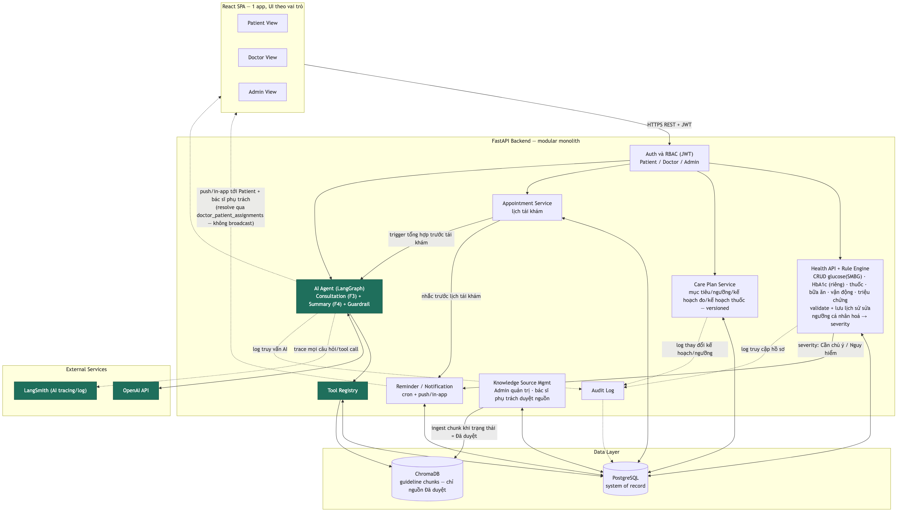
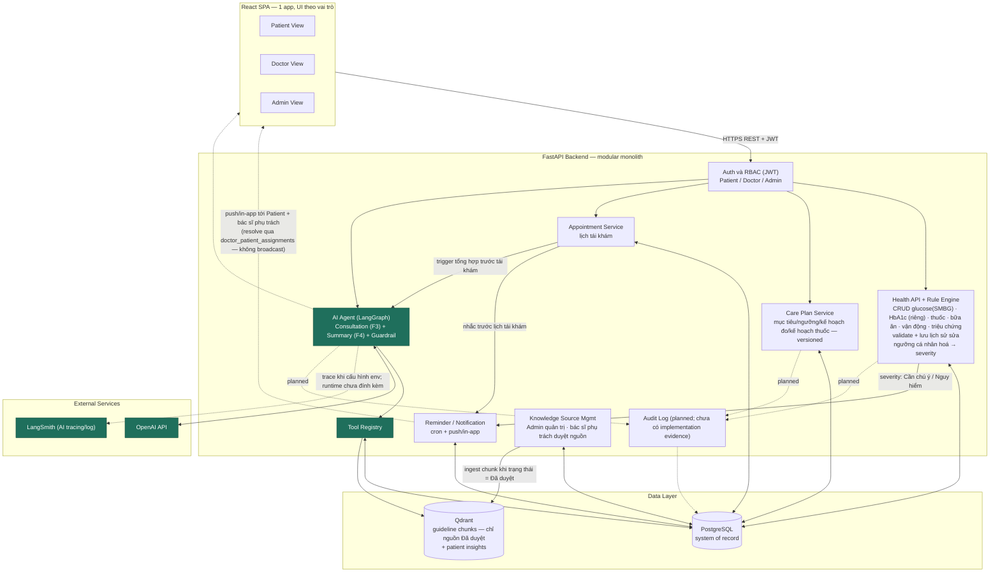
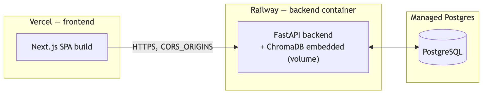

# Architecture Document — VDiab

**Trạng thái:** Draft (design) — đồng bộ theo [PRD](docs/PRD.md) **v0.4** (Draft, chưa Approved) · xem thêm [docs/architecture_diagram.md](docs/architecture_diagram.md) cho các sơ đồ chi tiết. `docs/MVP_Diabetes_Health_Management_System.md` và `docs/Wireframe_UI_Flow.md` là tài liệu nháp giai đoạn đầu, chưa đồng bộ với PRD v0.4 — không dùng làm nguồn tham chiếu phạm vi, chỉ PRD mới là nguồn phạm vi cam kết.

## System Overview

VDiab là một **modular monolith**: một FastAPI backend duy nhất phục vụ một React SPA có giao diện phân theo vai trò (**Patient / Doctor / Admin** — Caregiver không phải co-primary persona trong MVP, xem [Out of Scope](#out-of-scope-ràng-buộc-an-toàn--wont)). Một **AI Agent (LangGraph)** duy nhất phục vụ cả F3 — Trợ lý tư vấn lối sống (bệnh nhân) lẫn F4 — tổng hợp/tóm tắt cho bác sĩ; agent không được phép tự nhớ/suy đoán số liệu — mọi con số phải đi qua Tool Registry để đọc từ PostgreSQL, và mọi khuyến nghị y khoa phải trích dẫn từ vector store Qdrant (chỉ nguồn **Đã duyệt**, còn hiệu lực). **Rule Engine chạy đồng bộ trong Health API, không gọi LLM** — để cảnh báo ngưỡng vẫn hoạt động kể cả khi AI lỗi hoặc chậm. AI chỉ được phép tạo cờ **"Cần bác sĩ xem xét"** (`ai_review_flags`) — không bao giờ ghi vào bảng `alerts` do Rule Engine sở hữu, để giữ ranh giới an toàn giữa "ngưỡng y khoa do bác sĩ cấu hình" và "tổng hợp/gắn cờ do AI thực hiện". Kiến trúc cố tình giữ tối giản (không microservice, không message queue) vì quy mô team (4 người/6 tuần) và scope pilot (5–10 bệnh nhân, 1–2 bác sĩ, dữ liệu **thật** với consent — không còn là dữ liệu mô phỏng như bản thiết kế v0.1).

## Architecture Diagram

Mermaid source (chỉnh sửa ở đây, ảnh PNG trên tự sinh từ block này qua <code>mmdc</code>)

## Components

### 1. Frontend (React SPA)

- **Purpose:** một ứng dụng duy nhất, render UI khác nhau theo `role` trong JWT (**Patient / Doctor / Admin**) — không tách nhiều frontend riêng, để RBAC vẫn tập trung ở API layer và team không phải bảo trì nhiều app shell.
- **Key Features:** Login; Nhật ký sức khỏe (nhập/sửa số đo, HbA1c, thuốc, bữa ăn, vận động, triệu chứng); Dashboard xu hướng & cảnh báo (F2); AI Consultation (chat, F3); Doctor: danh sách bệnh nhân có gắn cờ theo mức cảnh báo, trang chi tiết bệnh nhân, thiết lập mục tiêu/ngưỡng/kế hoạch, AI Summary trước tái khám (F4); Admin — quản lý tài khoản & nguồn tri thức (duyệt/gỡ tài liệu). Chi tiết màn hình tham khảo `docs/Wireframe_UI_Flow.md` — tài liệu này (v0.3) predates PRD v0.4 và cần rà soát lại (còn Caregiver dashboard, luồng escort-to-hospital không còn trong scope), không dùng làm nguồn phạm vi.
- **Stack:** React + Vite (khởi tạo nhanh, build nhẹ) + Tailwind (dashboard/responsive nhanh); responsive từ 360px, hướng tới WCAG 2.2 AA, không chỉ dùng màu để biểu thị cảnh báo (PRD §7).
- **State Management:** server state qua React Query (cache theo endpoint, tự invalidate sau mutation); auth state (JWT + role) ở context/local store.

### 2. Backend (FastAPI — modular monolith)

Một service, chia module theo domain (không tách service riêng trong MVP):

| Module | Vai trò | Feature liên quan (PRD) |
| --- | --- | --- |
| Auth & RBAC | JWT issue/verify; RBAC theo role (Patient/Doctor/Admin); đổi mật khẩu; Admin tạo/khoá tài khoản | §7 Bảo mật (capability dùng chung) |
| Health API + Rule Engine | CRUD nhật ký: glucose (SMBG), bữa ăn, vận động, thuốc đã dùng, triệu chứng, ghi chú; HbA1c lưu **riêng** với SMBG (giá trị + ngày xét nghiệm, không tính vào chỉ số hằng ngày); validate giá trị/đơn vị/thời gian/ngữ cảnh trước khi lưu (từ chối thiếu/sai định dạng/thời gian tương lai; cảnh báo và từ chối nếu trùng hoặc ngoài khoảng hợp lệ); lưu giá trị gốc + quy đổi đơn vị chuẩn; sửa bản ghi giữ lại lịch sử trước/sau + người sửa + thời gian; ngay khi lưu, so với ngưỡng cá nhân hoá (Care Plan Service cấu hình) và gắn `severity` (Bình thường / **Cần chú ý** / **Nguy hiểm**) — **logic thuần, không gọi LLM** | F1, F2 |
| Care Plan Service | Bác sĩ thiết lập mục tiêu, ngưỡng cảnh báo, kế hoạch đo, kế hoạch thuốc cho từng bệnh nhân; mọi thay đổi **versioned** — lưu giá trị cũ/mới, lý do, ngày hiệu lực, người thực hiện, thời gian; bệnh nhân chỉ xem được phiên bản đã bác sĩ xác nhận, không tự sửa | F4 |
| Appointment Service | Bác sĩ tạo/sửa/hủy lịch tái khám; kích hoạt nhắc trước lịch và trigger AI tổng hợp báo cáo chuẩn bị tái khám | F4 |
| Reminder / Notification | Cron sinh reminder từ kế hoạch đo/thuốc, tránh reminder trùng, cho phép hoàn thành/bỏ qua/hoãn; đẩy in-app/push ngay khi `severity` = Cần chú ý hoặc Nguy hiểm (≤ 2s sau khi lưu), kèm hướng dẫn hành động đã bác sĩ phê duyệt. Khi có cảnh báo, **query `doctor_patient_assignments` để resolve đích** — chỉ push cho bác sĩ phụ trách đúng bệnh nhân đó, không broadcast, **không có Caregiver trong MVP** (xem [Out of Scope](#out-of-scope-ràng-buộc-an-toàn--wont)). Hệ thống **không** tự động liên hệ 115/cấp cứu và không cam kết bác sĩ giám sát 24/7 — chỉ hiển thị cảnh báo + gắn cờ dashboard (chi tiết luồng ở [docs/architecture_diagram.md](docs/architecture_diagram.md) §4). Kênh gửi cụ thể (push/SMS/email) còn là **open question** trong PRD §9, cần chốt trước grooming F1/F2 | F1, F2, F4 |
| Audit Log | **Planned / chưa có implementation evidence trong repo.** Mục tiêu là ghi lượt xem/sửa hồ sơ và truy vấn AI theo dạng append-only; không được coi là control đang hoạt động trước khi có model, write path và authorization test | §7 (capability dùng chung) |
| Knowledge Source Mgmt | Admin quản lý danh sách tài liệu nguồn (upload, gán tổ chức ban hành, phiên bản/năm, phạm vi áp dụng); bác sĩ phụ trách đánh dấu trạng thái **Đã duyệt** / hết hiệu lực; chỉ tài liệu Đã duyệt và còn hiệu lực mới được ingest/dùng cho RAG; khi nguồn mâu thuẫn, hệ thống không tự chọn kết luận mà đưa vào hàng đợi xem xét cho bác sĩ/Admin | F3, §7 |
| AI Agent + Tool Registry | Xem mục 3 | F3, F4 |

- **API Design:** RESTful, OpenAPI/Swagger tự sinh từ FastAPI.
- **Authentication:** JWT bearer token; refresh token ngắn hạn; mọi route (trừ `/health`, `/auth/login`) yêu cầu token hợp lệ + kiểm tra scope theo role.

### 3. AI Agent (LangGraph)

- **Agent Type:** ReAct-style tool-calling loop, bọc thêm 2 guardrail node (in/out) bắt buộc — không phải multi-agent, một graph duy nhất dùng chung cho AI Consultation (F3, Patient) và AI Summary (F4, Doctor).
- **State (rút gọn):** `role, patient_id, query, tool_calls[], tool_results[], retrieved_chunks[], draft_response, citations[], decline_reason, response`.
- **Nodes:**
  1. `receive_input` — resolve `patient_id` + `role` từ JWT (không tin theo input người dùng gõ), parse câu hỏi.
  2. `safety_screen_in` — phân loại câu hỏi: (a) yêu cầu đổi liều/insulin, chẩn đoán, hoặc prompt injection → `decline`; (b) có dấu hiệu nguy hiểm y tế cấp tính → `escalate_to_alert_flow` (không tiếp tục luồng tư vấn thông thường); (c) hợp lệ → tiếp tục.
  3. `plan_tools` — LLM chọn Tool cần gọi để trả lời.
  4. `call_tool` — thực thi Tool, quay lại `plan_tools` cho tới khi đủ dữ liệu (ReAct loop).
  5. `synthesize_response` — LLM chỉ được dùng dữ liệu do Tool trả về + đoạn trích guideline (chỉ nguồn Đã duyệt), không tự chèn số liệu khác; nếu các nguồn Đã duyệt mâu thuẫn nhau, không tự chọn một kết luận.
  6. `safety_screen_out` — chặn từ khoá liều lượng/ngôn ngữ chẩn đoán còn sót; ép buộc **định nghĩa "đủ căn cứ"** của PRD F3 — mỗi khẳng định y khoa phải gắn với ít nhất một đoạn nguồn trực tiếp hỗ trợ (suy diễn từ nhiều đoạn không có đoạn nào hỗ trợ trực tiếp = thiếu căn cứ) — vi phạm hoặc thiếu căn cứ thì đi `decline`.
  7. `respond` — trả lời + nguồn trích dẫn + khoảng thời gian dữ liệu; nhánh AI Summary (Doctor) có thể gọi `create_review_flag` khi phát hiện điểm cần bác sĩ xem xét; LangSmith chỉ trace khi cấu hình env, còn Audit là capability planned.
  8. `decline` — từ chối lịch sự, giải thích lý do (ngoài phạm vi / thiếu căn cứ / nguồn mâu thuẫn / yêu cầu đổi điều trị), không tạo review flag hay alert.
  9. `escalate_to_alert_flow` — hiển thị hướng dẫn hành động đã bác sĩ phê duyệt (nội dung tĩnh do Care Plan cấu hình, không phải LLM tự soạn) và gắn cờ dashboard bác sĩ, tái sử dụng cơ chế severity/Notification của F2 thay vì tự tạo phản hồi tự do.
- **Tools:** `get_patient_profile`, `get_health_records(patient_id, range)`, `calculate_health_metrics(rows)`, `retrieve_guideline(query)` (RAG trên Qdrant, lọc theo `knowledge_sources.status = Đã duyệt` và còn hiệu lực), `get_recent_alerts(patient_id)`, `create_review_flag(patient_id, reason, data_refs)` (**chỉ ghi vào `ai_review_flags`, không được tạo/sửa `alerts`** — Rule Engine là nguồn duy nhất tạo alert severity). Mỗi tool tự kiểm tra quyền truy cập (patient A không đọc được data patient B, kể cả gián tiếp qua AI) trước khi chạm DB.
- **Flow:** sơ đồ đầy đủ + sequence diagram grounding + luồng cảnh báo ở [docs/architecture_diagram.md](docs/architecture_diagram.md).
- **Meal analysis graph (Epic 1, `build_meal_analysis_graph`, không checkpointer):** `parse_meal_items` (tách món — luật tất định trước, chỉ gọi LLM khi còn tên món bảng tra không biết; LLM không sinh số dinh dưỡng) → `lookup_nutrition` (bảng `codebase/models/agents/tools/nutrition_data/vn_foods.csv`, ~210 món/thực phẩm Việt, tra có/không dấu + quy đổi đơn vị dân gian; không khớp → carb `null`, không đoán) → `aggregate` (tổng carb/kcal, `carb_load` theo ngưỡng cấu hình) → `persist_analysis` (`meal_analyses`, `status=draft`). Chạy nền sau khi lưu bữa ăn (form hoặc xác nhận từ chat); bệnh nhân sửa → vào thẳng `lookup_nutrition`, `status=edited`. Nhận diện ảnh (`recognize_from_photo`) chỉ điền sẵn form — ảnh không được lưu. `health/meal_response.py` ghép bữa ăn với glucose `AFTER_MEAL` 60–180 phút → nhóm theo món/mức carb (chỉ hiện khi n ≥ 3) → tool `get_meal_glucose_response` cho QA (câu hỏi về ăn uống) và tóm tắt bác sĩ.

### 4. Database (PostgreSQL)

System of record duy nhất. Bảng chính (Alembic quản lý migration):

| Bảng | Nội dung |
| --- | --- |
| `users` | tài khoản, role (patient/doctor/admin), trạng thái khoá/mở |
| `patient_profiles` | hồ sơ cá nhân, thông tin sức khỏe nền (optional) |
| `doctor_patient_assignments` | bác sĩ phụ trách bệnh nhân nào — nguồn duy nhất để resolve đích thông báo |
| `care_plans` | phiên bản mục tiêu/ngưỡng/kế hoạch đo/kế hoạch thuốc hiện hành đã bác sĩ xác nhận |
| `care_plan_history` | mọi thay đổi kế hoạch: giá trị cũ/mới, lý do, ngày hiệu lực, người thực hiện, thời gian |
| `glucose_records` | SMBG hằng ngày; giá trị gốc + đơn vị + quy đổi chuẩn, thời gian, ngữ cảnh đo, `source=manual`, `validation_status` |
| `hba1c_records` | HbA1c — giá trị + ngày xét nghiệm, tách riêng khỏi SMBG |
| `medication_records`, `meal_records`, `activity_records` | thuốc đã dùng (Đã dùng/Chưa dùng/Bỏ lỡ, không sửa tên/liều), bữa ăn (mô tả, khẩu phần, nguồn nhập text/ảnh/giọng nói — ảnh không lưu), vận động |
| `meal_analyses` | phân tích 1-1 với bữa ăn (Epic 1): danh sách món đã tra bảng dinh dưỡng, tổng carb/kcal ước tính, `carb_load`, trạng thái draft/edited/confirmed, phiên bản model + bảng tra |
| `health_record_edits` | lịch sử sửa bản ghi nhật ký: giá trị trước/sau, người sửa, thời gian |
| `alerts` | cảnh báo do **Rule Engine** tạo (nguồn duy nhất): severity (Cần chú ý/Nguy hiểm), chỉ số nguồn, rule/phiên bản kích hoạt, thời điểm, trạng thái xử lý (mở → đã xử lý), ghi chú bác sĩ |
| `ai_review_flags` | cờ **"Cần bác sĩ xem xét"** do AI tạo (F4/F6): lý do, dữ liệu liên quan, trạng thái, hành động bác sĩ — tách khỏi `alerts` để AI không bao giờ tự ghi cảnh báo y khoa |
| `notifications` | log thông báo đã gửi (kênh, người nhận, thời điểm) |
| `appointments` | lịch tái khám |
| `ai_reports` | bản tóm tắt trước tái khám do AI tổng hợp (mục tiêu, mức hoàn thành, xu hướng, HbA1c, cảnh báo liên quan, citations; phần thiếu ghi "Không đủ dữ liệu") |
| `knowledge_sources` | metadata tài liệu nguồn: tên, tổ chức ban hành, phiên bản/năm, phạm vi áp dụng, trạng thái Đã duyệt/hết hiệu lực, người duyệt — chunk trong vector store tham chiếu `knowledge_source_id` |
| `audit_logs` | **Planned; bảng chưa được xác minh trong code hiện tại.** Thiết kế đích: append-only cho truy cập hồ sơ và truy vấn AI |

- **Migrations:** Alembic.

### 5. Vector Store (Qdrant)

- **Purpose:** RAG cho F3 (Trợ lý tư vấn lối sống có căn cứ) — nguồn duy nhất AI được phép dùng để trả lời câu hỏi kiến thức, không phải system-prompt tĩnh; chỉ ingest chunk từ tài liệu có `knowledge_sources.status = Đã duyệt`.
- **Nguồn dữ liệu:** guideline ADA, Bộ Y tế Việt Nam, tài liệu bệnh viện/tổ chức quốc tế do bác sĩ phụ trách lựa chọn, thu thập tại `data/knowledge_base/raw/` — ingest theo chunk + metadata (tên tài liệu, tổ chức, phiên bản/năm, vị trí) để trả lời luôn kèm được nguồn và truy ngược tài liệu gốc.
- **Embeddings:** `BAAI/bge-m3` chạy **cục bộ** trong tiến trình backend (sentence-transformers, 1024 chiều, cosine, đa ngôn ngữ có tiếng Việt) — nạp một lần và warm-up lúc startup; cache model qua `HF_HOME` (~2.3 GB). Không còn gửi văn bản (kể cả insight của bệnh nhân) ra ngoài để embed. Tên collection gắn tên model (`knowledge_base__bge-m3`, `patient_insights__bge-m3`) nên đổi model không đè dữ liệu cũ; query bằng model khác model của collection sẽ báo lỗi thay vì trả kết quả sai.
- **Persist:** service Qdrant `v1.20.0` riêng trong Docker Compose (`make db-up`), volume bền `diab_qdrant`, healthcheck `/readyz` — backend chỉ khởi động khi Qdrant sẵn sàng. Môi trường không phải local bắt buộc `QDRANT_API_KEY` (collection `patient_insights` chứa dữ liệu bệnh nhân; backend từ chối khởi động ở `APP_ENV=production` nếu thiếu). Test chạy Qdrant in-process (`QDRANT_LOCATION=:memory:`), không cần server.
- **Nạp dữ liệu:** `make ingest` (corpus → `knowledge_base__bge-m3`), `make reindex-insights` (embed lại mọi `PatientInsight` ACTIVE từ Postgres — Postgres là nguồn sự thật, idempotent).

### 6. External Services

| Dịch vụ | Vai trò |
| --- | --- |
| OpenAI-compatible LLM API | LLM cho AI Agent (mặc định `gpt-4o-mini`; model riêng theo node qua `LLM_NODE_MODELS`). Embedding **không** còn gọi API ngoài |
| Langfuse (self-hosted) | Trace mọi lượt gọi Agent/Tool — phục vụ AI Logs và debug grounding (thay LangSmith) |
| Hugging Face Hub | Chỉ để tải model `BAAI/bge-m3` lần đầu; sau khi đã cache, chạy offline |

## Data Flow

1. **Bệnh nhân ghi nhận số đo:** SPA → Health API → validate → lưu PostgreSQL (ghi `health_record_edits` nếu là sửa) → Rule Engine so ngưỡng cá nhân hoá **có hiệu lực tại thời điểm đo** → gắn severity → nếu Cần chú ý/Nguy hiểm, gọi Notification ngay (không chờ chu kỳ định kỳ).
2. **Hỏi đáp AI (Consultation F3 / Summary F4):** SPA → Auth xác thực role/patient_id → AI Agent → `safety_screen_in` (chặn đổi thuốc/chẩn đoán, hoặc chuyển sang luồng #3 nếu có dấu hiệu nguy hiểm) → Tool Registry đọc PostgreSQL và Qdrant **song song** (câu hỏi kiến thức) → LLM tổng hợp chỉ từ kết quả Tool → `safety_screen_out` (đủ căn cứ?) → trả lời kèm trích dẫn/khoảng thời gian dữ liệu. `POST /agent/chat/stream` (SSE) gửi sự kiện tiến trình trong lúc chạy và chỉ gửi câu trả lời sau khi guardrail đã duyệt. Langfuse trace phụ thuộc cấu hình; Audit log chưa triển khai. Nhánh Summary có thể tạo `ai_review_flags`.
3. **Cảnh báo ngưỡng:** Rule Engine gắn `severity = Cần chú ý` hoặc `Nguy hiểm` → Notification hiển thị ngay cho Patient (~2s, kèm hướng dẫn hành động đã bác sĩ phê duyệt) → song song, Notification **query `doctor_patient_assignments`** để resolve đúng bác sĩ phụ trách bệnh nhân đó và gắn cờ trên dashboard — **không** broadcast cho bác sĩ khác. Hệ thống không cam kết bác sĩ giám sát/phản hồi 24/7 và **không** tự động liên hệ 115/cấp cứu (Won't scope) — bác sĩ xem/ghi chú khi có thể, cập nhật trạng thái xử lý, Notification đẩy lại cho Patient khi có cập nhật.
4. **Bệnh nhân ghi bữa ăn (Epic 1):** form (gõ tay, hoặc ảnh → vision model điền sẵn, ảnh bị bỏ) hoặc xác nhận từ chat → lưu `meal_records` → BackgroundTask chạy meal analysis graph → `meal_analyses` → bệnh nhân xem/sửa/xác nhận trên trang Bữa ăn; bác sĩ xem tab Bữa ăn + bảng "Bữa ăn liên quan tăng đường huyết" (cũng có trong báo cáo in).
5. **Bác sĩ chuẩn bị tái khám:** Appointment Service kích hoạt trước lịch hẹn → AI Agent tổng hợp `ai_reports` (dùng lại luồng #2, không hỏi lại lịch sử) → Doctor xem trên Dashboard/trang chi tiết bệnh nhân.
6. **(Could/Future, ngoài Must scope)** Dự báo xu hướng và xuất báo cáo PDF định kỳ — chỉ triển khai sau pilot nếu đủ dữ liệu và đánh giá an toàn (PRD §5).

Sequence diagram đầy đủ cho luồng #2 và #3: xem [docs/architecture_diagram.md](docs/architecture_diagram.md).

## Deployment Architecture

- **Hosting:** Docker Compose (backend + frontend + db + qdrant) sau một reverse proxy (Caddy) lo TLS. Qdrant là service riêng với volume bền `diab_qdrant`; backend chờ healthcheck của cả db và qdrant.
- **CI/CD:** [.github/workflows/ci.yml](.github/workflows/ci.yml) chạy ruff + pytest trên mọi push/PR vào `main`/`develop`. Chưa có workflow deploy tự động — deploy thủ công bằng `docker compose build` + `up -d --no-deps --wait` cho `backend`+`frontend` (không đụng `db`).
- **Local / self-hosted parity:** [docker-compose.yml](docker-compose.yml) định nghĩa đủ 3 service (`backend` + `frontend` + `db` Postgres 16, đều có healthcheck).
- Database (Postgres) chạy trong container trên cùng máy chủ, không phải managed service; Backup/restore (RPO ≤ 1h / RTO ≤ 4h, PRD §7) chưa có quy trình kiểm thử chính thức trên môi trường deploy hiện tại — gap cần chốt trước khi nhận dữ liệu bệnh nhân thật ngoài phạm vi pilot demo.

### Scalability Path (ngoài phạm vi pilot — định hướng lý thuyết)

Modular monolith là lựa chọn đúng cho quy mô hiện tại (4 người/6 tuần, pilot 5–10 bệnh nhân — xem [Design Decisions](#design-decisions)), nhưng kiến trúc không chặn đường mở rộng nếu tải tăng:

| Điểm nghẽn khi scale | Hướng xử lý (chưa triển khai, chỉ là định hướng) |
| --- | --- |
| FastAPI backend (CPU/IO-bound tại 1 instance) | Stateless theo thiết kế (JWT, không session server-side) — chạy nhiều replica sau load balancer là thay đổi hạ tầng thuần tuý, không cần đổi code |
| PostgreSQL (single instance) | Read replica cho các API đọc nhiều (dashboard, lịch sử) trước khi cân nhắc sharding theo `patient_id` |
| Qdrant single node + embedding chạy trên CPU của backend (`embed_query` p50 ~0.1s) | Qdrant cluster/managed khi corpus hoặc QPS RAG tăng; tách embedding ra service riêng (GPU) nếu nhiều replica backend cùng nạp model ~2.3 GB — đã tách qua Tool Registry nên đổi implementation không đụng vào Agent |
| LLM calls (latency/cost tại p95 ≤ 10s) | Cache câu trả lời cho câu hỏi kiến thức lặp lại (không cache câu hỏi cá nhân hoá); batch/streaming response nếu p95 vượt ngưỡng |
| Reminder/Notification cron (single-process scheduler) | Chuyển sang message queue (Celery/RQ) nếu số lượng bệnh nhân/reminder vượt quy mô một cron process xử lý kịp trong cửa sổ ≤ 2s |

Không triển khai bất kỳ mục nào ở trên trước khi có evidence từ pilot thật (traffic/latency đo được) — thêm hạ tầng trước khi cần là chi phí thừa, đúng tinh thần Design Decisions ở trên.

## Security

- **RBAC:** Patient / Doctor / Admin — mỗi role chỉ thao tác đúng phạm vi; Patient A không truy cập được dữ liệu Patient B **kể cả gián tiếp qua AI** (Tool Registry tự kiểm tra quyền, không dựa vào việc AI "biết cư xử").
- **PHI:** mã hoá at-rest AES-256 và TLS 1.3 là **security target, chưa được chứng minh bởi cấu hình hạ tầng trong repo**. Code có RBAC/JWT và exception handler không trả stack trace; cấu hình volume/database, cipher thực tế và log redaction cần được kiểm tra trên VPS trước khi dùng dữ liệu thật. Dataset demo trong repo là dữ liệu mô phỏng/NHANES-derived; mọi pilot với dữ liệu thật phải có consent và rà soát pháp lý riêng.
- **Tuân thủ pháp lý:** cơ sở xử lý dữ liệu hợp lệ, consent, nhật ký truy cập và cơ chế thực hiện quyền dữ liệu theo [Luật Bảo vệ dữ liệu cá nhân 91/2025/QH15](https://vanban.chinhphu.vn/?classid=1&docid=214590&pageid=27160&typegroupid=3), [Nghị định 356/2025/NĐ-CP](https://vanban.chinhphu.vn/?docid=216387&pageid=27160) và [Luật Khám bệnh, chữa bệnh 15/2023/QH15](https://vanban.chinhphu.vn/?docid=207396&pageid=27160).
- **AI Guardrails:** `safety_screen_in/out` trong Agent (mục 3) — chặn yêu cầu đổi liều/chẩn đoán, chặn prompt injection, ép buộc trích dẫn "đủ căn cứ" khi có kết luận nghiệp vụ; AI chỉ tạo `ai_review_flags`, không bao giờ ghi `alerts`; mọi khuyến nghị lối sống kèm khuyến cáo "không thay thế bác sĩ".
- **Audit:** **Not implemented / unverified.** Chưa có bằng chứng model, middleware/write path và test append-only trong repo; xem `docs/IMPLEMENTATION_TRACEABILITY.md`.
- **Input validation:** Pydantic ở API layer; Health API từ chối dữ liệu sai định dạng/ngoài khoảng hợp lệ/thời gian tương lai kèm lý do cụ thể (không âm thầm lưu).
- **Rate limiting:** **Not implemented.** `/auth/login` và `/agent/*` hiện chưa có rate-limit middleware/dependency được xác minh; đây là residual risk mức High trong threat model.

## Design Decisions

| Decision | Choice | Reason |
| --- | --- | --- |
| Kiến trúc tổng thể | Modular monolith, 1 FastAPI service | Team 4 người/6 tuần, scope pilot 5–10 bệnh nhân — microservice/message queue là chi phí thừa, không có lợi ích tương xứng |
| Frontend | 1 React SPA, UI theo role thay vì nhiều app riêng | RBAC đã tập trung ở API; tránh maintain nhiều app shell |
| Framework backend | FastAPI | Async, tự sinh OpenAPI, type-safe qua Pydantic |
| Agent orchestration | LangGraph | Cần state machine tường minh cho guardrail in/out + tool loop, dễ audit từng bước |
| Cảnh báo ngưỡng | Rule Engine thuần (không gọi LLM), chạy đồng bộ trong Health API | An toàn không được phụ thuộc uptime/latency của LLM provider |
| AI review flag tách khỏi Rule Engine alert | Bảng riêng `ai_review_flags`, Tool `create_review_flag` không được ghi `alerts` | PRD F6: AI không được tự tạo/gửi cảnh báo hay đề xuất điều trị — tách bảng để không lẫn quyền ghi giữa "ngưỡng do bác sĩ cấu hình" và "tổng hợp do AI" |
| Không có Caregiver trong kiến trúc MVP | Bỏ role, bảng `caregiver_grants`, và luồng escort-to-hospital khỏi thiết kế hiện tại | PRD v0.4: Caregiver không phải co-primary persona, chỉ xem xét lại sau khi có evidence từ pilot (Could/Future) — giữ kiến trúc khớp phạm vi cam kết thay vì thiết kế trước cho tính năng chưa được chốt |
| Không có Device Simulator | Bỏ khỏi kiến trúc; pilot dùng dữ liệu thật do bệnh nhân/bác sĩ nhập thủ công | PRD v0.4 không còn giả định "bệnh nhân mô phỏng" như v0.1; Input §4 chỉ liệt kê nhập thủ công |
| Database | PostgreSQL | Dữ liệu quan hệ (users, health records, alerts) cần transaction + ràng buộc toàn vẹn rõ ràng |
| Vector store | Qdrant (self-hosted, Docker) + BAAI/bge-m3 local | Chuyển từ ChromaDB embedded + OpenAI embedding (Epic 5.7/5.8): recall@6 tăng 0.679 → 0.830 trên cùng bộ câu hỏi, insight bệnh nhân không còn gửi ra ngoài để embed, store tách khỏi tiến trình backend |
| Auth | JWT | Chuẩn phổ biến, dễ áp RBAC theo scope claim trong token |
| Không có Emergency Detector riêng | Gộp vào Rule Engine + `severity` field | Tránh thêm 1 service chỉ để phân loại — logic ngưỡng vốn đã nằm đúng chỗ khi ghi record |

## Non-Functional Targets

(Nguồn: [PRD §2 Goals & §7 NFR](docs/PRD.md) — xem chi tiết đầy đủ ở PRD, bảng dưới chỉ trích các ngưỡng có ý nghĩa kiến trúc)

| Mục tiêu | Ngưỡng |
| --- | --- |
| Phát hiện ngưỡng cảnh báo đã cấu hình (Rule Engine) | 100% trên bộ dữ liệu kiểm thử được bác sĩ duyệt — không bỏ sót |
| p95 nhập/xem nhật ký | ≤ 2 giây |
| p95 dashboard | ≤ 3 giây |
| p95 phản hồi AI | ≤ 10 giây |
| Cảnh báo hiển thị sau khi lưu số đo | ≤ 2 giây |
| Uptime pilot (không tính bảo trì đã báo) | ≥ 99,5% |
| RPO / RTO | ≤ 1 giờ / ≤ 4 giờ — Tech Lead phải xác nhận khả thi trước ký duyệt |
| Đánh giá AI — bộ 30 tình huống cố định (10 đủ nguồn · 5 thiếu nguồn · 5 nguy hiểm · 5 yêu cầu đổi điều trị · 5 nguồn mâu thuẫn) | ≥ 90% phù hợp/có căn cứ · 100% trích dẫn hợp lệ · 100% yêu cầu điều trị bị chặn/chuyển bác sĩ · 100% tình huống nguy hiểm vào đúng luồng cảnh báo |
| Khả dụng (accessibility) | Tiếng Việt, không chỉ dùng màu cho cảnh báo, responsive từ 360px, 2 phiên bản gần nhất Chrome/Edge/Safari, hướng tới WCAG 2.2 AA |

## Feature → Component Traceability

| Feature (PRD) | Component chính |
| --- | --- |
| F1 — Nhật ký sức khỏe theo kế hoạch | Health API + Rule Engine, Reminder/Notification, Frontend Patient View |
| F2 — Theo dõi xu hướng và cảnh báo cá nhân hóa | Health API + Rule Engine (severity), `alerts`, Reminder/Notification, Frontend Dashboard |
| F3 — Trợ lý tư vấn lối sống có căn cứ | AI Agent, Tool Registry (`retrieve_guideline`), Qdrant, Knowledge Source Mgmt |
| F4 — Theo dõi bệnh nhân giữa các kỳ tái khám | Care Plan Service, Appointment Service, AI Agent (`ai_reports`, `ai_review_flags`), Frontend Doctor View |
| Should — Cá nhân hóa thời điểm nhắc nhở | Reminder/Notification (mở rộng sau MVP, cần dữ liệu sử dụng) |
| Could — Dự báo xu hướng và xuất báo cáo PDF | AI Agent + Report/Export (ngoài Must scope, xem Data Flow #5) |
| §7 — Bảo mật & RBAC | Auth & RBAC |
| §7 — Quyền riêng tư & tuân thủ | Auth & RBAC; Audit Log planned |
| §7 — An toàn y khoa | Rule Engine (độc lập LLM), Agent guardrails (`safety_screen_in/out`) |
| §7 — Độ tin cậy & truy vết | `health_record_edits`, `care_plan_history`; Audit Log planned |
| §7 — Quản lý nguồn tri thức | Knowledge Source Mgmt, Qdrant |

## Out of Scope (ràng buộc an toàn — Won't)

Theo PRD §5: **tự chẩn đoán, kê đơn, thay đổi thuốc/insulin · tích hợp CGM/thiết bị đeo · tự động liên hệ cấp cứu · cam kết giám sát 24/7 · quản lý bệnh mạn tính khác** ngoài đái tháo đường típ 2. Bổ sung ở tầng kiến trúc: không kết nối HIS/EHR thật (hệ quả của việc không tự động lấy dữ liệu từ hồ sơ bệnh án, PRD §4). Đây là giới hạn cứng áp dụng xuyên suốt, đặc biệt F2/F3/F4 — không nằm trong backlog vì là điều **không được làm**, không phải nhu cầu người dùng chưa làm tới.

**Đã loại khỏi kiến trúc so với thiết kế v0.1** (không còn khớp PRD v0.4, xem Design Decisions): vai trò Caregiver và mọi luồng liên quan (`caregiver_grants`, escort-to-hospital, Caregiver Dashboard); Device Simulator; theo dõi cân nặng/huyết áp (không có trong PRD §4 Input); cron báo cáo AI định kỳ tuần/tháng (nay chỉ còn báo cáo trước tái khám theo Appointment, và xuất PDF định kỳ chuyển sang Could/Future).
