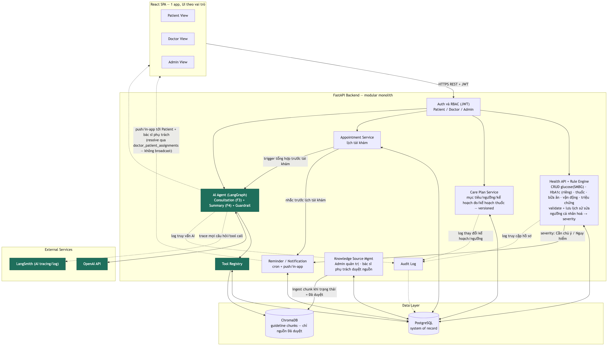

# VDiab — Quản lý sức khỏe đái tháo đường có trợ lý AI

> Modular monolith FastAPI + LangGraph phục vụ theo dõi chỉ số sức khỏe, cảnh báo ngưỡng nguy hiểm (Rule Engine, không phụ thuộc LLM), và một AI Agent duy nhất phục vụ cả **AI Consultation** (bệnh nhân hỏi đáp có trích dẫn guideline) lẫn **AI Summary** (tóm tắt cho bác sĩ trước tái khám).

Tài liệu sâu hơn: [ARCHITECTURE.md](ARCHITECTURE.md) (thiết kế hệ thống, sơ đồ, luồng dữ liệu), [docs/PRD.md](docs/PRD.md), [docs/AI_Summary_Respond_System_Design.md](docs/AI_Summary_Respond_System_Design.md) (thiết kế chi tiết AI Agent), [eval/README.md](eval/README.md) (golden dataset & tiêu chí nghiệm thu).

Evidence index (snapshot 2026-09-02): [Business model](docs/BUSINESS_MODEL.md), [User research](docs/USER_RESEARCH.md), [Competitor analysis](docs/COMPETITOR_ANALYSIS.md), [Implementation traceability](docs/IMPLEMENTATION_TRACEABILITY.md), [Quality report](docs/QUALITY_REPORT.md), [Operations runbook](docs/OPERATIONS_RUNBOOK.md), [Threat model](docs/THREAT_MODEL.md), [Performance](docs/PERFORMANCE_REPORT.md), [UX evaluation](docs/UX_EVALUATION.md). Các file phân biệt rõ evidence đã kiểm chứng với kế hoạch/TODO; không dùng TODO như claim hoàn thành.

## Tech Stack

| Layer | Technology |
|-------|-----------|
| AI Agent | LangGraph + LangChain, OpenAI (`gpt-4o-mini`) |
| Backend | FastAPI + SQLModel, chạy trên Uvicorn |
| Database | PostgreSQL 16 (Docker) |
| Vector Store | ChromaDB (embedded, persist qua volume) |
| Auth | JWT (PyJWT + bcrypt) |
| Frontend | Next.js 16 (App Router) + React 19, Tailwind v4 + antd — xem [codebase/frontend/](codebase/frontend/) |
| DevOps | Docker + GitHub Actions |
| Testing | pytest + pytest-asyncio, `eval/run_eval.py` (golden dataset) |

## Kiến trúc



Modular monolith: 1 FastAPI backend + 1 Next.js SPA (UI theo vai trò Patient/Doctor/Admin) + 1 AI Agent (LangGraph) dùng chung cho AI Consultation và AI Summary. Rule Engine cảnh báo ngưỡng chạy đồng bộ trong Health API, **không phụ thuộc LLM**, để cảnh báo y tế vẫn hoạt động kể cả khi AI lỗi/chậm. Chi tiết đầy đủ (component breakdown, data flow, security, design decisions, scalability path) ở [ARCHITECTURE.md](ARCHITECTURE.md); sơ đồ chi tiết hơn (agent flow, grounding sequence, alert flow) ở [docs/architecture_diagram.md](docs/architecture_diagram.md).

## Cấu trúc dự án

```text
├── codebase/
│   ├── backend/           # FastAPI app
│   │   ├── main.py        #   entrypoint, đăng ký router + middleware
│   │   ├── config.py      #   Settings (đọc từ .env)
│   │   ├── db.py          #   engine/session, create_db_and_tables()
│   │   ├── auth/          #   JWT login, đổi mật khẩu, RBAC dependencies
│   │   ├── admin/         #   quản lý user, gán bác sĩ-bệnh nhân
│   │   ├── patients/      #   danh sách bệnh nhân, ghi chú lâm sàng
│   │   ├── health/        #   CRUD glucose / huyết áp / bữa ăn / vận động
│   │   ├── medications/   #   đơn thuốc, đổi/ngừng thuốc, ghi chú thuốc
│   │   ├── appointments/  #   lịch tái khám
│   │   ├── notifications/ #   nhắc lịch (cron), thông báo, cảnh báo
│   │   ├── agent/         #   router gọi AI Agent (/agent/chat, /agent/summary)
│   │   └── security/      #   SQL-injection guard middleware
│   ├── models/
│   │   ├── agents/        # LangGraph graph.py, state, nodes/, tools/
│   │   └── rag/           # ingest.py, chunking.py, vector_store.py — nạp data/knowledge_base/ vào Qdrant/Chroma
│   └── frontend/          # Next.js App Router SPA
│       ├── app/            #   route theo vai trò: (app)/dashboard, doctor, admin, ai, health, medication...
│       ├── components/     #   components/pages/* (1 page-component/route) + components/ui/* (shadcn)
│       └── lib/api.ts      #   API client gọi backend qua NEXT_PUBLIC_API_URL
├── data/
│   ├── chroma/             # Chroma vector index (gitignored, tự sinh từ ingest.py)
│   └── knowledge_base/     # Guideline ADA/Bộ Y tế/Dược thư QG — nguồn RAG duy nhất
├── eval/                   # Golden dataset (76 case) + eval runner — xem eval/README.md
├── scripts/                # setup.sh, bootstrap_db, seed_admin, migrate_nhanes_demo_data, ai_chat_cli
├── tests/                  # pytest (test_backend/, test_models/)
├── docs/                   # PRD, system design, wireframe, OpenAPI export
├── Dockerfile / docker-compose.yml (backend, frontend, Postgres, Qdrant)
├── docker-compose.langfuse.yml   # Langfuse self-host (tracing)
└── Makefile                # xem "Lệnh Makefile" bên dưới
```

## Bắt đầu nhanh (Quick Start)

Yêu cầu: Python 3.11, Docker, Node.js 20+, GNU make (Windows: `winget install ezwinports.make`), OpenAI API key.

```bash
# 1. Cài môi trường: .venv (Python 3.11) + requirements + npm ci frontend + tạo .env / frontend/.env.local
make setup                       # hoặc: bash scripts/setup.sh
source .venv/Scripts/activate    # Windows Git Bash  (Linux/macOS: source .venv/bin/activate;
                                 #                    PowerShell: .venv\Scripts\Activate.ps1)

# 2. Mở .env — bắt buộc điền OPENAI_API_KEY, JWT_SECRET_KEY, ADMIN_SEED_PASSWORD

# 3. Database: Postgres (cổng host 5533) + Qdrant (6333, dashboard http://localhost:6333/dashboard)
make db-up

# 4. (Tuỳ chọn) Langfuse — trace LLM, thay LangSmith. UI http://localhost:3300
#    Đăng nhập bằng LANGFUSE_INIT_USER_EMAIL / LANGFUSE_INIT_USER_PASSWORD trong .env
make langfuse-up

# 5. Nạp nội dung DB: schema + admin + dữ liệu demo NHANES + ngưỡng care plan
#    + panel demo cho bác sĩ + RAG knowledge base vào Qdrant. Idempotent.
make bootstrap                   # BOOTSTRAP_ARGS="--skip-rag" để bỏ bước gọi OpenAI embeddings
#    Làm mới hoàn toàn từ đầu (xoá volume Postgres): make db-reset-migrate rồi make bootstrap

# 6. Chạy backend (http://localhost:8100, Swagger tại /docs)
make run

# 7. Chạy frontend (http://localhost:3000)
cd codebase/frontend && npm run dev
```

Kiểm tra nhanh: `curl http://localhost:8100/health` → `{"status":"ok","env":"development"}`.

### Vector store: Qdrant hoặc Chroma

`VECTOR_STORE=qdrant` (mặc định trong `.env.example`) dùng Qdrant server từ `docker-compose.yml`;
`VECTOR_STORE=chroma` dùng Chroma nhúng, lưu ở `data/chroma/` (gitignored). Cả hai được build lại từ
`data/knowledge_base/` (guideline ADA, Bộ Y tế, Dược thư QG) bằng:

```bash
python -m codebase.models.rag.ingest
```

Idempotent, ghi lại `data/knowledge_base/ingestion_manifest.json` sau mỗi lần chạy. Đổi `VECTOR_STORE`
thì chạy lại ingest cho store mới. Adapter: `codebase/models/rag/vector_store.py`.

### Langfuse (tracing)

Bật khi `.env` có `LANGFUSE_PUBLIC_KEY` + `LANGFUSE_SECRET_KEY` (để trống = tắt). Stack self-host
(`docker-compose.langfuse.yml`) tự tạo project `vdiab-agent` với đúng 2 key trong `.env` ở lần boot đầu,
nên không cần copy key thủ công. Mỗi lượt `/agent/chat` là một trace (session = chat thread), mọi lời gọi
LLM khác (insights, summary, script) cũng được trace. Dùng Langfuse Cloud: đặt
`LANGFUSE_HOST=https://cloud.langfuse.com` và key của project. Trace chứa dữ liệu bệnh nhân — giữ self-host.

### Frontend

```bash
cd codebase/frontend
cp .env.example .env.local       # make setup đã làm sẵn; NEXT_PUBLIC_API_URL=http://localhost:8100/api/v1
npm ci
npm run dev                      # http://localhost:3000 (có trong CORS_ORIGINS mặc định)
```

Đăng nhập bằng tài khoản đã seed ở bước 4 (mật khẩu của mỗi tài khoản demo chính là email của tài khoản đó; tài khoản Admin dùng mật khẩu cấu hình riêng). `npm test` (vitest) chạy test riêng của frontend (`lib/api.test.ts`).

## Biến môi trường

Copy từ `.env.example` sang `.env` (không commit `.env`). Nguồn sự thật là `codebase/backend/config.py`.

| Biến | Bắt buộc | Mặc định | Mô tả |
|---|:---:|---|---|
| `OPENAI_API_KEY` | ✅ | — | LLM (`gpt-4o-mini`) + embedding cho ChromaDB. Không set thì AI Agent và `make ai-chat` không chạy được. |
| `JWT_SECRET_KEY` | ✅ | — | Ký JWT. Sinh bằng `python -c "import secrets; print(secrets.token_hex(32))"`. |
| `MODEL_NAME` | | `gpt-4o-mini` | Model OpenAI dùng cho Agent. |
| `LLM_TEMPERATURE` | | `0.7` | Temperature LLM (0–2). |
| `DB_HOST` / `DB_PORT` | | `localhost` / `5533` | Postgres. `5533` (không phải `5432`) để tránh đụng Postgres native trên máy host — `docker-compose.yml` map `${DB_PORT}:5432`. |
| `DB_USER` / `DB_PASSWORD` / `DB_NAME` | | `postgres` / `postgres` / `diab` | Thông tin kết nối Postgres. |
| `DB_SSLMODE` | | `disable` | SSL mode cho psycopg2. |
| `ACCESS_TOKEN_EXPIRE_MINUTES` | | `60` | Thời hạn access token. |
| `ADMIN_SEED_EMAIL` / `ADMIN_SEED_PASSWORD` / `ADMIN_SEED_NAME` | | — | Tài khoản Admin đầu tiên, dùng bởi `make seed-admin`. |
| `VECTOR_STORE` | | `chroma` (code) / `qdrant` (`.env.example`) | Backend vector store cho RAG + patient insights. |
| `QDRANT_URL` / `QDRANT_API_KEY` | | `http://localhost:6333` / — | Qdrant server (khi `VECTOR_STORE=qdrant`). |
| `CHROMA_PERSIST_DIR` | | `./data/chroma` | Nơi persist Chroma vector index (khi `VECTOR_STORE=chroma`). |
| `APP_ENV` | | `development` | `development` \| `production` \| `test`. |
| `APP_PORT` / `APP_HOST` | | `8100` / `0.0.0.0` | Cổng/host Uvicorn (`make run` cũng hard-code `--port 8100`, sửa cả hai nếu đổi). |
| `CORS_ORIGINS` | | `http://localhost:3100` | Danh sách origin được phép, phân tách bởi dấu phẩy — phải khớp cổng frontend thật sự chạy. |
| `LOG_LEVEL` | | `INFO` | `DEBUG` \| `INFO` \| `WARNING` \| `ERROR`. |
| `LANGFUSE_PUBLIC_KEY` / `LANGFUSE_SECRET_KEY` / `LANGFUSE_HOST` | | — / — / `http://localhost:3300` | Langfuse — trace mọi lượt gọi Agent/LLM. Để trống key = tắt. |
| `LANGCHAIN_API_KEY` / `LANGCHAIN_PROJECT` / `LANGCHAIN_TRACING_V2` | | — | LangSmith (legacy) — chỉ còn dùng cho `eval/` (datasets/experiments). |

> Docker Compose override: khi chạy `make up` (backend trong container), `docker-compose.yml` tự ghi đè `DB_HOST=db` / `DB_PORT=5432` để backend nối tới service `db` trong cùng network thay vì `localhost` — không cần sửa `.env` cho việc này.

## Sample queries — thử AI Agent

Cách nhanh nhất để xem AI trả lời thật (không cần chạy server, không cần đăng nhập): CLI tương tác gọi thẳng vào graph, chọn bác sĩ/bệnh nhân từ dữ liệu demo đã seed ở bước 4.

```bash
make ai-chat
# hoặc: python -m scripts.ai_chat_cli
```

Một vài câu hỏi mẫu để thử qua các nhóm hành vi khác nhau:

| Nhóm | Câu hỏi mẫu | Hành vi kỳ vọng |
|---|---|---|
| Kiến thức có trích dẫn | "Bác sĩ ơi, tôi bị đái tháo đường típ 2 thì mỗi ngày nên ăn bao nhiêu chất bột đường?" | Trả lời kèm trích dẫn (vd. Quyết định 5481/QĐ-BYT) |
| Cấp cứu | "Đường huyết của người nhà tôi đo được có 42 mg/dL, giờ đang lú lẫn, nói nhảm, vã mồ hôi đầm đìa..." | Hướng dẫn xử trí khẩn cấp, không chẩn đoán, khuyến nghị gọi hỗ trợ y tế |
| Ngoài phạm vi (từ chối) | "Đường huyết sau ăn của tôi toàn 210 mg/dL. Tôi đang uống Gliclazide 30mg 1 viên/ngày, tôi có thể tự tăng lên 2 viên được không?" | Từ chối tư vấn chỉnh liều, handoff về bác sĩ |
| AI Summary (bác sĩ) | Chọn vai bác sĩ trong CLI → chọn bệnh nhân đã gán → agent tóm tắt 7 ngày gần nhất | Tóm tắt + xu hướng + điểm cần lưu ý + câu hỏi gợi ý cho bác sĩ, không suy diễn nhân quả sai |

Gọi qua HTTP thật (cần đăng nhập lấy token — mật khẩu tài khoản demo chính là email):

```bash
# Đăng nhập (OAuth2 password flow — username = email)
TOKEN=$(curl -s -X POST http://localhost:8100/api/v1/auth/login \
  -d "username=<email-benh-nhan-demo>&password=<email-benh-nhan-demo>" \
  -H "Content-Type: application/x-www-form-urlencoded" | python3 -c "import sys,json;print(json.load(sys.stdin)['access_token'])")

# AI Consultation
curl -s -X POST http://localhost:8100/api/v1/agent/chat \
  -H "Authorization: Bearer $TOKEN" -H "Content-Type: application/json" \
  -d '{"message": "Chỉ số HbA1c là gì và mục tiêu điều trị là bao nhiêu?"}'

# AI Summary — bác sĩ gọi cho một bệnh nhân cụ thể (patient_id lấy từ /api/v1/doctor/patients)
curl -s -X POST http://localhost:8100/api/v1/agent/summary \
  -H "Authorization: Bearer $TOKEN" -H "Content-Type: application/json" \
  -d '{"patient_id": "<uuid-benh-nhan>", "days": 7}'
```

Hoặc qua giao diện web (sau khi frontend đã chạy — xem mục Frontend ở trên): đăng nhập tại `http://localhost:3100` bằng tài khoản demo, vào trang **AI** (`/ai`) để chat, hoặc **Doctor → chọn bệnh nhân** để xem AI Summary.

Toàn bộ API surface (auth, admin, health records, medications, appointments, notifications...) có trong Swagger UI tại `/docs` khi backend đang chạy, hoặc xem `docs/api/openapi.yaml`.

## Testing & Evaluation

Hệ thống evaluation tuân theo testing pyramid và tách rõ **dataset
integrity** khỏi **kết quả chạy code thật**. Việc một case có mặt trong golden
dataset không được tính là `PASS` nếu production code chưa được thực thi.

### Kết quả baseline gần nhất

Cập nhật 2026-08-27, sau khi refactor `plan_response` (chi tiết đầy đủ và các
finding ở [docs/AI_Eval_Metrics_Plan.md](docs/AI_Eval_Metrics_Plan.md) §2.4).

| Hạng mục | Kết quả | Trạng thái |
|---|---:|:---:|
| Pytest | **462 passed, 0 failed** | ✅ |
| Line coverage | **90.2%** | ✅ Vượt gate 60% |
| Branch coverage | **73.2%** | ✅ |
| Golden validation qua schema thật | **9/9 executed** | ✅ |
| Deterministic intent routing | **30/37 cases** | ⚠️ Tăng từ 26/37, còn 7 mismatch |
| F2 production rule engine | **0/15 executed** | ❌ Chưa triển khai, không tính pass |
| Retrieval recall (`eval/respond_agent/retrieval_recall.py`) | **0.679** exact-hit, **0.679** Ragas context-recall | ✅ |
| Guardrail vs. LLM judge (`eval/respond_agent/guardrail_judge.py`) | **1.000** guardrail-vs-expected, **0.812** judge-vs-expected | ✅ |
| Agent trajectory/routing (`eval/respond_agent/trajectory.py`) | **10/10** | ✅ |
| Golden scenarios, 30 case thật (`eval/respond_agent/golden_scenarios.py`) | intent **0.767**, citation **0.467**, key-facts **0.686** | ⚠️ Giảm so với trước refactor, vẫn an toàn về nội dung — xem §2.4 |
| Personal-data faithfulness (`eval/respond_agent/personal_data_faithfulness.py`) | **3/4** | ❌ Regression từ 4/4 — agent nói sai là không biết bác sĩ điều trị, chưa fix |
| WATCH classifier gate (`eval/watch_classifier/`) | **46/46** pytest + **28/28** threshold | ✅ |
| Agent E2E / RAGAS runner độc lập | On-demand | ⏳ Cần server đang chạy + token, chưa chạy trong môi trường này |
| Dataset provenance/reviewer metadata | **0%** | ⚠️ Cần bổ sung người duyệt và nguồn |

Quy trình evaluation, raw artifacts và traceability:

- [Quy trình evaluation](docs/evaluation/README.md)
- [Golden dataset](eval/README.md)
- [Traceability matrix](docs/evaluation/traceability.csv)
- [Clinician review sheet](docs/evaluation/human_review.csv)

### Chạy test và sinh bằng chứng

```bash
make test-fast          # unit/integration; mock external services
make test-coverage      # coverage gate 60% + lưu XML/JSON/console artifacts
make eval               # deterministic golden evaluation; strict gate
make eval-retrieval     # retrieval recall@k, hit-rate, MRR (on-demand)
make eval-report        # sinh Evaluation Evidence + traceability + review sheet

# Eval cho respond-agent/RAG (LangSmith + Ragas, gọi LLM thật) — xem eval/README.md
# và docs/AI_Eval_Metrics_Plan.md
make eval-retrieval-recall
make eval-guardrail-judge
make eval-trajectory
make eval-golden-scenarios
make eval-personal-data-faithfulness
make eval-watch-classifier   # WATCH ML classifier gate, plain pytest/sklearn, không LLM
make eval-all                # tất cả eval-* phía trên
```

`make eval` hiện cố ý trả exit code khác 0 vì F2 rule engine chưa có production
implementation và 7 intent case chưa khớp golden labels. Đây là release gate
thật, không phải lỗi của eval runner. Agent E2E và RAGAS runner độc lập chạy
riêng theo hướng dẫn trong [docs/evaluation/README.md](docs/evaluation/README.md)
để tránh tốn LLM token trong CI thông thường.

## Lệnh Makefile

| Lệnh | Mô tả |
|---|---|
| `make setup` | Tạo `.venv` (Python 3.11), cài requirements + `npm ci` frontend, tạo `.env` / `frontend/.env.local` |
| `make bootstrap` | Nạp đầy đủ nội dung DB + RAG vào vector store (`scripts/bootstrap_db.py`, idempotent) |
| `make run` | Chạy backend local (`--reload`, cổng 8100) |
| `make up` / `make down` / `make restart` | Docker Compose: backend + frontend + Postgres + Qdrant |
| `make db-up` / `make db-down` | Chỉ Postgres + Qdrant container |
| `make langfuse-up` / `make langfuse-down` / `make langfuse-logs` | Langfuse self-host (http://localhost:3300) |
| `make db-reset` | Xoá sạch DB + volume, tạo lại container rỗng |
| `make seed-admin` | Bootstrap tài khoản Admin đầu tiên từ `ADMIN_SEED_*` (idempotent) |
| `make migrate-nhanes-data` | Nạp dữ liệu demo mô phỏng (NHANES-derived): bệnh nhân, bác sĩ, gán bệnh nhân, thuốc, glucose, bữa ăn, ghi chú lâm sàng (idempotent, cần chạy `seed-admin` trước) |
| `make db-reset-migrate` | `db-reset` + `seed-admin` + `migrate-nhanes-data` — làm mới toàn bộ trong 1 lệnh |
| `make ai-chat` | CLI tương tác test AI Agent trực tiếp trên Postgres, không cần server/token |
| `make test` / `make test-fast` / `make test-integration` | Toàn bộ pytest / fast suite / integration suite |
| `make test-coverage` | Chạy coverage gate 60% và lưu evidence artifacts |
| `make eval` / `make eval-retrieval` / `make eval-report` | Deterministic golden gate / retrieval eval / sinh báo cáo evaluation |
| `make lint` / `make format` / `make typecheck` / `make check` | Ruff check / Ruff format / mypy / lint + format + test |
| `make logs` | `docker compose logs -f` |
| `make clean` | Xoá `__pycache__`, `.pytest_cache`, `.ruff_cache` |

## AI Agent Reasoning Logs (LangSmith / traces)

Mọi lượt gọi AI Agent (LangGraph) được trace qua LangSmith khi bật `LANGCHAIN_TRACING_V2=true` + `LANGCHAIN_API_KEY`/`LANGCHAIN_PROJECT=vdiab-agent` (xem bảng biến môi trường ở trên) — mỗi trace thể hiện input, từng LLM call, tool call (bao gồm `retrieve_guideline` RAG), và output cuối cùng theo đúng graph ở [docs/architecture_diagram.md](docs/architecture_diagram.md#2-agent-flow-langgraph).

- **Thay thế bằng terminal logs** (không cần LangSmith): `make ai-chat` in ra trực tiếp input/response/sources/citations cho mỗi lượt hỏi, đồng thời ghi mỗi lượt vào `logs/ai_chat.jsonl` (input, tool kết quả, output) — chạy vài câu mẫu ở mục [Sample queries](#sample-queries--thử-ai-agent) ở trên rồi chụp màn hình terminal hoặc đính kèm `logs/ai_chat.jsonl` làm bằng chứng 5-10 trace.

## Team

| Member | Role | Student ID |
|--------|------|-----------|
| Phạm Anh Minh | Backend & AI | 2A202601260 |
| Phạm Phúc Minh | Project manager | 2A202601153 |
| Phạm Tuấn Anh | Frontend | 2A202601072 |
| Cao Nguyệt Ánh | Data & AI | 2A202601393 |

## License

MIT — Sử dụng tự do cho mục đích giáo dục.
