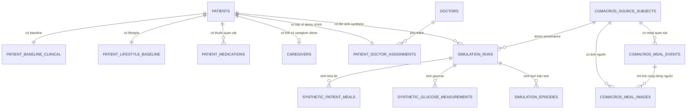

# Thiết kế cơ sở dữ liệu Diabetes

## Phạm vi

Schema PostgreSQL `diabetes` chứa hai miền dữ liệu độc lập:

- NHANES: hồ sơ nền của bệnh nhân dự án, gồm `PREDIABETES` và nhãn thuật toán `TYPE_2`.
- CGMacros: cohort nghiên cứu quan sát dùng để học quy luật glucose, vận động và bữa ăn cho simulator.

`source_subject_id` của CGMacros không phải `patient_id` của NHANES. Không được nối hai nguồn như cùng một người. Khi sinh 60 ngày, hệ thống phải tạo một bảng ánh xạ synthetic riêng và ghi lại phiên bản thuật toán/seed.

## Quan hệ chính

## Ánh xạ CSV

| CSV | Bảng PostgreSQL | Ý nghĩa |
|---|---|---|
| `deployment_dataset/patient_profiles.csv` | `patients` | Hồ sơ nền dự án |
| `deployment_dataset/patient_baseline_clinical.csv` | `patient_baseline_clinical` | Xét nghiệm và chỉ số nền |
| `deployment_dataset/patient_lifestyle_baseline.csv` | `patient_lifestyle_baseline` | Lifestyle nền |
| `deployment_dataset/patient_medications.csv` | `patient_medications` | Thuốc được khai báo, không có lịch/liều |
| `deployment_dataset/caregiver_profiles.csv` | `caregivers` | Caregiver demo |
| `deployment_dataset/doctor_profiles.csv` | `doctors` | Bác sĩ demo |
| `deployment_dataset/patient_doctor_assignments.csv` | `patient_doctor_assignments` | Phân công demo |
| `CGMacros/cgmacros_subject_profiles.csv` | `cgmacros_source_subjects` | Hồ sơ cohort nguồn |
| `CGMacros/meal_events.csv` | `cgmacros_meal_events` | Bữa ăn quan sát đã chuẩn hóa |
| `CGMacros/meal_images.csv` | `cgmacros_meal_images` | Ảnh nguồn và trạng thái liên kết |
| `simulator_60d/simulation_runs.csv` | `simulation_runs` | Seed, nhóm và donor của mỗi bệnh nhân |
| `simulator_60d/synthetic_meal_events.csv` | `synthetic_patient_meals` | Bữa ăn synthetic trong 60 ngày |
| `simulator_60d/synthetic_glucose_measurements.csv` | `synthetic_glucose_measurements` | Các lần đo theo lịch ba nhóm |
| `simulator_60d/simulation_episodes.csv` | `simulation_episodes` | Bất thường bắt buộc để kiểm thử alert |

## Thứ tự import

1. `patients`, `doctors`.
2. Các bảng baseline NHANES.
3. `patient_medications`, `caregivers`, `patient_doctor_assignments`.
4. `cgmacros_source_subjects`.
5. `cgmacros_meal_events`.
6. `cgmacros_meal_images`.
7. `simulation_runs`.
8. `synthetic_patient_meals`.
9. `synthetic_glucose_measurements`.
10. `simulation_episodes`.
11. `field_lineage`.

## Quy tắc toàn vẹn CGMacros

- Meal event chỉ được tạo từ dòng nguồn có `Meal Type`.
- Ảnh chỉ nhận `meal_id` khi `Image path` và `Meal Type` nằm trên cùng dòng nguồn.
- Ảnh ở dòng riêng giữ `UNLINKED_SOURCE_IMAGE`; không tự suy đoán đó là ảnh trước hay sau ăn.
- Macro bất thường không bị tự sửa. Pipeline giữ giá trị nguồn và ghi `quality_flags`.
- Các bảng CGMacros bắt buộc có `is_synthetic = FALSE`.
- Không tạo khóa ngoại từ CGMacros sang `patients`.

## Dùng cho simulator 60 ngày

CGMacros là nguồn học phân phối, không phải lịch sử của bệnh nhân NHANES. Simulator phải:

1. Chọn nhóm donor theo `source_glycemic_group`, HbA1c, BMI và tuổi.
2. Sinh lịch 60 ngày bằng seed có thể tái lập.
3. Tạo dữ liệu mới với `patient_id` của NHANES và `is_synthetic = TRUE`.
4. Ghi `source_subject_id` chỉ như provenance của donor, không như danh tính bệnh nhân.
5. Không sao chép ảnh nguồn vào hồ sơ synthetic nếu chưa có quyền sử dụng phù hợp.

## Lịch đo của simulator

- `PREDIABETES`: fasting với xác suất tuân thủ 85%; cặp trước/sau ăn vào thứ 2, 4, 6 và luân phiên ba bữa chính.
- `TYPE_2_NON_INSULIN`: fasting, một cặp trước/sau ăn mỗi ngày và bedtime bốn ngày mỗi tuần; xác suất tuân thủ 90%.
- `TYPE_2_INSULIN`: fasting, trước trưa, trước tối, bedtime và sau một bữa luân phiên mỗi ngày; xác suất tuân thủ 96%.

Các xác suất trên là cấu hình simulator cho demo, không phải khuyến nghị đo hay ước lượng tuân thủ ngoài đời.

Glucose được tạo bằng độ lệch của mẫu CGMacros so với fasting donor rồi cộng vào fasting anchor của bệnh nhân. Nếu NHANES thiếu fasting glucose, simulator dùng hồi quy HbA1c–fasting học riêng từ 30 hồ sơ CGMacros; nếu cả HbA1c cũng thiếu thì mới dùng fasting donor.

Simulator giữ `raw_generated_glucose_mg_dl`, đồng thời tạo giá trị dùng cho ứng dụng trong khoảng thiết bị demo 40–600 mg/dL. Mọi lần bị giới hạn đều có `value_adjustment_flag=BOUNDED_TO_SIMULATOR_SENSOR_RANGE`. Timestamp trùng của cùng bệnh nhân được dịch tối thiểu một phút và lưu số phút dịch trong `timestamp_adjustment_minutes`.

Episode bất thường dùng lại extreme glucose quan sát từ đúng nhóm donor và bắt buộc mang `TEST_COVERAGE_NOT_EPISODE_PREVALENCE`. Không được dùng số episode synthetic để tính tỷ lệ biến cố y khoa.

## Hạn chế

- `DIABETES_RANGE` của CGMacros là phân nhóm theo HbA1c nguồn, không xác nhận type 2.
- Nhãn `TYPE_2` của NHANES là nhãn thuật toán, không phải chẩn đoán lâm sàng xác nhận.
- Thuốc NHANES thiếu liều, lịch dùng và trạng thái đang hoạt động; không được tự suy đoán.
- Bảng synthetic 60 ngày, alert và medication adherence sẽ được thiết kế ở bước tiếp theo, tách khỏi các bảng quan sát ở đây.

## Knowledge base có cấu trúc

Pipeline `final/build_knowledge_base_dataset.py` chuẩn hóa tài liệu Markdown nhưng
không biến nội dung hướng dẫn thành dữ liệu lâm sàng của bệnh nhân.

| CSV | Bảng PostgreSQL | Phạm vi |
|---|---|---|
| `knowledge_structured/knowledge_documents.csv` | `knowledge_documents` | Nguồn, phiên bản và checksum tài liệu |
| `knowledge_structured/knowledge_chunks.csv` | `knowledge_chunks` | Đoạn nội dung có dòng nguồn để tìm kiếm/RAG |
| `knowledge_structured/drug_catalog.csv` | `drug_reference_catalog` | Danh mục hoạt chất tham khảo, không phải toa thuốc |
| `knowledge_structured/drug_reference_sections.csv` | `drug_reference_sections` | Chỉ định, chống chỉ định, liều tham khảo, tác dụng phụ và tương tác theo tài liệu |
| `knowledge_structured/clinical_target_templates.csv` | `clinical_target_templates` | Mẫu mục tiêu theo quần thể, luôn cần cá thể hóa |
| `knowledge_structured/screening_protocols.csv` | `screening_protocols` | Tầm soát thận, mắt, thần kinh, bàn chân và tâm lý |
| `knowledge_structured/education_topics.csv` | `education_topics` | Chủ đề giáo dục bệnh nhân |
| `knowledge_structured/education_topic_documents.csv` | `education_topic_documents` | Liên kết chủ đề với tài liệu nguồn |
| `knowledge_structured/recommendation_rules.csv` | `recommendation_rules` | Rule nháp, mặc định tắt và chờ phê duyệt lâm sàng |

Thứ tự import phần knowledge: `knowledge_documents` → `knowledge_chunks` →
`drug_reference_catalog` → `drug_reference_sections` →
`clinical_target_templates`/`screening_protocols` → `education_topics` →
`education_topic_documents` → `recommendation_rules`.

## Dữ liệu lâm sàng cần thu thập thêm

Schema có các bảng tiếp nhận dữ liệu thật trong tương lai:

- `patient_conditions`, `patient_allergies`;
- `patient_kidney_assessments`, `patient_eye_exams`, `patient_foot_exams`;
- `patient_mental_health_screenings`;
- `patient_care_plans`, `patient_clinical_targets`;
- `patient_education_progress`;
- `patient_recommendation_events`.

Các template CSV tương ứng chỉ có header. Không được điền từ knowledge base, vì tài
liệu chung không chứng minh tình trạng của một bệnh nhân cụ thể.

## Rào chắn recommendation engine

- Mọi rule sinh từ knowledge base có `enabled = FALSE`.
- `approval_status = DRAFT_REQUIRES_CLINICAL_APPROVAL`.
- `automated_action_allowed = FALSE`.
- Đầu ra chỉ là `REVIEW_PROMPT_ONLY_NOT_DIAGNOSIS_OR_TREATMENT`.
- Chỉ bác sĩ được phân công mới có thể duyệt hoặc từ chối một recommendation event.
- Không rule nào được tự kê thuốc, chọn liều, xác nhận biến chứng hoặc thay đổi care plan.

`final/run_recommendation_engine.py` chỉ chạy rule đồng thời có `enabled=TRUE`,
`approval_status=APPROVED_FOR_REVIEW_PROMPTS` và `automated_action_allowed=FALSE`.
Nếu file dữ liệu lâm sàng đầu vào không tồn tại, engine bỏ qua domain đó thay vì coi
mọi bệnh nhân là thiếu chăm sóc. Không có rule hiện tại đạt cổng duyệt này, nên lần
chạy kiểm chứng tạo 0 recommendation event.

## Luồng thuốc happy case 60 ngày

`final/build_happy_case_medication_flow.py` tạo dữ liệu test tách biệt trong
`medication_flow_60d`. Pipeline chỉ chọn hồ sơ có nhãn thuật toán `TYPE_2`, tên
thuốc đơn hoạt chất khớp chính xác với knowledge base và có lịch demo không mơ hồ.

Các trường hợp insulin, thuốc phối hợp, semaglutide không rõ đường dùng và hồ sơ
không phải `TYPE_2` bị loại, có lý do trong `medication_flow_exclusions.csv`.

| CSV | Bảng PostgreSQL |
|---|---|
| `synthetic_medication_regimens.csv` | `synthetic_medication_regimens` |
| `synthetic_medication_schedule.csv` | `synthetic_medication_schedule` |
| `synthetic_medication_reminders.csv` | `synthetic_medication_reminders` |
| `synthetic_medication_administrations.csv` | `synthetic_medication_administrations` |

Happy case quy ước reminder được gửi và xác nhận, sau đó thuốc được ghi nhận đã
dùng trong 0-5 phút so với lịch. Tất cả dòng có `is_synthetic=TRUE` và
`clinical_use_allowed=FALSE`; không được ghi ngược vào `patient_medications`.
