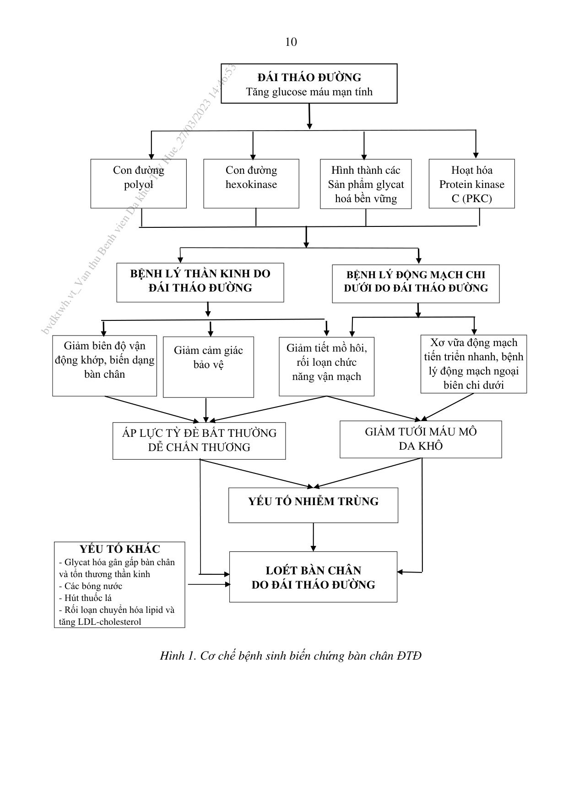
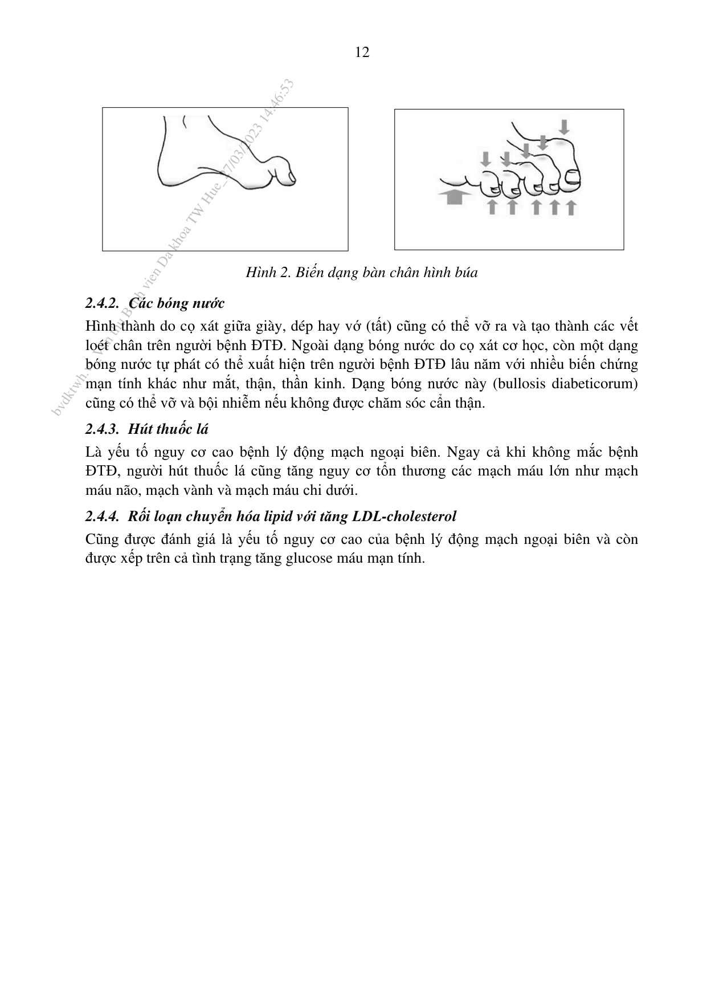
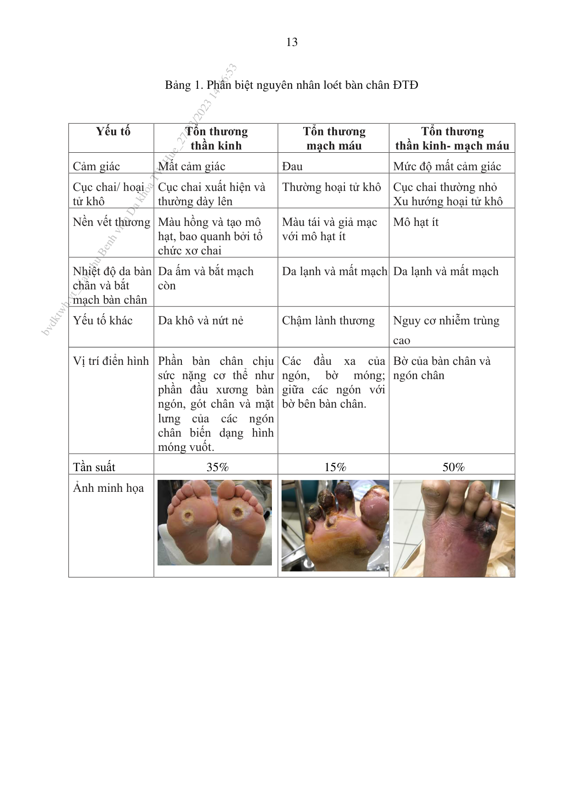
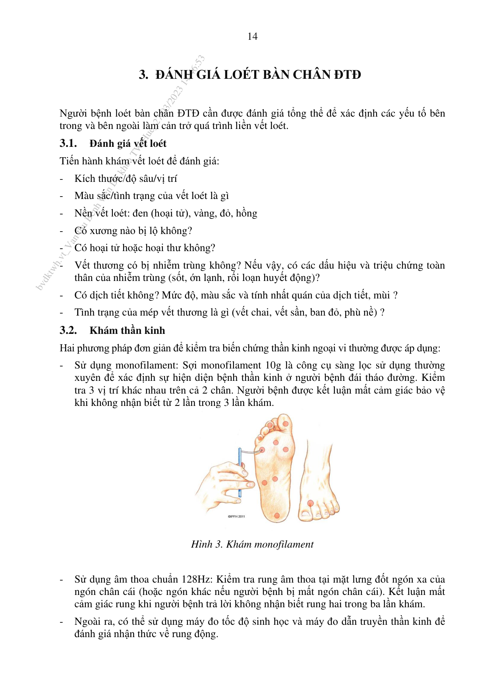
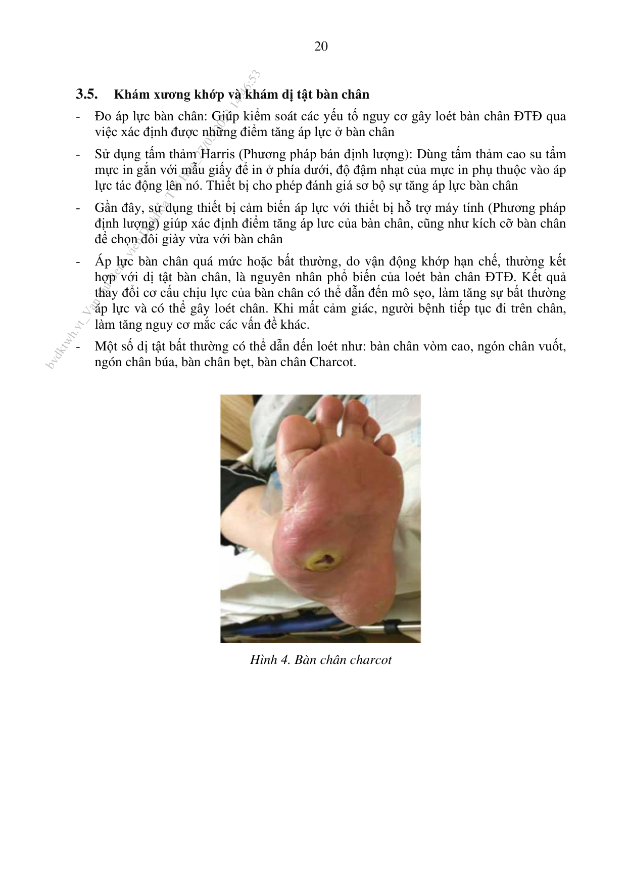
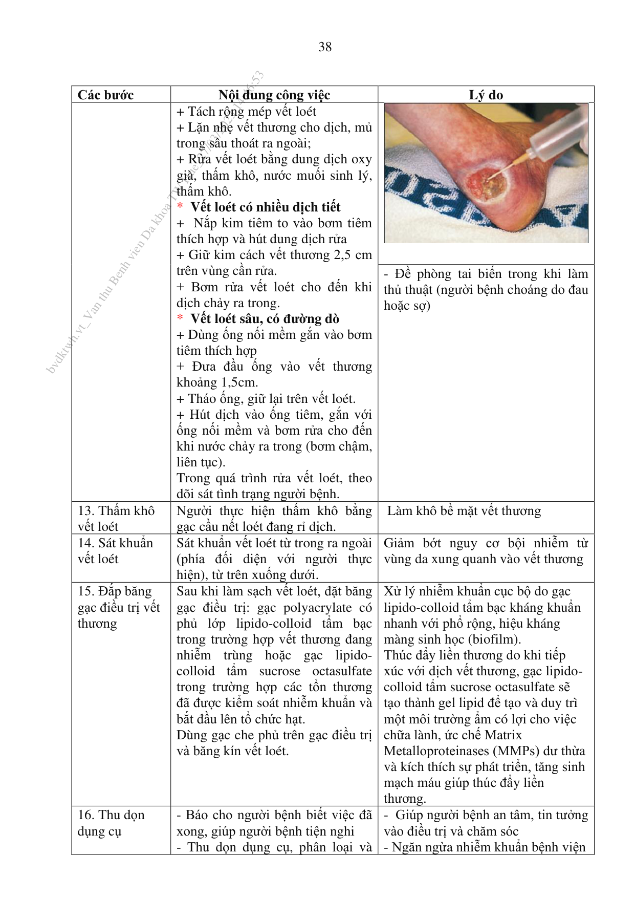

> Nguồn tệp gốc: pdfs/566-1530-QD-QLD-Hướng-dẫn-chẩn-doán-diều-trị-Loét-bàn-chân-do-dái-tháo-dường-2.pdf
> Trích xuất ngày: 2026-08-07

# Quyết định 1530/QĐ-BYT (24/03/2023) - Hướng dẫn chẩn đoán và điều trị loét bàn chân do đái tháo đường

--- Trang 1 ---
[Lưu ý: trang bìa/quyết định ký này có font nhúng bị lỗi encoding khi trích xuất tự động, chữ bị biến dạng. Nội dung xác nhận qua trang 2: Quyết định số 1530/QĐ-BYT, ký ngày 24/03/2023. Toàn bộ nội dung chuyên môn từ trang 2 trở đi trích xuất bình thường.]
BQYT6
SO:l53olqo-avr
ceNG noa xA Hor crru Ncnia uEr N,*l
DQc lip - Tg do - II?nh phric
Hd NA| ngay 24 thdng 3 ndm 2023
quy
9m w, quyen han vd co cdu t6 chuc cua Bd Yt€
. 
QIIYET Dr}-{rr
VG viQc ban hinh tiLi liQu chuyGn m6n
chiiu doino rliGu fi Lo6t bin chin ds t*ii thdo iH*g.
ca
BOTRIIONGBOYT[
qt Khdm bAnh, chira b€nh;
hi dinh sij gstzozz/w-cp
rycay. I5/1 1/2022 cia Chinh phit
dinh ch*c ndng, nhi
Nui ahSn:
- Nh: niiru 3:
- B+ tru,@g Bi Y ti! 1d6 bno c6o);
- Cic Tht tnrong:
- C6ng th6ng tin tli6n nr 86 Y t6;
--Website Cuc KCB;
- Lu*; VT, KCB.
[* u"rl
rff.B0 TR1I6NG
TRT,ONG
Cdn c* Bi'6n bdn sii $BA-KCA ng{ty l3/01/202j vi ho.p ltgi ding chuyix
mdn nghiAm thu Humg ddn diiu tri bdn chdn ddi thdo fudng,
Theo tti ughi ctla Cue t uottg Cuc Qudn lfi Khdrn, ch#a bQnh.
QUYETD[NH:
Di6u 1. Ban hdnh kdm theo quyi5t dinh ndy tii li6u chuy€n m6n..Huung
d5n chin doin vi diAu tri Lo6t bin ch6rr do d6i th6;dulng.'. 
.:
DiAu 2. Tdi li6u chuydn rn6n "Hu6ng d6n chin do6n vd diAu tri Lo6t bdn
chrin do drii thdo dudng" dugc rip dung tai c6c co s0 khrlm bQnh, ch&a bQnh trong
cA nudc.
Dilu 3. Cric 6ng, bd: Chdnh Vin phdng BO, Chenh tha:rh tra BQ, Cuc tnrong
vi Yg trr0ng c6c Cpc, Vu thuQc BO Y t6, Gi6m tl6c S0 Y tai c6c tinh, thnnh ph6
ryc thu$c trung uong. Girim tl0c c6c B€nh vi6n trgc thudc B0 Y rq Tht firung y
td crie ngdnh chiu tr6ch nhi6m thi hdnh Quy6t dinh ndy./.
(-t
illn vrEru rnuuo utltTffP
B
Chuyin:.,...
I Lrtu h6 saso:..
Cdn ca I
[.\ 6l Nflwva
Ylia Thudn

--- Trang 2 ---
2 
 
 
 
 
 
 
 
 
 
 
 
HƯỚNG DẪN CHẨN ĐOÁN VÀ ĐIỀU TRỊ 
LOÉT BÀN CHÂN DO ĐÁI THÁO ĐƯỜNG 
 
(Ban hành kèm theo Quyết định số          /QĐ-BYT  
ngày      tháng    năm 2023 của Bộ trưởng Bộ Y tế) 
 
 
 
 
 
 
 
 
 
 
 
 
 
 
Hà Nội, 2023 
 
bvdktwh.vt_Van thu Benh vien Da khoa TW Hue_27/03/2023 14:46:53
1530
24
3

--- Trang 3 ---
3 
 
DANH SÁCH BAN BIÊN SOẠN “HƯỚNG DẪN CHẨN ĐOÁN  
VÀ ĐIỀU TRỊ LOÉT BÀN CHÂN DO ĐÁI THÁO ĐƯỜNG” 
 
 
Chỉ đạo biên soạn 
 
GS.TS. Trần Văn Thuấn 
Thứ trưởng Bộ Y tế 
Chủ biên 
 
PGS.TS. Lương Ngọc Khuê 
Phó Chủ tịch Hội đồng y khoa quốc gia, Cục trưởng 
Cục Quản lý Khám, chữa bệnh (QLKCB) 
GS. TS. Trần Hữu Dàng 
Chủ tịch Hội Nội tiết – Đái tháo đường Việt Nam 
Tham gia biên soạn và thẩm định  
TS. Nguyễn Quang Bảy 
Trưởng Khoa Nội tiết - Đái tháo đường, Bệnh viện 
Bạch Mai 
TS. Lê Văn Chi 
Phụ trách Khoa Nội tổng hợp - Nội tiết, Bệnh viện 
Đại học Y dược Huế 
GS. TS. Trần Hữu Dàng 
Chủ tịch Hội Nội tiết – Đái tháo đường Việt Nam 
TS. Phan Hướng Dương 
Phó Giám đốc Bệnh viện Nội tiết Trung ương 
BSCKII. Trần Đoàn Đạo 
Phó chủ tịch Liên chi hội liền thương thành phố Hồ 
Chí Minh  
TS. Lâm Vãn Hoàng 
Trường khoa Nội tiết, Bệnh viện Chợ Rẫy 
PGS.TS. Vũ Thị Thanh Huyền 
Trưởng Khoa Nội tiết - Cơ xương khớp, Bệnh viện Lão 
khoa Trung ương 
PGS.TS. Lương Ngọc Khuê 
Phó Chủ tịch Hội đồng y khoa quốc gia, Cục trưởng 
Cục Quản lý Khám, chữa bệnh (QLKCB) 
TS. Nguyễn Trọng Khoa 
Phó Cục trưởng Cục QLKCB 
TS. Trần Quang Nam 
Trưởng Khoa Nội tiết, Bệnh viện Đại học Y Dược 
Thành phố Hồ Chí Minh 
PGS.TS. Vũ Bích Nga 
Phụ trách Khoa Nội tiết - Hô hấp, Bệnh viện Đại học 
Y Hà Nội 
TS. Trần Thừa Nguyên 
Tổng thư ký Hội Nội tiết – Đái tháo đường Việt 
Nam 
BSCKII. Nguyễn Thị Bạch Oanh 
Phó Trưởng khoa Nội tiết - Thần kinh - Hô hấp, 
Bệnh viện Trung ương Huế 
TS. Ngô Thị Phượng 
Chủ nhiệm khoa Nội tiết, Bệnh viện Trung ương 
Quân đội 108 
PGS. TS. Hồ Thị Kim Thanh 
Trưởng Bộ môn Y học gia đình, Trường Đại học Y 
Hà Nội 
bvdktwh.vt_Van thu Benh vien Da khoa TW Hue_27/03/2023 14:46:53

--- Trang 4 ---
4 
 
ThS. Phan Văn Toàn  
Phó Vụ trưởng Vụ Bảo hiểm y tế 
ThS. Đặng Thị Mai Trang 
Trưởng khoa Chăm sóc bàn chân, Bệnh viện Nội tiết 
Trung ương 
TS. Nguyễn Hoàng Thanh Vân 
Phó Trưởng Khoa Nội tổng hợp - Nội tiết, Bệnh viện Đại 
học Y dược Huế 
ThS. Phan Thị Bích Vân  
Chuyên viên Phòng Quản lý Kinh doanh Dược, Cục 
Quản lý Dược 
ThS. Hoàng Lê Thái Bão 
Nghiên cứu sinh Trường Đại học Y- Dược Huế 
Tổ Biên tập 
 
TS. Trần Thừa Nguyên 
Tổng thư ký Hội Nội tiết – Đái tháo đường Việt 
Nam 
ThS. Trương Lê Vân Ngọc  
Phó Trưởng Phòng Nghiệp vụ - Thanh tra – Bảo vệ 
sức khỏe cán bộ (BVSKCB), Cục QLKCB 
ThS. Lê Kim Dung 
Chuyên viên Phòng Nghiệp vụ - Thanh tra - 
BVSKCB, Cục QLKCB 
BS. Nguyễn Thị Dung 
Chuyên viên Cục QLKCB 
DS. Đỗ Thị Ngát 
Chuyên viên Phòng Nghiệp vụ - Thanh tra - 
BVSKCB, Cục QLKCB 
 
 
 
bvdktwh.vt_Van thu Benh vien Da khoa TW Hue_27/03/2023 14:46:53

--- Trang 5 ---
5 
 
MỤC LỤC 
 
DANH SÁCH BAN BIÊN SOẠN ..................................................................................... 3 
MỤC LỤC ............................................................................................................................ 5 
DANH MỤC KÝ HIỆU VÀ CHỮ VIẾT TẮT ................................................................. 6 
DANH MỤC BẢNG ........................................................................................................... 7 
DANH MỤC HÌNH............................................................................................................. 7 
1. 
ĐẠI CƯƠNG ............................................................................................................... 8 
2. 
CƠ CHẾ BỆNH SINH VÀ NGUYÊN NHÂN ........................................................... 9 
2.1. Bệnh lý thần kinh do đái tháo đường ...................................................................... 9 
2.2. Bệnh lý động mạch chi dưới ................................................................................. 11 
2.3. Yếu tố nhiễm trùng ............................................................................................... 11 
2.4. Các yếu tố góp phần khác ..................................................................................... 11 
3. 
ĐÁNH GIÁ LOÉT BÀN CHÂN ĐÁI THÁO ĐƯỜNG ........................................... 14 
3.1. Đánh giá vết loét ................................................................................................... 14 
3.2. Khám thần kinh ..................................................................................................... 14 
3.3. Khám mạch máu ................................................................................................... 15 
3.4. Khám nhiễm trùng ................................................................................................ 19 
3.5. Khám xương khớp và khám dị tật bàn chân ......................................................... 20 
4. 
CHẨN ĐOÁN ............................................................................................................ 21 
4.1. Tiêu chuẩn chẩn đoán đái tháo đường: ................................................................. 21 
4.2. Tiêu chuẩn chẩn đoán loét bàn chân ..................................................................... 21 
5. 
ĐIỀU TRỊ ................................................................................................................... 24 
5.1. Nguyên tắc điều trị: ............................................................................................... 24 
5.2. Điều trị cụ thể loét bàn chân đái tháo đường ........................................................ 24 
6. 
DỰ PHÒNG ............................................................................................................... 29 
6.1. Phân tầng nguy cơ và thời gian theo dõi ............................................................... 29 
6.2. Giáo dục người bệnh, gia đình và các chuyên gia chăm sóc sức khỏe về chăm 
sóc bàn chân .................................................................................................................... 29 
PHỤ LỤC 01 ...................................................................................................................... 31 
PHỤ LỤC 02 ...................................................................................................................... 32 
PHỤ LỤC 03 ...................................................................................................................... 34 
PHỤ LỤC 04 ...................................................................................................................... 40 
TÀI LIỆU THAM KHẢO .................................................................................................. 43 
bvdktwh.vt_Van thu Benh vien Da khoa TW Hue_27/03/2023 14:46:53

--- Trang 6 ---
6 
 
DANH MỤC KÝ HIỆU VÀ CHỮ VIẾT TẮT 
 
 
ABI 
Ankle-branchial index (Chỉ số cổ chân-cánh tay) 
AGE 
Advanced Glycation Endproducts (Sản phẩm glycat hoá bền vững) 
CLVT 
Cắt lớp vi tính 
DSA 
Digital Subtraction Angiography (Chụp mạch số hoá xoá nền) 
ĐTĐ 
Đái tháo đường 
IWGDF 
The International working Group on the Diabetic Foot 
(Nhóm chuyên trách bàn chân đái tháo đường quốc tế) 
PKC 
Protein kinase C (Enzyme Protein kinase C) 
TBI 
Toe-branchial index (Chỉ số ngón chân-cánh tay) 
bvdktwh.vt_Van thu Benh vien Da khoa TW Hue_27/03/2023 14:46:53

--- Trang 7 ---
7 
 
DANH MỤC BẢNG 
 
Bảng 1. Phân biệt nguyên nhân loét bàn chân đái tháo đường ........................................... 13 
Bảng 2. Phân loại loét bàn chân ĐTĐ theo Wagner – Meggitt .......................................... 22 
Bảng 3. Phân loại loét bàn chân ĐTĐ theo thang điểm PEDIS ......................................... 22 
Bảng 4. Các Phương thức cắt lọc (Theo Đồng thuận năm 2020, Vết thương khó lành 
“Hard to heal wounds”) ...................................................................................................... 26 
Bảng 5. Phân tầng và theo dõi sàng lọc người bệnh theo hướng dẫn của IWGDF 2019 ... 29 
 
 
DANH MỤC HÌNH 
 
Hình 1. Cơ chế bệnh sinh biến chứng bàn chân đái tháo đường ........................................ 10 
Hình 2. Biến dạng bàn chân hình búa ................................................................................. 12 
Hình 3. Khám monofilamnet .............................................................................................. 14 
Hình 4. Bàn chân charcot ................................................................................................... 20 
 
bvdktwh.vt_Van thu Benh vien Da khoa TW Hue_27/03/2023 14:46:53

--- Trang 8 ---
8 
 
1. ĐẠI CƯƠNG 
 
1.1. Định nghĩa: loét bàn chân do đái tháo đường (ĐTĐ) là các vết loét xuất hiện ở bàn 
chân (từ mắc cá chân trở xuống: mu chân, gan bàn chân, gót chân và bàn- ngón chân) ở 
người bệnh ĐTĐ. 
1.2. Dịch tễ học:  
Ước tính có khoảng 19 – 34% người bệnh ĐTĐ có nguy cơ bị loét bàn chân do ĐTĐ 
trong đời. Theo Liên đoàn ĐTĐ Quốc tế, hàng năm có từ 9,1–26,1 triệu người bệnh ĐTĐ 
mắc loét bàn chân do ĐTĐ. Trên toàn cầu, tỷ lệ loét bàn chân do ĐTĐ là 6,3%, thay đổi 
từ 3% ở Châu Đại Dương đến 13% ở Bắc Mỹ. Có sự chênh lệch về tỷ lệ loét bàn chân do 
ĐTĐ giữa các khu vực trên thế giới. Tỷ lệ hiện mắc cao nhất là ở Bỉ (16,6%), Canada 
(14,8%), Mỹ (13%), thấp nhất ở Úc (1,5%) và Hàn Quốc (1,7%).  
Số liệu thống kê quốc gia về loét bàn chân do ĐTĐ ở Việt Nam không sẵn có, trong một 
số nghiên cứu cho thấy: tỷ lệ loét bàn chân ở người bệnh ĐTĐ nhập viện điều trị nội trú 
khoảng 20%. 
Loét bàn chân do ĐTĐ có thể lành lại sau một vài tuần hoặc một vài tháng nếu được 
chăm sóc đúng cách, tuy nhiên, việc cắt cụt chi được áp dụng để ngăn ngừa nhiễm trùng 
hoặc tử vong ở khoảng gần một phần ba tổng số vết loét. 
Tỷ lệ tái phát loét bàn chân do ĐTĐ được ước tính là khoảng 40% (trong vòng 1 năm), 
60% (trong vòng 3 năm) và 65% (trong vòng 5 năm). Trong khi đó, hơn một triệu chi 
dưới bị mất ở những người mắc bệnh ĐTĐ mỗi năm, tương đương với 85% tổng số chi 
dưới bị cắt cụt và khi xét đến tỷ lệ ngày càng gia tăng của bệnh ĐTĐ, có thể dự đoán 
rằng hậu quả tiêu cực của loét bàn chân do ĐTĐ cũng sẽ tăng đáng kể trong tương lai 
gần. 
Hơn nữa, ngoài tác động tiêu cực đến sức khỏe thể chất của người bệnh ĐTĐ, loét bàn 
chân do ĐTĐ còn ảnh hưởng đáng kể đến chất lượng cuộc sống của những người bệnh 
khi họ có vấn đề về tâm lý, trầm cảm. Trầm cảm phổ biến ở một phần ba số người bệnh 
bị loét bàn chân do ĐTĐ lần đầu và liên quan đến nguy cơ tử vong tăng gấp hai lần trong 
5 năm. 
bvdktwh.vt_Van thu Benh vien Da khoa TW Hue_27/03/2023 14:46:53

--- Trang 9 ---
9 
 
2.  CƠ CHẾ BỆNH SINH VÀ NGUYÊN NHÂN 
 
Tăng glucose máu mạn tính là nguy cơ gây một số biến chứng động mạch nhỏ và lớn, 
trong khi các yếu tố khác góp phần gây ra các biến chứng bao gồm tăng huyết áp, rối 
loạn lipid máu và đề kháng insulin. Các yếu tố nguy cơ này làm tăng khả năng dẫn đến 
biến chứng loét bàn chân. Hai vấn đề chính là: (1) bệnh lý thần kinh do ĐTĐ và (2) bệnh 
lý động mạch chi dưới. 
2.1. 
Bệnh lý thần kinh do ĐTĐ 
Bệnh lý thần kinh do ĐTĐ thường biểu hiện dưới dạng các tổn thương về cảm giác, vận 
động và tự chủ: 
- 
Mất cảm giác bảo vệ ở người bệnh mắc bệnh thần kinh cảm giác khiến dễ bị tổn 
thương về cơ học, chấn thương hóa học và nhiệt … 
- 
Bệnh thần kinh vận động có thể gây ra bàn chân dị tật (chẳng hạn như bàn chân hình 
búa và/hoặc móng vuốt), có thể dẫn đến bất thường áp lực bàn chân. 
- 
Bệnh thần kinh tự chủ thường là liên quan đến da khô, có thể dẫn đến trong các vết 
nứt, nứt và chai.  
- 
Mất cảm giác bảo vệ là một nguyên nhân chính. 
- 
Bệnh lý thần kinh ĐTĐ có thể khiến phân bố áp lực bất thường ở lòng bàn chân dẫn 
đến các biến dạng bàn chân Charcot. Đồng thời với biến dạng bàn chân, các vết chai 
cũng xuất hiện dưới áp lực tỳ đè kéo dài gây ra tình trạng viêm nhiễm, chấn thương 
mô mạn tính, hình thành các vết nứt nhỏ trên nền mô chai. Các áp xe bên dưới các 
mô chai rất dễ xuất hiện và gây nên các vết loét bàn chân ĐTĐ. Cảm giác bảo vệ bàn 
chân (cảm giác đau) cũng suy giảm do biến chứng thần kinh cảm giác và do đó người 
bệnh ĐTĐ càng ít quan tâm đến việc chăm sóc bàn chân. Biến chứng thần kinh ĐTĐ 
còn ảnh hưởng đến sự lành vết thương dễ tạo thành các vết loét lỗ đáo. 
bvdktwh.vt_Van thu Benh vien Da khoa TW Hue_27/03/2023 14:46:53

--- Trang 10 ---

> **[Chuyển đổi ảnh → text để phục vụ embedding — nguồn ảnh: `images/1530_p10.png`, cần đối chiếu lại ảnh gốc khi cần độ chính xác tuyệt đối]**
>
> **Sơ đồ cơ chế bệnh sinh biến chứng bàn chân ĐTĐ (luồng nhân quả từ trên xuống):**
>
> "ĐÁI THÁO ĐƯỜNG — Tăng glucose máu mạn tính" → phân thành 4 con đường sinh hóa song song: (1) Con đường polyol, (2) Con đường hexokinase, (3) Hình thành các sản phẩm glycat hoá bền vững, (4) Hoạt hóa Protein kinase C (PKC) → cả 4 con đường hội tụ, dẫn đến 2 nhóm bệnh lý song song:
> - **Bệnh lý thần kinh do ĐTĐ** → gây ra: (a) Giảm biên độ vận động khớp, biến dạng bàn chân; (b) Giảm cảm giác bảo vệ; (c) Giảm tiết mồ hôi, rối loạn chức năng vận mạch (nhánh này dùng chung với nhánh mạch máu).
> - **Bệnh lý động mạch chi dưới do ĐTĐ** → gây ra: (c) Giảm tiết mồ hôi, rối loạn chức năng vận mạch (chung với thần kinh); (d) Xơ vữa động mạch tiến triển nhanh, bệnh lý động mạch ngoại biên chi dưới.
>
> Từ 4 hậu quả (a)-(d) trên, hội tụ thành 2 cơ chế trung gian:
> - (a)+(b) → **Áp lực tỳ đè bất thường, dễ chấn thương**
> - (c)+(d) → **Giảm tưới máu mô, da khô**
>
> Cả 2 cơ chế trung gian → **Yếu tố nhiễm trùng** → cùng với **"Yếu tố khác"** (glycat hóa gân gấp bàn chân và tổn thương thần kinh; các bóng nước; hút thuốc lá; rối loạn chuyển hóa lipid và tăng LDL-cholesterol) → hội tụ tại kết quả cuối: **LOÉT BÀN CHÂN DO ĐÁI THÁO ĐƯỜNG**.

10 
 
 
 
 
 
 
 
 
 
 
 
 
 
 
 
 
 
 
 
 
 
 
 
 
 
 
 
 
Hình 1. Cơ chế bệnh sinh biến chứng bàn chân ĐTĐ 
 
 
 
ĐÁI THÁO ĐƯỜNG 
Tăng glucose máu mạn tính 
Con đường 
polyol 
Con đường 
hexokinase 
Hình thành các 
Sản phẩm glycat 
hoá bền vững 
Hoạt hóa 
Protein kinase 
C (PKC) 
BỆNH LÝ THẦN KINH DO  
ĐÁI THÁO ĐƯỜNG 
BỆNH LÝ ĐỘNG MẠCH CHI 
DƯỚI DO ĐÁI THÁO ĐƯỜNG 
Giảm biên độ vận 
động khớp, biến dạng 
bàn chân 
Giảm cảm giác 
bảo vệ 
Giảm tiết mồ hôi, 
rối loạn chức 
năng vận mạch 
Xơ vữa động mạch 
tiến triển nhanh, bệnh 
lý động mạch ngoại 
biên chi dưới 
ÁP LỰC TỲ ĐÈ BẤT THƯỜNG  
DỄ CHẤN THƯƠNG 
GIẢM TƯỚI MÁU MÔ  
DA KHÔ 
YẾU TỐ NHIỄM TRÙNG 
 
LOÉT BÀN CHÂN  
DO ĐÁI THÁO ĐƯỜNG 
YẾU TỐ KHÁC 
- Glycat hóa gân gấp bàn chân 
và tổn thương thần kinh 
- Các bóng nước 
- Hút thuốc lá 
- Rối loạn chuyển hóa lipid và 
tăng LDL-cholesterol 
bvdktwh.vt_Van thu Benh vien Da khoa TW Hue_27/03/2023 14:46:53

--- Trang 11 ---
11 
 
2.2. 
Bệnh lý động mạch chi dưới 
- Thuật ngữ “bệnh động mạch ngoại biên” (Peripheral Artery Disease - PAD) thường 
dùng để chỉ tất cả các bệnh động mạch khác ngoài động mạch vành và động mạch 
chủ. Theo phân loại của Hiệp hội Tim mạch Châu Âu (ESC) các vị trí của bệnh động 
mạch ngoại biên bao gồm: động mạch cảnh và đốt sống, động mạch chi trên, động 
mạch chi dưới, động mạch mạc treo ruột và động mạch thận, khác với quan điểm 
trước đây cho rằng nhóm bệnh này chỉ gồm có bệnh động mạch chi dưới. 
- Bệnh lý động mạch chi dưới là tình trạng bệnh lý của động mạch chi dưới trong đó 
lòng động mạch bị hẹp, tắc gây giảm tưới máu cơ quan và các bộ phận liên quan (da, 
thần kinh) phía hạ lưu. Bệnh lý động mạch chi dưới có thể biểu hiện ở nhiều mức độ 
lâm sàng khác nhau; từ không có triệu chứng lâm sàng, đi cách hồi cho đến viêm tắc 
động mạch chi dưới hay hoại tử khô. 
- Nguyên nhân chủ yếu của bệnh lý động mạch chi dưới là do xơ vữa động mạch. Các 
yếu tố nguy cơ chính của xơ vữa động mạch là hút thuốc lá, thuốc lào, ĐTĐ, rối loạn 
lipid máu, tăng huyết áp và tăng homocystein máu làm gia tăng sự phát triển của bệnh 
lý động mạch chi dưới và các bệnh lý động mạch khác do xơ vữa. 
- Xơ vữa động mạch chi dưới gây tắc hoàn toàn hoặc một phần của một hoặc nhiều 
động mạch ngoại vi, nhưng cũng có thể là do tắc mạch, huyết khối, loạn sản sợi cơ, 
hoặc viêm mạch, dẫn đến giảm lưu lượng máu hoặc mất mô.  
- Rối loạn chức năng tế bào nội mô, rối loạn chức năng tế bào cơ trơn mạch máu, viêm, 
suy giảm chức năng tiểu cầu và đông máu bất thường là những yếu tố chính khác làm 
tiến triển bệnh động mạch ngoại biên ở bệnh ĐTĐ.  
- Xơ vữa động mạch chi dưới có thể gây hẹp lòng mạch làm giảm tưới máu và làm 
nặng thêm biến chứng bàn chân và/hoặc tắc mạch, là nguyên nhân trực tiếp gây loét 
hoại tử bàn ngón chân. 
2.3. 
Yếu tố nhiễm trùng 
Người bệnh ĐTĐ có nguy cơ cao bị nhiễm trùng. Glucose máu tăng cao mạn tính làm giảm 
tính hóa ứng động của bạch cầu, làm suy giảm khả năng tự miễn nội tại của người bệnh. 
Dưới tác động của môi trường glucose tăng cao, các vi khuẩn gây bệnh dễ dàng tạo lớp vỏ 
bọc biofilm bảo vệ nhờ các chất polysaccharides và lipid thặng dư. Màng bảo vệ này giúp vi 
khuẩn đề kháng với kháng sinh và chống chọi lại các đại thực bào một cách rất hiệu quả.  
2.4. 
Các yếu tố góp phần khác 
Ngoài ba thành tố chính vừa kể trên, nhiều yếu tố khác cũng góp phần trong cơ chế bệnh 
sinh hình thành biến chứng bàn chân ĐTĐ.  
2.4.1. Hiện tượng glycat hóa các gân gấp bàn chân và tổn thương thần kinh 
Làm co rút các cơ gian cốt gây biến dạng bàn chân hình búa. Các điểm biến dạng sẽ là 
các vị trí thuận lợi cho sự hình thành các vết chai và từ đó gây nên các vết loét chân lâu 
lành (Hình 2). 
 
 
 
bvdktwh.vt_Van thu Benh vien Da khoa TW Hue_27/03/2023 14:46:53

--- Trang 12 ---

> **[Chuyển đổi ảnh → text để phục vụ embedding — nguồn ảnh: `images/1530_p12.png`, cần đối chiếu lại ảnh gốc khi cần độ chính xác tuyệt đối]**
>
> Ảnh minh họa giải phẫu 2 panel: (1) hình vẽ bàn chân nhìn nghiêng cho thấy các ngón chân co quắp/gập lại tạo hình dạng giống "búa" (hammer toe) ở phần khớp giữa ngón; (2) hình vẽ cận cảnh 5 ngón chân với các mũi tên chỉ hướng lực đè ép bất thường lên đầu ngón và mu ngón do biến dạng — minh họa cho nội dung văn bản: biến dạng hình búa làm tăng áp lực tỳ đè lên đầu xương bàn ngón, gót chân và mặt lưng ngón chân, là vị trí điển hình dễ hình thành vết chai/loét ở nhóm tổn thương thần kinh (xem Bảng 1, hàng "Vị trí điển hình").

12 
 
 
 
 
 
 
 
Hình 2. Biến dạng bàn chân hình búa 
2.4.2. Các bóng nước 
Hình thành do cọ xát giữa giày, dép hay vớ (tất) cũng có thể vỡ ra và tạo thành các vết 
loét chân trên người bệnh ĐTĐ. Ngoài dạng bóng nước do cọ xát cơ học, còn một dạng 
bóng nước tự phát có thể xuất hiện trên người bệnh ĐTĐ lâu năm với nhiều biến chứng 
mạn tính khác như mắt, thận, thần kinh. Dạng bóng nước này (bullosis diabeticorum) 
cũng có thể vỡ và bội nhiễm nếu không được chăm sóc cẩn thận.  
2.4.3. Hút thuốc lá 
Là yếu tố nguy cơ cao bệnh lý động mạch ngoại biên. Ngay cả khi không mắc bệnh 
ĐTĐ, người hút thuốc lá cũng tăng nguy cơ tổn thương các mạch máu lớn như mạch 
máu não, mạch vành và mạch máu chi dưới.  
2.4.4. Rối loạn chuyển hóa lipid với tăng LDL-cholesterol 
Cũng được đánh giá là yếu tố nguy cơ cao của bệnh lý động mạch ngoại biên và còn 
được xếp trên cả tình trạng tăng glucose máu mạn tính.  
 
 
 
 
bvdktwh.vt_Van thu Benh vien Da khoa TW Hue_27/03/2023 14:46:53

--- Trang 13 ---

13 
 
Bảng 1. Phân biệt nguyên nhân loét bàn chân ĐTĐ

> **[Định dạng lại + chuyển đổi ảnh → text/bảng để phục vụ embedding — nguồn ảnh gốc kèm ảnh lâm sàng: `images/1530_p13.png`; bảng gốc trong PDF bị trích xuất tự động thành text phẳng, đã đối chiếu ảnh gốc để tái dựng đúng hàng, cần đối chiếu lại ảnh khi cần độ chính xác tuyệt đối]**

| Yếu tố | Tổn thương thần kinh | Tổn thương mạch máu | Tổn thương thần kinh - mạch máu |
|---|---|---|---|
| Cảm giác | Mất cảm giác | Đau | Mức độ mất cảm giác |
| Cục chai/hoại tử khô | Cục chai xuất hiện và thường dày lên | Thường hoại tử khô | Cục chai thường nhỏ, xu hướng hoại tử khô |
| Nền vết thương | Màu hồng và tạo mô hạt, bao quanh bởi tổ chức xơ chai | Màu tái và giả mạc với mô hạt ít | Mô hạt ít |
| Nhiệt độ da bàn chân và bắt mạch bàn chân | Da ấm và bắt mạch còn | Da lạnh và mất mạch | Da lạnh và mất mạch |
| Yếu tố khác | Da khô và nứt nẻ | Chậm lành thương | Nguy cơ nhiễm trùng cao |
| Vị trí điển hình | Phần bàn chân chịu sức nặng cơ thể như phần đầu xương bàn ngón, gót chân và mặt lưng của các ngón chân biến dạng hình móng vuốt | Các đầu xa của ngón, bờ móng; giữa các ngón với bờ bên bàn chân | Bờ của bàn chân và ngón chân |
| Tần suất | 35% | 15% | 50% |

**Ảnh minh họa (3 ảnh lâm sàng, chỉ có trong ảnh gốc, không có text tương đương):**
- *Tổn thương thần kinh:* ảnh 2 lòng bàn chân với vết loét tròn, đáy hồng, xung quanh có viền chai cứng dày — điển hình vị trí chịu lực (dưới đầu xương bàn ngón).
- *Tổn thương mạch máu:* ảnh mu bàn chân với các ngón chân hoại tử đen (hoại tử khô) lan đến vùng giữa bàn chân, da xanh tái.
- *Tổn thương thần kinh - mạch máu:* ảnh mu bàn chân với vùng hoại tử đen lan rộng ở các ngón và bờ bàn chân kèm viêm đỏ mô mềm xung quanh — mức độ tổn thương nặng hơn, phù hợp tần suất 50% (phổ biến nhất).

--- Trang 14 ---

> **[Chuyển đổi ảnh → text để phục vụ embedding — nguồn ảnh: `images/1530_p14.png`, cần đối chiếu lại ảnh gốc khi cần độ chính xác tuyệt đối]**
>
> Ảnh minh họa kỹ thuật khám monofilament 10g: một tay cầm sợi monofilament (dạng bút) chạm vuông góc vào lòng bàn chân bệnh nhân. Sơ đồ bàn chân đánh dấu các vị trí kiểm tra bằng chấm đỏ, tập trung ở: đầu ngón cái, các đầu xương bàn ngón (ụ 1, 3, 5), gót chân, và mặt ngoài giữa bàn chân — minh họa cho quy tắc "kiểm tra 3 vị trí khác nhau trên cả 2 chân" nêu trong văn bản. Nguồn ảnh gốc: ©IPFH 2011.

14 
 
3. ĐÁNH GIÁ LOÉT BÀN CHÂN ĐTĐ  
 
Người bệnh loét bàn chân ĐTĐ cần được đánh giá tổng thể để xác định các yếu tố bên 
trong và bên ngoài làm cản trở quá trình liền vết loét.  
3.1. 
Đánh giá vết loét 
Tiến hành khám vết loét để đánh giá: 
- Kích thước/độ sâu/vị trí  
- Màu sắc/tình trạng của vết loét là gì 
- Nền vết loét: đen (hoại tử), vàng, đỏ, hồng 
- Có xương nào bị lộ không? 
- Có hoại tử hoặc hoại thư không? 
- Vết thương có bị nhiễm trùng không? Nếu vậy, có các dấu hiệu và triệu chứng toàn 
thân của nhiễm trùng (sốt, ớn lạnh, rối loạn huyết động)? 
- Có dịch tiết không? Mức độ, màu sắc và tính nhất quán của dịch tiết, mùi ? 
- Tình trạng của mép vết thương là gì (vết chai, vết sần, ban đỏ, phù nề) ? 
3.2. 
Khám thần kinh 
Hai phương pháp đơn giản để kiểm tra biến chứng thần kinh ngoại vi thường được áp dụng: 
- Sử dụng monofilament: Sợi monofilament 10g là công cụ sàng lọc sử dụng thường 
xuyên để xác định sự hiện diện bệnh thần kinh ở người bệnh đái tháo đường. Kiểm 
tra 3 vị trí khác nhau trên cả 2 chân. Người bệnh được kết luận mất cảm giác bảo vệ 
khi không nhận biết từ 2 lần trong 3 lần khám. 
 
Hình 3. Khám monofilament 
 
- Sử dụng âm thoa chuẩn 128Hz: Kiểm tra rung âm thoa tại mặt lưng đốt ngón xa của 
ngón chân cái (hoặc ngón khác nếu người bệnh bị mất ngón chân cái). Kết luận mất 
cảm giác rung khi người bệnh trả lời không nhận biết rung hai trong ba lần khám. 
- Ngoài ra, có thể sử dụng máy đo tốc độ sinh học và máy đo dẫn truyền thần kinh để 
đánh giá nhận thức về rung động. 
bvdktwh.vt_Van thu Benh vien Da khoa TW Hue_27/03/2023 14:46:53

--- Trang 15 ---
15 
 
3.3. 
Khám mạch máu 
Trên người bệnh có loét bàn chân do ĐTĐ, khi đánh giá mạch máu cần phát hiện các dấu 
hiệu/triệu chứng sau: 
3.3.1. Triệu chứng cơ năng và thực thể 
3.3.1.1. Triệu chứng cơ năng  
- Đau cách hồi (đau khi vận động, đi lại, đỡ khi nghỉ) chi dưới, giai đoạn nặng người 
bệnh có triệu chứng đau liên tục, đau khi nghỉ. 
- Các triệu chứng khác: vết loét đầu chi khó lành, hoại tử ngón chân,… 
- Người bệnh có tiền sử bệnh lý động mạch do xơ vữa như bệnh động mạch vành, động 
mạch cảnh, động mạch thận, phình động mạch chủ… 
3.3.1.2. Triệu chứng thực thể 
Đau cách hồi chi dưới có thể ở một hoặc hai chân, một hay nhiều vị trí. Khám mạch (bắt 
mạch) và dựa trên vị trí đau có thể giúp phát hiện và định khu tổn thương động mạch: 
- Đau cách hồi hông và mông: Tổn thương động mạch vùng chủ chậu. Mạch bẹn hai 
bên khó bắt hoặc không bắt được. 
- Đau cách hồi đùi: Tổn thương động mạch vùng chủ chậu và/hoặc đùi chung. Mạch 
bẹn không bắt được hoặc bắt yếu, mạch khoeo không bắt được. 
- Đau cách hồi bắp chân: Là vị trí đau thường gặp và nhận biết nhất. Đau 2/3 trên bắp 
chân thường do tổn thương động mạch đùi nông, đau 1/3 dưới bắp chân thường do 
tổn thương động mạch khoeo. 
- Đau cách hồi bàn chân: Tổn thương động mạch vùng cẳng chân. 
Các triệu chứng kèm theo đau cách hồi: 
- Mạch yếu hoặc không bắt được mạch. 
- Loét khó lành. 
- Đổi màu da. 
- Hoại tử đầu chi. 
Khám các tổn thương của các mạch máu khác như: 
- Mạch cảnh: người bệnh có triệu chứng liệt vận động, thất ngôn, rối loạn cảm giác…, 
bắt mạch cảnh, nghe mạch cảnh 
- Mạch thận: tăng huyết áp bất thường, nghe tiếng thổi tại vị trí của động mạch thận 
- Mạch chủ bụng: khám bụng, nghe tiếng thổi dọc đường đi của động mạch chủ bụng 
- Mạch vành: người bệnh có triệu chứng đau thắt ngực, khó thở. 
- Mạch dưới đòn: cần đo huyết áp 2 tay và bắt mạch cánh tay 2 bên. 
3.3.1.3. Chẩn đoán phân biệt 
- Đau cách hồi do nguyên nhân thần kinh: Viêm tủy, hẹp ống tủy, đau thần kinh tọa… 
- Bệnh lý thần kinh ngoại biên. 
- Đau cách hồi do viêm khớp/thoái hoá khớp. 
bvdktwh.vt_Van thu Benh vien Da khoa TW Hue_27/03/2023 14:46:53

--- Trang 16 ---
16 
 
- Đau cách hồi trong hội chứng hậu huyết khối sau huyết khối tĩnh mạch sâu. 
- Kén khoeo có triệu chứng. 
- Hội chứng khoang mạn tính… 
3.3.2. Thăm dò cận lâm sàng 
3.3.2.1. Chỉ số huyết áp cổ chân - cánh tay (ABI) 
Chỉ số huyết áp cổ chân - cánh tay (ABI: Ankle Brachial Index) là tỉ số giữa huyết áp 
tâm thu lớn nhất đo được ở cổ chân từng bên (động mạch chày trước hoặc động mạch 
chày sau) với huyết áp tâm thu đo được ở cánh tay (bên có trị số cao hơn). Có thể đo 
bằng máy đo huyết áp thông thường theo hướng dẫn, nhưng tốt nhất là sử dụng máy đo 
điện tử chuyên dụng. 
ABI có giá trị trong sàng lọc, chẩn đoán bệnh động mạch chi dưới và đánh giá mức độ 
nặng của bệnh: 
- ABI < 0,9: có giá trị chẩn đoán bệnh động mạch chi dưới với độ nhạy 79%, độ đặc 
hiệu 96%. 
- ABI < 0,5: nguy cơ cắt cụt chi cao. 
- ABI > 1,4: động mạch cứng, vôi hóa, thường gặp ở người bệnh ĐTĐ, bệnh thận mạn 
tính... 
Để chẩn đoán bệnh động mạch chi dưới, cần phân tích ABI của từng bên chân riêng rẽ. 
Để phân tầng nguy cơ, trị số ABI được lấy ở bên chân mà có trị số thấp hơn. 
Một số hạn chế của ABI: 
- Không phân tích được khi động mạch cứng (người bệnh cao tuổi, ĐTĐ, suy thận,…). 
- ABI khi nghỉ có thể bình thường khi tổn thương tầng động mạch chủ bụng - động 
mạch chậu. 
- Không mô tả được mức độ hạn chế gắng sức. 
- ABI bình thường khi nghỉ, có thể giảm sau khi gắng sức. 
3.3.2.2. Chỉ số ngón chân - cánh tay (TBI) 
Chỉ số ngón chân - cánh tay (TBI: Toe Brachial Index) là một chỉ số đáng tin cậy hơn về 
tưới máu chi ở người bệnh ĐTĐ, suy thận mạn vì các mạch nhỏ của ngón chân thường 
không bị vôi hóa nội mạc. TBI đặc biệt có giá trị khi ABI lớn hơn 1,4. 
TBI = Huyết áp tâm thu đo tại ngón chân/Huyết áp tâm thu đo tại cánh tay (bên lớn hơn). 
Thay vì đo huyết áp cổ chân như trong cách đo chỉ số ABI, phương pháp này sẽ đo huyết 
áp ngay tại ngón chân (ngón cái hoặc ngón thứ hai) sử dụng băng cuốn nhỏ (vòng cuốn) 
chuyên dụng và cảm biến hồng ngoại để đánh giá huyết áp tại ngón này. TBI bình 
thường > 0,7. TBI có độ nhạy từ 90 - 100%, độ đặc hiệu 65 - 100%, là một trong những 
thông số để tiên lượng biến cố tim mạch. 
• Huyết áp tâm thu ngón chân > 30 mmHg thuận lợi cho việc chữa lành vết thương nói 
chung và yêu cầu để chữa lành ở người bệnh ĐTĐ là > 45 - 55 mmHg. 
bvdktwh.vt_Van thu Benh vien Da khoa TW Hue_27/03/2023 14:46:53

--- Trang 17 ---
17 
 
• Áp lực ngón chân rất hữu ích để xác định tưới máu ở cấp độ của bàn chân, đặc biệt là 
ở những người có mạch máu xơ cứng, tuy nhiên không có giá trị để chẩn đoán vị trí 
hẹp tắc. 
3.3.2.3. Siêu âm Doppler động mạch 
a. Siêu âm 2D 
- Có 2 mặt cắt cơ bản dọc và ngang qua đoạn mạch bị tổn thương. 
- Siêu âm 2D giúp nhận định bản chất và đặc điểm tổn thương: Xơ vữa, huyết khối, 
viêm mạch… 
- Siêu âm 2D giúp xác định mức độ hẹp/tắc thông qua chỉ số hẹp đo được trên diện tích 
hay bán kính. 
b. Siêu âm Doppler màu 
- Dựa trên nguyên lý phổ siêu âm Doppler phản ánh dòng máu chảy trong lòng mạch 
và qua các vị trí hẹp để xác định được mức độ hẹp tắc của mạch máu thông qua tín 
hiệu, hình thái, tốc độ dòng chảy đo đạc được. Có hai loại siêu âm Doppler là đánh 
giá mã hóa dòng chảy bằng màu sắc (Doppler màu) và đánh giá dòng chảy ngắt 
quãng theo nhịp (Doppler xung). 
- Trong lòng động mạch tại vị trí hẹp: Phổ Doppler màu tăng sáng, với dấu hiệu 
aliasing ở nơi hẹp nhất, phản ánh sự tăng vận tốc của dòng máu (dòng rối). Hoặc 
không ghi được tín hiệu Doppler màu với tổn thương tắc hoàn toàn. 
- Ngay sau vị trí hẹp: Có thể quan sát thấy phổ Doppler màu có dạng khảm (mosaic) do 
dòng rối, có thể kèm theo hình ảnh nhiễu quanh mạch máu do dòng chảy bị hẹp gây 
rung các cấu trúc mô lân cận. 
c. Siêu âm Doppler xung 
- Sự tăng tốc và phân tán của phổ Doppler tại vị trí hẹp: Tăng vận tốc tâm thu tối đa là 
dấu hiệu đầu tiên của hẹp động mạch. Tín hiệu âm thanh tại vị trí hẹp có âm vực cao, 
nghe sắc, ngắn gọn và rõ nét. Khi động mạch hẹp khít, âm thanh là tiếng rít sắc nhọn. 
- Sự gia tăng vận tốc tối đa phụ thuộc vào mức độ hẹp của lòng mạch, tuy nhiên khi 
hẹp trên 90% lòng mạch thì có sự chuyển hướng theo chiều ngược lại do giảm lưu 
lượng tuần hoàn. Khi tổn thương tắc hoàn toàn, tốc độ tại tổn thương bằng 0, tức là 
không ghi được tín hiệu Doppler xung. 
- Dấu hiệu gián tiếp: Phản ánh huyết động của tổn thương đối với động mạch sau vị trí 
hẹp. Dấu hiệu gián tiếp càng rõ ràng chứng tỏ hẹp càng trầm trọng. Tuy nhiên còn 
phụ thuộc vào tuần hoàn bàng hệ và mức độ giãn của động mạch phía hạ lưu. Đối với 
mức độ tổn thương thì có biểu hiện khác nhau: 
+ Hẹp nhẹ đến vừa: Giảm tốc độ tâm thu tối đa do giảm lưu lượng tuần hoàn, chỉ số 
mạch đập giảm. 
+ Hẹp khít hoặc tắc hoàn toàn: Phổ Doppler dạng một pha sau hẹp có dạng vòm, Vmax 
tâm trương rất giảm, thời gian tâm thu tối đa kéo dài, sóng phản hồi đầu tâm trương 
mất, hoặc thay thế bởi một phổ dương của sóng tâm trương. 
+ Tín hiệu Doppler phía trước vị trí hẹp/tắc được đặc trưng bởi sóng tâm thu - tâm 
trương do tăng sức cản ngoại biên: Chỉ số sức cản và chỉ số mạch đập tăng. 
bvdktwh.vt_Van thu Benh vien Da khoa TW Hue_27/03/2023 14:46:53

--- Trang 18 ---
18 
 
3.3.2.4. Chụp cắt lớp vi tính mạch máu (CLVT) 
- CLVT cho phép dựng hình ảnh 3D của tổn thương và toàn bộ cây mạch máu, cung 
cấp thông tin về vị trí, chiều dài và mức độ tổn thương từ đó hướng dẫn cho can thiệp 
qua da, cũng như đánh giá và theo dõi sau can thiệp. Ngoài ra, CLVT mạch máu cho 
thông tin chi tiết về giải phẫu và bất thường giải phẫu động mạch, tĩnh mạch: Phình, 
giả phình, dị dạng mạch máu, rò động-tĩnh mạch, vị trí giải phẫu bất thường, đánh giá 
được tình trạng thành mạch, các thông tin về mô mềm. 
- Tuy nhiên chụp CLVT có những hạn chế liên quan đến nhiễm tia xạ, thuốc cản 
quang, suy tim, suy thận. Đồng thời hạn chế đánh giá tổn thương khi thành động 
mạch có stent, vôi hóa nặng và đánh giá động mạch nhỏ (động mạch vùng cẳng 
chân). Ngoài ra, tốc độ dòng chảy đến hạ lưu giảm khi có tình trạng hẹp, tắc phía trên 
cũng ảnh hưởng đến kết quả chẩn đoán. 
- Chụp CLVT hiện là một thăm dò được ưu tiên lựa chọn trong chẩn đoán và đánh giá 
mức độ tổn thương động mạch chi dưới giúp quyết định điều trị tối ưu. 
3.3.2.5. Chụp cộng hưởng từ mạch máu 
- Chụp mạch cộng hưởng từ cho hình ảnh tổng quan về hệ thống mạch máu, xác định 
được vị trí, chiều dài và mức độ tổn thương, do cộng hưởng từ thu được hình ảnh tốt 
của nội mạc mạch máu và lòng mạch. Ngoài ra, chụp cộng hưởng từ còn cho phép 
đánh giá tốt tình trạng phần mềm xung quanh. Do vậy, trên lâm sàng, chụp cộng 
hưởng từ mạch máu có tiêm thuốc đối quang từ gadolinium được chỉ định khi cần 
đánh giá tổn thương mạch máu kết hợp đánh giá các cấu trúc liên quan và các tổn 
thương phần mềm xung quanh. 
- Tuy nhiên, chụp cộng hưởng từ mạch máu có hạn chế là máy cộng hưởng từ phải có 
từ lực cao (> 1,5 Tesla), giá thành đắt, dễ bị nhiễu ảnh, không chụp được khi có vật 
liệu kim loại trong người, hạn chế đánh giá khi mảng xơ vữa lớn, thời gian chụp kéo 
dài. 
3.3.2.6. Chụp mạch máu qua da số hóa xóa nền (DSA) 
Chụp mạch máu xâm nhập bằng hệ thống chụp mạch số hoá xoá nền là tiêu chuẩn vàng 
chẩn đoán bệnh lý mạch máu. 
a. Chỉ định 
- Để chẩn đoán: DSA giúp chẩn đoán chính xác loại tổn thương, hình thái, vị trí và 
mức độ tổn thương mạch máu. Chụp DSA thường được chỉ định khi có kế hoạch can 
thiệp động mạch chi dưới (nếu có thể). Chỉ định chụp DSA đơn thuần là chẩn đoán 
chỉ khi các phương pháp thăm dò hình ảnh khác không kết luận được hoặc có sự bất 
tương đồng giữa các kết quả. 
- Khi chụp DSA thường kết hợp điều trị ở những người bệnh có chỉ định can thiệp 
bệnh lý động mạch hoặc tĩnh mạch dựa trên lâm sàng và các phương pháp thăm dò 
hình ảnh không xâm lấn: nong bóng, đặt stent, bít coil, bít dù, đặt lưới lọc... 
b. Chống chỉ định tương đối 
- Dị ứng với chất cản quang có chứa i-ốt 
- Suy thận nặng, suy tim sung huyết và thiếu máu nặng. 
bvdktwh.vt_Van thu Benh vien Da khoa TW Hue_27/03/2023 14:46:53

--- Trang 19 ---
19 
 
- Tình trạng nhiễm khuẩn đang tiến triển, không tiến hành được các thăm dò gây chảy 
máu 
c. Đánh giá tổn thương 
- Tổn thương hẹp/tắc động mạch: Đặc điểm của tổn thương trên phim chụp mạch số 
hóa xóa nền là hình khuyết thuốc cản quang làm giảm khẩu kính đột ngột tại vị trí 
hẹp hoặc không nhìn thấy hiện hình mạch máu do bị tắc hoàn toàn, có thể quan sát 
thấy đoạn xa sau tắc nhờ hệ thống tuần hoàn bàng hệ. 
- Trong tổn thương hẹp, chênh áp qua chỗ hẹp trên 20 mmHg là một chỉ số đáng tin 
cậy về tổn thương có ý nghĩa về mặt huyết động. 
3.3.3. Đánh giá mức độ bệnh động mạch chi dưới 
Việc đánh giá mức độ tổn thương, giai đoạn tổn thương là rất quan trọng giúp thầy thuốc 
ra quyết định điều trị kịp thời, chính xác, nhất là lựa chọn biện pháp tái thông động mạch 
và chỉ định cắt cụt chi. Các phân loại, thang điểm được thống nhất sử dụng trong bệnh 
động mạch chi dưới bao gồm Phân loại giai đoạn bệnh theo lâm sàng theo Fontaine và 
Rutherford (Phụ lục 1); thang điểm phân loại đánh giá nguy cơ cắt cụt chi dưới theo Hệ 
thống phân loại PEDIS. 
3.4. 
Khám nhiễm trùng 
- Những yếu tố nguy cơ gây nhiễm trùng vết loét bàn chân ĐTĐ bao gồm:  
+ Xét nghiệm thăm dò tổn thương xương,  
+ Vết loét tồn tại hơn 30 ngày,  
+ Lịch sử của các vết loét lặp lại,  
+ Vết thương ở chân do chấn thương,  
+ Sự hiện diện của bệnh động mạch ngoại biên,  
+ Tiền sử cắt cụt chi dưới trước đó, 
+ Mất cảm giác bảo vệ ở bàn chân, đi chân trần. 
- Vết loét nhiễm trùng khi thăm khám thường có những biểu hiện như:  
+ Tăng tiết dịch,  
+ Dịch tiết có mủ, mùi hôi,  
+ Tăng cảm giác đau,  
+ Sưng tấy đỏ xung quanh.  
+ Khi nhiễm trùng nặng, có thể đáp ứng viêm hệ thống: sốt cao, tăng bạch cầu, tăng hs-
CRP.  
- Chẩn đoán nhiễm trùng bàn chân ĐTĐ phải được thực hiện bằng đánh giá các dấu 
hiệu và triệu chứng lâm sàng, không chỉ là kết quả vi sinh. 
- Nếu nghi ngờ nhiễm trùng, nên lấy mẫu cấy thích hợp, tốt nhất là mô mềm (hoặc 
xương khi nghi ngờ viêm tủy xương), hoặc chọc hút dịch tiết có mủ. Một số ủng hộ 
việc sử dụng kỹ thuật ngoáy sâu sau khi vết thương đã được làm sạch. Gạc bề ngoài 
hoặc mô bên ngoài bề mặt thường nhiễm tạp khuẩn khiến kết quả cấy mủ bệnh phẩm 
chính xác. 
bvdktwh.vt_Van thu Benh vien Da khoa TW Hue_27/03/2023 14:46:53

--- Trang 20 ---

> **[Chuyển đổi ảnh → text để phục vụ embedding — nguồn ảnh: `images/1530_p20.png`, cần đối chiếu lại ảnh gốc khi cần độ chính xác tuyệt đối]**
>
> Ảnh chụp lâm sàng lòng bàn chân một bệnh nhân: bàn chân sưng nề, biến dạng rõ (vòm gan chân sụp/mất vòm — dấu hiệu điển hình của bàn chân Charcot), da đỏ ửng, có 1 vết loét tròn nhỏ ở vùng giữa gan bàn chân (vùng chịu lực bất thường do biến dạng xương khớp). Minh họa trực quan cho các dị tật bàn chân được liệt kê trong văn bản (bàn chân vòm cao, ngón chân vuốt, ngón chân búa, bàn chân bẹt, bàn chân Charcot) có thể dẫn đến loét do thay đổi phân bố áp lực tỳ đè.

20 
 
3.5. 
Khám xương khớp và khám dị tật bàn chân 
- Đo áp lực bàn chân: Giúp kiểm soát các yếu tố nguy cơ gây loét bàn chân ĐTĐ qua 
việc xác định được những điểm tăng áp lực ở bàn chân 
- Sử dụng tấm thảm Harris (Phương pháp bán định lượng): Dùng tấm thảm cao su tẩm 
mực in gắn với mẫu giấy để in ở phía dưới, độ đậm nhạt của mực in phụ thuộc vào áp 
lực tác động lên nó. Thiết bị cho phép đánh giá sơ bộ sự tăng áp lực bàn chân 
- Gần đây, sử dụng thiết bị cảm biến áp lực với thiết bị hỗ trợ máy tính (Phương pháp 
định lượng) giúp xác định điểm tăng áp lưc của bàn chân, cũng như kích cỡ bàn chân 
để chọn đôi giày vừa với bàn chân 
- Áp lực bàn chân quá mức hoặc bất thường, do vận động khớp hạn chế, thường kết 
hợp với dị tật bàn chân, là nguyên nhân phổ biến của loét bàn chân ĐTĐ. Kết quả 
thay đổi cơ cấu chịu lực của bàn chân có thể dẫn đến mô sẹo, làm tăng sự bất thường 
áp lực và có thể gây loét chân. Khi mất cảm giác, người bệnh tiếp tục đi trên chân, 
làm tăng nguy cơ mắc các vấn đề khác.  
- Một số dị tật bất thường có thể dẫn đến loét như: bàn chân vòm cao, ngón chân vuốt, 
ngón chân búa, bàn chân bẹt, bàn chân Charcot. 
 
 
Hình 4. Bàn chân charcot 
bvdktwh.vt_Van thu Benh vien Da khoa TW Hue_27/03/2023 14:46:53

--- Trang 21 ---
21 
 
4. CHẨN ĐOÁN 
 
Chẩn đoán người bệnh có bệnh lý loét bàn chân ĐTĐ cần có 2 tiêu chuẩn sau: 
- Người bệnh được chẩn đoán mắc ĐTĐ. 
- Có tình trạng loét ở bàn chân. 
4.1. 
Tiêu chuẩn chẩn đoán ĐTĐ:  
Theo Hướng dẫn chẩn đoán và điều trị ĐTĐ típ 2, Quyết định số 5481/QĐ-BYT, ngày 
30 tháng 12 năm 2020. Tiêu chuẩn chẩn đoán ĐTĐ dựa vào 1 trong 4 tiêu chí sau đây:  
a) Glucose huyết tương lúc đói ≥ 126 mg/dL (hay 7 mmol/L) 
b) Glucose huyết tương ở thời điểm sau 2 giờ làm nghiệm pháp dung nạp với 75g 
glucose bằng đường uống ≥ 200 mg/dL (hay 11,1 mmol/L) 
c) HbA1c ≥ 6,5% (48 mmol/mol). Xét nghiệm HbA1c phải được thực hiện bằng phương 
pháp đã chuẩn hóa theo tiêu chuẩn quốc tế. 
d) BN có triệu chứng kinh điển của tăng glucose huyết hoặc của cơn tăng glucose huyết 
cấp kèm mức glucose huyết tương bất kỳ ≥ 200 mg/dL (hay 11,1 mmol/L). 
Chẩn đoán xác định nếu có 2 kết quả trên ngưỡng chẩn đoán trong cùng 1 mẫu máu xét 
nghiệm hoặc ở 2 thời điểm khác nhau đối với tiêu chí a, b, hoặc c; riêng tiêu chí d: chỉ 
cần một lần xét nghiệm duy nhất. 
Lưu ý: 
- 
Glucose huyết đói được đo khi BN nhịn ăn (không uống nước ngọt, có thể uống nước 
lọc, nước đun sôi để nguội) ít nhất 8 giờ (thường phải nhịn đói qua đêm từ 
8 -14 giờ). 
- 
Nghiệm pháp dung nạp glucose bằng đường uống phải được thực hiện theo 
hướng dẫn của Tổ chức Y tế thế giới: BN nhịn đói từ nửa đêm trước khi làm nghiệm 
pháp, dùng một lượng 75g glucose, hòa trong 250-300 mL nước, uống trong 5 phút; 
trong 3 ngày trước đó BN ăn khẩu phần có khoảng 150-200 gam carbohydrat mỗi 
ngày, không mắc các bệnh lý cấp tính và không sử dụng các thuốc làm tăng glucose 
máu. Định lượng glucose huyết tương tĩnh mạch. 
4.2. 
Tiêu chuẩn chẩn đoán loét bàn chân 
Tình trạng loét ở bàn chân được xác định là mất mô và/ hoặc hoại tử độ 1 trở đi theo 
Phân loại Wagner – Meggitt hoặc giai đoạn 2 trở đi theo Phân loại  PEDIS. Người bệnh 
có bàn chân không mất mô, không hoại tử ở bàn chân được xem là không loét.  
Có thể dựa vào một trong hai phân loại sau để chẩn đoán loét bàn chân 
4.2.1. Phân loại loét bàn chân ĐTĐ theo Wagner – Meggitt 
 
 
bvdktwh.vt_Van thu Benh vien Da khoa TW Hue_27/03/2023 14:46:53

--- Trang 22 ---
22 
 
Bảng 2. Phân loại loét bàn chân ĐTĐ theo Wagner – Meggitt 
Độ 
Triệu chứng 
0 
Không có các vết thương hở nhưng có thể có biến dạng bàn chân hoặc viêm mô tế 
bào  
1 
Vết loét nông (1 phần hoặc toàn bộ lớp da) 
2 
Vết loét sâu đến lớp gân hoặc bao khớp nhưng không có tổn thương áp xe hoặc 
tổn thương xương 
3 
Vết loét sâu với áp xe, viêm tủy xương hoặc nhiễm trùng khớp 
4 
Hoại tử khu trú ở ngón chân hoặc gót chân 
5 
Hoại tử lan rộng toàn bộ cẳng chân 
4.2.2. Phân loại theo thang điểm PEDIS 
Thang điểm PEDIS dựa trên Hướng dẫn của Hiệp hội bàn chân ĐTĐ thế giới năm 2019 
(IWDGF – 2019). 
Bảng 3. Phân loại loét bàn chân ĐTĐ theo thang điểm PEDIS 
Giai 
đoạn 
Tưới máu (Perfusion) 
Mức độ 
(Externt) 
Độ sâu 
(Depth) 
Nhiễm trùng 
(Infection) 
Cảm giác 
(Sensation) 
Điểm 
1 
Không có triệu chứng 
của bệnh động mạch 
ngoại biên, kèm với 1 
trong  4 dấu hiệu: Sờ 
được mạch chày trước 
và chày sau, ABI 0,9-
1,10, TBI > 0,6, 
TcPO2 > 60 mmHg 
Chưa tổn 
thương 
Chưa 
tổn 
thương 
Vết thương không 
có mủ hoặc không 
có bất kỳ biểu 
hiện viêm nào  
Không mất cảm 
giác bảo vệ ở 
bàn chân bị loét. 
0 
2 
(nhẹ) 
Có bệnh động mạch 
ngoại biên nhưng thiếu 
máu cục bộ không 
nghiêm trọng (CLI) 
kèm 1 trong 5 dấu hiệu 
sau: Đi lại cách hồi 
(cần đánh giá không 
xâm nhập), ABI < 0,9 
nhưng HA cổ chân > 
50 mmHg, TBI < 0,6 
nhưng HA tâm thu 
ngón chân > 30 
mmHg, TcPO2 30-60 
mmHg, Bất thường 
khác khi thăm dò 
không xâm nhập phù 
hợp với bệnh động 
mạch ngoại biên  
 
< 1cm2 
Loét 
nông bề 
mặt và 
không 
lan 
xuống 
lớp bì 
Sự hiện diện của ≥ 
2 biểu hiện viêm 
(có mủ, vùng da 
đỏ, đau, nóng 
hoặc sưng cứng), 
nhưng bất kỳ 
viêm mô tế 
bào/ban da đỏ nào 
kéo dài ≤ 2cm 
quanh vết loét và 
nhiễm trùng chỉ 
giới hạn ở da hoặc 
bề mặt mô dưới 
da; không có biến 
chứng cục bộ 
hoặc bệnh toàn 
thân khác  
Mất cảm giác 
bảo vệ ở bàn 
chân bị loét: ≥ ½ 
dấu hiệu sau: 
Mất cảm giác áp 
lực (sợi đơn 
10g) ở 2/3 vị trí 
gan bàn chân. 
Hoặc mất cảm 
giác rung âm 
thoa 128 Hz 
hoặc ngưỡng 
cảm giác rung > 
25V (kỹ thuật 
bán định lượng) 
ở xương bàn 
ngón cái 
1 
bvdktwh.vt_Van thu Benh vien Da khoa TW Hue_27/03/2023 14:46:53

--- Trang 23 ---
23 
 
Giai 
đoạn 
Tưới máu (Perfusion) 
Mức độ 
(Externt) 
Độ sâu 
(Depth) 
Nhiễm trùng 
(Infection) 
Cảm giác 
(Sensation) 
Điểm 
3 
(vừa) 
Thiếu máu cục bộ chi 
nghiêm trọng: 1 trong 
3 dấu hiệu sau: Huyết 
áp tâm thu cổ chân < 
50 mmHg, Huyết áp 
tâm thu ngón chân < 
30 mmHg, TcPO2 < 
30 mmHg 
1 – 3 cm2 
Loét sâu 
qua lớp 
bì, lan 
đến tổ 
chức 
dưới da 
(cân, cơ 
hay 
gân) 
Nhiễm trùng (như 
trên) ở một người 
bệnh ổn định mặt 
chuyển hóa và 
toàn thân nhưng 
có ≥1 đặc điểm 
sau: viêm mô tế 
bào > 2cm, sọc 
viêm bạch huyết, 
lan rộng bên dưới 
bề mặt da, áp xe 
mô sâu, hoại thư 
và liên quan đến 
cơ, gân, khớp 
hoặc xương  
- 
2 
4 
(nặng) 
- 
> 3 cm2 
Loét 
ảnh 
hưởng 
đến tất 
cả cấu 
trúc bàn 
chân: 
xương 
và/hoặc 
khớp (lộ 
xương 
hoặc 
chạm 
xương) 
Nhiễm trùng ở 
người bệnh có 
nhiễm độc toàn 
thân hoặc mất ổn 
định chuyển hóa 
(ví dụ sốt, ớn 
lạnh, nhịp tim 
nhanh, hạ huyết 
áp, lú lẫn, nôn, 
tăng bạch cầu, 
nhiễm toan, tăng 
glucose máu nặng, 
hoặc tăng urê 
máu)  
- 
3 
Đánh giá: Tổng điểm đánh giá sau khi phân loại càng lớn thì nguy cơ cắt cụt chi càng 
cao. 
- PEDIS < 7: Nguy cơ cắt cụt chi thấp 
- PEDIS >= 7: Nguy cơ cắt cụt chi cao 
 
 
bvdktwh.vt_Van thu Benh vien Da khoa TW Hue_27/03/2023 14:46:53

--- Trang 24 ---
24 
 
5. ĐIỀU TRỊ  
 
5.1. 
Nguyên tắc điều trị: 
- 
Cải thiện tình trạng vết loét (làm lành/liền vết loét, tưới máu, nhiễm trùng). 
- 
Ưu tiên phương pháp làm lành và phục hồi vết loét trước khi cân nhắc cắt lọc và sau 
cùng là cắt cụt chi. Giảm nguy cơ cắt cụt chi. 
- 
Tăng chất lượng cuộc sống. 
- 
Giảm, hạn chế tử vong. 
- 
Cùng với đó việc điều trị bệnh nền, đặc biệt là ĐTĐ có vai trò quan trọng trong việc 
phục hồi vết loét. 
- 
Cần quan tâm đến điều kiện kinh tế của người bệnh vì chi phí điều trị loét/nhiễm 
trùng. bàn chân ĐTĐ rất tốn kém và lâu dài. 
5.2. 
Điều trị cụ thể loét bàn chân ĐTĐ 
5.2.1. Điều trị nhiễm khuẩn  
- 
Liệu pháp kháng sinh ban đầu cho hầu hết người bệnh bị nhiễm trùng bàn chân ĐTĐ 
là chọn theo kinh nghiệm (Phụ lục 2. Phác đồ kháng sinh theo kinh nghiệm cho người 
bệnh nhiễm trùng bàn chân ĐTĐ); mục tiêu là để điều trị các tác nhân có khả năng 
gây bệnh mà không cần dùng kháng sinh phổ rộng không cần thiết. Điều trị quyết 
định cuối cùng sau đó nên được điều chỉnh theo đáp ứng lâm sàng với kháng sinh 
theo kinh nghiệm tuỳ từng mức độ hoặc kết quả cấy kháng sinh đồ. 
- 
Cấy lại dịch vết thương trong điều kiện tối ưu khi lâm sàng vẫn không đáp ứng hay 
đáp ứng kém. 
- 
Dùng kháng sinh đường tiêm cho tất cả các trường hợp nhiễm trùng nặng và một số 
trường hợp nhiễm trùng vừa. Xem xét chuyển qua kháng sinh đường uống khi tình 
trạng nhiễm trùng đã được kiểm soát tốt và có kết quả cấy vi sinh học. 
- 
Tiếp tục kháng sinh cho đến khi tình trạng nhiễm trùng được giải quyết, thường từ 2 – 
4 tuần cho nhiễm trùng mô mềm là đủ. Không nhất thiết phải dùng kháng sinh cho 
đến khi vết loét lành hoàn toàn. Tuy nhiên, thời gian dùng kháng sinh lý tưởng vẫn 
phụ thuộc vào mức độ nghiêm trọng của nhiễm trùng và tình trạng đáp ứng điều trị 
của người bệnh. 
- 
Xem xét chọn lựa kháng sinh kinh nghiệm ban đầu có hiệu quả trên MRSA 
(Macrolide, Linezolid, Axit Fusidic,…) khi có một trong những yếu tố sau: 
+ Có tiền sử nhiễm MRSA  
+ Có tỷ lệ cấy MRSA cao  
+ Nhiễm trùng nặng 
Điều trị phá vỡ màng sinh học thực hiện bằng:  
- 
Cắt lọc cơ học thường xuyên và lặp lại loại bỏ màng sinh học 
bvdktwh.vt_Van thu Benh vien Da khoa TW Hue_27/03/2023 14:46:53

--- Trang 25 ---
25 
 
- 
Sử dụng các chất kháng khuẩn hoặc gạc có chứa chất kháng khuẩn như gạc sợi đa 
thấm hút polyacrylate có phủ lớp lipido-colloid tẩm bạc. Băng phủ lớp lipido-colloid 
tẩm bạc có hiệu quả trên lâm sàng trong việc xử lý nhiễm khuẩn cục bộ và thúc đẩy 
liền thương, kháng khuẩn nhanh với phổ rộng, hiệu kháng màng sinh học (biofilm). 
Sợi đa thấm hút polyacrylate giữ sạch nền vết thương, tối ưu hiệu quả của ion bạc tại 
nền vết thương. 
5.2.2. Điều trị cải thiện tình trạng mạch máu  
- 
Điều trị nội khoa, thay đổi lối sống và giảm các yếu tố nguy cơ tim mạch được áp 
dụng cho tất cả người bệnh.  
- 
Điều trị tái tưới máu cần được áp dụng cho người bệnh có tiêu chí “Tưới máu” 
(Perfusion) từ giai đoạn 3 trở lên hoặc tổng điểm PEDIS theo IWDGF 2019 từ 7 điểm 
trở lên. 
5.2.2.1. Điều trị Nội khoa cải thiện tình trạng mạch máu 
Người bệnh nên được hỗ trợ ngừng hút thuốc và nên duy trì huyết áp và glucose máu 
theo khuyến cáo hướng dẫn về tăng huyết áp và ĐTĐ. Ngoài ra, tất cả các người bệnh 
nên được chỉ định điều trị bằng statin và thuốc chống kết tập tiểu cầu. 
5.2.2.2. Tái tưới máu 
- 
Tình trạng thiếu máu nuôi chi nặng và cấp tính cần được điều trị kịp thời, đây là một 
cấp cứu lâm sàng, nếu xử lý muộn sẽ dẫn đến hậu quả hoại tử không hồi phục. Những 
trường hợp bệnh động mạch ngoại biên khác làm giảm tưới máu vết thương cũng cần 
xem xét áp dụng các biện pháp tái tưới máu nhằm thúc đẩy lành thương và ngừa hoặc 
trì hoãn cắt cụt trong tương lai. 
- 
Hai kỹ thuật chính được áp dụng là phẫu thuật bắc cầu nối mạch máu và điều trị can 
thiệp nội mạch.  
Một số chỉ định tái tưới máu có thể áp dụng như: 
- 
Ở những người bệnh có huyết áp cổ chân <50mm Hg hoặc ABI <0,5, cân nhắc chụp 
mạch máu cấp. Cũng nên xem xét việc kiểm tra lại nếu áp lực ngón chân <30mmHg 
hoặc TcpO2 <25 mmHg. Tuy nhiên, bác sĩ lâm sàng có thể cân nhắc tái thông mạch 
máu ở mức áp suất cao hơn ở những người bệnh bị nhiễm trùng hoặc mất mô rộng. 
- 
Khi vết loét không có dấu hiệu cải thiện trong vòng 6 tuần, mặc dù đã được xử trí tối 
ưu, hãy cân nhắc tái thông mạch máu, bất kể kết quả của các xét nghiệm chẩn đoán 
mạch máu được mô tả ở trên. 
- 
Nếu dự định cắt cụt cao (tức là trên mắt cá chân), trước tiên hãy xem xét lựa chọn tái 
tưới máu. 
- 
Mục đích của tái thông mạch là khôi phục dòng chảy trực tiếp đến ít nhất một trong 
các động mạch chân, tốt nhất là động mạch cung cấp cho vùng giải phẫu của vết 
thương.  
5.2.3. Điều trị phục hồi mô hạt 
Theo hướng dẫn của IWGDF 2019 và NICE 2019: Ngay sau giai đoạn nhiễm khuẩn hoặc 
ở vết loét mới phát hiện không có dấu hiệu nhiễm trùng, sử dụng băng gạc lipido-colloid 
tẩm sucrose octasulfate cho đến khi vết thương lành, thay băng hàng ngày hoặc cách 
bvdktwh.vt_Van thu Benh vien Da khoa TW Hue_27/03/2023 14:46:53

--- Trang 26 ---
26 
 
ngày tùy tình trạng vết thương. Đây là lựa chọn đầu tay giúp rút ngắn đáng kể thời gian 
lành vết loét so với băng gạc khác, đồng thời mang lại hiệu quả kinh tế hơn các phương 
pháp điều trị phục hồi mô hạt khác. Khi tiếp xúc với dịch tiết vết thương, lipido-colloid 
tẩm sucrose octasulfate sẽ tạo thành gel lipid để tạo và duy trì một môi trường ẩm có lợi 
cho việc chữa lành. Gạc lipido-colloid tẩm sucrose octasulfate ức chế Matrix 
Metalloproteinases (MMPs) dư thừa và kích thích sự phát triển, tăng sinh mạch máu. 
5.2.4. Cắt lọc  
- Những lợi ích của việc cắt lọc vết thương, bao gồm : 
+ Lấy đi mô hoại tử/ mảng mục (Slough) và mô xơ chai (Callus ) 
+ Giảm áp lực lên bàn chân 
+ Giúp đánh giá toàn diện vết thương  
+ Giúp dẫn lưu dịch tiết hay mủ  
+ Giúp tối ưu hóa việc chăm sóc tại chỗ 
+ Kích thích sự lành thương 
- Chống chỉ định cắt lọc : 
+ Rối loạn đông máu 
+ Thiểu năng tưới máu tại chỗ 
+ Bệnh tự miễn với nhiễm trùng vết thương nặng 
+ Nhạy cảm đau 
 
Bảng 4. Các Phương thức cắt lọc  
(Theo Đồng thuận năm 2020, Vết thương khó lành “Hard to heal wounds”) 
Phương thức 
Thực hiện 
Đặc điểm 
Cơ học 
(Mechanical) 
Gạc hay bọt biển tẩm 
dung 
dịch 
rửa 
vết 
thương chà sát lên bề 
mặt và ngóc ngách vết 
thương 
Đơn giản, không đòi hỏi thiết bị và 
chuyên môn sâu, dùng gạc monofilament 
ít đau kết hợp dung dịch kháng khuẩn rửa 
vết thương 
Công cụ bén 
(Sharp) 
Dao mổ, kéo, nạo, nhíp 
Cắt lọc bề mặt vết thương,thiết bị đơn 
giản, có thể thực hiện tại giường bệnh 
Phẫu thuật 
(Surgical) 
Cắt lọc triệt để, thực 
hiện tại phòng mổ với 
phẫu thuật viên và kíp 
mổ 
Cắt lọc triệt để cả tổ chức phía dưới da, 
đòi hỏi chuyên môn, cơ sở điều trị , thời 
gian chuẩn bị 
Siêu âm 
(Ultrasonic) 
Máy chuyên dùng 
Phá vỡ màng biofilm, ít gây chảy máu, 
tăng tưới máu mô, kích thích yếu tố tăng 
trưởng (GF) 
Sinh học 
(Biologic) 
Ấu trùng ruồi xanh 
(Giòi) nuôi trong lab 
Ăn cặn bả mô chết vết thương (Slough – 
mảng mục) kích thích tế bào sợi 
 
bvdktwh.vt_Van thu Benh vien Da khoa TW Hue_27/03/2023 14:46:53

--- Trang 27 ---
27 
 
Đồng thuận 2020 của các chuyên gia quốc tế về vết thương không nhắc đến các phương 
thức tự phân (Autolytic) & Enzyme. Tưới rửa & liệu pháp Hút áp lực âm (NPWT) được 
xem là cắt lọc cơ học. 
- Một số lưu ý : 
+ Cắt lọc nhiều lần có hiệu quả hơn một lần duy nhất, cần kết hợp với các biện pháp 
trị liệu khác (Kháng sinh, Giảm áp (off loading), Hút áp lực âm,…). 
+ Cắt lọc và rửa vết thương thường đi đôi với nhau 
+ Chức năng bàn chân, bảo tồn mô, tránh việc cắt lọc quá mức (Đòi hỏi kỹ năng)  
5.2.5. Cắt cụt chi và chăm sóc sau đoạn chi  
Cắt cụt chi chỉ nên được thực hiện sau khi đã can thiệp đầy đủ tình trạng tưới máu chi 
dưới ở người bệnh loét bàn chân ĐTĐ. Chỉ định đoạn chi có thể được xem xét trong một 
số tình huống sau: 
- 
Thiếu máu chi trầm trọng kèm nhiễm khuẩn hoặc không kèm nhiễm khuẩn nhưng quá 
đau không thể kiểm soát bằng nội khoa. (Tiêu chí “Tưới máu” (Perfusion) trong 
thang PEDIS ở giai đoạn 3 hoặc 4) 
- 
Nhiễm khuẩn nặng đe dọa tính mạng mà không thể kiểm soát được bằng các phương 
pháp khác. (Tiêu chí “Nhiễm trùng” (Infection) trong thang PEDIS ở giai đoạn 4) 
- 
Viêm xương tủy xương không phù hợp điều trị nội khoa. 
- 
Theo ý muốn của người bệnh. 
Trong bất kỳ tình huống nào, chức năng vận động và khả năng hồi phục sau vật lý trị liệu 
cũng nên được tính đến trong từng bước phẫu thuật kể cả phẫu thuật cắt lọc. 
Sau đoạn chi, cần có kế hoạch chăm sóc da (Tránh để tình trạng khô da) và vết thương 
môi trường ẩm để quản lý vết mổ và tối ưu hóa sự lành vết thương:  
+ Cần thăm khám thường xuyên mỗi 1-3 tháng; 
+ Có kế hoạch chăm sóc phòng ngừa loét tái phát ở chi bị cắt cụt cũng như loét ở chi 
còn lại; 
+ Tại mỗi lần thăm khám, đánh giá lành thương ở mỏm cụt của người bệnh, đánh giá 
mạch máu ở cả 02 chi; 
+ Cần hướng dẫn người bệnh cách chăm sóc bàn chân tại nhà, mang giày dép chuyên 
dụng phù hợp, chăm sóc da và móng. 
5.2.6. Giảm tải cho vết loét bàn chân ĐTĐ  
- 
Khuyến nghị: Giảm tải với thiết bị không thể tháo rời, cao đến đầu gối. Tiêu chuẩn 
vàng là Khuôn bột bó tiếp xúc toàn phần (Total contact cast -TCC): Giúp phân phối 
áp lực đồng đều trên toàn bộ bề mặt của bàn chân. Chống chỉ định: Thiếu máu cục bộ 
(ischaemia), vết loét nhiễm trùng hoặc viêm tủy xương. Một bất lợi khác của TCC 
làm cho sinh hoạt hàng ngày của người bệnh bị ảnh hưởng, gây kích ứng da và tương 
đối tốn kém 
- 
Các thiết bị có thể tháo rời (Giày đi bộ có thể tháo rời – Removable cast walker, hoặc 
Giày Scotchcast, dép – healing sandals) có thể là lựa chọn cho những trường hợp 
không thể sử dụng TCC, một lựa chọn thực dụng hơn cho người bệnh, cho phép họ 
bvdktwh.vt_Van thu Benh vien Da khoa TW Hue_27/03/2023 14:46:53

--- Trang 28 ---
28 
 
tắm rửa và ngủ thỏa mái hơn. Tuy nhiên người bệnh khó có thể mang thiết bị đúng 
qui định  
- 
 Trong bối cảnh của Việt Nam việc sử dụng các thiết bị hỗ trợ như nạng, xe lăn cũng 
giúp tái phân bố áp lực ở bàn chân (Cần hướng dẫn người bệnh hiểu rõ mục đích của 
sử dụng thiết bị đễ dễ dàng chấp nhận), ngay cả nỉ dán (Adhesive rayon felt) làm đệm 
lót xung quanh rìa vết thương và mang giày hỗ trợ cũng là cách làm giảm áp lực ở 
vùng bị loét. 
5.2.7. Điều trị bệnh nền 
Trong quá trình chăm sóc người bệnh loét bàn chân ĐTĐ, cần xác định các bệnh lý nền 
và các yếu tố làm cản trở liền vết loét, đồng thời tiến hành loại bỏ chúng: 
- 
Kiểm soát glucose máu, lipid máu, tăng huyết áp. 
- 
Bổ sung dinh dưỡng cho phù hợp. 
- 
Điều trị các bệnh nền mạn tính khác. 
bvdktwh.vt_Van thu Benh vien Da khoa TW Hue_27/03/2023 14:46:53

--- Trang 29 ---
29 
 
6. DỰ PHÒNG 
6.1. 
Phân tầng nguy cơ và thời gian theo dõi 
Người bệnh được đánh giá tình trạng mất cảm giác bảo vệ (LOPS) (được khám bằng 
Monofilament 10g và rung âm thoa 128Hz) và bệnh động mạch ngoại biên. Sau đó được 
phân tầng và theo dõi sàng lọc hướng dẫn của IWGDF 2019 như sau: 
Bảng 5. Phân tầng và theo dõi sàng lọc người bệnh theo hướng dẫn của IWGDF 2019 
 
Phân 
loại 
Nguy cơ loét Đặc điểm 
Thời gian theo dõi 
và sàng lọc 
0 
Rất thấp  
Không mất cảm giác bảo vệ (LOPS) hoặc 
không có bệnh động mạch ngoại biên 
(PAD)  
Mỗi năm  
1 
Thấp  
LOPS hoặc PAD  
Mỗi 6-12 tháng  
2 
Trung bình  
LOPS + PAD, hoặc  
LOPS + Biến dạng bàn chân hoặc PAD + 
Biến dạng bàn chân  
Mỗi 3-6 tháng  
3 
Cao  
LOPS hoặc PAD, và một hoặc 2 yếu tố 
sau:  
- Tiền sử loét bàn chân  
- Cắt cụt chi dưới (đoạn chi thấp hoặc cao)  
- Bệnh thận giai đoạn cuối  
Mỗi 1-3 tháng  
Trong đó mất cảm giác bảo vệ LOPS tương đương giai đoạn 2 – tính 01 điểm trong 
thành tố S – Sensation của phân độ PEDIS (theo IWDGF 2019)  
6.2. 
Giáo dục người bệnh, gia đình và các chuyên gia chăm sóc sức khỏe về chăm 
sóc bàn chân 
Các hạng mục cần trang bị khi giáo dục người có nguy cơ bị loét chân (IWGDF nguy cơ 
thấp trở lên) bao gồm: 
- 
Xác định xem người bệnh có thể thực hiện kiểm tra bàn chân hay không. Nếu không, 
hãy thảo luận xem ai có thể hỗ trợ. 
- 
Phải thực hiện kiểm tra chân hàng ngày đối với toàn bộ bề mặt của cả hai bàn chân, 
khu vực giữa các ngón chân. 
- 
Thông báo cho chuyên gia y tế nếu có dấu hiệu sưng, nóng, hoặc nổi mụn nước, vết 
cắt, vết xước hoặc vết loét. 
- 
Không đi chân trần, đi tất không mang giày, hoặc đi dép đế mỏng, dù ở nhà hoặc đi ra 
ngoài.   
- 
Không đi giày quá chật, có mép gồ ghề hoặc đường may không đều. Nhìn kỷ và sờ 
bằng tay vào bên trong đôi giày trước khi mang. 
bvdktwh.vt_Van thu Benh vien Da khoa TW Hue_27/03/2023 14:46:53

--- Trang 30 ---
30 
 
- 
Mang vớ không có đường may (hoặc có đường may từ trong ra ngoài); không mang 
vớ quá chật hoặc cao quá đầu gối và thay vớ hàng ngày. 
- 
Rửa chân hàng ngày (với nhiệt độ nước luôn dưới 37 ° C) và lau khô cẩn thận, đặc 
biệt giữa các ngón chân. 
- 
Không dùng các loại máy sưởi, bình nước nóng để sưởi ấm chân. 
- 
Không sử dụng các chất hóa học, bột trét để tẩy các vết chai. 
- 
Sử dụng chất làm mềm da để bôi trơn vùng da khô, nhưng không bôi giữa các ngón 
chân. 
- 
Cắt móng chân thẳng ngang. 
- 
Khám bàn chân theo định kỳ. 
7.3. Đảm bảo thường xuyên mang giày dép thích hợp 
Ở những người bệnh loét bàn chân ĐTĐ, đi giày dép không phù hợp hoặc đi chân trần là 
nguyên nhân chủ yếu gây chấn thương bàn chân dẫn đến loét chân. Người bệnh có bệnh 
lý thần kinh ngoại biên nên được khuyến khích mang giày dép phù hợp mọi lúc, cả trong 
nhà và ngoài trời. Tất cả giày dép phải được điều chỉnh để phù hợp với cấu trúc bàn chân 
của người đó. Chiều dài bên trong của giày phải dài hơn chân họ 1-2 cm và không được 
quá chật hoặc quá lỏng. Chiều rộng bên trong phải bằng chiều rộng của bàn chân ở cổ 
chân (hoặc phần rộng nhất của bàn chân) và chiều cao phải đủ chỗ cho tất cả ngón chân. 
Nên chọn giày dép phù hợp với người bệnh ở tư thế đứng, tốt nhất là vào cuối ngày (khi 
họ có thể bị phù chân). Nếu không có giày dép bán sẵn có thể vừa với chân (ví dụ: do dị 
tật bàn chân) hoặc nếu có dấu hiệu của bàn chân có tải trọng bất thường (ví dụ, tăng 
huyết áp, vết chai, vết loét) thì nên đi giày dép đặc biệt như giày đặt làm riêng, có miếng 
lót hoặc chỉnh hình.  
 
bvdktwh.vt_Van thu Benh vien Da khoa TW Hue_27/03/2023 14:46:53

--- Trang 31 ---
31 
 
PHỤ LỤC 01 
THANG ĐIỂM ĐÁNH GIÁ LÂM SÀNG  
BỆNH ĐỘNG MẠCH CHI DƯỚI MẠN TÍNH 
 
Phân độ giai đoạn bệnh trên lâm sàng theo bảng phân độ của Fontaine hoặc Rutherford. 
Hai bảng phân loại này gần tương tự nhau, cho phép thầy thuốc đánh giá nhanh giai đoạn 
bệnh. Người bệnh Fontaine III-IV và Rutherford độ ≥4 được xếp vào giai đoạn thiếu máu 
chi trầm trọng. 
Bảng 1: Phân loại giai đoạn bệnh theo lâm sàng theo Fontaine và Rutherford 
Fontaine 
Rutherford 
Giai đoạn 
Lâm sàng 
Độ 
Lâm sàng 
I 
Không triệu chứng 
0 
Không triệu chứng 
IIa 
Đau cách hồi nhẹ 
1 
Đau cách hồi nhẹ 
IIb 
Đau cách hồi vừa đến nặng 
2 
Đau cách hồi vừa 
3 
Đau cách hồi nặng 
III 
Đau chi khi nghỉ 
4 
Đau chi khi nghỉ 
IV 
Loét hoặc hoại tử chi 
5 
Mất tổ chức ít 
6 
Mất tổ chức nhiều 
  
 
 
 
 
 
 
 
 
 
 
 
 
bvdktwh.vt_Van thu Benh vien Da khoa TW Hue_27/03/2023 14:46:53

--- Trang 32 ---
32 
 
PHỤ LỤC 02 
PHÁC ĐỒ KHÁNG SINH THEO KINH NGHIỆM CHO  
NGƯỜI BỆNH LOÉT/NHIỄM TRÙNG BÀN CHÂN ĐTĐ 
 
 
Độ 
Yếu tố  
làm nặng 
Tác nhân gây bệnh Phác đồ kháng sinh 
Nhẹ 
(Wagner 
độ 1 hoặc 
PEDIS 
giai đoạn 
1-2) 
Không có yếu 
tố phức tạp  
Cầu khuẩn gram 
dương  
- Penicillin bán tổng hợp kháng 
enzyme penicillinase 
- Cephalosporin thế hệ 1 
Dị ứng hoặc 
không dung 
nạp ß-lactam  
Cầu khuẩn gram 
dương   
- Clindamycin 
- Fluoroquinolone có hoạt tính tốt 
chống lại cầu khuẩn Gram dương 
hiếu khí (ví dụ: levofloxacin hoặc 
moxifloxacin) 
- Macrolide 
- Doxycycline 
Sử dụng kháng 
sinh gần đây  
Cầu khuẩn gram 
dương + Trực khuẩn 
gram âm 
 
- ß-Lactam nhóm 1: 
amoxicillin/clavulanate, 
ampicillin/sulbactam 
- Trimethoprim/ sulfamethoxazole 
- Fluoroquinolone có hoạt tính tốt 
chống lại cầu khuẩn Gram dương 
hiếu khí (ví dụ: levofloxacin hoặc 
moxifloxacin) 
Nguy cơ cao do 
MRSA  
Tụ cầu vàng kháng 
methicillin 
(MRSA)  
- Linezolid 
- Trimethoprim/ sulfamethoxazole 
- Doxycycline 
- Macrolide 
Trung 
bình hoặc 
nặng 
(Wagner 
độ 2 trở 
lên hoặc 
PEDIS 
giai đoạn 
3 trở lên) 
Không có yếu 
tố phức tạp  
Cầu khuẩn gram 
dương ± Trực khuẩn 
gram âm 
- ß-Lactam nhóm 1: 
amoxicillin/clavulanate, 
ampicillin/sulbactam 
- Cephalosporin thế hệ 2; 3 
Sử dụng kháng 
sinh gần đây  
Cầu khuẩn gram 
dương ± Trực khuẩn 
gram âm 
 
 
- ß-Lactam nhóm 2: 
ticarcillin/clavulanate, 
piperacillin/tazobactam; 
- Cephalosporin thế hệ 3;  
- Nhóm 1 carbapenem (phụ thuộc vào 
điều trị trước đó, hoặc tham khảo 
thêm ý kiến) 
Vết loét ẩm ướt 
và khí hậu ấm  
Trực khuẩn gram 
âm, gồm 
Pseudomonas  
- ß-Lactam nhóm 2: 
ticarcillin/clavulanate, 
piperacillin/tazobactam 
- Penicillin bán tổng hợp kháng 
enzyme penicillinase + ceftazidime 
bvdktwh.vt_Van thu Benh vien Da khoa TW Hue_27/03/2023 14:46:53

--- Trang 33 ---
33 
 
Độ 
Yếu tố  
làm nặng 
Tác nhân gây bệnh Phác đồ kháng sinh 
- Penicillin bán tổng hợp kháng 
enzyme penicillinase + thuốc kháng 
sinh nhóm fluoroquinolone kháng 
pseudomonas (ví dụ ciprofloxacin) 
- Carbapenem nhóm 2 
Chi thiếu máu 
cục bộ/hoại tử/ 
sinh hơi  
Cầu khuẩn gram 
dương ± Trực khuẩn 
gram âm 
± Vi khuẩn kị khí  
- ß-Lactam nhóm 1 hoặc 2 
- Carbapenem nhóm 1 hoặc 2 
- - Cephalosporin thế hệ 2 hoặc 3 + 
clindamycin hoặc metronidazole 
Yếu tố nguy cơ 
MRSA  
Tụ cầu vàng kháng 
methicillin 
 MRSA  
- Xem xét thêm hoặc thay thế bằng, 
glycopeptide; linezolid; daptomycin; 
axit fusidic trimethoprim/ 
sulfamethoxazole (±rifampicin )*  
- Doxycycline  
Các yếu nguy 
cơ kháng thuốc 
ở trực khuẩn 
gram âm  
Vi trùng sản xuất 
men bata-lactamase 
phổ rộng 
ESBL  
- Carbapenems 
- Fluoroquinolone có hoạt tính tốt 
chống lại cầu khuẩn Gram dương 
hiếu khí (ví dụ: levofloxacin hoặc 
moxifloxacin) 
- Aminoglycoside và colistin  
Ghi chú: Những khuyến cáo dựa trên những lý thuyết và kết quả các thử nghiệm lâm 
sàng sẵn có. 
* Rifamp (ic) in: vì có liên quan đến nguy cơ tác dụng phụ cao hơn và việc sử dụng bị 
hạn chế ở một số quốc gia, nên được sử dụng thích hợp nhất để điều trị viêm tủy xương 
hoặc nhiễm trùng liên quan đến cấy ghép kim loại. 
 
 
 
 
 
bvdktwh.vt_Van thu Benh vien Da khoa TW Hue_27/03/2023 14:46:53

--- Trang 34 ---
34 
 
PHỤ LỤC 03 
QUY TRÌNH THAY BĂNG ĐIỀU TRỊ  
VẾT LOÉT, HOẠI TỬ CHI DƯỚI DO ĐTĐ 
 
I. ĐẠI CƯƠNG 
Thay băng vết loét là kỹ thuật cơ bản trong chăm sóc, điều trị loét bàn chân do đái tháo 
đường, việc thay băng chăm sóc vết thương tốt giúp người bệnh phục hồi sức khỏe nhanh 
chóng, kiểm soát vấn đề vô trùng, giảm thời gian nằm viện, giảm chi phí điều trị, tăng 
cường niềm tin của người bệnh vào nhân viên y tế.  
Bên cạnh việc thay băng chăm sóc vết loét, hoại tử, việc sử dụng các loại băng gạc điều 
trị, che phủ để che chở và bảo vệ vết loét giúp cho sự lành vết thương diễn ra một cách 
tốt nhất là rất quan trọng. 
1. Phân loại vết loét, hoại tử chi dưới do ĐTĐ theo diện tích tổn thương  
- Dưới 50 cm2 
- Từ 50 cm2 đến 100 cm2 
- Từ 100 cm2 đến 200 cm2 
- Từ 200 cm2 đến 400 cm2 
- Trên 400 cm2 
2. Nguyên tắc 
2.1. Nguyên tắc chăm sóc 
- Loại bỏ dị vật, mô hoại tử, mô giập: bất kỳ vết thương nào cũng có sự hiện diện của vi 
khuẩn, do đó loại bỏ mô giập, hoại tử lấy sạch máu tụ, dị vật là cắt đứt nguồn cung cấp 
thức ăn cho vi khuẩn; luôn giữ tình trạng vô khuẩn, tránh đem thêm vi khuẩn mới vào. 
- Mở rộng vết thương dẫn lưu tốt: sự ứ đọng dịch, máu cũ, dị vật,… tránh nhiễm khuẩn 
và kích thích mô hạt mọc đẩy nhanh quá trình lành vết thương. 
- Giúp vết thương mau lành: khi chăm sóc vết loét, không nên phá huỷ hàng rào tự vệ như: 
làm tổn thương vùng xung quanh, chạm tới vết thương liên tục; thay băng thường xuyên 
không đúng kỹ thuật, một số dung dịch sát khuẩn có nguy cơ làm tổn thương mô hạt nên 
không dùng dung dịch sát khuẩn bôi lên vết loét nếu không có chỉ định.  
- Vết thương/vết loét luôn tiết dịch nên việc giữ ẩm vết thương là cần thiết nhưng 
không phải là làm ướt vết thương, do đó cần thay băng khi thấm ướt.  
- Chú ý tránh làm nặng cảm giác đau ở người bệnh khi thay băng, nên thực hiện thuốc 
giảm đau trước khi thay băng nếu nhận định vết thương có thể làm người bệnh đau. 
2.2. Nguyên tắc thay băng  
- Áp dụng kỹ thuật vô khuẩn tuyệt đối khi thay băng vết thương/vết loét. Mỗi người 
bệnh sử dụng một bộ dụng cụ vô khuẩn 
- Rửa vết thương đúng nguyên tắc:  
+ Rửa vết thương/vết loét theo đường thẳng từ đỉnh đến đáy và thao tác từ trong ra 
ngoài, từ vết cắt theo đường thẳng chạy song song với vết thương.  
bvdktwh.vt_Van thu Benh vien Da khoa TW Hue_27/03/2023 14:46:53

--- Trang 35 ---
35 
 
+ Luôn rửa từ vùng sạch đến vùng bẩn và sử dụng tăm bông hoặc miếng gạc cho 
mỗi lần lau theo chiều đi xuống.  
+ Đối với một vết thương/vết loét đã mở, làm ẩm miếng gạc bằng một tác nhân làm 
sạch và vắt khô dung dịch thừa, rửa vết thương bằng 1,2 vòng tròn hay cả vòng 
tròn đi từ trung tâm ra phía ngoài.  
+ Nên rửa vết thương tối thiểu 2,5cm vượt qua phần cuối của gạc mới, hoặc vượt 
qua rìa của vết thương là 5cm.  
+ Chọn miếng gạc đủ độ mềm khi chạm vào bề mặt vết thương. 
- Nên sử dụng những dung dịch không gây hại với mô cơ thể và không cản trở sự lành 
vết thương. Băng gạc để điều trị loét bàn chân ĐTĐ nên sử dụng gạc polyacrylate có 
phủ lớp lipido-colloid tẩm bạc trong trường hợp vết thương đang nhiễm trùng hoặc sử 
dụng gạc lipido-colloid tẩm sucrose octasulfate trong trường hợp các tổn thương đã 
được kiểm soát nhiễm khuẩn và bắt đầu lên tổ chức hạt. 
- Trên người bệnh có nhiều vết thương/vết loét cần rửa vết thương theo thứ tự: vô 
trùng, sạch, nhiễm khuẩn. 
- Băng vết thương: sau khi làm sạch vết thương, đặt băng gạc điều trị đảm bảo tất cả 
các tổn thương đều được tiếp xúc với băng gạc điều trị. Băng kín vết thương/vết loét 
bằng gạc che phủ, cần đặt gạc che phủ nhẹ nhàng vào trung tâm vết thương, nới rộng 
ra hai bên tối thiểu là 2,5cm so với mép vết thương. Những vết thương đang rỉ dịch 
nhiều một băng gạc hút nước có nhiều lớp phía trên gạc, có thể áp 2 đến 3 lớp để hút 
dịch cho đến khi đổi băng gạc kế tiếp. Khi băng gạc che phủ đã được đặt vào chỗ, 
người thực hiện nên tháo găng ra để tránh băng keo dính vào găng. Gắn chặt mép gạc 
vào da của người bệnh bằng băng keo, hoặc làm chặt băng với một nút thắt, băng co 
giãn, sao cho người bệnh thấy thoải mái. 
3. Nhận định tình trạng vết loét, hoại tử 
 
Nhận định 
Lý do 
1. Nhận định và đánh giá toàn thân về tri giác, 
bệnh lý, dinh dưỡng và tổn thương đi kèm.  
Theo dõi và phát hiện sớm tình trạng 
bất thường của người bệnh. 
2. Xác định nguy cơ loét ép: người bệnh tự di 
chuyển hay bất động, mắc bệnh tiểu đường hay 
bệnh lý thần kinh, liệt, suy dinh dưỡng, béo phì 
hay quá ốm, tiêu tiểu không tự chủ hay tình 
trạng tri giác bị thay đổi. 
Đánh giá mức độ tổn thương của da 
và các tổ chức liên quan. 
 
3. Nhận định diện tích tổn thương, đánh giá xem 
có sự tổn thương rộng hơn. 
Đánh và phân loại diện tích tổn 
thương theo Bảng… và chuẩn bị 
phương tiện, vật tư tiêu hao phù hợp. 
4. Nhận định tình trạng da: màu sắc da, tuần hoàn 
da, bề mặt ngoài của da có thể sờ, nhìn khi nhận 
định, mềm mại hay thô ráp, da có vảy, có vỏ 
cứng hay ẩm ướt, da có thể dày và dai hay 
mỏng và bở. Sờ vùng da bị đè có nóng? 
Lượng giá nguy cơ ảnh hưởng đến 
quá trình phát triển của loét. 
5. Đánh giá tình trạng tuần hoàn tại chỗ. 
 
 
bvdktwh.vt_Van thu Benh vien Da khoa TW Hue_27/03/2023 14:46:53

--- Trang 36 ---
36 
 
II. CHUẨN BỊ 
1. Người thực hiện  
- Bác sĩ hoặc điều dưỡng (ĐD) hoặc kỹ thuật viên 
- Trang phục y tế, đội mũ, đeo khẩu trang 
2. Người bệnh: Người bệnh và người nhà người bệnh được trao đổi, giải thích về kỹ 
thuật thay băng điều trị. 
3. Phương tiện và dụng cụ: 01 xe thay băng được lau sạch. 
3.1. Tầng 1 (trên cùng): 
- 01 hộp hoặc gói dụng cụ vô khuẩn: 02 pince không mấu, 01 kéo, 01 kẹp phẫu tích 
- Dung dịch rửa vết thương:  Nước muối sinh lý 9‰, Povidine iodine 10% và dung 
dịch sát khuẩn tay nhanh. 
3.2. Tầng 2: 
- Gạc vô khuẩn vệ sinh và che phủ: Gạc 10x10, gạc 30x40, gạc cầu, băng cuộn, băng 
dính, găng tay, kéo cắt băng.  
- Băng gạc điều trị loét bàn chân ĐTĐ: gạc polyacrylate có phủ lớp lipido-colloid tẩm 
bạc trong trường hợp vết thương đang nhiễm trùng hoặc gạc lipido-colloid tẩm 
sucrose octasulfate trong trường hợp các tổn thương đã được kiểm soát nhiễm khuẩn 
và bắt đầu lên tổ chức hạt. Số lượng băng gạc điều trị được tính như sau: 
Diện tích vết loét – hoại tử 
Số miếng gạc điều trị * 
Dưới 50 cm2 
1 miếng loại 10 x 10 (cm) 
50 m2 đến 100 cm2 
1 miếng loại 10 x 10 (cm) 
100 2 đến 200 cm2 
1 - 2 miếng loại 10 x 10 (cm) 
200 2 đến 400 cm2 
1- 4 miếng loại 10 x 10 (cm) 
Trên 400 cm2 
> 4 miếng 10 x 10 (cm) 
(*) Số miếng gạc điều trị có thể gấp đôi nếu vết thương sâu, hang hốc, cần phải 
nhét gạc điều trị vào sâu bên trong vết thương 
- 01 kim lấy thuốc (để kiểm tra sự lưu thông mạch máu nếu cần) 
- Túi nilon đựng rác, miếng lót vết thương 
- 01 bình xịt đựng nước khử khuẩn (đựng dung  dịch khử khuẩn presept,  pha theo  
hướng dẫn của nhà sản xuất)  để lau xe, khăn lau xe. 
3.3. Tầng 3 (tầng dưới cùng): 
- Hộp ngâm dụng cụ bẩn, đã sử dụng (đựng dung dịch khử khuẩn presept, pha theo 
hướng dẫn của nhà sản xuất), có nắp đậy. 
III. CÁC BƯỚC TIẾN HÀNH 
 
 
bvdktwh.vt_Van thu Benh vien Da khoa TW Hue_27/03/2023 14:46:53

--- Trang 37 ---
37 
 
Các bước 
Nội dung công việc 
Lý do 
1. Kiểm tra y 
lệnh 
Kiểm tra hồ sơ bệnh án, đúng tên 
người bệnh, y lệnh thay băng 
Đảm bảo chính xác đúng bệnh, đúng 
chỉ định 
2. Chuẩn bị 
người thực 
hiện 
- Thực hiện rửa tay thường quy 
- Mang khẩu trang 
Đảm bảo nguyên tắc vô trùng trước 
khi chăm sóc vết thương 
3. Chuẩn bị xe 
băng 
Kiểm tra và sắp xếp dụng cụ lên xe 
thay băng 
Thuận lợi và nhanh chóng khi thực 
hiện thao tác 
4. Chuẩn bị 
người bệnh 
 
- Thông báo, giải thích cho người 
bệnh hoặc gia đình người bệnh 
- Đặt người bệnh tư thế thích hợp: 
phù hợp với vị trí của vết thương. 
- Tạo tâm lý thoải mái, người bệnh 
hợp tác tốt. 
 
 
5.  Trải tấm lót  
 
- Trải tấm lót dưới vị trí vết loét 
- Đặt túi đựng đồ bẩn vào vị trí 
thuận lợi. 
- Tránh dung dịch rửa, dịch từ vết 
thương người bệnh chảy ra giường   
- Để bỏ bông gạc bẩn. 
6. Mang găng 
tay sạch   
Người thực hiện sát khuẩn tay 
nhanh, đeo găng tay. 
- Giảm nguy cơ lây nhiễm. 
 
7.  Bộc lộ vùng 
vết thương 
Tiến hành bóc băng (chú ý bóc 
cuốn chiếu tránh để băng bẩn 
chạm vào vùng khác của vết 
thương) bộc lộ vùng vết thương  
- Giúp cho việc chăm sóc được dễ 
dàng 
8. Đánh giá 
tình trạng vết 
loét 
Tháo bỏ băng gạc bẩn, quan sát 
nhận định, đánh giá tình trạng vết 
thương  
- Giảm nguy cơ lây nhiễm từ vết 
thương 
- Đánh giá, nhận định tình trạng vết 
loét, sự tiến triển của vết thương 
- Nhận định diện tích tổn thương  
9. Tháo bỏ 
găng bẩn 
Tháo bỏ găng đã sử dụng, rửa tay 
bằng dung dịch rửa tay nhanh  
- Ngăn ngừa nhiễm khuẩn bệnh viện 
 
10. Mở gói/ 
hộp dụng cụ vô 
khuẩn  
 
- Mở gói/ hộp dụng cụ vô khuẩn  
- Bóc gạc cầu, gạc điều trị vết 
thương, đổ vào hộp (Phần hộp 
không để dụng cụ 
-  Đổ dung dịch rửa ra cốc (nếu cần) 
- Đảm bảo nguyên tắc vô khuẩn 
- Ngăn ngừa nhiễm khuẩn 
- Để công việc được thực hiện liên 
tục và nhanh chóng 
11. Mang găng 
tay sạch 
Người thực hiện mang găng tay 
sạch 
- Ngăn ngừa nhiễm khuẩn 
12. Rửa vết 
thương 
 
 *  Vết loét có mô hoại tử 
+ Dùng kéo cắt lọc các tổ chức 
hoại tử 
- Lấy hết mô chết, vết loét được rửa 
sạch tránh nhiễm khuẩn lan tỏa. 
 
bvdktwh.vt_Van thu Benh vien Da khoa TW Hue_27/03/2023 14:46:53

--- Trang 38 ---

> **[Chuyển đổi ảnh → text để phục vụ embedding — nguồn ảnh: `images/1530_p38.png`, cần đối chiếu lại ảnh gốc khi cần độ chính xác tuyệt đối]**
>
> Ảnh minh họa nằm trong cột "Lý do" của bảng quy trình thay băng (trang này là phần tiếp nối bảng các bước, không có tiêu đề riêng): ảnh cận cảnh một ngón chân có vết loét hở, nhân viên y tế đang dùng bơm tiêm gắn ống nối mềm để bơm rửa/hút dịch trực tiếp vào vết loét — minh họa cho kỹ thuật "dùng ống nối mềm gắn vào bơm tiêm thích hợp, đưa đầu ống vào vết thương khoảng 1,5cm" được mô tả bằng chữ ở cột "Nội dung công việc" cùng hàng (mục "Vết loét sâu, có đường dò").

38 
 
Các bước 
Nội dung công việc 
Lý do 
+ Tách rộng mép vết loét 
+ Lặn nhẹ vết thương cho dịch, mủ 
trong sâu thoát ra ngoài;  
+ Rửa vết loét bằng dung dịch oxy 
già, thấm khô, nước muối sinh lý, 
thấm khô. 
*  Vết loét có nhiều dịch tiết 
+  Nắp kim tiêm to vào bơm tiêm 
thích hợp và hút dung dịch rửa 
+ Giữ kim cách vết thương 2,5 cm 
trên vùng cần rửa. 
+ Bơm rửa vết loét cho đến khi 
dịch chảy ra trong. 
*  Vết loét sâu, có đường dò 
+ Dùng ống nối mềm gắn vào bơm 
tiêm thích hợp 
+ Đưa đầu ống vào vết thương 
khoảng 1,5cm. 
+ Tháo ống, giữ lại trên vết loét. 
+ Hút dịch vào ống tiêm, gắn với 
ống nối mềm và bơm rửa cho đến 
khi nước chảy ra trong (bơm chậm, 
liên tục). 
Trong quá trình rửa vết loét, theo 
dõi sát tình trạng người bệnh. 
 
- Đề phòng tai biến trong khi làm 
thủ thuật (người bệnh choáng do đau 
hoặc sợ) 
13. Thấm khô 
vết loét 
Người thực hiện thấm khô bằng 
gạc cầu nết loét đang rỉ dịch. 
 Làm khô bề mặt vết thương  
14. Sát khuẩn 
vết loét 
Sát khuẩn vết loét từ trong ra ngoài 
(phía đối diện với người thực 
hiện), từ trên xuống dưới. 
Giảm bớt nguy cơ bội nhiễm từ 
vùng da xung quanh vào vết thương 
15. Đắp băng 
gạc điều trị vết 
thương 
Sau khi làm sạch vết loét, đặt băng 
gạc điều trị: gạc polyacrylate có 
phủ lớp lipido-colloid tẩm bạc 
trong trường hợp vết thương đang 
nhiễm trùng hoặc gạc lipido-
colloid tẩm sucrose octasulfate 
trong trường hợp các tổn thương 
đã được kiểm soát nhiễm khuẩn và 
bắt đầu lên tổ chức hạt. 
Dùng gạc che phủ trên gạc điều trị 
và băng kín vết loét.  
Xử lý nhiễm khuẩn cục bộ do gạc 
lipido-colloid tẩm bạc kháng khuẩn 
nhanh với phổ rộng, hiệu kháng 
màng sinh học (biofilm). 
Thúc đẩy liền thương do khi tiếp 
xúc với dịch vết thương, gạc lipido-
colloid tẩm sucrose octasulfate sẽ 
tạo thành gel lipid để tạo và duy trì 
một môi trường ẩm có lợi cho việc 
chữa lành, ức chế Matrix 
Metalloproteinases (MMPs) dư thừa 
và kích thích sự phát triển, tăng sinh 
mạch máu giúp thúc đẩy liền 
thương. 
16. Thu dọn 
dụng cụ 
- Báo cho người bệnh biết việc đã 
xong, giúp người bệnh tiện nghi 
- Thu dọn dụng cụ, phân loại và 
-  Giúp người bệnh an tâm, tin tưởng 
vào điều trị và chăm sóc 
- Ngăn ngừa nhiễm khuẩn bệnh viện 
bvdktwh.vt_Van thu Benh vien Da khoa TW Hue_27/03/2023 14:46:53

--- Trang 39 ---
39 
 
IV. THEO DÕI SAU THAY BĂNG 
- Chảy máu 
- Nhiễm trùng 
V. XỬ TRÍ TAI BIẾN 
- Băng ép, cầm máu. 
- Nhiễm trùng: kháng sinh, chống phù nề. 
 
Các bước 
Nội dung công việc 
Lý do 
thu gom chất thải: 
+ Bỏ kẹp vào chậu có dung dịch 
khử khuẩn 
+ Tháo găng tay bỏ vào túi đựng 
đồ bẩn và bỏ túi đựng đồ bẩn vào 
thùng rác y tế 
 
17. Rửa tay 
thường quy 
Người thực hiện rửa tay theo đúng 
quy trình 
Ngăn ngừa lây nhiễm 
18. Ghi hồ sơ:   
 
 Ghi hồ sơ:   
+ Ngày giờ rửa vết loét    
+ Tình trạng của vết thương  
+ Phản ứng của người bệnh 
+ Tên người thay băng  
- Để theo dõi tiến trình chăm sóc và 
sự lành của vết thương 
bvdktwh.vt_Van thu Benh vien Da khoa TW Hue_27/03/2023 14:46:53

--- Trang 40 ---
40 
 
PHỤ LỤC 04 
MỘT SỐ LOẠI BĂNG GẠC ĐIỀU TRỊ LOÉT BÀN CHÂN ĐTĐ 
 
Loại băng gạc 
Hiệu quả 
Ứng dụng 
Thận trọng 
Technology lipido-
colloid Nano-
oligosaccharide factor 
hoặc băng gạc 
hydrocolloid tẩm 
sucrose octasulfate 
Mục đích giúp bảo 
vệ yếu tố tăng 
trưởng nguyên bào 
sợi và ức chế hoạt 
động men MMPs, 
kích thích sự phát 
triển, tăng sinh 
mạch máu, thúc đẩy 
quá trình lành 
thương nhanh hơn 
trên vết thương mạn 
tính đã được kiểm 
soát nhiễm khuẩn. 
Vết thương loét bàn 
chân ĐTĐ, vết loét 
chân, loét tì đè. Dạng 
xốp (foam) cho vết 
thương tiết dịch, dạng 
lưới cho vết thương ít 
tiết dịch. 
Không sử dụng cho 
vết thương đang có 
nhiễm khuẩn. 
Alginate/CMC 
(Aginate/ 
Carboxymethylcellulo
se) 
Hấp thu dịch  
Thúc đẩy tự phân 
hủy 
Kiểm soát độ ẩm  
Phù hợp với đáy vết 
thương 
Vết thương tiết dịch 
vừa đến nhiều 
Các dạng dải, dây dùng 
cho các ngóc ngách vết 
thương 
Các dạng kết hợp với 
bạc có khả năng kháng 
khuẩn 
 
 
Không sử dụng 
trên vết thương 
khô/hoại tử  
Dùng cẩn thận ở 
vùng mô mong 
manh (có thể gây 
chảy máu) 
Không nên nhét 
quá chặt vào các 
khoang vết thương 
(vì có thể giãn nở) 
Các dạng xốp (foam) 
 
 
Hấp thụ dịch Kiểm 
soát độ ẩm Dễ phù 
hợp với đáy vết 
thương 
Vết thương tiết dịch 
vừa đến nhiều 
Các dạng dải, dây dùng 
cho các ngó ngách vết 
thương 
Các dạng có độ dính 
thấp dùng cho vùng da 
mỏng manh 
Các dạng kết hợp với 
bạc có khả năng kháng 
khuẩn 
Không sử dụng 
trên vết thương 
khô/hoại tử hoặc 
tiết dịch tối thiểu 
Mật ong 
 
 
Làm ẩm đáy vết 
thương 
Thúc đẩy tự phân 
hủy 
Hoạt tính kháng 
khuẩn 
Vết thương có giả 
mạc, tiết dịch từ ít đến 
vừa 
Vết thương có dấu 
hiệu nhiễm trùng hay 
nghi ngờ có tăng gánh 
nặng vi sinh 
Có thể gây đau do 
hiệu quả tạo áp 
lực thẩm thấu 
Cẩn 
thận 
trên 
người đã biết nhạy 
cảm 
bvdktwh.vt_Van thu Benh vien Da khoa TW Hue_27/03/2023 14:46:53

--- Trang 41 ---
41 
 
Loại băng gạc 
Hiệu quả 
Ứng dụng 
Thận trọng 
Hydrocolloids 
Hấp thu dịch, thúc 
đẩy tự phân hủy 
Vết thương tiết dịch ít 
đến vừa Các dạng kết 
hợp với bạc có khả 
năng kháng khuẩn 
Không sử dụng 
trên vết thương 
khô/hoại tử hoặc 
vết 
thương 
tiết 
dịch nhiều 
Có thể gây quá 
phát mô hạt 
Có thể gây hăm da 
Hydrogels 
Làm ẩm đáy vết 
thương 
Kiểm soát độ ẩm 
Thúc đẩy tự phân 
hủy 
Làm mát 
Vết thương tiết dịch 
ít/khô 
Các dạng kết hợp với 
bạc có khả năng kháng 
khuẩn 
Không sử dụng 
trên vết thương tiết 
dịch nhiều hay khi 
nghi ngờ nhiễm vi 
khuẩn yếm khí. 
Có thể gây hăm da 
Iodine 
Kháng khuẩn 
 
Vết thương tiết dịch từ 
ít đến cao 
Vết thương có dấu 
hiệu nhiễm trùng hay 
nghi ngờ có tăng gánh 
nặng vi sinh 
 
 
Không sử dụng 
trên vêt thương 
khô/hoại tử  
Cẩn thận trên 
người có nhạy 
cảm iodine 
Nên sử dụng trong 
thời 
gian 
ngắn 
(nhằm tránh nguy 
cơ hấp thu vào 
toàn thân) 
Các miếng tiếp 
xúc vết thương có độ 
dính thấp (silicone) 
Bảo vệ sự tăng 
trưởng của mô 
Tránh sang chấn da 
xung quanh 
Thích hợp với 
đường cong cơ thể 
Vết thương tiết dịch từ 
ít đến nhiều 
Sử dụng như một lớp 
tiếp xúc trên bề mặt 
vết thương tiết dịch ít 
Có thể khô đi khi 
để quá lâu 
Cẩn thận trên 
người nhạy cảm 
silicone 
PHMB 
Kháng khuẩn 
 
Vết thương tiết dịch từ 
ít đến nhiều 
Vết thương có dấu 
hiệu nhiễm trùng hay 
nghi ngờ có tăng gánh 
nặng vi sinh 
Có thể đòi hỏi phải có 
băng thứ cấp 
Không sử dụng 
trên vết thương 
khô/hoại tử  
Cẩn thận trên 
người đã biết nhạy 
cảm 
Loại kiểm soát mùi 
(vd: than hoạt) 
Hấp thu mùi 
Vết thương mùi hôi  
(do  tiết dịch quá mức) 
Có thể cần phải phối 
hợp thêm chất kháng 
khuẩn nếu có tăng 
gánh nặng vi sinh 
Không sử dụng 
trên vết thương 
khô 
bvdktwh.vt_Van thu Benh vien Da khoa TW Hue_27/03/2023 14:46:53

--- Trang 42 ---
42 
 
Loại băng gạc 
Hiệu quả 
Ứng dụng 
Thận trọng 
Điều hòa men 
Protease 
Kiểm soát thụ động 
hay chủ động mức 
độ Protease 
Làm sạch vết thương, 
loại trừ nhiễm trùng và 
chăm sóc vết thương 
tối ưu 
Không sử dụng 
trên vết thương 
khô hay mảng mục 
da khô 
Bạc 
Kháng khuẩn 
Vết thương tiết dịch từ 
ít đến nhiều 
Vết thương có dấu 
hiệu nhiễm trùng hay 
nghi ngờ có tăng gánh 
nặng vi sinh 
Các dạng phối hợp với 
foam và alginate/CMC 
để tăng khả năng thấp 
hút 
Một số có thể gây 
ra biến đổi màu 
Cẩn thận trên 
người có nhạy cảm 
với bạc 
Ngưng sau 02 tuần 
nếu không cải thiện 
và đánh giá lại 
Polyurethane film 
Kiểm soát độ ẩm. 
Rào cản ngăn vi 
khuẩn 
Trong suốt, có thể 
quan sát vết thương 
Băng nguyên phát phủ 
trên vết thương tiết 
dịch ít 
Băng thứ phát phủ lên 
alginate hay hydrogel 
để giữ ẩm vết thương 
Không sử dung 
trên người bệnh có 
da xung quanh vết 
thương mỏng 
manh, bị tổn hại 
Không sử dụng 
trên vết thương tiết 
dịch vừa và nhiều. 
 
bvdktwh.vt_Van thu Benh vien Da khoa TW Hue_27/03/2023 14:46:53

--- Trang 43 ---
43 
 
TÀI LIỆU THAM KHẢO 
 
Tiếng Việt 
1. Bộ Y tế (2020), Hướng dẫn chẩn đoán và điều trị đái tháo đường típ 2, Quyết định số 
5481/QĐ-BYT ngày 30 tháng 12 năm 2020. 
2. Bộ Y tế (2022), Hướng dẫn chẩn đoán và điều trị bệnh động mạch ngoại biên, Quyết 
định số 2475/QĐ-BYT ngày 09 tháng 9 năm 2022. 
Tiếng Anh 
3. American Diabetes Association; Standards of Medical Care in Diabetes—2022 
Abridged for Primary Care Providers. Clin Diabetes 1 January 2022; 
4. IWGDF Guidelines on the Prevention and Management of Diabetic Foot Disease 2019 
5. NICE. UrgoStart for treating diabetic foot ulcers and leg ulcers, 2019 
6. International Diabetes Federation (IDF). IDF Diabetes Atlas 10th edition.  
7. Shah P, Inturi R, Anne D, Jadhav D, Viswambharan V, Khadilkar R, Dnyanmote A, 
Shahi S. Wagner's Classification as a Tool for Treating Diabetic Foot Ulcers: Our 
Observations at a Suburban Teaching Hospital. Cureus. 2022 Jan 22;14(1):e21501. 
doi: 10.7759/cureus.21501. PMID: 35223277; PMCID: PMC8861474. 
8. Schaper NC, Van Netten JJ, Apelqvist J, Bus SA, Hinchliffe RJ, Lipsky BA. IWGDF 
practical guidelines on the prevention and management of diabetic foot disease. 
Diabetes Metabl Res Rev. 2019. 
9. Dutta A, Rastogi A, Jude EB. Screening developments for the foot in diabetes. The 
Diabetic Foot Journal. June 2020; 23(2):62–9 
10. Van Netten JJ, Sacco IC, Lavery LA, Monteiro‐Soares M, Rasmussen A, Raspovic A, 
Bus SA. Treatment of modifiable risk factors for foot ulceration in persons with 
diabetes: a systematic review. Diabetes/Metabolism Research and Reviews. 2020 
Mar;36:e3271. 
11. Chatwin KE, Abbott CA, Boulton AJ, Bowling FL, Reeves ND. The role of foot 
pressure measurement in the prediction and prevention of diabetic foot ulceration—A 
comprehensive review. Diabetes/Metabolism Research and Reviews. 2020 
May;36(4):e3258. 
 
 
 
 
 
bvdktwh.vt_Van thu Benh vien Da khoa TW Hue_27/03/2023 14:46:53
