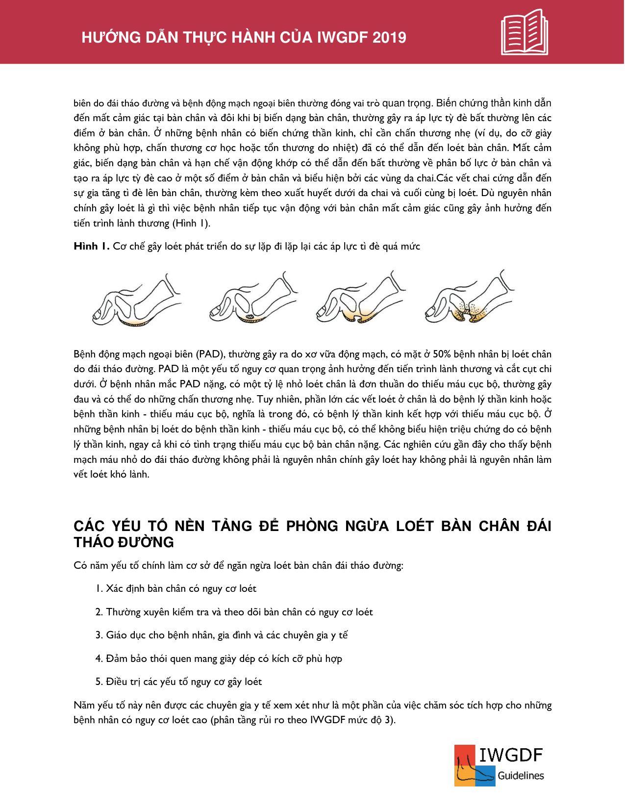
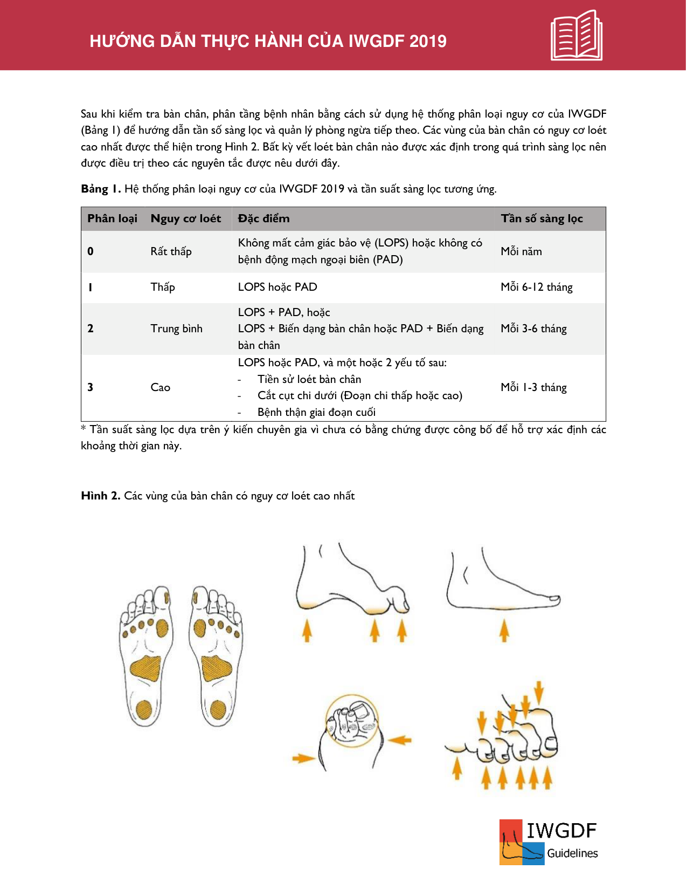
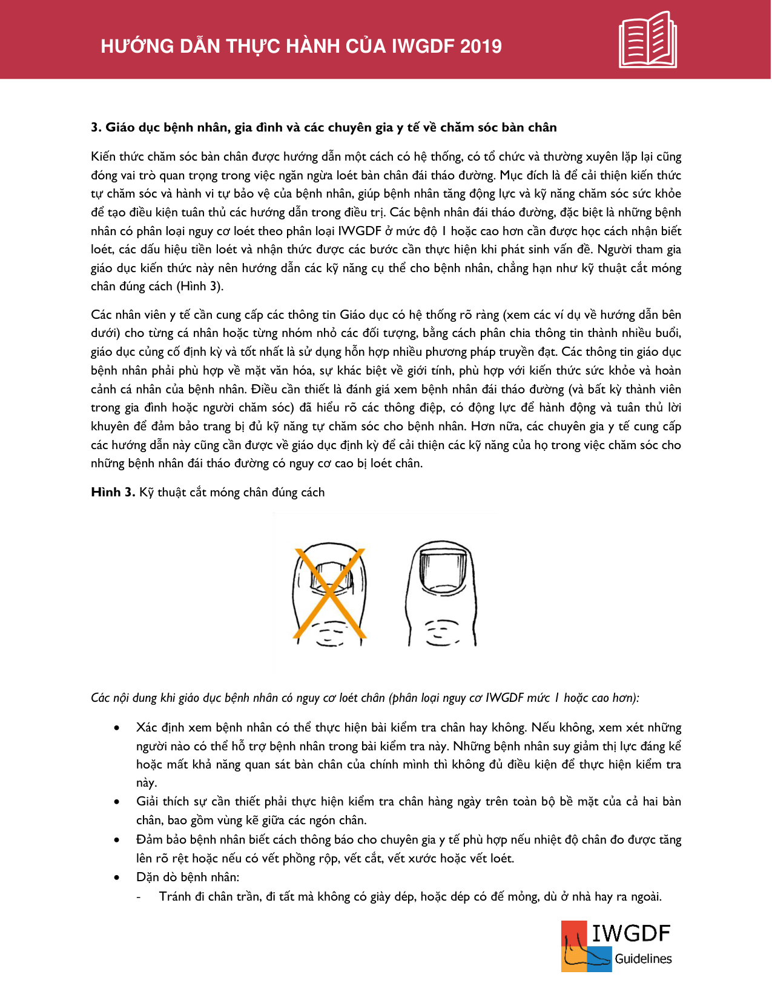
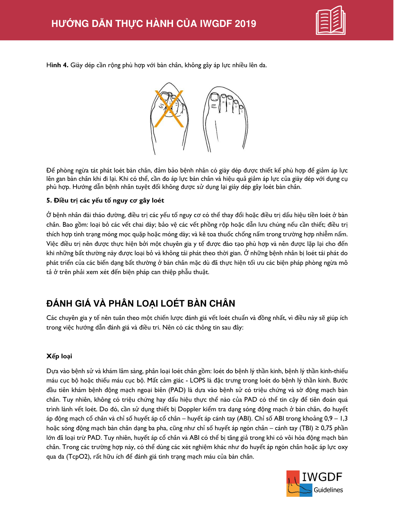
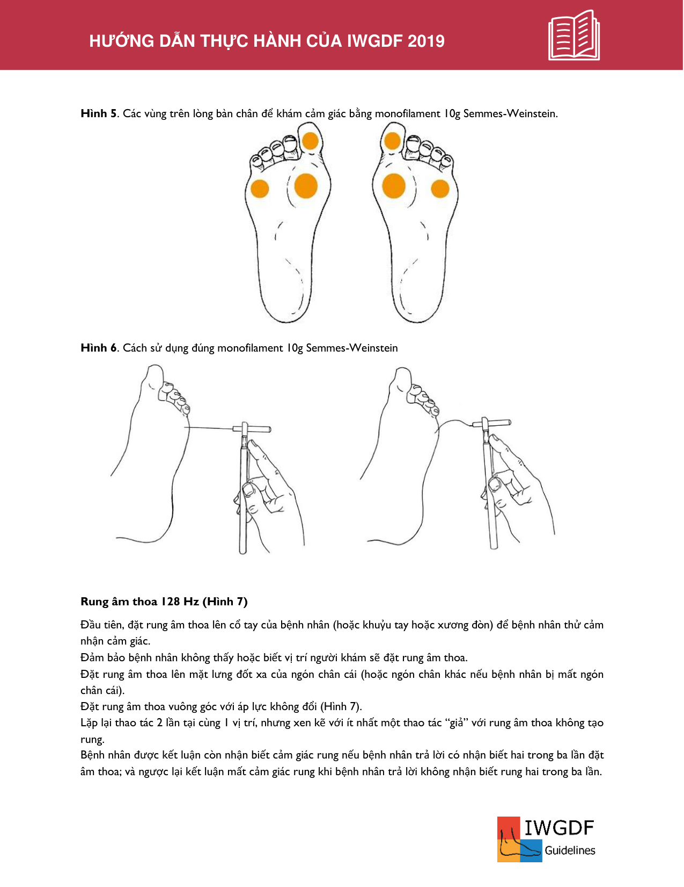
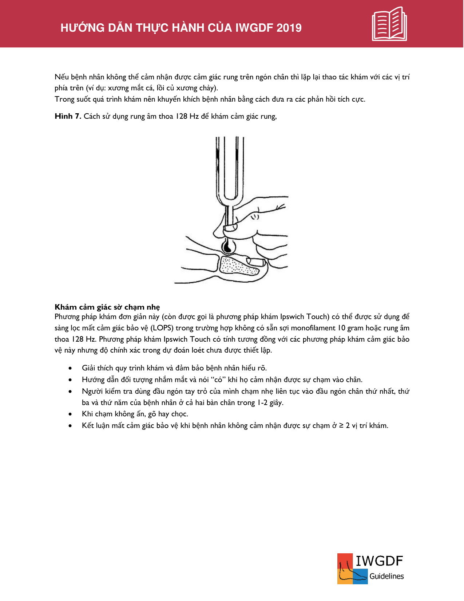
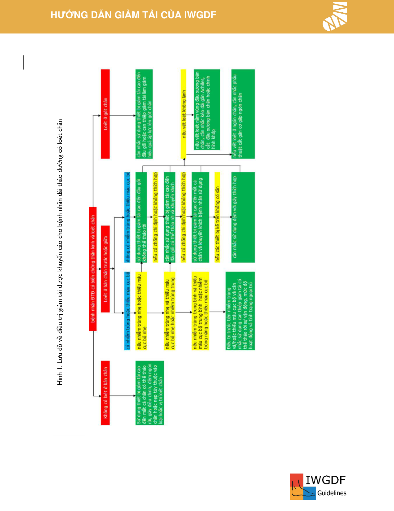
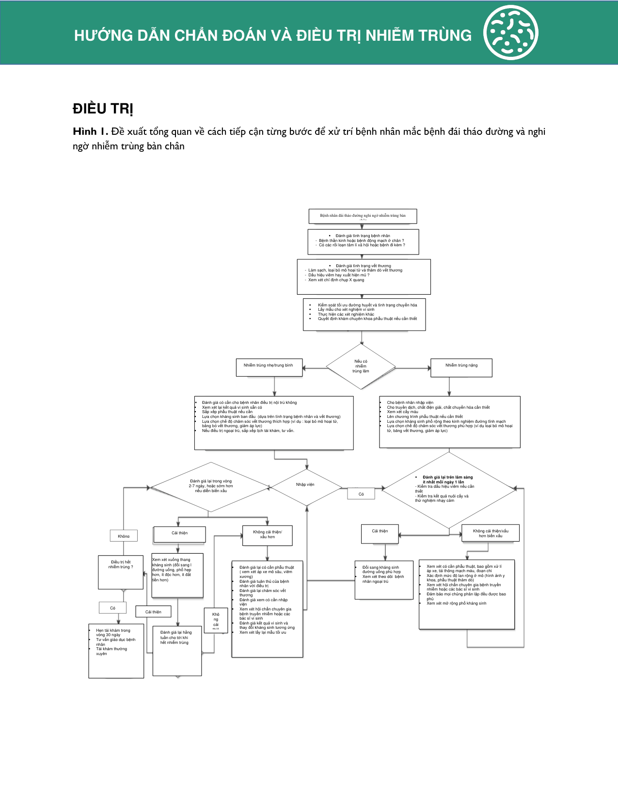

> Nguồn tệp gốc: pdfs/Final_IWGDF-Guideline-Tieng-Viet-2.pdf
> Trích xuất ngày: 2026-08-07

# IWGDF 2019 - Hướng dẫn phòng ngừa và quản lý bàn chân đái tháo đường (bản dịch tiếng Việt)

--- Trang 1 ---
6 Chương 
Hướng Dẫn 
Phát triển và 
Phương Pháp 
Hướng dẫn  
thực hành 
2019 
HƯỚNG DẪN  
PHÒNG NGỪA VÀ QUẢN LÝ 
BÀN CHÂN ĐÁI THÁO ĐƯỜNG 
CỦA IWGDF 2019

--- Trang 2 ---
IWGDF EDITORIAL BOARD 
Nicolaas C. Schaper (chair), Jaap J. van Netten 
(secretary), Jan Apelqvist, Sicco A. Bus, Robert J. 
Hinchliffe, Benjamin A. Lipsky 
CORRESPONDENCE 
www.iwgdfguidelines.org/contact 
LAYOUT 
Simon Christiaanse 
www.simonchristiaanse.com 
 
www.iwgdfguidelines.org

--- Trang 3 ---
Một phần của Hướng dẫn IWGDF năm 2019  
về Phòng ngừa và Quản lý bàn chân đái tháo đường  
 
HƯỚNG DẪN  
PHÒNG NGỪA VÀ  
QUẢN LÝ BÀN CHÂN 
ĐÁI THÁO ĐƯỜNG 
CỦA IWGDF

--- Trang 4 ---
s
TÁC GIẢ 
Nicolaas C. Schaper1, Jaap J. van Netten2,3,4 ,Jan Apelqvist5, Sicco A. 
Bus2, Robert J. Hinchliffe6 ,Benjamin A. Lipsky7  thay mặt Nhóm Chuyên 
Trách Bàn Chân Đái tháo đường thế giới (IWGDF) 
 
CÁC TRUNG TÂM THAM GIA 
1Div. Endocrinology, MUMC+, CARIM and CAPHRI Institute, Maastricht, 
The Netherlands 
2Amsterdam UMC, Department of Rehabilitation Medicine, Academic 
Medical Center, University of Amsterdam, Amsterdam, The Netherlands 
3School of Clinical Sciences, Queensland University of Technology, 
Brisbane, Australia 
4Diabetic foot clinic, Department of Surgery, Ziekenhuisgroep Twente, 
Almelo and Hengelo, The Netherlands 
5Department of Endocrinology, University Hospital of Malmö, Sweden 
6Bristol Centre for Surgical Research, University of Bristol, Bristol, UK 
7Department of Medicine, University of Washington, Seattle, USA; Green 
Templeton College, University of Oxford, Oxford, UK 
 
TỪ KHÓA 
Bàn chân đái tháo đường, loét chân, hướng dẫn, 
thực hành, ngăn ngừa, điều trị 
 
www.iwgdfguidelines.org

--- Trang 5 ---
HƯỚNG DẪN THỰC HÀNH CỦA IWGDF 2019 
TÓM TẮT 
Bệnh lý bàn chân đái tháo đường là gánh nặng lớn đối với người bệnh và hệ thống chăm sóc sức khỏe trên toàn 
cầu. Nhóm Chuyên Trách Bàn Chân Đái tháo đường thế giới - IWGDF (The International working Group on 
the Diabetic Foot) đã đưa ra các hướng dẫn dựa trên các bằng chứng về phòng ngừa và quản lý bệnh lý bàn 
chân đái tháo đường từ năm 1999. Năm 2019, tất cả các Hướng dẫn của IWGDF đã được cập nhật dựa trên 
các tổng quan hệ thống tài liệu nghiên cứu và khuyến nghị của các chuyên gia đa ngành từ khắp nơi trên thế 
giới.  
Hướng dẫn thực hành của IWGDF (IWGDF Practical Guidelines) mô tả các nguyên tắc cơ bản phòng ngừa, 
phân loại và điều trị bệnh lý bàn chân đái tháo đường, dựa trên sáu chương Hướng dẫn của IWGDF (IWGDF 
Guidelines). Tài liệu đồng thời mô tả sự phối hợp cần thiết ở các tầng lớp tổ chức cơ quan y tế để thành công 
trong việc phòng ngừa và điều trị loét bàn chân đái tháo đường dựa trên các nguyên tắc này và cung cấp các 
phụ lục nhằm hỗ trợ sàng lọc phát hiện sớm. Hướng dẫn thực hành cung cấp các thông tin hướng đến cộng 
đồng các chuyên gia y tế làm việc trong lĩnh vực chăm sóc bệnh nhân đái tháo đường. 
Nhiều nghiên cứu trên thế giới đã chứng tỏ việc thực hiện các nguyên tắc phòng ngừa và chăm sóc này có liên 
quan đến việc giảm tần suất cắt cụt chi dưới do đái tháo đường. Chúng tôi hy vọng rằng Hướng dẫn thực hành 
này sẽ tiếp tục đóng vai trò là tài liệu tham khảo để hỗ trợ các chuyên gia y tế trong việc giảm gánh nặng bệnh 
lý bàn chân đái tháo đường trên toàn cầu.

--- Trang 6 ---
HƯỚNG DẪN THỰC HÀNH CỦA IWGDF 2019 
GIỚI THIỆU 
Trong các Hướng dẫn thực hành về bệnh lý bàn chân đái tháo đường của IWGDF, chúng tôi mô tả các nguyên 
tắc cơ bản về phòng ngừa và chăm sóc bệnh lý bàn chân đái tháo đường. Hướng dẫn thực hành này dựa trên 
Hướng dẫn của IWGDF 2019, bao gồm các chương hướng dẫn dựa trên bằng chứng như sau: 
• Phòng ngừa loét chân ở bệnh nhân đái tháo đường (1) 
• Giảm áp lực loét chân ở bệnh nhân đái tháo đường (2) 
• Chẩn đoán, tiên lượng và kiểm soát bệnh động mạch ngoại biên ở bệnh nhân loét chân và đái tháo 
đường (3) 
• Chẩn đoán và điều trị nhiễm trùng bàn chân ở bệnh nhân đái tháo đường (4) 
• Can thiệp để tăng cường chữa lành vết loét chân ở bệnh nhân đái tháo đường (5) 
• Phân loại loét chân do đái tháo đường (6) 
Các tác giả, với tư cách là thành viên Ban biên tập của IWGDF, đã tóm tắt các thông tin từ sáu chương này và 
cung cấp các khuyến nghị bổ sung dựa trên ý kiến chuyên gia trong các lĩnh vực mà các chương hướng dẫn 
không thể đưa ra khuyến nghị dựa trên bằng chứng.  
Để biết thêm về các thông tin cơ bản và chi tiết người đọc có thể tham khảo sáu chương hướng dẫn dựa trên 
bằng chứng (1-6) cũng như các tài liệu về phương pháp luận và xây dựng hướng dẫn của chúng tôi (7); nếu 
trong văn bản tóm tắt này xuất hiện các thông tin khác với các chương trên, chúng tôi đề nghị người đọc tham 
khảo các chương hướng dẫn cụ thể (1-6). Bởi vì trong lĩnh vực đa ngành này các thuật ngữ đôi khi có thể được 
hiểu không rõ ràng, chúng tôi đã phát triển một tài liệu riêng IWGDF - Tiêu chí và Định nghĩa (IWGDF 
Definitions and Criteria document) (8).  
Các hướng dẫn thực hành cung cấp các thông tin đến cộng đồng các chuyên gia chăm sóc sức khỏe bệnh nhân 
đái tháo đường. Các nguyên tắc thực hành có thể được điều chỉnh hoặc sửa đổi tùy theo hoàn cảnh thực tế 
địa phương, tùy thuộc vào sự khác biệt tình hình kinh tế xã hội, khả năng tiếp cận, cơ cấu các nguồn lực chăm 
sóc sức khỏe và đa dạng về các yếu tố văn hóa. 
Bệnh lý bàn chân đái tháo đường 
Bệnh lý bàn chân đái tháo đường là một trong những biến chứng nghiêm trọng nhất của bệnh đái tháo đường. 
Đây là nguyên nhân gây đau đớn cũng như gánh nặng tài chính cho bệnh nhân, gia đình bệnh nhân cũng như các 
chuyên gia y tế, các cơ sở chăm sóc sức khỏe và xã hội nói chung. Chiến lược bao gồm các biện pháp phòng 
ngừa, giáo dục bệnh nhân và nhân viên y tế, điều trị phối hợp đa chuyên khoa và theo dõi chặt chẽ, được mô 
tả trong tài liệu này có thể làm giảm gánh nặng do bệnh lý bàn chân đái tháo đường.  
Sinh lý bệnh 
Mặc dù tỷ lệ mắc phải và các loại bệnh lý bàn chân đái tháo đường có sự khác nhau ở các vùng miền trên thế 
giới, nhưng cơ chế dẫn đến loét bàn chân là giống nhau ở hầu hết bệnh nhân. Loét bàn chân thường xuất hiện 
ở bệnh nhân đái tháo đường có đồng thời hai hoặc nhiều hơn yếu tố nguy cơ, trong đó bệnh lý thần kinh ngoại

--- Trang 7 ---

> **[Chuyển đổi ảnh → text để phục vụ embedding — nguồn ảnh: `images/iwgdf_p7.png`, cần đối chiếu lại ảnh gốc khi cần độ chính xác tuyệt đối]**
>
> 4 hình vẽ nối tiếp mô tả tiến trình hình thành vết loét (nhìn nghiêng bàn chân, vùng đầu ngón cái chịu lực):
> 1. Bàn chân bình thường, đầu ngón cái tiếp xúc mặt đất.
> 2. Xuất hiện vùng chai/dày da (tô vàng nhạt) tại điểm tỳ đè do áp lực lặp lại.
> 3. Vùng chai dày lên, bắt đầu có tổn thương mô dưới da (chấm vàng đậm hơn).
> 4. Hình thành vết loét hở tại vị trí vết chai (các chấm vàng lan rộng thể hiện mô hoại tử/loét).
>
> Minh họa cho nguyên lý mô tả bằng chữ ngay phía trên: chấn thương nhẹ lặp lại trên nền bàn chân mất cảm giác bảo vệ → hình thành vết chai → xuất huyết dưới da chai → loét.

HƯỚNG DẪN THỰC HÀNH CỦA IWGDF 2019 
biên do đái tháo đường và bệnh động mạch ngoại biên thường đóng vai trò quan trọng. Biến chứng thần kinh dẫn 
đến mất cảm giác tại bàn chân và đôi khi bị biến dạng bàn chân, thường gây ra áp lực tỳ đè bất thường lên các 
điểm ở bàn chân. Ở những bệnh nhân có biến chứng thần kinh, chỉ cần chấn thương nhẹ (ví dụ, do cỡ giày 
không phù hợp, chấn thương cơ học hoặc tổn thương do nhiệt) đã có thể dẫn đến loét bàn chân. Mất cảm 
giác, biến dạng bàn chân và hạn chế vận động khớp có thể dẫn đến bất thường về phân bố lực ở bàn chân và 
tạo ra áp lực tỳ đè cao ở một số điểm ở bàn chân và biểu hiện bởi các vùng da chai.Các vết chai cứng dẫn đến 
sự gia tăng tì đè lên bàn chân, thường kèm theo xuất huyết dưới da chai và cuối cùng bị loét. Dù nguyên nhân 
chính gây loét là gì thì việc bệnh nhân tiếp tục vận động với bàn chân mất cảm giác cũng gây ảnh hưởng đến 
tiến trình lành thương (Hình 1). 
Hình 1. Cơ chế gây loét phát triển do sự lặp đi lặp lại các áp lực tì đè quá mức  
 
Bệnh động mạch ngoại biên (PAD), thường gây ra do xơ vữa động mạch, có mặt ở 50% bệnh nhân bị loét chân 
do đái tháo đường. PAD là một yếu tố nguy cơ quan trọng ảnh hưởng đến tiến trình lành thương và cắt cụt chi 
dưới. Ở bệnh nhân mắc PAD nặng, có một tỷ lệ nhỏ loét chân là đơn thuần do thiếu máu cục bộ, thường gây 
đau và có thể do những chấn thương nhẹ. Tuy nhiên, phần lớn các vết loét ở chân là do bệnh lý thần kinh hoặc 
bệnh thần kinh - thiếu máu cục bộ, nghĩa là trong đó, có bệnh lý thần kinh kết hợp với thiếu máu cục bộ. Ở 
những bệnh nhân bị loét do bệnh thần kinh - thiếu máu cục bộ, có thể không biểu hiện triệu chứng do có bệnh 
lý thần kinh, ngay cả khi có tình trạng thiếu máu cục bộ bàn chân nặng. Các nghiên cứu gần đây cho thấy bệnh 
mạch máu nhỏ do đái tháo đường không phải là nguyên nhân chính gây loét hay không phải là nguyên nhân làm 
vết loét khó lành. 
 
CÁC YẾU TỐ NỀN TẢNG ĐỂ PHÒNG NGỪA LOÉT BÀN CHÂN ĐÁI 
THÁO ĐƯỜNG 
Có năm yếu tố chính làm cơ sở để ngăn ngừa loét bàn chân đái tháo đường: 
1. Xác định bàn chân có nguy cơ loét 
2. Thường xuyên kiểm tra và theo dõi bàn chân có nguy cơ loét 
3. Giáo dục cho bệnh nhân, gia đình và các chuyên gia y tế 
4. Đảm bảo thói quen mang giày dép có kích cỡ phù hợp 
5. Điều trị các yếu tố nguy cơ gây loét 
Năm yếu tố này nên được các chuyên gia y tế xem xét như là một phần của việc chăm sóc tích hợp cho những 
bệnh nhân có nguy cơ loét cao (phân tầng rủi ro theo IWGDF mức độ 3).

--- Trang 8 ---
HƯỚNG DẪN THỰC HÀNH CỦA IWGDF 2019 
1. Xác định bàn chân có nguy cơ loét 
Bệnh nhân đái tháo đường không biểu hiện triệu chứng cũng không loại trừ bệnh lý bàn chân; những bệnh nhân 
này có thể có bệnh lý thần kinh không triệu chứng, bệnh động mạch ngoại biên, dấu hiệu tiền loét hoặc thậm 
chí là loét. Kiểm tra bệnh nhân đái tháo đường có nguy cơ loét chân rất thấp (IWGDF nguy cơ cấp 0) hàng 
năm để tìm các dấu hiệu hoặc triệu chứng mất cảm giác bảo vệ và bệnh động mạch ngoại biên, để xác định 
xem bệnh nhân có nguy cơ bị loét chân hay không, bao gồm: 
• 
Tiền sử: Đã từng bị loét hoặc cắt cụt chi dưới, đau khập khiễng cách hồi. 
• 
Khám mạch máu: Sờ thấy mạch máu bàn chân 
• 
Mất cảm giác bảo vệ (LOPS): đánh giá bằng một trong các kỹ thuật sau (xem chi tiết phần phụ lục): 
- 
Cảm giác áp lực: sử dụng sợi monofilament Semmes-Weinstein (áp lực là 10 gram). 
- 
Cảm giác rung: rung âm thoa 128 Hz 
- 
Khi không có sợi monofilament Semmes-Weinstein và rung âm thoa, có thể tiến hành khám cảm 
giác bằng cách: dùng đầu ngón tay trỏ  chạm nhẹ vào đầu ngón chân của bệnh nhân trong 1-2 giây. 
Mất cảm giác bảo vệ - LOPS (Loss of Protective Sensation) thường do bệnh lý đa dây thần kinh đái 
tháo đường. Nếu có mất LOPS, thường cần xem xét thêm tiền sử và tiến hành kiểm tra thêm về 
nguyên nhân và hậu quả của LOPS; những thông tin này nằm ngoài phạm vi của hướng dẫn này. 
 
 
 
 
 
2. Thường xuyên theo dõi và khám bàn chân có nguy cơ (nguy cơ theo phân IWGDF từ mức  
1 trở lên ) 
Ở bệnh nhân đái tháo đường mất cảm giác bảo vệ hoặc có bệnh động mạch ngoại biên (IWGDF nguy cơ cấp 
1-3) thực hiện kiểm tra toàn diện hơn, bao gồm: 
• 
Tiền sử: Đã từng loét/cắt cụt chi dưới, bệnh thận giai đoạn cuối, đã từng được giáo dục về bàn chân, 
cách ly xã hội, tiếp cận kém với dịch vụ chăm sóc sức khỏe và hạn chế về tài chính, đau chân (khi đi bộ 
hoặc nghỉ ngơi) hoặc tê chân, đau khập khiễng cách hồi. 
• 
Khám mạch máu: Sờ thấy mạch bàn chân. 
• 
Da: Đánh giá màu da, nhiệt độ, sự hiện diện của vết chai hoặc phù, dấu hiệu tiền loét. 
• 
Xương / khớp: kiểm tra các biến dạng (ví dụ: ngón chân quặp, ngón chân hình búa), các điểm xương nhô 
lớn bất thường hoặc sự vận động hạn chế của khớp. Kiểm tra bàn chân bệnh nhân cả ở tư thế nằm và 
đứng.  
• 
Đánh giá mất cảm giác bảo vệ (LOPS), nếu trong lần kiểm tra trước, cảm giác bảo vệ còn nguyên vẹn 
• 
Giày dép: không vừa, không phù hợp hoặc không mang giày dép. 
• 
Vệ sinh bàn chân kém, ví dụ: cắt móng chân không đúng cách, không rửa bàn chân, nhiễm nấm bề mặt 
hoặc tất không sạch. 
• 
Các giới hạn về thể chất có thể cản trở việc tự chăm sóc bàn chân (ví dụ: thị lực kém, béo phì). 
• 
Kiến thức chăm sóc bàn chân.

--- Trang 9 ---

HƯỚNG DẪN THỰC HÀNH CỦA IWGDF 2019 
Sau khi kiểm tra bàn chân, phân tầng bệnh nhân bằng cách sử dụng hệ thống phân loại nguy cơ của IWGDF 
(Bảng 1) để hướng dẫn tần số sàng lọc và quản lý phòng ngừa tiếp theo. Các vùng của bàn chân có nguy cơ loét 
cao nhất được thể hiện trong Hình 2. Bất kỳ vết loét bàn chân nào được xác định trong quá trình sàng lọc nên 
được điều trị theo các nguyên tắc được nêu dưới đây. 
Bảng 1. Hệ thống phân loại nguy cơ của IWGDF 2019 và tần suất sàng lọc tương ứng.

> **[Định dạng lại — bảng gốc bị trích xuất tự động thành text phẳng, đã đối chiếu ảnh gốc `images/iwgdf_p9.png` để tái dựng đúng hàng]**

| Phân loại | Nguy cơ loét | Đặc điểm | Tần số sàng lọc |
|---|---|---|---|
| 0 | Rất thấp | Không mất cảm giác bảo vệ (LOPS) hoặc không có bệnh động mạch ngoại biên (PAD) | Mỗi năm |
| 1 | Thấp | LOPS hoặc PAD | Mỗi 6-12 tháng |
| 2 | Trung bình | LOPS + PAD, hoặc LOPS + Biến dạng bàn chân hoặc PAD + Biến dạng bàn chân | Mỗi 3-6 tháng |
| 3 | Cao | LOPS hoặc PAD, và một hoặc 2 yếu tố sau: tiền sử loét bàn chân; cắt cụt chi dưới (đoạn chi thấp hoặc cao); bệnh thận giai đoạn cuối | Mỗi 1-3 tháng |

*Tần suất sàng lọc dựa trên ý kiến chuyên gia vì chưa có bằng chứng được công bố để hỗ trợ xác định các khoảng thời gian này.*

Hình 2. Các vùng của bàn chân có nguy cơ loét cao nhất

> **[Chuyển đổi ảnh → text để phục vụ embedding — nguồn ảnh: `images/iwgdf_p9.png`, cần đối chiếu lại ảnh gốc khi cần độ chính xác tuyệt đối]**
>
> 4 hình vẽ minh họa vùng nguy cơ loét cao trên bàn chân: (1) Lòng 2 bàn chân nhìn từ dưới lên, tô đậm các vùng nguy cơ cao gồm đầu các ngón chân, các đầu xương bàn ngón (ụ dưới các ngón), và gót chân. (2) Mặt lòng bàn chân nhìn nghiêng với các mũi tên chỉ lực tỳ đè tập trung vào vùng đầu xương bàn ngón và ngón cái. (3) Cạnh bên bàn chân với mũi tên chỉ lực ép vào vùng bờ ngoài/gót. (4) Cận cảnh các ngón chân với nhiều mũi tên chỉ lực ép từ trên xuống và từ hai bên vào các đầu ngón và khe giữa ngón (vùng dễ tổn thương do biến dạng/chèn ép giữa các ngón).

--- Trang 10 ---

> **[Chuyển đổi ảnh → text để phục vụ embedding — nguồn ảnh: `images/iwgdf_p10.png`, cần đối chiếu lại ảnh gốc khi cần độ chính xác tuyệt đối]**
>
> 2 hình vẽ ngón chân cái nhìn từ trên xuống: (1) Bên trái, đánh dấu "SAI" bằng dấu X màu cam — minh họa cắt móng theo đường cong ôm sát khóe móng (cắt sâu vào 2 góc). (2) Bên phải, không đánh dấu — minh họa cắt móng theo đường THẲNG ngang qua đầu móng, không cắt sâu vào khóe. Thông điệp: cắt móng chân thẳng ngang, không cắt vát/sâu vào khóe để tránh gây tổn thương/nhiễm trùng khóe móng.

HƯỚNG DẪN THỰC HÀNH CỦA IWGDF 2019 
3. Giáo dục bệnh nhân, gia đình và các chuyên gia y tế về chăm sóc bàn chân  
Kiến thức chăm sóc bàn chân được hướng dẫn một cách có hệ thống, có tổ chức và thường xuyên lặp lại cũng 
đóng vai trò quan trọng trong việc ngăn ngừa loét bàn chân đái tháo đường. Mục đích là để cải thiện kiến thức 
tự chăm sóc và hành vi tự bảo vệ của bệnh nhân, giúp bệnh nhân tăng động lực và kỹ năng chăm sóc sức khỏe 
để tạo điều kiện tuân thủ các hướng dẫn trong điều trị. Các bệnh nhân đái tháo đường, đặc biệt là những bệnh 
nhân có phân loại nguy cơ loét theo phân loại IWGDF ở mức độ 1 hoặc cao hơn cần được học cách nhận biết 
loét, các dấu hiệu tiền loét và nhận thức được các bước cần thực hiện khi phát sinh vấn đề. Người tham gia 
giáo dục kiến thức này nên hướng dẫn các kỹ năng cụ thể cho bệnh nhân, chẳng hạn như kỹ thuật cắt móng 
chân đúng cách (Hình 3).  
Các nhân viên y tế cần cung cấp các thông tin Giáo dục có hệ thống rõ ràng (xem các ví dụ về hướng dẫn bên 
dưới) cho từng cá nhân hoặc từng nhóm nhỏ các đối tượng, bằng cách phân chia thông tin thành nhiều buổi, 
giáo dục củng cố định kỳ và tốt nhất là sử dụng hỗn hợp nhiều phương pháp truyền đạt. Các thông tin giáo dục 
bệnh nhân phải phù hợp về mặt văn hóa, sự khác biệt về giới tính, phù hợp với kiến thức sức khỏe và hoàn 
cảnh cá nhân của bệnh nhân. Điều cần thiết là đánh giá xem bệnh nhân đái tháo đường (và bất kỳ thành viên 
trong gia đình hoặc người chăm sóc) đã hiểu rõ các thông điệp, có động lực để hành động và tuân thủ lời 
khuyên để đảm bảo trang bị đủ kỹ năng tự chăm sóc cho bệnh nhân. Hơn nữa, các chuyên gia y tế cung cấp 
các hướng dẫn này cũng cần được về giáo dục định kỳ để cải thiện các kỹ năng của họ trong việc chăm sóc cho 
những bệnh nhân đái tháo đường có nguy cơ cao bị loét chân. 
Hình 3. Kỹ thuật cắt móng chân đúng cách 
 
Các nội dung khi giáo dục bệnh nhân có nguy cơ loét chân (phân loại nguy cơ IWGDF mức 1 hoặc cao hơn): 
• 
Xác định xem bệnh nhân có thể thực hiện bài kiểm tra chân hay không. Nếu không, xem xét những 
người nào có thể hỗ trợ bệnh nhân trong bài kiểm tra này. Những bệnh nhân suy giảm thị lực đáng kể 
hoặc mất khả năng quan sát bàn chân của chính mình thì không đủ điều kiện để thực hiện kiểm tra 
này.  
• 
Giải thích sự cần thiết phải thực hiện kiểm tra chân hàng ngày trên toàn bộ bề mặt của cả hai bàn 
chân, bao gồm vùng kẽ giữa các ngón chân. 
• 
Đảm bảo bệnh nhân biết cách thông báo cho chuyên gia y tế phù hợp nếu nhiệt độ chân đo được tăng 
lên rõ rệt hoặc nếu có vết phồng rộp, vết cắt, vết xước hoặc vết loét. 
• 
Dặn dò bệnh nhân: 
- 
Tránh đi chân trần, đi tất mà không có giày dép, hoặc dép có đế mỏng, dù ở nhà hay ra ngoài.

--- Trang 11 ---
HƯỚNG DẪN THỰC HÀNH CỦA IWGDF 2019 
- 
Không mang giày quá chật, có cạnh thô hoặc có đường may nổi không bằng phẳng. 
- 
Kiểm tra bằng mắt và cảm nhận bằng tay bên trong giày trước khi mang chúng vào. 
- 
Mang tất ngắn /tất dài không có đường may nổi (hoặc có đường may từ trong ra ngoài); không 
mang tất chật hoặc tất cao đến đầu gối (chỉ nên mang tất áp lực khi có chỉ định của chuyên gia 
chăm sóc chân) và thay tất hàng ngày. 
- 
Rửa chân hàng ngày (với nhiệt độ nước luôn dưới 37°C) và lau khô cẩn thận, đặc biệt là khoảng 
kẽ giữa các ngón chân. 
- 
Không sử dụng bất kỳ loại máy sưởi hoặc chai nước nóng để làm ấm chân. 
- 
Không sử dụng các tác nhân hóa học hoặc thạch cao để loại bỏ vết chai, sần; cần liên hệ với 
chuyên gia y tế thích hợp về những vấn đề này. 
- 
Đối với da khô có thể sử dụng các chất làm mềm, nhưng không được bôi vào khoảng kẽ giữa các 
ngón chân. 
- 
Cắt móng chân tạo thành đường cắt ngang (xem Hình 3). 
- 
Kiểm tra chân thường xuyên bởi một chuyên gia y tế. 
4. Đảm bảo thói quen mang giày dép phù hợp 
Ở những bệnh nhân đái tháo đường có bàn chân mất cảm giác, mang giày dép không phù hợp hoặc đi chân trần 
là nguyên nhân chính gây chấn thương bàn chân dẫn đến loét chân. Những người bị mất cảm giác bảo vệ (LOPS) 
phải có giày, dép và nên được khuyến khích mang giày, dép phù hợp mọi lúc, cả trong nhà và ra ngoài. Tất cả 
giày dép phải được điều chỉnh để phù hợp với bất kỳ sự thay đổi nào trong cấu trúc bàn chân hoặc cơ chế sinh 
học ảnh hưởng bất thường đến bàn chân. Những người không có LOPS hoặc PAD (IWGDF 0) có thể chọn 
giày dép có kích cỡ vừa chân. Những người bị LOPS hoặc PAD (IWGDF 1-3) phải cẩn thận hơn khi lựa chọn 
giày dép có kích cỡ phù hợp; điều này hết sức quan trọng đối với các bệnh nhân có các biến dạng ở bàn chân 
(IWGDF 2) hoặc có tiền sử loét / cắt cụt chi trước đó (IWGDF 3). 
Chiều dài bên trong giày nên dài hơn 1 – 2 cm so với chiều dài chân, không quá rộng hoặc không quá chật 
(Hình 4). Chiều rộng bên trong cần bằng với chiều rộng bàn chân (tại vùng rộng nhất bàn chân), chiều cao cần 
tạo đủ không gian cho tất cả các ngón chân. Đánh giá kích thước phù hợp với bệnh nhân ở tư thế đứng, tốt 
nhất và buổi chiều (khi mà bàn chân có thể phồng to ra. Nếu không có giày dép phù hợp có sẵn cho bàn chân 
(vd không vừa do biến dạng bàn chân) hoặc nếu có các dấu hiệu tăng áp lực bất thường tại bàn chân (vd: xung 
huyết, vùng da chai cứng, loét), cần giới thiệu bệnh nhân đến các chuyên gia dụng cụ chỉnh hình (để có thêm 
lời khuyên và/ hoặc sản xuất giày), có thể bao gồm giày tăng độ sâu, giày đóng theo biến dạng bàn chân, thêm 
lót giày bên trong hoặc chỉnh hình phù hợp.

--- Trang 12 ---

> **[Chuyển đổi ảnh → text để phục vụ embedding — nguồn ảnh: `images/iwgdf_p12.png`, cần đối chiếu lại ảnh gốc khi cần độ chính xác tuyệt đối]**
>
> 2 hình vẽ bàn chân nhìn từ trên xuống trong giày: (1) Bên trái, đánh dấu "SAI" bằng dấu X màu cam — bàn chân bị bó/ép trong khuôn giày quá hẹp, các ngón chân chồng lấn nhau. (2) Bên phải, không đánh dấu — bàn chân với các ngón chân thoải mái, khuôn giày đủ rộng theo đúng hình dạng bàn chân, không chèn ép. Thông điệp: giày dép phải đủ rộng ở phần mũi/ngón chân, không gây áp lực/chèn ép lên các ngón.

HƯỚNG DẪN THỰC HÀNH CỦA IWGDF 2019 
Hình 4. Giày dép cần rộng phù hợp với bàn chân, không gây áp lực nhiều lên da.  
 
Để phòng ngừa tát phát loét bàn chân, đảm bảo bệnh nhân có giày dép được thiết kế phù hợp để giảm áp lực 
lên gan bàn chân khi đi lại. Khi có thể, cần đo áp lực bàn chân và hiệu quả giảm áp lực của giày dép với dụng cụ 
phù hợp. Hướng dẫn bệnh nhân tuyệt đối không được sử dụng lại giày dép gây loét bàn chân. 
5. Điều trị các yếu tố nguy cơ gây loét 
Ở bệnh nhân đái tháo đường, điều trị các yếu tố nguy cơ có thể thay đổi hoặc điều trị dấu hiệu tiền loét ở bàn 
chân. Bao gồm: loại bỏ các vết chai dày; bảo vệ các vết phồng rộp hoặc dẫn lưu chúng nếu cần thiết; điều trị 
thích hợp tình trạng móng mọc quặp hoặc móng dày; và kê toa thuốc chống nấm trong trường hợp nhiễm nấm. 
Việc điều trị nên được thực hiện bởi một chuyên gia y tế được đào tạo phù hợp và nên được lặp lại cho đến 
khi những bất thường này được loại bỏ và không tái phát theo thời gian. Ở những bệnh nhân bị loét tái phát do 
phát triển của các biến dạng bất thường ở bàn chân mặc dù đã thực hiện tối ưu các biện pháp phòng ngừa mô 
tả ở trên phải xem xét đến biện pháp can thiệp phẫu thuật. 
 
ĐÁNH GIÁ VÀ PHÂN LOẠI LOÉT BÀN CHÂN 
Các chuyên gia y tế nên tuân theo một chiến lược đánh giá vết loét chuẩn và đồng nhất, vì điều này sẽ giúp ích 
trong việc hướng dẫn đánh giá và điều tri. Nên có các thông tin sau đây:  
 
Xếp loại 
Dựa vào bệnh sử và khám lâm sàng, phân loại loét chân gồm: loét do bệnh lý thần kinh, bệnh lý thần kinh-thiếu 
máu cục bộ hoặc thiếu máu cục bộ. Mất cảm giác - LOPS là đặc trưng trong loét do bệnh lý thần kinh. Bước 
đầu tiên khám bệnh động mạch ngoại biên (PAD) là dựa vào bệnh sử có triệu chứng và sờ động mạch bàn 
chân. Tuy nhiên, không có triệu chứng hay dấu hiệu thực thể nào của PAD có thể tin cậy để tiên đoán quá 
trình lành vết loét. Do đó, cần sử dụng thiết bị Doppler kiểm tra dạng sóng động mạch ở bàn chân, đo huyết 
áp động mạch cổ chân và chỉ số huyết áp cổ chân – huyết áp cánh tay (ABI). Chỉ số ABI trong khoảng 0,9 – 1,3 
hoặc sóng động mạch bàn chân dạng ba pha, cũng như chỉ số huyết áp ngón chân – cánh tay (TBI) ≥ 0,75 phần 
lớn đã loại trừ PAD. Tuy nhiên, huyết áp cổ chân và ABI có thể bị tăng giả trong khi có vôi hóa động mạch bàn 
chân. Trong các trường hợp này, có thể dùng các xét nghiệm khác như đo huyết áp ngón chân hoặc áp lực oxy 
qua da (TcpO2), rất hữu ích để đánh giá tình trạng mạch máu của bàn chân.

--- Trang 13 ---
HƯỚNG DẪN THỰC HÀNH CỦA IWGDF 2019 
Nguyên nhân 
Mang giày dép có kích cỡ không phù hợp và đi chân trần là những thói quen thường dẫn đến loét chân, ngay cả 
ở những bệnh nhân chỉ bị loét do thiếu máu cục bộ. Do đó, cần phải kiểm tra kỹ giày dép và thói quen mang 
giày dép của mỗi bệnh nhân bị loét chân. 
Vị trí và độ sâu 
Loét do bệnh lý thần kinh thường phát triển trên bề mặt lòng của bàn chân hoặc ở vị trí có biến dạng xương. 
Loét do thiếu máu cục bộ và do bệnh lý thần kinh - thiếu máu cục bộ thường phát triển ở đầu ngón chân hoặc 
cạnh bên của bàn chân. 
Xác định độ sâu của vết loét bàn chân có thể khó khăn, đặc biệt là trong trường hợp có vết chai hoặc mô hoại 
tử. Để giúp đánh giá tốt vết loét, nên cắt lọc càng sớm càng tốt đối với các vết loét do bệnh lý thần kinh hoặc 
bệnh lý thần kinh - thiếu máu có bao quanh bởi da chai hoặc có mô hoại tử. Tuy nhiên, không nên cắt lọc vết 
loét không nhiễm trùng và có dấu hiệu thiếu máu cục bộ nặng. Loét do bệnh lý thần kinh thường có thể được 
cắt lọc mà không cần gây tê cục bộ. 
Dấu hiệu nhiễm trùng 
Nhiễm trùng bàn chân ở bệnh nhân đái tháo đường là mối đe dọa nghiêm trọng cho bàn chân và chi dưới, phải 
được đánh giá và điều trị kịp thời. Do tất cả vết loét đều có thể có các mầm bệnh cư trú, chẩn đoán nhiễm 
trùng cần có ít nhất hai dấu hiệu hoặc triệu chứng viêm (đỏ, nóng, sưng cứng , đau) hoặc dịch tiết mủ. Tuy 
nhiên, những dấu hiệu này có thể khó phát hiện do bệnh lý thần kinh hoặc thiếu máu cục bộ và các dấu hiệu 
toàn thân (ví dụ: đau, sốt, tăng bạch cầu) lại không xuất hiện trong các trường hợp nhiễm trùng nhẹ và trung 
bình. Nhiễm trùng nên được phân loại theo xếp độ của IDSA/IWGDF như sau: mức độ nhẹ (bề mặt, mức độ 
viêm mô tế bào rất ít), trung bình (sâu hơn hoặc rộng hơn) hoặc nghiêm trọng (kèm theo dấu hiệu của nhiễm 
trùng huyết), cũng cần đánh giá có viêm tủy xương kèm theo hay không (4). 
Nếu không được điều trị đúng cách, nhiễm trùng có thể lây lan ngay đến các mô bên dưới, kể cả xương (viêm 
tủy xương). Nên đánh giá nguy cơ viêm tủy xương ở bệnh nhân bị nhiễm trùng bàn chân đái tháo đường, đặc 
biệt là nếu vết loét kéo dài, sâu hoặc vết loét ở vị trí vùng xương nhô . Kiểm tra vết loét có sâu đến xương 
hay không bằng cách quan sát hoặc dùng que thăm dò kim loại vô trùng xem có đụng vào xương. Ngoài khám 
lâm sàng, nên chụp X-quang thường ở hầu hết các bệnh nhân để tìm bằng chứng viêm tủy xương, khí trong mô 
mềm hoặc dị vật. Khi cần có thể xem xét chụp cộng hưởng từ (MRI) hoặc các phương pháp chẩn đoán hình 
ảnh khác đối với những bệnh nhân không thể thực hiện được MRI (ví dụ, xạ hình hoặc chụp PET) 
Đối với các vết thương bị nhiễm trùng trên lâm sàng, lấy mẫu mô để cấy vi trùng (và nếu có thể thì nhuộm 
Gram); tránh lấy mẫu bệnh phẩm ở vết thương bằng tăm bông. Các mầm bệnh gây nhiễm trùng bàn chân và 
tính nhạy cảm với kháng sinh của chúng khác nhau tùy vùng địa lý, đặc điểm nhân khẩu học và tình trạng lâm 
sàng, nhưng Staphylococcus aureus (nhiễm đơn độc hoặc nhiễm đồng thời với vi trùng khác) là tác nhân thường 
gặp trong hầu hết các trường hợp. Trường hợp nhiễm trùng mạn tính và nghiêm trọng thường do nhiễm nhiều 
loại vi khuẩn, trực khuẩn gram âm hiếu khí, vi khuẩn kỵ khí và kèm theo cầu khuẩn gram dương, đặc biệt ở 
bệnh nhân sống ở những vùng khí hậu ấm áp.

--- Trang 14 ---
HƯỚNG DẪN THỰC HÀNH CỦA IWGDF 2019 
Các yếu tố liên quan đến bệnh nhân 
Ngoài việc đánh giá có hệ thống cho các vết loét, bàn chân và cẳng chân, cũng cần xem xét các yếu tố liên quan 
đến bệnh nhân có thể ảnh hưởng đến quá trình lành vết thương, như bệnh thận giai đoạn cuối, phù, suy dinh 
dưỡng, kiểm soát chuyển hoá kém hoặc các vấn đề tâm lý - xã hội. 
Phân loại loét 
Đánh giá mức độ nghiêm trọng của nhiễm trùng bằng tiêu chí phân loại IWGDF / ISDA (4, 6) và ở bệnh nhân 
mắc PAD nên sử dụng hệ thống WIfI (wound/ ischaemia/ Infection: vết thương / thiếu máu cục bộ/ nhiễm 
trùng) để phân tầng nguy cơ cắt cụt chi và lợi ích tái thông mạch (3, 6). Để giao tiếp giữa các chuyên gia y tế, 
chúng tôi đề nghị sử dụng hệ thống SINBAD (Site, Ischemia, Neuropathy, Bacterial Infection, and Depth: vị 
trí, thiếu máu cục bộ, thần kinh, nhiễm trùng và độ sâu), hệ thống này cũng có thể dùng để kiểm định kết quả 
điều trị trong nhóm bệnh nhân (6).

--- Trang 15 ---
HƯỚNG DẪN THỰC HÀNH CỦA IWGDF 2019 
NGUYÊN TẮC ĐIỀU TRỊ VẾT LOÉT 
Loét chân sẽ lành ở phần lớn các bệnh nhân nếu bác sĩ lâm sàng điều trị dựa trên các nguyên tắc dưới đây. Tuy 
nhiên, nếu tiếp tục gây tổn thương nền vết thương, hoặc không điều trị tốt tình trạng thiếu máu cục bộ hay 
nhiễm trùng, thì ngay cả việc chăm sóc vết thương tối ưu cũng không đạt hiệu quả tốt. Các bệnh nhân có vết 
loét sâu hơn mô dưới da thường cần được điều trị tích cực, và tùy vào tình hình xã hội, nguồn lực địa phương 
và cơ sở hạ tầng, các bệnh nhân này có thể cần phải được nhập viện. 
1. Giảm tải áp lực cho bàn chân đái tháo đường và bảo vệ vết loét  
Giảm tải áp lực là nền tảng trong điều trị vết loét gây ra do gia tăng áp lực cơ sinh học bàn chân (biomechanical 
stress): 
• 
Phương pháp điều trị giảm tải ưu tiên cho loét gan bàn chân do biến chứng thần kinh là sử dụng một 
dụng cụ giảm áp lực có chiều cao đến đầu gối không tự tháo rời, như phương pháp bó bột tiếp xúc 
toàn bộ (Total contact casting - TCC) hay máng tiếp xúc có thể tháo rời nhưng được cố định tại chỗ 
(bởi chuyên gia chỉnh hình sau khi đo đạc vừa chân. 
• 
Khi thiết bị hỗ trợ giảm tải bàn chân cao đến đầu gối không tự tháo rời bị chống chỉ định hoặc không 
dung nạp với bệnh nhân, cân nhắc sử dụng thiết bị giảm tải cao đến đầu gối có thể tự tháo rời. Nếu 
thiết bị này bị chống chỉ định hoặc không dung nạp, hãy cân nhắc sử dụng một thiết bị giảm tải cao 
đến mắt cá chân. Luôn giáo dục bệnh nhân về lợi ích của tuân thủ việc đeo thiết bị hỗ trợ có thể tháo 
rời. 
• 
Nếu các hình thức giảm tải cơ sinh học khác không sẵn có, cân nhắc sử dụng lớp đệm xốp (felted 
foam), nhưng chỉ nên dùng kết hợp với giày dép phù hợp 
• 
Khi bị nhiễm trùng hoặc thiếu máu cục bộ, giảm tải cho bàn chân vẫn rất quan trọng nhưng phải thận 
trọng hơn, như trong hướng dẫn giảm tải cho bàn chân đái tháo đường của IWGDF (2). 
• 
Đối với các loét không phải ở lòng bàn chân, hãy sử dụng thiết bị giảm tải cao đến mắt cá chân và có 
thể tháo rời, sửa đổi giày dép phù hợp, có miếng đệm giữa các ngón chân hoặc dụng cụ chỉnh hình tùy 
thuộc vào loại và vị trí của vết loét. 
 
2. Phục hồi tưới máu mô 
 
• 
Ở những bệnh nhân có huyết áp mắt cá chân < 50mm Hg hoặc ABI <0,5, cân nhắc chụp hình ảnh mạch 
máu khẩn cấp, và nếu kết quả xác nhận, tiến hành tái thông mạch máu. Cũng cân nhắc tái thông mạch 
nếu áp lực ngón chân <30mmHg hoặc TcpO2 <25 mmHg. Tuy nhiên, các bác sĩ lâm sàng có thể xem 
xét tái thông mạch máu ở mức áp lực cao hơn ở những bệnh nhân mất mô diện rộng hoặc nhiễm 
trùng mô diện rộng, như chi tiết trong Hướng dẫn về Bệnh động mạch ngoại biên của IWGDF (3) 
• 
Mặc dù đã được xử trí tối ưu, nếu loét không lành trong vòng 6 tuần, nên cân nhắc tái thông mạch 
máu, bất kể kết quả của các phương pháp chẩn đoán mạch máu đã mô tả ở trên. 
• 
Nếu khả năng cao phải cắt cụt chi mức độ cao (tức là phía trên mắt cá chân), trước tiên nên cân nhắc 
lựa chọn tái thông mạch. 
• 
Mục đích của tái thông mạch là khôi phục tuần hoàn trực tiếp đến ít nhất một trong các động mạch 
bàn chân, tốt nhất là các động mạch cung cấp máu trong vùng giải phẫu của vết thương. Nhưng, tránh

--- Trang 16 ---
HƯỚNG DẪN THỰC HÀNH CỦA IWGDF 2019 
tái thông mạch máu ở những bệnh nhân mà nhìn từ góc độ bệnh nhân có tỉ số lợi ích - rủi ro của khả 
năng tái thông mạch thành công là không cao. 
• 
Chọn kỹ thuật tái thông mạch máu dựa trên tất cả các yếu tố của bệnh nhân (như phân bố hình thái 
mạch máu của bệnh động mạch ngoại biên, có tĩnh mạnh tự thân bệnh đồng mắc khác) và chuyên môn 
của người thực hiện phẫu thuật. 
• 
Sau khi làm thủ thuật tái thông mạch, hiệu quả cần được đánh giá bằng phép đo tưới máu khách quan. 
• 
Các phương pháp điều trị bằng thuốc để cải thiện tưới máu chưa được chứng minh là mang lại lợi ích. 
• 
Nhấn mạnh các nỗ lực nhằm giảm nguy cơ tim mạch (cai thuốc lá, kiểm soát tăng huyết áp và rối loạn 
lipid máu, sử dụng thuốc chống kết tập tiểu cầu). 
 
3. Điều trị nhiễm trùng 
Trường hợp loét nông với nhiễm trùng mô mềm mức độ nhẹ: 
• 
Làm sạch, cắt lọc các mô hoại tử và vùng da chai cứng xung quanh 
• 
Bắt đầu điều trị bằng kháng sinh đường uống theo kinh nghiệm nhắm vào Staphylococcus aureus và 
các liên cầu khuẩn (trừ khi có lý do để cân nhắc khác hoặc có khả năng thêm tác nhân gây bệnh khác). 
Trường hợp nhiễm trùng sâu hoặc rộng (nguy cơ đe dọa chi) (nhiễm trùng trung bình hoặc nặng): 
• 
Đánh giá khẩn cấp xác định có cần can thiệp ngoại khoa để cắt lọc mô hoại tử, bao gồm xương bị 
nhiễm trùng, giải phóng áp lực khoang hoặc dẫn lưu ổ áp xe 
• 
Nếu có bệnh động mạch ngoại biên thì xem xét điều trị khẩn cấp, bao gồm cả tái thông mạch máu 
• 
Điều trị theo kinh nghiệm bằng kháng sinh phổ rộng đường tiêm, nhắm vào các vi khuẩn gram dương 
và gram âm thường gặp, bao gồm cả vi khuẩn kị khí bắt buộc. 
• 
Điều chỉnh phác đồ sử dụng kháng sinh (hạn chế và nhắm mục tiêu nếu có thể) dựa trên đáp ứng lâm 
sàng với kháng sinh ban đầu, kết quả cấy mẫu phân lập và kết quả kháng sinh đồ 
 
4. Kiểm soát chuyển hoá và điều trị các bệnh đồng mắc 
• 
Tối ưu hóa kiểm soát đường huyết, dùng insulin nếu cần thiết. 
• 
Điều trị phù hoặc suy dinh dưỡng (nếu có). 
 
 
5. Chăm sóc tại chỗ vết loét 
• 
Việc kiểm tra thường xuyên vết loét bởi nhân viên y tế đã được huấn luyện là rất cần thiết, tần suất 
kiểm tra phụ thuộc vào mức độ nặng của vết loét và bệnh lý cơ bản, sự hiện diện của nhiễm trùng, 
lượng dịch tiết và biện pháp điều trị vết thương đã sử dụng. 
• 
Cắt lọc vết loét và loại bỏ da chai xung quanh (tốt nhất là bằng dụng cụ phẫu thuật sắc bén) và lặp lại 
khi cần thiết. 
• 
Sử dụng băng gạc để kiểm soát tiết dịch quá mức và duy trì môi trường ẩm. 
• 
Không ngâm chân vì có thể gây tổn thương trượt da. 
• 
Cân nhắc sử dụng liệu pháp áp lực âm hỗ trợ liền vết thương hậu phẫu

--- Trang 17 ---
HƯỚNG DẪN THỰC HÀNH CỦA IWGDF 2019 
• 
Cân nhắc một trong số các biện pháp bổ trợ sau đối với các vết loét không nhiễm trùng nhưng không 
lành sau 4 - 6 tuần mặc dù đã được chăm sóc lâm sàng tối ưu: 
• 
Sử dụng băng gạc tẩm sucrose octasulfate trong trường hợp loét do thần kinh - thiếu máu cục bộ 
(không có thiếu máu cục bộ nặng). 
• 
Sử dụng băng nhiều lớp thấm bạch cầu, tiểu cầu và fibrin từ máu của chính bệnh nhân đặt lên vết loét 
trong trường hợp có hoặc không có thiếu máu cục bộ vừa phải. 
• 
Đặt mảnh ghép màng nhau trong trường hợp loét có hoặc không có thiếu máu cục bộ vừa phải. 
• 
Liệu pháp oxy cao áp cũng là một phương pháp điều trị hỗ trợ cho các vết loét do thiếu máu cục bộ 
không lành mặc dù đã thực hiện tái thông mạch máu. 
 
Các biện pháp điều trị sau đây chưa có đầy đủ bằng chứng để dùng chăm sóc thường quy: 
• 
Sử dụng các sản phẩm chứa thành phần có hoạt tính sinh học (collagen, các yếu tố tăng trưởng, mô 
nhân tạo (Bio-engineered) trong trường hợp loét do thần kinh. 
• 
Băng gạc hoặc chế phẩm dùng tại chỗ chứa bạc, hoặc thành phần kháng khuẩn. 
 
6. Giáo dục cho bệnh nhân và người thân 
• 
Hướng dẫn bệnh nhân (và người thân hoặc người chăm sóc) cách tự chăm sóc vết loét ở chân cũng 
như cách nhận biết, báo cáo các dấu hiệu và triệu chứng của nhiễm trùng mới hoặc nhiễm trùng tiến 
triển xấu đi (ví dụ: khởi phát sốt, thay đổi tình trạng vết thương tại chỗ, tăng đường huyết) 
• 
Trong giai đoạn phải nằm tại giường, hướng dẫn bệnh nhân cách ngăn ngừa vết loét ở bàn chân đối 
diện. 
 
TỔ CHỨC CHĂM SÓC BỆNH NHÂN ĐÁI THÁO ĐƯỜNG 
Những nỗ lực thành công để ngăn ngừa và điều trị bàn chân đái tháo đường tuỳ thuộc vào một đội ngũ được 
tổ chức tốt và sử dụng cách tiếp cận toàn diện trong đó vết loét được xem là một dấu hiệu của bệnh lý đa cơ 
quan và có tích hợp các chuyên khoa khác nhau có liên quan. Cách tổ chức chăm sóc có hiệu quả đòi hỏi các 
hệ thống và những hướng dẫn về giáo dục, sàng lọc, giảm thiểu nguy cơ, điều trị và kiểm toán. Cách cung cấp 
dịch vụ chăm sóc khác nhau tùy thuộc nguồn lực và nhân sự tại địa phương, nhưng chương trình chăm sóc bàn 
chân đái tháo đường lý tưởng cần cung cấp các chi tiết như sau: 
• 
Giáo dục cho bệnh nhân đái tháo đường và người chăm sóc họ cũng như các nhân viên y tế trong bệnh 
viện và các chuyên gia chăm sóc sức khỏe tuyến đầu. 
• 
Có hệ thống phát hiện tất cả những bệnh nhân có nguy cơ, bao gồm lịch kiểm tra bàn chân hàng năm 
cho tất cả những bệnh nhân đái tháo đường 
• 
Tiếp cận các biện pháp giảm nguy cơ loét chân như: chăm sóc điều trị bàn chân và cung cấp giày dép 
phù hợp. 
• 
Tạo sự dễ dàng cho bệnh nhân trong việc tiếp cận liệu pháp điều trị kịp thời và hiệu quả cho vết loét 
hoặc nhiễm trùng bàn chân. 
• 
Kiểm toán tất cả các khía cạnh của dịch vụ để xác định và giải quyết các vấn đề và đảm bảo thực hành 
y khoa ở địa phương đáp ứng các tiêu chuẩn chăm sóc đã được chấp nhận.

--- Trang 18 ---
HƯỚNG DẪN THỰC HÀNH CỦA IWGDF 2019 
• 
Tổ chức để đáp ứng nhu cầu chăm sóc lâu dài của bệnh nhân thay vì chỉ đáp ứng với các vấn đề cấp 
tính khi chúng xảy ra. 
• 
Ở tất cả các quốc gia, tối ưu phải có ít nhất ba cấp quản lý chăm sóc bàn chân đái tháo đường với các 
chuyên gia liên ngành như được liệt kê trong Bảng 2. 
Bảng 2. Cấp quản lý chăm sóc bàn chân đái tháo đường 
Cấp 
Chuyên viên liên ngành có liên quan 
1 
Bác sĩ đa khoa, bác sĩ chuyên khoa bàn chân và điều dưỡng chuyên ngành đái tháo đường 
2 
Bác sĩ chuyên khoa đái tháo đường, bác sĩ phẫu thuật (đa khoa, chỉnh hình hoặc chuyên về bàn 
chân), bác sĩ chuyên khoa mạch máu (can thiệp nội mạch và phẫu thuật mở tái thông mạch máu), 
chuyên gia về nhiễm trùng hoặc chuyên gia vi sinh học lâm sàng, bác sĩ chuyên khoa điều trị bàn 
chân và điều dưỡng chuyên ngành đái tháo đường, phối hợp với chuyên viên kỹ thuật giày chỉnh 
hình, chuyên viên dụng cụ chỉnh hình (orthotist)  hoặc chuyên viên phục hình (prosthetist). 
3 
Một trung tâm cấp 2 chuyên về chăm sóc bàn chân đái tháo đường với nhiều chuyên gia từ nhiều 
chuyên ngành, làm việc cùng nhau và hoạt động như một trung tâm chuyên khoa tuyến cuối. 
 
Các nghiên cứu trên thế giới cho thấy rằng việc thành lập một nhóm liên ngành về chăm sóc bàn chân đái tháo 
đường cùng với việc thực hiện phòng ngừa và quản lý bàn chân đái tháo đường theo các nguyên tắc được nêu 
trong hướng dẫn này có liên hệ với việc làm giảm tần suất cắt cụt chi dưới. Nếu không đủ điều kiện để thành 
lập một nhóm hoàn chỉnh ngay từ bước đầu thì nên đặt mục tiêu xây dựng từng bước một, với đội ngũ liên 
ngành nhiều nhất có thể. Đội ngũ này trước tiên phải cùng hoạt động với sự hiểu biết và tôn trọng lẫn nhau, 
làm việc ở cả cơ sở chăm sóc tuyến đầu và tuyến cuối, và cần có ít nhất một thành viên sẵn sàng tư vấn hoặc 
đánh giá bệnh nhân mọi lúc. Nhóm tác giả hy vọng rằng những hướng dẫn thực hành đã được cập nhật này và 
sáu chương hướng dẫn dựa trên bằng chứng sẽ tiếp tục là tài liệu tham khảo hữu ích góp phần giảm bớt gánh 
nặng do bàn chân đái tháo đường gây ra.

--- Trang 19 ---
HƯỚNG DẪN THỰC HÀNH CỦA IWGDF 2019 
LỜI CẢM ƠN 
Chúng tôi xin gửi lời cảm ơn chân thành đến 49 thành viên trong nhóm cộng tác vì những nỗ lực không mệt 
mỏi, thời gian, với chuyên môn và niềm đam mê đã góp phần hiện thực hóa dự án soạn thảo các hướng dẫn 
của IWGDF. Chúng tôi cũng xin gửi lời cảm ơn đến 50 chuyên gia độc lập không thuộc nhóm cộng tác đã dành 
thời gian để xem xét các câu hỏi và hướng dẫn lâm sàng của chúng tôi. Ngoài ra, chúng tôi cũng xin chân thành 
cảm ơn sự ủng hộ nhiệt tình của các nhà tài trợ, để chúng tôi có thể xây dựng và hoàn thiện các hướng dẫn 
này. 
 
CHÍNH SÁCH VỀ SỰ MÂU THUẪN QUYỀN LỢI GIỮA CÁC BÊN LIÊN QUAN 
Xuất bản năm 2019 Hướng dẫn của IWGDF được tài trợ bởi: Molnlycke Healthcare, Acelity, ConvaTec, Urgo 
Medical, Edixomed, Klaveness, Siemplix, Podartis, Aurealis, SoftOx, Woundcare Circle và Essity. Trong suốt 
quá trình soạn thảo hướng dẫn các nhà tài trợ này không có bất kỳ liên hệ, trao đổi thông tin nào liên quan 
đến quá trình đánh giá có hệ thống các tài liệu hoặc các hướng dẫn với các thành viên nhóm cộng tác. Các nhà 
tài trợ này cũng không được xem bất kỳ hướng dẫn hoặc tài liệu có liên quan trước khi các hướng dẫn này 
được xuất bản. 
Mọi chính sách về mâu thuẫn quyền lợi cá nhân giữa các tác giả của hướng dẫn này có thể được tìm thấy tại: 
www.iwgdfguidelines.org/about-iwgdf-guidelines/biographies 
 
PHIÊN BẢN 
Xin lưu ý rằng các hướng dẫn này tuy đã được xem xét và bình duyệt đầy đủ nhưng chưa được thông qua quá 
trình biên tập, hoàn chỉnh bố cục, phân trang và hiệu đính. Vì vậy, phiên bản hướng dẫn này chưa được coi là 
phiên bản chính thức. Phiên bản này vẫn có thể chứa các lỗi hoặc sai lệch so với phiên bản cuối cùng được 
xuất bản sau này. Khi phiên bản cuối cùng của bản thảo được xuất bản trực tuyến, phiên bản hiện tại này sẽ 
được thay thế.

--- Trang 20 ---
HƯỚNG DẪN THỰC HÀNH CỦA IWGDF 2019 
TÀI LIỆU THAM KHẢO 
(1) Bus SA; Lavery LA; Monteiro-Soares M; Rasmussen A; Raspovic A; Sacco ICN; Van Netten JJ; on behalf of the International 
Working Group on the Diabetic Foot (IWGDF). IWGDF guideline on the prevention of foot ulcers in persons with diabetes. 
Diabetes Metab. Res. Rev. 2019; in press.   
(2) Bus SA, Armstrong DG, Gooday C; Jarl G; Caravaggi CF, Viswanathan V; Lazzarini PA; on behalf of the the International 
Working Group on the Diabetic Foot (IWGDF). IWGDF Guideline on offloading foot ulcers in persons with diabetes. Diabetes 
Metab.Res.Rev. 2019; in press.   
(3) Hinchliffe RJ, Forsythe R, Apelqvist J, Boyko EJ, Fitridge R, Hong JP, et al. IWGDF Guideline on diagnosis, prognosis and 
management of peripheral artery disease in patients with a foot ulcer and diabetes. Diabetes Metab. Res. Rev. 2019; in press.   
(4) Lipsky BA, Senneville , Abbas Z, Aragón-Sánchez J, Diggle M, Embil J, et al. IWGDF Guideline on the diagnosis and treatment 
of foot infection in persons with diabetes. Diabetes Metab. Res. Rev. 2019; in press.   
(5) Rayman G, Vas P, Dhatariya K, Driver V, Hartemann A, Londahl M, et al. IWGDF Guideline on interventions to enhance 
healing of foot ulcers in persons with diabetes. Diabetes Metab. Res. Rev. 2019; in press.  
(6) Monteiro-Soares M, Russell D, Boyko EJ, Jeffcoate W, Mills JL, Morbach S, Game F. IWGDF Guidelines on the classification of 
diabetic foot ulcers. Diabetes Metab. Res. Rev. 2019; in press.   
(7) Bus SA, Van Netten JJ, Apelqvist J, Hinchliffe RJ, Lipsky BA, Schaper NC. Development and methodology of the 2019 IWGDF 
Guidelines. Diabetes Metab. Res. Rev. 2019; in press.  
(8) IWGDF Editorial Board. IWGDF Definitions and Criteria. 2019; Available at: https://iwgdfguidelines.org/definitionscriteria/. 
Accessed 04/23, 2019.

--- Trang 21 ---
HƯỚNG DẪN THỰC HÀNH CỦA IWGDF 2019 
PHỤ LỤC 
Khám cảm giác bàn chân 
Bệnh thần kinh ngoại biên có thể được phát hiện bằng cách sử dụng monofilament 10 g (Semmes-Weinstein 
5.07) (Phát hiện mất cảm giác bảo vệ) và rung âm thoa (128 Hz, phát hiện mất nhận thức rung).  
Monofilament 10g Semmes-Weinstein 5.07) (Hình 5 và 6): khám cảm giác áp lực 
• 
Trước tiên, đặt monofilament lên tay của bệnh nhân (khuỷu tay hoặc trán) để bệnh nhân thử cảm nhận 
cảm giác. 
• 
Kiểm tra 3 vị trí khác nhau trên cả hai chân, chọn từ các vị trí được đánh dấu trong Hình 5. 
• 
Đảm bảo bệnh nhân không thấy hoặc không biết vị trí người khám sẽ đặt monofilatment. 
• 
Đặt moniflament vuông góc với bề mặt da (Hình 6a) với lực đủ mạnh để làm cho monifilament bị uốn 
cong (Hình 6b). 
• 
Tổng thời gian từ lúc bắt đầu đưa vào  -> tiếp xúc với da -> và lấy monofilament ra phải khoảng 2 giây. 
• 
Không đặt monofilament trực tiếp lên vết loét, mô chai, sẹo hoặc mô hoại tử. 
• 
Không để monofilament trượt trên da hoặc tiếp xúc lặp đi lặp lại ở 1 vị trí khám. 
• 
Nhấn monofilament vào da và hỏi xem bệnh nhân có cảm thấy áp lực không ('có' / 'không') và tiếp 
theo là vị trí mà bệnh nhân cảm thấy áp lực (ví dụ: 'nửa trước bàn chân trái' / 'gót chân phải). 
• 
Lặp lại thao tác 2 lần tại cùng 1 vị trí, nhưng xen kẽ với ít nhất một thao tác “giả” lúc đó không đặt 
monofilament vào vị trí cần khám (hỏi tổng cộng 3 lần cho mỗi vị trí). 
• 
Bệnh nhân được kết luận còn cảm giác bảo vệ nếu tại mỗi vị trí kiểm tra bệnh nhân trả lời thấy có 
nhận biết hai trong ba lần khám; và ngược lại kết luận mất cảm giác bảo vệ khi bệnh nhân trả lời không 
nhận biết hai trong ba lần. 
• 
Trong suốt quá trình khám nên khuyến khích bệnh nhân bằng cách đưa ra các phản hồi tích cực. 
• 
Các sợi monofilament có xu hướng mất lực bẻ cong tạm thời sau khi được sử dụng nhiều lần trong 
cùng một ngày hoặc mất vĩnh viễn lực bẻ cong sau một thời gian dài sử dụng. Tùy thuộc vào loại dây 
monofilament, chúng tôi khuyên bạn không nên sử dụng dây monofilament trong 24 giờ tiếp theo sau 
khi đánh giá 10-15 bệnh nhân và nên thay thế sau khi sử dụng trên 70-90 bệnh nhân.

--- Trang 22 ---

> **[Chuyển đổi ảnh → text để phục vụ embedding — nguồn ảnh: `images/iwgdf_p22.png`, cần đối chiếu lại ảnh gốc khi cần độ chính xác tuyệt đối]**
>
> **Hình 5** — Sơ đồ lòng 2 bàn chân, đánh dấu 3 chấm cam trên mỗi bàn chân là vị trí khám cảm giác bằng monofilament 10g: (1) đầu ngón cái, (2) đầu xương bàn ngón 1 (gốc ngón cái), (3) đầu xương bàn ngón 5 (gốc ngón út) — khớp với quy tắc "kiểm tra 3 vị trí khác nhau trên cả 2 chân" nêu trong văn bản.
>
> **Hình 6** — 2 hình vẽ minh họa kỹ thuật đặt monofilament: tay cầm monofilament chạm vuông góc vào da bàn chân tại 1 trong các vị trí đánh dấu ở Hình 5, ấn nhẹ cho đến khi sợi monofilament uốn cong hình chữ C (áp lực chuẩn 10g), giữ khoảng 1-2 giây rồi nhấc ra.

HƯỚNG DẪN THỰC HÀNH CỦA IWGDF 2019 
Hình 5. Các vùng trên lòng bàn chân để khám cảm giác bằng monofilament 10g Semmes-Weinstein. 
 
 
Hình 6. Cách sử dụng đúng monofilament 10g Semmes-Weinstein 
 
 
Rung âm thoa 128 Hz (Hình 7) 
Đầu tiên, đặt rung âm thoa lên cổ tay của bệnh nhân (hoặc khuỷu tay hoặc xương đòn) để bệnh nhân thử cảm 
nhận cảm giác. 
Đảm bảo bệnh nhân không thấy hoặc biết vị trí người khám sẽ đặt rung âm thoa. 
Đặt rung âm thoa lên mặt lưng đốt xa của ngón chân cái (hoặc ngón chân khác nếu bệnh nhân bị mất ngón 
chân cái). 
Đặt rung âm thoa vuông góc với áp lực không đổi (Hình 7). 
Lặp lại thao tác 2 lần tại cùng 1 vị trí, nhưng xen kẽ với ít nhất một thao tác “giả” với rung âm thoa không tạo 
rung. 
Bệnh nhân được kết luận còn nhận biết cảm giác rung nếu bệnh nhân trả lời có nhận biết hai trong ba lần đặt 
âm thoa; và ngược lại kết luận mất cảm giác rung khi bệnh nhân trả lời không nhận biết rung hai trong ba lần.

--- Trang 23 ---

> **[Chuyển đổi ảnh → text để phục vụ embedding — nguồn ảnh: `images/iwgdf_p23.png`, cần đối chiếu lại ảnh gốc khi cần độ chính xác tuyệt đối]**
>
> Hình vẽ minh họa: âm thoa 128Hz đã rung được đặt vuông góc, đầu chân âm thoa tiếp xúc mặt lưng đốt xa ngón chân cái, tay người khám giữ thân âm thoa với lực ấn ổn định. Minh họa cho kỹ thuật mô tả bằng chữ: đặt rung âm thoa vuông góc với áp lực không đổi lên mặt lưng đốt xa ngón chân cái (hoặc ngón khác nếu mất ngón cái), lặp lại 2 lần cùng vị trí xen kẽ 1 lần "giả" không tạo rung, kết luận mất cảm giác rung nếu bệnh nhân không nhận biết đúng ≥2/3 lần.

HƯỚNG DẪN THỰC HÀNH CỦA IWGDF 2019 
Nếu bệnh nhân không thể cảm nhận được cảm giác rung trên ngón chân thì lặp lại thao tác khám với các vị trí 
phía trên (ví dụ: xương mắt cá, lồi củ xương chày). 
Trong suốt quá trình khám nên khuyến khích bệnh nhân bằng cách đưa ra các phản hồi tích cực. 
Hình 7. Cách sử dụng rung âm thoa 128 Hz để khám cảm giác rung, 
 
Khám cảm giác sờ chạm nhẹ 
Phương pháp khám đơn giản này (còn được gọi là phương pháp khám Ipswich Touch) có thể được sử dụng để 
sàng lọc mất cảm giác bảo vệ (LOPS) trong trường hợp không có sẵn sợi monofilament 10 gram hoặc rung âm 
thoa 128 Hz. Phương pháp khám Ipswich Touch có tính tương đồng với các phương pháp khám cảm giác bảo 
vệ này nhưng độ chính xác trong dự đoán loét chưa được thiết lập. 
• 
Giải thích quy trình khám và đảm bảo bệnh nhân hiểu rõ. 
• 
Hướng dẫn đối tượng nhắm mắt và nói “có” khi họ cảm nhận được sự chạm vào chân. 
• 
Người kiểm tra dùng đầu ngón tay trỏ của mình chạm nhẹ liên tục vào đầu ngón chân thứ nhất, thứ 
ba và thứ năm của bệnh nhân ở cả hai bàn chân trong 1-2 giây. 
• 
Khi chạm không ấn, gõ hay chọc. 
• 
Kết luận mất cảm giác bảo vệ khi bệnh nhân không cảm nhận được sự chạm ở ≥ 2 vị trí khám.

--- Trang 24 ---
HƯỚNG DẪN THỰC HÀNH CỦA IWGDF 2019 
Bảng sàng lọc bàn chân trong thăm khám lâm sàng 
Bệnh nhân có vết loét sâu 
Yếu tố nguy cơ loét bàn chân 
Có/Không 
Bệnh thần kinh ngoại biên (một hay nhiều thử nghiệm kiểm tra sau đây) 
 
- 
Không phát hiện cảm giác bảo vệ (bằng sợi monofilament) 
Có/Không 
- 
Không phát hiện nhận thức rung (bằng rung âm thoa 128 Hz) 
Có/Không 
- 
Không phát hiện cảm giác sờ nhẹ (phương pháp Ipswich) 
Có/Không 
Mạch ở chân 
 
- 
Không sờ thấy động mạch chày sau 
Có/Không 
- 
Không sờ thấy động mạch mu chân 
Có/Không 
Các yếu tố khác 
 
- 
Biến dạng bàn chân hay tình trạng lồi xương quá mức 
Có/Không 
- 
Giới hạn cử động khớp 
Có/Không 
- 
Dấu hiệu của áp lực bất thường, ví dụ các vết chai 
Có/Không 
- 
Da chuyển màu đỏ trong tư thế ngồi chân thõng xuống 
Có/Không 
- 
Vệ sinh chân kém 
Có/Không 
- 
Mang giày, dép không phù hợp 
Có/Không 
- 
Đã từng bị loét trước đó 
Có/Không 
- 
Đoạn chi dưới 
Có/Không

--- Trang 25 ---
HƯỚNG DẪN CỦA IWGDF 
VỀ PHÒNG NGỪA 
LOÉT BÀN CHÂN 
Ở BỆNH NHÂN 
ĐÁI THÁO ĐƯỜNG 
Một phần của Hướng dẫn IWGDF năm 2019 
về phòng ngừa và quản lý bệnh bàn chân đái tháo đường.

--- Trang 26 ---
TÁC GIẢ 
Sicco A. Bus1, Larry A. Lavery2, Matilde Monteiro-Soares3, Anne 
Rasmussen4, Anita Raspovic5, Isabel C.N. Sacco6, Jaap J. van 
Netten1,7,8 thay mặt Nhóm Chuyên Trách Bàn Chân Đái tháo đường 
thế giới (IWGDF) 
 
CÁC TRUNG TÂM THAM GIA 
 
1 Amsterdam UMC, Department of Rehabilitation 
Medicine, Academic Medical Center, University of 
Amsterdam, Amsterdam, The Netherlands 
2 Department of Plastic Surgery, University of Texas 
Southwestern Medical Center, Dallas, Texas, USA 
3 MEDCIDES: Departamento de Medicina da 
Comunidade Informação e Decisão em Saúde & 
CINTESIS – Center for Health Technology and 
Services Research, Faculdade de Medicina da 
Universidade do Porto, Porto, Portugal 
4 Steno Diabetes Center Copenhagen, Gentofte, 
Denmark 
5 Discipline of Podiatry, School of Allied Health, 
Human Services and Sport, La Trobe University, 
Melbourne, Victoria, Australia 
6 Physical Therapy, Speech and Occupational 
Therapy department, School of Medicine, 
University of São Paulo, São Paulo, Brazil 
7 School of Clinical Sciences, Queensland University 
of Technology, Brisbane, Australia 
8 Diabetic foot clinic, Department of Surgery, 
Ziekenhuisgroep Twente, Almelo and Hengelo, 
The Netherlands 
2345678 
TỪ KHÓA 
bàn chân đái tháo đường; loét bàn chân; hướng dẫn; phòng ngừa; 
giày dép; tự chăm sóc; tự quản lý; giáo dục 
 
www.iwgdfguidelines.org

--- Trang 27 ---
HƯỚNG DẪN CỦA IWGDF VỀ PHÒNG NGỪA 
   
                 
HƯỚNG DẪN PHÒNG NGỪA CỦA IWGDF                     
TÓM TẮT 
Nhóm chuyên trách quốc tế về bàn chân đái tháo đường (IWGDF) đã công bố các hướng dẫn dựa trên bằng 
chứng về phòng ngừa và quản lý bệnh lý bàn chân đái tháo đường từ năm 1999. Lần này là hướng dẫn về phòng 
ngừa loét chân ở bệnh nhân đái tháo đường, cập nhật hướng dẫn 2015.  
Chúng tôi dựa theo phương pháp GRADE để thiết kế các câu hỏi lâm sàng và các kết cục quan trọng trong 
định dạng PICO, tổng quan y văn, viết các khuyến cáo và các cơ sở lý luận. Các khuyến cáo dựa trên chất lượng 
bằng chứng trong y văn, ý kiến chuyên gia trong trường hợp không có đủ bằng chứng đồng thời cân nhắc lợi 
ích cũng như tác hại, sở thích của bệnh nhân, tính khả thi, khả năng áp dụng và chi phí liên quan với các can 
thiệp. 
Chúng tôi khuyến cáo tầm soát mỗi năm ở bệnh nhân có nguy cơ loét rất thấp kèm mất cảm giác và bệnh động 
mạch ngoại biên. Tầm soát thường xuyên hơn ở bệnh nhân nguy cơ cao hơn kèm các yếu tố nguy cơ khác. 
Giáo dục bệnh nhân có nguy cơ về cách tự chăm sóc bàn chân và điều trị bất kỳ khi nào có dấu hiệu tiền loét 
nhằm phòng ngừa lóet chân. Hướng dẫn bệnh nhân có nguy cơ từ trung bình đến cao mang giày dép phù hợp, 
và hướng dẫn họ theo dõi nhiệt độ da bàn chân. Chỉ định giày có tác dụng giảm áp lực bàn chân khi đi bộ để 
ngăn ngừa tái loét bàn chân. Xem xét phẫu thuật ở những bệnh nhân loét chân đang tiến triển bị thất bại với 
điều trị không phẫu thuật; Chúng tôi khuyến cáo không thực hiện thủ thuật giải ép thần kinh. Đưa ra liệu trình 
tích hợp chăm sóc bàn chân cho bệnh nhân có nguy cơ cao để phòng ngừa tái loét. 
Thực hiện theo các khuyến cáo này sẽ giúp nhân viên y tế chăm sóc tốt hơn cho những bệnh nhân đái tháo 
đường có nguy cơ bị loét chân, để tăng thời gian không bị loét, giảm gánh nặng loét bàn chân đái tháo đường 
cho bệnh nhân và hệ thống y tế.

--- Trang 28 ---
HƯỚNG DẪN CỦA IWGDF VỀ PHÒNG NGỪA 
   
                 
HƯỚNG DẪN PHÒNG NGỪA CỦA IWGDF                     
DANH SÁCH CÁC KHUYẾN CÁO 
1. Khám chân bệnh nhân đái tháo đường nguy cơ loét chân rất thấp (nguy cơ IWGDF 0) mỗi năm một 
lần, nhằm tìm các dấu hiệu hoặc triệu chứng mất cảm giác bảo vệ, bệnh động mạch ngoại biên, để xác 
định xem họ có tăng nguy cơ loét chân hay không. (Mức độ khuyến cáo: Mạnh; Mức độ chứng cứ: 
Cao) 
2. Tầm soát trên bệnh nhân đái tháo đường có nguy cơ loét bàn chân (nhóm nguy cơ IWGDF 1-3) về 
các vấn đề: bệnh sử loét chân hoặc cắt cụt chân; chẩn đoán bệnh thận giai đoạn cuối; biến dạng bàn 
chân hiện có hoặc tiến triển; hạn chế vận động khớp; nhiều nốt chai; và bất kỳ dấu hiệu tiền loét nào 
trên bàn chân. Lặp lại tầm soát này mỗi 6-12 tháng đối với bệnh nhân được phân loại nguy cơ IWGDF 
nhóm 1, mỗi 3-6 tháng đối với nhóm nguy cơ 2 và mỗi 1-3 tháng đối với nhóm nguy cơ 3. (Mạnh; Cao) 
3. Hướng dẫn bệnh nhân đái tháo đường có nguy cơ bị loét bàn chân (nhóm nguy cơ 1-3) bảo vệ bàn 
chân của họ bằng cách không đi chân trần, không đi tất mà không có giày, hoặc không đi dép đế mỏng, 
dù ở trong nhà hay ra ngoài. (Mạnh; Thấp) 
4. Hướng dẫn, sau đó cần khuyến khích và nhắc nhở bệnh nhân đái tháo đường có nguy cơ loét bàn chân 
(nhóm nguy cơ 1-3): kiểm tra hàng ngày toàn bộ bề mặt da cả hai bàn chân và bên trong giày dép sẽ 
sử dụng; rửa chân hàng ngày (lau khô chân cẩn thận, đặc biệt là vùng kẽ ngón); bôi chất làm mềm da; 
cắt ngang móng chân, và không sử dụng hóa chất, miếng dán hoặc bất kỳ kỹ thuật nào khác để gọt chai 
chân. (Mạnh; Thấp) 
5. Huấn luyện bệnh nhân đái tháo đường có nguy cơ loét bàn chân (nhóm nguy cơ 1-3) về cách tự chăm 
sóc bàn chân thích hợp nhằm ngăn ngừa loét chân. (Mạnh; Thấp) 
6. Cân nhắc hướng dẫn bệnh nhân đái tháo đường có nguy cơ loét chân mức độ trung bình hoặc cao 
(nhóm nguy cơ 2-3) tự theo dõi nhiệt độ da chân một lần mỗi ngày để phát hiện bất kỳ dấu hiệu sớm 
nào của phản ứng viêm ở bàn chân và giúp ngăn ngừa loét bàn chân tiên phát hoặc tái loét. Nếu chênh 
lệch nhiệt độ giữa hai vùng tương tự ở hai bàn chân trong hai ngày liên tiếp trên ngưỡng cho phép, 
hướng dẫn bệnh nhân giảm các hoạt động đi lại và tham khảo ý kiến chuyên gia để được chẩn đoán và 
điều trị đầy đủ. (Yếu; Trung bình) 
7. Hướng dẫn bệnh nhân đái tháo đường có nguy cơ loét bàn chân ở mức độ trung bình (nhóm nguy cơ 
2) hoặc bệnh nhân có vết thương không phải ở bàn chân đã được chữa lành (nhóm nguy cơ 3) mang 
giày dép phù hợp và vừa với hình dạng của bàn chân, nhằm giảm áp lực đè lên bàn chân và giúp ngăn 
ngừa loét chân. Khi bàn chân bị biến dạng hoặc có dấu hiệu tiền loét, xem xét chỉ định làm giày dép 
theo từng bệnh nhân, miếng lót giày được đo đóng riêng, hoặc dụng cụ chỉnh hình ngón chân. (Mạnh; 
Thấp) 
8. Cân nhắc chỉ định các can thiệp chỉnh hình, chẳng hạn như các dụng cụ chỉnh hình bằng silicone  hoặc 
dụng cụ cố định (hoặc bán cố định) cho ngón chân, để giúp giảm bớt cục chai chân ở bệnh nhân đái 
tháo đường có nguy cơ bị loét chân (nguy cơ IWGDF 1-3). (Yếu; Thấp) 
9. Ở một bệnh nhân đái tháo đường có vết loét bàn chân đã lành (nhóm nguy cơ 3), chỉ định giày dép trị 
liệu có tác dụng giảm áp lực bàn chân trong khi đi bộ, giúp ngăn ngừa tái loét bàn chân; cũng cần khuyến 
khích bệnh nhân liên tục mang giày dép này. (Mạnh; Trung bình). 
10. Đưa ra phương pháp điều trị thích hợp khi có bất kỳ dấu hiệu tiền loét hoặc cục chai ở bàn chân, 
móng chân quặp, kể cả nhiễm nấm ở bàn chân, để giúp ngăn ngừa loét chân ở bệnh nhân đái tháo 
đường có nguy cơ loét chân (nhóm nguy cơ 1-3). (Mạnh; Thấp)

--- Trang 29 ---
HƯỚNG DẪN CỦA IWGDF VỀ PHÒNG NGỪA 
   
                 
HƯỚNG DẪN PHÒNG NGỪA CỦA IWGDF                     
11. Xem xét cắt gân gấp ngón ở bệnh đái tháo đường có vùng chai nhiều hoặc vết loét ở đầu ngón hoặc 
phần xa của ngón chân hình búa mà chậm lành với điều trị không phẫu thuật để ngăn ngừa loét bàn 
chân lần đầu hoặc tái loét ở vết loét đã lành. (Yếu; Thấp). 
12. Đối với bệnh nhân đái tháo đường có vết loét ở phần trước bàn chân không lành sau khi  điều trị bảo 
tồn, cần xem xét phẫu thuật kéo dài gân Achilles, tạo hình khớp, cắt 1 hoặc toàn bộ các đầu xương 
bàn, tạo hình khớp bàn ngón hoặc cắt xương để phòng ngừa tái loét phần trước bàn chân sau khi vết 
loét đã lành (Yếu; Thấp) 
13. Khuyến cáo không sử dụng thủ thuật giải ép thần kinh, ưu tiên các điều trị chuẩn chất lượng tốt đã 
được chấp nhận, để giúp ngăn ngừa loét bàn chân ở bệnh nhân đái tháo đường có nguy cơ loét trung 
bình hoặc cao (nhóm nguy cơ 2-3) và ở bệnh nhân có kèm đau thần kinh. (Yếu; Thấp) 
14. Nhắc nhở bệnh nhân đái tháo đường có nguy cơ loét chân thấp hoặc trung bình (nhóm nguy cơ 1 hoặc 
2) thực hiện các bài tập liên quan đến vận động và liên quan đến bàn chân nhằm giảm các yếu tố nguy 
cơ gây loét, như là giảm áp lực ở đầu xương, tăng biên độ vận động của bàn chân và cổ chân, nhằm cải 
thiện các triệu chứng bệnh lý thần kinh. (Yếu; Trung bình) 
15. Trao đổi với bệnh nhân đái tháo đường có nguy cơ loét chân thấp hoặc trung bình (nhóm nguy cơ 1 
hoặc 2) về việc gia tăng vừa phải các bài tập đi bộ liên quan đến trọng lượng hằng ngày (ví dụ đi bộ 
thêm 1.000 bước/ngày) khá là an toàn. Khuyên bệnh nhân nên mang giày dép phù hợp khi thực hiện 
các bài tập và thường xuyên theo dõi các dấu hiệu tiền loét hay tổn thương trên da (Yếu; Thấp) 
16. Cung cấp dịch vụ chăm sóc chân tích hợp cho bệnh nhân đái tháo đường có nguy cơ loét chân cao 
(nhóm nguy cơ 3) để giúp ngăn ngừa tái loét. Chăm sóc chân tích hợp này bao gồm chăm sóc bàn chân 
chuyên nghiệp, giày dép phù hợp và tổ chức giáo dục bệnh nhân cách tự chăm sóc bàn chân. Lặp lại 
chăm sóc chân hoặc đánh giá lại nhu cầu này mỗi 1-3 tháng hay khi cần. (Mạnh; Thấp)

--- Trang 30 ---
HƯỚNG DẪN CỦA IWGDF VỀ PHÒNG NGỪA 
   
                 
HƯỚNG DẪN PHÒNG NGỪA CỦA IWGDF                     
GIỚI THIỆU 
Loét chân là một biến chứng chính của đái tháo đường, có liên quan đến bệnh suất và tử suất cao, cũng như 
tăng đáng kể chi phí điều trị (1-3). Tỷ lệ mới mắc hàng năm là 2%, tỷ lệ mắc bệnh trọn đời là 19-34%, (4). Sau 
khi chữa lành, tỷ lệ tái loét chân đái tháo đường (DFU) là 40% trong vòng một năm và 65% trong vòng 3 năm 
(4). Do đó, việc phòng ngừa DFU là tối quan trọng để giảm nguy cơ cho bệnh nhân và giảm gánh nặng kinh tế 
cho xã hội. 
Không phải tất cả bệnh nhân đái tháo đường đều có nguy cơ loét chân. Các yếu tố nguy cơ chính bao gồm: 
mất cảm giác bảo vệ (LOPS), bệnh động mạch ngoại biên (PAD) và biến dạng bàn chân. Ngoài ra, tiền sử loét 
bàn chân và đoạn chi dưới ở bất kỳ mức nào cũng làm tăng nguy cơ loét (4-6). Nói chung, bệnh nhân không có 
bất kỳ yếu tố nguy cơ nào trong số này dường như không có nguy cơ bị loét. Đối với hướng dẫn hiện tại, chúng 
tôi định nghĩa nhóm bệnh nhân có nguy cơ là những bệnh nhân đái tháo đường không có vết loét đang tiến 
triển, nhưng có ít nhất LOPS hoặc PAD. Bảng 1 là hệ thống phân tầng nguy cơ loét chân của IWGDF. 
Nếu bệnh nhân không có yếu tố nguy cơ, tần suất mắc mới phát triển loét chân là rất thấp. Do đó, chỉ những 
can thiệp nhằm mục đích phòng ngừa loét chân ở những bệnh nhân có nguy cơ mới được đưa vào hướng dẫn 
này. Trong nhóm này, những bệnh nhân có tiền sử DFU hoặc đoạn chi được xem là có nguy cơ loét cao hơn 
so với những bệnh nhân không có những vấn đề này (6). Vì vậy, chúng tôi nói đến tỷ lệ mới mắc DFU và tỷ lệ 
tái loét là những kết cục riêng biệt.  
Các can thiệp khác nhau để ngăn ngừa loét bàn chân hoặc được sử dụng trong thực hành lâm sàng hoặc đã 
được nghiên cứu trong các thử nghiệm (7). Chúng tôi xác định năm thành tố chính trong việc phòng ngừa: 1) 
xác định chân có nguy cơ; 2) thường xuyên đánh giá và kiểm tra bàn chân có nguy cơ; 3) giáo dục bệnh nhân, 
gia đình và người hỗ trợ chăm sóc; 4) đảm bảo thói quen mang giày dép phù hợp; 5) điều trị các yếu tố nguy 
cơ gây loét. Chăm sóc bàn chân tích hợp là sự kết hợp của các yếu tố này, và cũng liên quan đến thành tố thứ 
6 được nói đến trong hướng dẫn này. 
Mục đích của hướng dẫn này là cung cấp các khuyến cáo dựa trên bằng chứng để phòng ngừa loét bàn chân ở 
bệnh nhân đái tháo đường và bao gồm các cơ sở lý luận để chúng tôi đi đến mỗi khuyến cáo. Hướng dẫn này 
là một phần của hướng dẫn IWGDF về phòng ngừa và quản lý bệnh bàn chân đái tháo đường (8-12) đồng thời 
cập nhật hướng dẫn trước đây của chúng tôi (13). Cơ sở lý luận được dựa trên tổng quan y văn làm cơ sở cho 
hướng dẫn này (14), cùng với việc xem xét lợi ích và tác hại, các mối quan tâm và ưu tiên của bệnh nhân, chi 
phí liên quan đến can thiệp. Chúng tôi cũng đưa ra những cân nhắc chung và đề xuất kế hoạch cho nghiên cứu 
tương lai.

--- Trang 31 ---
HƯỚNG DẪN CỦA IWGDF VỀ PHÒNG NGỪA 
   
                 
HƯỚNG DẪN PHÒNG NGỪA CỦA IWGDF                     
PHƯƠNG PHÁP 
Trong hướng dẫn này, chúng tôi đã tuân theo phương pháp GRADE, với cấu trúc xoay quanh các câu hỏi lâm 
sàng theo định dạng PICO (Bệnh nhân-Can thiệp-So sánh-Kết cục), tìm kiếm và đánh giá hệ thống các bằng 
chứng có sẵn, tiếp theo là phát triển các khuyến cáo cùng với cơ sở lý luận của các khuyến cáo này (15, 16). 
Thứ nhất, một nhóm hoạt động đa chuyên khoa gồm các chuyên gia độc lập (các tác giả của hướng dẫn này) 
đã được thiết lập bởi Ban biên tập IWGDF. Các thành viên của nhóm thiết kế các câu hỏi lâm sàng, được sửa 
đổi sau khi tham khảo ý kiến các chuyên gia bên ngoài từ các khu vực địa lý khác nhau và Ban biên tập IWGDF. 
Mục đích là để đảm bảo sự liên quan của các câu hỏi cho bác sĩ lâm sàng và các chuyên gia y tế khác trong việc 
cung cấp thông tin hữu ích về việc ngăn ngừa loét bàn chân ở những bệnh đái tháo đường có nguy cơ loét chân. 
Chúng tôi cũng thiết lập những gì chúng tôi coi là cực kỳ quan trọng liên quan đến chăm sóc hàng ngày, sử dụng 
bộ kết quả xây dựng bởi Jeffcoate và đồng nghiệp (17) làm hướng dẫn tham khảo. 
Thứ hai, chúng tôi xem xét một cách có hệ thống các tài liệu để trả lời các câu hỏi lâm sàng. Đối với mỗi kết 
quả có thể đánh giá được, chúng tôi đã phân loại chất lượng bằng chứng dựa trên rủi ro các thiên lệch trong 
các nghiên cứu, cỡ mẫu, sai lệch chọn lựa và sai lệch xuất bản (bản sau phù hợp hơn bản trước). Sau đó, chúng 
tôi đánh giá chất lượng của bằng chứng là ‘cao’,‘trung bình’ hoặc ‘thấp’. Các đánh giá có hệ thống hỗ trợ cho 
hướng dẫn này được công bố riêng lẻ (14,18). 
Thứ ba, chúng tôi xây dựng các khuyến cáo để giải quyết từng câu hỏi lâm sàng. Chúng tôi hướng đến mục tiêu 
rõ ràng, cụ thể và không mơ hồ về những gì chúng tôi đề xuất, cho bất kỳ người nào và trong bất kỳ hoàn cảnh 
nào. Sử dụng hệ thống GRADE, chúng tôi đã nêu cơ sở lý luận về cách chúng tôi đưa ra từng khuyến cáo, dựa 
trên bằng chứng từ các đánh giá có hệ thống của chúng tôi (14,18), ý kiến chuyên gia khi không có bằng chứng 
và cân nhắc cẩn thận về lợi ích và tác hại của bệnh nhân và chi phí liên quan đến phương pháp can thiệp hoặc 
chẩn đoán (15,16). Dựa trên các yếu tố này, chúng tôi đã phân loại độ mạnh của từng khuyến cáo là ‘mạnh’ 
hoặc ‘yếu’, chấp nhận hoặc chống lại từng phương pháp chẩn đoán hoặc can thiệp. Tất cả các khuyến cáo của 
chúng tôi (với cơ sở lý luận của các khuyến cáo này) được xem xét bởi cùng các chuyên gia, những người đã 
xem xét các câu hỏi lâm sàng, cũng như bởi các thành viên của Ban biên tập IWGDF. 
Chúng tôi giới thiệu một mô tả chi tiết hơn về các phương pháp để phát triển và viết các hướng dẫn này trong 
tài liệu ‘Phương pháp luận và Phát triển các hướng dẫn của IWGDF’ (19).

--- Trang 32 ---
HƯỚNG DẪN CỦA IWGDF VỀ PHÒNG NGỪA 
   
                 
HƯỚNG DẪN PHÒNG NGỪA CỦA IWGDF                     
1. XÁC ĐỊNH BÀN CHÂN CÓ NGUY CƠ 
PICO: Ở những bệnh nhân đái tháo đường, so với tầm soát ít thường xuyên hơn hoặc tầm soát không có hệ 
thống, việc tầm soát có hệ thống các yếu tố nguy cơ loét chân định kì hàng năm có hiệu quả trong việc ngăn 
ngừa DFU lần đầu tiên hoặc tái phát hay không? 
 
Cơ sở lý luận: Mục tiêu phòng ngừa loét chân ở bệnh nhân đái tháo đường đòi hỏi phải xác định những bệnh 
nhân nào có nguy cơ. Chúng tôi chưa tìm thấy bằng chứng trong y văn về hiệu quả của việc tầm soát trong 
ngăn ngừa DFU. Tuy nhiên, chúng tôi khuyến cáo khám chân định kỳ hàng năm cho tất cả bệnh nhân đái tháo 
đường không có yếu tố nguy cơ (IWGDF nguy cơ 0). Khám chân nhằm xác định những người có nguy cơ và 
đặc biệt nên khám tầm soát LOPS gây ra bởi bệnh thần kinh ngoại biên đái tháo đường và các dấu hiệu hoặc 
triệu chứng của PAD. Tầm soát bàn chân phải được thực hiện bởi một chuyên gia y tế được huấn luyện đầy 
đủ (xem phần chú giải để biết định nghĩa). LOPS có thể được khám bằng monofilament Semmes Weinstein 10 
gram (20): một báo cáo phân tích tổng hợp dữ liệu cá nhân của bệnh nhân gần đây cho thấy kết quả nhất quán 
về sử dụng phương pháp khám này để dự đoán nguy cơ loét chân (6). Nếu không có monofilament 10 gram, 
có thể dùng phương pháp Ipswich Touch Test (21). Mặc dù kết quả của test này không được đưa vào trong 
báo cáo phân tích đã nói ở trên, Ipswich Touch Test đã cho thấy kết quả tương tự như monofilament 10 gram 
(22). Vì giảm nhận biết cảm giác rung cũng có thể dự đoán nguy cơ loét chân (4), nên nếu monofilament không 
cho thấy LOPS, chúng tôi đề nghị khám sàng lọc bằng rung  âm thoa hoặc máy đo biothesiometer/ 
neurothesiometer. Tầm soát PAD được thảo luận trong Hướng dẫn của IWGDF về PAD (9). Ngắn gọn thì 
tầm soát này bao gồm hỏi tiền sử tim mạch, bắt mạch chân, đo Doppler sóng mạch và huyết áp động mạch mu 
chân (9). Mặc dù chưa có bằng chứng khoảng thời gian giữa các lần tầm soát, chúng tôi khuyến cáo tầm soát 
định kỳ hàng năm cho bệnh nhân đái tháo đường chưa có LOPS hoặc PAD. 
Dựa trên một phân tích gộp (6), có bằng chứng tốt cho thấy LOPS và PAD có thể dự đoán loét bàn chân. Tầm 
soát chân hàng năm không có tác hại, trong khi lợi ích của việc tầm soát vượt xa các tác hại. Chúng tôi đề nghị 
tầm soát bàn chân là một phần của việc kiểm tra định kỳ bệnh đái tháo đường. Mặc dù tầm soát bàn chân nói 
chung là khả thi, chấp nhận được và không tốn kém ở cấp độ cá thể, nó sẽ phức tạp và tốn kém hơn khi tổ 
chức tầm soát đại trà, do gia tăng số lượng bệnh nhân đái tháo đường và giới hạn thời gian trong lần khám ban 
đầu. Tuy nhiên, việc xác định sớm những người có nguy cơ loét chân là rất quan trọng và cần thiết để nhắm 
vào những người cần điều trị phòng ngừa. Do đó, có khuyến cáo mạnh về tầm soát bàn chân hàng năm. 
 
 
Khuyến cáo 1: Khám chân bệnh nhân đái tháo đường nguy cơ loét chân rất thấp (nguy cơ IWGDF 0) mỗi năm 
một lần, nhằm tìm các dấu hiệu hoặc triệu chứng mất cảm giác bảo vệ, bệnh động mạch ngoại biên, để xác định 
xem họ có tăng nguy cơ loét chân hay không. (Mức độ khuyến cáo: Mạnh; Mức độ chứng cứ: Cao).

--- Trang 33 ---
HƯỚNG DẪN CỦA IWGDF VỀ PHÒNG NGỪA 
   
                 
HƯỚNG DẪN PHÒNG NGỪA CỦA IWGDF                     
 
2. GIÁM SÁT VÀ KIỂM TRA THƯỜNG XUYÊN BÀN CHÂN CÓ YẾU TỐ 
NGUY CƠ 
PICO: Ở những bệnh nhân đái tháo đường có nguy cơ bị loét chân, các yếu tố nguy cơ nào cần được tầm soát, 
để ngăn ngừa DFU lần đầu hoặc tái phát? 
Khuyến cáo 2: Tầm soát trên bệnh nhân đái tháo đường có nguy cơ loét bàn chân (nhóm nguy cơ 1-3) về các 
vấn đề: tiền sử loét chân hoặc cắt cụt chân; chẩn đoán bệnh thận giai đoạn cuối; biến dạng bàn chân hiện có 
hoặc tiến triển; hạn chế vận động khớp; nhiều nốt chai; và bất kỳ dấu hiệu tiền loét nào trên bàn chân. Lặp lại 
tầm soát này mỗi 6-12 tháng đối với bệnh nhân được phân loại nguy cơ IWGDF nhóm 1, mỗi 3-6 tháng đối với 
nhóm nguy cơ 2 và mỗi 1-3 tháng đối với nhóm nguy cơ 3. (Mạnh; Cao) 
Cơ sở lý luận: Khi xác định LOPS hoặc PAD ở một bệnh nhân đái tháo đường, cần kiểm tra chân thường 
xuyên và chặt chẽ hơn, vì nguy cơ loét cao hơn (4,6). Đối với những bệnh nhân này, việc kiểm tra nên bao gồm 
hỏi chi tiết tiền sử loét chân, đoạn chi dưới và xác định chẩn đoán bệnh thận mạn giai đoạn cuối. Khám bàn 
chân xem đang có hay tiến triển của biến dạng bàn chân, nốt chai và các dấu hiệu tiền loét như bóng nước, vết 
nứt và xuất huyết; giới hạn vận động khớp (5,6). Tiền sử loét chân hoặc đoạn chi là yếu tố tiên đoán quan 
trọng cho việc xuất hiện vết loét mới, đã được xác định trong một báo cáo phân tích gộp (6). Biến dạng bàn 
chân, nốt chai, các dấu hiệu tiền loét và hạn chế vận động khớp có thể làm tăng nguy cơ loét chân (4,23) và là 
những yếu tố quan trọng quyết định điều trị ở những người mắc LOPS hoặc PAD. 
Mặc dù không đủ bằng chứng, các yếu tố khác mà chúng tôi đề nghị hỏi thêm: bị cô lập xã hội, khó tiếp cận 
với hệ thống y tế và hạn chế tài chính; đau chân (đau khi đi hoặc khi nghỉ); tê hoặc đau cách hồi. Chúng tôi 
cũng đề nghị kiểm tra xem giày dép có vừa không, giày dép không phù hợp hoặc thiếu giày dép; bất thường 
máu da, nhiệt độ hay phù nề; vệ sinh chân kém, ví dụ, cắt móng chân không đúng cách, bàn chân không được 
rửa sạch, nấm da hoặc tất không sạch; những hạn chế về thể chất có thể cản trở việc tự chăm sóc bàn chân 
(ví dụ: thị lực, béo phì); và kiến thức chăm sóc chân (23-26). Thiếu giày dép, hoặc có giày dép không vừa vặn 
hoặc không phù hợp có thể là nguyên nhân gây loét (24) việc vệ sinh kém có thể phản ánh việc tự chăm sóc 
kém. Các can thiệp phù hợp có khả năng cải thiện các yếu tố nguy cơ này. 
Bất kỳ vết loét bàn chân nào được xác định trong quá trình tầm soát phải được điều trị theo các nguyên tắc 
được nêu trong các hướng dẫn khác của IWGDF (8-12). 
Phân nhóm nguy cơ của IWGDF 
Dựa trên những phát hiện khi việc tầm soát, bệnh nhân có thể được phân tầng theo nguy cơ loét chân (Bảng 
1). Phân tầng nguy cơ được xác định dựa trên báo cáo phân tích gộp và đánh giá hệ thống các nghiên cứu yếu 
tố nguy cơ tiên đoán loét chân (6)

--- Trang 34 ---
HƯỚNG DẪN CỦA IWGDF VỀ PHÒNG NGỪA 
   
                 
HƯỚNG DẪN PHÒNG NGỪA CỦA IWGDF                     
Bảng 1. Hệ thống phân tầng nguy cơ IWGDF, các tầm soát chân tương ứng và tần suất kiểm tra 
Phân 
nhóm Nguy cơ loét 
Đặc điểm 
Tần suất tầm soát 
0 
Rất thấp 
Không LOPS và không PAD 
Mỗi năm 
1 
Thấp 
LOPS hay PAD 
 
Mỗi 6-12 tháng 
2 
Trung bình 
LOPS + PAD hoặc 
LOPS + biến dạng chân hoặc 
PAD + biến dạng chân 
Mỗi 3-6 tháng 
3 
Cao 
LOPS hay PAD, và một hoặc nhiều yếu tố kèm theo 
sau: 
Tiền sử loét chân 
Đoạn chi dưới (đoạn chi thấp hoặc cao) 
Bệnh thận mạn giai đoạn cuối 
Mỗi 1-3 tháng 
 
Ghi chú: LOPS = Mất cảm giác cảm vệ; PAD = bệnh động mạch ngoại biên. *: Tần suất tầm soát dựa trên ý 
kiến của chuyên gia, vì không có bằng chứng hiện có hỗ trợ cho các khoảng cách thời gian giữa 2 lần tầm soát. 
Xem xét tầm soát bàn chân tại cùng lần khám nếu lần khám đó gần tới đợt tầm soát định kỳ. 
Người không có LOPS và không có PAD được phân vào nhóm nguy cơ 0 của IWGDF và có nguy cơ loét rất 
thấp. Người này chỉ cần tầm soát hàng năm. Tất cả các phân nhóm khác đều được coi là “có nguy cơ”, và cần 
kiểm tra chân thường xuyên hơn, theo dõi thăm khám bàn chân thường xuyên hơn so với những bệnh nhân 
không có nguy cơ. 
Bệnh nhân có LOPS hoặc PAD, nhưng không có các yếu tố nguy cơ kèm theo, được xếp vào nhóm nguy cơ 1, 
nhóm có nguy cơ thấp. Họ nên được kiểm tra mỗi 6-12 tháng. Khi có kèm theo các yếu tố nguy cơ khác, họ 
sẽ được xếp vào nhóm nguy cơ 2, nhóm có nguy cơ trung bình. Vì nguy cơ của họ cao hơn, họ nên được kiểm 
tra mỗi 3-6 tháng. Tất cả những người bị LOPS hoặc PAD và có tiền sử loét chân hoặc đoạn chi dưới đều 
được xếp vào nhóm nguy cơ 3 và được coi là có nguy cơ loét cao. Những người này nên được kiểm tra mỗi 1-
3 tháng. Chúng tôi cũng coi những người mắc LOPS hoặc PAD kèm với bệnh thận giai đoạn cuối (27-29) là 
nhóm có nguy cơ cao, bất kể tiền sử loét của họ và do đó những người này được xếp vào nhóm nguy cơ 3. 
Tình trạng nguy cơ của một người có thể thay đổi theo thời gian, do đó cần phải theo dõi liên tục. Các tần 
suất tầm soát mà chúng tôi đưa ra giúp hướng dẫn theo dõi này. Nếu có phát hiện dẫn đến thay đổi tình trạng 
nguy cơ, tần suất tầm soát phải được điều chỉnh cho phù hợp. Khi đái tháo đường của bệnh nhân tiến triển 
nặng, có thể dẫn đến việc gia tăng phân tầng nguy cơ lên tầng nguy cơ cao hơn. Nguy cơ loét cũng có thể giảm

--- Trang 35 ---
HƯỚNG DẪN CỦA IWGDF VỀ PHÒNG NGỪA 
   
                 
HƯỚNG DẪN PHÒNG NGỪA CỦA IWGDF                     
sau khi can thiệp (phẫu thuật) nhằm bình thường hóa cấu trúc bàn chân hoặc cải thiện tưới máu chi dưới. Hơn 
nữa, ở những bệnh nhân có LOPS kéo dài, không bắt buộc phải lặp lại đánh giá LOPS ở mỗi lần tầm soát. 
Vì thiếu bằng chứng hiệu quả về khoảng cách thời gian giữa các đợt tầm soát ở những bệnh nhân có nguy cơ, 
chúng tôi khuyến cáo tần suất tầm soát dựa trên ý kiến của chuyên gia. Mục đích giúp xác định sớm các yếu tố 
nguy cơ có thể có thể tiến triển đến loét chân. Tiếp theo đó bệnh nhân sẽ được chăm sóc phòng ngừa thích 
hợp. Ví dụ, chẩn đoán sớm và điều trị các dấu hiệu tiền loét có thể ngăn ngừa loét bàn chân, cũng như các biến 
chứng nặng hơn như nhiễm trùng và nhập viện. Tầm soát tất cả các yếu tố này sẽ giúp tăng cường nhận thức; 
đồng thời nó cũng có thể làm tăng mối bận tâm hoặc gây lo lắng ở một số bệnh nhân, chúng tôi cho rằng nó ít 
có khả năng gây hại. Tất cả các tầm soát có thể được thực hiện mà không cần can thiệp xâm lấn và cũng có 
thể là cơ hội để cung cấp thêm kiến thức, tư vấn và hỗ trợ bệnh nhân. Chúng tôi cho rằng những lợi ích liên 
quan đến điều trị dự phòng sau tầm soát đem lại lợi ích lớn hơn tác hại, miễn là phương pháp điều trị thích 
hợp được đưa ra bởi chuyên gia y tế đã được đào tạo.Tầm soát không mất nhiều thời gian, trong khi điều này 
là khả thi, có thể chấp nhận và không tốn kém ở cấp độ cá thể, thì có thể khó tổ chức và tốn kém hơn khi tổ 
chức đại trà. Từ tất cả bằng chứng trên, chúng tôi khuyến cáo mạnh cho việc tầm soát này. 
 
3. GIÁO DỤC BỆNH NHÂN, GIA ĐÌNH VÀ NHÂN VIÊN Y TẾ 
3A - Hướng dẫn cách tự chăm sóc chân 
PICO: Ở những bệnh nhân đái tháo đường có nguy cơ bị loét chân, việc tự chăm sóc bàn chân so với việc 
không tự chăm sóc chân, có hiệu quả để ngăn ngừa DFU tiên phát hay tái phát không? 
Khuyến cáo 3: Hướng dẫn bệnh nhân đái tháo đường có nguy cơ bị loét bàn chân (nhóm nguy cơ 1-3) bảo 
vệ bàn chân của họ bằng cách không đi chân trần, không đi tất mà không có giày, hoặc không đi dép đế mỏng, 
dù ở trong nhà hay ra ngoài. (Mạnh; Thấp). 
Cơ sở lý luận: Bàn chân của bệnh nhân đái tháo đường có nguy cơ cần được bảo vệ chống lại các stress cơ 
học cũng như các tác nhân gây chấn thương, vì cả hai đều có thể gây loét chân (20). Để bảo vệ bàn chân của 
họ, những bệnh nhân này không nên đi chân trần, đi tất mà không đi giày, đi dép đế mỏng, bất kể ở nhà hoặc 
đi ra ngoài. Nên tránh bất kỳ loại giày dép hở ngón làm tăng nguy cơ tổn thương da trực tiếp bởi tác nhân bên 
ngoài. Mặc dù chưa có nghiên cứu nào được thực hiện để đánh giá ảnh hưởng của việc đi chân trần, đi tất, 
hoặc đi dép thường đế mỏng đến nguy cơ loét chân, có nhiều nghiên cứu tiền cứu lớn cho thấy khi bệnh nhân 
đi chân trần, đi tất không có giày và đi dép đế mỏng, có sự gia tăng áp lực cơ học lên bàn chân của bệnh nhân 
đái tháo đường có nguy cơ (30,31). Áp lực cao này là một yếu tố nguy cơ độc lập đối với loét bàn chân và do 
đó nên tránh để xảy ra (4). Ngoài ra, đi chân trần, đi tất không có giày hoặc đi dép xỏ ngón đế mỏng sẽ gây 
những tác hại khác ở bệnh nhân đái tháo đường có nguy cơ, như không bảo vệ chống lại chấn thương do nhiệt 
hoặc cơ học. Do đó, mặc dù không có bằng chứng trực tiếp cho khuyến cáo này, chúng tôi hoàn toàn tin rằng 
nên khuyên bệnh nhân tránh đi bộ trong những tình trạng này để giảm nguy cơ tổn thương bàn chân. 
Bệnh nhân có thể không muốn tuân thủ khuyến cáo này, đặc biệt là khi ở trong nhà (32,33). Tuy nhiên, do việc 
đi bộ không có bảo vệ bàn chân sẽ có tác hại nhiều hơn, chúng tôi khuyến cáo mạnh cần hướng dẫn bệnh nhân

--- Trang 36 ---
HƯỚNG DẪN CỦA IWGDF VỀ PHÒNG NGỪA 
   
                 
HƯỚNG DẪN PHÒNG NGỪA CỦA IWGDF                     
đái tháo đường có yếu tố nguy cơ không được đi chân trần, đi tất hoặc đi dép đế mỏng, dù ở nhà hay khi ra 
ngoài. 
Khuyến cáo 4: Hướng dẫn, tiếp theo cần khuyến khích và nhắc nhở bệnh nhân đái tháo đường có nguy cơ 
loét bàn chân (nhóm nguy cơ 1-3): kiểm tra hàng ngày toàn bộ bề mặt da cả hai bàn chân và bên trong giày dép 
sẽ sử dụng; rửa chân hàng ngày (lau khô chân cẩn thận, đặc biệt là vùng kẽ ngón); bôi chất làm mềm da; cắt 
ngang móng chân, và không sử dụng hóa chất, miếng dán (plaster) hoặc bất kỳ kỹ thuật nào khác để gọt chai 
chân. (Mạnh; Thấp) 
Cơ sở lý luận: Mặc dù không có bằng chứng trực tiếp nào về tác dụng của các can thiệp tự chăm sóc này 
trong việc ngăn ngừa loét chân, nhưng chúng cho phép phát hiện sớm các dấu hiệu của DFU và góp phần giữ 
vệ sinh chân. Điều này có thể giúp ngăn ngừa loét chân, mặc dù nó có thể gây ra gánh nặng cho bệnh nhân. 
Nhìn chung mọi người có thể chấp nhận vệ sinh chân cơ bản, lợi ích vượt trên những tác hại tiềm ẩn liên quan 
đến việc không tự chăm sóc bàn chân, chăm sóc bàn chân không phù hợp, hay không đủ. Tự chăm sóc chân là 
khả thi, dễ tiếp cận và có chi phí thấp cho mỗi bệnh nhân có nguy cơ. Mặc dù không đủ bằng chứng về hiệu 
quả của các hoạt động tự chăm sóc này trong phòng ngừa loét, nhưng đây là một khuyến cáo mạnh. 
3B - Cung cấp giáo dục có hệ thống về việc tự chăm sóc bàn chân 
PICO: Ở những bệnh nhân đái tháo đường có nguy cơ loét bàn chân, việc triển khai chương trình giáo dục có 
hệ thống về việc tự chăm sóc bàn chân so với việc không cung cấp nó, liệu có hiệu quả để ngăn ngừa DFU lần 
đầu hoặc tái phát không? 
Khuyến cáo 5: Huấn luyện bệnh nhân đái tháo đường có nguy cơ loét bàn chân (nhóm nguy cơ 1-3) về cách 
tự chăm sóc bàn chân thích hợp nhằm ngăn ngừa loét chân. (Mạnh; Thấp) 
Cơ sở lý luận: Giáo dục có hệ thống được xem là một phần thiết yếu và không thể thiếu trong phòng ngừa 
loét chân, vì người ta cho rằng bệnh nhân đái tháo đường có nguy cơ loét chân cần phải hiểu rõ bệnh của họ 
để có thể tự chăm sóc bàn chân (34-36). Giáo dục có hệ thống được định nghĩa là bất kỳ mô thức giáo dục 
nào được cung cấp cho bệnh nhân theo một cấu trúc sẵn có. Có thể có nhiều hình thức, chẳng hạn như giáo 
dục từng bệnh nhân trực tiếp bằng lời nói, phỏng vấn động lực, giáo dục nhóm, giáo dục bằng video, sách, phần 
mềm, câu đố và bằng hình ảnh thông qua hình vẽ hoạt hình hoặc hình ảnh mô tả. Mặc dù có vô số hình thức 
có sẵn và giáo dục đã được tích hợp sâu vào thực hành lâm sàng trên toàn thế giới, nghiên cứu về hiệu quả của 
nó còn hạn chế. Không đủ bằng chứng mạnh mẽ rằng giáo dục bệnh nhân đơn thuần có hiệu quả trong việc 
giảm nguy cơ loét trên lâm sàng (37,38). Tuy nhiên, giáo dục có thể cải thiện kiến thức và hành vi tự chăm sóc 
bàn chân (38). Do đó, giáo dục nên nhằm mục đích nâng cao kiến thức chăm sóc bàn chân và hành vi tự chăm 
sóc bệnh nhân, đồng thời khuyến khích bệnh nhân tuân thủ nội dung được giáo dục tự chăm sóc chân.

--- Trang 37 ---
HƯỚNG DẪN CỦA IWGDF VỀ PHÒNG NGỪA 
   
                 
HƯỚNG DẪN PHÒNG NGỪA CỦA IWGDF                     
Giáo dục chăm sóc chân có hệ thống nên bao gồm các thông tin về: 
• 
Loét chân và hậu quả của chúng. 
• 
Các hành vi tự chăm sóc phòng ngừa, ví dụ: không đi lại với chân trần hoặc đi tất mà không mang giày 
hoặc đi dép đế mỏng. 
• 
Mang giày bảo vệ phù hợp. 
• 
Kiểm tra chân thường xuyên. 
• 
Vệ sinh chân đúng cách. 
• 
Tìm kiếm sự giúp đỡ của chuyên gia kịp thời khi phát hiện có vấn đề về bàn chân (xem khuyến cáo 3 
và 4). 
Vì có bằng chứng việc tuân thủ điều trị là có lợi ích đối với kết cục của loét (39,40), cần khuyến khích những 
bệnh nhân có nguy cơ DFU tuân thủ việc giáo dục tự chăm sóc chân đã được hướng dẫn. Tốt nhất là chương 
trình giáo dục này nên phối hợp với việc tầm soát chân thường xuyên (xem khuyến cáo 1 và 2), và là một phần 
của việc phối hợp chăm sóc chân (xem khuyến cáo 16). Giáo dục có hệ thống phải phù hợp về mặt văn hóa, 
sự khác biệt về giới tính và phù hợp với sự hiểu biết về sức khỏe và hoàn cảnh cá nhân của bệnh nhân. Do đó, 
không thể có khuyến cáo áp dụng chung trên toàn cầu về một hình thức giáo dục tốt nhất. Chúng tôi đề nghị 
rằng nên cung cấp giáo dục tự chăm sóc chân có hệ thống cần cá thể hóa hoặc theo nhóm nhỏ. Nó nên được 
giáo dục qua nhiều đợt kèm theo sự củng cố kiến thức định kỳ, để tối đa hóa hiệu quả. 
Mặc dù chất lượng bằng chứng thấp, chúng tôi khuyến cáo mạnh là nên cung cấp giáo dục có hệ thống về tự 
chăm sóc bàn chân. Mặc dù giáo dục có khả năng dẫn đến bất lợi như gia tăng nỗi sợ về các biến chứng (41), 
nhưng nó cũng có thể tạo cơ hội cho bệnh nhân làm sáng tỏ những hiểu lầm và tìm kiếm câu trả lời cho các 
thắc mắc của họ (26). Nhìn chung, chúng tôi đánh giá rằng những lợi ích vượt xa những tác hại tiềm tàng. Bệnh 
nhân có thể sẽ thích phương thức giáo dục có hệ thống này khi nó phù hợp với hoàn cảnh của họ, có tính khả 
thi, công bằng và dễ tiếp cận. Mặc dù giáo dục có hệ thống là không tốn kém ở cấp độ cá thể, nhưng có thể 
khó tổ chức và tốn kém hơn khi tổ chức đại trà. Tóm lại, chúng tôi khuyến cáo mạnh nên cung cấp các chương 
trình giáo dục có hệ thống. 
3C - Hướng dẫn về tự xử trí bàn chân 
PICO: Ở những bệnh nhân đái tháo đường có nguy cơ bị loét bàn chân, việc tự xử trí bàn chân so với việc 
không tự quản lý, có hiệu quả để ngăn ngừa DFU lần đầu hoặc tái phát (O) không? 
Khuyến cáo 6: Cân nhắc hướng dẫn bệnh nhân đái tháo đường có nguy cơ loét chân mức độ trung bình hoặc 
cao (nhóm nguy cơ 2-3) tự theo dõi nhiệt độ da chân một lần mỗi ngày để phát hiện bất kỳ dấu hiệu sớm nào 
của phản ứng viêm ở bàn chân và giúp ngăn ngừa loét bàn chân tiên phát hoặc tái loét. Nếu chênh lệch nhiệt 
độ giữa hai vùng tương tự ở hai bàn chân trong hai ngày liên tiếp trên ngưỡng cho phép, hướng dẫn bệnh nhân 
giảm các hoạt động đi lại và tham khảo ý kiến chuyên gia để được chẩn đoán và điều trị đầy đủ. (Yếu; Trung 
bình) 
Cơ sở lý luận: Tự xử trí bàn chân khác với tự chăm sóc bàn chân vì nó bao gồm các can thiệp nâng cao được 
thiết kế đặc biệt để ngăn ngừa loét, chẳng hạn như các công cụ theo dõi tại nhà và phương pháp chăm sóc y 
tế từ xa. Tự quản lý có thể bao gồm nhiều biện pháp can thiệp, nhưng chúng tôi không tìm thấy bằng chứng 
nào hỗ trợ cho việc sử dụng các biện pháp can thiệp cụ thể nào, ngoại trừ việc theo dõi nhiệt độ da bàn chân

--- Trang 38 ---
HƯỚNG DẪN CỦA IWGDF VỀ PHÒNG NGỪA 
   
                 
HƯỚNG DẪN PHÒNG NGỪA CỦA IWGDF                     
tại nhà (42-45). Chúng tôi đã tìm thấy bằng chứng rằng việc theo dõi nhiệt độ da chân tại nhà một lần mỗi ngày 
bằng nhiệt kế hồng ngoại dễ sử dụng, kết hợp với biện pháp phòng ngừa khi nhiệt độ da bàn chân tăng lên ghi 
nhận trong hai ngày liên tiếp, có hiệu quả hơn so với phương pháp điều trị tiêu chuẩn để ngăn ngừa loét chân 
ở bệnh nhân có nguy cơ cao (nhóm nguy cơ 2-3) (42-45). Những phòng ngừa này bao gồm: giảm hoạt động đi 
lại, tham khảo ý kiến chuyên gia y tế được đào tạo chuyên môn để thảo luận về các phát hiện cũng như các 
biện pháp phòng ngừa cao hơn được đánh giá bởi chuyên gia y tế. Để khuyến cáo này có hiệu quả, bệnh nhân 
cần có tinh thần sẵn sàng, khả năng sử dụng một nhiệt kế thích hợp và liên lạc với một chuyên gia chăm sóc 
sức khỏe được đào tạo chuyên môn. 
Các chuyên gia đánh giá việc theo dõi nhiệt độ bàn chân tại nhà là phương pháp dễ sử dụng, tương đối rẻ tiền, 
có thể có giá trị lâm sàng cao và giúp mọi người tự chăm sóc đôi chân của mình. Tuy nhiên, bằng chứng sẵn có 
cho thấy rằng việc tuân thủ đo nhiệt độ bàn chân là một yếu tố quan trọng trong việc đạt được hiệu quả, và 
mọi người, đặc biệt là những người không bị loét chân, có thể thấy yêu cầu đánh giá hàng ngày là một gánh 
nặng (43,46). Kết quả dương tính giả và âm tính giả của các phép đo nhiệt độ có thể làm bệnh nhân bận tâm 
một cách không cần thiết và ảnh hưởng đến sự tin tưởng của họ khi sử dụng phương pháp này (47,48). Theo 
hiểu biết của chúng tôi, việc theo dõi nhiệt độ bàn chân tại nhà hiện không được thực hiện thường xuyên trong 
việc chăm sóc bàn chân cho những bệnh nhân đái tháo đường có nguy cơ mắc DFU mức độ từ trung bình đến 
cao. Điều này có thể là do cách mọi người đánh giá về sự cần thiết và tính đơn giản của việc đo nhiệt độ chân 
hàng ngày, không dễ để hiệu chỉnh thiết bị, thiếu thông tin về hiệu quả-chi phí và tính khả thi. Do những hạn 
chế tiềm tàng này, khuyến cáo được xếp loại là yếu. 
 
4. ĐẢM BẢO THÓI QUEN MANG GIÀY DÉP PHÙ HỢP 
PICO: Ở những bệnh nhân đái tháo đường có nguy cơ bị loét bàn chân, có bất kỳ một can thiệp chỉnh hình cụ 
thể nào, bao gồm giày điều trị (ví dụ như giày, miếng lót hoặc dụng cụ chỉnh hình) và so với không can thiệp 
hoặc một loại chỉnh hình khác, có hiệu quả để ngăn ngừa DFU tiên phát hay tái phát không? 
Khuyến cáo 7: Hướng dẫn bệnh nhân đái tháo đường có nguy cơ loét bàn chân ở mức độ trung bình (nhóm nguy 
cơ 2) hoặc bệnh nhân có vết thương không phải ở bàn chân đã được chữa lành (nhóm nguy cơ 3) mang giày dép phù 
hợp và vừa với hình dạng của bàn chân, nhằm giảm áp lực tì đè lên bàn chân và giúp ngăn ngừa loét chân. Khi bàn 
chân bị biến dạng hoặc có dấu hiệu tiền loét, xem xét chỉ định giày dép, đế giày được đo đóng riêng, hoặc chỉnh hình 
ngón chân. (Mạnh; Thấp) 
Khuyến cáo 8: Cân nhắc chỉ định các can thiệp chỉnh hình, như dụng cụ chỉnh hình cố định (bán cố định) hoặc bằng 
silicone dành cho ngón chân, để giúp giảm bớt vùng da chai ở bệnh nhân đái tháo đường có nguy cơ bị loét chân 
(nguy cơ IWGDF 1-3). (Yếu; Thấp)  
Cơ sở lý luận: Bệnh nhân có nguy cơ loét chân ở mức độ trung bình hoặc cao (nhóm nguy cơ 2-3) thường 
mất cảm giác đau hoặc áp lực, và có thể không đánh giá đúng mức độ vừa vặn của giày dép hoặc mức độ áp 
lực tì đè lên bàn chân. Khi tăng nguy cơ bị loét, điều quan trọng là giày dép của họ phải vừa vặn, có thể bảo vệ 
và phải phù hợp với hình dạng của bàn chân; bao gồm phù hợp cả về chiều dài, chiều rộng và chiều sâu (49). 
Khi có biến dạng bàn chân hoặc có dấu hiệu tiền loét, quan trọng là phải thay đổi cấu trúc cơ sinh học của bàn 
chân đồng thời phải giảm áp lực đè lên bàn chân tại những vị trí có nguy cơ. Điều này đòi hỏi phải có giày dép,

--- Trang 39 ---
HƯỚNG DẪN CỦA IWGDF VỀ PHÒNG NGỪA 
   
                 
HƯỚNG DẪN PHÒNG NGỪA CỦA IWGDF                     
miếng lót được làm riêng cho từng bệnh nhân hoặc dụng cụ chỉnh hình ngón chân. Đối với bệnh nhân có vết 
loét bàn chân đã lành, hãy làm theo khuyến cáo 9. Dựa trên 3 RCT (50-52), giày dép trị liệu, bao gồm giày, 
miếng lót, phụ kiện chỉnh hình có thể làm giảm nguy cơ loét chân lần đầu ở người có nguy cơ loét trung bình 
(nhóm nguy cơ 2). Ngoài ra, giày dép như vậy có thể làm giảm áp lực bàn chân khi đi bộ (53,54). Áp lực tăng 
cao trên bàn chân là một yếu tố nguy cơ độc lập đối với loét chân và do đó nên tránh (4,55). Bởi vì bệnh nhân 
có LOPS không thể nhận biết đúng giày dép có vừa vặn không, nên giày dép cần được đánh giá bởi chuyên gia 
đã qua đào tạo. Đánh giá giày có vừa không khi bệnh nhân đang đứng, tốt nhất là vào cuối ngày (49). 
Để giảm các nốt chai và những biến chứng liên quan tới gia tăng áp lực bàn chân, bệnh nhân có nguy cơ bị loét 
(nhóm nguy cơ 1-3) có thể được cung cấp dụng cụ chỉnh hình ngón chân bằng silicone, dụng cụ cố định (hoặc 
bán cố định) hay felted foam cùng với giày dép trị liệu. 
Bệnh nhân đái tháo đường có thể biết được được vai trò của giày dép phù hợp giúp ngăn ngừa loét, nhưng một 
số người vẫn coi giày dép là nguyên nhân gây ra vấn đề cho họ, đặc biệt là khi giày dép đó không vừa. Giày dép 
phù hợp cũng có thể không vừa ý với sự thoải mái và sở thích phong cách của họ, trong khi ở một số quốc gia, 
việc mang giày dép không quen hoặc có thể gây bất tiện (ví dụ: ở vùng khí hậu ấm hoặc ẩm). Tuy nhiên, chúng 
ta biết ít về việc tuân thủ mang giày dép phù hợp ở bệnh nhân có nguy cơ loét trung bình. Giày dép trị liệu 
hoặc các chuyên gia được đào tạo chuyên môn cũng không có mặt đầy đủ ở tất cả các quốc gia, điều này làm 
hạn chế tiếp cận với các can thiệp chỉnh hình. Tuy nhiên, với lợi ích cộng thêm trong việc bảo vệ bàn chân 
chống lại chấn thương nhiệt và cơ học, cũng như bằng chứng giảm nguy cơ loét, chúng tôi đánh giá các lợi ích 
mang lại là vượt xa tác hại và do đó đưa ra khuyến cáo mạnh. 
Khuyến cáo 9: Ở một bệnh nhân đái tháo đường có vết loét bàn chân đã lành (nhóm nguy cơ 3), chỉ định giày 
dép trị liệu có tác dụng giảm áp lực bàn chân khi đi bộ, để giúp ngăn ngừa tái loét chân; hơn nữa, cần khuyến 
khích bệnh nhân liên tục mang giày dép này. (Mạnh; Trung bình). 
Cơ sở lý luận: Đối với bệnh nhân loét chân chân đã lành (nhóm nguy cơ 3), giày dép trị liệu cần giảm được 
áp lực bàn chân ở những vùng có nguy cơ cao, bao gồm cả vị trí loét trước đó. Hai nghiên cứu ngẫu nhiên có 
kiểm chứng với nguy cơ sai lệch rất thấp đã chứng minh rằng có thể giảm nguy cơ loét khi đi giày dép chỉnh 
hình được đo đóng riêng (56) hoặc miếng lót được đóng riêng (57) để làm giảm áp tối ưu, với điều kiện là bệnh 
nhân phải mang giày. Hiệu quả giảm áp lực bàn chân có ý nghĩa khi giảm ≥30% áp lực đỉnh trong khi đi bộ (so 
với giày điều trị hiện tại), hoặc áp lực cực đại <200kPa (nếu được đo bằng hệ thống đo áp suất và hiệu chỉnh 
hệ thống đo áp lực có kích thước cảm biến 2cm2) tại các vị trí có áp lực cao (56,57). Cách để đạt được sự 
giảm áp lực hoặc mức độ như vậy là bằng cách áp dụng kiến thức khoa học hiện đại có sẵn vào các thiết kế 
giày dép nhằm giảm tải hiệu quả cho bàn chân (49,56-64). 
Lợi ích của việc liên tục mang giày dép hay miếng lót tối ưu đã chứng minh được hiệu quả giảm áp là vượt trội 
so với tác hại tiềm tàng, vì các thử nghiệm hiện có chưa thấy báo cáo bất kỳ tác hại nào liên quan đến giày dép 
trị liệu (56,57,65-69). Mặt khác, mang giày dép không phù hợp (chiều dài hoặc chiều rộng không phù hợp) làm 
tăng nguy cơ loét (70) và một lần nữa chúng tôi nhấn mạnh tầm quan trọng của việc đảm bảo sự vừa vặn của 
giày (49). Bác sĩ lâm sàng cũng cần khuyến khích bệnh nhân mang giày dép của họ bất cứ khi nào có thể. Chi 
phí cho giày dép trị liệu có công dụng giảm tải có thể khá cao, vì nó đòi hỏi phải đo áp lực bàn chân trần hoặc 
áp lực bàn chân lúc mang giày, cho đến nay là tương đối đắt. Tuy nhiên, những chi phí này phải luôn luôn được 
xem xét liên quan đến lợi ích của việc ngăn ngừa loét. Hiệu quả chi phí cho đến nay chưa được nghiên cứu, 
nhưng theo ý kiến của chúng tôi, giày dép được thiết kế hoặc đánh giá dựa theo cách đo áp lực bàn chân có

--- Trang 40 ---
HƯỚNG DẪN CỦA IWGDF VỀ PHÒNG NGỪA 
   
                 
HƯỚNG DẪN PHÒNG NGỪA CỦA IWGDF                     
hiệu quả - chi phí khi nó có thể giảm được 50% nguy cơ loét, giảm nguy cơ đã thể hiện ở hầu hết các thử 
nghiệm được đề cập ở trên trong chủ đề này (46). Do đó, đây là một khuyến cáo mạnh. 
Lưu ý rằng khuyến cáo này được đưa ra dựa trên sự sẵn có của cả giày dép trị liệu và công nghệ chính xác để 
đo áp lực. Chúng tôi thừa nhận rằng công nghệ và chuyên môn cho việc đo áp lực như vậy vẫn chưa được phổ 
biến. Đối với các khu vực có đủ điều kiện, chúng tôi khuyến khích các đầu tư vào việc đo áp lực bàn chân 
thường xuyên. Đối với các khu vực không đủ điều kiện, chúng tôi khuyến khích nên chỉ định giày dép trị liệu 
bằng cách sử dụng các phương tiện sẵn có trong các thiết kế giày dép để việc giải áp trên chân được hiệu quả 
(49,56-59). 
 
5. ĐIỀU TRỊ CÁC YẾU TỐ NGUY CƠ GÂY LOÉT 
5A - Điều trị các yếu tố nguy cơ hoặc dấu hiệu tiền loét trên bàn chân  
PICO: Ở những bệnh nhân đái tháo đường có nguy cơ loét bàn chân, việc điều trị các dấu hiệu tiền loét ở bàn 
chân so với không điều trị, có hiệu quả để ngăn ngừa DFU (O) tiên phát hoặc tái phát không? 
Khuyến cáo 10: Đưa ra phương pháp điều trị thích hợp khi có bất kỳ dấu hiệu tiền loét hoặc vết chai ở bàn 
chân, móng chân quặp, kể cả nhiễm nấm ở bàn chân, để giúp ngăn ngừa loét chân ở bệnh nhân đái tháo đường 
có nguy cơ loét chân (nhóm nguy cơ 1-3). (Mạnh; Thấp) 
Cơ sở lý luận: Các dấu hiệu tiền loét ở bàn chân, chẳng hạn như bóng nước, vết nứt hoặc xuất huyết là yếu 
tố tiên đoán mạnh cho loét bàn chân trong tương lai (4,23,25). Các yếu tố nguy cơ khác cần điều trị bao gồm 
nốt chai, móng chân quặp hoặc móng chân dày và nhiễm nấm. Những dấu hiệu này đòi hỏi phải điều trị ngay 
lập tức bởi một chuyên gia y tế được đào tạo phù hợp. Điều trị thích hợp là: gọt bỏ vết chai; bảo vệ bóng nước 
và dẫn lưu dịch khi cần thiết; xử lý vết nứt; điều trị móng chân quặp hoặc móng chân dày; điều trị xuất huyết 
dưới da; và, chỉ dịnh thuốc chống nấm trong trường hợp nhiễm nấm. Hiệu quả của việc điều trị các dấu hiệu 
này trong việc ngăn ngừa loét chân chưa được chứng minh trực tiếp. Có bằng chứng gián tiếp về lợi ích của 
gọt bỏ vết chai giúp làm giảm áp lực bàn chân là một yếu tố nguy cơ quan trọng đối với loét (71,72). 
Việc điều trị các dấu hiệu tiền loét bởi chuyên gia bàn chân được đào tạo phù hợp có tỉ số lợi ích - tác hại được 
xem là tích cực, và có chi phí tương đối thấp. Tuy nhiên, những điều trị này có khả năng gây hại khi được thực 
hiện không đúng cách, và do đó nên có chuyên gia y tế được đào tạo phù hợp thực hiện. Có thể dự đoán rằng 
những người được giáo dục về sự nguy hiểm của các dấu hiệu tiền loét sẽ mong muốn được điều trị. Mặc dù 
thiếu bằng chứng, chúng tôi vẫn quan tâm đến thực hành chuẩn và do đó khuyến cáo là mạnh. 
5B - Can thiệp phẫu thuật 
PICO: Ở những bệnh nhân đái tháo đường có nguy cơ loét chân, thực hiện các can thiệp xâm lấn so với can 
thiệp không xâm lấn, có hiệu quả để ngăn ngừa DFU lần đầu hay tái phát không? 
Khuyến cáo 11: Xem xét cắt gân gấp ngón ở bệnh đái tháo đường có vùng chai lớn hoặc vết loét ở đầu ngón 
hoặc phần xa của ngón chân hình búa mà không lành với điều trị bảo tồn để ngăn ngừa loét bàn chân tiên phát 
hoặc tái loét (Yếu; Thấp).

--- Trang 41 ---
HƯỚNG DẪN CỦA IWGDF VỀ PHÒNG NGỪA 
   
                 
HƯỚNG DẪN PHÒNG NGỪA CỦA IWGDF                     
Cơ sở lý luận: Mặc dù thiếu các nghiên cứu có đối chứng về vấn đề này, nhiều nghiên cứu cho thấy phương 
pháp phẫu thuật cắt gân cơ gấp ngón có thể làm giảm nguy cơ loét bàn chân tái phát ở những bệnh nhân được 
chọn so sánh với với phương pháp điều trị không phẫu thuật (73 -79). Cắt gân gấp cũng có thể làm giảm nguy 
cơ loét tiến triển ở những bệnh nhân có nốt chai ở đầu ngón hoặc bệnh nhân có móng chân dày (75,76,78). 
Chúng tôi coi phẫu thuật cắt gân gấp là một thủ thuật đầy hứa hẹn cho bệnh nhân bị loét ngón chân, hoặc có 
dấu hiệu tiền loét ở ngón chân, mà không đáp ứng với điều trị bảo tồn và cần phải bình thường hóa cấu trúc 
bàn chân để ngăn ngừa loét. Chỉ nên xem xét dùng phẫu thuật phòng ngừa sau khi có chuyên gia được đào tạo 
đánh giá đầy đủ các lựa chọn điều trị bảo tồn. 
Những lợi ích của phương pháp cắt gân gấp dường như vượt xa tác hại của nó, có ít biến chứng đã được báo 
cáo (73-79). Cắt gân gấp có thể có hiệu quả ở những bệnh nhân có các tổn thương tiền loét không thành công 
sau khi điều trị bảo tồn nhiều lần. Thủ thuật này được thực hiện dễ dàng trên bệnh nhân ngoại trú, không cần 
bất động sau thủ thuật và dường như không ảnh hưởng xấu đến chức năng bàn chân. Chi phí và chi phí - hiệu 
quả của thủ thuật này chưa được đánh giá. Nên thảo luận tác dụng phụ của thủ thuật này với bệnh nhân. Ở 
bệnh nhân có tưới máu bàn chân kém, thủ thuật này có thể gây ra một vết thương khó lành. Tóm lại, khuyến 
cáo là yếu. 
Khuyến cáo 12: Đối với bệnh nhân đái tháo đường có vết loét ở phần trước bàn chân thất bại với điều trị 
bảo tồn, cần xem xét phẫu thuật kéo dài gân Achilles, tạo hình khớp, cắt xương bàn hoặc chỏm xương bàn, 
tạo hình khớp bàn ngón hoặc cắt xương để phòng ngừa tái loét bàn chân trước khi vết loét lành (Yếu; Thấp) 
Cơ sở lý luận: Các nghiên cứu chủ yếu nhằm mục đích chữa lành vết loét ở phần trước bàn chân, đã phát 
hiện ra rằng việc kéo dài gân Achilles, cắt bỏ xương bàn hoặc chỏm xương bàn, tạo hình khớp bàn ngón có thể 
làm giảm nguy cơ tái loét ở các bệnh nhân được chọn có vết loét không lành khi so sánh với điều trị không 
phẫu thuật (80-99). Mặc dù cỡ mẫu thường lớn, nhưng có rất ít nghiên cứu thiết kế tốt có nhóm đối chứng 
cho thấy hiệu quả của các can thiệp này. 
Khuyến cáo này áp dụng cho bệnh nhân: a) bị loét chân không đáp ứng với điều trị bảo tồn; b) có nguy cơ tái 
phát cao nếu cấu trúc bàn chân không được điều chỉnh; c) tăng áp lực lên phần trước bàn chân; d) trường hợp 
kéo dài gân Achilles, giới hạn biên độ vận động khớp cổ chân không qua được vị trí trung gian.  
Các biến chứng và tác dụng phụ có thể gặp của các thủ thuật làm giảm áp lực tì đè này gồm có nhiễm trùng 
hậu phẫu, xuất hiện biến dạng mới, bất thường dáng đi và có thêm vết loét ở vị trí khác (83.100-102). Do đó, 
không rõ liệu lợi ích có cao hơn tác hại hay không. Trong mọi trường hợp, những thủ thuật này nên được sử 
dụng chủ yếu ở bệnh nhân có vết loét không lành với điều trị bảo tồn và có nguy cơ tái loét cao nếu không 
điều chỉnh cấu trúc bàn chân. Chưa rõ đánh giá và ưu tiên lựa chọn của bệnh nhân đối với các thủ thuật này, 
mặc dù chúng tôi hy vọng bệnh nhân sẽ đánh giá cao thủ thuật này khi nó có thể vừa chữa lành vừa ngăn ngừa 
loét, nhưng sẽ đánh giá thấp khi xảy ra các biến chứng như bất thường dáng đi hoặc các vấn đề về thăng bằng. 
Chi phí của các can thiệp này có thể cao hơn so với điều trị không phẫu thuật, nhưng chi phí -hiệu quả chưa 
được biết rõ. Các bác sĩ lâm sàng nên thảo luận cẩn thận các tác dụng phụ với bệnh nhân. Ở những bệnh nhân 
tưới máu chi dưới kém, thủ thuật có thể gây ra một vết thương khó lành. Do đó, chúng tôi đưa ra khuyến cáo 
yếu khi xem xét các can thiệp này.

--- Trang 42 ---
HƯỚNG DẪN CỦA IWGDF VỀ PHÒNG NGỪA 
   
                 
HƯỚNG DẪN PHÒNG NGỪA CỦA IWGDF                     
Khuyến cáo 13: Khuyến cáo không sử dụng thủ thuật giải ép thần kinh, ưu tiên các liệu pháp điều trị chuẩn 
đã được chấp nhận, để giúp ngăn ngừa loét bàn chân ở bệnh nhân đái tháo đường có nguy cơ loét trung bình 
hoặc cao (nhóm nguy cơ 2-3) và ở bệnh nhân có kèm đau thần kinh. (Yếu; Thấp) 
Cơ sở lý luận: Mặc dù các nghiên cứu quan sát cho thấy thủ thuật giải áp thần kinh làm giảm tỷ lệ loét trong 
thời gian theo dõi kéo dài ở những bệnh nhân bị đau thần kinh, có hoặc không kèm loét bàn chân (103-107), 
nhưng không có bằng chứng nào cho thấy hiệu quả phòng ngừa loét của việc giải áp thần kinh. Với các can 
thiệp không phẫu thuật khác sẵn có có thể được coi là tiêu chuẩn chăm sóc tốt để ngăn ngừa loét chân ở bệnh 
nhân có nguy cơ, chúng tôi khuyến cáo không nên sử dụng giải áp thần kinh như một thủ thuật điều trị. 
 
 
5C - Các bài tập liên quan đến bàn chân và hoạt động chịu trọng lượng 
PICO: Ở những bệnh nhân đái tháo đường có nguy cơ bị loét chân, thực hiện các bài tập liên quan đến bàn 
chân so với không có bài tập liên quan đến bàn chân, có hiệu quả để ngăn ngừa DFU lần đầu tiên hoặc tái phát 
không? 
Khuyến cáo 14: Nhắc nhở bệnh nhân đái tháo đường có nguy cơ loét chân thấp hoặc trung bình (nhóm nguy 
cơ 1 hoặc 2) thực hiện các bài tập liên quan đến vận động và liên quan đến bàn chân nhằm giảm các yếu tố 
nguy cơ gây loét, như là giảm áp lực ở đầu xương, tăng biên độ vận động của bàn chân và cổ chân, nhằm cải 
thiện các triệu chứng bệnh lý thần kinh. (Yếu; Trung bình). 
Cơ sở lý luận: Không có bằng chứng trực tiếp chứng tỏ các bài tập bàn chân giúp ngăn ngừa DFU, vì không 
có nghiên cứu về vấn đề này. Nhiều dạng bài tập bàn chân có thể thực hiện với mục đích điều chỉnh cải thiện 
các nguy cơ có thể thay đổi được của loét chân như phân bố áp lực bàn chân, triệu chứng bệnh thần kinh, giảm 
cảm giác bàn chân, giảm biên độ vận động và sức mạnh của khớp cổ chân (108-117). Những bài tập này có thể 
bao gồm việc kéo duỗi và tăng cường cơ của chân và cổ chân. Các bài tập chức năng như bài tập thăng bằng và 
dáng đi, được đưa ra hoặc giám sát bởi các nhà trị liệu vật lý hoặc các chuyên gia được đào tạo tương tự. 
Nhiều RCT và nghiên cứu không có nhóm chứng đã cho thấy lợi ích của các bài tập này trên một loạt các yếu 
tố nguy cơ có thể thay đổi của loét chân, bao gồm áp lực ở chân, biên độ vận động của bàn chân và cổ chân, 
các triệu chứng bệnh thần kinh (108-117). 
Các bài tự tập liên quan đến bàn chân tương đối dễ tự thực hiện, không tốn kém và không cần giám sát chuyên 
sâu. Vì những người có nguy cơ sẽ không nhận biết được các bài tập phù hợp, trước khi bắt đầu tập chúng tôi 
khuyến cáo họ nên được khám chân và được chỉ định các bài tập bởi chuyên gia y tế được đào tạo. Thường 
xuyên đánh giá tiến độ huấn luyện và những thay đổi của chương trình khi phối hợp với các chuyên gia. Bệnh 
nhân có dấu hiệu tiền loét hoặc có vét loét tiến triển không nên tham gia vào các bài tập mà bàn chân phải 
chịu tải một lữ cơ học  
Đối với bệnh nhân có nguy cơ loét chân từ thấp đến trung bình (nhóm nguy cơ 1 hoặc 2), việc tư vấn thực 
hiện các bài tập bàn chân dựa trên các bằng chứng chất lượng trung bình. Khi tập thể dục, bất kỳ khả năng gây 
bất lợi nào đều không nhiều hơn các lợi ích mà tập thể dục mang lại cho sức khỏe chung và lợi ích cải thiện 
đặc hiệu cho những khiếm khuyết về cơ xương khớp phức tạp do bệnh đái tháo đường gây ra. Các bài tự tập

--- Trang 43 ---
HƯỚNG DẪN CỦA IWGDF VỀ PHÒNG NGỪA 
   
                 
HƯỚNG DẪN PHÒNG NGỪA CỦA IWGDF                     
chân tương đối dễ thực hiện, không tốn kém và không cần giám sát chuyên sâu. Thiết bị tập cần thiết tối thiểu, 
ví dụ như dây thun hoặc bóng tập thể dục. Vì tuân thủ tập luyện có thể là một thách thức, chúng tôi khuyên 
các huyến luyện viên sức khỏe tiếp tục tạo động lực cho bệnh nhân hoàn thành chương trình tập luyện được 
chỉ định. Chúng tôi khuyến cáo khám bàn chân của bệnh nhân trước khi cho bệnh nhân bắt đầu tập luyện và 
việc tập luyện nên được chỉ định bởi một chuyên gia y tế được đào tạo chuyên môn. Bệnh nhân có dấu hiệu 
tiền loét hoặc loét chân đang tiến triển nên tránh các bài tập mang trọng lượng hoặc các bài tập liên quan bàn 
chân. Nên thường xuyên đánh giá quá trình tập luyện,  kết quả, cập nhật chương trình khi cần. 
PICO: Ở những bệnh nhân đái tháo đường có nguy cơ bị loét chân, mức độ thể dục chịu sức nặng hàng ngày 
có thể tăng lên một cách an toàn mà không làm tăng nguy cơ DFU tiên phát hay tái phát không? 
Khuyến cáo 15: Trao đổi với bệnh nhân đái tháo đường có nguy cơ loét chân thấp hoặc trung bình (nhóm 
nguy cơ 1 hoặc 2) về việc gia tăng vừa phải các bài tập đi bộ có liên quan đến chịu sức nặng hằng ngày (Ví dụ: 
đi bộ thêm 1.000 bước / ngày) khá là an toàn. Khuyên bệnh nhân nên mang giày dép phù hợp khi thực hiện các 
bài tập và thường xuyên theo dõi các dấu hiệu tiền loét hay tổn thương trên da (Yếu; Thấp). 
Cơ sở lý luận: Tập thể dục có nhiều lợi ích chung cho sức khỏe của bệnh nhân đái tháo đường, bao gồm cải 
thiện đặc hiệu về các khiếm khuyết cơ xương khớp phức tạp tiến triển do bệnh đái tháo đường (118). Tuy 
nhiên, khi bài tập có chịu sức nặng, nó có thể làm tăng tích tụ áp lực lên gan bàn chân, do đó có thể làm tăng 
nguy tổn thương da (119). Dựa trên 2 RCT (120.121) bệnh nhân có nguy cơ bị loét chân đã tham gia vào một 
chương trình tập luyện có gia tăng hoạt động chịu sức nặng, nhưng không cho thấy làm sự gia tăng tỷ lệ loét 
mới, chúng tôi đề nghị nên xem xét tư vấn cho bệnh nhân có nguy cơ loét mức độ thấp hoặc trung bình (nhóm 
nguy cơ 1 hoặc 2) rằng sự tăng nhẹ mức độ thể dục chịu sức nặng hàng ngày được xem là an toàn. Chúng tôi 
xác định mức tăng nhẹ là 1000 bước/ngày, dựa trên mức tăng được thấy trong 2 nghiên cứu RCT này (120, 
121) và một nghiên cứu RCT khác cho thấy sự gia tăng như vậy có lợi cho việc kiểm soát đường huyết (122). 
Nên tăng hàng ngày số bước đi tối đa 10% mỗi tuần, cho đến khi một người đạt mức tăng 1000 bước/ngày khi 
so với ban đầu. Đối với những người có nguy cơ bị loét cao (nhóm nguy cơ 3), không có đủ bằng chứng để đưa 
ra khuyến cáo về sự an toàn khi gia tăng hoạt động này, vì những người tham gia trong các RCT đề cập trên 
có vết loét tiến triển đều có nguy cơ cao (120, 121). 
Chất lượng của các bằng chứng để hỗ trợ cho khuyến cáo này là thấp, vì nó chỉ dựa trên 2 RCT mà mỗi nghiên 
cứu không đủ mạnh để xác định rõ sự khác biệt trong việc chữa lành vết loét (120, 121). Việc thiếu bằng chứng 
là vấn đề bận tâm (và là một lĩnh vực quan trọng cho nghiên cứu trong tương lai). Tuy nhiên, chúng tôi nghĩ 
rằng việc thiếu sự khác biệt về tỷ lệ loét giữa các nhóm trong các thử nghiệm này và lợi ích đã biết của việc gia 
tăng các bài tập mang trọng lượng đối với sức khỏe nói chung và các kết cục liên quan đến bàn chân, đều nhiều 
hơn các tác hại. Tuy nhiên, bệnh nhân nên thận trọng để tránh các vấn đề như té ngã. Để ngăn ngừa kết cục 
bất lợi, hãy khuyên bệnh nhân nên mang giày dép phù hợp khi thực hiện các thể dục chịu sức nặng (xem khuyến 
cáo 8-11) và theo dõi da của họ để biết các dấu hiệu tiền loét hoặc bị tổn thương da (xem khuyến cáo 4-6). 
Gia tăng mức độ thể dục chịu sức nặng hằng ngày theo khuyến cáo có thể được xem là khả thi và chấp nhận 
được đối với bệnh nhân. Tuy nhiên, tỷ lệ bệnh nhân bỏ nghiên cứu trong một số thử nghiệm và thiếu ý nghĩa 
thống kê cho thấy điều này có thể không áp dụng được cho tất cả bệnh nhân. Tập thể dục là một can thiệp 
tương đối rẻ. Chủ yếu là do chất lượng bằng chứng thấp liên quan đến phòng ngừa loét, đây là một khuyến cáo 
yếu.

--- Trang 44 ---
HƯỚNG DẪN CỦA IWGDF VỀ PHÒNG NGỪA 
   
                 
HƯỚNG DẪN PHÒNG NGỪA CỦA IWGDF                     
 
6. CHĂM SÓC BÀN CHÂN TÍCH HỢP 
PICO: Ở những bệnh nhân đái tháo đường có nguy cơ bị loét chân, việc cung cấp mô hình chăm sóc chân tích 
hợp so với việc không cung cấp mô hình chăm sóc chân tích hợp, có hiệu quả để ngăn ngừa DFU (O) lần đầu 
hay tái phát hay không? 
Khuyến cáo 16: Cung cấp dịch vụ chăm sóc chân tích hợp cho bệnh nhân đái tháo đường có nguy cơ loét 
chân cao (nhóm nguy cơ 3) để giúp ngăn ngừa tái loét. Chăm sóc chân tích hợp này bao gồm chuyên gia bàn 
chân, giày dép phù hợp và tổ chức giáo dục bệnh nhân cách tự chăm sóc bàn chân. Lặp lại hoặc đánh giá lại nhu 
cầu này mỗi 1-3 tháng hay khi cần. (Mạnh; Thấp) 
Cơ sở lý luận: Chúng tôi định nghĩa chăm sóc bàn chân tích hợp là một can thiệp ở mức tối thiểu tích hợp 
chăm sóc và kiểm tra bàn chân thường xuyên bởi một chuyên gia được đào tạo chuyên môn, giáo dục có hệ 
thống và mang giày dép phù hợp. Một RCT, một nghiên cứu đoàn hệ và bốn nghiên cứu không có nhóm chứng 
đều báo cáo tỷ lệ loét tái phát thấp hơn đáng kể ở những bệnh nhân được chăm sóc tích hợp so với những 
bệnh nhân không có (123-125) hoặc ở những bệnh nhân tuân thủ chương trình so với những bệnh nhân không 
tuân thủ (126-128). Không có nghiên cứu báo cáo biến cố từ chương trình, hoặc tác hại khác liên quan đến 
chương trình. 
Chăm sóc bàn chân chuyên nghiệp, bởi một chuyên gia chăm sóc sức khỏe được đào tạo chuyên môn, bao 
gồm: điều trị các yếu tố nguy cơ và các dấu hiệu tiền loét như mô tả trong khuyến cáo 10; Giáo dục có hệ 
thống về tự chăm sóc chân theo khuyến cáo 3-5; và, cung cấp giày dép phù hợp theo khuyến cáo 7-9. Khám 
bàn chân thường xuyên (xem khuyến cáo 1 và 2). Chăm sóc bàn chân tích hợp có thể bao gồm tự xử trí bàn 
chân (khuyến cáo 6), xem xét phẫu thuật (khuyến cáo 11-13), và các bài tập liên quan đến bàn chân và các thể 
dục chịu sức nặng (khuyến cáo 14 và 15). 
Mặc dù các chương trình chăm sóc chân tích hợp đã được nghiên cứu trực tiếp trong các thử nghiệm có nhóm 
chứng và không có nhóm chứng được đề cập ở trên, nhưng không có chương trình nào bao gồm được tất cả 
các yếu tố tiềm năng của chăm sóc tích hợp. Hiệu quả của chương trình chăm sóc tích hợp kết hợp tất cả các 
khuyến cáo từ hướng dẫn này được dự kiến có thể sẽ cao hơn nhiều so với các chương trình đã từng được 
nghiên từ trước đến nay. Cỡ mẫu của các thành phần khác nhau của chăm sóc tích hợp đã được nghiên cứu 
trong hai thử nghiệm (4,46). Dựa trên các phân tích này, chúng tôi khuyến cáo về chăm sóc tích hợp ở mức tối 
thiểu bao gồm chăm sóc chân bởi chuyên gia, giáo dục có hệ thống cho bệnh nhân, giày dép phù hợp, khám 
chân thường xuyên (4,46). Tuy nhiên, cỡ mẫu lớn nhất trong phòng ngừa loét có thể được tìm thấy trong các 
can thiệp tự xử trí bàn chân và can thiệp phẫu thuật, và một tiếp cận phương pháp tích hợp hoàn chỉnh cũng 
nên bao gồm cả những yếu tố này. Đối với tất cả các khía cạnh của chương trình chăm sóc chân tích hợp, việc 
tuân thủ theo khuyến cáo sẽ làm tăng hiệu quả (4,46) và điều này cần được đặc biệt chú ý khi trao đổi với bệnh 
nhân. Tóm lại, việc chăm sóc chân tích hợp có thể ngăn ngừa tới 75% loét bàn chân đái tháo đường (46). 
Chúng tôi không có thông tin về chi phí và hiệu quả-chi phí của việc chăm sóc tích hợp. Tuy nhiên, một công 
bố từ Hoa Kỳ cho thấy có sự gia tăng tỷ lệ nhập viện của bệnh nhân loét bàn chân đái tháo đường sau khi 
Medicare hủy bảo hiểm ở một tiểu bang của Hoa Kỳ để điều trị dự phòng đưa ra bởi các bác sĩ chuyên khoa

--- Trang 45 ---
HƯỚNG DẪN CỦA IWGDF VỀ PHÒNG NGỪA 
   
                 
HƯỚNG DẪN PHÒNG NGỪA CỦA IWGDF                     
bàn chân (129). Hai nghiên cứu tiếp theo cho thấy có sự giảm tỷ lệ đoạn chi sau khi đưa vào chăm sóc chân 
tích hợp bao gồm cả phòng ngừa loét và điều trị loét (130, 131). 
Chăm sóc chân tích hợp nên được cung cấp bởi một chuyên gia y khoa được đào tạo chuyên môn. Những 
bệnh nhân đái tháo đường có nguy cơ bị loét chân được chăm sóc bởi bác sĩ không chuyên khoa về bàn chân 
đái tháo đường nên được giới thiệu đến các đơn vị chăm sóc chân tích hợp. Các can thiệp giáo dục nhắm vào 
các chuyên gia chăm sóc sức khỏe để cải thiện tỷ lệ hoàn tất khám chân hàng năm và nâng cao kiến thức của 
các chuyên gia chăm sóc sức khỏe không liên quan đến chăm sóc bàn chân đái tháo đường có thể rất quan 
trọng, nhưng hiệu quả của phương pháp giáo dục này không rõ ràng (132-146). Các nhóm cung cấp chăm sóc 
tích hợp có thể thực hiện các hoạt động tiếp cận giáo dục cho các chuyên gia chăm sóc sức khỏe tại các cơ sở 
tuyến đầu hay tuyến 2. Tuy nhiên, các nhóm chuyên gia nên lưu ý rằng hiệu quả của việc giáo dục như vậy vẫn 
bị hạn chế đối với việc cải thiện kiến thức và thực hiện kiểm tra chân hàng năm, và có thể phải được lặp lại 
thường xuyên. 
Lợi ích của việc chăm sóc chân tích hợp bởi một chuyên gia chăm sóc sức khỏe được đào tạo chuyên môn 
vượt xa tác hại tiềm tàng của điều trị như vậy. Chúng tôi nghĩ rằng có khả năng bệnh nhân thích được chăm 
sóc tích hợp hơn là các chăm sóc riêng biệt bởi từng chuyên gia chăm sóc sức khỏe khác nhau, hoặc hoàn toàn 
không được chăm sóc. Chúng tôi cho rằng kết hợp của các can thiệp khác nhau tạo nên sự chăm sóc tích hợp 
chất lượng cao. Mặc dù chất lượng bằng chứng thấp, với những lợi thế được mô tả, chúng tôi đánh giá khuyến 
cáo này là mạnh. 
 
XEM XÉT 
1. 
Các khuyến cáo trong hướng dẫn này nhằm hướng đến các chuyên gia chăm sóc sức khỏe điều trị cho 
những bệnh nhân có bệnh bàn chân đái tháo đường. Tuy nhiên, các chuyên gia điều trị bệnh nhân trong 
một hệ thống hoặc tổ chức chăm sóc sức khỏe, mà bản thân các hệ thống, các tổ chức này có thể có ảnh 
hưởng đến kết cục. Mặc dù không có bằng chứng trực tiếp, nhưng các bằng chứng gián tiếp đến từ hiệu 
quả của việc gia tăng bác sĩ chuyên khoa bàn chân và các nhóm đa mô thức ở Hà Lan (147), đưa đến giảm 
đoạn chi dưới. Một nghiên cứu khác cho thấy gia tăng tỷ lệ nhập viện tại Hoa Kỳ khi ngừng chăm sóc bàn 
chân của chương trình Medicare (129). Cả hai nghiên cứu đều chỉ ra tầm quan trọng của tổ chức chăm 
sóc sức khỏe trong chăm sóc bàn chân đái tháo đường, bao gồm cả phòng ngừa loét. Chúng tôi đề xuất 
một hệ thống chăm sóc sức khỏe bao gồm nhiều cấp độ mô tả trong hướng dẫn thực tế của chúng tôi 
(20), bệnh nhân có thể được chuyển từ đơn vị chăm sóc tuyến đầu sang đơn vị chăm sóc tuyến 2 một 
cách nhanh chóng và các biện pháp can thiệp phòng ngừa dựa trên bằng chứng được bảo hiểm trong toàn 
hệ thống. Ngoài ra, tất cả các chuyên gia chăm sóc sức khỏe nên được đào tạo chuyên môn trong phân 
loại bệnh nhân nhằm đảm bảo họ được điều trị bởi đúng chuyên gia. Đầu tư vào các khía cạnh của hệ 
thống chăm sóc sức khỏe là rất quan trọng để cung cấp hệ thống chăm sóc dự phòng phù hợp cho bệnh 
nhân có nguy cơ. Hướng dẫn này không được viết ra cho chính phủ hoặc các cơ quan đang đầu tư vào 
các tổ chức chăm sóc sức khỏe, mà chúng tôi kêu gọi các chính trị gia và nhà quản lý chịu trách nhiệm 
trong việc đầu tư vào các hệ thống chăm sóc sức khỏe hãy tạo điều kiện cho các điều nêu trên.

--- Trang 46 ---
HƯỚNG DẪN CỦA IWGDF VỀ PHÒNG NGỪA 
   
                 
HƯỚNG DẪN PHÒNG NGỪA CỦA IWGDF                     
2. 
Tất cả các khuyến cáo trong hướng dẫn này nhằm chỉ tập trung vào ba tầng trong hệ thống phân tầng 
nguy cơ của IWGDF (Bảng 1). Một số thuật ngữ chuyên ngành được đưa ra liên quan đến vị trí của vết 
loét (ví dụ: lòng bàn chân so với không phải lòng bàn chân; ngón chân so với bàn chân trước) hoặc các 
biến dạng bàn chân đang có, khi khuyến cáo can thiệp chỉnh hình hoặc phẫu thuật. Tuy nhiên, có nhiều sự 
khác biệt giữa các bệnh nhân trong cùng một phân tầng nguy cơ và có thể dẫn đến các hạn chế trong việc 
lựa chọn đúng phương pháp điều trị cho đúng từng người vào đúng thời điểm. Không có nghiên cứu nào 
được thực hiện trên y học cá thể và hiệu quả của nó trong việc ngăn ngừa loét chân do đái tháo đường, 
điều đó có nghĩa là không thể đưa ra khuyến cáo cá nhân cụ thể nào. Điều này có thể thay đổi trong tương 
lai gần, vì y tế cộng đồng đang ngày càng hướng tới các giải pháp cá thể hóa cho các vấn đề y tế. 
 
3. 
Một yếu tố quan trọng cho hầu hết các khuyến cáo được đưa ra là sự tuân thủ của bệnh nhân đối với các 
khuyến cáo. Như chúng tôi đã lưu ý trong hướng dẫn trước đây của chúng tôi (13), việc tuân thủ can thiệp 
đã được chứng minh là rất quan trọng trong việc ngăn ngừa loét chân, và báo cáo cho thấy rằng những 
bệnh nhân không tuân thủ có tỷ lệ loét cao hơn (46). Một số nghiên cứu pilot về các phương pháp để cải 
thiện tuân thủ điều trị (148), nhưng tập trung mạnh hơn vào việc phát triển, đánh giá và thực hiện các 
phương pháp cải thiện tuân thủ điều trị dự phòng trong bàn chân đái tháo đường vẫn rất cấp thiết. 
 
4. 
Có lẽ hai hành động phòng ngừa phổ biến nhất trong thực hành lâm sàng chăm sóc bàn chân hàng ngày 
trên toàn cầu là khám tầm soát bàn chân chân (khuyến cáo 1 và 2) và giáo dục (khuyến cáo 5). Mặc dù 
các khuyến cáo này được ứng dụng rộng rãi trong thực hành lâm sàng trong chăm sóc bàn chân, nhưng 
bằng chứng về các khuyến cáo này rất kém. Tần suất khám tầm soát chân chỉ dựa trên ý kiến chuyên gia 
và giáo dục có hệ thống chưa được nghiên cứu đầy đủ. Không thấy hiệu quả không có nghĩa là các can 
thiệp này không có tác dụng, mà cần có nhiều nghiên cứu hơn để có thể cho bằng chứng mạnh mẽ hơn. 
 
5. 
Chi phí và chi phí- hiệu quả chưa được nghiên cứu trong bất kỳ biện pháp can thiệp nào được mô tả trong 
hướng dẫn này và cần chú ý nhiều hơn đến các khía cạnh chi phí. Mặc dù một số can thiệp tương đối rẻ 
tiền ở cấp độ cá thể (chẳng hạn như khám tầm soát bàn chân), nhưng lại có thể tốn kém ở cấp độ xã hội, 
khi xem xét đến hàng triệu bệnh nhân đái tháo đường. Các can thiệp khác rất tốn kém ở cấp độ cá nhân 
(như giày đo đóng riêng), nhưng giảm nguy cơ tái phát loét được đánh giá sẽ giúp tiết kiệm chi phí ở cấp 
xã hội. Do đó, cần tiến hành nhiều nghiên cứu hơn trong lĩnh vực này. 
 
ĐỀ XUẤT NGHIÊN CỨU TRONG TƯƠNG LAI 
Dựa trên trong tổng quan của chúng tôi cho thấy còn thiếu nhiều các bằng chứng (14), các khuyến cáo và cân 
nhắc trong hướng dẫn này, chúng tôi coi các chủ đề sau là vấn đề nghiên cứu quan trọng trong tương lai: 
• 
Thuật ngữ chăm sóc bàn chân tích hợp tiên tiến kết hợp các biện pháp can thiệp cập nhật có trong 
khuyến cáo này cho đến nay vẫn chưa được nghiên cứu về hiệu quả để ngăn ngừa loét chân, trong khi 
các can thiệp khác nhau có thể phòng ngừa đến 75% loét chân. Điều này cần phải được nghiên cứu 
trong các nghiên cứu ngẫu nhiên có đối chứng được thiết kế tốt.

--- Trang 47 ---
HƯỚNG DẪN CỦA IWGDF VỀ PHÒNG NGỪA 
   
                 
HƯỚNG DẪN PHÒNG NGỪA CỦA IWGDF                     
• 
Các khuyến cáo điều trị hiện tại được dựa trên phân tầng sức khỏe. Trong tương lai, cần thực hiện 
các nghiên cứu khảo sát nhiều hơn về tiềm năng của phương pháp tiếp cận cá thể hóa trong phòng 
ngừa loét chân do đái tháo đường, để đưa ra đúng phương pháp điều trị, đúng người, đúng thời điểm. 
• 
Tổ chức chăm sóc sức khỏe và bối cảnh chăm sóc sức khỏe đóng một vai trò quan trọng trong phòng 
ngừa loét, nhưng điều này vẫn chưa được nghiên cứu. 
• 
Giáo dục có hệ thống được xem là một khía cạnh quan trọng của chương trình phòng chống loét chân, 
nhưng vẫn chưa biết tác dụng chính xác là gì và phương pháp giáo dục nào hoạt động tốt nhất. Nghiên 
cứu trong tương lai nên đánh giá hiệu quả của các can thiệp giáo dục khác nhau, cũng như tần suất 
giáo dục được triển khai. Điều này bao gồm nhưng không giới hạn ở các can thiệp hành vi, các ứng 
dụng y tế điện tử và các hệ thống hỗ trợ xã hội (trực tuyến) của các đồng nghiệp hoặc các chuyên gia 
y tế. 
• 
Tuân thủ điều trị là rất quan trọng để đạt được kết quả tốt nhất có thể trong phòng ngừa loét, vẫn 
chưa có biện pháp chính xác để cải thiện được việc tuân thủ điều trị. Cần có các nghiên cứu về biện 
pháp can thiệp có khả năng cải thiện việc tuân thủ. Những can thiệp này có thể bao gồm, hỗ trợ của 
công nghệ, can thiệp giáo dục hoặc giải pháp kỹ thuật đóng giày. 
• 
Cần nghiên cứu về chi phí và chi phí- hiệu quả của các can thiệp nhằm mục đích ngăn ngừa loét bàn 
chân. 
• 
Bệnh thần kinh ngoại biên là yếu tố nguy cơ quan trọng nhất đối với sự phát triển của loét bàn chân ở 
những bệnh nhân đái tháo đường, nhưng có rất ít nghiên cứu về phòng ngừa hoặc điều trị bệnh thần 
kinh. Cần một nghiên cứu tập trung mạnh mẽ hơn về lĩnh vực này. 
• 
Thiếu dữ liệu có độ tin cậy mạnh mẽ về vấn đề: ai, bằng cách nào và thời điểm tầm soát nguy cơ loét 
chân. Khan hiếm dữ liệu chất lượng cao về lợi ích của các can thiệp trong ngăn ngừa loét chân tiên 
phát. Vì tỷ lệ biến cố (loét chân) tương đối thấp trong dân số không có loét trước đó, nên một nhóm 
lớn bệnh nhân cần được hướng đến và không rõ liệu lợi ích có nhiều hơn tác hại và chi phí. Các nghiên 
cứu là cấp thiết để xác định rõ hơn các nhóm bệnh nhân sẽ được hưởng lợi từ các can thiệp dự phòng 
và nên áp dụng các phương pháp can thiệp cụ thể nào. 
• 
Mặc dù có một số bằng chứng hỗ trợ các can thiệp phẫu thuật để ngăn ngừa loét tái phát ở những 
bệnh nhân được chọn, những can thiệp này không phải không có nguy cơ. Vai trò nổi trội của các thủ 
thuật này so với các phương pháp bảo tồn trong dự phòng loét vẫn chưa rõ ràng, và đòi hỏi các nghiên 
cứu có nhóm chứng được thiết kế phù hợp. 
 
KẾT LUẬN 
Gánh nặng cho bệnh nhân và kinh tế toàn cầu của bệnh bàn chân đái tháo đường có thể giảm đáng kể khi điều 
trị dự phòng dựa trên bằng chứng được thực hiện trong việc chăm sóc bàn chân đái tháo đường có nguy cơ bị 
loét chân. Giảm nguy cơ loét cũng làm giảm nguy cơ nhiễm trùng, nhập viện và đoạn chi dưới ở những bệnh 
nhân này. Mặc dù không thu hút sự chú ý của các bác sĩ lâm sàng và các nhà nghiên cứu, phòng ngừa loét chân 
là cách tốt nhất để ngăn ngừa các thương tật nghiêm trọng và tử vong ở những bệnh nhân đái tháo đường. 
Chúng tôi nghĩ rằng tuân thủ theo các khuyến cáo về điều trị phòng ngừa trong hướng dẫn này sẽ giúp các 
chuyên gia và các nhóm chăm sóc sức khỏe chăm sóc tốt hơn cho các bệnh nhân đái tháo đường có nguy cơ

--- Trang 48 ---
HƯỚNG DẪN CỦA IWGDF VỀ PHÒNG NGỪA 
   
                 
HƯỚNG DẪN PHÒNG NGỪA CỦA IWGDF                     
loét. Chúng tôi khuyến khích các đồng nghiệp của chúng tôi, cả những người làm việc trong lĩnh vực chăm sóc 
tuyến đầu và tại các phòng khám chuyên khoa bàn chân đái tháo đường, xem xét việc phát triển các hình thức 
giám sát (ví dụ, hệ thống sổ bộ, lưu đồ tiếp cận) để theo dõi và cải thiện kết cục ở những bệnh nhân có nguy 
cơ loét chân. Chúng tôi cũng khuyến khích các đồng nghiệp nghiên cứu xem xét các vấn đề còn tranh cãi, 
những cân nhắc và cần tiến hành các nghiên cứu được thiết kế phù hợp (17) trong lĩnh vực dự phòng mà chúng 
tôi còn thấy thiếu bằng chứng, nhằm mục đích thông báo tốt hơn cho những bệnh nhân loét chân về cách điều 
trị hiệu quả để ngăn ngừa loét chân ở bệnh nhân đái tháo đường.

--- Trang 49 ---
HƯỚNG DẪN CỦA IWGDF VỀ PHÒNG NGỪA 
   
                 
HƯỚNG DẪN PHÒNG NGỪA CỦA IWGDF                     
BẢNG GIẢI THÍCH THUẬT NGỮ 
Nốt chai dày: nốt chai, được đánh giá bởi một chuyên gia chăm sóc sức khỏe được đào tạo phù hợp, cần phải 
được loại bỏ để giảm nguy cơ loét. 
Sự tuân thủ: Mức độ hành vi của một người tuân theo với các khuyến cáo đã được thống nhất về điều trị từ 
chuyên gia y tế, được thể hiện một cách định lượng nhất có thể; ví dụ. tỷ lệ thời gian, các bước hoặc trường 
hợp can thiệp được chỉ định (hoặc so sánh) đã sử dụng (149). 
Chuyên gia chăm sóc sức khỏe được đào tạo chuyên môn: một người theo tiêu chuẩn quốc gia hoặc 
khu vực có kiến thức, chuyên môn và kỹ năng để thực hiện một nhiệm vụ cụ thể trong tầm soát, kiểm tra hoặc 
quản lý một bệnh nhân đái tháo đường có nguy cơ bị loét chân. 
Miếng lót giày được làm theo yêu cầu bệnh nhân: Một miếng lót được tùy chỉnh cho chân mỗi cá nhân 
bằng cách sử dụng bản mô phỏng 2D hoặc 3D của bàn chân và thường được tích hợp trong cấu trúc nhiều 
lớp. Điều này cũng có thể kết hợp các tính năng khác, chẳng hạn như một miếng đệm hoặc thanh đệm lòng 
bàn chân. Miếng lót được thiết kế để phù hợp với hình dạng của bàn chân, có tác dụng đệm và phân phối lại áp 
lực trên gan bàn chân. Thuật ngữ “miếng lót” và còn được gọi là “miếng chèn” 
Giày dép được đóng riêng: Giày dép được sản xuất chuyên biệt cho một người, khi người này không thể 
được bảo vệ an toàn với giày dép có sẵn. Nó được tạo ra để phù hợp với sự biến dạng và giảm áp lực lên các 
vị trí có nguy cơ trên bề mặt lòng bàn chân và mặt lưng của bàn chân. Yêu cầu sản xuất được đánh giá chuyên 
sâu, thực hiện nhiều phép đo, khuôn và mô hình phù hợp bàn chân và mắt cá chân của bệnh nhân. Giày này bao 
gồm có miếng lót trong tùy chỉnh. Còn được gọi là giày dép đặt hàng và giày dép chỉnh hình. 
Giày dép với độ sâu gia tăng: Giày dép được chế tạo với độ sâu và thể tích tăng thêm để phù hợp với biến 
dạng như ngón chân hình búa/móng vuốt và / hoặc cho phép có không gian để chèn thêm một miếng lót trong 
dày. Thông thường, độ sâu tối thiểu 5 milimét (~ 3/16”) được thêm vào so với giày có sẵn. Thậm chí độ sâu 
lớn hơn đôi khi được cung cấp trong giày dép được gọi là độ sâu gấp đôi hoặc siêu sâu. 
Biến dạng bàn chân: xem tài liệu định nghĩa và tiêu chí của IWGDF (150). 
Các bài tập liên quan đến chân: Bất kỳ bài tập thể chất nào đặc biệt nhắm vào bàn chân hoặc đầu chi dưới 
với mục đích thay đổi chức năng chân. Những bài tập này có thể bao gồm kéo duỗi và tăng cường sức mạnh 
của cơ chân và mắt cá chân và các bài tập chức năng như thăng bằng và luyện tập dáng đi. Những bài tập này 
được cung cấp và / hoặc giám sát bởi một nhà vật lý trị liệu hoặc một chuyên gia chăm sóc sức khỏe được đào 
tạo chuyên môn. 
Tự chăm sóc bàn chân: Can thiệp chăm sóc bàn chân bệnh nhân có thể thực hiện tại nhà, bao gồm nhưng 
không giới hạn trong các vấn đề: kiểm tra bàn chân, rửa chân, lau khô cẩn thận các kẽ ngón chân, cắt móng, 
sử dụng chất làm mềm da để bôi trơn da, không sử dụng chất hóa học hoặc miếng dán để loại bỏ vết chai, 
kiểm tra giày dép, tránh đi chân trần hoặc chỉ đi tất hoặc dép có đế mỏng, tránh mang vớ quá chặt, tránh tiếp 
xúc với lạnh và nóng quá mức. 
Tự xử trí bàn chân: Các can thiệp hỗ trợ nâng cao mà bệnh nhân có thể sử dụng tại nhà, bao gồm nhưng 
không chỉ giới hạn ở các vấn đề: hệ thống theo dõi ở nhà, can thiệp lối sống, chăm sóc sức khỏe từ xa, ứng 
dụng công nghệ, các chương trình hỗ trợ. 
Giày dép: được định nghĩa rộng rãi như bất kỳ thiết bị giày và bao gồm cả miếng lót. 
Giày dép hiệu chỉnh: Sửa điều chỉnh một loại giày dép có sẵn với hiệu quả điều trị dự định, ví dụ: giảm áp 
lực bàn chân.

--- Trang 50 ---
HƯỚNG DẪN CỦA IWGDF VỀ PHÒNG NGỪA 
   
                 
HƯỚNG DẪN PHÒNG NGỪA CỦA IWGDF                     
Sản phẩm dệt kim: tất hoặc vớ bất kỳ loại nào. Xem thêm tất hoặc vớ. 
Giày chỉnh hình cố định (bán cố định): Thuật ngữ được sử dụng cho thiết bị đặt bên trong giày để đạt 
được giảm áp lực hoặc thay đổi chức năng của bàn chân. Có thể được đúc sẵn hoặc tùy chỉnh. 
Giới hạn vận động khớp: xem tài liệu định nghĩa và tiêu chí của IWGDF (150). 
Giày dép y tế: Giày dép đáp ứng nhu cầu cụ thể của một người. Có thể được đúc sẵn (xem Giày dép y tế 
được chế tạo sẵn), hoặc được sản xuất riêng (xem Giày dép y tế được sản xuất theo yêu cầu tùy chỉnh). Còn 
được gọi là giày dép thiết kế trị liệu. 
Giày dép có sẵn: Giày dép có sẵn chưa được sửa đổi và không có chức năng trị liệu. Thuật ngữ ưa thích là 
giày dép chế tạo sẵn. 
Giày dép y tế đúc sẵn: Giày dép đúc sẵn nhằm đáp ứng nhu cầu cụ thể của một người, trên cơ sở giày dép 
cung cấp thêm độ sâu, nhiều phụ kiện có chiều rộng và các tính năng được thiết kế để phù hợp với nhiều loại 
chân hơn. Các tính năng khác có thể bao gồm đế hiệu chỉnh, dây buộc và lớp lót bên trong mịn. Loại giày này 
thường có sẵn tại các cửa hàng giày đặc biệt. 
Miếng lót trong đúc sẵn: Một loại miếng lót trong phẳng hoặc có đường viền có sẵn được sản xuất mà 
không cần tham khảo hình dạng bàn chân bệnh nhân. 
Khuôn giày: Được sử dụng trong giai đoạn cuối cùng để làm giày dép. Phần trên của giày được đúc hoặc kéo 
qua khuôn giày này. Hình dạng khuôn xác định hình dạng giày dép bao gồm hình dạng đế ngoài, gót chân và 
ngón chân. Đối với giày có sẵn hoặc giày đúc sẵn, tạo ra bởi khuôn ở các kích cỡ khác nhau. 
Dép: Giày dép loại thấp, hở, dễ trượt vào chân. Bao gồm dép đế mỏng và dép xỏ ngón (dép). 
Vớ: May cho chân và cẳng chân dưới, thường được dệt từ len, cotton hoặc nylon. 
Tất: Loại vớ vừa khít với bàn chân và chân dưới, thường là thun. Bao gồm vớ nén ép cho mục đích y tế. 
Giáo dục có hệ thống: Bất kỳ phương thức giáo dục nào được cung cấp theo cách có cấu trúc. Có thể có 
nhiều hình thức, chẳng hạn như giáo dục bằng lời một-một, phỏng vấn động lực, phiên nhóm giáo dục, giáo dục 
video, sách, phần mềm, câu đố và giáo dục bằng hình ảnh thông qua hình vẽ hoạt hình hoặc hình ảnh mô tả. 
Giày trị liệu: Thuật ngữ chung cho giày dép được thiết kế để có một số hiệu quả trị liệu không có được đối 
với giày thông thường. Giày hoặc dép tùy chỉnh, đế trong tùy chỉnh, giày siêu sâu và giày cấp y tế tùy chỉnh hoặc 
đúc sẵn là những ví dụ về giày trị liệu. 
Chỉnh hình ngón chân: giày định hình ngón chân để đạt được một số thay đổi trong chức năng của ngón 
chân. 
Hoạt động chịu sức nặng: Hoạt động mà trong suốt quá trình đó bàn chân sẽ nâng đỡ trọng lượng cơ thể 
của người đó, và được thể hiện một cách định lượng nhất có thể. Bao gồm đi và đứng.

--- Trang 51 ---
HƯỚNG DẪN CỦA IWGDF VỀ PHÒNG NGỪA 
   
                 
HƯỚNG DẪN PHÒNG NGỪA CỦA IWGDF                     
LỜI CẢM ƠN 
Công trình của Matilde Monteiro-Soares được tài trợ bởi Dự án “NORTE-01-0145-FedER-000016” 
(NanoSTIMA), và dự án này được tài trợ bởi Chương trình hoạt động khu vực Bắc Bồ Đào Nha (NORTE 
2020), theo Hiệp định đối tác PORTUGAL 2020, và thông qua Quỹ phát triển khu vực Châu Âu (ERDF). 
Chúng tôi xin cảm ơn các chuyên gia ngoài tổ chức sau đây vì đã xem xét Hướng dẫn và PICO về sự phù hợp 
lâm sàng: Lee Brentnall (Úc), Snjezana Bursac (Bosnia), Dra Nalini Campillo (Cộng hòa Dominican), Heidi 
Corcoran (Hongkong), Jill Cundell (Vương quốc Anh), Mieke Fransen (Bỉ), Alfred Gatt (Malta), Hanan Gawish 
(Ai Cập), Yamile Jubiz (Colombia), Hermelinda Pedrosa (Brazil), Sharad Pendsey (Ấn Độ), Ingrid Ruys (Hà Lan), 
Zhangrong Xu (Trung Quốc). 
CHÍNH SÁCH VỀ SỰ MÂU THUẪN LỢI ÍCH 
Việc ấn hành Hướng dẫn IWGDF 2019 được hỗ trợ bởi các khoản tài trợ không giới hạn từ: Công ty thiết bị 
Y tế Molnlycke, Acelity, ConvaTec, Urgo Medical, Edixomed, Klaveness, Siemplix, Podartis, Aurealis, SoftOx, 
Woundcare Circle và Essity. Các nhà tài trợ này không có bất kỳ trao đổi nào liên quan đến các đánh giá có hệ 
thống về tài liệu hoặc liên quan đến các hướng dẫn với các thành viên tổ chức hoạt động trong quá trình viết 
hướng dẫn, và không được xem qua bất kỳ phần nào của hướng dẫn hoặc tài liệu nào có liên quan đến hướng 
dẫn trước khi xuất bản. 
Tất cả các xung đột lợi ích của các tác giả tham gia soạn thảo hướng dẫn này có thể được tìm thấy tại: 
www.iwgdfguferences.org/about-iwgdf-guferences/biographies. 
PHIÊN BẢN 
Xin lưu ý rằng hướng dẫn này đã được phản hồi và xem xét đầy đủ, nhưng chưa được thông qua quá trình sao 
chép, định dạng chữ, phân trang và hiệu đính. Vì vậy, không nên xem đây là Phiên bản Sao chép. Hướng dẫn 
này vẫn có thể còn chứa lỗi hoặc sai lệch so với phiên bản cuối cùng được xuất bản sau này. Khi phiên bản 
cuối cùng của bản thảo được xuất bản trực tuyến, phiên bản hiện tại này sẽ được thay thế.

--- Trang 52 ---
HƯỚNG DẪN CỦA IWGDF VỀ PHÒNG NGỪA 
   
                 
HƯỚNG DẪN PHÒNG NGỪA CỦA IWGDF                     
 
TÀI LIỆU THAM KHẢO 
(1) Lazzarini PA, Pacella RE, Armstrong DG, van Netten JJ. Diabetes-related lower-extremity complications are 
a leading cause of the global burden of disability. Diabet Med 2018 May 23.  
(2) Jupiter DC, Thorud JC, Buckley CJ, Shibuya N. The impact of foot ulceration and amputation on mortality 
in diabetic patients. I: From ulceration to death, a systematic review. Int Wound J 2016 Oct;13(5):892-903.  
(3) Kerr M, Rayman G, Jeffcoate WJ. Cost of diabetic foot disease to the National Health Service in England. 
Diabet Med 2014 Dec;31(12):1498-1504. 
(4) Armstrong DG, Boulton AJ, Bus SA. Diabetic foot ulcers and their recurrence. N.Engl.J.Med. 2017;376:2367-
2375.  
(5) Monteiro-Soares M, Boyko EJ, Ribeiro J, Ribeiro I, Dinis-Ribeiro M. Predictive factors for diabetic foot 
ulceration: a systematic review. Diabetes Metab Res Rev 2012 Oct;28(7):574-600.  
(6) Crawford F, Cezard G, Chappell FM, Murray GD, Price JF, Sheikh A, et al. A systematic review and individual 
patient data meta-analysis of prognostic factors for foot ulceration in people with diabetes: the international 
research collaboration for the prediction of diabetic foot ulcerations (PODUS). Health Technol Assess 2015 
Jul;19(57):1- 210.  
(7) Van Netten JJ, Price PE, Lavery LA, Monteiro-Soares M, Rasmussen A, Jubiz Y, et al. Prevention of foot 
ulcers in the at-risk patient with diabetes: a systematic review. Diabetes Metab Res Rev 2016 Jan;32 Suppl 1:84-
98.  
(8) Bus SA, Armstrong DG, Gooday C, Jarl G, Caravaggi CF, Viswanathan V, et al. IWGDF Guideline on 
offloading foot ulcers in persons with diabetes Diabetes Metab Res Rev 2019;in press.  
(9) Hinchliffe RJ, Forsythe RO, Apelqvist J, Boyko EJ, Fitridge R, Hong JP, et al. IWGDF Guideline on the 
diagnosis, prognosis and management of peripheral artery disease in patients with a foot ulcer and diabetes. 
Diabetes Metab Res Rev 2019;in press.  
(10) Lipsky BA, Senneville E, Abbas ZG, Aragón-Sánchez J, Diggle M, Embil J, et al. IWGDF Guideline on the 
diagnosis and treatment of foot infection in persons with diabetes. Diabetes Metab Res Rev 2019;in press.  
(11) Rayman G, Vas PR, Dhatariya K, Driver VR, Hartemann A, Londahl M, et al. IWGDF Guideline on 
interventions to enhance healing of foot ulcers in persons with diabetes. Diabetes Metab Res Rev 2019;in press.  
(12) Monteiro-Soares M, Russell D, Boyko EJ, Jeffcoate WJ, Mills JL, Morbach S, et al. IWGDF Guideline on the 
classification of diabetic foot ulcers. Diabetes Metab Res Rev 2019;in press.  
(13) Bus SA, van Netten JJ, Lavery LA, Monteiro-Soares M, Rasmussen A, Jubiz Y, et al. IWGDF guidance on 
the prevention of foot ulcers in at-risk patients with diabetes. Diabetes Metab Res Rev 2016 Jan;32 Suppl 1:16-
24.

--- Trang 53 ---
HƯỚNG DẪN CỦA IWGDF VỀ PHÒNG NGỪA 
   
                 
HƯỚNG DẪN PHÒNG NGỪA CỦA IWGDF                     
(14) Van Netten JJ, Raspovic A, Lavery LA, Monteiro-Soares M, Rasmussen A, Sacco ICN, et al. Prevention of 
foot ulcers in the at-risk patient with diabetes: a systematic review (update). Diabetes Metab Res Rev 2019;in 
press.  
(15) Alonso-Coello P, Oxman AD, Moberg J, Brignardello-Petersen R, Akl EA, Davoli M, et al. GRADE Evidence 
to Decision (EtD) frameworks: a systematic and transparent approach to making well informed healthcare 
choices. 2: Clinical practice guidelines. BMJ 2016 Jun 30;353:i2089.  
(16) Guyatt GH, Oxman AD, Vist GE, Kunz R, Falck-Ytter Y, Alonso-Coello P, et al. GRADE: an emerging 
consensus on rating quality of evidence and strength of recommendations. BMJ 2008 Apr 26;336(7650):924-
926.  
(17) Jeffcoate WJ, Bus SA, Game FL, Hinchliffe RJ, Price PE, Schaper NC, et al. Reporting standards of studies 
and papers on the prevention and management of foot ulcers in diabetes: required details and markers of good 
quality. Lancet Diabetes Endocrinol 2016 Sep;4(9):781-788.  
(18) Van Netten JJ, Sacco ICN, Lavery LA, Monteiro-Soares M, Rasmussen A, Raspovic A, et al. Prevention of 
modifiable risk factors for foot ulceration in people with diabetes: a systematic review. Diabetes Metab Res 
Rev 2019;in press.  
(19) Bus SA, Van Netten JJ, Apelqvist J, Hinchliffe RJ, Lipsky BA, Schaper NC, et al. Development and 
methodology of the 2019 IWGDF Guidelines. Diabetes Metab Res Rev 2019;in press.  
(20) Schaper NC, Van Netten JJ, Apelqvist J, Bus SA, Hinchliffe RJ, Lipsky BA. IWGDF Practical Guidelines on 
the prevention and management of diabetic foot disease. Diabetes Metab Res Rev 2019;in press.  
(21) Rayman G, Vas PR, Baker N, Taylor CG,Jr, Gooday C, Alder AI, et al. The Ipswich Touch Test: a simple 
and novel method to identify inpatients with diabetes at risk of foot ulceration. Diabetes Care 2011 
Jul;34(7):1517-1518.  
(22) Sharma S, Kerry C, Atkins H, Rayman G. The Ipswich Touch Test: a simple and novel method to screen 
patients with diabetes at home for increased risk of foot ulceration. Diabet Med 2014 Sep;31(9):1100-1103.  
(23) Waaijman R, de Haart M, Arts ML, Wever D, Verlouw AJ, Nollet F, et al. Risk factors for plantar foot 
ulcer recurrence in neuropathic diabetic patients. Diabetes Care 2014 Jun;37(6):1697-1705.  
(24) Apelqvist J, Larsson J, Agardh CD. The influence of external precipitating factors and peripheral neuropathy 
on the development and outcome of diabetic foot ulcers. J Diabet Complications 1990 Jan-Mar;4(1):21-25.  
(25) Reiber GE, Vileikyte L, Boyko EJ, del Aguila M, Smith DG, Lavery LA, et al. Causal pathways for incident 
lowerextremity ulcers in patients with diabetes from two settings. Diabetes Care 1999 Jan;22(1):157-162.  
(26) Coffey L, Mahon C, Gallagher P. Perceptions and experiences of diabetic foot ulceration and foot care in 
people with diabetes: A qualitative meta-synthesis. Int Wound J 2019 Feb;16(1):183-210.  
(27) Lavery LA, Hunt NA, Ndip A, Lavery DC, Van Houtum W, Boulton AJ. Impact of chronic kidney disease 
on survival after amputation in individuals with diabetes. Diabetes Care 2010 Nov;33(11):2365-2369.  
(28) Otte J, van Netten JJ, Woittiez AJ. The association of chronic kidney disease and dialysis treatment with 
foot ulceration and major amputation. J Vasc Surg 2015 Aug;62(2):406-411.

--- Trang 54 ---
HƯỚNG DẪN CỦA IWGDF VỀ PHÒNG NGỪA 
   
                 
HƯỚNG DẪN PHÒNG NGỪA CỦA IWGDF                     
(29) Game FL, Chipchase SY, Hubbard R, Burden RP, Jeffcoate WJ. Temporal association between the incidence 
of foot ulceration and the start of dialysis in diabetes mellitus. Nephrol Dial Transplant 2006 Nov;21(11):3207-
3210.  
(30) Fernando ME, Crowther RG, Pappas E, Lazzarini PA, Cunningham M, Sangla KS, et al. Plantar pressure in 
diabetic peripheral neuropathy patients with active foot ulceration, previous ulceration and no history of 
ulceration: a metaanalysis of observational studies. PLoS One 2014 Jun 10;9(6):e99050.  
(31) Fernando M, Crowther R, Lazzarini P, Sangla K, Cunningham M, Buttner P, et al. Biomechanical 
characteristics of peripheral diabetic neuropathy: A systematic review and meta-analysis of findings from the 
gait cycle, muscle activity and dynamic barefoot plantar pressure. Clin Biomech (Bristol, Avon) 2013 
Oct;28(8):831-845.  
(32) Barwick AL, van Netten JJ, Reed LF, Lazzarini PA. Independent factors associated with wearing different 
types of outdoor footwear in a representative inpatient population: a cross-sectional study. J Foot Ankle Res 
2018 May 29;11:19-018-0260-7. eCollection 2018.  
(33) Waaijman R, Keukenkamp R, de Haart M, Polomski WP, Nollet F, Bus SA. Adherence to wearing 
prescription custom-made footwear in patients with diabetes at high risk for plantar foot ulceration. Diabetes 
Care 2013 Jan 15;Jun;36(6):1613-1618.  
(34) Schaper NC, Van Netten JJ, Apelqvist J, Lipsky BA, Bakker K, International Working Group on the Diabetic 
Foot. Prevention and management of foot problems in diabetes: a Summary Guidance for Daily Practice 2015, 
based on the IWGDF Guidance Documents. Diabetes Metab Res Rev 2016 Jan;32 Suppl 1:7-15.  
(35) Price PE. Education, psychology and 'compliance'. Diabetes Metab Res Rev 2008 May-Jun;24 Suppl 1:S101-
5.  
(36) Price P. How can we improve adherence? Diabetes Metab Res Rev 2016 Jan;32 Suppl 1:201-205.  
(37) Dorresteijn JA, Kriegsman DM, Assendelft WJ, Valk GD. Patient education for preventing diabetic foot 
ulceration. Cochrane Database Syst Rev 2014 Dec 16;12:CD001488. (38) Adiewere P, Gillis RB, Imran Jiwani 
S, Meal A, Shaw I, Adams GG. A systematic review and meta-analysis of patient education in preventing and 
reducing the incidence or recurrence of adult diabetes foot ulcers (DFU). Heliyon 2018 May 2;4(5):e00614.  
(39) Calle-Pascual AL, Duran A, Benedi A, Calvo MI, Charro A, Diaz JA, et al. Reduction in foot ulcer incidence: 
relation to compliance with a prophylactic foot care program. Diabetes Care 2001 Feb;24(2):405-407.  
(40) Viswanathan V, Madhavan S, Rajasekar S, Chamukuttan S, Ambady R. Amputation prevention initiative in 
South India: positive impact of foot care education. Diabetes Care 2005 May;28(5):1019-1021.  
(41) Wukich DK, Raspovic KM, Suder NC. Patients With Diabetic Foot Disease Fear Major Lower-Extremity 
Amputation More Than Death. Foot Ankle Spec 2018 Feb;11(1):17-21.  
(42) Lavery LA, Higgins KR, Lanctot DR, Constantinides GP, Zamorano RG, Armstrong DG, et al. Home 
monitoring of foot skin temperatures to prevent ulceration. Diabetes Care 2004 Nov;27(11):2642-2647. 
(43) Lavery LA, Higgins KR, Lanctot DR, Constantinides GP, Zamorano RG, Athanasiou KA, et al. Preventing 
diabetic foot ulcer recurrence in high-risk patients: use of temperature monitoring as a self-assessment tool. 
Diabetes Care 2007 Jan;30(1):14-20.

--- Trang 55 ---
HƯỚNG DẪN CỦA IWGDF VỀ PHÒNG NGỪA 
   
                 
HƯỚNG DẪN PHÒNG NGỪA CỦA IWGDF                     
(44) Armstrong DG, Holtz-Neiderer K, Wendel C, Mohler MJ, Kimbriel HR, Lavery LA. Skin temperature 
monitoring reduces the risk for diabetic foot ulceration in high-risk patients. Am J Med 2007 Dec;120(12):1042-
1046.  
(45) Skafjeld A, Iversen MM, Holme I, Ribu L, Hvaal K, Kilhovd BK. A pilot study testing the feasibility of skin 
temperature monitoring to reduce recurrent foot ulcers in patients with diabetes--a randomized controlled 
trial. BMC Endocr Disord 2015 Oct 9;15:55-015-0054-x.  
(46) Bus SA, van Netten JJ. A shift in priority in diabetic foot care and research: 75% of foot ulcers are 
preventable. Diabetes Metab Res Rev 2016 Jan;32 Suppl 1:195-200.  
(47) Wijlens AM, Holloway S, Bus SA, van Netten JJ. An explorative study on the validity of various definitions 
of a 2.2 degrees C temperature threshold as warning signal for impending diabetic foot ulceration. Int Wound 
J 2017 Dec;14(6):1346-1351.  
(48) van Netten JJ, Prijs M, van Baal JG, Liu C, van der Heijden F, Bus SA. Diagnostic values for skin temperature 
assessment to detect diabetes-related foot complications. Diabetes Technol Ther 2014 Nov;16(11):714-721.  
(49) van Netten JJ, Lazzarini PA, Armstrong DG, Bus SA, Fitridge R, Harding K, et al. Diabetic Foot Australia 
guideline on footwear for people with diabetes. J Foot Ankle Res 2018 Jan 15;11:2-017-0244-z. eCollection 
2018. 
(50) Rizzo L, Tedeschi A, Fallani E, Coppelli A, Vallini V, Iacopi E, et al. Custom-made orthesis and shoes in a 
structured follow-up program reduces the incidence of neuropathic ulcers in high-risk diabetic foot patients. 
Int J Low Extrem Wounds 2012 Mar;11(1):59-64.  
(51) Lavery LA, LaFontaine J, Higgins KR, Lanctot DR, Constantinides G. Shear-reducing insoles to prevent foot 
ulceration in high-risk diabetic patients. Adv Skin Wound Care 2012 Nov;25(11):519-24; quiz 525-6.  
(52) Scire V, Leporati E, Teobaldi I, Nobili LA, Rizzo L, Piaggesi A. Effectiveness and safety of using Podikon 
digital silicone padding in the primary prevention of neuropathic lesions in the forefoot of diabetic patients. J 
Am Podiatr Med Assoc 2009 Jan-Feb;99(1):28-34.  
(53) Arts ML, Waaijman R, de Haart M, Keukenkamp R, Nollet F, Bus SA. Offloading effect of therapeutic 
footwear in patients with diabetic neuropathy at high risk for plantar foot ulceration. Diabet Med 2012 
Dec;29:1534-1541.  
(54) Waaijman R, Arts ML, Haspels R, Busch-Westbroek TE, Nollet F, Bus SA. Pressure-reduction and 
preservation in custom-made footwear of patients with diabetes and a history of plantar ulceration. Diabet 
Med 2012 Dec;29(12):1542-1549.  
(55) Fernando ME, Crowther RG, Lazzarini PA, Sangla KS, Wearing S, Buttner P, et al. Plantar pressures are 
higher in cases with diabetic foot ulcers compared to controls despite a longer stance phase duration. BMC 
Endocr Disord 2016 Sep 15;16(1):51-016-0131-9.  
(56) Bus SA, Waaijman R, Arts M, de Haart M, Busch-Westbroek T, van Baal J, et al. Effect of custom-made 
footwear on foot ulcer recurrence in diabetes: a multicenter randomized controlled trial. Diabetes Care 2013 
Dec;36(12):4109- 4116.

--- Trang 56 ---
HƯỚNG DẪN CỦA IWGDF VỀ PHÒNG NGỪA 
   
                 
HƯỚNG DẪN PHÒNG NGỪA CỦA IWGDF                     
(57) Ulbrecht JS, Hurley T, Mauger DT, Cavanagh PR. Prevention of recurrent foot ulcers with plantar pressure-
based inshoe orthoses: the CareFUL prevention multicenter randomized controlled trial. Diabetes Care 2014 
Jul;37(7):1982-1989.  
(58) Arts ML, de Haart M, Waaijman R, Dahmen R, Berendsen H, Nollet F, et al. Data-driven directions for 
effective footwear provision for the high-risk diabetic foot. Diabet Med 2015 Jun;32(6):790-797.  
(59) Bus SA, Haspels R, Busch-Westbroek TE. Evaluation and optimization of therapeutic footwear for 
neuropathic diabetic foot patients using in-shoe plantar pressure analysis. Diabetes Care 2011 Jul;34(7):1595-
1600.  
(60) Guldemond NA, Leffers P, Schaper NC, Sanders AP, Nieman F, Willems P, et al. The effects of insole 
configurations on forefoot plantar pressure and walking convenience in diabetic patients with neuropathic feet. 
Clin Biomech 2007 January;22:81-87.  
(61) Owings TM, Apelqvist J, Stenstrom A, Becker M, Bus SA, Kalpen A, et al. Plantar pressures in diabetic 
patients with foot ulcers which have remained healed. Diabet Med 2009 Nov;26(11):1141-1146 
(62) Bus SA, Ulbrecht JS, Cavanagh PR. Pressure relief and load redistribution by custom-made insoles in 
diabetic patients with neuropathy and foot deformity. Clin Biomech (Bristol, Avon) 2004 Jul;19(6):629-638.  
(63) Praet SF, Louwerens JW. The influence of shoe design on plantar pressures in neuropathic feet. Diabetes 
Care 2003 Feb;26(2):441-445.  
(64) van Schie C, Ulbrecht JS, Becker MB, Cavanagh PR. Design criteria for rigid rocker shoes. Foot Ankle Int 
2000 Oct;21(10):833-844.  
(65) Uccioli L, Faglia E, Monticone G, Favales F, Durola L, Aldeghi A, et al. Manufactured shoes in the prevention 
of diabetic foot ulcers. Diabetes Care 1995 10;18(10):1376-1378.  
(66) Reiber GE, Smith DG, Wallace C, Sullivan K, Hayes S, Vath C, et al. Effect of therapeutic footwear on foot 
reulceration in patients with diabetes - a randomized controlled trial. JAMA 2002 05/15;287(19):2552-2558.  
(67) Busch K, Chantelau E. Effectiveness of a new brand of stock 'diabetic' shoes to protect against diabetic 
foot ulcer relapse. A prospective cohort study. Diabet Med 2003 Aug;20(8):665-669.  
(68) Viswanathan V, Madhavan S, Gnanasundaram S, Gopalakrishna G, Das BN, Rajasekar S, et al. Effectiveness 
of different types of footwear insoles for the diabetic neuropathic foot: a follow-up study. Diabetes Care 2004 
Feb;27(2):474-477.  
(69) Reike H, Bruning A, Rischbieter E, Vogler F, Angelkort B. Recurrence of foot lesions in patients with 
diabetic foot syndrome: influence of custom-molded orthotic device. Diabetes Stoffwechsel 1997(6):107-113.  
(70) Litzelman DK, Marriott DJ, Vinicor F. The role of footwear in the prevention of foot lesions in patients 
with NIDDM. Conventional wisdom or evidence-based practice? Diabetes Care 1997 Feb;20(2):156-162.  
(71) Young MJ, Cavanagh PR, Thomas G, Johnson MM, Murray H, Boulton AJ. The effect of callus removal on 
dynamic plantar foot pressures in diabetic patients. Diabet Med 1992 Jan-Feb;9(1):55-57.

--- Trang 57 ---
HƯỚNG DẪN CỦA IWGDF VỀ PHÒNG NGỪA 
   
                 
HƯỚNG DẪN PHÒNG NGỪA CỦA IWGDF                     
(72) Pitei DL, Foster A, Edmonds M. The effect of regular callus removal on foot pressures. J Foot Ankle Surg 
1999 JulAug;38(4):251-5; discussion 306.  
(73) Kearney TP, Hunt NA, Lavery LA. Safety and effectiveness of flexor tenotomies to heal toe ulcers in 
persons with diabetes. Diabetes Res Clin Pract 2010 Sep;89(3):224-226.  
(74) Laborde JM. Neuropathic toe ulcers treated with toe flexor tenotomies. Foot Ankle Int 2007 
Nov;28(11):1160- 1164.  
(75) Rasmussen A, Bjerre-Christensen U, Almdal TP, Holstein P. Percutaneous flexor tenotomy for preventing 
and treating toe ulcers in people with diabetes mellitus. J Tissue Viability 2013 Aug;22(3):68-73.  
(76) Van Netten JJ, Bril A, van Baal JG. The effect of flexor tenotomy on healing and prevention of neuropathic 
diabetic foot ulcers on the distal end of the toe. J Foot Ankle Res 2013 Jan 24;6(1):3-1146-6-3.  
(77) Schepers T, Berendsen HA, Oei IH, Koning J. Functional outcome and patient satisfaction after flexor 
tenotomy for plantar ulcers of the toes. J Foot Ankle Surg 2010 Mar-Apr;49(2):119-122.  
(78) Tamir E, McLaren AM, Gadgil A, Daniels TR. Outpatient percutaneous flexor tenotomies for management 
of diabetic claw toe deformities with ulcers: a preliminary report. Can J Surg 2008 Feb;51(1):41-44.  
(79) Tamir E, Vigler M, Avisar E, Finestone AS. Percutaneous tenotomy for the treatment of diabetic toe ulcers. 
Foot Ankle Int 2014 Jan;35(1):38-43.  
(80) Mueller MJ, Sinacore DR, Hastings MK, Strube MJ, Johnson JE. Effect of Achilles tendon lengthening on 
neuropathic plantar ulcers. A randomized clinical trial. J Bone Joint Surg Am 2003 Aug;85-A(8):1436-1445.  
(81) Colen LB, Kim CJ, Grant WP, Yeh JT, Hind B. Achilles tendon lengthening: friend or foe in the diabetic 
foot? Plast Reconstr Surg 2013 Jan;131(1):37e-43e.  
(82) Cunha M, Faul J, Steinberg J, Attinger C. Forefoot ulcer recurrence following partial first ray amputation: 
the role of tendo-achilles lengthening. J Am Podiatr Med Assoc 2010 Jan-Feb;100(1):80-82.  
(83) Holstein P, Lohmann M, Bitsch M, Jorgensen B. Achilles tendon lengthening, the panacea for plantar 
forefoot ulceration? Diabetes Metab Res Rev 2004 May-Jun;20 Suppl 1:S37-40.  
(84) Lin SS, Lee TH, Wapner KL. Plantar forefoot ulceration with equinus deformity of the ankle in diabetic 
patients: the effect of tendo-Achilles lengthening and total contact casting. Orthopedics 1996 May;19(5):465-
475. 
(85) Laborde JM. Treatment of diabetic foot ulcers with tendon lengthening. Am Fam Physician 2009 Dec 
15;80(12):1351; author reply 1351.  
(86) Laborde JM. Midfoot ulcers treated with gastrocnemius-soleus recession. Foot Ankle Int 2009 
Sep;30(9):842-846.  
(87) Piaggesi A, Schipani E, Campi F, Romanelli M, Baccetti F, Arvia C, et al. Conservative surgical approach 
versus nonsurgical management for diabetic neuropathic foot ulcers: a randomized trial. Diabet Med 1998 
May;15(5):412-417.

--- Trang 58 ---
HƯỚNG DẪN CỦA IWGDF VỀ PHÒNG NGỪA 
   
                 
HƯỚNG DẪN PHÒNG NGỪA CỦA IWGDF                     
(88) Armstrong DG, Short B, Espensen EH, Abu-Rumman P, Nixon BP, Boulton AJ. Efficacy of fifth metatarsal 
head resection for treatment of chronic diabetic foot ulceration. J Am Podiatr Med Assoc 2005 Jul-Aug;95:353-
356.  
(89) Faglia E, Clerici G, Caminiti M, Curci V, Somalvico F. Feasibility and effectiveness of internal pedal 
amputation of phalanx or metatarsal head in diabetic patients with forefoot osteomyelitis. J Foot Ankle Surg 
2012 SepOct;51(5):593-598.  
(90) Giurini JM, Basile P, Chrzan JS, Habershaw GM, Rosenblum BI. Panmetatarsal head resection. A viable 
alternative to the transmetatarsal amputation. J Am Podiatr Med Assoc 1993 Feb;83(2):101-107.  
(91) Hamilton GA, Ford LA, Perez H, Rush SM. Salvage of the neuropathic foot by using bone resection and 
tendon balancing: a retrospective review of 10 patients. J Foot Ankle Surg 2005 Jan-Feb;44(1):37-43.  
(92) Petrov O, Pfeifer M, Flood M, Chagares W, Daniele C. Recurrent plantar ulceration following pan 
metatarsal head resection. J Foot Ankle Surg 1996 Nov-Dec;35(6):573-7; discussion 602.  
(93) Molines-Barroso RJ, Lazaro-Martinez JL, Aragon-Sanchez J, Garcia-Morales E, Beneit-Montesinos JV, 
Alvaro-Afonso FJ. Analysis of transfer lesions in patients who underwent surgery for diabetic foot ulcers located 
on the plantar aspect of the metatarsal heads. Diabet Med 2013 Aug;30(8):973-976.  
(94) Griffiths GD, Wieman TJ. Metatarsal head resection for diabetic foot ulcers. Arch Surg 1990 Jul;125(7):832-
835.  
(95) Vanlerberghe B, Devemy F, Duhamel A, Guerreschi P, Torabi D. Conservative surgical treatment for 
diabetic foot ulcers under the metatarsal heads. A retrospective case-control study. Ann Chir Plast Esthet 2013 
Aug 22.  
(96) Armstrong DG, Lavery LA, Vazquez JR, Short B, Kimbriel HR, Nixon BP, et al. Clinical efficacy of the first 
metatarsophalangeal joint arthroplasty as a curative procedure for hallux interphalangeal joint wounds in 
patients with diabetes. Diabetes Care 2003 Dec;26(12):3284-3287.  
(97) Lin SS, Bono CM, Lee TH. Total contact casting and Keller arthoplasty for diabetic great toe ulceration 
under the interphalangeal joint. Foot Ankle Int 2000 Jul;21(7):588-593.  
(98) Downs DM, Jacobs RL. Treatment of resistant ulcers on the plantar surface of the great toe in diabetics. J 
Bone Joint Surg Am 1982 Jul;64(6):930-933.  
(99) Fleischli JE, Anderson RB, Davis WH. Dorsiflexion metatarsal osteotomy for treatment of recalcitrant 
diabetic neuropathic ulcers. Foot Ankle Int 1999 Feb;20(2):80-85.  
(100) Mueller MJ, Sinacore DR, Hastings MK, Lott DJ, Strube MJ, Johnson JE. Impact of achilles tendon 
lengthening on functional limitations and perceived disability in people with a neuropathic plantar ulcer. 
Diabetes Care 2004 Jul;27(7):1559-1564.  
(101) Salsich GB, Mueller MJ, Hastings MK, Sinacore DR, Strube MJ, Johnson JE. Effect of Achilles tendon 
lengthening on ankle muscle performance in people with diabetes mellitus and a neuropathic plantar ulcer. Phys 
Ther 2005 Jan;85(1):34-43.

--- Trang 59 ---
HƯỚNG DẪN CỦA IWGDF VỀ PHÒNG NGỪA 
   
                 
HƯỚNG DẪN PHÒNG NGỪA CỦA IWGDF                     
(102) Hastings MK, Mueller MJ, Sinacore DR, Salsich GB, Engsberg JR, Johnson JE. Effects of a tendo-Achilles 
lengthening procedure on muscle function and gait characteristics in a patient with diabetes mellitus. J Orthop 
Sports Phys Ther 2000 Feb;30(2):85-90.  
(103) Nickerson DS. Low recurrence rate of diabetic foot ulcer after nerve decompression. J Am Podiatr Med 
Assoc 2010 Mar-Apr;100(2):111-115.  
(104) Dellon AL, Muse VL, Nickerson DS, Akre T, Anderson SR, Barrett SL, et al. Prevention of ulceration, 
amputation, and reduction of hospitalization: outcomes of a prospective multicenter trial of tibial neurolysis in 
patients with diabetic neuropathy. J Reconstr Microsurg 2012 May;28(4):241-246.  
(105) Nickerson DS, Rader AJ. Low long-term risk of foot ulcer recurrence after nerve decompression in a 
diabetes neuropathy cohort. J Am Podiatr Med Assoc 2013 Sep-Oct;103(5):380-386 
(106) Nickerson DS, Rader AJ. Nerve decompression after diabetic foot ulceration may protect against 
recurrence: a 3- year controlled, prospective analysis. J Am Podiatr Med Assoc 2014 Jan-Feb;104(1):66-70.  
(107) Aszmann O, Tassler PL, Dellon AL. Changing the natural history of diabetic neuropathy: incidence of 
ulcer/amputation in the contralateral limb of patients with a unilateral nerve decompression procedure. Ann 
Plast Surg 2004 Dec;53(6):517-522.  
(108) Sartor CD, Hasue RH, Cacciari LP, Butugan MK, Watari R, Passaro AC, et al. Effects of strengthening, 
stretching and functional training on foot function in patients with diabetic neuropathy: results of a randomized 
controlled trial. BMC Musculoskelet Disord 2014 Apr 27;15:137-2474-15-137.  
(109) Melai T, Schaper NC, Ijzerman TH, de Lange TL, Willems PJ, Lima Passos V, et al. Lower leg muscle 
strengthening does not redistribute plantar load in diabetic polyneuropathy: a randomised controlled trial. J 
Foot Ankle Res 2013 Oct 18;6(1):41-1146-6-41.  
(110) Pataky Z, de Leon Rodriguez D, Allet L, Golay A, Assal M, Assal JP, et al. Biofeedback for foot offloading 
in diabetic patients with peripheral neuropathy. Diabet Med 2010 Jan;27(1):61-64.  
(111) York RM, Perell-Gerson KL, Barr M, Durham J, Roper JM. Motor learning of a gait pattern to reduce 
forefoot plantar pressures in individuals with diabetic peripheral neuropathy. PM R 2009 May;1(5):434-441.  
(112) De Leon Rodriguez D, Allet L, Golay A, Philippe J, Assal JP, Hauert CA, et al. Biofeedback can reduce 
foot pressure to a safe level and without causing new at-risk zones in patients with diabetes and peripheral 
neuropathy. Diabetes Metab Res Rev 2013 Feb;29(2):139-144.  
(113) Cerrahoglu L, Kosan U, Sirin TC, Ulusoy A. Range of Motion and Plantar Pressure Evaluation for the 
Effects of SelfCare Foot Exercises on Diabetic Patients with and Without Neuropathy. J Am Podiatr Med Assoc 
2016 May;106(3):189-200.  
(114) Goldsmith JR, Lidtke RH, Shott S. The effects of range-of-motion therapy on the plantar pressures of 
patients with diabetes mellitus. J Am Podiatr Med Assoc 2002 Oct;92(9):483-490.  
(115) Kanchanasamut W, Pensri P. Effects of weight-bearing exercise on a mini-trampoline on foot mobility, 
plantar pressure and sensation of diabetic neuropathic feet; a preliminary study. Diabet Foot Ankle 2017 Feb 
20;8(1):1287239.

--- Trang 60 ---
HƯỚNG DẪN CỦA IWGDF VỀ PHÒNG NGỪA 
   
                 
HƯỚNG DẪN PHÒNG NGỪA CỦA IWGDF                     
(116) Iunes DH, Rocha CB, Borges NC, Marcon CO, Pereira VM, Carvalho LC. Self-care associated with home 
exercises in patients with type 2 diabetes mellitus. PLoS One 2014 Dec 5;9(12):e114151.  
(117) Fayed EE, Badr NM, Mahmoud S, Hakim SA. Exercise therapy improves plantar pressure distribution in 
patients with diabetic peripheral neuropathy. International Journal of Pharm Tech Research 2016;9(5):151-159.  
(118) Colberg SR, Sigal RJ, Yardley JE, Riddell MC, Dunstan DW, Dempsey PC, et al. Physical Activity/Exercise 
and Diabetes: A Position Statement of the American Diabetes Association. Diabetes Care 2016 
Nov;39(11):2065-2079.  
(119) Lazzarini PA, Crews RT, Van Netten JJ, Bus SA, Fernando ME, Chadwick PJ, et al. Measuring Plantar 
Tissue Stress in People With Diabetic Peripheral Neuropathy: A Critical Concept in Diabetic Foot Management. 
J Diab Sci Technol 2019.  
(120) Lemaster JW, Mueller MJ, Reiber GE, Mehr DR, Madsen RW, Conn VS. Effect of weight-bearing activity 
on foot ulcer incidence in people with diabetic peripheral neuropathy: feet first randomized controlled trial. 
Phys Ther 2008 Nov;88(11):1385-1398.  
(121) Mueller MJ, Tuttle LJ, Lemaster JW, Strube MJ, McGill JB, Hastings MK, et al. Weight-bearing versus 
nonweightbearing exercise for persons with diabetes and peripheral neuropathy: a randomized controlled trial. 
Arch Phys Med Rehabil 2013 May;94(5):829-838.  
(122) Kooiman TJM, de Groot M, Hoogenberg K, Krijnen WP, van der Schans CP, Kooy A. Self-tracking of 
Physical Activity in People With Type 2 Diabetes: A Randomized Controlled Trial. Comput Inform Nurs 2018 
Jul;36(7):340- 349.  
(123) Plank J, Haas W, Rakovac I, Gorzer E, Sommer R, Siebenhofer A, et al. Evaluation of the impact of 
chiropodist care in the secondary prevention of foot ulcerations in diabetic subjects. Diabetes Care 2003 
Jun;26(6):1691-1695.  
(124) Dargis V, Pantelejeva O, Jonushaite A, Vileikyte L, Boulton AJ. Benefits of a multidisciplinary approach in 
the management of recurrent diabetic foot ulceration in Lithuania: a prospective study. Diabetes Care 1999 
Sep;22:1428-1431. 
(125) Jimenez S, Rubio JA, Alvarez J, Lazaro-Martinez JL. Análisis de las reulceraciones en una 
unidadmultidisciplinar de pie diabético tras laimplementación de un programa de cuidado integradodel pie. 
Endocrinología, Diabetes y Nutrición 2018.  
(126) Hamonet J, Verdie-Kessler C, Daviet JC, Denes E, Nguyen-Hoang C, Salle JY, et al. Evaluation of a 
multidisciplinary consultation of diabetic foot. French]. Annals of Physical and Rehabilitation Medicine 2010 
June;53:306-318.  
(127) Armstrong DG, Harkless LB. Outcomes of preventative care in a diabetic foot specialty clinic. J Foot 
Ankle Surg 1998;37:460-466.  
(128) Marcinia M, Chantelau E. Qualified podiatry for rehabilitation of patients with diabetic foot syndrome. A 
cohort study. Diabetes und Stoffwechsel 1998;7:81-85.  
(129) Skrepnek GH, Mills JL, Armstrong DG. Foot-in-wallet disease: tripped up by "cost-saving" reductions? 
Diabetes Care 2014 Sep;37(9):e196-7.

--- Trang 61 ---
HƯỚNG DẪN CỦA IWGDF VỀ PHÒNG NGỪA 
   
                 
HƯỚNG DẪN PHÒNG NGỪA CỦA IWGDF                     
(130) Marn Pernat A, Persic V, Usvyat L, Saunders L, Rogus J, Maddux FW, et al. Implementation of routine 
foot check in patients with diabetes on hemodialysis: associations with outcomes. BMJ Open Diabetes Res Care 
2016 Mar 3;4(1):e000158.  
(131) Schmidt BM, Wrobel JS, Munson M, Rothenberg G, Holmes CM. Podiatry impact on high-low amputation 
ratio characteristics: A 16-year retrospective study. Diabetes Res Clin Pract 2017 Apr;126:272-277.  
(132) Jones J, Gorman A. Evaluation of the impact of an educational initiative in diabetic foot management. Br 
J Community Nurs 2004 Mar;9(3):S20-6.  
(133) Donohoe ME, Fletton JA, Hook A, Powell R, Robinson I, Stead JW, et al. Improving foot care for people 
with diabetes mellitus--a randomized controlled trial of an integrated care approach. Diabet Med 2000 
Aug;17(8):581- 587.  
(134) Kiefe CI, Allison JJ, Williams OD, Person SD, Weaver MT, Weissman NW. Improving quality 
improvement using achievable benchmarks for physician feedback: a randomized controlled trial. JAMA 2001 
Jun 13;285(22):2871- 2879.  
(135) Holmboe ES, Prince L, Green M. Teaching and improving quality of care in a primary care internal 
medicine residency clinic. Acad Med 2005 Jun;80(6):571-577.  
(136) Vidal-Pardo JI, Perez-Castro TR, Lopez-Alvarez XL, Santiago-Perez MI, Garcia-Soidan FJ, Muniz J. Effect 
of an educational intervention in primary care physicians on the compliance of indicators of good clinical 
practice in the treatment of type 2 diabetes mellitus [OBTEDIGA project. Int J Clin Pract 2013 Aug;67(8):750-
758.  
(137) Herring R, Pengilley C, Hopkins H, Tuthill B, Patel N, Nelson C, et al. Can an interprofessional education 
tool improve healthcare professional confidence, knowledge and quality of inpatient diabetes care: a pilot study? 
Diabet Med 2013 Jul;30(7):864-870.  
(138) O'Brien KE, Chandramohan V, Nelson DA, Fischer JR,Jr, Stevens G, Poremba JA. Effect of a physician-
directed educational campaign on performance of proper diabetic foot exams in an outpatient setting. J Gen 
Intern Med 2003 Apr;18(4):258-265.  
(139) Szpunar SM, Minnick SE, Dako I, Saravolatz LD,2nd. Improving Foot Examinations in Patients With 
Diabetes: A Performance Improvement Continuing Medical Education (PI-CME) Project. Diabetes Educ 2014 
May;40(3):281- 289.  
(140) Leese GP, Brown K, Green V. Professional development for podiatrists in diabetes using a work-based 
tool. Practical Diabetes International 2008;25(8):313-315.  
(141) Harris SB, Green ME, Brown JB, Roberts S, Russell G, Fournie M, et al. Impact of a quality improvement 
program on primary healthcare in Canada: A mixed-method evaluation. Health Policy 2004;119(4):405-416.  
(142) Allen ML, Van der Does AM, Gunst C. Improving diabetic foot screening at a primary care clinic: A quality 
improvement project. Afr J Prim Health Care Fam Med 2016;8(1):1-9.  
(143) Brand SL, Musgrove A, Jeffcoate WJ, Lincoln NB. Evaluation of the effect of nurse education on patient-
reported foot checks and foot care behaviour of people with diabetes receiving haemodialysis. Diabet Med 
2016 Feb;33(2):204-207.

--- Trang 62 ---
HƯỚNG DẪN CỦA IWGDF VỀ PHÒNG NGỪA 
   
                 
HƯỚNG DẪN PHÒNG NGỪA CỦA IWGDF                     
(144) Schoen DE, Gausia K, Glance DG, Thompson SC. Improving rural and remote practitioners' knowledge 
of the diabetic foot: findings from an educational intervention. J Foot Ankle Res 2016 Jul 29;9:26-016-0157-2. 
eCollection 2016.  
(145) Tewary S, Pandya N, Cook NJ. Diabetes foot education: An evidence-based study in long-term care. 
Annals of Long-Term Care 2014;22(7):23-26. 
(146) Bruckner M, Mangan M, Godin S, Pogach L. Project LEAP of New Jersey: lower extremity amputation 
prevention in persons with type 2 diabetes. Am J Manag Care 1999 May;5(5):609-616.  
(147) van Houtum WH, Rauwerda JA, Ruwaard D, Schaper NC, Bakker K. Reduction in diabetes-related lower-
extremity amputations in The Netherlands: 1991-2000. Diabetes Care 2004 May;27(5):1042-1046.  
(148) Keukenkamp R, Merkx MJ, Busch-Westbroek TE, Bus SA. An Explorative Study on the Efficacy and 
Feasibility of the Use of Motivational Interviewing to Improve Footwear Adherence in Persons with Diabetes 
at High Risk for Foot Ulceration. J Am Podiatr Med Assoc 2018 Mar;108(2):90-99.  
(149) World Health Organization. Adherence to long-term therapies: evidence for action. 2003.  
(150) 
IWGDF 
Editorial 
Board. 
IWGDF 
Definitions 
and 
Criteria. 
2019; 
Available 
at: 
www.iwgdfguidelines.org/definitionscriteria. Accessed 04/23, 2019.

--- Trang 63 ---
Một phần của Hướng dẫn IWGDF năm 2019 
về phòng ngừa và quản lý bệnh bàn chân đái tháo đường. 
HƯỚNG DẪN CỦA IWGDF 
VỀ GIẢM TẢI 
VẾT LOÉT BÀN CHÂN 
Ở BỆNH NHÂN 
ĐÁI THÁO ĐƯỜNG

--- Trang 64 ---
HƯỚNG DẪN CỦA IWGDF VỀ GIẢM TẢI 
HƯỚNG DẪN GIẢM TẢI CỦA IWGDF 
 
 
TÁC GIẢ 
Sicco A. Bus1, David G. Armstrong2, Catherine Gooday3, Gustav 
Jarl4, Carlo F. Caravaggi5,6, Vijay Viswanathan7, Peter A. 
Lazzarini8,9 on behalf of the International Working Group on the 
Diabetic Foot (IWGDF) 
 
 
CÁC TRUNG TÂM THAM GIA 
 
1 Department of Rehabilitation Medicine, Academic Medical 
Center, University of Amsterdam, Amsterdam, The Netherlands  
2 Southwestern Academic Limb Salvage Alliance (SALSA), 
Department of Surgery, Keck School of Medicine of University of 
Southern California (USC), Los Angeles, California, USA  
3 Norfolk and Norwich University Hospitals, UK  
4 Orebro University, Sweden  
5 Diabetic Foot Clinic, Istituto Clinico Città Studi, Milan, Italy  
6 Vita-Salute San Raffaele University, Milan, Italy  
7 MV Hospital for Diabetes Chennai, India  
8 School of Public Health and Social Work, Queensland University 
of Technology, Brisbane, Australia  
9 Allied Health Research Collaborative, The Prince Charles 
Hospital, Brisbane, Australia 
 
TỪ KHÓA 
bàn chân đái tháo đường; loét bàn chân;  
hướng dẫn; giảm tải; giày dép; phẫu thuật 
 
www.iwgdfguidelines.org

--- Trang 65 ---
HƯỚNG DẪN CỦA IWGDF VỀ GIẢM TẢI 
HƯỚNG DẪN GIẢM TẢI CỦA IWGDF 
TÓM TẮT 
Nhóm chuyên trách quốc tế về bàn chân đái tháo đường (IWGDF) đã công bố các hướng dẫn dựa trên bằng 
chứng về phòng ngừa và quản lý bàn chân đái tháo đường từ năm 1999. Hướng dẫn về việc sử dụng các biện 
pháp can thiệp giảm áp lực nhằm thúc đẩy quá trình lành vết loét chân ở bệnh nhân đái tháo đường và cập nhật 
hướng dẫn trước đây của IWGDF. 
Chúng tôi sử dụng phương pháp GRADE để đặt ra các câu hỏi lâm sàng và các kết cục quan trọng theo mẫu 
PICO, tổng quan y văn và viết các khuyến cáo cùng cơ sở lý luận của các khuyến cáo này. Các khuyến cáo dựa 
trên chất lượng bằng chứng từ tổng quan y văn, ý kiến chuyên gia khi không có đủ bằng chứng, đồng thời cân 
nhắc giữa lợi ích và tác hại, mong muốn của bệnh nhân, tính khả thi, khả năng áp dụng và chi phí liên quan đến 
can thiệp. 
Để chữa lành vết loét do bệnh lý thần kinh ở gan chân phần trước bàn chân hoặc giữa bàn chân của bệnh nhân 
đái tháo đường, chúng tôi khuyến cáo sử dụng khung nẹp giảm tải cố định cao đến gối là lựa chọn hàng đầu 
trong điều trị giảm tải. Khi có chống chỉ định hoặc bệnh nhân không thích hợp với khung nẹp giảm tải cố định, 
thì lựa chọn hàng thứ hai và hàng thứ ba là khung nẹp giảm tải có thể tháo rời cao đến gối và dụng cụ cao đến 
cổ chân. Giày dép vừa vặn kết hợp với felted foam (foam nỉ) có thể được xem là lựa chọn hàng thứ tư. Nếu 
can thiệp giảm tải không phẫu thuật thất bại, chúng tôi khuyến cáo nên xem xét các can thiệp phẫu thuật giảm 
tải để chữa lành vết loét ở đầu xương bàn và ở ngón chân. Chúng tôi bổ sung các khuyến cáo mới về điều trị 
giảm tải giúp lành vết loét phức tạp có nhiễm trùng hoặc thiếu máu cục bộ và vết loét ở gót chân. 
Giảm tải được xem là quan trọng nhất trong can thiệp đa mô thức cần để chữa lành vết loét do bệnh lý thần 
kinh tại gan bàn chân ở bệnh nhân đái tháo đường. Tuân theo theo các khuyến cáo này sẽ giúp các chuyên gia 
và các nhóm chăm sóc sức khỏe điều trị tốt hơn cho các bệnh nhân đái tháo đường bị loét chân có nguy cơ 
nhiễm trùng, nhập viện và đoạn chi.

--- Trang 66 ---
HƯỚNG DẪN CỦA IWGDF VỀ GIẢM TẢI 
HƯỚNG DẪN GIẢM TẢI CỦA IWGDF 
DANH SÁCH CÁC KHUYẾN CÁO 
1. a) Ở bệnh nhân đái tháo đường có loét do bệnh lý thần kinh tại gan bàn chân ở bàn chân trước hoặc bàn 
chân giữa, khuyến cáo sử dụng khung nẹp giảm tải cố định cao đến gối vừa vặn với chân là lựa chọn hàng đầu 
trong điều trị giảm tải để thúc đẩy chữa lành vết loét (Mức độ khuyến cáo: Mạnh; Mức độ chứng cứ: Cao). 
b) Khi sử dụng khung nẹp giảm tải cố định cao đến gối để chữa lành vết loét do bệnh lý thần kinh tại gan bàn 
chân ở bàn chân trước hoặc bàn chân giữa trên bệnh nhân đái tháo đường, có thể dùng bột tiếp xúc toàn phần 
hoặc dùng khung đi cố định cao tới gối, điều này tùy thuộc vào dụng cụ hiện có, kĩ năng của kỹ thuật viên, mong 
muốn của bệnh nhân và mức độ biến dạng của bàn chân. (Mạnh; Trung bình). 
2. Ở bệnh nhân đái tháo đường có loét do bệnh lý thần kinh tại lòng bàn chân trước hoặc bàn chân giữa mà 
chống chỉ định hoặc không dung nạp với khung nẹp giảm tải cố định cao đến gối, cân nhắc lựa chọn hàng thứ 
hai là sử dụng khung nẹp giảm tải có thể tháo rời cao đến gối tiếp xúc vừa vặn với bàn chân trong điều trị giảm 
tải để chữa lành vết loét. Ngoài ra, cần khuyến khích bệnh nhân luôn mang dụng cụ này (Yếu; Thấp). 
3. Ở bệnh nhân đái tháo đường có loét do bệnh lý thần kinh tại lòng bàn chân trước hoặc bàn chân giữa mà 
chống chỉ định hoặc không dung nạp với khung nẹp giảm tải cao đến gối, sử dụng khung nẹp giảm tải có thể 
tháo rời cao đến cổ chân như là lựa chọn hàng thứ ba trong điều trị giảm tải để chữa lành vết loét. Ngoài ra, 
cần khuyến khích bệnh nhân luôn mang theo dụng cụ này. (Mạnh; Thấp). 
4. a) Ở bệnh nhân đái tháo đường có loét do bệnh lý thần kinh tại lòng bàn chân trước hoặc bàn chân giữa, 
không sử dụng và hướng dẫn bệnh nhân không sử dụng giày dép thông thường hoặc giày dép trị liệu tiêu chuẩn 
để điều trị giảm tải chữa lành vết loét, trừ khi không có được các khung nẹp giảm tải đã nói phía trên. (Yếu; 
Thấp). 
b) Trong trường hợp này, lựa chọn điều trị giảm tải hàng thứ tư là sử dụng foam nỉ kết hợp với giày dép thông 
thường hoặc giày dép trị liệu vừa vặn để chữa lành vết loét. (Yếu; Thấp). 
5. Ở bệnh nhân đái tháo đường có loét do bệnh lý thần kinh tại lòng bàn chân ở vùng đầu xương bàn, nếu điều 
trị giảm tải không phẫu thuật thất bại, cân nhắc phẫu thuật kéo dài gân Achilles, phẫu thuật cắt bỏ chỏm xương 
bàn hoặc phẫu thuật tạo hình khớp để thúc đẩy chữa lành vết loét. (Yếu; Thấp). 
6. Ở bệnh nhân đái tháo đường có loét do bệnh lý thần kinh ở mặt lòng ngón chân, nếu điều trị giảm tải không 
phẫu thuật thất bại, cân nhắc cắt gân gấp ngón để thúc đẩy chữa lành vết loét. (Yếu; Thấp). 
7. a) Ở bệnh nhân đái tháo đường có loét do bệnh lý thần kinh tại lòng bàn chân trước hoặc bàn chân giữa kèm 
theo nhiễm trùng nhẹ hoặc thiếu máu cục bộ nhẹ, cân nhắc sử dụng khung nẹp giảm tải cố định cao đến gối 
để thúc đẩy lành vết loét (Yếu; Thấp). 
b) Ở bệnh nhân đái tháo đường có loét do bệnh lý thần kinh tại lòng bàn chân trước hoặc bàn chân giữa kèm 
cả nhiễm trùng nhẹ và thiếu máu cục bộ nhẹ, hoặc nhiễm trùng trung bình hoặc thiếu máu cục bộ trung bình, 
cân nhắc sử dụng khung nẹp giảm tải có thể tháo rời cao đến gối để thúc đẩy lành vết loét (Yếu; Thấp). 
c) Ở bệnh nhân đái tháo đường có loét do bệnh lý thần kinh ở lòng bàn chân phía trước hoặc giữa bàn chân 
kèm cả nhiễm trùng trung bình và thiếu máu cục bộ trung bình hoặc nhiễm trùng nặng hoặc thiếu máu cục bộ 
nặng, chủ yếu điều trị nhiễm trùng và/hoặc thiếu máu cục bộ, cân nhắc sử dụng khung nẹp giảm tải có thể tháo

--- Trang 67 ---
HƯỚNG DẪN CỦA IWGDF VỀ GIẢM TẢI 
HƯỚNG DẪN GIẢM TẢI CỦA IWGDF 
rời cao đến gối dựa trên tình trạng chức năng, khả năng đi lại và mức độ hoạt động của bệnh nhân, để thúc 
đẩy lành vết loét (Yếu; Thấp). 
8. Ở bệnh nhân đái tháo đường có loét do bệnh lý thần kinh tại mặt lòng gót chân, cân nhắc sử dụng khung 
nẹp giảm tải cao đến gối hoặc các can thiệp giảm tải khác mà giảm được áp lực lên lòng bàn chân ở vùng gót 
và bệnh nhân dung nạp được để thúc đẩy lành vết loét (Yếu; Thấp). 
9. Ở bệnh nhân đái tháo đường có loét không phải ở lòng bàn chân, sử dụng khung nẹp giảm tải có thể tháo 
rời cao đến cổ chân, giày dép hiệu chỉnh, đệm ngón chân hoặc chỉnh hình, tùy thuộc vào loại và vị trí vết loét 
để thúc đẩy lành vết loét. (Mạnh; Thấp).

--- Trang 68 ---
HƯỚNG DẪN CỦA IWGDF VỀ GIẢM TẢI 
HƯỚNG DẪN GIẢM TẢI CỦA IWGDF 
LỜI MỞ ĐẦU 
Loét chân đái tháo đường (DFU) gây ra gánh nặng lớn về bệnh suất, tử suất và chi phí trên toàn cầu (1-5). Hàng 
năm, trên thế giới có khoảng 26 triệu người bị loét chân đái tháo đường (2, 4). Loét chân nếu không được điều 
trị hợp lý, có thể dẫn đến nhập viện, đoạn chi và tử vong (1-5). Do đó, việc chữa lành loét chân do đái tháo 
đường có tầm quan trọng toàn cầu (1 -5). 
Bệnh thần kinh ngoại biên ảnh hưởng đến khoảng một nửa các bệnh đái tháo đường và dẫn đến mất cảm giác 
bảo vệ ở bàn chân (2-4). Gia tăng các stress cơ học khi mất cảm giác bảo vệ là một trong những nguyên nhân 
phổ biến nhất gây ra loét chân đái tháo đường (2, 6-8). Stress cơ học là áp lực đè ép lên lòng bàn chân và lực 
tích lũy trong suốt quá trình của các hoạt động chịu trọng lượng lặp đi lặp lại (2, 6-8). Bệnh thần kinh ngoại 
biên có thể dẫn đến các thay đổi khác trong dáng đi, biến dạng bàn chân và mô mềm, tất cả đều có thể gia tăng 
stress cơ học (7-9). Sự phối hợp của mất cảm giác bảo vệ và stress cơ học dẫn đến tổn thương mô và loét 
chân đái tháo đường (2, 6, 10). Một khi xuất hiện loét chân đái tháo đường, quá trình lành thương kéo dài sẽ 
bị gián đoạn nếu không giảm tải hiệu quả tại vị trí đó (2, 6, 10). 
Can thiệp đa mô thức thường được áp dụng để chữa lành loét chân do đái tháo đường, bao gồm điều trị tại 
chỗ, điều trị nhiễm trùng, tái thông mạch máu và giảm tải (11, 12). Ba biện pháp can thiệp đầu tiên được đề 
cập trong các phần hướng dẫn khác của Nhóm chuyên trách quốc tế về bàn chân đái tháo đường (IWGDF) 
(12-15). Ở những người có loét chân đái tháo đường do biến chứng thần kinh, giảm tải là biện pháp quan trọng 
nhất trong số các can thiệp (10-12). Đó là kinh ngiệm lâu dài trong việc sử dụng các khung nẹp giảm tải, giày 
dép, phẫu thuật và các can thiệp giảm tải khác để chữa lành loét chân do đái tháo đường (6, 10, 16-18). Các 
hướng dẫn trước đây của IWGDF đưa ra các bằng chứng hiệu quả ủng hộ việc sử dụng các khung nẹp giảm tải 
cố định cao đến gối để chữa lành vết loét ở lòng chân trước so với tất cả các can thiệp giảm tải khác (10, 12, 
19). Cần có nhiều nghiên cứu chất lượng hơn để khẳng định hiệu quả của các can thiệp giảm tải khác trong 
việc chữa lành vết loét chân đái tháo đường nhằm cung cấp thông tin tốt hơn về các phương pháp điều trị đến 
các nhân viên y tế (10, 19). Trong vài trở lại đây, nhiều nghiên cứu có đối chứng được thiết kế tốt trong lĩnh 
vực này được tiến hành đã cung cấp thêm bằng chứng cho việc điều trị giảm tải ở bệnh nhân loét chân đái tháo 
đường (20-23). 
Hướng dẫn lần này cập nhật hướng dẫn IWGDF trước đây về giày dép và giảm tải. Tuy nhiên, không giống như 
hướng dẫn trước, hướng dẫn này không còn bao gồm giày dép và giảm tải để ngăn ngừa loét chân mà chỉ tập 
trung vào việc giảm tải trong quản lý loét chân. Giày dép và giảm tải để ngăn ngừa loét chân được nhắc đến 
trong hướng dẫn của IWGDF về phòng ngừa (24). Các hướng dẫn khác của IWGDF trong loạt bài này bao 
gồm những hướng dẫn về bệnh động mạch ngoại biên, nhiễm trùng, chữa lành vết thương và phân loại vết loét 
(25-28).

--- Trang 69 ---
HƯỚNG DẪN CỦA IWGDF VỀ GIẢM TẢI 
HƯỚNG DẪN GIẢM TẢI CỦA IWGDF 
PHƯƠNG PHÁP 
Trong hướng dẫn này, chúng tôi sử dụng phương pháp GRADE mà trong đó các câu hỏi lâm sàng theo định 
dạng PICO (Patient-Intervention-Comparison-Outcome), tìm kiếm hệ thống và đánh giá các bằng chứng có 
sẵn, sau đó phát triển các khuyến cáo và cơ sở cho các khuyến cáo này (29, 30). 
Đầu tiên, một nhóm hoạt động đa chuyên khoa gồm các chuyên gia độc lập (các tác giả của hướng dẫn này) đã 
được thiết lập bởi Ban biên tập IWGDF. Các thành viên của nhóm thiết kế các câu hỏi lâm sàng, được sửa đổi 
sau khi tham khảo ý kiến các chuyên gia bên ngoài từ các khu vực địa lý khác nhau và Ban biên tập IWGDF. 
Mục đích là để đảm bảo sự liên quan của các câu hỏi cho bác sĩ lâm sàng và các chuyên gia y tế khác trong việc 
cung cấp thông tin hữu ích về việc ngăn ngừa loét bàn chân ở những bệnh đái tháo đường có nguy cơ loét chân. 
Chúng tôi cũng thiết lập những gì chúng tôi coi là cực kỳ quan trọng liên quan đến chăm sóc hàng ngày, sử dụng 
bộ kết quả xây dựng bởi Jeffcoate và đồng nghiệp (11) làm hướng dẫn tham khảo. 
Thứ hai, chúng tôi xem xét một cách có hệ thống các tài liệu để trả lời các câu hỏi lâm sàng. Đối với mỗi kết 
quả có thể đánh giá được, chúng tôi đã phân loại chất lượng bằng chứng dựa trên rủi ro các sai lệch trong các 
nghiên cứu, cỡ mẫu, sai lệch chọn lựa và sai lệch xuất bản (bản sau phù hợp hơn bản trước). Sau đó, chúng tôi 
đánh giá chất lượng của bằng chứng là ‘cao’,‘trung bình’ hoặc ‘thấp’. Các đánh giá có hệ thống hỗ trợ cho hướng 
dẫn này được công bố riêng rẽ (31). 
Thứ ba, chúng tôi xây dựng các khuyến cáo để giải quyết từng câu hỏi lâm sàng. Chúng tôi hướng đến mục tiêu 
rõ ràng, cụ thể và không mơ hồ về những gì chúng tôi đề xuất, cho bất kỳ người nào và trong bất kỳ hoàn cảnh 
nào. Sử dụng hệ thống GRADE, chúng tôi đã nêu cơ sở lý luận về cách chúng tôi đưa ra từng khuyến cáo, dựa 
trên bằng chứng từ các đánh giá có hệ thống của chúng tôi (31), ý kiến chuyên gia khi không có bằng chứng và 
cân nhắc cẩn thận về lợi ích và tác hại của bệnh nhân và chi phí liên quan đến phương pháp can thiệp hoặc chẩn 
đoán (29,30). Dựa trên các yếu tố này, chúng tôi đã phân loại độ mạnh của từng khuyến cáo là ‘mạnh’ hoặc 
‘yếu’, chấp nhận hoặc chống lại từng phương pháp chẩn đoán hoặc can thiệp. Tất cả các khuyến cáo của chúng 
tôi (với cơ sở lý luận của các khuyến cáo này) được xem xét bởi cùng các chuyên gia, những người đã xem xét 
các câu hỏi lâm sàng, cũng như bởi các thành viên của Ban biên tập IWGDF. 
Chúng tôi giới thiệu một mô tả chi tiết hơn về các phương pháp để phát triển và viết các hướng dẫn này trong 
tài liệu ‘Phương pháp luận và Phát triển các hướng dẫn của IWGDF’ (32).

--- Trang 70 ---
HƯỚNG DẪN CỦA IWGDF VỀ GIẢM TẢI 
HƯỚNG DẪN GIẢM TẢI CỦA IWGDF 
CÁC KHUYẾN CÁO 
Sơ đồ tổng quan tiếp cận điều trị giảm tải được khuyến cáo để chữa lành vết loét chân đái tháo đường trình 
bày trong Hình 1. 
Trong hướng dẫn này, nhiều can thiệp giảm tải khác nhau được đề cập. Chúng tôi đưa ra bảng chú giải cho 
định nghĩa và mô tả cho từng can thiệp giảm tải. Hơn nữa, các dụng cụ và can thiệp giảm tải được khuyến cáo 
theo yêu cầu đào tạo, kỹ năng và kinh nghiệm cụ thể nhằm áp dụng đúng. Vì những kỹ năng và đào tạo cụ thể 
này không được mô tả trong các nghiên cứu đã tiến hành và có thể khác nhau giữa các quốc gia, chúng tôi đề 
xuất người áp dụng giảm tải phải là một chuyên gia chăm sóc sức khỏe được đào tạo đúng theo tiêu chuẩn 
quốc gia hoặc khu vực của họ, có kiến thức, chuyên môn và kỹ năng cần thiết để điều trị cho bệnh nhân loét 
chân do đái tháo đường. 
Những điểm mới 
Chúng tôi có nhiều thay đổi đối với các khuyến cáo có trong hướng dẫn can thiệp giảm tải IWGDF 2019 so 
với hướng dẫn trước đây như sau: 
• 
Bỏ các khuyến cáo về ngăn ngừa loét chân (các khuyến cáo này hiện giờ được đề cập trong hướng dẫn 
phòng ngừa IWGDF 2019 cập nhật (24) 
• 
Nêu rõ sự lựa chọn hàng thứ nhất, thứ hai, thứ ba và thứ tư trong điều trị giảm tải để chữa lành vết 
loét do bệnh lý thần kinh ở lòng bàn chân trước hoặc bàn chân giữa  
• 
Thêm một khuyến cáo mới về các cân nhắc để lựa chọn giữa bột tiếp xúc toàn phần hoặc khung đi giảm 
tải cố định cao đến gối 
• 
Thêm ba khuyến cáo mới về điều trị giảm tải cho bệnh nhân bị loét do bệnh lý thần kinh ở lòng bàn 
chân trước mà có nhiễm trùng hoặc thiếu máu cục bộ 
• 
Thêm một khuyến cáo mới về điều trị giảm tải cho bệnh nhân bị loét do bệnh lý thần kinh ở gót chân.  
 
 
 
 
KHUNG NẸP GIẢM TẢI 
PICO 1: Ở bệnh nhân loét lòng bàn chân đái tháo đường, khung nẹp giảm tải cố định có hiệu quả hơn khung 
nẹp giảm tải có thể tháo rời để chữa lành vết loét không? 
Khuyến cáo 1a: 1. a) Ở bệnh nhân đái tháo đường có loét do bệnh lý thần kinh tại gan bàn chân ở phần trước 
bàn chân hoặc phần giữa bàn chân, khuyến cáo sử dụng khung nẹp giảm tải cố định cao đến gối vừa vặn với 
chân là lựa chọn hàng đầu trong điều trị giảm tải để thúc đẩy chữa lành vết loét (Mức độ khuyến cáo: Mạnh; 
Mức độ chứng cứ: Cao). 
Cơ sở lý luận: Khung nẹp giảm tải cố định cao đến gối bao gồm bột tiếp xúc toàn phần (total contact casts 
(TCCs)) và khung đi cố định (19). TCCs là bột cố định, tiếp xúc cao đến gối được làm cho từng cá nhân, khung 
đi cố định cao đến gối được làm sẵn. Khung đi tháo rời có thể được cố định bằng cách sử dụng một lớp bột 
hoặc dây quấn xung quanh khung đi. Những khung này có thể kết hợp thêm một miếng lót được đóng sẵn hay 
với miếng lót được đo đóng riêng. Trong trường hợp nào cũng cần tạo sự tiếp xúc vừa vặn giữa chân và dụng

--- Trang 71 ---
HƯỚNG DẪN CỦA IWGDF VỀ GIẢM TẢI 
HƯỚNG DẪN GIẢM TẢI CỦA IWGDF 
cụ, có nghĩa là áp lực đỉnh được phân phối đồng đều và giảm áp lực tại vị trí loét. Các khung nẹp giảm tải cố 
định có lợi ích chữa lành loét chân đái tháo đường so với các can thiệp giảm tải khác trong việc phân phối lại 
áp lực lên bàn chân và phần thấp của cẳng chân, cũng như tăng sự tuân thủ của bệnh nhân (6, 10, 19, 33). 
Những yếu tố này đóng vai trò quan trọng trong việc chữa lành vết loét bàn chân khi dùng khung nẹp giảm tải 
cố định. 
Tổng quan y văn được cập nhật của chúng tôi (31) cho thấy có năm phân tích gộp các nghiên cứu có đối chứng 
có chất lượng tốt về chủ đề này (33-37) với nhiều điểm giống giữa các phân tích gộp về các thử nghiệm đã nêu. 
Tất cả đều cho thấy các khung nẹp giảm tải cố định cải thiện có ý nghĩa kết cục lành vết loét ở bàn chân do 
bệnh lý thần kinh khi so sánh với các dụng cụ có thể tháo trời (khung nẹp giảm tải có thể tháo rời hoặc giày 
dép) (33-37). Những phân tích gộp báo cáo về nguy cơ tương đối cho thấy các khung nẹp giảm tải cố định có 
khả năng chữa lành vết loét thần kinh ở lòng bàn chân trước cao hơn 17-43 % so với các dụng cụ có thể tháo 
rời để (p < 0,05) (34, 36, 37). Các báo cáo về thời gian chữa lành vết loét cho thấy khung nẹp giảm tải cố định 
có thời gian chữa lành vết loét nhanh hơn 8-12 ngày so với các dụng cụ có thể tháo rời (p <0,05) (33, 35). 
Chúng tôi kết luận rằng khung nẹp giảm tải cố định cao đến gối có lợi ích chữa bệnh rõ ràng so với các dụng 
cụ có thể tháo rời. Bằng chứng có chất lượng  cao. 
Các tác dụng phụ có thể có của các khung nẹp giảm tải cố định bao gồm yếu cơ, té ngã, loét mới do dụng cụ 
không vừa, khó chịu vùng gối hoặc hông do có chênh lệch chiều dài chân khi mang dụng cụ (38-40). Có thể 
xem xét nâng cao giày của chi đối diện để giảm thiểu sự khác biệt chiều dài 2 chân. Trong hầu hết các RCT, sự 
khác biệt lớn về tác dụng phụ do cỡ mẫu tương đối nhỏ và tỷ lệ các biến cố được báo cáo thấp đã ngăn cản 
việc kiểm tra thống kê (22, 23, 38, 41 - 43). Tuy nhiên, có hai phân tích gộp đã báo cáo không có sự khác biệt 
về vấn đề hầm bở da hoặc phải ngưng điều trị (do tác dụng phụ, tự rút khỏi nghiên cứu hoặc mất dấu) (34, 
36). Ngoài ra, có sáu RCT mô tả tỷ lệ thấp (0-20%) các tác dụng phụ, không có bằng chứng khác biệt giữa các 
dụng cụ không thể tháo rời và có thể tháo rời cho các biến cố này, bao gồm té ngã, hầm bí, trầy xước, loét 
mới, nhiễm trùng và nhập viện (22, 23, 38, 41 - 43). Tuy nhiên, các bác sĩ và người chăm sóc sức khỏe khác vẫn 
nên biết về các tác dụng phụ này. Chúng tôi kết luận các khung nẹp giảm tải cố định và và tháo rời cùng có tỷ 
lệ biến cố thấp. 
Nhiều bệnh nhân không thích các khung nẹp giảm tải cố định cao đến gối vì chúng hạn chế các hoạt động 
thường ngày, như đi bộ, ngủ, tắm hoặc lái xe (34). Có hai RCT báo cáo về sở thích của bệnh nhân, một báo 
cáo cho thấy ít bệnh nhân hài lòng với khung nẹp giảm tải cố định so với khung nẹp giảm tải có thể tháo rời 
(23) và RCT còn lại cho thấy không có sự khác biệt về sự hài lòng hoặc thoải mái của bệnh nhân (43). Một 
đánh giá công nghệ đã trình bày báo cáo về các cuộc phỏng vấn định tính với 16 bệnh nhân loét chân đái tháo 
đường đã quen thuộc với nhiều khung nẹp giảm tải (34). Các bệnh nhân đánh giá các khung nẹp giảm tải cố 
định là tốt hơn sau khi họ hiểu được lợi ích chữa bệnh, mặc dù họ đánh giá các khung nẹp giảm tải có thể tháo 
rời cao hơn về sự thoải mái và cho phép di chuyển tự do hơn (34). Các bác sĩ có thể không thích một số khung 
nẹp giảm tải cố định, vì các khảo sát và nghiên cứu dịch tễ học cho thấy tần suất sử dụng bột tiếp xúc toàn 
phần thấp trong thực hành lâm sàng, nhưng sử dụng các khung đi không thể tháo rời và tháo rời với tần suất 
tương tự (và vừa phải) (16-18, 44). Chúng tôi kết luận rằng các khung nẹp giảm tải cố định và khung nẹp giảm 
tải có thể tháo rời có thể được cả bệnh nhân và bác sĩ lâm sàng ưa thích như nhau. 
Hai RCT báo cáo về chi phí, trong đó một nghiên cứu cho thấy chi phí sử dụng dụng cụ 1 lần của khung đi cố 
định và khung đi có thể tháo rời cao hơn so với bột tiếp xúc toàn phần (38) và nghiên cứu còn lại cho thấy bột

--- Trang 72 ---
HƯỚNG DẪN CỦA IWGDF VỀ GIẢM TẢI 
HƯỚNG DẪN GIẢM TẢI CỦA IWGDF 
tiếp xúc toàn phần và khung đi cố định ít tốn kém hơn trong quá trình điều trị so với khung đi có thể tháo rời 
(23). Một nghiên cứu đánh giá công nghệ đã xem xét một cách có hệ thống các tài liệu và không tìm thấy tài 
liệu nào về đánh giá kinh tế của các khung nẹp giảm tải cố định (34). Sau đó, các tác giả đã thực hiện phân tích 
hiệu quả chi phí, sử dụng y văn hiện tại và ý kiến chuyên gia, cho thấy chi phí cho mỗi bệnh nhân trong ba tháng 
điều trị (bao gồm tất cả chi phí về dụng cụ /vật liệu, băng quấn, tư vấn, nhân công, biến chứng, v.v.) là thấp 
nhất đối với khung đi cố định ($876) và bột tiếp xúc toàn phần (1,137 $), so với khung đi có thể tháo rời (1,629 
$) và giày dép trị liệu (1,934 $) (34). Họ kết luận khung đi cố định và bột tiếp xúc toàn phần vượt trội so với 
các biện pháp can thiệp giảm tải khác bởi vì chúng đều rẻ hơn và hiệu quả hơn so với khung tháo rời và giày trị 
liệu. Họ cũng thực hiện một phân tích lợi ích chi phí và cho thấy chi phí cho mỗi bệnh nhân trong 6 tháng điều 
trị (bao gồm tất cả các chi phí điều trị và sức khỏe sau khi vết loét lành cũng như chất lượng cuộc sống) một 
lần nữa là thấp nhất đối với khung đi cố định (2,431 $) và bột tiếp xúc toàn phần (2,924 $), so với khung có 
thể tháo rời (4,005 $) và giày trị liệu (4,940 $) (34). Chúng tôi kết luận các khung nẹp giảm tải cố định sẽ hiệu 
quả hơn so với các khung nẹp giảm tải có thể tháo rời. 
Chống chỉ định của khung nẹp giảm tải cố định cao đến gối, chủ yếu dựa trên ý kiến chuyên gia, bao gồm sự 
xuất hiện của cả nhiễm trùng nhẹ và thiếu máu cục bộ nhẹ, nhiễm trùng từ trung bình đến nặng, thiếu máu cục 
bộ từ trung bình đến nặng, hoặc vết loét tiết dịch nhiều (34-36, 39, 45). Chúng tôi tham khảo đến các hướng 
dẫn của IWGDF về nhiễm trùng và PAD, các định nghĩa và tiêu chí của IWGDF cho nhiễm trùng và thiếu máu 
cục bộ (27, 28, 46). Chúng tôi chưa tìm thấy RCT nào về chủ đề này vì lý do an toàn. Tuy nhiên, chúng tôi tìm 
thấy các nghiên cứu có đối chứng và không có đối chứng cho thấy không có tác dụng phụ nào ở những người 
bị nhiễm trùng nhẹ hoặc thiếu máu nhẹ (39, 45, 47-51). Một báo cáo tổng quan có chất lượng thấp với hầu hết 
là các nghiên cứu không đối chứng về sử dụng bột tiếp xúc toàn phần ở những người bị thiếu máu cục bộ đã 
khuyến cáo ngưỡng ABI nên > 0,55 để sử dụng an toàn bột tiếp xúc toàn phần (52). Việc sử dụng các khung 
nẹp giảm tải cố định cao đến gối cũng có thể làm tăng nguy cơ té ngã với báo cáo ở một số nghiên cứu cho 
thấy sự thay đổi dáng đi bất thường và mất thăng bằng ở bệnh nhân loét chân đái tháo đường mang các khung 
nẹp giảm tải cố định cao đến gối (53-55). Tuy nhiên, trong các RCT trên, không có gia tăng báo cáo các tác 
dụng phụ liên quan té ngã ở những bệnh nhân mang các khung nẹp giảm tải cố định cao đến gối (22, 23, 38, 41-
43). Hơn nữa, các nghiên cứu can thiệp chỉnh hình cổ chân, các dụng cụ tương đồng về chức năng với các khung 
nẹp giảm tải cao đến gối, cho thấy chỉnh hình cổ chân có thể giúp cải thiện sự thăng bằng và giảm té ngã ở 
người cao tuổi có bệnh lý thần kinh (56, 57). Các nghiên cứu trong tương lai nên khảo sát chuyên biệt về tác 
động của các khung nẹp giảm tải cao đến gối đối với nguy cơ té ngã, và chúng tôi đề nghị đánh giá nguy cơ té 
ngã nên được thực hiện trên từng bệnh nhân. 
Tóm lại, các phân tích gộp được thực hiện có bằng chứng chất lượng cao, mặc dù chất lượng bằng chứng từ 
các RCT riêng lẻ khác nhau. Tất cả các phân tích gộp đều ủng hộ việc sử dụng khung nẹp giảm tải cố định cao 
đến gối hơn là sử dụng khung nẹp giảm tải có thể tháo rời để chữa lành vết loét do bệnh lý thần kinh ở lòng 
bàn chân trước không kèm nhiễm trùng hoặc thiếu máu cục bộ. Khung nẹp giảm tải cố định có lợi ích lớn hơn 
tác hại, và với hiệu quả chi phí cao, hòa hợp với mong muốn bệnh nhân so với các dụng cụ có thể tháo rời, 
chúng tôi xếp hạng khuyến cáo này mạnh. Chúng tôi đề cập đến các khuyến cáo 7a, 7b và 7c cho loét chân đái 
tháo đường có nhiễm trùng hoặc thiếu máu cục bộ. 
PICO 2: Bệnh nhân có vết loét chân đái tháo đường ở lòng bàn chân, bột tiếp xúc toàn phần có hiệu quả chữa 
lành vết loét khi so sánh với các khung nẹp giảm tải cố định khác không?

--- Trang 73 ---
HƯỚNG DẪN CỦA IWGDF VỀ GIẢM TẢI 
HƯỚNG DẪN GIẢM TẢI CỦA IWGDF 
Khuyến cáo 1b: Khi sử dụng khung nẹp giảm tải cố định cao đến gối để chữa lành vết loét do bệnh lý thần 
kinh tại gan bàn chân ở bàn chân trước hoặc bàn chân giữa trên bệnh nhân đái tháo đường, có thể dùng bột 
tiếp xúc toàn phần hoặc dùng khung đi cố định cao tới gối, điều này tùy thuộc vào dụng cụ hiện có, kĩ năng của 
kỹ thuật viên, mong muốn của bệnh nhân và mức độ biến dạng của bàn chân. (Mạnh; Trung bình). 
Cơ sở lý luận: Trong nhiều thập kỷ, bột tiếp xúc toàn phần được xem như là “tiêu chuẩn vàng” trong can 
thiệp giảm tải để chữa lành vết loét lòng bàn chân trước do bệnh lý thần kinh (19, 58). Hướng dẫn trước đây 
của chúng tôi đã mở rộng khuyến cáo cho khung nẹp giảm tải cố định (19), bao gồm cả bột tiếp xúc toàn phần 
và khung đi cố định cao đến gối vừa vặn với bàn chân. Tuy nhiên, hướng dẫn trước đây không đưa ra khuyến 
cáo dụng cụ nào được ưa chuộng hơn (19). 
Tổng quan hệ thống mới đây của chúng tôi (31) tìm thấy một phân tích gộp có chất lượng cao về chủ đề này 
(34) mà trong đó có ba RCT với chất lượng cao (23, 59, 60). Phân tích gộp cho thấy lành vết loét không có sự 
khác biệt khi sử dụng bột tiếp xúc toàn phần và khung đi cố định (p = 0,82) (34). Một RCT khác có chất lượng 
thấp cho thấy không khác biệt có ý nghĩa giữa bột tiếp xúc toàn phần và khung đi cố định cao đến gối trong 
chữa lành vết loét (p = 0,99) hoặc thời gian lành vết loét (p = 0,77) (61). Tuy nhiên, không có thử nghiệm nào 
trong bốn RCT này được dựa trên tính toán cỡ mẫu tương đương (59). Do đó, các thử nghiệm đối chứng ngẫu 
nhiên riêng lẻ có kết quả không có ý nghĩa có thể cho thấy nghiên cứu thiếu sức mạnh thống kê để thấy sự 
khác biệt, mặc dù các phân tích gộp có đủ độ mạnh. Chúng tôi kết luận rằng bột tiếp xúc toàn phần và khung 
đi cố định cao đến gối đều có hiệu quả như nhau trong chữa lành loét chân đái tháo đường. 
Vì kết quả lành vết loét tương tự nhau, chúng tôi đã phân tích hiệu quả đánh giá trên kết cục thay thế của áp 
lực lên lòng bàn chân và hoạt động chịu sức nặng (11). Một RCT cho thấy việc sử dụng khung đi cố định cao 
đến gối so với bột tiếp xúc toàn phần đều giảm có ý nghĩa áp lực lên bàn chân so với bàn chân trần ban đầu: 
91% vs 80% ở vị trí loét, 92% vs 84% ở bàn chân trước và 77% vs 63% ở bàn chân giữa (với p đều < 0,05), 
nhưng không có sự khác biệt ở phần sau bàn chân (p = 0,11) (62). Tuy nhiên, một số nghiên cứu không đối 
chứng cho thấy, so với bột tiếp xúc toàn phần tại vị trí loét ngón chân cái và bàn chân trước thì dùng khung đi 
cố định cao đến gối không thấy sự khác biệt có ý nghĩa trong việc giảm áp lực lên lòng bàn chân so với giày dép 
tiêu chuẩn 
(63-66). Chúng tôi không tìm thấy nghiên cứu có đối chứng nào đánh giá về các hoạt động 
chịu sức nặng. Chúng tôi nhận thấy bột tiếp xúc toàn phần và khung đi cố định cao đến gối có tác dụng tương 
tự trong việc giảm tải lên lòng chân. 
Ba RCT có chất lượng cao đã báo cáo không khác biệt có ý nghĩa về các tác dụng phụ của bột tiếp xúc toàn 
phần và khung đi cố định cao đến gối (p > 0,05) (23, 59, 60). Một phân tích gộp khác cho thấy không khác biệt 
có ý nghĩa về tỷ lệ ngưng điều trị giữa 2 nhóm dụng cụ này (p = 0,52) (34). Số lượng các tác dụng phụ và tỷ lệ 
thấp ngưng điều trị, dẫn đến việc khó có thể đưa ra sự khác biệt có ý nghĩa giữa hai dụng cụ, chúng tôi cho 
rằng các dụng cụ này có mức độ gây hại thấp như nhau. Các RCT tương tự đánh giá sở thích của bệnh nhân. 
Một báo cáo cho thấy mức độ hài lòng của bệnh nhân với khung đi cố định cao đến gối cao hơn so với dùng 
bột tiếp xúc toàn phần (p <0,05) (60), trong khi báo cáo khác không cho thấy có sự khác biệt (p > 0,05) (23). 
Hai trong số các RCT này cũng cho thấy phải mất một thời gian dài hơn để sử dụng và tháo một bột tiếp xúc 
toàn phần so với khung đi cố định cao đến gối (tối đa 14 phút, p < 0,01) (59, 60). Chúng tôi kết luận rằng không 
có sự phân biệt rõ ràng về ưu tiên của bệnh nhân và bác sĩ cho một trong hai dụng cụ này. 
Bốn RCT báo cáo về chi phí sử dụng bột tiếp xúc toàn phần hoặc khung đi cố định cao đến gối. Trong đó, một 
RCT chất lượng thấp cho thấy chi phí của vật liệu /dụng cụ cho một bột tiếp xúc toàn phần thấp hơn so với

--- Trang 74 ---
HƯỚNG DẪN CỦA IWGDF VỀ GIẢM TẢI 
HƯỚNG DẪN GIẢM TẢI CỦA IWGDF 
khung nẹp giảm tải cố định (20 $ vs 35 $, p < 0,01) (61). Ba RCT còn lại với chất lượng cao cho thấy khung đi 
cố định cao đến gối có chi phí điều trị thấp hơn so với bột tiếp xúc toàn phần (23, 59, 60). Giữa khung đi cố 
định so với bột tiếp xúc toàn phần, một báo cáo cho thấy chi phí dụng cụ/vật liệu thấp hơn (158 $ vs 211 $, p 
= không báo cáo) (59), báo cáo khác cho thấy tất cả chi phí (gồm cả dụng cụ/vật liệu, khung bột, băng quấn, 
lương kỹ thuật viên bó bột) thấp hơn đáng kể (162 $ vs 727 $, p <0,001) (60), và báo cáo thứ 3 về chi phí trung 
bình hằng ngày cho thấy khung đi cố định rẻ hơn có ý nghĩa so với bột tiếp xúc toàn phần (83 € vs 243 €, p 
<0,05) (23 ). Phân tích hiệu quả chi phí cho thấy chi phí cho mỗi bệnh nhân trong ba tháng điều trị bằng khung 
đi đi cố định thấp hơn so với bột tiếp xúc toàn phần (876 $ vs 1137 $) (34). Khi mô hình hóa chi phí và khả 
năng chữa lành vết thương trên 1000 bệnh nhân loét chân đái tháo đường cho thấy bột tiếp xúc toàn phần sẽ 
chữa lành thêm được 15 trường hợp (741 vs 726), nhưng chi phí cao hơn 260 420 $ so với khung đi cố định 
bộ cao đến gối (1,137 triệu $ vs 0,876 triệu $). Do đó, từ góc độ dân số, họ đề xuất rằng khi dùng thêm bột 
tiếp xúc toàn phần trong điều trị loét chân đái tháo đường sẽ tốn 17 923 $ so với khi dùng khung đi cố định, 
do đó hầu hết sẽ không hiệu quả hơn về chi phí (34). Nghiên cứu tương tự được tìm thấy trong một phân tích 
hiệu quả chi phí cho thấy chi phí cho mỗi bệnh nhân trong sáu tháng điều trị thấp hơn khi dùng khung đi cố 
định so với bột tiếp xúc toàn phần (2431 $ vs 2924 $) (34). Chúng tôi kết luận khung đi cố định có hiệu quả 
chi phí cao hơn so với bột tiếp xúc toàn phần . 
Tóm lại, dựa trên một phân tích gộp từ ba RCT chất lượng cao cho thấy kết quả lành vết loét đồng nhất giữa 
bột tiếp xúc toàn phần và khung đi cố định cao đến gối và cần thiết phải thực hiện các thử nghiệm lớn hơn để 
kiểm tra tính tương đương. Chúng tôi đánh giá chất lượng bằng chứng là vừa phải. Ngoài ra, xem xét sự tương 
đương về lợi ích giảm tải và các tác động bất lợi, khung đi cố định cao tới gối được ưa thích hơn và chi phí thấp 
hơn, chúng tôi xếp loại là khuyến cáo mạnh. Tuy nhiên, chúng tôi khuyến cáo lựa chọn bột tiếp xúc toàn phần 
hay khung đi cố định cao đến gối dựa vào tính sự sẵn có của dụng cụ/vật liệu (ví dụ các nguồn tài nguyên), kỹ 
năng của kỹ thuật viên bó bột, mức độ vừa vặn của dụng cụ với biến dạng bàn chân (ví dụ bột tiếp xúc toàn 
phần cho bàn chân bị biến dạng nghiêm trọng) và sở thích của bệnh nhân. 
PICO 3: Ở bệnh nhân loét lòng bàn chân do đái tháo đường, khung nẹp giảm tải có thể tháo rời cao đến gối 
có hiệu quả không khi so với các khung nẹp giảm tải khác trong việc chữa lành vết loét? 
Khuyến cáo 2: Ở bệnh nhân đái tháo đường có loét do bệnh lý thần kinh tại lòng bàn chân phía trước hoặc 
phần giữa bàn chân mà có chống chỉ định hoặc không dung nạp với khung nẹp giảm tải cố định cao đến gối, 
cân nhắc sử dụng lựa chọn hàng thứ hai là khung nẹp giảm tải có thể tháo rời cao đến gối tiếp xúc vừa vặn 
với bàn chân trong điều trị giảm tải để chữa lành vết loét. Ngoài ra, cần khuyến khích bệnh nhân luôn mang 
dụng cụ này (Yếu; Thấp). 
 
Cơ sở lý luận: Có những trường hợp khi khung nẹp giảm tải cao đến gối không tháo rời bị chống chỉ định 
(xem cơ sở cho khuyến cáo 1) hoặc bệnh nhân không chấp nhận. Việc không chấp nhận có thể do từ chối đeo 
dụng cụ hoặc các trường hợp bệnh nhân không được hỗ trợ, chẳng hạn như không thể sử dụng dụng cụ như 
một phần của công việc bệnh nhân. Cho những trường hợp này thì một khung nẹp giảm tải cao đến gối có thể 
tháo rời có thể là một giải pháp (19). Dụng cụ cao đến gối có thể tháo rời phân phối lại áp lực cực đại theo 
kiểu tương tự như dụng cụ cao đến gối không thể tháo rời (6, 10, 19, 33), mặc dù một nghiên cứu cho thấy, 
sau khi sử dụng bột tiếp xúc toàn phần được chỉnh sửa thành hai mảnh và có thể tháo rời thì khi đi bộ có áp 
lực cao hơn  (66). Một dụng cụ có thể tháo rời cao đến gối cũng thực hiện điều này hiệu quả hơn một khung

--- Trang 75 ---
HƯỚNG DẪN CỦA IWGDF VỀ GIẢM TẢI 
HƯỚNG DẪN GIẢM TẢI CỦA IWGDF 
nẹp giảm tải cao đến cổ chân có thể tháo rời (như giày đi bộ cao đến cổ chân, giày đế ngoài, giày nửa đế (half-
shoes), giày đúc hoặc sandal sau phẫu thuật) (6, 10, 19 , 33). 
Tổng quan hệ thống của chúng tôi (31) đã xác định một phân tích gộp chất lượng cao (34) mà trong đó có hai 
RCT với chất lượng thấp (38, 43), và không tìm thấy sự khác biệt về tỷ lệ liền thương của loét phần trước bàn 
chân giữa khung nẹp giảm tải cao đến gối và cổ chân có thể tháo rời (sandal trị liệu hoặc giày nửa đế) (p = 
0,20) (34). Một RCT chất lượng cao gần đây cũng không tìm thấy sự khác biệt nào trong tỉ lệ liền thương ở 
các vết loét ở bàn chân trước giữa dụng cụ có thể tháo rời tới đầu gối (bột tiếp xúc toàn phần hai mảnh) và 
giày đúc cao đến cổ chân có thể tháo rời hoặc giày giảm tải phần trước bàn chân, trong 12 tuần (p = 0,703) 
hoặc 20 tuần (p = 0,303) (20). Tuy nhiên, các tác giả lưu ý lúc trước khi vào nghiên cứu  nhóm dụng cụ cao 
đến gối có thể tháo rời có vết loét sâu hơn đáng kể (Phân loại ĐH Texas GRADE 2) so với cả nhóm dụng cụ 
cao đến cổ chân (p < 0,05) (20). Không có RCT nào được tiến hành đủ tương quan mạnh. Từ các bằng chứng 
hiện có chúng tôi kết luận là các khung nẹp giảm tải cao đến gối có thể tháo rời và tới cổ chân có thể tháo rời 
có tác dụng tương đương trong việc chữa lành loét do đái tháo đường từ biến chứng thần kinh. 
Giữa các dụng cụ có kết quả chữa bệnh tương đương, nên chúng tôi đã đánh giá các chỉ số đo thay thế (11). 
Một RCT với chất lượng cao (20) cho thấy, so với mang giày dép tiêu chuẩn lúc vào nghiên cứu, một dụng cụ 
cao đến gối có thể tháo rời (bột tiếp xúc toàn phần hai mảnh) làm giảm áp lực gan chân nhiều hơn tại vị trí 
loét so với giày bột cao đến cổ chân có thể tháo rời hoặc giày giảm tải phần trước bàn chân (lần lượt 67% so 
với 47 % so với 26%, p = 0,029) (20). Một số nghiên cứu cũng cho thấy rằng các dụng cụ có thể tháo rời cao 
tới đầu gối có khả năng giảm tải phần trước bàn chân nhiều hơn so với các dụng cụ có thể tháo rời tới cổ chân 
(53, 54, 64-67). Ba RCT đã đánh giá các hoạt động chịu sức nặng. Một RCT chất lượng cao không tìm thấy sự 
khác biệt về số bước trung bình hàng ngày giữa một dụng cụ cao đến gối có thể tháo rời (bột tiếp xúc toàn 
phần hai mảnh) và giày đúc cao đến cổ chân hoặc dụng cụ giày giảm tải phần trước bàn chân (lần lượt là 4150 
vs 3514 vs 4447, p = 0,71) (p = 0,71) (20), nhưng cần lưu ý rằng nghiên cứu không được thiết kế để cho đánh 
giá kết cục này. Một RCT chất lượng thấp khác đã cho thấy, dụng cụ cao đến gối có thể tháo rời làm sự giảm 
nhiều nhưng không ý nghĩa về số bước đi hàng ngày so với giày một nửa cao đến cổ chân có thể tháo rời (768 
vs 1462 bước, p = 0,15) (38). RCT thứ ba có chất lượng thấp đã tìm thấy sự giảm đáng kể số bước trung bình 
hàng ngày ở những bệnh nhân đeo dụng cụ có thể tháo rời cao tới đầu gối so với đi sandal trị liệu (1404 vs 
4022, p < 0,01) (43). Chúng tôi kết luận các dụng cụ cao đến gối có thể tháo rời làm giảm tải lên bàn chân tại 
các vị trí loét và hoạt động chịu sức nặng có hiệu quả hơn các dụng cụ cao đến cổ chân có thể tháo rời, và do 
đó có nhiều khả năng chữa lành vết loét do biến chứng thần kinh ở phần trước bàn chân. 
Các tác dụng phụ có thể gặp khi sử dụng khung nẹp giảm tải cao đến gối có thể tháo rời tương tự với dụng cụ 
không thể tháo rời. Tuy nhiên, khung nẹp giảm tải cao đến cổ chân có thể có ít biến cố bất lợi hơn so với dụng 
cụ cao đến gối vì dụng cụ cao đến mắt cá có chiều cao thấp hơn nên ít có thể gây ra trầy da, loét chân, mất 
thăng bằng, khó khăn khi đi lại và tỉ lệ ngừng điều trị thấp hơn (20). Một phân tích gộp có chất lượng cao bao 
gồm hai RCT (38, 43) cho thấy khi dùng dụng cụ cao đến gối có thể tháo rời có tỉ lệ ngừng điều trị cao hơn so 
với dùng dụng cụ cao đến cổ chân có thể tháo rời (p < 0,01) (34). Một RCT chất lượng cao cho thấy không có 
sự khác biệt về các tác dụng phụ giữa dụng cụ cao đến gối có thể tháo rời và giày đúc có thể tháo rời hoặc giày 
giảm tải bàn chân trước (45% vs 30% vs 25%, tương ứng, p = 0,377) (20). Hơn nữa, những tác động bất lợi 
được ghi nhận hầu như chỉ là những điểm tì đè nhẹ, bóng nước và trầy da; và với số lượng nhỏ hơn bệnh nhân  
phải nhập viện nghiêm trọng và té ngã (lần lượt là 15% vs 5% vs 5%, p = không báo cáo) (20). Một RCT chất 
lượng thấp cũng không cho thấy khác biệt về các tác dụng phụ liên quan đến vết loét mới hoặc nhiễm trùng

--- Trang 76 ---
HƯỚNG DẪN CỦA IWGDF VỀ GIẢM TẢI 
HƯỚNG DẪN GIẢM TẢI CỦA IWGDF 
giữa dụng cụ cao đến gối có thể tháo rời và dụng cụ cao đến mắt cá cùng loại (15% vs 13%, p > 0,05) (43). Một 
RCT chất lượng thấp thứ 3 cho thấy không có tác dụng phụ với cả hai loại dụng cụ (38). Chúng tôi kết luận 
rằng không có sự khác biệt rõ ràng về tác động bất lợi giữa dụng cụ cao đến gối có thể tháo rời và dụng cụ 
giảm tải cao đến mắt cá có thể tháo rời.  
Một RCT chất lượng thấp đánh giá về sự ưa thích của bệnh nhân đối với các dụng cụ. Nghiên cứu này cho thấy 
không có khác biệt về sự hài lòng, thoải mái hoặc ưu tiên của bệnh nhân khi mang một khung nẹp giảm tải cao 
đến gối có thể tháo rời và dụng cụ cao đến cổ chân cùng loại (p > 0,05) (43). Nghiên cứu cũng cho thấy bệnh 
nhân không tuân thủ nhiều hơn đối với nhóm dụng cụ cao đến gối có thể tháo rời hơn là loại cao đến cổ chân 
có thể tháo rời (11% so với 0% số người tham gia được coi là không tuân thủ điều trị với dụng cụ của họ và bị 
loại khỏi nghiên cứu, p = không báo cáo) (43). Một RCT chất lượng cao cũng báo cáo sự không tuân thủ cao 
hơn nhưng không có ý nghĩa đối với khung nẹp giảm tải cao đến gối có thể tháo rời so với hai dụng cụ cao đến 
cổ chân có thể tháo rời (17% so với 5% so với 5%, p = 0,236) (20). Chúng tôi kết luận rằng bệnh nhân có sở 
thích tương tự đối với các dụng cụ cao đến gối và cổ chân có thể tháo rời và việc không tuân thủ dường như 
không khác biệt giữa các loại dụng cụ, mặc dù cần lưu ý rằng những nghiên cứu này không đủ mạnh để phát 
hiện sự khác biệt trong việc không tuân thủ giữa các dụng cụ . 
Một RCT chất lượng thấp đánh gía về chi phí nhận thấy chi phí một lần của dụng cụ khung nẹp giảm tải cao 
đến gối có thể tháo rời (khung đi) đắt hơn so với khung nẹp giảm tải cao đến cổ chân (giày nửa đế) (150-200 
$ vs 25-75 $, p = không báo cáo) (38). Chỉ dựa trên một nghiên cứu khá cũ, chúng tôi tạm thời kết luận rằng 
chi phí điều trị của dụng cụ cao hơn ở các dụng cụ cao đến gối có thể tháo rời so với các khung nẹp giảm tải 
cao đến cổ chân có thể tháo rời. 
Chống chỉ định khi sử dụng các khung nẹp giảm tải cao đến gối có thể tháo rời chủ yếu dựa trên ý kiến của 
chuyên gia, bao gồm những trường hợp sau: có hiện diện cả nhiễm trùng trung bình và thiếu máu cục bộ trung 
bình, hoặc nhiễm trùng nặng hoặc thiếu máu nặng. Chúng tôi đề cập đến hướng dẫn về nhiễm trùng IWGDF 
và hướng dẫn PAD và bảng chú giải thuật ngữ IWGDF cho các định nghĩa về nhiễm trùng và thiếu máu cục bộ 
(27, 28, 46). 
Tóm lại, dựa trên kết cục lành vết thương tương tự trong một số ít các nghiên cứu đối chứng có chất lượng 
thấp, nhưng hiệu quả giảm tải lên chân luôn vượt trội, hoạt động đi lại được giảm bớt và khả năng liền thương 
vượt trội trong các nghiên cứu này và cũng như các nghiên cứu không đối chứng khác, chúng tôi nhận thấy 
chất lượng bằng chứng là thấp về việc ủng hộ các dụng cụ cao đến gối có thể tháo rời so với các dụng cụ cao 
đến cổ chân có thể tháo rời. Ngoài ra, khi xem xét lợi ích chữa lành vết loét, nhận thấy không có sự khác biệt 
rõ ràng trong các tác dụng phụ hoặc sự ưa thích của bệnh nhân, tỉ lệ không tuân thủ cao hơn, chi phí điều trị 
cao hơn khi dùng khung nẹp giảm tải cao đến gối có thể tháo rời so với khung nẹp giảm tải cao đến cổ chân. 
Trong khuyến cáo, chúng tôi ủng hộ khung nẹp giảm tải cao đến gối, nhưng xếp loại khuyến cáo mức yếu. Tuy 
nhiên, vì một dụng cụ có thể tháo rời có thể dẫn đến khả năng không tuân thủ điều trị, chúng tôi nhấn mạnh 
rằng bệnh nhân nên được nhắc nhiều hơn về lợi ích của việc tuân thủ việc mang dụng cụ để cải thiện tính hiệu 
quả của dụng cụ trong việc chữa lành vết loét (55). 
Khuyến cáo 3: Ở bệnh nhân đái tháo đường có loét do bệnh lý thần kinh tại lòng bàn chân phía trước hoặc 
phần giữa bàn chân mà chống chỉ định hoặc không dung nạp với khung nẹp giảm tải cao đến gối, có thể lựa 
chọn hàng thứ ba để điều trị giảm tải là sử dụng khung nẹp giảm tải có thể tháo rời cao đến cổ chân để 
chữa lành vết loét. Ngoài ra, cần khuyến khích bệnh nhân luôn dùng dụng cụ này. (Mạnh; Thấp).

--- Trang 77 ---
HƯỚNG DẪN CỦA IWGDF VỀ GIẢM TẢI 
HƯỚNG DẪN GIẢM TẢI CỦA IWGDF 
 
Cơ sở lý luận: Nhìn chung, bằng chứng chỉ ra rằng các khung nẹp giảm tải cố định và có thể tháo rời cao đến 
gối mang lại kết cục lâm sàng tốt hơn hoặc khả năng chữa lành vết loét tốt hơn các dụng cụ cao đến cổ chân 
(xem phần Có sở lý luận cho khuyến cáo 1 và 2). Tuy nhiên, có thể có chống chỉ định (xem phần Cơ sở lý luận 
cho khuyến cáo 1 và 2) hoặc bệnh nhân không dung nạp dụng cụ cao đến gối, chẳng hạn như dụng cụ gây mất 
thăng bằng dáng đi, trầy xước hoặc các biến chứng khác liên quan đến bột hoặc khung dụng cụ hoặc bệnh nhân 
từ chối mang dụng cụ. Lý do khác có thể là không có sẵn khung nẹp giảm tải cao đến gối. Trong những trường 
hợp đó, khung nẹp giảm tải có thể tháo rời cao đến cổ chân có thể được xem xét. Nhóm dụng cụ này bao 
gồm khung đi cao đến cổ chân, bột bàn chân, giày nửa đế, giày giảm tải bàn chân trước, giày trị liệu sau phẫu 
thuật và giày tạm được đóng riêng. 
Tổng quan y văn của chúng tôi (31) chưa tìm thấy nghiên cứu đối chứng nào so sánh cụ thể các khung nẹp có 
thể tháo rời cao đến cổ chân so với giày điều trị thông thường hoặc giày tiêu chuẩn hoặc các biện pháp can 
thiệp giảm tải khác, về hiệu quả lành vết loét, kết cục thay thế cho lành loét, biến cố bất lợi, sở thích của bệnh 
nhân hoặc chi phí. 
Một số nghiên cứu không đối chứng cho thấy 70 đến 96% các vết loét lòng bàn chân có thể được chữa lành 
trong một khoảng gian vừa phải (khoảng 34 - 79 ngày) khi dùng các khung nẹp giảm tải có thể tháo rời cao đến 
cổ chân, miễn là chúng được sử dụng thường xuyên (68-72). Nhiều nghiên cứu cũng cho thấy một loạt các 
khung nẹp giảm tải có thể tháo rời cao đến cổ chân có hiệu quả hơn trong việc giảm tải ở bàn lòng bàn chân 
trước so với nhiều loại giày dép trị liệu (giày được thiết kế riêng, giày trị liệu, giày tăng thêm độ sâu, giày thông 
thường hoặc tiêu chuẩn) (53, 54, 64, 65, 73-77). Không có nghiên cứu nào thực hiện về các hoạt động chịu 
trọng lượng hoặc sự tuân thủ. Như vậy chúng tôi kết luận rằng các dụng cụ có thể tháo rời cao đến cổ chân 
có khả năng chữa lành vết loét cao hơn so với giày thông thường hoặc giày trị liệu hoặc các biện pháp can thiệp 
giảm tải không cao đến gối khác. 
Không có báo cáo trong y văn về so sánh các biến cố bất lợi của khung giảm tải cao đến cổ chân với các can 
thiệp bằng giày dép. Dựa trên ý kiến của chuyên gia, chúng tôi coi các khung nẹp giảm tải cao đến cổ chân có 
tỷ lệ biến cố bất lợi thấp, và có thể so sánh với giày thông thường hoặc giày trị liệu. Các biến cố bất lợi có thể 
bao gồm trầy da, phồng rộp, khó khăn khi đi lại hoặc mất thăng bằng, và, với việc bó bột kém gây ra loét mới 
khi bó bột. Tuy nhiên, cần lưu ý rằng hình dạng của giày nửa đế truyền thống chỉ hỗ trợ bàn chân giữa và gót 
chân (71), ngược lại giày giảm tải phía trước bàn chân bị chống chỉ định vì có nguy cơ làm gãy phần giữa bàn 
chân. 
Hai nghiên cứu báo cáo về sở thích của bệnh nhân (74, 75) cho thấy sự thoải mái của bệnh nhân là như nhau 
khi dùng khung đi cao đến cổ chân và giày dép tiêu chuẩn (75), nhưng ít thoải mái hơn khi dùng giày giảm tải 
bàn chân trước so với giày tiêu chuẩn (74). Một nghiên cứu gần đây báo cáo rằng việc sử dụng khung đi cao 
đến cổ chân có mức độ thoải mái tương tự với giày thể thao khi giày ở chân còn lại được nâng cao để bù cho 
sự chênh lệch chiều dài chân (53). Dựa trên ý kiến của chuyên gia, bệnh nhân có thể thích khung đi cao đến cổ 
chân hơn một đôi giày giảm tải bàn chân trước, bởi vì về lâu dài, cái đế cong phía sau có thể gây ra vấn đề trong 
dáng đi.  
Chúng tôi chưa tìm thấy nghiên cứu nào so sánh chi phí của các khung nẹp giảm tải cao đến cổ chân với giày 
thông thường hoặc trị liệu. Chi phí điều trị dường như thấp đối với một số khung nẹp giảm tải cao đến cổ chân

--- Trang 78 ---
HƯỚNG DẪN CỦA IWGDF VỀ GIẢM TẢI 
HƯỚNG DẪN GIẢM TẢI CỦA IWGDF 
(ví dụ: giày đúc bằng bột, giày giảm tải bàn chân trước), đặc biệt khi chúng không cần thay đổi trong quá trình 
điều trị. Tuy nhiên, chi phí cho giày điều trị dự kiến sẽ cao hơn so với các dụng cụ cao đến cổ chân này. 
Tóm lại, vì tất cả bằng chứng cho khuyến cáo này đến từ các nghiên cứu cắt ngang và ý kiến chuyên gia nên 
chất lượng bằng chứng được đánh giá là thấp. Chính lợi ích chữa lành loét của các dụng cụ có thể tháo rời cao 
đến cổ chân cao hơn so với giày thông thường hoặc giày trị liệu, có kết cục tốt hơn với áp lực lên lòng chân, 
tỷ lệ gây hại thấp như dự đoán, sở thích của bệnh nhân và chi phí nên chúng tôi xếp loại khuyến cáo này là 
mạnh. Đặc biệt, đối với các quốc gia có ít hoặc thiếu kỹ thuật viên bó bột được đào tạo, các dụng cụ có thể 
tháo rời cao đến cổ chân này có thể là một biện pháp can thiệp giảm tải thích hợp để điều trị loét lòng bàn 
chân do bệnh lý thần kinh. 
GIÀY DÉP 
PICO 4: Ở bệnh nhân loét lòng bàn chân đái tháo đường, khi so sánh với các can thiệp giảm tải không phẫu 
thuật khác thì giày thông thường hoặc giày trị liệu có hiệu quả trong chữa lành vết loét không?  
Khuyến cáo 4a: Ở bệnh nhân đái tháo đường có loét do bệnh lý thần kinh tại lòng bàn chân trước hoặc 
bàn chân giữa, không sử dụng và hướng dẫn bệnh nhân không sử dụng giày dép thông thường hoặc giày dép 
trị liệu tiêu chuẩn để điều trị giảm tải chữa lành vết loét. Chỉ dùng các dụng cụ này khi không có được các 
khung nẹp giảm tải đã nói phía trên. (Yếu; Thấp). 
 
Cơ sở lý luận: Không có nghiên cứu nào cho thấy hiệu quả chữa lành vết loét lòng bàn chân do bệnh lý thần 
kinh của giày thông thường hoặc giày trị liệu tiêu chuẩn khi sử dụng làm biện pháp can thiệp đầu tiên. Trong 
một vài nghiên cứu mà trong đó những loại giày dép này đã được thử nghiệm như một biện pháp can thiệp so 
sánh, giày trị liệu thông thường hoặc tiêu chuẩn kém hơn các khung nẹp giảm tải khác (đóng riêng hoặc đúc 
sẵn, không thể tháo rời hoặc tháo rời, cao đến gối hoặc cao đến cổ chân) để giảm stress cơ học và chữa lành 
vết loét do bệnh thần kinh ở bàn chân trước. Hai phân tích gộp chất lượng cao cho thấy các khung nẹp giảm 
tải cố định cao đến gối có khả năng chữa lành vết loét do bệnh thần kinh ở lòng bàn chân trước cao hơn 62 - 
68% so với giày điều trị (p <0,01) (34, 37). Một phân tích gộp chất lượng cao khác (35), bao gồm hai RCT chất 
lượng thấp (49, 78), đã báo cáo các khung nẹp giảm tải có thể tháo rời có khả năng chữa lành các vết loét cao 
hơn 76% so với giày điều trị, nhưng sự khác biệt không có ý nghĩa thống kê (p = 0,184 ) (35). Một RCT chất 
lượng thấp không có nằm trong các phân tích gộp không cho thấy có sự khác biệt giữa các bột tiếp xúc toàn 
phần, khung đi cố định cao đến gối hoặc giày được hiệu chỉnh về tỷ lệ chữa lành vết loét (p = 0,99) và thời gian 
lành vết loét (p = 0,77) (61). 
Bốn RCT chất lượng thấp đã báo cáo các tác dụng phụ khi sử dụng giày điều trị và tất cả đều được so sánh với 
bột tiếp xúc toàn phần . Trong đó có hai thử nghiệm cho thấy tỷ lệ thấp như nhau về trầy da hoặc xuất hiện 
vết loét mới ở bột tiếp xúc toàn phần (0-4%) và giày dép (0-4%, p = không báo cáo) (61, 79). Trong khi hai thử 
nghiệm còn lại cho thấy tỷ lệ nhiễm trùng khi dùng bột tiếp xúc toàn phần thấp hơn (0-3%) so với giày dép (19-
26%) (p <0,05) (49, 78). Một phân tích gộp chất lượng cao báo cáo tỷ lệ ngưng điều trị cao hơn có ý nghĩa ở 
những bệnh nhân được điều trị bằng bột tiếp xúc toàn phần so với giày điều trị (p = 0,003) vì tác dụng phụ, 
rút khỏi nghiên cứu hoặc mất dấu theo dõi (34). 
Một RCT chất lượng thấp báo cáo về sở thích của bệnh nhân và nhận thấy rằng những bệnh nhân sử dụng bột 
tiếp xúc toàn phần và những người sử dụng giày điều trị không có sự khác biệt trong việc chấp nhận điều trị

--- Trang 79 ---
HƯỚNG DẪN CỦA IWGDF VỀ GIẢM TẢI 
HƯỚNG DẪN GIẢM TẢI CỦA IWGDF 
(p không ý nghĩa) (79). Một RCT chất lượng thấp đã báo cáo chi phí vật liệu cho giày dép được hiệu chỉnh thấp 
hơn so với người dùng bột tiếp xúc toàn phần và khung nẹp cố định trong điều trị vết loét chân (tương ứng 7 
$ vs 20 $ vs 35 $; p <0,01) (61). Tuy nhiên, đánh giá công nghệ y tế được đề cập ở trên cho thấy giày dép trị 
liệu có hiệu quả kinh tế thấp hơn nhiều so với các dụng cụ cố định (bột tiếp xúc toàn phần và khung nẹp giảm 
tải cố định cao đến gối) và khung nẹp giảm tải có thể tháo rời (khung đi có thể tháo rời) (34). 
Dựa trên dữ liệu từ nhiều phân tích gộp ủng hộ việc sử dụng các khung nẹp giảm tải so với giày điều trị thông 
thường hoặc tiêu chuẩn để chữa lành vết loét do bệnh thần kinh ở lòng bàn chân trước, chúng tôi đánh giá 
chất lượng bằng chứng là trung bình. Ngoài ra, dựa trên hậu quả của tác dụng phụ và chi phí sử dụng giày điều 
trị và kết quả tương tự cho sở thích của bệnh nhân, chúng tôi xếp hạng khuyến cáo này mạnh . 
 
NHỮNG KỸ THUẬT GIẢM TẢI KHÁC 
PICO 5: Ở bệnh nhân loét lòng bàn chân do đái tháo đường, liệu có những kỹ thuật giảm tải khác mà không 
phải sử dụng các dụng cụ hoặc liên quan đến giày dép có hiệu quả trong việc chữa lành loét chân? 
Khuyến cáo 4b. Trong trường hợp này, cân nhắc sử dụng felted foam (foam nỉ) kết hợp với giày dép thông 
thường hoặc giày dép trị liệu vừa vặn như là lựa chọn điều trị giảm tải hàng thứ tư để chữa lành vết loét. 
(Yếu; Thấp). 
 
Cơ sở lý luận: Mặc dù nhiều khảo sát ý kiến của bác sĩ điều trị ghi nhận việc sử dụng nhiều kỹ thuật giảm tải 
khác (đặc biệt đối với foam nỉ) (17, 18), nhưng còn ít các bằng chứng ủng hộ các kỹ thuật giảm tải khác để chữa 
lành hiệu quả vết loét do bệnh lý thần kinh ở lòng bàn chân (10). Các kỹ thuật giảm tải khác được định nghĩa 
là bất kỳ biện pháp can thiệp nào được thực hiện với mục đích giảm stress cơ học lên một vùng cụ thể của bàn 
chân mà không phải là một khung nẹp giảm tải, giày dép hoặc phẫu thuật. 
Tổng quan y văn được cập nhật của chúng tôi (31) cho thấy chỉ có ba thử nghiệm đối chứng chất lượng thấp 
(70, 80, 81) về các kỹ thuật giảm tải khác để chữa lành vết loét do bệnh lý thần kinh ở lòng bàn chân. Tất cả 
ba thử nghiệm đều liên quan đến foam nỉ (70, 80, 81). Không có thử nghiệm có đối chứng nào xác định việc 
nghỉ ngơi tại giường, đi nạng, xe lăn, băng quấn giảm tải, gọt chai chân, các bài tập tăng cường sức mạnh và kéo 
duỗi bàn chân, hoặc điều chỉnh lại dáng đi để chữa lành vết loét hiệu quả. 
Một RCT chất lượng thấp cho thấy thời gian lành vết loét ngắn hơn đáng kể khi mang giày hậu phẫu có kèm 
foam nỉ so với khi mang giày nửa đế mà không dùng foam nỉ (81). Một RCT chất lượng thấp khác cho thấy 
không có sự khác biệt trong việc giảm kích thước vết loét sau 4 tuần giữa việc dùng nỉ bó bàn chân rồi mang 
giày hậu phẫu so với nỉ có trong giày hậu phẫu (80). Một nghiên cứu đoàn hệ hồi cứu chất lượng thấp cho thấy 
không có sự khác biệt về chữa lành vết loét hoặc thời gian chữa lành giữa nỉ được gắn vào chân trong giày hậu 
phẫu, foam nỉ có sẵn trong giày hậu phẫu, nẹp đi bộ hoặc bột tiếp xúc toàn phần (70). Ngoài ra, hai nghiên cứu 
cho thấy foam nỉ kết hợp với giày hậu hẫu sẽ giảm vừa phải áp lực lên lòng bàn chân trong một tuần so với khi 
chỉ dùng giày hậu phẫu đơn thuần (82, 83). Chúng tôi kết luận rằng foam nỉ được sử dụng cùng với khung nẹp 
giảm tải cao đến cổ chân có thể hiệu quả hơn so với khi chỉ mang dụng cụ đơn độc, để giảm tải lên gan bàn 
chân và chữa lành loét thần kinh do đái tháo đường. Hơn nữa, chúng tôi xem xét dến hiệu quả tương tự có

--- Trang 80 ---
HƯỚNG DẪN CỦA IWGDF VỀ GIẢM TẢI 
HƯỚNG DẪN GIẢM TẢI CỦA IWGDF 
thể có được khi sử dụng foam nỉ kết hợp với giày điều trị thông thường hoặc tiêu chuẩn thay vì chỉ mang giày 
đơn thuần. 
Chỉ có hai thử nghiệm có đối chứng báo cáo các biến cố bất lợi cho thấy khi dùng foam nỉ kết hợp với khung 
nẹp giảm tải cao đến cổ chân so với chỉ dùng dụng cụ đơn độc đều có mức độ biến cố bất lợi tương tự, bào 
gồm rách da/hầm bí da nhẹ (10% vs 20% ) và nhiễm trùng mới (25% vs 23%) (80, 81). Không có nghiên cứu đối 
chứng nào được thực hiện để đánh giá sở thích của bệnh nhân hoặc chi phí. Tuy nhiên, bệnh nhân có thể sẽ 
ưa chuộng và thích sử dụng foam nỉ hơn vì dễ sử dụng. Chi phí của foam nỉ tương đối thấp nhưng cần thay 
thường xuyên bởi bác sĩ, bệnh nhân, người thân hoặc điều dưỡng chăm sóc tại nhà. Dựa trên bằng chứng từ 
các nghiên cứu được thực hiện, foam nỉ có thể được sử dụng trong các khung nẹp giảm tải cao đến cổ chân 
hoặc khi không có sẵn khung nẹp giảm tải, sau đó có thể dùng chung với giày trị liệu thông thường hoặc tiêu 
chuẩn. Cần xác định loại giày phù hợp với kích cỡ bàn chân và foam nỉ thêm vào. Điều này cho phép điều trị 
giảm tải vết loét nếu như không có sẵn các lựa chọn giảm tải được đề cập trong khuyến cáo từ 1 đến 3. Foam 
nỉ được trang bị cho bàn chân hoặc vào giày hoặc đế không tạo ra sự khác biệt trong việc chữa lành vết loét 
mặc dù việc gắn thêm đệm vào chân có thể mang lại tác động giảm tải khi bệnh nhân không tuân thủ việc mang 
giày. 
Tóm lại, dựa trên số ít nghiên cứu đối chứng với chất lượng thấp và những khó khăn trong việc xác định hiệu 
quả cộng thêm của foam nỉ trong các nghiên cứu này, chúng tôi đánh giá chất lượng bằng chứng là thấp. Bất kỳ 
lợi ích nào được tìm thấy khi sử dụng foam nỉ dường như vượt qua tác hại. Cùng với việc thiếu thông tin về 
chi phí và sự ưa thích của bệnh nhân, chúng tôi đánh giá khuyến cáo này mức độ yếu. Cuối cùng, dựa trên bằng 
chứng từ tất cả các nghiên cứu can thiệp giảm tải được thực hiện và ý kiến chuyên gia, foam nỉ có thể được sử 
dụng cùng với các khung nẹp giảm tải, hoặc nếu không có khung nẹp giảm tải thì foam nỉ có thể được sử dụng 
kết hợp với giày dép điều trị thông thường hoặc tiêu chuẩn như là lựa chọn điều trị giảm tải hàng thứ tư để 
chữa lành vết loét. Tuy nhiên, foam nỉ không nên được sử dụng điều trị duy nhất. 
 
KỸ THUẬT GIẢM TẢI CÓ PHẪU THUẬT 
PICO 6. Ở bệnh nhân có loét chân đái tháo đường, khi so với các can thiệp giảm tải không phẫu thuật, các 
phẫu thuật giảm tải có hiệu quả trong chữa lành loét chân không? 
Khuyến cáo 5. Ở bệnh nhân đái tháo đường có loét do bệnh lý thần kinh tại lòng bàn chân ở vùng đầu 
xương bàn, nếu điều trị giảm tải không phẫu thuật thất bại, cân nhắc phẫu thuật kéo dài gân Achilles, phẫu 
thuật cắt bỏ chỏm xương bàn hoặc phẫu thuật tạo hình khớp để thúc đẩy chữa lành vết loét. (Yếu; Thấp). 
 
Cơ sở lý luận: Các kỹ thuật phẫu thuật giảm tải được xem xét sử dụng đối với những vết loét lòng bàn chân 
khó chữa lành với các can thiệp giảm tải không phẫu thuật (58). Những kỹ thuật này làm thay đổi cấu trúc của 
bàn chân và do đó trở thành giải pháp giảm tải lâu dài hơn cho các vị trí chịu stress cơ học ngay cả khi bệnh 
nhân không tuân thủ việc mang khung nẹp giảm tải. Tuy nhiên, phẫu thuật giảm tải có khả năng gặp phải nguy 
cơ biến chứng cao (58). Can thiệp giảm tải bằng phẫu thuật được định nghĩa là một thủ thuật phẫu thuật được 
thực hiện với mục đích làm giảm stress cơ học ở một khu vực cụ thể của bàn chân, và thường gồm kéo dài gân 
Achilles, cắt chỏm xương bàn, tạo hình khớp, cắt bó lồi xương, cố định ngoài, chuyển cơ gấp hoặc cắt gân, và 
làm đầy mô bằng như silicone hoặc mỡ.

--- Trang 81 ---
HƯỚNG DẪN CỦA IWGDF VỀ GIẢM TẢI 
HƯỚNG DẪN GIẢM TẢI CỦA IWGDF 
Tổng quan y văn cập nhật của chúng tôi (31) đã tìm thấy một phân tích gộp chất lượng cao về chủ đề này (84). 
Phân tích gộp này bao gồm hai RCT, trong đó một nghiên cứu chất lượng cao (85) và một chất lượng thấp (86). 
Phân tích gộp đánh giá việc kéo dài gân Achilles và khâu rút cơ sinh đôi cẳng chân so với dùng bột tiếp xúc toàn 
phần (84). Nghiên cứu không cho thấy sự khác biệt về tỷ lệ lành vết loét hoặc thời gian lành vết loét giữa 2 
biện pháp can thiệp (84). RCT chất lượng cao cho thấy những hiệu quả nhỏ, nhưng những hiệu quả này không 
khác biệt có ý nghĩa thống kê, về lành vết loét (100% vs 88%, p = 0,12) và thời gian lành vết loét (40,8 ngày vs 
57,5 ngày, p = 0,14) ủng hộ việc kéo dài gân Achilles kết hợp với bột tiếp xúc toàn phần so với chỉ dùng bột 
tiếp xúc toàn phần đơn thuần ở bệnh nhân bị giảm biên độ duỗi cổ chân (85). Bốn nghiên cứu hồi cứu không 
đối chứng cho thấy 80-95% lành vết loét sau 3 tháng kéo dài gân Achilles (87-90). 
Một RCT chất lượng cao cho thấy cắt chỏm xương bàn kết hợp với giày điều trị có tỷ lệ chữa lành vết loét 
nhiều hơn (95% v 79%, p <0,05) với thời gian lành vết thương ngắn hơn (47 v 130 ngày, p <0,05) so với chỉ 
dùng giày điều trị đơn thuần (91). Ba nghiên cứu đoàn hệ hồi cứu có đối chứng chất lượng thấp cũng cho thấy 
phẫu thuật cắt chỏm xương bàn có thời gian chữa lành vết loét nhanh hơn (khoảng 21 -350 ngày, p <0,05) so 
với các biện pháp can thiệp giảm tải không phẫu thuật (khung đi có thể tháo rời, giày sandal và giày điều trị) 
(92-94). Ngoài ra, sáu nghiên cứu không đối chứng cho thấy tác dụng có lợi của cắt chỏm xương bàn về thời 
gian chữa lành vết loét thần kinh tại lòng bàn chân ở đầu xương bàn ở những bệnh nhân thất bại với điều trị 
không phẫu thuật (95-100). 
Hai nghiên cứu đoàn hệ hồi cứu nhỏ có đối chứng chất lượng thấp đánh giá việc tạo hình khớp bàn ngón kết 
hợp với dùng bột tiếp xúc toàn phần cho thấy thời gian chữa vết loét ngắn hơn (khoảng 24-43 ngày, p <0,05) 
so với với các khung nẹp giảm tải cố định (bột tiếp xúc toàn phần hoặc khung đi cố định) (101, 102). Bốn nghiên 
cứu không đối chứng cho thấy từ 91% đến 100% vết loét ở mặt lòng, mặt bên hoặc mặt lưng ngón chân được 
chữa lành khi tạo hình khớp liên đốt hoặc khớp bàn ngón (103-106). 
Tác hại tiềm tàng của phẫu thuật này bao gồm các biến chứng hậu phẫu, nhiễm trùng, bất thường dáng đi, 
Charcot cấp tính, đứt gân Achilles và loét ở vị trí khác (87, 97, 99). Các thử nghiệm có đối chứng báo cáo tác 
dụng phụ cho kết quả không đồng nhất (85, 91 -93, 101, 102). Chúng bao gồm sự gia tăng đáng kể các vết loét 
gót chân sau khi kéo dài gân Achilles so với khi dùng bột tiếp xúc toàn phần đơn thuần (13% vs 0%, p <0,05), 
nhưng tương đồng về số lần trầy da (13% vs 18%), nhiễm trùng (3% vs 0%), đoạn chi (0% vs 3%), ngã (7% vs 
0%) và tử vong (10% vs 9%) (85). Hầu hết các thử nghiệm khác so sánh các kỹ thuật phẫu thuật với các khung 
nẹp giảm tải có thể tháo rời hoặc giày dép và nhận thấy các tác dụng phụ không khác biệt đáng kể giữa các can 
thiệp, bao gồm nhiễm trùng (5-40% vs 13-65%) và đoạn chi (5-7% vs 10- 13%) (p> 0,05) (91 -93, 101). Một thử 
ngiệm có đối chứng chất lượng thấp gần đây về phẫu thuật cắt bỏ đầu xương bàn cho thấy giảm có ý nghĩa số 
lượng nhập viện và nhiễm trùng so với các biện pháp giảm tải không phẫu thuật như việc dùng giày dép chuyên 
dụng và không mang trọng lượng (p <0,05) (94). 
Chỉ có một thử nghiệm có đối chứng báo cáo về sở thích của bệnh nhân, cho thấy sự khó chịu nhiều hơn khi 
áp dụng can thiệp giảm tải bằng phẫu thuật trong quá trình điều trị lành vết loét (p <0,05), nhưng sự hài lòng 
cao hơn sau khi điều trị khi so sánh với giày điều trị (p <0,01) (91). Chúng tôi không tìm thấy thử nghiệm có 
đối chứng nào đánh giá chi phí. Chi phí điều trị cho can thiệp phẫu thuật thường được coi là cao hơn so với 
điều trị không phẫu thuật, mặc dù một nghiên cứu cho thấy không có sự khác biệt về chi phí giữa phẫu thuật 
cắt bỏ đầu xương bàn và điều trị không phẫu thuật cho vết loét lòng bàn chân (99).

--- Trang 82 ---
HƯỚNG DẪN CỦA IWGDF VỀ GIẢM TẢI 
HƯỚNG DẪN GIẢM TẢI CỦA IWGDF 
Tóm lại, có một số bằng chứng ủng hộ việc giảm tải phẫu thuật so với không phẫu thuật để cải thiện thời gian 
chữa lành vết loét khó lành ở lòng bàn chân thất bại với điều trị không phẫu thuật. Tuy nhiên, dựa trên số ít 
các thử nghiệm có đối chứng đối với từng can thiệp phẫu thuật, chất lượng chung của các thử nghiệm thấp và 
lợi ích chưa rõ ràng, chúng tôi cho rằng chất lượng bằng chứng cho khuyến cáo này là thấp. Khi nhận thấy rằng 
các lợi ích chủ yếu chỉ liên quan đến thời gian lành vết loét và không phải là tỷ lệ chữa lành, không rõ liệu các 
lợi ích có vượt quá tác hại tiềm ẩn hay không. Bệnh nhân có thể coi trọng và thích điều trị phẫu thuật sau khi 
điều trị không phẫu thuật lâu dài và không thành công (như với các khung nẹp giảm tải cao đến gối). Vì vậy, 
chúng tôi đánh giá khuyến cáo mức độ yếu. Tuy nhiên, chúng tôi cho rằng nên xem xét can thiệp giảm tải bằng 
phẫu thuật khi điều trị giảm tải không phẫu thuật thất bại trong việc chữa lành vết loét chân. Can thiệp giảm 
tải bằng phẫu thuật bị chống chỉ định khi có thiếu máu cục bộ nặng; trong trường hợp này cần ưu tiên điều trị 
trướcq thiếu máu cục bộ. 
Khuyến cáo 6: Ở bệnh nhân đái tháo đường có loét do bệnh lý thần kinh ở mặt lòng ngón chân, nếu điều 
trị giảm tải không phẫu thuật thất bại, cân nhắc cắt gân gấp ngón để thúc đẩy chữa lành vết loét. (Yếu; 
Thấp). 
 
Cơ sở lý luận: Hai tổng quan y văn gần đây nhận thấy các hiệu quả của phương pháp cắt gân gấp ngón trên 
kết cục của loét chân do đái tháo đường (107, 108). Cả 2 báo cáo tổng quan từ năm thử nghiệm không đối 
chứng (109-113) và một báo cáo tổng quan gồm thêm thử nghiệm không đối chứng thứ sáu (114). Báo cào 
tổng quan lớn hơn cho thấy tỷ lệ chữa lành chung là 97% trong trung bình 29,5 ngày (107). Phần lớn các nghiên 
cứu báo cáo về tác dụng phụ, báo cáo tỷ lệ nhiễm trùng trung bình (2-7%), loét vị trị khác (5-16%) đoạn chi (2-
9%) hoặc tái loét (0-21%) (107). Không có báo cáo nào nói đến sở thích của bệnh nhân hoặc chi phí. 
Mặc dù thiếu các thử nghiệm có đối chứng về chủ đề này, nhưng chúng tôi cân nhắc phương pháp này là một 
can thiệp có triển vọng bệnh nhân có ngón chân hình búa và loét ngón chân tái phát nhất là khi thất bại với 
điều trị không phẫu thuật. Tuy nhiên, chất lượng của bằng chứng cho khuyến cáo này là thấp. Những lợi ích có 
thể có của phẫu thuật cắt gân gấp ngón có thể lớn hơn tác hại tiềm ẩn. Bệnh nhân bị loét ngón chân mà không 
lành với điều trị không phẫu thuật có thể thích điều trị bằng phương pháp này, có thể thực hiện ngoại trú, 
không cần phải bất động sau mổ. Chi phí và hiệu quả chi phí của phương pháp này vẫn chưa được đánh giá. Vì 
vậy, chúng tôi cho rằng đây là khuyến cáo yếu. 
 
CÁC LOẠI LOÉT KHÁC 
PICO 7: Ở bệnh nhân loét lòng bàn chân do đái tháo đường có nhiễm trùng hoặc thiếu máu cục bộ, loại can 
thiệp giảm tải nào có hiệu quả trong chữa lành vết loét? 
Khuyến cáo 7a: Ở bệnh nhân đái tháo đường có loét do bệnh lý thần kinh tại lòng bàn chân trước hoặc 
bàn chân giữa kèm theo nhiễm trùng nhẹ hoặc thiếu máu cục bộ nhẹ, cân nhắc sử dụng khung nẹp giảm tải 
cố định cao đến gối để thúc đẩy lành vết loét (Yếu; Thấp). 
 
Khuyến cáo 7b: Ở bệnh nhân đái tháo đường có loét do bệnh lý thần kinh tại lòng bàn chân trước hoặc bàn 
chân giữa kèm cả nhiễm trùng nhẹ và thiếu máu cục bộ nhẹ, hoặc nhiễm trùng trung bình hoặc thiếu máu cục bộ

--- Trang 83 ---
HƯỚNG DẪN CỦA IWGDF VỀ GIẢM TẢI 
HƯỚNG DẪN GIẢM TẢI CỦA IWGDF 
trung bình, cân nhắc sử dụng khung nẹp giảm tải có thể tháo rời cao đến gối để thúc đẩy lành vết loét (Yếu; 
Thấp). 
 
 
Khuyến cáo 7c: Ở bệnh nhân đái tháo đường có loét do bệnh lý thần kinh tại lòng bàn chân trước hoặc bàn 
chân giữa kèm cả nhiễm trùng trung bình và thiếu máu cục bộ trung bình hoặc nhiễm trùng nặng hoặc thiếu máu 
cục bộ nặng, ưu tiên điều trị nhiễm trùng và/hoặc thiếu máu cục bộ, cân nhắc sử dụng khung nẹp giảm tải có thể 
tháo rời cao đến gối dựa trên tình trạng chức năng, khả năng đi lại và mức độ hoạt động của bệnh nhân, để thúc 
đẩy lành vết loét (Yếu; Thấp). 
 
Cơ sở lý luận: Nhiều vết loét lòng bàn chân trong thực hành lâm sàng không phải hoàn toàn là loét do biến 
chứng thần kinh, nhưng mức độ nào đó có nhiễm trùng và/hoặc thiếu máu cục bộ. Các vết loét vẫn bị ảnh 
hưởng bởi nguyên nhân thần kinh và stress cơ học đã gây ra chúng và cần phải được giảm tải. Tuy nhiên, các 
chuyên gia chăm sóc sức khỏe nên thận trọng hơn về việc sử dụng loại giảm tải nào và khi nào nên sử dụng 
chúng nếu loét có nhiễm trùng hoặc thiếu máu cục bộ. 
Như đã đề cập trong Khuyến cáo 1, các khung nẹp giảm tải cố định cao đến gối được xem xét để chữa lành 
vết loét do bệnh lý thần kinh ở lòng bàn chân trước mà có nhiễm trùng nhẹ, dịch tiết vừa đến trung bình hoặc 
thiếu máu nhẹ (34-36, 39, 45, 52). Khung nẹp giảm tải cố định không nên sử dụng cho nhiễm trùng từ trung 
bình đến nặng hoặc loét có tiết dịch nhiều vì các vết loét này này cần được kiểm tra và chăm sóc tại chỗ thường 
xuyên, hoặc loét chân có thiếu máu cục bộ từ trung bình đến nặng vì không chắc chắn được khả năng lành vết 
thương, hoặc khi có cả nhiễm trùng nhẹ và thiếu máu cục bộ nhẹ (34-36, 39, 45, 52). Khung nẹp giảm tải có 
thể tháo rời cao đến gối có thể được xem xét để chữa lành vết loét có nhiễm trùng nhẹ và thiếu máu cục bộ 
nhẹ, hoặc có tiết dịch nhiều, nhiễm trùng trung bình hoặc thiếu máu cục bộ trung bình. Các trường này cần 
thăm khám hoặc chăm sóc vết thương tại chỗ thường xuyên. Tuy nhiên, nếu loét chân do biến chứng thần kinh 
có cả nhiễm trùng trung bình và thiếu máu cục bộ trung mình, hoặc nhiễm trùng nặng hoặc thiếu máu cục bộ 
nặng, cần ưu tiên điều trị nhiễm trùng hoặc thiếu máu cục bộ và biện pháp giảm tải nên được áp dụng tùy 
thuộc tình trạng chức năng của bệnh nhân, tình trạng đi lại, mức độ hoạt động. 
Khuyến cáo này có bằng chứng với chất lượng nói chung là thấp vì chúng được dựa trên một vài nghiên cứu 
quan sát (39, 45, 47, 48), diễn giải từ các nhóm nhỏ bệnh nhân bị những biến chứng này trong một số thử 
nghiệm đối chứng lớn hơn (49-51), và ý kiến chuyên gia với quan điểm là những vết loét lòng bàn chân vẫn cần 
giảm tải để chữa lành (33, 34). Hơn nữa, dựa trên việc thiếu bằng chứng, dữ liệu còn thiếu về tác hại và lợi ích, 
sở thích của bệnh nhân và chi phí điều trị, những khuyến cáo này có mức độ yếu. 
PICO 8: Ở bệnh nhân loét lòng bàn chân sau do đái tháo đường, loại can thiện giảm tải nào có hiệu quả để 
chữa lành vết loét? 
Khuyến cáo 8: Ở bệnh nhân đái tháo đường có loét do bệnh lý thần kinh tại mặt lòng gót chân, cân nhắc 
sử dụng khung nẹp giảm tải cao đến gối hoặc các can thiệp giảm tải khác mà giảm được áp lực lên lòng bàn 
chân ở vùng gót và bệnh nhân dung nạp được để thúc đẩy lành vết loét (Yếu; Thấp).

--- Trang 84 ---
HƯỚNG DẪN CỦA IWGDF VỀ GIẢM TẢI 
HƯỚNG DẪN GIẢM TẢI CỦA IWGDF 
Cơ sở: Loét lòng bàn chân sau do bệnh lý thần kinh ít phổ biến hơn loét bàn chân trước (115), nhưng được 
coi là một thách thức trong việc giảm tải và chữa lành (58). Có rất ít bằng chứng về can thiệp giảm tải để điều 
trị loét lòng bàn chân sau (58). 
Tổng quan y văn gần đây của chúng tôi (31) tìm thấy chỉ có một thử nghiệm có đối chứng báo cáo cụ thể kết 
quả chữa lành vết loét phần sau bàn chân (78). RCT chất lượng thấp này báo cáo những vết loét được giảm tải 
với bột tiếp xúc toàn phần có thời gian lành nhanh hơn so với những người sử dụng giày điều trị (69 ngày vs 
107 ngày), nhưng không có ý nghĩa thống kê (78). Một RCT lượng cao khác so sánh bó bột gót chân gót chân 
với chăm sóc vết thương tiêu chuẩn ở bệnh nhân bị loét gót chân, nhưng trong đó hầu hết (72%) không phải 
loét ở mặt lòng gót chân (21). Các tác giả đã không báo cáo cụ thể về loét ở lòng gót chân.  
Vì kết quả chữa lành bị hạn chế nên chúng tôi đánh giá các biện pháp thay thế cho giảm tải như đã được khuyến 
cáo (11) và nhận thấy ba thử nghiệm có đối chứng đánh giá có sự giảm tải lên lòng bàn chân. Một RCT chất 
lượng cao cho thấy có giảm tải lên lòng bàn chân sau tốt hơn so với chân trần ở những người dùng bột tiếp 
xúc toàn phần so với những người dùng khung đi cao đến gối, nhưng khác biệt này không có ý nghĩa thống kê 
(54% vs 40%, p = 0,11) (62). Một RCT chất lượng cao khác cho thấy tăng áp lực lên lòng bàn chân sau có ý 
nghĩa ở những người được kéo dài gân Achilles kết hợp với bột tiếp xúc toàn phần so với những người được 
điều trị bằng bột tiếp xúc toàn phần (70,6 ± 28,1 vs 55,8 ± 30,7 N/cm2, p = 0,008) (116). Thử nghiệm đối 
chứng không ngẫu nhiên chất lượng thấp khác báo cáo áp lực lên lòng bàn chân sau ở những người dùng khung 
đi có thể tháo rời cao đến cổ chân tăng thêm 10% so với ban đầu, khi so sánh với ngững người sử dụng giày 
dép truyền thống (117). 
Một số nghiên cứu cắt ngang cũng đánh giá hiệu quả của những can thiệp giảm tải khác nhau đối với áp lực lên 
lòng bàn chân sau (65, 66, 118). Trong đó, có ba nghiên cứu đánh giá bột tiếp xúc toàn phần với khung đi cao 
đến gối và cho kết quả khác nhau. Một nghiên cứu cho thấy bột tiếp xúc toàn phần làm giảm áp lực lên lòng 
bàn chân phía sau hơi nhiều hơn (118), một nghiên cứu khác cho thấy khung đi cao đến gối làm giảm tải lên 
bàn chân sau nhiều hơn (65), và nghiên cứu còn lại nhận thấy cả hai biện pháp giảm tải đều làm giảm tải như 
nhau (66). Vài nghiên cứu khác cho thấy khung nẹp có thể tháo rời cao đến gối (khung đi và bột tiếp xúc toàn 
phần 2 mảnh) làm giảm nhẹ áp lực lên lòng bàn chân sau hơn so với thiệt bị cao đến cổ chân (khung đi, giày 
bột, giày hậu phẫu) (65-67,76) nhưng luôn không có ý nghĩa thống kê (66, 67). Những nghiên cứu khác cho 
thấy dụng cụ có thể tháo rời cao đến cổ chân làm giảm tải lên chân sau nhiều hơn so với giày (điều trị và tiêu 
chuẩn) (74-76). Giày nâng đỡ gót chân được thiết kế đặc biệt để giảm tải lên gót chân nhưng cho đến hiện nay 
vẫn chưa được kiểm tra tính hiệu quả trong việc giảm làm giảm áp lực.  
Không có nghiên cứu đối chứng báo cáo cụ thể về các tác động bất lợi khi điều trị loét bàn chân sau. Tuy nhiên, 
một RCT nhận thấy tỷ lệ loét gót chân mới tăng lên sau khi bệnh nhân được phẫu thuật kéo dài gân Achilles 
kết hợp với dùng bột tiếp xúc toàn phần để chữa lành vết loét so với chỉ sử dùng bột tiếp xúc toàn phần, nhưng 
không báo cáo độ tin cậy (13% vs 0%) (85). Chúng tôi cho rằng các tác dụng phụ của can thiệp giảm tải khác 
nhau có thể tương tự nhau. Vì vậy, chúng tôi cân nhắc các dụng cụ cố định và dụng cụ có thể tháo rời cao đến 
gối có khả năng gây ra các tác hại như nhau nhưng khả năng là cao hơn ở các dụng cụ có thể tháo rời được. 
Không có nghiên cứu nào báo cáo về ý thích của bệnh nhân hoặc chi phí điều trị vết loét lòng bàn chân sau. 
Tóm lại, đây là những bằng chứng cho thấy việc sử dụng khung nẹp giảm tải cao đến gối có thể hiệu quả hơn 
về thời gian chữa lành và giảm tải lên lòng bàn chân vùng gót hơn so với các biện pháp can thiệp giảm tải khác. 
Tuy nhiên, dựa trên một thử nghiệm có đối chứng chất lượng thấp so sánh các dưới nhóm và một số các thử

--- Trang 85 ---
HƯỚNG DẪN CỦA IWGDF VỀ GIẢM TẢI 
HƯỚNG DẪN GIẢM TẢI CỦA IWGDF 
nghiệm không đối chứng khác, chúng tôi đánh giá chất lượng bằng chứng là thấp. Khi cân nhắc những lợi ích 
nổi bật liên quan đến những hiệu quả nhỏ về thời gian chữa lành vết loét và giảm tải lên chân với những can 
thiệp giảm tải khác, và từ một số ít các dữ liều về tác hại, ý thích của bệnh nhân và chi phí, chúng tôi đánh giá 
những khuyến cáo này có mức độ yếu. Vì vậy, chúng tôi khuyến cáo cân nhắc việc sử dụng khung nẹp giảm tải 
cao đến gối hoặc bất cứ can thiệp giảm tải khác mà có thể giảm tải lên gót chân một cách hiệu quả. 
PICO 9: Ở bệnh nhân đái tháo đường có vết loét không phải ở bàn chân, loại can thiệp giảm tải nào hiệu quả 
trong việc chữa lành vết loét?  
Khuyến cáo 9: Ở bệnh nhân đái tháo đường có loét không phải ở lòng bàn chân, sử dụng khung nẹp giảm 
tải có thể tháo rời cao đến cổ chân, giày dép hiệu chỉnh, đệm ngón chân hoặc chỉnh hình, tùy thuộc vào loại 
và vị trí vết loét để thúc đẩy lành vết loét. (Mạnh; Thấp). 
 
Cơ sở lý luận: Nhìn chung, có ít bằng chứng về cách điều trị tốt cho vết loét không ở lòng bàn chân. Loét do 
đái tháo đường không ở lòng bàn chân phổ biến và cũng cần thực hiện giảm tải áp lực từ các stress cơ học 
(115). Tổng quan y văn gần đây của chúng tôi (31) tìm thấy chỉ có một thử nghiệm có đối chứng có thể giải 
quyết vấn đề này (21). RCT lớn với chất lượng cao này so sánh bột gót chân bằng sợi thủy tinh được điều chỉnh 
kết hợp với chăm sóc thông thường và chăm sóc thông thường đơn thuần (chăm sóc thông thường không đồng 
đều nhau) ở các bệnh nhân mà trong đó hầu như (chiếm 72%) đều có vết loét ở gót chân. Thử nghiệm cho 
thấy không có sự khác biệt trong việc chữa lành loét, các tác động bất lợi hoặc bệnh nhân thích điều trị nào 
hơn, nhưng chi phí cho bột gót chân nhìn chung cao hơn (21). Mặc dù các bệnh nhân không có loét ở lòng bàn 
chân chiếm đa số các bệnh nhân tham gia nghiên cứu nhưng kết quả của RCT không được báo cáo cụ thể (21). 
Do đó, cho đến khi có bằng chứng mới và tùy thuộc vào vị trí vết loét, chúng tôi khuyến cáo các phương thức 
khác nhau có thể được xem xét, bao gồm các khung nẹp giảm tải cao đến cổ chân, giày điều chỉnh thông thường 
hoặc điều trị, đệm ngón chân, nẹp chân. Giày dép không phải được dùng để điều trị nhưng việc mang giày dép 
thông thường phù hợp để ngăn ngừa tiếp xúc trực tiếp với vết loét. Phương pháp điều trị được chọn phải ngăn 
chặn các stress cơ học hoặc sự tiếp xúc với vết loét và phù hợp với phần còn lại của bàn chân để không gây ra 
các tổn thương mới. 
Dựa trên RCT và ý kiến chuyên gia, chúng tôi hy vọng mọi tác hại tiềm ẩn như tổn thương trực tiếp gây ra bởi 
các phương thức khác trên bàn chân là tối thiểu. Chúng tôi cũng dự đoán rằng bệnh nhân sẽ thích việc sử dụng 
các phương pháp này để điều trị loét vì chúng sẽ làm tăng bảo vệ vết loét so với chăm sóc chuẩn. Chúng tôi 
cho rằng chi phí áp dụng những phương pháp này tương đối thấp. 
Tóm lại, do dữ liệu ít nên chúng tôi đánh giá chất lượng bằng chứng cho khuyến cáo này là thấp. Tuy nhiên, 
chúng tôi đánh giá khuyến cáo này mạnh. Điều này dựa trên ý kiến của chúng tôi rằng những phương pháp này 
so với chăm sóc vết thương đơn thuần sẽ tạo ra lợi ích về mặt chữa lành loét chân do đái tháo đường, giảm 
stress cơ học và ý thích của bệnh nhân, lợi ích sẽ vượt trội hơn các bất lợi hay chi phí điều trị thấp. 
 
CÁC BÀN LUẬN VÀ QUAN TÂM CHÍNH 
1. Trong những hướng dẫn gần đây, bột tiếp xúc toàn phần không còn là lựa chọn điều trị tiêu chuẩn vàng duy 
nhất có hiệu quả chữa lành vết loét ở lòng bàn chân trước. Với nhiều bằng chứng hơn trong 4 năm qua, khung

--- Trang 86 ---
HƯỚNG DẪN CỦA IWGDF VỀ GIẢM TẢI 
HƯỚNG DẪN GIẢM TẢI CỦA IWGDF 
đi cao đến gối cố định hoặc có thể tháo rời đã được chứng minh có hiệu quả như bột tiếp xúc toàn phần. Điều 
này đã làm thay đổi quan điểm truyền thống về giảm tải mà trong đó bột tiếp xúc toàn phần được dùng làm 
phương pháp chuẩn so sánh các biện pháp can thiệp giảm tải khác. Do đó hiện nay khung nẹp giảm tải cố định 
cao đến gối được dùng so sánh với các can thiệp giảm tải khác. Điều này có ý nghĩa tích cực cho những nơi 
không có sẵn vật liệu hoặc kỹ thuật viên bó bột. Thay vào đó sẽ tùy thuộc vào ý thích của bệnh nhân và vào 
việc sử dụng đúng các khung đi cố định hoặc có thể tháo rời để giảm tải. 
2. Trong số lớn các nghiên cứu được thực hiện về hiệu quả của bột tiếp xúc toàn phần hoặc khung đi giảm tải 
cố định cao đến gối, với nhiều phiên bản, loại và phương pháp khác nhau cũng như nhiều loại bột khác nhau đã 
được sử dụng. Những các phiên bản dụng cụ khác nhau có thể dẫn đến kết quả khác nhau và chi phí khác nhau. 
Các thử nghiệm là cần thiết trong đó các phiên bản khác nhau của bột hoặc khung đi được so sánh với nhau, 
nhằm có thêm thông tin để có thề quyết định tốt hơn về loại bột hoặc khung đi nào là tốt nhất trong việc sử 
dụng khung nẹp giảm tải cố định cao đến gối. 
3. Tương tự như vậy, có rất nhiều khung nẹp giảm tải khác nhau được xem là khung nẹp giảm tải cao đến cổ 
chân như khung đi cao đến cổ chân, giày giảm tải bàn chân phía trước, giày bột, sandal lành vết thương (heal 
sandal), giày lành vết thương hậu phẫu, giày đo đóng tạm theo bệnh nhân, vv. Những dụng cụ này có thể chỉ ở 
trên hoặc dưới cổ chân, được đúc sẵn hoặc được đóng riêng và dẫn đến hiệu quả, chi phí khác nhau. Nên xem 
xét việc nghiên cứu tính hiệu quả của từng khung nẹp giảm tải cao đến cổ chân này trong việc chữa lành vết 
loét chân để biết được dụng cụ nào hiệu quả nhất trong việc chữa lành vết loét và có tác dụng giảm áp lực lên 
lòng bàn chân để lựa chọn dụng cụ tốt nhất trong thực hành lâm sàng. 
 
4. Nhiều RCT không đánh giá trực tiếp mức độ thay đổi của các stress cơ học trên vết loét bởi sự can thiệp 
giảm tải. Điều này cho phép chúng ta hiểu hơn về vai trò và tác động của giảm tải trong chữa lành vết loét. 
Cần tập trung hơn trên việc đánh giá các yếu tố ảnh hưởng đến stress cơ học dẫn đến kết quả lành vết loét 
khác nhau, chẳng hạn như áp lực lên lòng bàn chân, lực xé, hoạt động chịu trọng lượng bao gồm thời gian đi 
bộ và thời gian đứng, và sự tuân thủ sử dụng các khung nẹp giảm tải. 
5. Các nghiên cứu giảm tải tập trung hầu hết vào việc điều trị loét bàn chân trước không phức tạp. Có ít dữ 
liệu đánh giá giảm tải trong chữa bệnh loét chân có nhiễm trùng hoặc thiếu máu cục bộ, loét bàn chân sau, 
hoặc loét không ở lòng bàn chân, cho dù những vết loét này đã có kinh nghiệm lâm sàng phổ biến hơn nhiều 
so với những năm trước đây. Chúng tôi hiện đã giải quyết các vết loét chân cụ thể này trong các khuyến cáo 
và PICO riêng biệt, đó là phần lớn dựa trên ý kiến chuyên gia. Các nghiên cứu chất lượng cao về giảm tải các 
vết loét khác với loét thần kinh ở bàn chân trước không phức tạp vẫn còn rất cần thiết. 
6. Sự tuân thủ đối với biện pháp can thiệp rất quan trọng trong việc chữa lành vết loét. Những bệnh nhân 
không tuân thủ can thiệp hiện tại có kết quả điều trị xấu hơn. Cần phải tập trung mạnh hơn cả trong nghiên 
cứu và thực hành lâm sàng về đo lường và cải thiện việc tuân thủ điều trị giảm tải. 
7. Can thiệp giảm tải bằng phẫu thuật chủ yếu được áp dụng để chữa lành vết loét chân ở những bệnh nhân 
mà các can thiệp giảm tải không phẫu thuật khác đã thất bại. Những RCT chất lượng cao hơn liên quan đến 
phẫu thuật giảm tải cần phải xác định tác động của các can thiệp phẫu thuật đối với việc chữa lành của cả loét 
chân không phức tạp và phức tạp. 
8. Thông tin về tác hại và các biến cố bất lợi khác rất quan trọng để xác định có cần phải áp dụng can thiệp 
giảm tải không, và nếu có thì phải dẫn ra thông tin đó. Hầu hết các RCT đều không đủ độ mạnh để xác định 
xem có bất kỳ sự khác biệt nào trong các biến cố bất lợi giữa các can thiệp giảm tải. RCT dường như không

--- Trang 87 ---
HƯỚNG DẪN CỦA IWGDF VỀ GIẢM TẢI 
HƯỚNG DẪN GIẢM TẢI CỦA IWGDF 
được thực hiện để kiểm tra các biến cố bất lợi như là kết quả chính của thử nghiệm. Tuy nhiên, nếu các thử 
nghiệm trong tương lai thu thập các biến cố bất lợi giống nhau được quan sát như nhau ở các dụng cụ thì khả 
năng tổng hợp dữ liệu về các biến cố bất lợi trong các dữ liệu gộp sẽ đồng nhất hơn để có thể biết được các 
can thiệp nào gây ra ít hoặc nhiều biến cố bất lợi. Chúng tôi khuyên cáo các thử nghiệm trong tương lai cần 
đảm bảo thu thập các biến cố bất lợi dựa trên các định nghĩa tiêu chuẩn theo hướng dẫn của Jeffcoate và cộng 
sự. (11). 
9. Chi phí và mối quan hệ hiệu quả - chi phí cũng ít được chú ý trong các nghiên cứu về can thiệp giảm tải mặc 
dù thực tế việc thanh toán thông qua bảo hiểm ngày càng phụ thuộc nhiều vào hiệu quả chi phí đã được chứng 
minh. Trong khi một số nghiên cứu chi phí đã được thực hiện kể từ hướng dẫn trước đây của chúng tôi vào 
năm 2015, vẫn còn nhiều cảnh báo về áp lực liên tục trong việc giảm chi phí chăm sóc sức khỏe. 
10. Phần lớn các can thiệp được thảo luận là từ các nghiên cứu thực hiện nhiều hơn ở các nước phát triển kinh 
tế có khí hậu ôn đới. Mặc dù một số các can thiệp có thể áp dụng rộng rãi, vẫn cần có hướng dẫn cụ thể hơn 
trong cách tiếp cận chữa lành vết loét ở những khu vực có thu nhập thấp, nơi mà khí hậu và/hoặc tài nguyên 
có thể là một yếu tố mà khung nẹp giảm tải cũng có thể là được sử dụng, tuân thủ việc mang dụng cụ và hiệu 
quả của nó.

--- Trang 88 ---
HƯỚNG DẪN CỦA IWGDF VỀ GIẢM TẢI 
HƯỚNG DẪN GIẢM TẢI CỦA IWGDF 
NHẬN XÉT CHÍNH 
Số lượng bệnh nhân trên toàn cầu và gánh nặng kinh tế đối với bệnh lý bàn chân đái tháo đường có thể giảm 
đáng kể khi việc điều trị dựa trên bằng chứng được thực hiện bởi các chuyên gia y tế và các nhóm phối hợp đa 
chuyên khoa. Giảm tải vết loét bàn chân là một trong những can thiệp quan trọng nhất với bằng chứng sẵn có 
mạnh nhất để chữa lành vết loét chân và giảm gánh nặng toàn cầu đối với bệnh lý bàn chân đái tháo đường. 
Chúng tôi nghĩ rằng tuân theo các khuyến cáo điều trị giảm tải vết loét chân do đái tháo đường trong hướng 
dẫn này sẽ giúp các chuyên gia chăm sóc sức khỏe chăm sóc tốt hơn cho bệnh nhân có loét chân do đái tháo 
đường và có nguy cơ bị nhiễm trùng, nhập viện và đoạn chi. 
Chúng tôi khuyến khích các đồng nghiệp, đặc biệt là những người làm việc trong các phòng khám bàn chân đái 
tháo đường nên xem xét việc phát triển một số hình thức thăm khám theo dõi (ví dụ sổ đăng ký, theo dõi quá 
trình) để theo dõi và cố gắng cải thiện kết cục loét chân ở bệnh nhân đái tháo đường. Chúng tôi cũng khuyến 
khích các đồng nghiệp nghiên cứu xem xét các bàn luận và cân nhắc chính của chúng tôi đồng thời xem xét và 
tiến hành các nghiên cứu được thiết kế tốt (11) trong các lĩnh vực giảm tải mà trong đó chúng tôi tìm thấy các 
lỗ hổng về cơ sở bằng chứng để cung cấp thông tin tốt hơn trong tương lai về việc điều trị giảm tải hiệu quả 
cho bệnh nhân loét chân đái tháo đường.

--- Trang 89 ---
HƯỚNG DẪN CỦA IWGDF VỀ GIẢM TẢI 
HƯỚNG DẪN GIẢM TẢI CỦA IWGDF 
BẢNG CHÚ GIẢI 
Các biến cố bất lợi liên quan đến điều trị giảm tải: biến chứng toàn thân hoặc tại chỗ có liên quan trực tiếp 
hoặc gián tiếp với can thiệp giảm tải mà không nghiêm trọng. Chúng bao gồm nhưng không giới hạn: té ngã; 
hình thành tổn thương mới (trầy xước, chai chân và bóng nước); hình thành loét chân đái đường mới; Charcot 
cấp; nhiễm trùng; nhập viện; đoạn chi; tử vong. 
Tuân thủ can thiệp giảm tải: Mức độ hành vi của một người phù hợp với các khuyến cáo đã được thống 
nhất về điều trị, được thể hiện một cách định lượng như khả thi; thường được định nghĩa là tỷ lệ thời gian sử 
dụng biện pháp can thiệp giảm tải được chỉ định trong tổng thời gian sử dụng biện pháp can thiệp (ví dụ: % tổng 
thời gian phải chịu trọng lượng mà bệnh nhân đang được chỉ định mang khung nẹp giảm tải). 
Hoạt động đi lại: thường được xem như những hoạt động chịu trọng lượng (sổ bước đi hoặc sải chân trung 
bình mỗi ngày xác định ở một vùng cụ thể, ví dụ vị trí loét chân do đái tháo đường). 
Khung nẹp giảm tải cao đến cổ chân: một khung nẹp giảm tải mà chiều dài không cao hơn cổ chân. Bao 
gồm khung đi cao đến cổ chân, giày giảm tải bàn chân trước, giày bột, sandal lành vết loét, giày lành vết loét 
hậu phẫu và giày đóng riêng tạm thời. 
Giày bột: một tấm thạch cao hoặc sợi thủy tinh có thể tháo đặt ngay bên dưới hoặc ở khớp cổ chân, được 
đúc xung quanh theo hình dạng của bàn chân, tiếp xúc toàn bộ bề mặt bàn chân. Ví dụ là giày bột Mabal, giày 
boot Ransart hoặc giày boot Scotch. 
Loét chân đái tháo đường phức tạp: loét chân đái tháo đường có kèm nhiễm trùng và/hoặc thiếu máu 
cục bộ. 
Giày thông thường: giày dép không có những tính chất đặc biệt cho mục đích điều trị. 
Miếng lót tùy chỉnh: miếng lót ở trong giày được tùy chỉnh cho chân của mỗi bệnh nhân bằng cách sử dụng 
dấu ấn 2D hoặc 3D của chân và thường được tích hợp trong cấu trúc nhiều lớp. Giày cũng có thể kết hợp 
các đặc điểm khác, chẳng hạn như một miếng đệm hoặc thanh cho khối xương bàn chân. Đế được thiết kế 
để phù hợp với hình dạng của bàn chân, cung cấp đệm và phân phối lại áp lực lên chân. Từ “Insole” cũng 
được hiểu như “insert” (chèn) hoặc “liner” (lót). 
Giày tùy chỉnh y tế: giày được sản xuất riêng cho mỗi bệnh nhân khi việc dùng giày dép chế tạo sẵn (y tế) 
không an toàn với họ. Loại giày này được thiết kế phù hợp với sự biến dạng và giảm tải lên các vị trí có nguy 
cơ trên bề mặt của bàn chân và mặt lưng của chân. Các đánh giá chuyên sâu, phép đo, lấy dấu chân hoặc khuôn 
và kiểu mẫu xác thực của chân bệnh nhân và cổ chân thường được yêu cầu khi sản xuất. Giày này bao gồm 
một đế tùy chỉnh bên trong. Giày còn được gọi là giày bespoke (giày đặt trước) và giày chỉnh hình. 
.  
Giày tùy chỉnh tạm thời: loại giày độc nhất thường được làm thủ công trong khoảng thời gian ngắn và dùng 
tạm thời để điều trị vết loét chân. Giày được thiết kế trên mẫu chân xác thực của bệnh nhân để phù hợp với 
tình trạng biến dạng của chân và giảm giảm lực tại vị trí loét ở bề mặt bàn chân. 
Loét chân liên quan đái tháo đường (DFU): xem tài liệu định nghĩa và tiêu chí của IWGDF (46).

--- Trang 90 ---
HƯỚNG DẪN CỦA IWGDF VỀ GIẢM TẢI 
HƯỚNG DẪN GIẢM TẢI CỦA IWGDF 
Lành vết loét chân do đái tháo đường: được định nghĩa như số hoặc phần trăm vết loét lành lại trong một 
thời gian cố định (ví dụ phần trăm vết loét chân do đái tháo đường lành sau 12 tuần can thiệp) hoặc thời gian 
lành loét. 
Giày thêm độ sâu: Giày được sản xuất với độ sâu và thể tích thêm vào để phù hợp với biến dạng như móng/ 
ngón chân nhẫn búa (hammer toe) và / hoặc để cho phép không gian cho một đế dày. Thông thường, độ sâu 
tối thiểu 5 milimét được thêm vào. Còn giày có độ sâu lớn hơn với độ sâu gấp đôi hoặc siêu sâu. 
Giày dép: được định nghĩa rộng rãi như các loại giày và bao gồm cả miếng lót. 
Giày giảm tải chân trước: giày đúc sẵn được thiết kế đặc biệt để giảm đau các vị trí chân trước. Giày có 
hình dạng xác định với thiết kế hình nêm và để trống phần đế ở bàn chân trước. Những đôi giày này thường 
được mang một bên. 
Giày nửa đế: giày đúc sẵn được thiết kế để giảm tải cho bàn chân trước. Phần trước của giày được cắt ra, 
rời khỏi gót chân và giữa bàn chân là bề mặt duy nhất chịu trọng lượng. 
Loét chân đái tháo đường đã lành: xem tài liệu định nghĩa và tiêu chí của IWGDF (46).. 
Giày giảm tải gót chân: giày được thiết kế để giảm tải gót chân. Phần gót chân của trong giày sẽ bị bỏ, và 
cách sắp xếp đế được làm theo cách mà gót chân không chịu sức tải khi đi bộ. 
Giày chỉnh hình: các dụng cụ đặt bên trong giày để đạt được một số thay đổi trong chức năng của bàn chân. 
Khung nẹp giảm tải cao đến gối: một khung nẹp giảm tải kéo dài ở cẳng chân đến một mức ngay dưới đầu 
gối (ví dụ: bột tiếp xúc toàn phần cao đến gối (TCC), khung đi có thể tháo rời cao đến gối). 
Không thuộc lòng bàn chân: xem tài liệu định nghĩa và tiêu chí của IWGDF (46). 
Khung nẹp giảm tải cố định: bệnh nhân không thể tháo rời khung nẹp giảm tải (ví dụ: bột tiếp xúc toàn 
phần , khung đi không thể tháo rời,...). 
Can thiệp giảm tải không phẫu thuật: bất kỳ can thiệp nào được thực hiện với mục đích giảm stress cơ 
học (áp lực) lên một vùng cụ thể ở bàn chân mà không liên quan đến phẫu thuật (bao gồm các khung nẹp giảm 
tải, giày dép và các kỹ thuật giảm tải khác). 
Khung đi cố định: Khung đi có thể tháo rời cao đến gối được bọc lại với những lớp bột bằng sợi thủy tinh 
làm cho bệnh nhân không thể tháo rời (còn được biết là “bột tiếp xúc toàn bộ ngay tức thì”) 
Giảm tải: giảm stress cơ học (áp lực) lên một vùng bàn chân cụ thể. 
Khung nẹp giảm tải: tất cả các dụng cụ làm riêng hoặc đúc sẵn với mục đích làm giảm stress cơ học (áp lực) 
lên một vùng bàn chân cụ thể (ví dụ bột tiếp xúc toàn phần (TCC), khung đi có/không thể tháo rời, khung đi 
cao đến gối/cổ chân, chỉnh hình cổ chân, sandal lành vết loét, giày bột, giày giảm tải bàn chân trước,…). Lưu ý 
nó không phải giày dép thông thường. 
Can thiệp giảm tải: bất kì can thiệp được thực hiện với mục đích làm giảm stress cơ học (áp lực) lên một 
vùng bàn chân cụ thể (bao gồm kỹ thuật giảm tải có phẫu thuật, khung nẹp giảm tải, giày dép, và bất kỳ kỹ 
thuật giảm tải khác).

--- Trang 91 ---
HƯỚNG DẪN CỦA IWGDF VỀ GIẢM TẢI 
HƯỚNG DẪN GIẢM TẢI CỦA IWGDF 
Các kỹ thuật giảm tái khác: bất cứ các kỹ thuật khác được thực hiện với mục đích giảm stress cơ học (áp 
lực) lên những vùng bàn chân cụ thể mà không phải là điều trị giảm tải có phẫu thuật, khung nẹp giảm tải 
hoặc giày (ví dụ nghỉ ngơi tại giường, nạng, xe lăn, băng quấn giảm tải, đệm nỉ, gọt vết chai, phục hồi lại dáng 
đi, các bài tập liên quan đến chân, giáo dục bệnh nhân,…). 
PICO: Quy trình PICO là một kỹ thuật được sử dụng để soạn thảo các câu hỏi lâm sàng dựa trên bằng 
chứng. PICO viết tắt của: (P): Dân số; (I): Can thiệp; (C): Kiểm soát; (O): Kết quả. 
 
Thuộc lòng bàn chân: xem tài liệu định nghĩa và tiêu chí của IWGDF (46). 
Áp lực lên chân: xem tài liệu định nghĩa và tiêu chí của IWGDF (46). 
Giày lành vết loét hậu phẫu: giày đúc với đế rộng và mềm mang sau phẫu thuật 
Khung nẹp giảm tải có thể tháo rời: khung nẹp giảm tải mà bệnh nhân có thể tháo ra (ví dụ khung đi có 
thể tháo rời, giày giảm tải bàn chân trước, giày bột, sandal hồi phục vết loét,…). 
Đế ngoài Rocker: đế ngoài cứng với hình dạng được thay đổi để hướng giày về phía trước.Cho phép đi bộ 
mà không cần duỗi khớp bàn ngón. 
 
Giày điều chỉnh: những thay đổi ở những đôi giày sẵn có cho hiệu quả điều trị, ví dụ như giảm tải. 
Giày điều trị tiêu chuẩn: giày mà tác động điều trị có mục địch nhưng không được sản xuất theo chân của 
bệnh nhân. 
Can thiệp giảm tải bằng phẫu thuật: quá trình phẫu thuật hoặc kĩ thuật được thực hiện với mục đích giảm 
stress cơ học (áp lực) lên một vùng bàn chân cụ thể (ví dụ kéo dài gân Achilles, cắt chỏm xương bàn, cắt xương, 
tạo hình khớp, cắt lồi xương, cố định ngoài, chuyển vị dây chằng cơ gấp hoặc cắt gân, tiêm silicone, mô tăng 
cường,..). 
Giày điều trị: thuật ngữ chung để chỉ giày được thiết kế cho tác động trị liệu mà không thể có được từ giày 
thông thường. Giày tùy chỉnh hoặc sandal, đế tùy chỉnh, giày siêu sâu hoặc giày được đúc sẵn hoặc tùy chỉnh là 
những ví dụ cho giày điều trị. 
Chỉnh hình ngón chân: chỉnh hình ngón chân để có được những biến đổi về chức năng của ngón chân. 
Bột tiếp xúc toàn phần (TCC): khung được đúc bởi thạch cao hoặc sợi thủy tinh cao đến gối không thể 
tháo rời và tùy chỉnh kèm theo đệm để duy trì sự tiếp xúc toàn bộ với bề mặt bàn chân và phần thấp cẳng 
chân. Khung này thường được có thêm đế để bảo về khung và dễ di chuyển. 
Giảm diện tích vùng loét: được định nghĩa như giảm tỷ lệ diện tích vùng loét so với ban đầu trong khoảng 
một khoảng thời gian (ví dụ tỷ lệ diện tích vùng loét giảm vào 4 hoặc 6 tuần tính từ thời điểm quan sát) (1). 
Loét chân đái tháo đường không phức tạp: loét chân đái tháo đường do nguyên nhân thần kinh mà không 
có nhiễm trùng hay thiếu máu cục bộ.

--- Trang 92 ---
HƯỚNG DẪN CỦA IWGDF VỀ GIẢM TẢI 
HƯỚNG DẪN GIẢM TẢI CỦA IWGDF 
LỜI CẢM ƠN 
Các tác giả và Ban biên tập IWGDF mong muốn ghi nhận xét về các câu hỏi lâm sàng và dự thảo của khuyến 
cáo của các chuyên gia quốc tế sau đây: Zufiqarali Abbas, Tanzania; Abdul Basit, Pakistan; Heidi Corcoran, Hồng 
Kông; Ryan Crews, Hoa Kỳ; Yamile Jubiz, Colombia; Klaus Kirketerp-Moller, Đan Mạch; Grace Spencer, 
Caribbean / St Maarten; Gulupar Srisawasdi, Thái Lan; Bashir Tarazi, Palestin; và Ioan Veresiu, Romania. 
MÂU THUẪN GIỮA QUYỀN LỢI CÁ NHÂN VÀ QUYỀN LỢI CHUNG 
Hướng dẫn IWGDF 2019 được hỗ trợ bởi các khoản tài trợ không giới hạn từ: Molnlycke Healthcare, Acelity, 
ConvaTec, Urgo Medical, Edixomed, Klaveness, Siemplix, Podartis, Aurealis, SoftOx, Woundcare Circle, và 
Essity. Những nhà tài trợ không có bất kỳ thông tin liên quan trong tổng quan tài liệu hoặc các hướng dẫn với 
các thành viên viết các hướng dẫn và chưa thấy bất kỳ hướng dẫn hoặc tài liệu có liên quan đến hướng dẫn 
nào trước xuất bản. 
Tất cả các mẫu thuẩn giữa quyền lợi cá nhân và quyền lợi chung của các tác giả trong hướng dẫn này có thể 
được tìm thấy tại: www.iwgdfguidelines.org/about-iwgdf-guidelines/biographies 
PHIÊN BẢN 
Lưu ý hướng dẫn này đã được phản hồi và xem xét đầy đủ, nhưng vẫn chưa được thông qua thảo sao, in ấn, 
phân trang và hiệu đính. Vì vậy, không nên coi đây là phiên bản chính thức. Hướng dẫn này vẫn có thể còn các 
lỗi hoặc sai lệch so với phiên bản cuối cùng được xuất bản sau này. Khi phiên bản cuối cùng của bản thảo được 
xuất bản trực tuyến, phiên bản hiện tại này sẽ được thay thế.

--- Trang 93 ---

> **[Chuyển đổi ảnh → text để phục vụ embedding — nguồn ảnh: `images/iwgdf_p93.png` (sơ đồ xoay 90°, chữ nhỏ, một số chi tiết khó đọc tuyệt đối chính xác — CẦN đối chiếu lại ảnh gốc trước khi trích dẫn số liệu/câu chữ cụ thể)]**
>
> **Lưu đồ điều trị giảm tải cho BN ĐTĐ có biến chứng thần kinh và loét chân, chia theo vị trí loét (3 nhánh chính):**
>
> 1. **Không có loét ở bàn chân** → sử dụng thiết bị giảm tải cao đến cổ chân có thể tháo rời, giày điều chỉnh, đệm ngón chân hoặc nẹp, tùy thuộc loại/vị trí loét.
> 2. **Loét ở bàn chân trước hoặc giữa** → phân nhánh theo mức độ nhiễm trùng/thiếu máu cục bộ:
>    - Không nhiễm trùng hoặc thiếu máu cục bộ nhẹ → thiết bị giảm tải cao đến đầu gối, KHÔNG thể tháo rời.
>    - Nhiễm trùng nhẹ hoặc thiếu máu cục bộ nhẹ → thiết bị giảm tải cao đến đầu gối, CÓ thể tháo rời (dùng dưới giám sát/khuyến khích tuân thủ).
>    - Nhiễm trùng trung bình–nặng hoặc thiếu máu cục bộ trung bình–nặng → điều trị ổn định nhiễm trùng/thiếu máu cục bộ trước, sau đó mới cân nhắc thiết bị giảm tải có thể tháo rời, tùy khả năng vận động và điều kiện bệnh nhân.
>    - Nếu chống chỉ định/không thích hợp với thiết bị cao đến đầu gối → cân nhắc thiết bị giảm tải khác hoặc đệm + giày thích hợp nếu không có thiết bị chuyên dụng.
>    - Nếu vết loét không lành: loét vùng đầu xương bàn chân → cân nhắc kéo dài gân Achilles hoặc phẫu thuật cắt/chỉnh xương bàn chân; loét ở ngón chân → cân nhắc phẫu thuật cắt gân cơ gấp ngón chân.
> 3. **Loét ở gót chân** → cân nhắc thiết bị giảm tải cao đến đầu gối hoặc biện pháp can thiệp giảm tải giúp giảm hiệu quả áp lực lên gót chân.
>
> *(Ghi chú độ tin cậy: đây là bản diễn giải cấu trúc quyết định chính của sơ đồ; do ảnh gốc xoay 90° và chữ nhỏ, một số cụm từ trong các ô màu vàng/xanh trung gian có thể chưa được chuyển dịch chính xác 100% — khi cần trích dẫn nguyên văn, phải xem trực tiếp ảnh gốc.)*

HƯỚNG DẪN CỦA IWGDF VỀ GIẢM TẢI 
HƯỚNG DẪN GIẢM TẢI CỦA IWGDF 
Hình 1. Lưu đồ về điều trị giảm tải được khuyến cáo cho bệnh nhân đái tháo đường có loét chân

--- Trang 94 ---
HƯỚNG DẪN CỦA IWGDF 
VỀ CHẨN ĐOÁN, TIÊN LƯỢNG 
VÀ QUẢN LÝ BỆNH 
ĐỘNG MẠCH NGOẠI BIÊN 
Ở BỆNH NHÂN 
LOÉT BÀN CHÂN ĐÁI THÁO 
ĐƯỜNG 
Một phần của Hướng dẫn IWGDF năm 2019 
về phòng ngừa và quản lý loét bàn chân đái tháo đường

--- Trang 95 ---
TÁC GIẢ 
Robert J. Hinchliffe1, Rachael O. Forsythe2, Jan Apelqvist3, Ed J. Boyko4, Robert Fitridge5, 
Joon Pio Hong6, Konstantinos Katsanos7, Joseph L. Mills8, Sigrid Nikol9, Jim Reekers10, 
Maarit Venermo11, R. Eugene Zierler12, Nicolaas C. Schaper13 thay mặt Nhóm Chuyên 
Trách Bàn Chân Đái tháo đường thế giới - IWGDF (International Working Group on the 
Diabetic Foot) 
 
CÁC TRUNG TÂM THAM GIA 
1 Bristol Centre for Surgical Research, University of Bristol, Bristol, UK  
2 British Heart Foundation / University of Edinburgh Centre for Cardiovascular Science, 
University of Edinburgh, Edinburgh, Scotland, UK  
3 Department of Endocrinology, University Hospital of Malmö, Sweden  
4 Seattle Epidemiologic Research and Information Centre-Department of Veterans Afairs 
Puget Sound Health Care System and the University of Washington, Seattle, 
Washington, USA  
5 Vascular Surgery, The University of Adelaide, Adelaide, South Australia, Australia  
6 Asan Medical Center University of Ulsan, Seoul, Korea  
7 Patras University Hospital School of Medicine, Rion, Patras, Greece  
8 SALSA (Southern Arizona Limb Salvage Alliance),  
University of Arizona Health Sciences Center, Tucson, Arizona, USA  
9 Asklepios Klinik St. Georg, Hamburg, Germany  
10 Department of Vascular Radiology, Amsterdam Medical Centre, The Netherlands  
11 Helsinki University Hospital, University of Helsinki, Finland  
12 Department of Surgery, University of Washington, Seattle, Washington, USA  
13 Div. Endocrinology, MUMC+, CARIM and CAPHRI Institute, Maastricht, The 
Netherlands  
 
TỪ KHÓA 
bàn chân đái tháo đường; loét bàn chân;  
hướng dẫn; bệnh động mạch ngoại biên; phẫu thuật; chẩn đoán;  
tiên lượng; bệnh mạch máu bệnh động mạch ngoại biên, phầu thuật, chẩn đoán, tiên 
lượng, bệnh mạch máu  
 
www.iwgdfguidelines.org

--- Trang 96 ---
HƯỚNG DẪN CỦA IWGDF VỀ BỆNH ĐỘNG MẠCH NGOẠI BIÊN. 
HƯỚNG DẪN VỀ BỆNH ĐỘNG MẠCH NGOẠI BIÊN 
Ủ
TÓM TẮT 
Nhóm làm việc quốc tế về bàn chân đái tháo đường (IWGDF) đã công bố các hướng dẫn dựa trên bằng chứng 
về phòng ngừa và quản lý loét bàn chân đái tháo đường từ năm 1999. Hướng dẫn này có nội dung về chẩn 
đoán, tiên lượng và quản lý bệnh động mạch ngoại biên ở bệnh nhân loét bàn chân đái tháo đường và cập nhật 
hướng dẫn trước đó của IWGDF. 
Có tới 50% bệnh nhân loét bàn chân đái tháo đường mắc bệnh động mạch ngoại biên (PAD), làm tăng đáng kể 
nguy cơ mắc các biến cố trên chi và bệnh tim mạch. Chúng tôi biết rằng việc chẩn đoán, tiên lượng và điều trị 
những bệnh nhân này có sự khác biệt rõ rệt với những bệnh nhân đái tháo đường không mắc PAD và vẫn còn 
ít nghiên cứu có chất lượng liên quan đến nhóm đối tượng quan trọng này. 
Chúng tôi dùng phương pháp GRADE để đưa ra các câu hỏi lâm sàng và các kết cục quan trọng dưới định dạng 
PICO, để tiến hành một tổng quan có hệ thống các y văn cũng như soạn thảo các khuyến cáo và cơ sở của các 
khuyến cáo này. Các khuyến cáo dựa trên chất lượng bằng chứng được đưa ra trong các tổng quan hệ thống 
hoặc ý kiến của các chuyên gia khi không có sẵn bằng chứng, cân nhắc lợi ích và tác hại, sự ưu tiên của bệnh 
nhân, tính khả thi, khả năng áp dụng và chi phí liên quan đến biện pháp can thiệp. 
Ở đây chúng tôi trình bày các hướng dẫn cập nhật năm 2019 về chẩn đoán, tiên lượng và quản lý PAD ở bệnh 
nhân loét bàn chân đái tháo đường cũng như đề xuất một số chủ đề chính trong tương lai đối với các hướng 
nghiên cứu cụ thể.

--- Trang 97 ---
HƯỚNG DẪN CỦA IWGDF VỀ BỆNH ĐỘNG MẠCH NGOẠI BIÊN. 
HƯỚNG DẪN VỀ BỆNH ĐỘNG MẠCH NGOẠI BIÊN 
Ủ
KHUYẾN CÁO 
1. Khám bàn chân cho tất cả bệnh nhân đái tháo đường hàng năm để phát hiện bệnh động mạch ngoại biên, 
ngay cả khi không có loét chân. Tối thiểu, bao gồm ghi nhận bệnh sử liên quan và bắt mạch bàn chân. (Độ mạnh 
của khuyến cáo: Mạnh; Chất lượng bằng chứng: Thấp) 
2. Khám lâm sàng (thông qua tiền sử liên quan và bắt mạch bàn chân) tất cả các bệnh nhân loét bàn chân đái 
tháo đường để xác định có mắc bệnh động mạch ngoại biên hay không. (Mạnh; Thấp) 
3. Vì khám lâm sàng không loại trừ chắc chắn bệnh động mạch ngoại biên (PAD) ở hầu hết các bệnh nhân loét 
bàn chân đái tháo đường, nên đánh giá sóng động mạch bàn chân bằng Doppler kết hợp với đo huyết áp tâm 
thu cổ chân và chỉ số huyết áp tâm thu cổ chân - cánh tay (ABI) hoặc huyết áp tâm thu ngón chân và chỉ số 
huyết áp tâm thu ngón chân- cánh tay (TBI). Không có phương thức duy nhất nào là tối ưu và không có giá trị 
ngưỡng xác định loại trừ PAD một cách đáng tin cậy. Tuy nhiên, chẩn đoán PAD ít được nghĩ đến khi ABI trong 
khoảng 0,9-1,3, TBI ≥0,75 và sóng Doppler động mạch bàn chân có dạng ba pha. (Mạnh; Thấp). 
4. Thực hiện ít nhất một trong các nghiệm pháp tại giường sau đây ở các bệnh nhân loét bàn chân đái tháo 
đường và mắc bệnh động mạch ngoại biên, bất kỳ kết quả nghiệm pháp nào sau đây cũng làm tăng xác suất tiền 
nghiệm chữa lành loét ít nhất 25%: áp lực tưới máu da ≥40 mmHg; áp lực ngón chân ≥30 mmHg; hoặc đo phân 
áp oxy qua da (TcPO2) ≥25 mmHg. (Mạnh; Trung bình) 
5. Sử dụng hệ thống phân loại WIfI (Wound/ Ischaemia/ Foot Infection - Vết thương/ thiếu máu / nhiễm trùng 
bàn chân) để phân tầng nguy cơ đoạn chi và lợi ích tái thông mạch ở bệnh nhân loét bàn chân đái tháo đường 
và bệnh động mạch ngoại biên. (Mạnh; Trung bình) 
6. Luôn xem xét chụp và tái thông mạch máu khẩn cấp ở bệnh nhân loét bàn chân đái tháo đường và huyết áp 
cổ chân <50mmHg, ABI <0,5, huyết áp ngón chân <30 mmHg hoặc TcPO2 <25 mmHg. (Mạnh; Thấp) 
7. Luôn xem xét chụp mạch máu ở bệnh nhân loét bàn chân đái tháo đường bất kể kết quả nghiệm pháp tại 
giường khi vết loét không lành trong vòng 4 - 6 tuần dù đã tiến hành các biện pháp chăm sóc chuẩn. (Mạnh; 
Thấp) 
8. Luôn xem xét tái thông mạch máu ở bệnh nhân loét bàn chân đái tháo đường và bệnh động mạch ngoại biên 
bất kể kết quả xét nghiệm tại giường, khi vết loét không lành trong vòng 4 - 6 tuần mặc dù đã tiến hành các 
biện pháp xử trí tối ưu. (Mạnh; Thấp). 
9. Khi bệnh nhân đái tháo đường bị biến chứng mạch máu nhỏ, không nên cho rằng đây là nguyên nhân làm 
chậm lành vết loét, phải xem xét các khả năng khác làm chậm tiến trình lành vết loét (Mạnh, Thấp). 
10. Khi xem xét tái tạo mạch máu chi dưới cho bệnh nhân, để đánh giá về giải phẫu học, nên thực hiện bất kì 
phương pháp nào sau đây: siêu âm màu Duplex; chụp mạch máu cắt lớp vi tính (CTA); chụp cộng hưởng từ 
mạch máu (MRA) hoặc chụp lòng động mạch bằng kỹ thuật chụp mạch máu số hóa xóa nền (DSA). Đánh giá 
toàn bộ tuần hoàn động mạch chi dưới với hình ảnh chi tiết của các động mạch dưới gối và bàn chân, theo 
hướng mặt phẳng trước - sau và mặt bên (Mạnh; Thấp)  
11. Khi thực hiện tái thông mạch ở bệnh nhân loét chân đái tháo đường nhằm mục đích khôi phục lưu lượng 
máu trực tiếp đến ít nhất một trong các động mạch bàn chân, ưu tiên động mạch cung cấp máu trong vùng giải

--- Trang 98 ---
HƯỚNG DẪN CỦA IWGDF VỀ BỆNH ĐỘNG MẠCH NGOẠI BIÊN. 
HƯỚNG DẪN VỀ BỆNH ĐỘNG MẠCH NGOẠI BIÊN 
Ủ
phẫu của vết loét. Sau khi thực hiện thủ thuật, đánh giá hiệu quả thông qua phương pháp đo tưới máu khách 
quan. (Mạnh; Thấp) 
12. Chưa đủ bằng chứng để xác định điều trị tái lưu thông nội mạch, kỹ thuật mở hay kỹ thuật Hybrid là ưu 
việt hơn, nên đưa ra quyết định dựa trên các yếu tố cá nhân chẳng hạn như phân bố hình thái của bệnh động 
mạch ngoại biên, tĩnh mạch tự thân sẵn có, các bệnh đồng mắc của bệnh nhân và khả năng chuyên môn tại 
chỗ. (Mạnh; Thấp) 
13. Bất kỳ trung tâm điều trị bệnh nhân loét bàn chân đái tháo đường nên có chuyên môn và khả năng tiếp cận 
nhanh chóng với các phương tiện cần thiết để chẩn đoán và điều trị bệnh động mạch ngoại biên bao gồm các 
kỹ thuật nội mạch và phẫu thuật bắc cầu. (Mạnh; Thấp)  
14. Đảm bảo rằng sau khi thực hiện thủ thuật tái thông mạch ở bệnh nhân loét bàn chân đái tháo đường, bệnh 
nhân nên được điều trị bởi một nhóm đa chuyên khoa với kế hoạch chăm sóc toàn diện. (Mạnh; Thấp) 
15. Đánh giá và điều trị khẩn cấp các bệnh nhân có các dấu hiệu hoặc triệu chứng của bệnh động mạch ngoại 
biên và nhiễm trùng bàn chân đái tháo đường vì những bệnh nhân này có nhiều nguy cơ phải đoạn chi cao. 
(Mạnh; Trung bình) 
16. Không thực hiện tái thông mạch máu ở những bệnh nhân mà xét thấy tỉ số lợi ích – nguy cơ về xác suất 
thành công không cao của thủ thuật tái thông mạch. (Mạnh; Thấp) 
17. Kiểm soát tích cực nguy cơ tim mạch ở các bệnh nhân đái tháo đường và loét chân do thiếu máu bao gồm 
hỗ trợ ngưng thuốc lá, điều trị tăng huyết áp, kiểm soát đường huyết, điều trị statin cũng như clopidogrel hoặc 
aspirin liều thấp. (Mạnh; Thấp)  
 
GIỚI THIỆU 
Gánh nặng toàn cầu của bệnh đái tháo đường đã tăng nhanh trong thập kỷ qua và nhiều tổ chức quốc tế hiện 
nay xem đái tháo đường là một tình trạng khẩn cấp về sức khỏe cộng đồng. Các chuyên gia y tế và bệnh nhân 
đang ngày càng nhận thức được mức độ nghiêm trọng của các biến chứng liên quan đến đái tháo đường. Mặc 
dù nhận thức đã tăng lên đáng kể, sự ra đời của các chương trình sàng lọc và các nhóm chăm sóc sức khỏe liên 
ngành chuyên biệt ở nhiều nước phát triển, số người mắc đái tháo đường đã tăng gấp bốn lần kể từ năm 1980 
và ước tính tỷ lệ loét bàn chân đái tháo đường trên toàn thế giới chiếm khoảng 3%1 trong nghiên cứu đoàn hệ 
cộng đồng với sự dao động lớn về tỷ lệ đoạn chi cao trên toàn thế giới 2. 
Ước tính ở các nước thu nhập trung bình và cao có tới 50% bệnh nhân đái tháo đường và loét chân có bệnh 
động mạch ngoại biên (PAD) 3 4, trong khi loét với biến chứng thần kinh có thể phổ biến hơn ở các nước thu 
nhập thấp 5 6. Ở bệnh nhân đái tháo đường, PAD có thể chưa được chẩn đoán cho đến khi bệnh nhân bị mất 
mô (nặng) vì nhiều bệnh nhân không có các triệu chứng lâm sàng điển hình của PAD như đau cách hồi hoặc 
đau khi nghỉ 7 8. 
Các xét nghiệm chẩn đoán có thể kém tin cậy khi bệnh nhân có bệnh lý thần kinh ngoại biên, vôi hóa trung 
mạc thành động mạch 9 và phù ngoại biên. Tuy nhiên, điều quan trọng là xác định PAD ở bệnh nhân loét bàn 
chân đái tháo đường (DFU-diabetic foot ulceration) ở giai đoạn sớm nhất có thể vì sự hiện diện của PAD có 
liên quan đến tăng nguy cơ loét không lành, nhiễm trùng và đoạn chi cao, cũng như tăng nguy cơ mắc bệnh tim

--- Trang 99 ---
HƯỚNG DẪN CỦA IWGDF VỀ BỆNH ĐỘNG MẠCH NGOẠI BIÊN. 
HƯỚNG DẪN VỀ BỆNH ĐỘNG MẠCH NGOẠI BIÊN 
Ủ
mạch và tỷ lệ tử vong chung 10 11 12 13 14. Tiên lượng của bệnh nhân đái tháo đường mắc PAD có loét chân cần 
đoạn chi còn tồi tệ hơn nhiều so với nhiều loại ung thư thường gặp – có thể lên tới 50% bệnh nhân sẽ tử vong 
sau 5 năm 4 15. 
Có một số hướng dẫn về quản lý bệnh nhân mắc PAD và thiếu máu cục bộ mạn đe dọa đoạn chi (CLTI - 
chronic limb threatening ischaemia). Tuy nhiên, hầu hết các nghiên cứu báo cáo về kết cục của PAD lại không 
bao gồm nhóm bệnh nhân đái tháo đường, mặc dù có khả năng nhiều bệnh nhân trong nghiên cứu thực sự mắc 
đái tháo đường. Hơn nữa, nhiều nghiên cứu báo cáo về PAD và đái tháo đường chỉ bao gồm những bệnh nhân 
có bàn chân nguyên vẹn hoặc không mô tả đầy đủ sự hiện diện của bệnh lý thần kinh, loét, nhiễm trùng hoặc 
các yếu tố khác góp phần dẫn đến kết cục xấu 16. 
Rõ ràng bệnh nhân đái tháo đường và PAD đại diện cho một phân nhóm đặc biệt. Họ có xu hướng biểu hiện 
triệu chứng lâm sàng, diễn tiến tự nhiên và kết cục khác nhau. Bệnh nhân thường bị mất mô nặng mà không có 
triệu chứng đáng kể, có thể nhanh chóng tiến triển đến mất chi; các đặc điểm khác được mô tả trong Bảng 1. 
Như vậy, rõ ràng cần có nghiên cứu sâu hơn về phân nhóm riêng biệt các bệnh nhân đái tháo đường có loét 
chân và PAD để có thể cải thiện kết cục trên toàn thế giới. 
 
Bảng 1. 74 
Các đặc điểm của PAD ở bệnh nhân đái tháo đường (so với người không mắc đái tháo đường) 
Thường gặp hơn 
Trẻ tuổi hơn 
Nhiều tầng và hai bên 
Tổn thương phần xa thường gặp hơn 
Vôi hóa nhiều hơn 
Hình thành tuần hoàn bàng hệ kém 
Tiến triển nhanh, nguy cơ đoạn chi cao hơn 
 
Hướng dẫn này là bản cập nhật Hướng dẫn về PAD trước đây của IWGDF 17 và là một phần của Hướng dẫn 
IWGDF về phòng ngừa và quản lý bàn chân đái tháo đường. Chúng tôi mong muốn cung cấp các khuyến cáo dựa 
trên bằng chứng về chẩn đoán, tiên lượng và quản lý PAD ở bệnh nhân loét bàn chân đái tháo đường. 
 
 
PHƯƠNG PHÁP 
Trong hướng dẫn này, chúng tôi thực hiện theo phương pháp GRADE, xây dựng các câu hỏi lâm sàng theo định 
dạng PICO (Patient-Intervention-Comparison-Outcome - Bệnh nhân- Can thiệp-So sánh-Kết quả), tìm kiếm và 
đánh giá có hệ thống các bằng chứng sẵn có và sau đó đưa ra các khuyến cáo và cơ sở của các khuyến cáo.

--- Trang 100 ---
HƯỚNG DẪN CỦA IWGDF VỀ BỆNH ĐỘNG MẠCH NGOẠI BIÊN. 
HƯỚNG DẪN VỀ BỆNH ĐỘNG MẠCH NGOẠI BIÊN 
Ủ
Đầu tiên, một nhóm hoạt động đa chuyên khoa gồm các chuyên gia độc lập (các tác giả của hướng dẫn này) đã 
được tập hợp bởi ban biên tập IWGDF. Các thành viên của nhóm làm việc đã đưa ra các câu hỏi lâm sàng, các 
câu hỏi này đã được duyệt sau khi tham vấn các chuyên gia bên ngoài từ các khu vực địa lý khác nhau và ban 
biên tập IWGDF. Mục đích để đảm bảo sự liên quan của các câu hỏi cho bác sĩ lâm sàng và các chuyên gia chăm 
sóc sức khỏe khác trong việc cung cấp thông tin hữu ích về chẩn đoán, tiên lượng và quản lý bệnh động mạch 
ngoại biên ở bệnh nhân loét bàn chân đái tháo đường. Chúng tôi cũng đã tổng hợp những kết quả được coi là 
quan trọng có liên quan đến chăm sóc hàng ngày, sử dụng bộ kết quả của Jeffcoate và cộng sự 16 để làm hướng 
dẫn tham khảo. 
Thứ hai, chúng tôi đã xem xét một cách có hệ thống các tài liệu để giải quyết các câu hỏi lâm sàng đã được 
thống nhất. Đối với mỗi kết quả chúng tôi phân loại chất lượng bằng chứng dựa trên nguy cơ sai lệch của các 
nghiên cứu được đưa vào, hệ số ảnh hưởng, tính không nhất quán và bằng chứng về sai lệch của nghiên cứu 
(nếu thích hợp). Sau đó chúng tôi đánh giá chất lượng của bằng chứng theo các mức độ “cao”, “trung bình” 
hoặc “thấp”. Các bài tổng quan hệ thống dùng tham khảo cho hướng dẫn này được xuất bản riêng biệt 20 21 22. 
Thứ ba, chúng tôi xây dựng các khuyến cáo để giải quyết từng câu hỏi lâm sàng. Chúng tôi hướng đến mục tiêu 
khuyến cáo rõ ràng và cụ thể, cho những đối tượng nào và trong những hoàn cảnh nào. Sử dụng hệ thống 
GRADE để đưa ra cơ sở của các khuyến cáo dựa trên bằng chứng từ các tổng quan hệ thống 20 21 22, ý kiến các 
chuyên gia khi không có bằng chứng thích hợp và cân nhắc cẩn thận về lợi ích và tác hại, sự ưu tiên của bệnh 
nhân và chi phí tài chính (sử dụng nguồn lực) liên quan đến phương pháp chẩn đoán hoặc can thiệp 18 19. Dựa 
trên các yếu tố này, chúng tôi đã phân loại độ mạnh của từng khuyến cáo là “mạnh” hoặc “yếu” và ủng hộ hay 
không ủng hộ đối với một phương pháp chẩn đoán hay can thiệp cụ thể. Tất cả các khuyến cáo và cơ sở của 
chúng đã được xem xét bởi cùng các chuyên gia quốc tế đã xem xét các câu hỏi lâm sàng, cũng như bởi các 
thành viên của Ban biên tập IWGDF. 
Để tìm hiểu chi tiết hơn về các phương pháp để phát triển và soạn thảo các hướng dẫn này đề nghị quý độc 
giả tham khảo tài liệu “Hướng dẫn phát triển và phương pháp luận của IWGDF” (IWGDF Guidelines 
development and methodology). 
 
 
 
CHẨN ĐOÁN 
PICO: Ở một bệnh nhân đái tháo đường và không bị loét chân, những triệu chứng và dấu hiệu nào khi thăm 
khám lâm sàng nên được kiểm tra để xác định hoặc loại trừ bệnh động mạch ngoại biên? 
Khuyến cáo 1: Khám bàn chân để phát hiện bệnh động mạch ngoại biên cho tất cả bệnh nhân đái tháo 
đường hàng năm, ngay cả khi không có loét chân tối thiểu, bao gồm ghi nhận bệnh sử liên quan và bắt mạch 
bàn chân. (Độ mạnh của khuyến cáo: Mạnh; Chất lượng bằng chứng: Thấp)  
 
Cơ sở của khuyến cáo: Khuyến cáo này phù hợp với các hướng dẫn quốc gia (quốc tế) khác về quản lý đái 
tháo đường, khuyến cáo sàng lọc PAD hàng năm ở bệnh nhân đái tháo đường 24 25 26. Ngoài mất mạch bàn chân, 
các biểu hiện lâm sàng cụ thể gợi ý cho chuyên gia y tế về sự hiện diện của PAD bao gồm nghe được tiếng thổi

--- Trang 101 ---
HƯỚNG DẪN CỦA IWGDF VỀ BỆNH ĐỘNG MẠCH NGOẠI BIÊN. 
HƯỚNG DẪN VỀ BỆNH ĐỘNG MẠCH NGOẠI BIÊN 
Ủ
của động mạch đùi và chậm thời gian làm đầy tĩnh mạch 27 8. Các triệu chứng và dấu hiệu của PAD, chẳng hạn 
như đau cách hồi, mất mạch và chỉ số ABI thấp được xác định như là các yếu tố dự báo loét trong tương lai 
theo các bài tổng quan hệ thống gần đây 28, tuy nhiên các dấu hiệu điển hình này có thể không biểu hiện ở bệnh 
nhân mắc PAD và DFU. Do đó, bệnh nhân đái tháo đường và có những dấu hiệu của PAD nên được xem xét 
thường xuyên hơn. Hơn nữa, những bệnh nhân mắc PAD có nguy cơ mắc các bệnh tim mạch khác do đó đòi 
hỏi phải có chiến lược giải quyết những vấn đề này 29. 
PICO: Ở một bênh nhân đái tháo đường và loét chân, những triệu chứng và dấu hiệu nào khi thăm khám lâm 
sàng nên được khám để xác định hoặc loại trừ bệnh động mạch ngoại biên? 
Khuyến cáo 2: Khám lâm sàng (thông qua bệnh sử liên quan và bắt mạch bàn chân) tất cả các bệnh nhân 
loét bàn chân đái tháo đường để xác định có mắc bệnh động mạch ngoại biên hay không. (Mạnh; Thấp) 
 
Cơ sở của khuyến cáo: Rất ít dữ liệu đánh giá về tính chính xác của các triệu chứng hay khám lâm sàng để 
xác định PAD ở bệnh nhân đái tháo đường và loét chân. Mặc dù khai thác tiền sử bệnh và khám lâm sàng thích 
hợp có thể gợi ý sự hiện diện của PAD ở bệnh nhân bị loét chân, nhưng độ nhạy của chúng quá thấp để loại 
trừ PAD ở tất cả các bệnh nhân. Nhiều bệnh nhân đái tháo đường và PAD có ít hoặc triệu chứng không điển 
hình7 và theo kinh nghiệm của chúng tôi thì thậm chí bệnh nhân có thể bị mất mô nghiêm trọng nhưng rất ít 
triệu chứng. Các triệu chứng ít biểu hiện có thể do có bệnh lý thần kinh và mất cảm giác đau. Nhiệt độ bàn 
chân có thể không đáng tin cậy do shunt động - tĩnh mạch khiến nhiệt độ chân cũng tương đối ấm 30. Bắt mạch 
bàn chân là một phần quan trọng trong khám lâm sàng ban đầu, tuy nhiên không thể căn cứ đơn thuần vào việc 
bắt được mạch ở chân để loại trừ PAD một cách đáng tin cậy. Ví dụ, trong một nghiên cứu sàng lọc chăm sóc 
ban đầu ở các bệnh nhân > 50 tuổi, hơn 2/3 bệnh nhân mắc PAD vẫn bắt được mạch. 31. Ngay cả khi việc bắt 
mạch được thực hiện bởi các bác sĩ dày kinh nghiệm, vẫn có trường hợp bắt được mạch mặc dù bệnh nhân đã 
có dấu hiệu thiếu máu cục bộ đáng kể 32. Do đó, nên thực hiện đánh giá một cách khách quan hơn trên tất cả 
các bệnh nhân bị loét chân. 
PICO: Ở một bệnh nhân loét bàn chân đái tháo đường thì các nghiệm pháp làm tại giường bệnh nào được 
thực hiện đơn lẻ hay kết hợp để có thể chẩn đoán hoặc loại trừ bệnh động mạch ngoại biên? 
Khuyến cáo 3: Vì khám lâm sàng không loại trừ chắc chắn bệnh động mạch ngoại biên (PAD) ở hầu hết các 
bệnh nhân loét bàn chân đái tháo đường, nên đánh giá sóng động mạch bàn chân bằng Doppler kết hợp với đo 
huyết áp tâm thu cổ chân và chỉ số huyết áp tâm thu cổ chân - cánh tay (ABI) hoặc huyết áp tâm thu ngón chân 
và chỉ số huyết áp tâm thu ngón chân- cánh tay (TBI). Không có phương thức duy nhất nào là tối ưu và không có 
giá trị ngưỡng xác định loại trừ PAD một cách đáng tin cậy. Tuy nhiên, ít nghĩ đến chẩn đoán PAD khi ABI trong 
khoảng 0,9-1,3, TBI ≥0,75 và sóng Doppler động mạch bàn chân có dạng ba pha . (Mạnh; Thấp) 
 
Cơ sở của khuyến cáo: Ngoài hỏi bệnh sử và khám lâm sàng nên đánh giá khách quan ở tất cả các bệnh nhân 
bị loét chân. Trong một bài tổng quan hệ thống 20 chỉ ra rằng chỉ số ABI <0,9 có giá trị hữu ích trong phát hiện 
PAD. Tuy nhiên, ABI> 0,9 không loại trừ PAD. Phần lớn bệnh nhân mắc PAD và loét bàn chân sẽ bị bệnh thần 
kinh tự chủ ngoại biên liên quan đến vôi hóa trung mạc thành động mạch ở chi dưới (xơ cứng Mönckeberg), 
dẫn đến các động mạch trở nên cứng và ABI tăng cao, gây khó khăn trong sử dụng chỉ số ABI để chẩn đoán ở 
các trường hợp này 9. Cần lưu ý rằng vôi hóa trung mạc không phải luôn gây hẹp và giảm lưu lượng máu động 
mạch 33 29. 
Dạng sóng Doppler động mạch bàn chân có 3 pha với đầu dò Doppler cầm tay cho bằng chứng mạnh để loại 
trừ PAD. Cũng tương tự đối với chỉ số huyết áp tâm thu ngón chân - cánh tay TBI, ít có hiện diện của PAD

--- Trang 102 ---
HƯỚNG DẪN CỦA IWGDF VỀ BỆNH ĐỘNG MẠCH NGOẠI BIÊN. 
HƯỚNG DẪN VỀ BỆNH ĐỘNG MẠCH NGOẠI BIÊN 
Ủ
nếu TBI≥0,75 20 và chỉ số này cũng cung cấp thêm thông tin so với chỉ số ABI đặc biệt ở những bệnh nhân bị 
PAD nặng phần dưới cổ chân 34. Tuy nhiên, áp lực ngón chân cũng có thể bị sai lệch bởi các yếu tố tương tự 
ảnh hưởng đến ABI (bao gồm vôi hóa động mạch ngón chân). Không đủ bằng chứng ủng hộ việc áp dụng đơn 
lẻ một xét nghiệm chẩn đoán PAD tại giường cho tất cả các bệnh nhân mắc loét bàn chân đái tháo đường 35. 
Tuy nhiên, các nghiên cứu gần đây cho thấy TBI và dạng sóng xương chày (đo ở mắt cá trong, mu bàn chân và 
động mạch mác ở vị trí giữa bắp chân) là các xét nghiệm chẩn đoán không xâm lấn hữu ích nhất 36 37. Việc sử 
dụng đồng thời nhiều hơn 1 phương pháp chắc chắn giúp cải thiện độ chính xác của chẩn đoán 35 38 39. 
Không có dữ liệu chính xác về ngưỡng tuyệt đối hoặc giá trị bình thường của các nghiệm pháp không xâm lấn 
đối với bệnh nhân loét bàn chân đái tháo đường. Các nghiên cứu trước đây khảo sát việc sử dụng các nghiệm 
pháp tại giường để chẩn đoán PAD đã sử dụng các giá trị ngưỡng được xác định từ trước, tuy nhiên không có 
thông tin nào về các ngưỡng khác có thể đáng quan tâm. Chúng tôi đề xuất rằng ít có khả năng PAD khi ABI 
trong khoảng 0,9-1,3, TBI ≥0,75 và dạng sóng Doppler động mạch bàn chân 3 pha, tuy nhiên có thể bổ sung 
chẩn đoán hình ảnh xác định khi vẫn chưa chắc chắn. 
Tất cả các kỹ thuật chẩn đoán tại giường nên được thực hiện đúng tiêu chuẩn và bởi các chuyên gia y tế đã 
được đào tạo. Không đủ bằng chứng để khuyến cáo chắc chắn việc sử dụng bất kỳ phương thức chẩn đoán 
không xâm lấn tại giường nào đề cập ở trên so với các phương thức chẩn đoán PAD khác. Các chuyên gia y tế 
nên nhận thức được các hạn chế của từng phương thức và đưa ra quyết định sử dụng đơn lẻ hoặc kết hợp với 
nhau dựa trên khả năng chuyên môn và tính sẵn có của các phương pháp khám nghiệm tại cơ sở của họ.

--- Trang 103 ---
HƯỚNG DẪN CỦA IWGDF VỀ BỆNH ĐỘNG MẠCH NGOẠI BIÊN. 
HƯỚNG DẪN VỀ BỆNH ĐỘNG MẠCH NGOẠI BIÊN 
Ủ
 
TIÊN LƯỢNG 
PICO: Ở một người bị loét bàn chân đái tháo đường và PAD, những dấu hiệu, triệu chứng lâm sàng hoặc 
nghiệm pháp tại giường không xâm lấn nào có thể tiên lượng được sự lành vết loét và đoạn chi? 
Khuyến cáo 4: Thực hiện ít nhất một trong các nghiệm pháp tại giường sau đây ở các bệnh nhân loét bàn 
chân đái tháo đường và mắc bệnh động mạch ngoại biên, bất kỳ kết quả xét nghiệm nào sau đây cũng làm 
tăng xác suất tiền nghiệm chữa lành loét ít nhất 25%: áp lực tưới máu da ≥40 mmHg; áp lực ngón chân ≥30 
mmHg; hoặc đo phân áp oxy qua da (TcPO2) ≥25 mmHg. (Mạnh; Trung bình) 
 
Khuyến cáo 5: Sử dụng hệ thống phân loại WIfI (Wound / Ischaemia / Foot Infection - Vết thương/ thiếu 
máu /nhiễm trùng) để phân tầng nguy cơ đoạn chi và lợi ích tái thông mạch ở bệnh nhân loét bàn chân đái 
tháo đường và bệnh động mạch ngoại biên. (Mạnh; Trung bình) 
 
Khuyến cáo 6: Luôn xem xét chụp mạch máu và tái thông mạch máu khẩn cấp ở bệnh nhân loét bàn chân 
đái tháo đường và huyết áp cổ chân <50mmHg, ABI <0,5, huyết áp ngón chân <30 mmHg hoặc TcPO2 <25 
mmHg. (Mạnh; Thấp) 
 
Khuyến cáo 7: Luôn xem xét chụp mạch máu ở bệnh nhân loét bàn chân đái tháo đường bất kể kết quả 
khám mạch máu tại giường khi vết loét không lành trong vòng 4 - 6 tuần dù đã tiến hành các biện pháp chăm 
sóc tối ưu. (Mạnh; Thấp) 
 
Khuyến cáo 8: Luôn xem xét tái thông mạch máu ở bệnh nhân loét bàn chân đái tháo đường và bệnh động 
mạch ngoại biên bất kể kết quả khám mạch máu tại giường, khi vết loét không lành trong vòng 4 - 6 tuần 
mặc dù đã tiến hành các biện pháp xử trí tối ưu. (Mạnh; Thấp). 
 
 
Khuyến cáo 9: Khi bệnh nhân đái tháo đường bị biến chứng mạch máu nhỏ, không nên cho rằng đây là 
nguyên nhân làm chậm lành vết loét, phải xem xét các khả năng khác làm chậm tiến trình lành vết loét 
(Mạnh, Thấp) 
 
Cơ sở của khuyến cáo: Trong một bài tổng quan hệ thống của chúng tôi, các nghiệm pháp có giá trị nhất 
trong dự đoán khả năng chữa lành vết loét bao gồm áp lực tưới máu da ≥40 mmHg; áp lực ngón chân ≥30 
mmHg và TcPO2 (≥25 mmHg) 21. Nghiên cứu cho thấy tất cả các giá trị của xét nghiệm đánh giá mạch máu 
trên đều tăng xác suất tiền nghiệm chữa lành ít nhất 25%. Bệnh động mạch ngoại biên có sự phân bố, mức độ 
nghiêm trọng và triệu chứng khác nhau, do đó không có phương pháp đánh gía đơn lẻ nào có thể dự đoán khả 
năng chữa lành vết loét một cách chính xác nhất. Việc diễn giải các đặc điểm riêng biệt của PAD tiên lượng 
khả năng chữa lành vết loét bàn chân đái tháo đường hay không nên được xem xét tùy theo chất lượng của 
các y văn được xuất bản, vẫn còn hạn chế. 
Hầu hết các dữ liệu sẵn có trong y văn đều dựa trên các phân tích đơn biến và các biện pháp đánh giá PAD này 
nên được giải thích trong bối cảnh có các yếu tố quyết định khác của kết cục. Đối với các trường hợp bệnh

--- Trang 104 ---
HƯỚNG DẪN CỦA IWGDF VỀ BỆNH ĐỘNG MẠCH NGOẠI BIÊN. 
HƯỚNG DẪN VỀ BỆNH ĐỘNG MẠCH NGOẠI BIÊN 
Ủ
nhân có trị số áp lực ngón chân <30mmHg hoặc TcPO2 <25mmHg phản ánh khả năng lành vết loét tương đối 
kém và tăng nguy cơ đoạn chi, nên tiến hành chụp mạch máu để xem xét thực hiện tái thông mạch. ABI có ít 
giá trị trong việc dự đoán khả năng lành vết loét 40, nhưng ABI <0,5 và / hoặc áp lực mắt cá chân <50mmHg thì 
nguy cơ đoạn chi cao hơn. Chụp mạch máu và điều trị khẩn cấp nên được xem xét ở những bệnh nhân mắc 
PAD và mức áp lực cao hơn cùng với các yếu tố tiên lượng xấu khác bao gồm nhiễm trùng hoặc loét rộng 41. 
Một nghiên cứu gần đây cho thấy kỹ thuật chụp mạch tưới máu có thể giúp dự đoán sớm nguy cơ đoạn chi 
cao nhưng cần nghiên cứu thêm 42. 
Như vậy, các xét nghiệm chẩn đoán và tiên lượng đều có giới hạn của nó, do đó không có xét nghiệm nào 
được nêu trước đây có thể hoàn toàn loại trừ PAD là nguyên nhân gây chậm lành vết loét dù đã điều trị tối 
ưu. Ở những bệnh nhân này nên chụp mạch máu để xem xét có lợi ích của tái thông mạch máu. Trong một 
nghiên cứu quan sát, tái thông mạch máu sớm (trước 8 tuần) liên hệ với có cơ hội cao hơn đạt được lành loét 
chân do thiếu máu cục bộ43. Ngoài ra, một nghiên cứu hồi cứu gần đây cho thấy ở những bệnh nhân đái tháo 
đường trì hoãn tái thông mạch hơn 2 tuần kể từ khi có biểu hiện sẽ làm tăng đáng kể nguy cơ đoạn chi 44. Các 
nghiên cứu này cho thấy tiếp cận tích cực bằng tái thông mạch máu sớm có thể cải thiện kết cục nhưng các 
thủ thuật này cũng có những rủi ro như được tóm tắt bên dưới đây 22. Cách tiếp cận tích cực ở đây theo hướng 
“càng sớm càng tốt”. Tuy nhiên, có tới 50% bệnh nhân mắc DFU và PAD không thực hiện tái thông mạch máu 
nhưng vết loét vẫn có thể được chữa lành 10. Do đó, không có "một phương pháp đúng cho mọi trường hợp" 
mà nên đánh giá tình trạng của từng cá nhân để có phương pháp phù hợp. 
Khi tình trạng vết loét không được cải thiện trong vòng 4 - 6 tuần mặc dù đã được điều trị tối ưu, chúng tôi 
khuyến cáo nên xem xét tái thông mạch máu ở tất cả các bệnh nhân đái tháo đường có PAD và loét chân, bất 
kể kết quả của các phương pháp khám tại giường như nào. Do có nhiều yếu tố gây cản trở chữa lành vết loét, 
nên không thể xác định khoảng thời gian tối ưu của điều trị bảo tồn trước khi xem xét chụp mạch máu và can 
thiệp mạch máu. Phân tích post hoc của một thử nghiệm lâm sàng cho thấy thời gian 4 tuần là đủ để đánh giá 
khả năng chữa lành vết loét ở những bệnh nhân loét chân bàn chân đái tháo đường với biến chứng thần kinh 
không phức tạp 45. Vì những lý do thực tế, dựa trên ý kiến chuyên gia, chúng tôi khuyến nghị nên xem xét chụp 
mạch máu và tái thông mạch đối với bệnh nhân loét bàn chân đái tháo đường với biến chứng thần kinh-mạch 
máu mà tình trạng không được cải thiện trong vòng 6 tuần và không tìm thấy nguyên nhân nào khác gây chậm 
lành vết loét. 
Quá trình lành vết loét có liên quan đến sự tương tác giữa mức độ nghiêm trọng của tình trạng giảm tưới máu 
chi với các đặc điểm khác của bàn chân và bệnh nhân chẳng hạn như mất mô, nhiễm trùng, áp lực lên vết loét, 
các bệnh đồng mắc như suy tim và suy thận giai đoạn cuối 46. Như đã thảo luận trong hướng dẫn phân loại 
IWGDF 47, hệ thống phân loại WIfI (Wound, Ischemia and Foot infection-Vết thương, thiếu máu và nhiễm 
trùng bàn chân) có thể hướng dẫn bác sĩ lâm sàng ước tính nguy cơ đoạn chi và lợi ích của tái thông mạch máu. 
Hệ thống này phân loại vết loét, mức độ thiếu máu cục bộ dựa trên các nghiệm pháp không xâm lấn và mức 
độ nghiêm trọng của nhiễm trùng dựa trên phân loại IWGDF/IDSA (International Working Group on the 
Diabetic Foot/ Infectious Diseases Society of America-Nhóm chuyên trách quốc tế về bàn chân đái tháo 
đường/Hiệp hội các bệnh nhiễm trùng Hoa Kỳ). Hệ thống WIfI được hình thành từ sự đồng thuận của các 
chuyên gia và sau đó đã được hợp thức hóa trong dân số đái tháo đường và dân số không đái tháo đường 48. 
Hệ thống tính điểm được thảo luận trong hướng dẫn phân loại của chúng tôi và có thể được tải miễn phí như 
một công cụ tính, được tóm tắt trong Bảng 2 dưới đây 47 49. Cuối cùng, việc chữa lành vết loét sẽ liên quan đến 
chất lượng chăm sóc y tế, giải quyết các vấn đề đã đề cập ở trên đây. 
 
Bảng 2 48

--- Trang 105 ---
HƯỚNG DẪN CỦA IWGDF VỀ BỆNH ĐỘNG MẠCH NGOẠI BIÊN. 
HƯỚNG DẪN VỀ BỆNH ĐỘNG MẠCH NGOẠI BIÊN 
Ủ
Phân độ vết thương 
Mức độ 
Loét bàn chân đái tháo đường 
Hoại thư 
0 
Không loét 
Không hoại thư 
 
Mô tả lâm sàng: mất mô ít. Có thể cứu vãn bởi đoạn ngón đơn giản (1 hoặc 2 ngón) hoặc che 
phủ da. 
1 
Vết loét nhỏ, nông ở phần xa cẳng chân hoặc bàn chân, 
không lộ xương, ngoại trừ giới hạn ở đốt xa 
Không hoại thư 
 
Mô tả lâm sàng: mất mô ít. Có thể cứu vãn bởi đoạn ngón đơn giản (1 hoặc 2 ngón) hoặc phủ 
da 
2 
Loét sâu tới tận xương, khớp hoặc gân; nhìn chung không 
liên quan đến phần gót chân; hay loét gót chân nông, 
không ảnh hưởng xương gót chân 
Hoại thư giới hạn ở các ngón 
chân 
 
Mô tả lâm sàng: mất mô nhiều, có thể cứu vãn bởi đoạn nhiều ngón (≥3) hoặc cắt ngang 
xương bàn chân tiêu chuẩn (standard transmetatarsal amputation - TMA) ± ghép da 
3 
Loét rộng, sâu liên quan đến phần trước bàn chân và / 
hoặc phần giữa bàn chân; loét gót chân dày và sâu ± ảnh 
hưởng xương gót chân 
Hoại thư lan rộng liên quan phần 
trước bàn chân và / hoặc phần 
giữa bàn chân; hoại tử toàn bộ 
phần gót chân ảnh hưởng đến 
xương gót chân 
 
 
Mô tả lâm sàng: mất mô nhiều chỉ có thể cứu vãn bằng kỹ thuật tái tạo bàn chân phức tạp hoặc 
cắt ngang bàn chân không truyền thống (Chopart hoặc Lisfranc); che phủ vạt da hoặc biện pháp 
chăm sóc vết thương phức tạp cần thiết trong trường hợp khiếm khuyết mô mềm diện tích lớn

--- Trang 106 ---
HƯỚNG DẪN CỦA IWGDF VỀ BỆNH ĐỘNG MẠCH NGOẠI BIÊN. 
HƯỚNG DẪN VỀ BỆNH ĐỘNG MẠCH NGOẠI BIÊN 
Ủ
 
Phân độ thiếu máu cục bộ 
Cấp 
độ 
Chỉ số cổ chân cánh tay 
Huyết áp tâm thu cổ chân 
(mmHg) 
Áp lực ngón chân, phân áp 
oxy qua da (mmHg) 
0 
≥ 0.80 
>100 
≥ 60 
1 
0.6-0.79 
70-100 
40-59 
2 
0.4-0.59 
50-70 
30-39 
3 
≤0.39 
<50 
<30 
 
Phân độ nhiễm trùng chân 
Cấp 
độ 
Biểu hiện lâm sàng 
0 
Không có triệu chứng hoặc dấu hiệu nhiễm trùng 
Định nghĩa nhiễm trùng nếu có ít nhất 2 trong số các đặc điểm sau: 
• Phù hoặc sưng cứng tại chỗ 
• Quầng đỏ > 0,5 đến ≤ 2 cm quanh vết loét 
• Nhạy cảm đau cục bộ hoặc đau  
• Nóng cục bộ 
• Chảy mủ (mủ đặc, đục đến trắng hoặc lẫn máu) 
1 
Nhiễm trùng cục bộ giới hạn ở da và mô dưới da (không liên quan các mô sâu hơn và không có dấu 
hiệu toàn thân như mô tả dưới đây). 
Loại trừ các nguyên nhân khác gây ra đáp ứng viêm của da (ví dụ: chấn thương, bệnh gút, bệnh lý 
thần kinh – xương khớp Charcot cấp tính, gãy xương, huyết khối, ứ máu tĩnh mạch) 
2 
Nhiễm trùng cục bộ (như mô tả ở trên) với quầng đỏ > 2 cm, hoặc liên quan đến các cấu trúc sâu 
hơn của da và mô dưới da (ví dụ: áp xe, viêm tủy xương, viêm khớp nhiễm trùng, viêm cân mạc) và 
Không có dấu hiệu đáp ứng viêm toàn thân (như mô tả bên dưới) 
3 
Nhiễm trùng cục bộ (như được mô tả ở trên) với các dấu hiệu đáp ứng viêm toàn thân, được biểu 
hiện bằng hai hoặc nhiều đặc điểm sau: 
• Nhiệt độ > 38°C hoặc <36 °C 
• Nhịp tim> 90 nhịp/phút 
• Hô hấp > 20 nhịp/phút hoặc PaCO2 <32 mm Hg 
• Số lượng bạch cầu > 12.000 hoặc < 4000 /mm hoặc 10% bạch cầu chưa trưởng thành (dạng Band) 
 
Trước đây bệnh lý mạch máu nhỏ được xem là một nguyên nhân quan trọng gây chậm lành vết loét bàn chân đái 
tháo đường. Tuy nhiên, hiện tại không có bằng chứng ủng hộ quan niệm này và PAD vẫn là nguyên nhân quan trọng 
nhất dẫn đến suy giảm tưới máu bàn chân ở bệnh nhân đái tháo đường 50. Tuy nhiên, cần lưu ý rằng PAD không phải 
là nguyên nhân duy nhất gây giảm tưới máu chi dưới bởi vì phù và nhiễm trùng cũng có thể gây giảm oxy mô và tất 
cả những vấn đề này nên được điều trị bởi các biện pháp thích hợp 51 52.

--- Trang 107 ---
HƯỚNG DẪN CỦA IWGDF VỀ BỆNH ĐỘNG MẠCH NGOẠI BIÊN. 
HƯỚNG DẪN VỀ BỆNH ĐỘNG MẠCH NGOẠI BIÊN 
Ủ
 
ĐIỀU TRỊ 
PICO: Ở một người mắc bệnh đái tháo đường và loét chân, phương pháp chẩn đoán hình ảnh nào hữu ích 
nhất được sử dụng để có thông tin giải phẫu trong trường hợp xem xét tái thông mạch máu? 
Khuyến cáo 10: Khi xem xét tái tạo mạch máu chi dưới cho bệnh nhân để thu nhận thông tin giải phẫu 
học nên thực hiện bất kì phương pháp nào sau đây: siêu âm màu Duplex; chụp cắt lớp mạch máu (CTA); 
chụp cộng hưởng từ mạch máu (MRA) hoặc chụp lòng động mạch bằng kỹ thuật chụp mạch máu số hóa xóa 
nền (DSA). Đánh giá toàn bộ tuần hoàn động mạch chi dưới với hình ảnh chi tiết của các động mạch dưới 
gối và bàn chân, theo hướng mặt phẳng trước - sau và mặt bên. (Mạnh; Thấp) 
 
Cơ sở của khuyến cáo: Quyết định trường hợp nào cần tái thông động mạch chi dưới và xác định qui trình 
tái thông mạch thích hợp nhất đòi hỏi phải có các hình ảnh phù hợp để hướng dẫn trị liệu. Không thể chấp 
nhận chỉ dựa đơn thuần vào khám lâm sàng trước khi thực hiện thủ thuật tái thông mạch máu. Thông tin giải 
phẫu động mạch chi dưới giúp đánh giá sự hiện diện, mức độ nghiêm trọng và phân bố của tình trạng hẹp hoặc 
tắc động mạch. Ghi lại hình ảnh chi tiết của các động mạch chi dưới gối và bàn chân, đặc biệt là đánh giá chuyên 
biệt về tuần hoàn bàn chân là những yếu tố rất quan trọng cần xem xét ở bệnh nhân đái tháo đường. Các kỹ 
thuật được sử dụng để xác định hệ thống động mạch chi dưới ở bệnh nhân đái tháo đường bao gồm siêu âm 
Duplex, chụp cộng hưởng từ mạch máu (MRA), chụp cắt lớp vi tính mạch máu (CTA) và kỹ thuật chụp mạch 
máu số hóa xóa nền (DSA)50. 
Siêu âm màu Duplex (Colour Duplex ultrasound - CDUS) cung cấp chi tiết giải phẫu và đánh giá sinh lý lưu 
lượng máu tại các vị trí động mạch cụ thể. Bằng cách quét tuần tự từ động mạch bụng đến động mạch chày, 
có thể được đánh giá trực tiếp toàn bộ tuần hoàn động mạch chi dưới. Tuy nhiên, tổn thương lan tỏa đa tầng, 
vôi hóa và phù có thể cản trở quá trình siêu âm. CDUS có ưu điểm là phương pháp không xâm lấn nhưng đòi 
hỏi thiết bị tinh vi và bác sĩ chuyên khoa và không phù hợp để làm sàng lọc thường qui. Trong chụp cắt lớp vi 
tính mạch máu (CTA), tiêm đường tĩnh mạch chất cản quang chứa iod có thể thấy cây mạch máu từ động mạch 
thận xuống bàn chân. Tình trạng vôi hóa nghiêm trọng có thể cản trở việc đánh giá các động mạch nhỏ hơn, 
đặc biệt là ở chi dưới. Nhược điểm khác là các phản ứng dị ứng tiềm tàng và sự xuất hiện của bệnh thận do 
thuốc cản quang, đặc biệt ở những bệnh nhân đã có bệnh thận trước đó hoặc suy tim. 
Trong chụp cộng hưởng từ tương phản mạch máu (CE-MRA), gadolinium là chất đối quang được sử dụng và 
cho hình ảnh từ động mạch chủ bụng xuống bàn chân. Một ưu điểm chính của CE-MRA là việc sử dụng chất 
cản từ có độc tính trên thận thấp, nhược điểm là độ phân giải hạn chế và các xảo ảnh do đặt stent trước đó. 
Tuy nhiên, việc sử dụng kĩ thuật này bị hạn chế ở những bệnh nhân cấy dụng cụ, chẳng hạn như đặt máy tạo 
nhịp tim , hội chứng sợ không gian kín và ở những bệnh nhân suy thận nặng (độ thanh thải creatinin <30mL/phút) 
sử dụng thuốc cản từ gadolinium bị chống chỉ định tương đối vì có nguy cơ xảy ra xơ hóa hệ thống do thận 
(nephrogenic systemic fibrosis – NSF). Các tác nhân mới non- gadolinium, chẳng hạn như các hạt siêu nhỏ siêu 
từ tính oxid sắt (có một số ứng dụng về cộng hưởng từ), có thể được sử dụng thay thế và an toàn hơn ở những 
bệnh nhân suy thận 53. 
Kỹ thuật chụp mạch máu nội động mạch số hóa xóa nền vẫn được coi là tiêu chuẩn vàng trong việc ghi lại hình 
ảnh động mạch vì độ phân giải không gian cao. Kỹ thuật này có ưu điểm là cho phép điều trị nội mạch trong 
cùng một thủ thuật chụp nhưng có nhược điểm là sử dụng chất cản quang chứa iod và là một thủ thuật xâm 
lấn, có thể có biến chứng do chọc vào động mạch.

--- Trang 108 ---
HƯỚNG DẪN CỦA IWGDF VỀ BỆNH ĐỘNG MẠCH NGOẠI BIÊN. 
HƯỚNG DẪN VỀ BỆNH ĐỘNG MẠCH NGOẠI BIÊN 
Ủ
Các chuyên gia y tế nên biết về các kỹ thuật này, cũng như những hạn chế của chúng ở từng đối tượng bệnh 
nhân. Quyết định sử dụng phương thức chẩn đoán hình ảnh nào sẽ phụ thuộc vào chống chỉ định của bệnh 
nhân cũng như tính sẵn có của kỹ thuật và trình độ chuyên môn tại chỗ. 
PICO: Mục đích, phương pháp tái tạo mạch máu và biện pháp quản lý tiếp sau đó ở bệnh nhân đái tháo đường, 
loét chân và PAD là gì? 
Khuyến cáo 11: Khi thực hiện tái thông mạch ở bệnh nhân loét chân đái tháo đường nhằm mục đích khôi 
phục lưu lượng máu trực tiếp đến ít nhất một trong các động mạch bàn chân, ưu tiên động mạch cung cấp 
máu trong vùng giải phẫu của vết loét. Sau khi thực hiện thủ thuật, đánh giá hiệu quả bằng  các biến số đo 
lường tưới máu khách quan. (Mạnh; Thấp) 
 
Cơ sở của khuyến cáo: Lịch sử tự nhiên của bệnh nhân đái tháo đường mắc PAD và loét chân vẫn chưa 
được xác định rõ ràng, nhưng trong hai nghiên cứu báo cáo kết cục của bệnh nhân đái tháo đường và thiếu 
máu cục bộ chi không được tái thông mạch, tỷ lệ cứu vãn chi là khoảng 50% sau 1 năm 10 54. Hầu hết các nghiên 
cứu đều báo cáo tỷ lệ cứu vãn chi sau khi thực hiện thủ thuật tái thông mạch nằm trong tỷ lệ 80- 85% và chữa 
lành vết loét > 60% sau 12 tháng 22. Chất lượng bằng chứng nói chung còn thấp do định nghĩa dân số nghiên 
cứu chưa rõ, sự đa dạng trong chỉ định can thiệp và nhiều yếu tố có khả năng gây nhiễu. Bệnh nhân được tái 
thông mạch máu có gia tăng nguy cơ tử vong chu phẫu  và nhóm có nguy cơ cao nhất là những bệnh nhân đái 
tháo đường, PAD và bệnh thận giai đoạn cuối, nguy cơ tử vong chu phẫu 5%, tỷ lệ tử vong trong vòng 1 năm 
là 40% và tỷ lệ cứu vãn chi trong vòng 1 năm khoảng 70% 22. 
Về phương diện lịch sử, mục đích tái thông mạch ở bệnh nhân mắc PAD là để khôi phục lưu lượng máu đến 
bàn chân, bằng cách nhắm vào mạch máu sẵn có tốt nhất . Tuy nhiên, gần đây cách tiếp cận vùng giải phẫu 
được tưới máu trực tiếp bởi động mạch (angiosome-directed approach) đã được ủng hộ nhưng vẫn còn nhiều 
tranh luận 55 56. Theo lý thuyết này, bàn chân có thể được chia thành các khối mô ba chiều, mỗi khối có động 
mạch nuôi dưỡng riêng. Tái thông mạch trực tiếp sẽ phục hồi lưu lượng máu qua động mạch nuôi dưỡng đến 
khu vực có vết loét, trong khi tái thông mạch gián tiếp phục hồi lưu lượng máu thông qua các mạch máu xuất 
phát từ các vùng lân cận. 
Nhằm tái thông mạch máu trực tiếp nuôi dưỡng vùng giải phẫu (angiosome) của mô bị tổn thương, giả thuyết 
đặt ra đây sẽ là phương pháp tái thông mạch hiệu quả hơn là nhắm vào các mạch tốt nhất (the best vessel) mà 
những mạch này có thể không cung cấp máu cho vùng mô tổn thương. Một nghiên cứu hồi cứu gần đây về các 
nỗ lực cứu vãn nội mạch chi ở bệnh nhân DFU cho thấy tái thông mạch máu gián tiếp cho kết quả kém hơn so 
với tái thông mạch trực tiếp 57. Tuy nhiên, do thiếu định nghĩa rõ ràng và các yếu tố khác như sai lệch trong 
lựa chọn, hiệu quả của khái niệm angiosome ở bệnh nhân đái tháo đường chưa được làm rõ 58 59 60 55. 
Đặc biệt ở những bệnh nhân đái tháo đường có ít các mạch máu bàng hệ, việc phục hồi dòng chảy của động 
mạch trực tiếp cung cấp cho vùng mô tổn thương dường như là cách tiếp cận tốt nhất trong thủ thuật nội 
mạch 56. Việc tái thông thành công một hoặc nhiều mạch bị tắc không đồng nghĩa thủ thuật thành công về mặt 
lâm sàng, do đó trước khi thủ thuật kết thúc thì lưu lượng máu đến khu vực loét nên được đánh giá. Nếu khả 
thi thì việc mở nhiều động mạch có thể hữu ích với ít nhất một động mạch cung cấp máu trực tiếp cho vùng 
thiếu máu cục bộ 55. 
Hiệu quả của thủ thuật tái thông mạch máu tốt nhất nên được đánh giá bằng các chỉ số đo tưới máu khách 
quan. Trong khuyến cáo này chúng tôi không đưa ra áp lực tưới máu mục tiêu vì chưa có bằng chứng mạnh hỗ 
trợ hướng tiếp cận này. Trước đây chúng tôi đã đề nghị tái thông mạch được xem là có hiệu quả khi đạt được 
áp lực tưới máu da tối thiểu là 40mmHg, áp lực ngón chân> 30mmHg hoặc TcPO2> 25mmHg 17. Tuy nhiên, 
hiện tại chúng tôi khuyến nghị tái thông mạch với mục đích cải thiện tưới máu cho bàn chân càng nhiều càng

--- Trang 109 ---
HƯỚNG DẪN CỦA IWGDF VỀ BỆNH ĐỘNG MẠCH NGOẠI BIÊN. 
HƯỚNG DẪN VỀ BỆNH ĐỘNG MẠCH NGOẠI BIÊN 
Ủ
tốt và có thể thay đổi tùy theo từng bệnh nhân. Vì áp lực oxy qua da tăng dần trong khoảng thời gian vài tuần 
sau khi thực hiện thành công thủ thuật nong mạch qua da (percutaneous transluminal angioplasty - PTA), các 
phép đo TcPO2 tốt nhất nên được thực hiện ít nhất 1-3 tuần sau đó 61. 
 
Khuyến cáo 12: Chưa đủ bằng chứng để xác định điều trị tái lưu thông nội mạch, kỹ thuật mở hay kỹ thuật 
Hybrid là ưu việt hơn, nên đưa ra quyết định dựa trên các yếu tố cá nhân chẳng hạn như phân bố hình thái 
bệnh động mạch ngoại biên, tĩnh mạch tự thân sẵn có, các bệnh đồng mắc của bệnh nhân và khả năng chuyên 
môn tại chỗ. (Mạnh; Thấp). 
 
Khuyến cáo 13: Bất kỳ trung tâm điều trị bệnh nhân loét bàn chân đái tháo đường nên có chuyên gia 
chuyên môn và khả năng tiếp cận nhanh chóng với các phương tiện cần thiết để chẩn đoán và điều trị bệnh 
động mạch ngoại biên bao gồm các kỹ thuật can thiệp nội mạch và phẫu thuật bắc cầu. (Mạnh; Thấp)  
 
Khuyến cáo 14: Đảm bảo rằng sau khi thực hiện thủ thuật tái thông mạch ở bệnh nhân loét bàn chân đái 
tháo đường, bệnh nhân nên được điều trị bởi một nhóm đa chuyên khoa với kế hoạch chăm sóc toàn diện. 
(Mạnh; Thấp) 
 
Khuyến cáo 15: Đánh giá và điều trị khẩn cấp các bệnh nhân có các dấu hiệu hoặc triệu chứng của bệnh 
động mạch ngoại biên và nhiễm trùng bàn chân đái tháo đường vì những bệnh nhân này có nhiều nguy cơ 
phải đoạn chi cao. (Mạnh; Trung bình) 
 
Cơ sở của khuyến nghị: Vẫn chưa có đồng thuận về hướng tiếp cận tái thông mạch thích hợp nhất ở bệnh 
nhân loét chân do đái tháo đường. Trong tổng quan hệ thống của chúng tôi, chúng tôi nhận thấy các kết cục 
chính về lành vết thương và đoạn chi tương tự nhau giữa can thiệp nội mạch và phẫu thuật mở 22. Mỗi kỹ thuật 
đều có ưu điểm và nhược điểm. Bắc cầu tĩnh mạch xa thành công làm tăng đáng kể lưu lượng máu đến bàn 
chân nhưng thường phải gây mê toàn thân và phải có sẵn tĩnh mạch để bắc cầu. Thủ thuật can thiệp nội mạch 
có một số ưu điểm nhưng đôi khi cần can thiệp rất phức tạp để có đủ lưu lượng máu đến bàn chân, và can 
thiệp nội mạch thất bại có thể dẫn đến tiên lượng xấu khi sau đó cần phải tiến hành phẫu thuật mở 62. 
Trong vài thập kỷ qua, đã có những tiến bộ đáng kể trong kỹ thuật nội mạch cũng như những cải thiện trong 
gây mê và chăm sóc chu phẫu đã giúp cải thiện tiên lượng của phẫu thuật. Trong khi thử nghiệm BASIL thường 
được trích dẫn như một hướng dẫn trong tái thông mạch cho bệnh nhân thiếu máu cục bộ chi 63, dân số bao 
gồm một tỷ lệ nhỏ bệnh nhân đái tháo đường, không có phân tích phân nhóm và không tập trung vào bệnh 
nhân bị loét. Do đó, chúng tôi không thể ngoại suy những kết quả của thử nghiệm này lên bệnh nhân đái tháo 
đường, loét chân và PAD. Cuối cùng, phương pháp phẫu thuật kết hợp can thiệp nội mạch đang dần trở nên 
phổ biến. Do đó, chúng tôi khuyến nghị ở mỗi bệnh nhân cần tái thông mạch chi dưới, nên xem xét can thiệp 
nội mạch, phẫu thuật mổ mở và thủ thuật hybrid. Không có cách tiếp cận nào được xem là duy nhất và phù 
hợp với mọi đối tượng bệnh nhân đái tháo đường, loét chân và PAD, do đó điều quan trọng là một trung tâm 
điều trị phải có chuyên gia chuyên môn và các phương tiện cơ sở vật chất để cung cấp các lựa chọn điều trị về 
can thiệp nội mạch cũng như phẫu thuật mở. 
 
Như đã thảo luận trong các phần khác của Hướng dẫn IWGDF, phục hồi tưới máu ở bàn chân chỉ là một phần 
trong điều trị, cần được thực hiện bởi một nhóm đa chuyên khoa 64. Do đó, bất kỳ quy trình tái thông mạch 
nào cũng phải là một phần của kế hoạch chăm sóc toàn diện nhằm giải quyết vấn đề quan trọng bao gồm: điều

--- Trang 110 ---
HƯỚNG DẪN CỦA IWGDF VỀ BỆNH ĐỘNG MẠCH NGOẠI BIÊN. 
HƯỚNG DẪN VỀ BỆNH ĐỘNG MẠCH NGOẠI BIÊN 
Ủ
trị kịp thời nhiễm trùng, cắt lọc vết thương thường xuyên, giảm áp lực lên vết loét, kiểm soát đường huyết và 
điều trị các bệnh đồng mắc 64. Đặc biệt, bệnh nhân bị nhiễm trùng bàn chân có nguy cơ cao đoạn chi nên được 
điều trị như một tình trạng cấp cứu. Tỷ lệ đoạn chi trong 1 năm đối với những bệnh nhân này được báo cáo là 
44% 65 và việc điều trị chậm trễ có thể dẫn đến sự hủy hoại mô nhanh chóng và nhiễm trùng huyết đe dọa tính 
mạng 66 như được mô tả trong hướng dẫn của chúng tôi về nhiễm trùng. Ở những bệnh nhân bị nhiễm trùng 
sâu, chẳng hạn như áp xe bàn chân, nhiễm trùng khoang sâu ở bàn chân cần được dẫn lưu ngay lập tức hoặc 
trường hợp hoại thư hay mất mô diện rộng cần được cắt bỏ để kiểm soát nhiễm trùng, cần xem xét dẫn lưu 
ngay lập tức để kiểm soát nhiễm trùng huyết 14. Như được mô tả trong Hướng dẫn về nhiễm trùng của chúng 
tôi, các biện pháp này nên đi kèm với trị liệu tích cực bằng kháng sinh, bắt đầu bằng phổ rộng và điều chỉnh 
dựa vào kết quả nuôi cấy 14 – ở những bệnh nhân này thời gian là yếu tố quan trọng: “time is tissue” (Thời gian 
cũng chính là mô). Khi nhiễm trùng được kiểm soát và bệnh nhân ổn định, việc đánh giá mạch máu nên tiến 
hành để xem xét tái thông mạch kịp thời (tức là trong vòng vài ngày). Khi lưu lượng máu được cải thiện và 
nhiễm trùng được điều trị, có thể cần phải thực hiện phẫu thuật để tái tạo mô mềm và xương nhằm phục hồi 
chức năng bàn chân. Ở những bệnh nhân có tình trạng giảm tưới máu nặng và mất mô nghiêm trọng, nhưng 
không bị nhiễm trùng, không nên cắt lọc hoặc đoạn chi cho đến khi tưới máu máu được phục hồi. 
PICO: Ở bệnh nhân loét chân do đái tháo đường và PAD, có trường hợp nào không nên thực hiện tái thông 
mạch máu? 
 
Khuyến cáo 16: Không thực hiện tái thông mạch máu ở những bệnh nhân mà xét thấy tỷ lệ lợi ích - rủi ro 
trên xác suất thành công của thủ thuật tái thông mạch là không cao. (Mạnh; Thấp) 
 
Cơ sở của khuyến cáo: Không nên thực hiện tái thông mạch máu trong trường hợp xét thấy trên thực tế 
vết loét không có thể được chữa lành hoặc khi đoạn chi là không thể tránh khỏi. Nhiều bệnh nhân có nguy cơ 
gây mê cao do có các bệnh đồng mắc và phẫu thuật lớn tái tạo gây nguy cơ đáng kể chu phẫu xuất hiện các 
biến chứng chu phẫu. Đặc biệt, những bệnh nhân sau đây có thể không phù hợp để tái thông mạch máu: sức 
khỏe rất yếu, kỳ vọng sống ngắn, tình trạng chức năng kém, nằm liệt giường, bàn chân hủy hoại mô diện rộng 
không thể cứu vãn được và những người thực tế xét thấy không thể đi lại sau khi tái thông mạch. Quyết định 
tiến hành đoạn chi hay áp dụng các biện pháp giảm nhẹ nên được thảo luận giữa bệnh nhân và nhóm đa chuyên 
khoa bao gồm bác sĩ phẫu thuật mạch máu hoặc các chuyên gia khác về can thiệp mạch máu 67. 
Ở những bệnh nhân không rõ tỉ số lợi ích - rủi ro của tái thông mạch máu, cần lưu ý rằng một số trường hợp 
loét do thiếu máu nặng có thể vẫn được chữa lành mà không cần tái thông mạch máu - hai nghiên cứu quan 
sát đã chứng minh tỷ lệ chữa lành khoảng 50% (có hoặc không đoạn chi thấp) ở bệnh nhân không phù hợp với 
phương pháp tái thông mạch máu (vì bệnh nhân quá yếu hoặc về mặt kỹ thuật không thể tiến hành tái thông 
mạch máu) 10. Có một số kỹ thuật khác đã được tiến hành cho bệnh nhân đái tháo đường, PAD và loét mà 
không áp dụng được phương pháp tái thông mạch. Bao gồm kỹ thuật động mạch hóa tĩnh mạch và phương 
pháp điều trị bằng băng hơi gián đoạn (intermittent pneumatic compression) 68 69. Tuy nhiên, chưa có đủ dữ 
liệu để đưa ra bất kỳ khuyến nghị nào về lợi ích của các phương pháp này ở những bệnh nhân không thể thực 
hiện tái thông mạch máu. 
PICO: Ở bệnh nhân loét chân do đái tháo đường và PAD, có thể giảm nguy cơ biến cố tim mạch trong tương 
lai?

--- Trang 111 ---
HƯỚNG DẪN CỦA IWGDF VỀ BỆNH ĐỘNG MẠCH NGOẠI BIÊN. 
HƯỚNG DẪN VỀ BỆNH ĐỘNG MẠCH NGOẠI BIÊN 
Ủ
Khuyến cáo 17: Kiểm soát tích cực nguy cơ tim mạch ở các bệnh nhân đái tháo đường và loét chân do 
thiếu máu cục bộ bao gồm hỗ trợ ngưng thuốc lá, điều trị tăng huyết áp, kiểm soát đường huyết và điều trị 
bằng statin cũng như clopidogrel hoặc aspirin liều thấp. (Mạnh; Thấp) 
 
Cơ sở của khuyến cáo: Bệnh nhân đái tháo đường, PAD và loét có tỷ lệ tử vong trong vòng 5 năm khoảng 
50% do tăng rõ rệt các nguy cơ biến cố tim mạch 70. Theo các hướng dẫn khác 26 25, chúng tôi khuyến nghị nên 
xử trí kịp thời và triệt để các yếu tố nguy cơ tim mạch khác ở bệnh nhân đái tháo đường và PAD. 
Bệnh nhân nên được hỗ trợ ngừng hút thuốc và nên duy trì huyết áp và đường huyết theo khuyến cáo hướng 
dẫn về tăng huyết áp và đái tháo đường. Ngoài ra, tất cả các bệnh nhân nên được chỉ định điều trị bằng statin 
và thuốc chống kết tập tiểu cầu. Chiến lược này đã được chứng minh là làm giảm tỷ lệ tử vong 5 năm ở bệnh 
nhân loét do thần kinh – mạch máu 71. Không có bằng chứng cụ thể nào cho thấy thuốc chống kết tập tiểu cầu 
nào thích hợp nhất ở bệnh nhân đái tháo đường, PAD và loét, tuy nhiên một số hướng dẫn gần đây ủng hộ sử 
dụng clopidogrel hơn là aspirin trong điều trị bệnh nhân mắc PAD 26. 
Một phân tích phụ của một thử nghiệm gần đây về thuốc chống kết tập tiểu cầu và thuốc chống đông cho thấy 
rằng sự kết hợp giữa aspirin và rivaroxaban (một thuốc chống đông đường uống) cho hiệu quả lớn hơn trong 
việc giảm các biến cố chính ở chi khi so sánh với sử dụng aspirin đơn độc ở bệnh nhân mắc PAD, tuy nhiên 
phối hợp này phải trả giá bằng nguy cơ gia tăng xuất huyết (không gây tử vong) 72. Mặc dù 45% dân số trong 
nghiên cứu mắc bệnh đái tháo đường, tuy nhiên không có thông tin về loét chân và kết quả của những bệnh 
nhân này không được báo cáo riêng biệt. Cần lưu ý, chúng tôi đã không đề cập hiệu quả của các liệu pháp hạ 
lipid máu, thuốc hạ đường huyết hoặc liệu pháp chống đông máu trong chữa lành vết loét và đoạn chi vì chúng 
tôi nhận thấy bằng chứng vẫn còn quá hạn chế.

--- Trang 112 ---
HƯỚNG DẪN CỦA IWGDF VỀ BỆNH ĐỘNG MẠCH NGOẠI BIÊN. 
HƯỚNG DẪN VỀ BỆNH ĐỘNG MẠCH NGOẠI BIÊN 
Ủ
CÁC VẤN ĐỀ NGHIÊN CỨU ƯU TIÊN TRONG TƯƠNG LAI 
Các tổng quan hệ thống của chúng tôi cho thấy hiện tại có rất ít dữ liệu chất lượng cao liên quan đến nhóm 
bệnh nhân đái tháo đường, có loét và PAD 73. Cần nghiên cứu thêm để giải quyết các vấn đề của quản lý bệnh 
phù hợp bao gồm chẩn đoán, tiên lượng và quyết định có tái thông mạch hay không, can thiệp khi nào và như 
thế nào. IWGDF và EWMA xuất bản năm 2016 đưa ra các chi tiết cốt lõi cần có trong việc lập kế hoạch và 
báo cáo các nghiên cứu can thiệp trong phòng ngừa và quản lý bệnh loét bàn chân đái tháo đường, bao gồm cả 
những người mắc PAD 16. Những hướng dẫn này có thể đóng vai trò trong lộ trình tăng chất lượng nghiên cứu 
được công bố trong lĩnh vực này. 
Ngoài ra, có một số lĩnh vực then chốt khác cần được quan tâm hơn : 
• 
Lịch sử tự nhiên của loét bàn chân đái tháo đường cùng PAD với điều trị bảo tồn tối ưu là gì? 
• 
Sự kết hợp tối ưu nào của các xét nghiệm chẩn đoán để dự đoán chữa lành ở bệnh nhân loét bàn chân 
đái tháo đường và PAD 
• 
Vai trò của các phương pháp đánh giá tưới máu mới (bao gồm cả vi tuần hoàn) trong quyết định tái 
thông mạch cho bệnh nhân bị loét bàn chân đái tháo đường và PAD? 
• 
Vai trò của tái thông mạch ở bệnh nhân đái tháo đường với bàn chân còn nguyên vẹn nhưng có nguy cơ 
cao bị loét / đoạn chi không? 
• 
Tái thông mạch máu trực tiếp cho vùng mô tổn thương thì có hiệu quả hơn phương pháp tiếp cận các 
mạch máu ở bệnh nhân loét bàn chân đái tháo đường? 
• 
Kỹ thuật động mạch hóa tĩnh mạch có hiệu quả trong việc chữa lành vết loét hoặc ngăn ngừa đoạn chi 
ở những người không thể áp dụng tái thông mạch tiêu chuẩn? 
• 
Các điều trị nội khoa mới  bao gồm tế bào gốc hoặc tế bào đơn nhân máu ngoại vi có hiệu quả trong 
việc chữa lành ở các bệnh nhân mắc DFU và PAD khi tái thông mạch tiêu chuẩn không thích hợp?

--- Trang 113 ---
HƯỚNG DẪN CỦA IWGDF VỀ BỆNH ĐỘNG MẠCH NGOẠI BIÊN. 
HƯỚNG DẪN VỀ BỆNH ĐỘNG MẠCH NGOẠI BIÊN 
Ủ
LỜI CẢM ƠN 
Các tác giả xin gửi lời cảm ơn đến các chuyên gia đánh giá bên ngoài sau đã tham gia đánh giá các PICO và 
hướng dẫn lâm sàng của chúng tôi: Stephan Morbach (Đức), Heidi Corcoran (Hongkong), Vilma Urbančič 
(Slovenia), Rica Tanaka (Nhật Bản), Florian Dick (Thụy Sĩ), Taha Wassila (Ai Cập), Abdul Basit Pakistan), Yamile 
Jubiz (Colombia), Sriram Narayanan (Singapore), Eduardo Alvarez (Cuba). 
CHÍNH SÁCH VỀ SỰ MÂU THUẪN QUYỀN LỢI GIỮA CÁC BÊN LIÊN QUAN 
Hướng dẫn của IWGDF Xuất bản năm 2019 được tài trợ bởi: Molnlycke Healthcare, Acelity, ConvaTec, Urgo 
Medical, Edixomed, Klaveness, Siemplix, Podartis, Aurealis, SoftOx, Woundcare Circle và Essity. Trong suốt 
quá trình soạn thảo hướng dẫn các nhà tài trợ này không có bất kỳ liên hệ, trao đổi thông tin nào liên quan 
đến quá trình đánh giá có hệ thống các tài liệu hoặc các hướng dẫn với các thành viên nhóm cộng tác. Các nhà 
tài trợ này cũng không được xem bất kỳ hướng dẫn hoặc tài liệu có liên quan trước khi các hướng dẫn này 
được xuất bản. 
Mọi chính sách về mâu thuẫn quyền lợi cá nhân giữa các tác giả của hướng dẫn này có thể được tìm thấy tại: 
www.iwgdfguidelines.org/about-iwgdf-guidelines/biographies 
PHIÊN BẢN 
Xin lưu ý rằng các hướng dẫn này tuy đã được xem xét và bình duyệt đầy đủ nhưng chưa được thông qua quá 
trình biên tập, hoàn chỉnh bố cục, phân trang và hiệu đính. Vì vậy, phiên bản hướng dẫn này chưa được coi là 
phiên bản chính thức. Phiên bản này vẫn có thể chứa các lỗi hoặc sai lệch so với phiên bản cuối cùng được 
xuất bản sau này. Khi phiên bản cuối cùng của bản thảo được xuất bản trực tuyến, sẽ thay thế phiên bản hiện 
tại này.

--- Trang 114 ---
HƯỚNG DẪN CỦA IWGDF VỀ BỆNH ĐỘNG MẠCH NGOẠI BIÊN. 
HƯỚNG DẪN VỀ BỆNH ĐỘNG MẠCH NGOẠI BIÊN 
Ủ
TÀI LIỆU THAM KHẢO 
(1)  Zhang P, Lu J, Jing Y, Tang S, Zhu D, Bi Y. Global epidemiology of diabetic foot ulceration: a systematic review and meta-analysis. 
Ann Med. doi:10.1080/07853890.2016.1231932. 
(2) Narres M, Kvitkina T, Claessen H, Droste S, Schuster B, Morbach S, Rümenapf G, Van Acker K, Icks A. Incidence oflower extremity 
amputations in the diabetic compared with the non-diabetic population: A systematic review. A, ed. PLoS ONE. 2017;12(8):e0182081. 
doi:10.1371/journal.pone.0182081. 
(3) Prompers L, Huijberts M, Apelqvist J, Jude E, Piaggesi A, Bakker K, Edmonds M, Holstein P, Jirkovska A, Mauricio D, High prevalence 
of ischaemia, infection and serious comorbidity in patients with diabetic foot disease in Europe. B, Ruemenapf G, Abbas ZG, Bharara M, 
Armstrong DG. Long-Term Prognosis of Diabetic Foot Patients and Their foot ulcers in Africa. A systemic review and meta-analysis. 
Diabetes Research and Clinical Practice. 2018;142:63-73. diabetes, presenting to specialist diabetes clinic at a Tertiary Care Hospital, 
Lahore, Pakistan. BMC Endocr Disord. 2018;18(1):53. doi:10.1186/s12902-018-0282-y. 
(7) Dolan NC, Liu K, Criqui MH, Greenland P, Guralnik JM, Chan C, Schneider JR, Mandapat AL, Martin G, McDermott 
MM. Peripheral artery disease, diabetes, and reduced lower extremity functioning. Dia Care. 2002;25(1):113-120. 
(8) Boyko EJ, Ahroni JH, Davignon D, Stensel V, Prigeon RL, Smith DG. Diagnostic utility of the history and physical 
examination for peripheral vascular disease among patients with diabetes mellitus. Journal of Clinical Epidemiology. 
1997;50(6):659-668. doi:10.1016/S0895-4356(97)00005-X. 
(9) Edmonds ME, Morrison N, Laws JW, Watkins PJ. Medial Arterial Calcification and Diabetic Neuropathy. BMJ. 
1982;284(6320):928-930. 
(10) Elgzyri T, Larsson J, Thörne J, Eriksson K-F, Apelqvist J. Outcome of ischemic foot ulcer in diabetic patients who had 
no invasive vascular intervention. Eur J Vasc Endovasc Surg. 2013;46(1):110-117. doi:10.1016/j.ejvs.2013.04.013. 
(11) Spreen MI, Gremmels H, Teraa M, Sprengers RW, Verhaar MC, van Eps RGS, de Vries J-PPM, Mali WPTM, van 
Overhagen H, Grp PS, Grp JS. Diabetes Is Associated With Decreased Limb Survival in Patients With Critical Limb 
Ischemia: Pooled Data From Two Randomized Controlled Trials. Dia Care. 2016;39(11):2058-2064. 
doi:10.2337/dc16-0850. 
(12) Richter L, Freisinger E, Lueders F, Gebauer K, Meyborg M, Malyar NM. Impact of diabetes type on treatment and 
outcome of patients with peripheral artery disease. Diab Vasc Dis Res. 2018;15(6):504-510. 
doi:10.1177/1479164118793986. 
(13) Blinc A, Kozak M, Šabovič M, Božič Mijovski M, Stegnar M, Poredoš P, Kravos A, Barbič-Žagar B, Stare J, Pohar 
Perme M. Survival and event-free survival of patients with peripheral artery disease undergoing prevention of 
cardiovascular disease. Int Angiol. 2017;36(3):216-227. doi:10.23736/S0392-9590.16.03731-7. 
(14) Lipsky BA, Senneville E, Abbas ZG, Aragón-Sánchez J, Diggle M, Embil J, et al. IWGDF Guideline on the Diagnosis 
and Treatment of Foot Infection in People with Diabetes. Diab Metab Res Rev, in press 
(15) Junrungsee S, Kosachunhanun N, Wongthanee A, Rerkasem K. History of foot ulcers increases mortality among 
patients with diabetes in Northern Thailand. Diabet Med. 2011;28(5):608-611. doi:10.1111/j.1464- 
5491.2011.03262.x. 
(16) Jeffcoate WJ, Bus SA, Game FL, Hinchliffe RJ, Price PE, Schaper NC, International Working Group on the Diabetic 
Foot and the European Wound Management Association. Reporting standards of studies and papers on the 
prevention and management of foot ulcers in diabetes: required details and markers of good quality. Lancet 
Diabetes Endocrinol. 2016;4(9):781-788. doi:10.1016/S2213-8587(16)30012-2. 
(17) Hinchliffe RJ, Brownrigg JRW, Apelqvist J, Boyko EJ, Fitridge R, Mills JL, Reekers J, Shearman CP, Zierler RE, Schaper 
NC, International Working Group on the Diabetic Foot (IWGDF). IWGDF guidance on the diagnosis, prognosis 
and management of peripheral artery disease in patients with foot ulcers in diabetes. Diabetes Metab Res Rev. 
2015;32 Suppl 1:n/a–n/a. doi:10.1002/dmrr.2698. 
(18) Alonso-Coello P, Oxman AD, Moberg J, Brignardello-Petersen R, Akl EA, Davoli M, Treweek S, Mustafa RA, 
Vandvik PO, Meerpohl J, Guyatt GH, Schunemann HJ, GRADE Working Group. GRADE Evidence to Decision 
(EtD) frameworks: a systematic and transparent approach to making well informed healthcare choices. 2: Clinical 
practice guidelines. BMJ : British Medical Journal. 2016;353:i2089. doi:10.1136/bmj.i2089. 
(19) Guyatt GH, Oxman AD, Vist GE, Kunz R, Falck-Ytter Y, Alonso-Coello P, Schunemann HJ. GRADE: an emerging 
consensus on rating quality of evidence and strength of recommendations. BMJ. 2008;336(7650):924-926. 
doi:10.1136/bmj.39489.470347.AD. 
(20) Forsythe RO, Apelqvist J, Boyko EJ, Fitridge R, Hong JP, et al. Effectiveness of bedside investigations to diagnose 
peripheral artery disease among people with diabetes mellitus: a systematic review. Diab Metab Res Rev, in press 
(21) 21. Forsythe RO, Apelqvist J, Boyko EJ, Fitridge R, Hong JP, et al. Performance of prognostic markers in the 
prediction of wound healing or amputation among patients with foot ulcers in diabetes: a systematic review. Diab

--- Trang 115 ---
HƯỚNG DẪN CỦA IWGDF VỀ BỆNH ĐỘNG MẠCH NGOẠI BIÊN. 
HƯỚNG DẪN VỀ BỆNH ĐỘNG MẠCH NGOẠI BIÊN 
Ủ
Metab Res Rev, in press 
(22) Hinchliffe RJ, Forsythe RO, Apelqvist J, Boyko EJ, Fitridge R, Hong JP, et al. Effectiveness of revascularization of the 
ulcerated foot in patients with diabetes and peripheral artery disease: a systematic review. Diab Metab Res Rev, in 
press. 
(23) Bus SA, Van Netten JJ, Apelqvist J, Hinchliffe RJ, Lipsky BA, Schaper NC. Development and methodology of the 
2019 IWGDF Guidelines. Diabetes Metab Res Rev. 
(24) Hingorani A, LaMuraglia GM, Henke P, Meissner MH, Loretz L, Zinszer KM, Driver VR, Frykberg R, Carman TL, 
Marston W, Mills JL Sr., Murad MH. The management of diabetic foot: A clinical practice guideline by the Society 
for Vascular Surgery in collaboration with the American Podiatric Medical Association and the Society for Vascular 
Medicine. YMVA. 2016;63(2):3S–21S. doi:10.1016/j.jvs.2015.10.003. 
(25) Hart T, Milner R, Cifu A. Management of a Diabetic Foot. JAMA. 2017;318(14):1387-1388. 
doi:10.1001/jama.2017.11700. 
(26) National Institute for Health, Excellence C. NICE Guidelines [CG119] Diabetic Foot Problems. 2011. 
(27) McGee SR, Boyko EJ. Physical examination and chronic lower-extremity ischemia - A critical review. Arch Intern 
Med. 1998;158(12):1357-1364. 
(28) Soares MM, Boyko EJ, Ribeiro J, Ribeiro I, Ribeiro MD. Predictive factors for diabetic foot ulceration: a systematic 
review. Diabetes Metab Res Rev. 2012;28(7):574-600. doi:10.1002/dmrr.2319. 
(29) Norgren L, Hiatt WR, Dormandy JA. Inter-society consensus for the management of peripheral artery disease 
(TASC II). European Journal of Vascular and Endovascular Surgery. 2007;33(1):S1-S75. 
(30) Rayman G, Hassan A, Tooke JE. Blood-Flow in the Skin of the Foot Related to Posture in Diabetes-Mellitus. BMJ. 
1986;292(6513):87-90. 
(31) Collins TC, Suarez-Almazor M, Peterson NJ. An absent pulse is not sensitive for the early detection of peripheral 
artery disease. Fam Med. 2006;38(1):38-42. 
(32) Andros G, Harris RW, Dulawa LB, Oblath RW, Sallescunha SX. The Need for Arteriography in Diabetic-Patients 
with Gangrene and Palpable Foot Pulses. Arch Surg. 1984;119(11):1260-1263. 
(33) Chantelau E, Lee KM, Jungblut R. Association of Below-Knee Atherosclerosis to Medial Arterial Calcification in 
Diabetes-Mellitus. Diabetes Research and Clinical Practice. 1995;29(3):169-172. 
(34) Randhawa MS, Reed GW, Grafmiller K, Gornik HL, Shishehbor MH. Prevalence of Tibial Artery and Pedal Arch 
Patency by Angiography in Patients With Critical Limb Ischemia and Noncompressible Ankle Brachial Index. 
Circulation: Cardiovascular Interventions. 2017;10(5). doi:10.1161/CIRCINTERVENTIONS.116.004605. 
(35) Wukich DK, Shen W, Raspovic KM, Suder NC, Baril DT, Avgerinos E. Noninvasive Arterial Testing in Patients With 
Diabetes: A Guide for Foot and Ankle Surgeons. Foot Ankle Int. 2015;36(12):1391-1399. 
doi:10.1177/1071100715593888. 
(36) Vriens B, D'Abate F, Ozdemir BA, Fenner C, Maynard W, Budge J, Carradice D, Hinchliffe RJ. Clinical examination 
and non-invasive screening tests in the diagnosis of peripheral artery disease in people with diabetes-related foot 
ulceration. Diabet Med. 2018;35(7):895-902. doi:10.1111/dme.13634. 
(37) Tehan PE, Barwick AL, Sebastian M, Chuter VH. Diagnostic accuracy of resting systolic toe pressure for diagnosis of 
peripheral artery disease in people with and without diabetes: a cross-sectional retrospective case-control study. J 
Foot Ankle Res. 2017;10(1). doi:10.1186/s13047-017-0236-z. 
(38) Barshes NR, Flores E, Belkin M, Kougias P, Armstrong DG, Mills JLS. The accuracy and cost-effectiveness of 
strategies used to identify peripheral artery disease among patients with diabetic foot ulcers. YMVA. 
2016;64(6):1682–. doi:10.1016/j.jvs.2016.04.056. 
(39) Bunte MC, Jacob J, Nudelman B, Shishehbor MH. Validation of the relationship between ankle-brachial and toebrachial 
indices and infragenicular arterial patency in critical limb ischemia. Vasc Med. 2015;20(1):23-29. 
doi:10.1177/1358863X14565372. 
(40) Wang Z, Hasan R, Firwana B, Elraiyah T, Tsapas A, Prokop L, Mills JLS, Murad MH. A systematic review and metaanalysis 
of tests to predict wound healing in diabetic foot. YMVA. 2016;63(2):29S–U99. 
doi:10.1016/j.jvs.2015.10.004. 
(41) Ince P, Game FL, Jeffcoate WJ. Rate of healing of neuropathic ulcers of the foot in diabetes and its relationship to 
ulcer duration and ulcer area. Dia Care. 2007;30(3):660-663. doi:10.2337/dc06-2043. 
(42) Schreuder SM, Nieuwdorp M, Koelemay MJW, Bipat S, Reekers JA. Testing the sympathetic nervous system of the 
foot has a high predictive value for early amputation in patients with diabetes with a neuroischemic ulcer. BMJ Open 
Diabetes Res Care. 2018;6(1):e000592. doi:10.1136/bmjdrc-2018-000592. 
(43) Elgzyri T, Larsson J, Nyberg P, Thörne J, Eriksson K-F, Apelqvist J. Early Revascularization after Admittance to a 
Diabetic Foot Center Affects the Healing Probability of Ischemic Foot Ulcer in Patients with Diabetes. Eur J Vasc

--- Trang 116 ---
HƯỚNG DẪN CỦA IWGDF VỀ BỆNH ĐỘNG MẠCH NGOẠI BIÊN. 
HƯỚNG DẪN VỀ BỆNH ĐỘNG MẠCH NGOẠI BIÊN 
Ủ
Endovasc Surg. 2014;48(4):440-446. doi:10.1016/j.ejvs.2014.06.041. 
(44) Noronen K, Saarinen E, Alback A, Venermo M. Analysis of the Elective Treatment Process for Critical Limb 
lschaemia with Tissue Loss: Diabetic Patients Require Rapid Revascularisation. European Journal of Vascular and 
Endovascular Surgery. 2017;53(2):206-213. doi:10.1016/j.ejvs.2016.10.023. 
(45) Sheehan P, Jones P, Caselli A, Giurini JM, Veves A. Percent change in wound area of diabetic foot ulcers over a 4- 
week period is a robust predictor of complete healing in a 12-week prospective trial. Dia Care. 2003;26(6):1879- 
1882. doi:10.2337/diacare.26.6.1879. 
(46) Gershater MA, Londahl M, Nyberg P, Larsson J, Thörne J, Eneroth M, Apelqvist J. Complexity of factors related to 
outcome of neuropathic and neuroischaemic/ischaemic diabetic foot ulcers: a cohort study. Diabetologia. 
2009;52(3):398-407. doi:10.1007/s00125-008-1226-2. 
(47) Monteiro-Soares M, Russell D, Boyko EJ, Jeffcoate WJ, Mills JL, Morbach S, et al. IWGDF Guideline on the 
classification of diabetic foot ulcers. Diab Metab Res Rev, in press. 
(48) Mills JL, Conte MS, Armstrong DG, Pomposelli FB, Schanzer A, Sidawy AN, Andros G, Society for Vascular Surgery 
Lower Extremity Guidelines Committee. The Society for Vascular Surgery Lower Extremity Threatened Limb 
Classification System: risk stratification based on wound, ischemia, and foot infection (WIfI). Journal of Vascular 
Surgery. 2014;59(1):220–34.e1–2. doi:10.1016/j.jvs.2013.08.003. 
(49) Alliance STSALS. https://diabeticfootonline.com/2015/09/15/download-the-wifi-threatened-limb-score-theres-anapp- 
for-that/. 
(50) Schaper NC, Andros G, Apelqvist J, Bakker K, Lammer J, Lepäntalo M, Mills JL, Reekers J, Shearman CP, Zierler RE, 
Hinchliffe RJ. Diagnosis and treatment of peripheral artery disease in diabetic patients with a foot ulcer. A progress 
report of the International Working Group on the Diabetic Foot. Schaper N, Houtum W, Boulton A, eds. Diabetes 
Metab Res Rev. 2012;28 Suppl 1(S1):218-224. doi:10.1002/dmrr.2255. 
(51) Boyko EJ, Ahroni JH, Stensel VL, Smith DG, Davignon DR, Pecoraro RE. Predictors of transcutaneous oxygen 
tension in the lower limbs of diabetic subjects. Diabet Med. 1996;13(6):549-554. doi:10.1002/(SICI)1096- 
9136(199606)13:6<549::AID-DIA126>3.0.CO;2-R. 
(52) Pinzur MS, Stuck R, Sage R, Osterman H. Transcutaneous Oxygen-Tension in the Dysvascular Foot with Infection. 
Foot Ankle. 1993;14(5):254-256. 
(53) Lehrman ED, Plotnik AN, Hope T, Saloner D. Ferumoxytol-enhanced MRI in the peripheral vasculature. Clin Radiol. 
2019;74(1):37-50. doi:10.1016/j.crad.2018.02.021. 
(54) Lepäntalo M, Mätzke S. Outcome of unreconstructed chronic critical leg ischaemia. European Journal of Vascular and 
Endovascular Surgery. 1996;11(2):153-157. doi:10.1016/S1078-5884(96)80044-X. 
(55) Stimpson AL, Dilaver N, Bosanquet DC, Ambler GK, Twine CP. Angiosome Specific Revascularisation: Does the 
Evidence Support It? Eur J Vasc Endovasc Surg. August 2018. doi:10.1016/j.ejvs.2018.07.027. 
(56) Jongsma H, Bekken JA, Akkersdijk GP, Hoeks SE, Verhagen HJ, Fioole B. Angiosome-directed revascularization in 
patients with critical limb ischemia. J Vasc Surg. 2017;65(4):1208–1219.e1. doi:10.1016/j.jvs.2016.10.100. 
(57) Lo ZJ, Lin Z, Pua U, Quek LHH, Tan BP, Punamiya S, Tan GWL, Narayanan S, Chandrasekar S. Diabetic Foot Limb 
Salvage-A Series of 809 Attempts and Predictors for Endovascular Limb Salvage Failure. Annals of Vascular Surgery. 
2018;49:9-16. doi:10.1016/j.avsg.2018.01.061. 
(58) Khor BYC, Price P. The comparative efficacy of angiosome-directed and indirect revascularisation strategies to aid 
healing of chronic foot wounds in patients with co-morbid diabetes mellitus and critical limb ischaemia: a literature 
review. J Foot Ankle Res. 2017;10(1). doi:10.1186/s13047-017-0206-5. 
(59) Alexandrescu V, Hubermont G. The challenging topic of diabetic foot revascularization: does the angiosome-guided 
angioplasty may improve outcome. J Cardiovasc Surg (Torino). 2012;53(1):3-12. 
(60) Lejay A, Georg Y, Tartaglia E, Gaertner S, Geny B, Thaveau F, Chakfe N. Long-Term Outcomes of Direct and 
Indirect Below-The-Knee Open Revascularization Based on the Angiosome Concept in Diabetic Patients with 
Critical Limb Ischemia. Annals of Vascular Surgery. 2014;28(4):983-989. doi:10.1016/j.avsg.2013.08.026. 
(61) Caselli A, Latini V, Lapenna A, Di Carlo S, Pirozzi F, Benvenuto A, Uccioli L. Transcutaneous oxygen tension 
msonitoring after successful revascularization in diabetic patients with ischaemic foot ulcers. Diabet Med. 
2005;22(4):460-465. doi:10.1111/j.1464-5491.2004.01446.x. 
(62) Meecham L, Patel S, Bate GR, Bradbury AW. Editor's Choice - A Comparison of Clinical Outcomes Between 
Primary Bypass and Secondary Bypass After Failed Plain Balloon Angioplasty in the Bypass versus Angioplasty for 
Severe Ischaemia of the Limb (BASIL) Trial. European Journal of Vascular and Endovascular Surgery. 2018;55(5):666- 
671. doi:10.1016/j.ejvs.2018.02.015. 
(63) Bradbury AW, Ruckley CV, Fowkes F, Forbes JF. Bypass versus angioplasty in severe ischaemia of the leg (BASIL): 
multicentre, randomised controlled trial. Lancet. 2005. doi:10.1016/S0140-6736(05).

--- Trang 117 ---
HƯỚNG DẪN CỦA IWGDF VỀ BỆNH ĐỘNG MẠCH NGOẠI BIÊN. 
HƯỚNG DẪN VỀ BỆNH ĐỘNG MẠCH NGOẠI BIÊN 
Ủ
(64) Schaper NC, Van Netten JJ, Apelqvist J, Bus SA, Hinchliffe RJ, Lipsky BA. IWGDF Practical Guidelines on the 
prevention and management of diabetic foot disease. Diab Metab Res Rev, in press. 
(65) Prompers L, Schaper N, Apelqvist J, Edmonds M, Jude E, Mauricio D, Uccioli L, Urbancic V, Bakker K, Holstein P, 
Jirkovska A, Piaggesi A, Ragnarson-Tennvall G, Reike H, Spraul M, Acker K, Baal J, Merode F, Ferreira I, Huijberts M. 
Prediction of outcome in individuals with diabetic foot ulcers: focus on the differences between individuals with and 
without peripheral artery disease. The EURODIALE Study. Diabetologia. 2008;51(5):747-755. doi:10.1007/s00125- 
008-0940-0. 
(66) Fisher TK, Scimeca CL, Bharara M, Mills JLS, Armstrong DG. A Stepwise Approach for Surgical Management of 
Diabetic Foot Infections. Journal of the American Podiatric Medical Association. 2010;100(5):401-405. 
doi:10.7547/1000401. 
(67) Dunning T. Integrating palliative care with usual care of diabetic foot wounds. Diabetes Metab Res Rev. 2016;32 
Suppl 1(3):303-310. doi:10.1002/dmrr.2758. 
(68) Schreve MA, Vos CG, Vahl AC, de Vries JPPM, Kum S, de Borst GJ, Ünlü Ç. Venous Arterialisation for Salvage of 
Critically Ischaemic Limbs: A Systematic Review and Meta-Analysis. European Journal of Vascular and Endovascular 
Surgery. 2017;53(3):387-402. doi:10.1016/j.ejvs.2016.11.007. 
(69) Moran PS, Teljeur C, Harrington P, Ryan M. A systematic review of intermittent pneumatic compression for critical 
limb ischaemia. Vasc Med. 2015;20(1):41-50. doi:10.1177/1358863X14552096. 
(70) Hinchliffe RJ, Brownrigg JRW, Andros G, Apelqvist J, Boyko EJ, Fitridge R, Mills JL, Reekers J, Shearman CP, Zierler 
RE, Schaper NC, International Working Group on the Diabetic Foot (IWGDF). Effectiveness of revascularisation of 
the ulcerated foot in patients with diabetes and peripheral artery disease: a systematic review. Diabetes Metab Res 
Rev. 2015;32 Suppl 1:n/a–n/a. doi:10.1002/dmrr.2705. 
(71) Young MJ, McCardle JE, Randall LE, Barclay JI. Improved survival of diabetic foot ulcer patients 1995-2008: possibleimpact of 
aggressive cardiovascular risk management. Dia Care. 2008;31(11):2143-2147. doi:10.2337/dc08-1242. 
(72) Anand SS, Bosch J, Eikelboom JW, Connolly SJ, Diaz R, Widimsky P, Aboyans V, Alings M, Kakkar AK, Keltai K, 
Maggioni AP, Lewis BS, Stoerk S, Zhu J, Lopez-Jaramillo P, O'Donnell M, Commerford PJ, Vinereanu D, Pogosova 
N, Ryden L, Fox KAA, Bhatt DL, Misselwitz F, Varigos JD, Vanassche T, Avezum AA, Chen E, Branch K, Leong DP, 
Bangdiwala SI, Hart RG, Yusuf S, Investigators C. Rivaroxaban with or without aspirin in patients with stable 
peripheral or carotid artery disease: an international, randomised, double-blind, placebo-controlled trial. The Lancet. 
2018;391(10117):219-229. doi:10.1016/S0140-6736(17)32409-1. 
(73) Ali SR, Ozdemir BA, Hinchliffe RJ. Critical Appraisal of the Quality of Evidence Addressing the Diagnosis, Prognosis, 
and Management of Peripheral Artery Disease in Patients With Diabetic Foot Ulceration. Eur J Vasc Endovasc Surg. 
2018;56(3):401-408. doi:10.1016/j.ejvs.2018.05.009. 
(74) Schaper NC, Kitslaar P. Peripheral vascular disease in diabetes mellitus, Chapter 84, 1515-1527. In: International 
Textbook of Diabetes Mellitus, Editors DeFronzo, Ferannini, Zimmet and Keen, John Wiley and Sons, 2004.

--- Trang 118 ---
HƯỚNG DẪN CHẨN ĐOÁN VÀ ĐIỀU TRỊ NHIỄM TRÙNG 
 
HƯỚNG DẪN CỦA IWGDF  
VỀ CHẨN ĐOÁN VÀ 
ĐIỀU TRỊ NHIỄM TRÙNG  
BÀN CHÂN ĐÁI THÁO 
ĐƯỜNG 
Một phần của Hướng dẫn IWGDF năm 2019 
về phòng ngừa và quản lý loét bàn chân đái tháo đường

--- Trang 119 ---
HƯỚNG DẪN CHẨN ĐOÁN VÀ ĐIỀU TRỊ NHIỄM TRÙNG

--- Trang 120 ---
HƯỚNG DẪN CHẨN ĐOÁN VÀ ĐIỀU TRỊ NHIỄM TRÙNG 
 
  
 
 
 
 
 
 
 
TÁC GIẢ 
Benjamin A. Lipsky1, Éric Senneville2,  
Zulfiqarali G. Abbas3, Javier Aragón-Sánchez4, 
Mathew Diggle5, John M. Embil6, Shigeo Kono7, 
Lawrence A. Lavery8, Matthew Malone9, 
Suzanne A. van Asten10, Vilma Urbančič-Rovan11, 
Edgar J.G. Peters12 on behalf of the International 
Working Group on the Diabetic Foot (IWGDF) 
 
CÁC TRUNG TÂM THAM GIA 
1 Department of Medicine, University of Washington, Seattle, USA; Green 
Templeton College, University of Oxford, Oxford, UK 
2 Gustave Dron Hospital, Tourcoing, France 
3 Abbas Medical Centre, Muhimbili University of Health and Allied Sciences, Dar es 
Salaam, Tanzania 
4 La Paloma Hospital, Las Palmas de Gran Canaria, Spain 
5 Alberta Public Laboratories, University of Alberta Hospital, Canada 
6 University of Manitoba, Winnipeg, Canada 
7WHO-collaborating Centre for Diabetes, National Hospital Organization, Kyoto 
Medical Center, Kyoto, Japan 
8 Department of Plastic Surgery, University of Texas Southwestern Medical Center, 
Dallas, Texas, USA 
9 South West Sydney Local Health District; Western Sydney University, School of 
Medicine, Infectious Diseases and Microbiology, Sydney, Australia 
10 Leiden University Medical Centre, Leiden, The Netherlands 
11 University Medical Centre, University of Ljubljana Faculty of Medicine, Ljubljana, 
Slovenia 
12 Amsterdam UMC, Vrije Universiteit Amsterdam, Department of Internal Medicine; 
Infection and Immunity Institute, De Boelelaan, Amsterdam, The Netherlands 
 
TỪ KHÓA 
Bàn chân đái tháo đường, loét chân, hướng dẫn, nhiễm trùng, chẩn đoán, viêm 
xương, vi sinh 
 
www.iwgdfguidelines.org

--- Trang 121 ---
HƯỚNG DẪN CHẨN ĐOÁN VÀ ĐIỀU TRỊ NHIỄM TRÙNG 
TÓM TẮT 
 
Nhóm Chuyên Trách Bàn Chân Đái tháo đường thế giới (IWGDF) công bố các hướng dẫn dựa trên bằng chứng 
về phòng ngừa và kiểm soát bệnh bàn chân đái tháo đường từ năm 1999. Hướng dẫn này tập trung về việc 
chẩn đoán và điều trị nhiễm trùng ở bàn chân đái tháo đường, cập nhật trên hướng dẫn của IWGDF năm 2015. 
Dựa trên PICO (quy tắc thường được sử dụng để nghiên cứu và trả lời các câu hỏi liên quan đến chăm sóc 
sức khỏe và lâm sàng, trong đó P (Patient, Problem, Population), I (Intervention), C (Comparison, Control, 
Comparator), O (Outcome), Được phát triển bởi ủy ban Nhiễm trùng, kết hợp với các chuyên gia đánh giá và 
tư vấn khác trong và ngoài Liên đoàn, và dựa trên các đánh giá hệ thống, Liên đoàn đã phát triển các khuyến 
cáo về chẩn đoán nhiễm trùng (mới) và điều trị nhiễm trùng (cập nhật từ hướng dẫn năm 2016), bao gồm 27 
khuyến cáo về các khía cạnh khác nhau của chẩn đoán nhiễm trùng mô mềm và xương, bao gồm cả bảng phân 
loại để chẩn đoán nhiễm trùng và mức độ nghiêm trọng của nó. Lưu ý, chúng tôi cập nhật sơ đồ này lần đầu 
tiên kể từ khi chúng tôi phát triển nó từ 15 năm trước. Chúng tôi cũng xem xét về mặt vi sinh của nhiễm trùng 
bàn chân đái tháo đường, bao gồm cách thu thập mẫu và xử lý chúng để xác định mầm bệnh gây bệnh. Cuối 
cùng, chúng tôi thảo luận về cách tiếp cận điều trị nhiễm trùng bàn chân đái tháo đường, bao gồm lựa chọn 
liệu pháp kháng khuẩn theo kinh nghiệm và theo kháng sinh đồ thích hợp cho nhiễm trùng mô mềm và xương, 
khi nào cần điều trị phẫu thuật, điều trị phẫu thuật như thế nào và phương pháp điều trị hỗ trợ mà chúng tôi 
nghĩ là có ích hoặc không có ích về khía cạnh nhiễm trùng bàn chân đái tháo đường. Đối với phiên bản hướng 
dẫn này, chúng tôi cũng cập nhật bốn bảng và một hình từ hướng dẫn năm 2016. Chúng tôi tin rằng tuân theo 
các nguyên tắc chẩn đoán và điều trị nhiễm trùng bàn chân đái tháo đường được nêu trong hướng dẫn này có 
thể giúp các bác sĩ lâm sàng chăm sóc tốt hơn cho những bệnh nhân này.

--- Trang 122 ---
HƯỚNG DẪN CHẨN ĐOÁN VÀ ĐIỀU TRỊ NHIỄM TRÙNG 
DANH SÁCH CÁC KHUYẾN CÁO 
1. a) Chẩn đoán nhiễm trùng mô mềm bàn chân đái tháo đường là chẩn đoán lâm sàng,  dựa trên sự hiện diện 
của các dấu hiệu và triệu chứng tại chỗ hoặc toàn thân của phản ứng viêm. (Phân nhóm khuyến cáo: Mạnh; 
Mức độ chứng cứ: Cao). 
b) Đánh giá mức độ nghiêm trọng của bất kỳ tình trạng nhiễm trùng bàn chân đái tháo đường bằng bảng phân 
loại của Hiệp hội bệnh truyền nhiễm Hoa Kỳ (Infectious Diseases Society of America) hoặc Nhóm Chuyên 
Trách Bàn Chân Đái tháo đường thế giới (International Working Group on the Diabetic Foot classification). 
(Mạnh, vừa phải) 
2. Cân nhắc cho nhập viện tất cả những bệnh nhân đái tháo đường và nhiễm trùng bàn chân mức độ nặng, và 
những bệnh nhân nhiễm trùng mức độ vừa phải nhưng phức tạp hay có bệnh lý đi kèm quan trọng. (Mạnh; 
Thấp) 
3. Ở những bệnh nhân đái tháo đường có khả năng bị nhiễm trùng chân mà khám lâm sàng không rõ ràng hoặc 
không giải thích được, nên cân nhắc việc sử dụng một dấu ấn sinh học phản ứng viêm như CRP, tốc độ máu 
lắng, và có thể là procalcitonin, như một biện pháp hỗ trợ để chẩn đoán. (Yếu; Thấp) 
4. Các phương pháp như đo nhiệt độ bàn chân hay sử dụng phân tích định lượng vi khuẩn không được chứng 
minh là hữu ích trong việc chẩn đoán nhiễm trùng bàn chân đái tháo đường, do đó chúng tôi khuyên bạn không 
nên sử dụng. (Yếu; Thấp) 
5. Ở một bệnh nhân đái tháo đường bị nghi ngờ viêm xương bàn chân, chúng tôi khuyến cáo  sử dụng kết hợp 
khám thăm dò chạm xương, tốc độ lắng máu (hoặc CRP và/hoặc procalcitonin) và X-quang là các phương pháp 
ban đầu giúp chẩn đoán viêm xương. (Mạnh; Trung bình) 
6. a) Ở một người mắc bệnh đái tháo đường và nghi ngờ viêm xương bàn chân, nếu chụp X-quang thường và 
kết quả lâm sàng và xét nghiệm phù hợp với viêm xương, chúng tôi khuyến cáo không cần sử dụng thêm chẩn 
đoán hình ảnh chuyên sâu để chẩn đoán. (Mạnh; Thấp). 
b) Nếu vẫn còn nghi ngờ chẩn đoán viêm xương, cân nhắc dùng các phương pháp chẩn đoán hình ảnh tiên tiến, 
ví dụ như chụp ảnh cộng hưởng từ, PET/CT (18F-FDG- positron emission tomography/computed tomography) 
hoặc xạ hình bạch cầu (có hoặc không có CT). (Mạnh; Trung bình) 
7. Ở một người mắc bệnh đái tháo đường và nghi ngờ viêm xương bàn chân, việc chẩn đoán xác định hoặc xác 
định tác nhân gây nhiễm trùng là cần thiết để lựa chọn điều trị, hãy thu thập một mẫu xương (sinh thiết qua da 
hoặc phẫu thuật) để nuôi cấy vi sinh mẫu xương và mô bệnh học (nếu có thể). (Mạnh; Thấp) 
8. a) Lấy mẫu phù hợp đối với hầu hết các vết thương bị nhiễm trùng để nuôi cấy  nhằm xác định tác nhân gây 
bệnh. (Mạnh; Thấp) 
b) Đối với nhiễm trùng mô mềm bàn chân đái tháo đường, lấy mẫu để nuôi cấy bằng phương pháp lấy mẫu 
bệnh phẩm vô trùng (bằng cách nạo hoặc sinh thiết) từ vết loét. (Mạnh; Trung bình) 
9. Không sử dụng các kỹ thuật vi sinh phân tử (thay vì nuôi cấy thông thường) làm lựa chọn đầu tay nhằm xác 
định tác nhân gây bệnh từ các mẫu ở bệnh nhân bị nhiễm trùng bàn chân đái tháo đường. (Mạnh; Thấp)

--- Trang 123 ---
HƯỚNG DẪN CHẨN ĐOÁN VÀ ĐIỀU TRỊ NHIỄM TRÙNG 
10. Điều trị các trường hợp nhiễm trùng chân trên bệnh nhân đái tháo đường với kháng sinh đã được chứng 
minh có hiệu quả qua thử nghiệm lâm sàng ngẫu nhiên có nhóm chứng đã được công bố và phù hợp với từng 
đối tượng bệnh nhân. Một số kháng sinh được sử dụng bao gồm: penicillin, cephalosporin, các thuốc nhóm 
carbapenem, metronidazol (kết hợp với một hoặc vài kháng sinh khác), clindamycin, linezolid, daptomycin, các 
thuốc nhóm fluoroquinolon hoặc vancomycin, nhưng không sử dụng tigecyclin. (Mạnh; Cao) 
11. Chọn kháng sinh để điều trị nhiễm trùng bàn chân đái tháo đường dựa trên: tác nhân gây bệnh có khả  năng 
hoặc đã được chứng minh và tính nhạy cảm với kháng sinh của tác nhân gây bệnh; mức độ nghiêm trọng của 
nhiễm trùng; các bằng chứng được công bố về hiệu quả của thuốc với nhiễm trùng bàn chân đái tháo đường; 
nguy cơ của các tác dụng có hại, bao gồm khả năng gây loạn khuẩn của cơ thể; tương tác thuốc; tính sẵn có 
của thuốc và khả năng chi trả. (Mạnh; Trung bình) 
12. Điều trị bằng kháng sinh bằng đường tiêm cho những bệnh nhân nhiễm trùng bàn chân đái tháo đường mức 
độ nặng. Chuyển sang điều trị bằng uống nếu tình trạng lâm sàng của bệnh nhân được cải thiện và không có 
chống chỉ định các thành phần của thuốc và nếu có sẵn thuốc dùng đường uống thích hợp. (Mạnh; Thấp) 
13. Điều trị bằng kháng sinh bằng đường uống cho những bệnh nhân nhiễm trùng bàn chân đái tháo đường 
mức độ nhẹ và hầu hết ở mức độ trung bình tại thời điểm chẩn đoán nhiễm trùng hoặc khi tình trạng lâm sàng 
đã có dấu hiệu cải thiện rõ sau khi sử dụng liệu pháp kháng sinh tiêm truyền tĩnh mạch ban đầu. (Yếu; Thấp) 
14. Chúng tôi đề nghị không sử dụng bất kỳ kháng sinh tại chỗ hiện có để điều trị nhiễm trùng bàn chân đái 
tháo đường mức độ nhẹ. (Yếu; Trung bình) 
15. a) Điều trị bằng kháng sinh cho bệnh nhân bị nhiễm trùng bàn chân đái tháo đường ở da hoặc mô mềm 
trong thời gian từ 1 đến 2 tuần. (Mạnh; Cao) 
b) Cân nhắc tiếp tục điều trị, có thể đến 3-4 tuần, nếu tình trạng nhiễm trùng đang cải thiện nhưng lan rộng, 
đang hồi phục chậm hơn so với dự kiến hoặc nếu bệnh nhân bị bệnh động mạch ngoại biên nặng. (Yếu; Thấp) 
c) Nếu tình trạng nhiễm trùng không được giải quyết sau 4 tuần điều trị, nên đánh giá lại tình trạng bệnh và 
xem xét các biện pháp chẩn đoán khác hoặc thay đổi điều trị. 
(Mạnh; Thấp) 
16. Đối với những bệnh nhân mà không điều trị bằng kháng sinh gần đây và sống ở vùng khí hậu ôn đới, sử 
dụng kháng sinh theo kinh nghiệm bao phủ các vi khuẩn gram dương hiếu khí (streptococci betahemolytic và 
Staphylococcus aureus) trong trường hợp nhiễm trùng chân mức độ nhẹ. (Mạnh; Thấp) 
17. Đối với những bệnh nhân sống ở vùng khí hậu nhiệt đới/ cận nhiệt đới, hoặc đã được điều trị bằng liệu 
pháp kháng sinh trong vòng vài tuần, bị thiếu máu cục bộ nghiêm trọng hoặc nhiễm trùng trung bình/nặng, cân 
nhắc lựa chọn kháng sinh theo kinh nghiệm bao phủ cả vi khuẩn gram dương, vi khuẩn gram âm thường được 
gặp và có thể vi khuẩn kỵ khí trong trường hợp nhiễm trùng bàn chân đái tháo đường từ trung bình đến nặng. 
Sau đó, xem xét lại kháng sinh dựa trên đáp ứng lâm sàng, kết quả nuôi cấy và độ nhạy. (Yếu; Thấp) 
18. Điều trị theo kinh nghiệm nhắm vào Pseudomonas aeruginosa thường không cần thiết ở vùng khí hậu ôn 
đới, nhưng hãy cân nhắc nếu đã từng nhiễm P. aeruginosa trong vòng vài tuần trước đó hoặc ở vùng khí hậu 
nhiệt đới / cận nhiệt đới (ít nhất là ở mức trung bình hoặc nặng sự nhiễm trùng). (Yếu; Thấp)

--- Trang 124 ---
HƯỚNG DẪN CHẨN ĐOÁN VÀ ĐIỀU TRỊ NHIỄM TRÙNG 
19. Không điều trị vết loét chân không nhiễm trùng bằng liệu pháp kháng sinh toàn thân hoặc tại chỗ với mục 
tiêu giảm nguy cơ nhiễm trùng hoặc thúc đẩy quá trình lành vết loét. (Mạnh; Thấp) 
20. Nên khẩn trương tham khảo ý kiến bác sĩ phẫu thuật trong trường hợp nhiễm trùng mức độ nặng, hoặc 
nhiễm trùng mức độ trung bình có biến chứng do hoại tử lan rộng, nhiễm trùng hoại tử, dấu hiệu gợi ý áp xe 
sâu (dưới lớp cân cơ) hoặc hội chứng chèn ép khoang, hoặc thiếu máu cục bộ chi dưới nghiêm trọng. (Mạnh; 
Thấp) 
21. a) Ở một bệnh nhân bị đái tháo đường và viêm xương bàn chân không phức tạp, hay không có chỉ định điều 
trị phẫu thuật khác, hãy cân nhắc điều trị bằng liệu pháp kháng sinh mà không cần phẫu thuật cắt xương. (Mạnh; 
Trung bình) 
b) Ở một bệnh nhân bị đái tháo đường có khả năng viêm xương bàn chân đồng thời với nhiễm trùng mô mềm, 
cần đánh giá khẩn cấp về sự cần thiết của phẫu thuật cũng như các biện pháp theo dõi tích cực sau phẫu thuật 
và điều trị nội khoa. (Mạnh; Trung bình) 
22. Chọn thuốc kháng sinh điều trị viêm xương bàn chân đái tháo đường trong số những thuốc đã được chứng 
minh hiệu quả đối với viêm xương trong các nghiên cứu lâm sàng. (Mạnh; Thấp) 
23. a) Không nên điều trị viêm xương bàn chân đái tháo đường bằng liệu pháp kháng sinh quá 6 tuần. Nếu 
nhiễm trùng không cải thiện lâm sàng trong vòng 2-4 tuần đầu, hãy xem xét lại có cần lấy mẫu xương để nuôi 
cấy, tiến hành phẫu thuật cắt bỏ hoặc điều trị bằng kháng sinh thay thế khác. (Mạnh; Trung bình) 
b) Nếu không có nhiễm trùng mô mềm và tất cả các xương bị nhiễm trùng đã được phẫu thuật cắt bỏ, điều 
trị viêm xương bàn chân đái tháo đường bằng liệu pháp kháng sinh chỉ cần dùng vài ngày. (Yếu; Thấp) 
24. Đối với các trường hợp viêm xương bàn chân đái tháo đường được điều trị bằng kháng sinh đường tiêm, 
cân nhắc chuyển sang kháng sinh đường uống có sinh khả dụng cao sau khoảng 5 - 7 ngày, nếu vi khuẩn nhạy 
cảm với kháng sinh và có thể sử dụng đường uống. (Yếu; Trung bình) 
 
25. a) Trong quá trình phẫu thuật cắt xương để điều trị viêm xương bàn chân đái tháo đường, cân nhắc lấy 
mẫu xương để cấy (và nếu có thể là mẫu mô bệnh học) tại gốc xương còn lại sau cắt bỏ để xác định xem có 
còn sót xương bị nhiễm trùng hay không. (Yếu; Trung bình) 
b) Nếu một mẫu nuôi cấy được thu thập theo phương pháp vô trùng lấy được trong quá trình phẫu thuật có 
vi khuẩn gây bệnh, hoặc nếu mô học biểu hiện viêm tủy xương, điều trị bằng kháng sinh thích hợp trong tối đa 
6 tuần. (Mạnh; Trung bình) 
26. Đối với nhiễm trùng bàn chân đái tháo đường, không sử dụng liệu pháp oxy cao áp hoặc liệu pháp oxy tại 
chỗ như một phương pháp điều trị hỗ trợ nếu chỉ dùng duy nhất cho điều trị nhiễm trùng. (Yếu; Thấp) 
27. Để điều trị chuyên biệt nhiễm trùng trong loét chân đái tháo đường: 
a) không sử dụng điều trị yếu tố kích thích dòng bạch cầu hạt (Yếu; Trung bình) và, 
b) không sử dụng thường qui các thuốc sát khuẩn tại chỗ, các chế phẩm bạc, mật ong, liệu pháp vi khuẩn, hoặc 
điều trị vết thương áp lực âm (có hoặc không có tưới rữa). (Yếu; Thấp)

--- Trang 125 ---
HƯỚNG DẪN CHẨN ĐOÁN VÀ ĐIỀU TRỊ NHIỄM TRÙNG 
GIỚI THIỆU 
Tỷ lệ bệnh đái tháo đường tiếp tục gia tăng trên toàn thế giới, dẫn đến gia tăng tỷ lệ biến chứng bàn chân, bao 
gồm cả nhiễm trùng. Nhiễm trùng bàn chân do đái tháo đường (Diabetic foot infections) có liên quan đến các 
bệnh tật nghiêm trọng, đòi hỏi cần thăm khám thường xuyên bởi các chuyên gia y tế, chăm sóc vết thương 
hàng ngày, điều trị bằng kháng sinh, can thiệp phẫu thuật, với chi phí điều trị cao. Đặc biệt quan trọng, nhiễm 
trùng bàn chân đái tháo đường vẫn là biến chứng đái tháo đường thường gặp nhất phải nhập viện và là biến cố 
phổ biến nhất dẫn đến đoạn chi chi dưới. Bệnh nhân bị vết loét bàn chân đái tháo đường bị nhiễm trùng có kết 
cục kém: trong một nghiên cứu lớn đoàn hệ tiến cứu sau một năm của vết loét, chỉ có 46% bệnh nhân lành vết 
loét (và sau đó tái phát ở 10% trong số này), 15% tử vong và 17% bắt buộc đoạn chi chi dưới. Do đó, không có 
gì đáng ngạc nhiên khi một phân tích thư viện tài liệu các nghiên cứu toàn cầu về bệnh loét bàn chân đái tháo 
đường trong 10 năm qua cho thấy nhiễm trùng bàn chân đái tháo đường đứng đầu trong số các chủ đề thường 
xuyên nhất và là các ấn phẩm được trích dẫn nhiều nhất. 
Quản lý nhiễm trùng bàn chân đái tháo đường đòi hỏi phải chú ý cẩn thận để chẩn đoán chính xác tình trạng 
bệnh, lấy mẫu bệnh phẩm nuôi cấy phù hợp, lựa chọn kháng sinh kỹ lưỡng, xác định nhanh chóng khi nào cần 
can thiệp phẫu thuật và cung cấp các chăm sóc điều trị bệnh nhân toàn diện và điều trị hỗ trợ vết thương. Tiếp 
cận toàn diện dựa trên y học chứng cứ, quản lý nhiễm trùng bàn chân đái tháo đường có thể giúp cải thiện dự 
hậu, đặc biệt là giải quyết tình trạng nhiễm trùng và tránh các biến chứng, chẳng hạn như đoạn chi dưới. Điều 
này được thực hiện tốt nhất bởi đội nhóm đa chuyên khoa bất cứ khi nào có thể, và phải gồm các thành viên 
là chuyên gia bệnh truyền nhiễm hoặc chuyên gia vi sinh lâm sàng/y khoa. Tất nhiên, nhóm này cũng cần cố 
gắng đảm bảo việc chăm sóc tối ưu vết thương tại chỗ (ví dụ: vệ sinh và cắt lọc), giảm tải áp lực, đánh giá và 
điều trị mạch máu nếu cần thiết và kiểm soát chuyển hóa (đặc biệt là đường huyết). 
Có nhiều hướng dẫn cho bác sĩ lâm sàng trong việc quản lý nhiễm trùng bàn chân đái tháo đường. Một nhóm 
chuyên gia về các bệnh truyền nhiễm thành lập bởi Nhóm Chuyên Trách Bàn Chân Đái tháo đường Thế Giới 
(IWGDF) đã xuất bản các tài liệu hướng dẫn được sử dụng rộng rãi từ năm 2004. Hướng dẫn hiện tại này cập 
nhật cả định dạng và nội dung của hướng dẫn gần đây nhất, xuất bản vào năm 2016. Cụ thể, nó kết hợp thông 
tin từ các tổng quan hệ thống tài liệu công bố đồng thời, được phát triển bởi Hiệp hội nhiễm trùng: bản cập 
nhật tổng quan hệ thống năm 2016 về các biện pháp can thiệp trong quản lý nhiễm trùng ở bệnh nhân loét bàn 
chân đái tháo đường và đánh giá mới được tiến hành về các vấn đề liên quan đến chẩn đoán nhiễm trùng bàn 
chân đái tháo đường. Lưu ý, chúng tôi đã sửa đổi một chút hệ thống phân loại để xác định sự hiện diện và mức 
độ nghiêm trọng của nhiễm trùng bàn chân ở bệnh nhân đái tháo đường (xem Bảng 1) mà IWGDF và Hiệp hội 
Bệnh truyền nhiễm Hoa Kỳ (Infectious Diseases Society of America - IDSA) phát triển lần đầu tiên vào năm 
2004. Trong hướng dẫn này, chúng tôi đã phân chia phần lớn các khuyến cáo của chúng tôi thành các khuyến 
cáo liên quan đến chẩn đoán, đánh giá vi sinh và điều trị (kháng sinh, phẫu thuật, các biện pháp hỗ trợ).

--- Trang 126 ---
HƯỚNG DẪN CHẨN ĐOÁN VÀ ĐIỀU TRỊ NHIỄM TRÙNG 
TỔNG QUAN 
Nhiễm trùng được định nghĩa chính xác nhất là sự xâm nhập và nhân lên của các vi sinh trong các mô của người 
bệnh gây ra phản ứng viêm của người bệnh, thường sau đó gây phá hủy mô. Hầu như tất cả các nhiễm trùng 
bàn chân đái tháo đường xảy ra ở vết thương hở; vì nơi đây dễ bị xâm nhập bởi các vi sinh vật, nhiễm trùng 
không thể được xác định chỉ bằng cách sử dụng kết quả nuôi cấy vết thương. Thay vào đó, nhiễm trùng bàn 
chân đái tháo đường được định nghĩa lâm sàng là sự hiện diện các biểu hiện của quá trình viêm ở bất kỳ mô 
nào dưới mắt cá chân bệnh nhân đái tháo đường. Tuy nhiên, ở những bệnh nhân bị biến chứng bàn chân đái 
tháo đường, các dấu hiệu và triệu chứng viêm có thể bị che lấp bởi sự hiện diện của bệnh lý thần kinh ngoại 
biên hoặc bệnh lý động mạch ngoại biên hoặc rối loạn chức năng miễn dịch. nhiễm trùng bàn chân đái tháo 
đường thường bắt đầu bằng sự phá vỡ lớp da bảo vệ, điển hình là ở vị trí chấn thương hoặc loét, thường gặp 
nhất ở bệnh nhân có bệnh lý thần kinh ngoại biên và cũng thường gặp ở bệnh nhân có bệnh lý động mạch ngoại 
biên. Mặc dù hiếm khi là nguyên nhân chính gây loét chân, sự hiện diện của bệnh lý thiếu máu cục bộ chi làm 
tăng nguy cơ vết loét bị nhiễm trùng và có tiên lượng xấu khi có nhiễm trùng. Loét bàn chân ở bệnh nhân đái 
tháo đường thường diễn tiến thành bệnh lý mạn tính, liên quan đến sự gia tăng stress cơ sinh học, tăng đường 
huyết và các hậu quả chuyển hóa của nó, tình trạng viêm kéo dài, sự chết tế bào theo chương trình và thiếu 
máu cục bộ. Các yếu tố có thể dẫn đến nhiễm trùng bàn chân bao gồm: loét sâu, kéo dài hoặc tái phát hoặc 
do nguyên nhân chấn thương; chưa rõ các rối loạn miễn dịch liên quan đến bệnh đái tháo đường, đặc biệt là 
rối loạn chức năng bạch cầu trung tính; hoặc, suy thận mạn tính. Mặc dù chỉ được xem xét trong một vài nghiên 
cứu, tiền sử tăng đường huyết mạn tính được cho rằng có thể dẫn đến nhiễm trùng bàn chân đái tháo đường 
và sự hiện diện của tăng đường huyết ở thời điểm nhiễm trùng chân có thể gợi ý nhiễm trùng tiến triển nhanh 
chóng hoặc phá hủy mô (hoại tử). 
Trong khi hầu hết các nhiễm trùng bàn chân đái tháo đường hiện diện tương đối nông ở trên bề mặt, các vi 
sinh vật có thể lan liên tục đến các mô dưới da, bao gồm cả mô liên kết, gân, cơ, khớp và xương. Giải phẫu 
của bàn chân, được chia thành các khoang riêng biệt nhưng có sự liên thông với nhau, làm thúc đẩy nhiễm trùng 
lan rộng ra vùng lân cận. Đáp ứng phản ứng viêm với nhiễm trùng có thể làm cho áp lực khoang vượt quá áp 
lực mao mạch, dẫn đến hoại tử mô thiếu máu cục bộ và do đó nhiễm trùng tiến triển. Các cân cơ trong các 
khoang tạo điều kiện thuận lợi cho sự lây lan gần của nhiễm trùng, thường di chuyển từ vùng có áp lực cao 
hơn đến vùng có áp lực thấp hơn. Các yếu tố độc lực vi khuẩn cũng có thể góp phần trong các bệnh nhiễm 
trùng phức tạp này. 
Các triệu chứng toàn thân (ví dụ, sốt, ớn lạnh), bạch cầu tăng cao hoặc các rối loạn chuyển hóa chính không 
phổ biến ở những bệnh nhân mắc nhiễm trùng bàn chân đái tháo đường, nhưng khi hiện diện các triệu chứng 
này chứng tỏ tình trạng nhiễm trùng nặng hơn, có khả năng đe dọa đoạn chi (hoặc thậm chí đe dọa đến tính 
mạng). Nếu không được chẩn đoán và điều trị đúng cách, các nhiễm trùng bàn chân đái tháo đường có xu 
hướng tiến triển, đôi khi rất nhanh. Do đó, một bệnh nhân mắc nhiễm trùng bàn chân đái tháo đường nặng 
nên được đánh giá bởi một chuyên gia có kinh nghiệm (hoặc đội nhóm) trong vòng 24 giờ. Cần rạch tháo và 
dẫn lưu mủ nhanh chóng (thường trong vòng 24 giờ), đặc biệt nếu mủ ứ đọng ở nơi tì đè hoặc liên quan đến 
hoại tử. Mặc dù cắt bỏ xương (tốt nhất là hạn chế, tránh đoạn chi) hữu ích trong điều trị viêm xương, nhưng 
thường là các nhiễm trùng mô mềm cần điều trị kháng sinh khẩn cấp và can thiệp phẫu thuật. 
Mục đích của tài liệu này là cung cấp các hướng dẫn chẩn đoán và điều trị nhiễm trùng bàn chân ở bệnh nhân 
đái tháo đường. Các hướng dẫn này dự định sẽ được áp dụng trong điều trị lâm sàng, dựa trên tất cả các bằng 
chứng khoa học hiện có.

--- Trang 127 ---
HƯỚNG DẪN CHẨN ĐOÁN VÀ ĐIỀU TRỊ NHIỄM TRÙNG 
PHƯƠNG PHÁP 
Trong hướng dẫn này, chúng tôi đã dựa theo phương pháp GRADE, được xây dựng quanh các câu hỏi lâm sàng 
theo định dạng PICO (Bệnh nhân-Can thiệp-So sánh-Kết quả), tìm kiếm và đánh giá hệ thống các bằng chứng 
hiện có, tiếp theo là phát triển các khuyến cáo và cơ sở của khuyến cáo. 
Đầu tiên, một nhóm đa chuyên khoa gồm các chuyên gia độc lập (các tác giả của hướng dẫn này) được thành 
lập bởi IWGDF. Các thành viên của nhóm công tác xác định các câu hỏi lâm sàng, và được điều chỉnh sau khi 
tham khảo ý kiến các chuyên gia bên ngoài từ các khu vực địa lý khác nhau và Ban biên tập IWGDF. Mục đích 
là để đảm bảo sự phù hợp của các câu hỏi cho bác sĩ lâm sàng và các chuyên gia chăm sóc sức khỏe khác trong 
việc cung cấp thông tin hữu ích về kiểm soát nhiễm trùng bàn chân ở bệnh nhân đái tháo đường. Chúng tôi đã 
xây dựng những gì chúng tôi coi là kết quả quan trọng liên quan đến chăm sóc hàng ngày, sử dụng bộ kết quả 
được xác định bởi Jeffcoate và cộng sự như một hướng dẫn tham khảo. 
Thứ hai, chúng tôi đã xem xét một cách có hệ thống các tài liệu liên quan các câu hỏi lâm sàng đã được thống 
nhất. Đối với mỗi kết quả có thể đánh giá được, chúng tôi đã phân loại chất lượng của bằng chứng dựa trên 
rủi ro sai lệch của các nghiên cứu được đưa vào, mức độ ảnh hưởng, sự hiện diện của mâu thuẫn và bằng 
chứng về sai lệch xuất bản (cái sau thích hợp hơn). Sau đó, chúng tôi đã đánh giá chất lượng của bằng chứng là 
‘cao’, ‘trung bình’ hoặc ‘thấp’. Các đánh giá có hệ thống hỗ trợ hướng dẫn này được công bố riêng. 
Thứ ba, chúng tôi xây dựng các khuyến cáo để giải quyết từng câu hỏi lâm sàng. Chúng tôi hướng đến mục tiêu 
rõ ràng, cụ thể và không mơ hồ về những gì chúng tôi khuyến cáo, cho những đối tượng nào và trong hoàn 
cảnh nào. Sử dụng hệ thống GRADE, chúng tôi đã đưa ra các cơ sở giải thích cho cách chúng tôi đưa ra từng 
khuyến cáo, dựa trên bằng chứng xác thực từ các đánh giá có hệ thống của chúng tôi, ý kiến chuyên gia khi 
không có bằng chứng xác thực và cân nhắc cẩn thận về lợi ích và tác hại, lựa chọn của bệnh nhân và chi phí (sử 
dụng nguồn lực) liên quan đến phương pháp can thiệp hoặc chẩn đoán. Dựa trên các yếu tố này, chúng tôi đã 
phân loại độ mạnh của từng khuyến cáo là ‘mạnh’ hoặc ‘yếu’, và ủng hộ hoặc phản đối một phương pháp chẩn 
đoán hoặc can thiệp cụ thể. Tất cả các khuyến cáo của chúng tôi (với cơ sở khuyến cáo) được xem xét bởi 
cùng các chuyên gia quốc tế, những người đã xem xét các câu hỏi lâm sàng, cũng như bởi các thành viên của 
Ban biên tập IWGDF. 
Chúng tôi khuyến khích những người muốn tìm một mô tả chi tiết hơn về các phương pháp dùng trong việc 
phát triển và xây dựng các hướng dẫn này hãy vào tài liệu “Phát triển và phương pháp của Hướng dẫn IWGDF”.

--- Trang 128 ---
HƯỚNG DẪN CHẨN ĐOÁN VÀ ĐIỀU TRỊ NHIỄM TRÙNG 
CHẨN ĐOÁN 
PICO 1a: Ở một người mắc bệnh đái tháo đường và nhiễm trùng bàn chân, tăng mức độ nặng theo các tiêu 
chí IWGDF / IDSA có tương quan với việc tăng tỷ lệ kết cục bất lợi (ví dụ, cần nhập viện, thất bại trong điều 
trị nhiễm trùng, đoạn chi dưới)? 
Khuyến cáo 1: 
a) Chẩn đoán nhiễm trùng mô mềm trên bàn chân đái tháo đường trên lâm sàng dựa trên sự hiện diện của các 
dấu hiệu và triệu chứng tại chỗ hoặc toàn thân của phản ứng viêm. (Phân nhóm khuyến cáo: Mạnh; Mức độ 
chứng cứ: Cao). 
b) Đánh giá mức độ nghiêm trọng của bất kỳ tình trạng nhiễm trùng bàn chân đái tháo đường nào nên dựa trên 
Hướng dẫn của Hiệp hội bệnh truyền nhiễm Hoa Kỳ (Infectious Diseases Society of America) hoặc Nhóm 
Chuyên Trách Bàn Chân Đái tháo đường thế giới (International Working Group on the Diabetic Foot 
classification). (Mạnh, Trung bình) 
Cơ sở khuyến cáo: Khi thăm khám một bệnh nhân bị loét bàn chân do đái tháo đường, bác sĩ lâm sàng phải 
luôn luôn đánh giá sự hiện diện của nhiễm trùng, và nếu có phân loại mức độ nghiêm trọng của bệnh nhiễm 
trùng. Các chuyên gia đã đề xuất nhiều phương pháp phân loại loét chân do đái tháo đường (xem hướng dẫn 
của IWGDF về phân loại trong vấn đề này), trong số đó, có nhiều tài liệu chỉ đề cập đến khái niệm có hay 
không có “nhiễm trùng”  (mà hiếm khi xác định cụ thể), nhưng trong thập kỷ qua, hầu hết các tài liệu đều 
khuyến cáo sử dụng phân loại IWGDF / IDSA công bố lần đầu tiên vào năm 2004. Hai nghiên cứu đoàn hệ tiến 
cứu đã xác nhận tất cả hoặc một phần phân loại IWGDF / IDSA, và một nghiên cứu đoàn hệ tiến cứu và bốn 
nghiên cứu đoàn hệ hồi cứu đã xác nhận IWGDF / IDSA như là một phần hệ thống phân loại bàn chân đái tháo 
đường lớn hơn. Những nghiên cứu này và các nghiên cứu khác trên khắp thế giới đã cung cấp một số bằng 
chứng cho thấy mức độ nghiêm trọng của nhiễm trùng tăng có liên quan đến mức độ nặng hơn của các dấu 
hiệu viêm, khả năng bệnh nhân nhập viện để điều trị cao hơn, thời gian nằm viện lâu hơn, nguy cơ và mức độ 
đoạn chi chi dưới cao hơn, và tỷ lệ tái nhập viện cao hơn. Nhiễm trùng huyết được báo cáo không phổ biến 
(có lẽ một phần không được nhận ra) ở những bệnh nhân mắc nhiễm trùng bàn chân đái tháo đường, ngay cả 
khi có các dấu hiệu và triệu chứng nhiễm trùng tại chỗ lan rộng. Do đó, chúng tôi đã cân nhắc xem có nên thay 
thế việc sử dụng các biểu hiện hội chứng đáp ứng viêm toàn thân (systemic inflammatory response syndrome 
- SIRS) bằng một phân loại khác cho nhiễm trùng nghiêm trọng, ví dụ: điểm cảnh báo sớm quốc gia (national 
early warning score - NEWS) hoặc điểm đánh giá nhanh qSofa (quick sequential organ failure assessment ). Tuy 
nhiên, những thang điểm này được phát triển để xác định hoặc tiên lượng ở bệnh nhân nhiễm trùng huyết và 
không có dữ liệu hỗ trợ cho việc thay đổi từ sử dụng SIRS sang phân loại khác cho nhiễm trùng bàn chân đái 
tháo đường. 
Hai phân loại thường được sử dụng cho loét bàn chân đái tháo đường là WIfI (vết thương, thiếu máu cục bộ, 
nhiễm trùng bàn chân) và SINBAD (vị trí, thiếu máu cục bộ, bệnh thần kinh, Nhiễm trùng và độ sâu), đã dùng 
phân loại IWGDF / IDSA cho mục đích đánh giá nhiễm trùng và thẩm định với dữ liệu bệnh nhân. Phân loại 
IWGDF / IDSA có một số ưu điểm, bao gồm việc có nhiều nghiên cứu nhất thẩm định việc sử dụng phân loại 
này trong các quần thể khác nhau. Phân loại này tương đối dễ sử dụng, chỉ cần kiểm tra lâm sàng và xét nghiệm 
máu và xét nghiệm hình ảnh, trực tiếp giúp quyết định chẩn đoán và điều trị nhiễm trùng, không gây tác hại rõ

--- Trang 129 ---
HƯỚNG DẪN CHẨN ĐOÁN VÀ ĐIỀU TRỊ NHIỄM TRÙNG 
ràng và được cộng đồng học thuật và bác sĩ lâm sàng chấp nhận rộng rãi. Hơn nữa, các chương trình phân loại 
có sẵn khác không được phát triển chuyên biệt hoặc thẩm định cho nhiễm trùng bàn chân đái tháo đường. 
Với hướng dẫn này, chúng tôi đã trình bày rõ trong bảng phân loại nhiễm trùng (Bảng 1). Sự nhiễm trùng được 
xác định dựa trên sự hiện diện của bằng chứng về: 1) Biểu hiện viêm bất kỳ phần nào của bàn chân, không chỉ 
là vết loét hoặc vết thương; hoặc, 2) các biểu hiện của phản ứng viêm toàn thân. Chúng tôi cũng đã có một 
thay đổi trong bảng phân loại. Do có ý nghĩa quan trọng trong chẩn đoán, điều trị và tiên lượng viêm xương, 
chúng tôi phân biệt rõ bằng cách chỉ ra sự hiện diện của nhiễm trùng xương bằng cách thêm “(O)” sau số phân 
loại (3 hoặc 4) (xem Bảng 1). Mặc dù không phổ biến, nhiễm trùng xương có thể được ghi nhận trong trường 
hợp không có biểu hiện viêm tại chỗ. Trong trường hợp này, bàn chân phải được phân loại là nhiễm trùng 
(phân độ 3 / trung bình nếu không có biểu hiện SIRS, hoặc độ 4 / nặng nếu có biểu hiện SIRS), kèm với (O). 
Khi có viêm xương có nghĩa là bàn chân bị nhiễm trùng, thì nó không thể là độ 1 / không bị nhiễm trùng, và bởi 
vì là nhiễm trùng dưới da nên nó không thể là độ 2/ nhẹ. Do phân loại độ 3 (trung bình) là nhóm lớn nhất và 
thường không đồng nhất, chúng tôi đã cân nhắc chia nhóm này thành các nhóm nhỏ hơn như mức độ lan rộng 
ra ngoài (≥2 cm từ rìa vết thương), hoặc lan theo chiều dọc (sâu hơn mô dưới da). Tuy nhiên, cuối cùng ý 
tưởng bị loại bỏ vì nó sẽ làm tăng thêm sự phức tạp của sơ đồ chẩn đoán, đặc biệt là với quyết định về việc 
thêm (O) cho viêm xương.

--- Trang 130 ---
HƯỚNG DẪN CHẨN ĐOÁN VÀ ĐIỀU TRỊ NHIỄM TRÙNG 
Bảng 1. Hệ thống phân loại giúp xác định sự hiện diện và mức độ nghiêm trọng của nhiễm trùng bàn chân ở 
người mắc bệnh đái tháo đường 
Phân loại lâm sàng của nhiễm trùng, kèm định nghĩa 
Phân loại IWGDF 
Không nhiễm trùng 
Không có triệu chứng và dấu hiện nhiễm trùng toàn thân và tại chỗ 
1 (không nhiễm trùng) 
Nhiễm trùng 
Có ít nhất hai trong số các đặc điểm sau:  
• Sưng hoặc chai cứng tại chỗ 
• Quầng đỏ > 0,5 cm * xung quanh vết thương  
• Đau nhức tại chỗ 
• Nóng tại chỗ 
• Chảy mủ  
và không có nguyên nhân nào khác gây ra phản ứng viêm của da (ví dụ 
chấn thương, bệnh gút, bệnh thần kinh xương khớp cấp tính, gãy xương, 
huyết khối hoặc ứ đọng tĩnh mạch) 
 
- Nhiễm trùng không có biểu hiện toàn thân (xem bên dưới) liên quan 
đến  
• phần da hoặc mô dưới da (không phải bất kỳ mô sâu hơn) và  
• bất kỳ hiện tượng vùng da đỏ nào không quá 2 cm ** xung quanh vết 
thương 
2 (nhiễm trùng nhẹ) 
Nhiễm trùng không có biểu hiện toàn thân (xem bên dưới) bao gồm:  
• Quầng đỏ kéo dài ≥2 cm * từ bờ vết thương và / hoặc  
• Nhiễm trùng mô sâu hơn da và mô dưới da (ví dụ gân, cơ, khớp, 
xương)  
3 (nhiễm trùng vừa phải)

--- Trang 131 ---
HƯỚNG DẪN CHẨN ĐOÁN VÀ ĐIỀU TRỊ NHIỄM TRÙNG 
Bất kỳ nhiễm trùng bàn chân nào với các biểu hiện toàn thân (của hội 
chứng đáp ứng viêm toàn thân [SIRS]), có ≥2 biểu hiện sau đây:  
• Nhiệt độ> 38 ° C hoặc <36 ° C  
• Nhịp tim> 90 nhịp / phút  
• Hô hấp > 20 nhịp thở / phút hoặc PaCO2 <4,3 kPa (32 mmHg)  
• Số lượng bạch cầu> 12.000/mm3, hoặc <4.000 / mm3, hoặc> 10% 
chưa trưởng thành (băng) tạo thành  
4 (nhiễm trùng nặng) 
Nhiễm trùng liên quan đến xương ( viêm xương tủy xương)  
Thêm (O) vào sau (3) hoặc 4*** 
 
Lưu ý: * Nhiễm trùng ở đây nói đến sự nhiễm trùng bất kỳ phần nào của bàn chân, không chỉ là vết thương 
hoặc vết loét. ** Trong bất kỳ hướng nào, từ bờ của vết thương. Sự hiện diện của thiếu máu cục bộ làm cho 
việc chẩn đoán cũng như điều trị nhiễm trùng trở nên khó khăn hơn một cách đáng kể. *** Nếu viêm xương 
được chứng minh, hãy phân loại bàn chân là độ 3 (O) (nếu <2 tiêu chuẩn SIRS) hoặc độ 4 (O) nếu có ≥2 tiêu 
chí SIRS ) (xem để biết thêm chi tiết Hướng dẫn Nhiễm trùng của IWGDF (7). 
PICO 1b: Những vết loét bàn chân nhiễm trùng như thế nào thì nên nhập viện để kiểm soát nhiễm trùng? 
Khuyến cáo 2: Cân nhắc cho nhập viện tất cả những bệnh nhân đái tháo đường và nhiễm trùng bàn chân mức 
độ nặng, và những bệnh nhân nhiễm trùng mức độ vừa phải nhưng phức tạp và có bệnh nội khoa kèm theo. 
(Mạnh; Thấp) 
Cơ sở khuyến cáo: Nhập viện thường tốn kém cũng như hạn chế về số giường bệnh, đồng thời, có thể gây 
một số bất tiện cho bệnh nhân và những rủi ro do nằm viện. Trong khi nhiều bệnh nhân mắc nhiễm trùng bàn 
chân đái tháo đường không cần phải nhập viện, một số khác thì bắt buộc phải nhập viện. Bệnh nhân đái tháo 
đường có vết loét bàn chân bị nhiễm trùng diễn biến phức tạp hơn cần phải nhập viện bởi các lý do sau: cần 
được đánh giá chuyên sâu hơn về sự tiến triển của các bệnh lý tại chỗ và toàn thân; tiến hành các thủ thuật 
chẩn đoán (như kỹ thuật hình ảnh nâng cao hoặc đánh giá mạch máu); điều trị bằng kháng sinh đường tiêm và 
bù dịch; điều chỉnh rối loạn chuyển hóa và tim mạch; và, nhanh chóng hội chẩn các chuyên khoa cần thiết (đặc 
biệt là phẫu thuật). Một vài bằng chứng cho thấy việc theo dõi và kiểm soát các trường hợp tăng đường huyết 
nặng có thể có lợi. Bệnh nhân bị nhiễm trùng phức tạp, ví dụ, những người cần phẫu thuật khẩn cấp (ví dụ do 
hoại tử lan rộng, áp xe sâu hoặc hội chứng chèn ép khoang), có bệnh lý đi kèm (ví dụ, bệnh động mạch ngoại 
biên nặng, suy thận, tình trạng suy giảm miễn dịch) hoặc dễ tổn thương tâm lý, thể chất hoặc xã hội, cũng có 
thể nên (hoặc thậm chí yêu cầu người bệnh) được điều trị nhập viện (xem Bảng 2). Sự hiện diện của nhiễm 
trùng xương không nhất thiết phải nhập viện trừ khi có nhiễm trùng nặng mô mềm, để xét nghiệm chẩn đoán 
hoặc điều trị phẫu thuật. May mắn là hầu hết tất cả các bệnh nhân bị nhiễm trùng nhẹ, và nhiều người bị nhiễm 
trùng mức độ trung bình có thể được điều trị ngoại trú. Hầu hết các nghiên cứu đã công bố về nhiễm trùng 
bàn chân đái tháo đường đều tuyển chọn các bệnh nhân điều trị nhập viện, nhưng trong hai thập kỷ qua, nhiều 
báo cáo đã cho thấy các kết quả tốt ở bệnh nhân điều trị ngoại trú. Bảng phân loại IDSA / IWGDF không được

--- Trang 132 ---
HƯỚNG DẪN CHẨN ĐOÁN VÀ ĐIỀU TRỊ NHIỄM TRÙNG 
thiết kế nhằm xác định khi nào nhiễm trùng đã được kiểm soát (nghĩa là không còn dấu hiệu và triệu chứng để 
chẩn đoán nhiễm trùng), nhưng nó có thể được sử dụng theo cách này và đã được sử dụng như vậy trong một 
số nghiên cứu về liệu pháp kháng sinh cho nhiễm trùng bàn chân đái tháo đường. 
Bảng 2. Các đặc điểm cho thấy nhiễm trùng bàn chân đái tháo đường nghiêm trọng và các chỉ định cần thiết 
phải nhập viện 
A – Các biểu hiện cho thấy nhiễm trùng bàn chân đái tháo đường nghiêm trọng hơn  
Vết thương cụ thể 
Vết thương 
Thâm nhập vào các mô dưới da (ví dụ như mô liên kết, gân, cơ, khớp hoặc 
xương) 
Viêm mô tế bào 
Lan rộng (> 2 cm), xa vết loét hoặc tiến triển nhanh (bao gồm cả viêm hạch 
bạch huyết) 
Dấu hiệu/triệu chứng tại 
chỗ 
Viêm nặng hoặc thâm nhiễm, dấu lép bép dưới da, bóng nước, đổi màu, hoại 
tử hoặc hoại thư, mảng xuất huyết, chấm xuất huyết, dị cảm mới đây   hoặc 
đau tại chỗ. 
Tổng trạng 
Tình trạng biểu hiện ban 
đầu 
Khởi phát đột ngột / xấu đi hoặc tiến triển nặng nhanh chóng 
Dấu hiệu toàn thân 
Sốt, ớn lạnh, hạ huyết áp, lú lẫn, và giảm thể tích 
Xét nghiệm 
Bạch cầu tăng, tốc độ máu lắng tăng, CRP tăng, tăng glucose máu nặng hoặc 
trầm trọng hơn, nhiễm toan, tăng urê huyết hoặc tiến triển nặng hơn và bất 
thường điện giải 
Các đặc điểm phức tạp 
Sự hiện diện của dị vật  (vô tình hoặc phẫu thuật cấy ghép), vết thương 
thủng, áp xe sâu, suy động mạch hoặc tĩnh mạch, phù bạch huyết, ức chế 
miễn dịch do bệnh hoặc do điều trị, tổn thương thận cấp 
Thất bại với điều trị 
Bệnh nặng thêm mặt dù đã điều trị bằng kháng sinh thích hợp và các điều trị 
hỗ trợ  
B - Một số yếu tố gợi ý có thể cần thiết nhập viện  
Nhiễm trùng nặng (xem “các biểu hiện cho thấy nhiễm trùng bàn chân đái tháo đường nghiêm trọng hơn” 
ở trên) 
Rối loạn chuyển hóa hoặc huyết động không ổn định 
Cần điều trị kháng sinh tiêm tĩnh mạch (và không có sẵn/ không thích hợp với bệnh nhân ngoại trú) 
Các xét nghiệm chẩn đoán cần thiết không có sẵn đối với bệnh nhân ngoại trú

--- Trang 133 ---
HƯỚNG DẪN CHẨN ĐOÁN VÀ ĐIỀU TRỊ NHIỄM TRÙNG 
Có thiếu máu bàn chân 
Cần phải phẫu thuật (không phải tiểu phẫu) 
Thất bại khi điều trị ngoại trú 
Bệnh nhân không thể hoặc không tuân thủ khi điều trị ngoại trú 
Thay băng phức tạp mà bệnh nhân / người chăm sóc không thể thực hiện 
Cần phải chăm sóc và theo dõi liên tục 
 
PICO 2a: Ở một người mắc bệnh đái tháo đường và nghi ngờ nhiễm trùng bàn chân, các tiêu chí lâm sàng của 
IWGDF / IDSA trong chẩn đoán nhiễm trùng mô mềm có tương quan như thế nào với các xét nghiệm chẩn 
đoán khác? 
Khuyến cáo 3: Ở những bệnh nhân đái tháo đường có nhiễm trùng chân mà khám lâm sàng không rõ ràng 
hoặc không giải thích được, nên cân nhắc việc sử dụng một dấu ấn sinh học phản ứng viêm, như CRP, tốc độ 
máu lắng, hoặc có thể đo procalcitonin, như một biện pháp hỗ trợ để chẩn đoán. (Yếu; Thấp) 
Cơ sở khuyến cáo: Có nhiều xét nghiệm chẩn đoán so sánh với khám lâm sàng về khả năng đánh giá sự hiện 
diện hoặc mức độ nghiêm trọng của nhiễm trùng bàn chân hoặc phân biệt nhiễm trùng mô mềm với nhiễm 
trùng xương. Hầu hết các nghiên cứu hiện có đánh giá các chỉ số xét nghiệm máu, đặc biệt là số lượng bạch 
cầu, tốc độ máu lắng, protein phản ứng C (CRP) và procalcitoni, bằng cách so sánh chúng với kết quả của các 
tiêu chí đánh giá nhiễm trùng trong IDSA / IWGDF. Thật không may, mức độ nghiêm trọng của nhiễm trùng ở 
những bệnh nhân tham gia trong các nghiên cứu không phải lúc nào cũng được xác định rõ ràng, điều này có 
thể giải thích cho sự khác biệt giữa các nghiên cứu. Ngoài ra, nhiều nghiên cứu không chỉ rõ liệu bệnh nhân 
được  tuyển vào nghiên cứu gần đây có được điều trị bằng liệu pháp kháng sinh, điều này có thể ảnh hưởng 
đến kết quả. 
Đặc biệt lưu ý là mức bạch cầu, chỉ được sử dụng như một phần của tiêu chí IDSA/IWGDF để phân loại nhiễm 
trùng là nặng/ độ 4. Các nghiên cứu hiện có cho thấy bạch cầu rất ít tương quan với mức độ nghiêm trọng của 
nhiễm trùng, với khoảng một nửa số bệnh nhân được chẩn đoán mắc nhiễm trùng bàn chân đái tháo đường có 
số lượng bạch cầu bình thường. Trong hầu hết các nghiên cứu, giá trị tốc độ máu lắng cao hơn ở những bệnh 
nhân loét bàn chân đái tháo đường bị nhiễm trùng (IDFU) so với những bệnh nhân loét bàn chân không bị 
nhiễm trùng (NIDU). Giá trị tốc độ máu lắng có thể bị ảnh hưởng bởi các bệnh đi kèm khác nhau (ví dụ như 
thiếu máu, azotemia) và có thể không tăng trong nhiễm trùng cấp tính, do phản ứng tương đối chậm của chỉ 
dấu sinh học này, nhưng tốc độ máu lắng tăng cao (≥70 mm/h) thường gặp hơn ở những bệnh nhân bị nhiễm 
trùng xương so với chỉ nhiễm trùng mô mềm. 
Hầu hết các nghiên cứu về nồng độ procalcitonin huyết thanh cũng đã phát hiện ra rằng nồng độ procalcitonin 
ở những bệnh nhân loét bàn chân đái tháo đường bị nhiễm trùng cao hơn đáng kể so với procalcitonin ở những 
bệnh nhân loét bàn chân đái tháo đường không bị nhiễm trùng, nhưng có rất ít mối tương quan giữa các giá trị 
và mức độ nghiêm trọng của nhiễm trùng. hơn nữa, procalcitonin, cho đến nay ở một số khu vực, có chi phí 
đắt hơn CRP, và không sẵn có trong nhiều phòng thí nghiệm lâm sàng. so với tốc độ máu lắng, nồng độ CRP

--- Trang 134 ---
HƯỚNG DẪN CHẨN ĐOÁN VÀ ĐIỀU TRỊ NHIỄM TRÙNG 
có xu hướng tăng nhanh hơn với nhiễm trùng và giảm nhanh hơn khi đã kiểm soát của nhiễm trùng. nồng độ 
crp trong máu cũng tăng cao hơn có ý nghĩa ở những bệnh nhân loét bàn chân đái tháo đường bị nhiễm trùng 
so với những bệnh nhân loét bàn chân đái tháo đường không bị nhiễm trùng và nồng độ CRP ở những bệnh 
nhân loét bàn chân đái tháo đường không bị nhiễm trùng so với những người không bị loét chân, với mức độ 
gia tăng đáng kể theo mức độ nặng của nhiễm trùng. 
Nhìn chung, CRP và procalcitonin đã cho thấy độ chính xác chẩn đoán cao hơn số lượng bạch cầu hoặc tốc độ 
máu lắng. Một số nghiên cứu đã sử dụng các kết hợp các chỉ dấu này, nhưng không có kết hợp nào cho kết quả 
đặc biệt hữu ích và các giá trị ngưỡng khác nhau làm cho kết quả khó diễn giải. Các xét nghiệm huyết thanh 
cho các chỉ dấu sinh học phổ biến này có sẵn rộng rãi, dễ dàng thực hiện và hầu hết là tương đối rẻ tiền. Một 
vài nghiên cứu đã khảo sát các dấu hiệu viêm khác và vai trò của chúng trong chẩn đoán hoặc theo dõi nhiễm 
trùng bàn chân đái tháo đường, nhưng các nghiên cứu này nhỏ và có chất lượng thấp. 
PICO 2b: Ở một người mắc bệnh đái tháo đường và nghi ngờ nhiễm trùng bàn chân, các tiêu chí IDSA / 
IWGDF để chẩn đoán nhiễm trùng mô mềm có tương quan với kết quả đo nhiệt độ da hoặc cấy định lượng vi 
khuẩn không? 
Khuyến cáo 4: Các phương pháp như đo nhiệt độ da bàn chân hay sử dụng cấy định lượng vi khuẩn chưa 
được chứng minh là hữu ích trong việc chẩn đoán nhiễm trùng bàn chân đái tháo đường,  chúng tôi đề nghị 
không nên sử dụng. (Yếu; Thấp) 
Cơ sở khuyến cáo: Mặc dù các xét nghiệm chẩn đoán hình ảnh khác nhau được sử dụng rộng rãi để chẩn 
đoán nhiễm trùng xương (xem PICO D3 bên dưới), nhưng có rất ít dữ liệu về tính hữu ích của chúng đối với 
nhiễm trùng mô mềm. Các xét nghiệm chẩn đoán khác được nghiên cứu để đánh giá nhiễm trùng bàn chân đái 
tháo đường bao gồm hình ảnh bàn chân và đo nhiệt hồng ngoại. Một vài nghiên cứu về các thiết bị này đã kiểm 
tra giá trị của chúng trong việc dự đoán loét chân. Một số ít nghiên cứu đã chứng minh rằng sự gia tăng nhiệt 
độ ở một khu vực trên bàn chân, và có lẽ đánh giá hình ảnh bàn chân khác nhau, có mối tương quan tương đối 
yếu với bằng chứng lâm sàng về nhiễm trùng khi thăm khám. Nhìn chung, việc sử dụng nhiệt kế hay hồng ngoại 
hoặc kỹ thuật chụp hình ảnh dường như không giúp ích nhiều trong chẩn đoán nhiễm trùng hoặc dự đoán kết 
quả lâm sàng ở bệnh nhân loét bàn chân đái tháo đường gặp trong bệnh viện. Mặc dù hình ảnh hồng ngoại 
dường như không có hại, nhưng nó bị hạn chế bởi có rất ít bệnh viện trang bị thiết bị này. Có thể nó có giá trị 
khi kết hợp với đánh giá hình ảnh qua hệ thống chẩn đoán bệnh từ xa trong giai đoạn chẩn đoán sớm nhiễm 
trùng bàn chân đái tháo đường. 
Một số người ủng hộ phương pháp sử dụng định lượng số lượng vi khuẩn trên môi trường nuôi cấy (thường 
được định nghĩa là ≥105 khúm vi khuẩn trên mỗi gram mô) làm cơ sở để phân biệt giữa nhiễm và không nhiểm 
khuẩn. Tuy nhiên, không có dữ liệu thuyết phục (từ nuôi cấy thông thường hoặc phương pháp phân tử) ủng 
hộ khái niệm này. Trong các nghiên cứu đánh giá vai trò của các dấu hiệu lâm sàng trong chẩn đoán nhiễm 
trùng bàn chân đái tháo đường sử dụng phân tích vi sinh làm xét nghiệm tham khảo, các tiêu chí được sử dụng 
để xác định nhiễm trùng khác nhau giữa các tác giả và thậm chí giữa các nghiên cứu thực hiện bởi cùng một 
nhóm. Trong một số nghiên cứu phân tích vi sinh bao gồm các bệnh nhân sử dụng kháng sinh tại thời điểm lấy 
mẫu vết thương (có thể gây giảm số lượng vi sinh vật), trong khi các nghiên cứu khác không cung cấp thông tin 
về yếu tố gây nhiễu quan trọng này. Đáng chú ý, những phương pháp đo lường này, đôi khi được gọi là “gánh 
nặng sinh học vết thương”, rất tốn thời gian và tương đối tốn kém. Hơn nữa, trong thực hành thường quy của

--- Trang 135 ---
HƯỚNG DẪN CHẨN ĐOÁN VÀ ĐIỀU TRỊ NHIỄM TRÙNG 
hầu hết các bác sĩ lâm sàng, không có sẵn phương pháp nuôi cấy định lượng cổ điển và kỹ thuật vi sinh phân 
tử.   
PICO 3: Ở một người bệnh đái tháo đường và nghi ngờ nhiễm trùng xương bàn chân, xét nghiệm chẩn đoán 
nào là có mối tương quan tốt nhất với viêm xương, khi chẩn đoán dựa trên nuôi cấy và / hoặc bệnh học mô 
của mẫu xương? 
Khuyến cáo 5: Ở một bệnh nhân đái tháo đường bị nghi ngờ viêm xương bàn chân, chúng tôi khuyến cáo nên 
sử dụng kết hợp khám thăm dò chạm xương, tốc độ lắng máu (hoặc CRP và/hoặc procalcitonin) và X quang 
như các phương pháp ban đầu để chẩn đoán viêm xương. (Mạnh; Trung bình) 
Cơ sở khuyến cáo: Chẩn đoán viêm xương ở bàn chân đái tháo đường thường khá khó khăn, một phần do 
thiếu định nghĩa/tiêu chuẩn được chấp nhận rộng rãi và một phần liên quan đến mức độ thấp về tính tương 
đồng giữa các xét nghiệm chẩn đoán thường được sử dụng. Viêm xương có thể xảy ra ở bất kỳ loại DFU nào, 
đặc biệt là những vết loét đã xuất hiện trong nhiều tuần hoặc loét rộng, sâu, nằm trên một điểm lồi của xương, 
có thể nhìn thấy xương hoặc kèm theo một ngón chân bị tấy đỏ, sưng (ngón chân xúc xích). Trong các phương 
pháp khám lâm sàng, khám thăm dò chạm xương là hữu ích nhất, nhưng các yếu tố có thể ảnh hưởng đến độ 
tin cậy của phương phám này gồm có kỹ thuật khám và kinh nghiệm của bác sĩ lâm sàng thực hiện, vị trí vết 
loét và căn nguyên của loét. Một đánh giá có hệ thống về khám thăm dò chạm xương  cho thấy để phát hiện 
viêm xương độ nhạy là 0,87 và độ đặc hiệu 0,83. nhìn chung, trong chẩn đoán viêm xương, khám thăm dò chạm 
xương giúp xác định chẩn đoán khi dương tính ở bệnh nhân có nguy cơ cao và giúp loại trừ bệnh khi âm tính 
ở bệnh nhân có nguy cơ thấp. Quy trình khám thăm dò chạm xương này rất dễ học và thực hiện, chỉ cần một 
đầu kim loại, đầu tù, vô trùng (nhẹ nhàng đưa vào vết thương, thăm dò dương tính được định nghĩa bằng cảm 
giác cấu trúc cứng chạm xương), không tốn kém và về cơ bản là vô hại, nhưng sự thống nhất giữa các người 
khám chỉ ở mức trung bình.  
Trong số các xét nghiệm máu, tốc độ máu lắng là hữu ích nhất, với tốc độ lắng tăng cao (> 70 mm / giờ) cho 
thấy nhiễm trùng xương. Bất kỳ bệnh nhân nào có khả năng bị nhiễm trùng xương cần được chụp X-quang bàn 
chân. Khi chuyên gia kỹ thuật hình ảnh có kinh nghiệm đọc x quang, các biểu hiện đặc trưng của nhiễm trùng 
xương (xem Bảng 2) rất gợi ý viêm xương, nhưng X-quang thường âm tính trong vài tuần đầu nhiễm trùng và 
các biểu hiện bất thường có thể được gây ra bởi bệnh Charcot và các rối loạn khác. X-quang được sử dụng 
rộng rãi, tương đối rẻ tiền và ít tác hại. Một nghiên cứu hồi cứu trên 107 bệnh nhân mắc viêm xương đã được 
chứng minh về mặt mô học cho thấy sau khi điều chỉnh các yếu tố gây nhiễu, số lượng bạch cầu không hữu ích 
trong chẩn đoán viêm xương, nhưng tốc độ máu lắng (đặc biệt là xét nghiệm này), cũng như CRP và X quang, 
thực sự hữu ích hơn MRI. 
Khuyến cáo 6:  
a) Ở một người mắc bệnh đái tháo đường và nghi ngờ viêm xương bàn chân, nếu chụp X-quang và kết quả 
khám lâm sàng và xét nghiệm máu đều gợi ý với viêm xương, chúng tôi không khuyến cáo làm thêm chẩn đoán 
hình ảnh của bàn chân để chẩn đoán. (Mạnh; Thấp). 
b) Nếu vẫn còn nghi ngờ chẩn đoán viêm xương, hãy cân nhắc các phương pháp chẩn đoán hình ảnh tiên tiến, 
ví dụ như chụp ảnh cộng hưởng từ, PET/CT hoặc xạ hình bạch cầu (có hoặc không có CT). (Mạnh; Trung bình)

--- Trang 136 ---
HƯỚNG DẪN CHẨN ĐOÁN VÀ ĐIỀU TRỊ NHIỄM TRÙNG 
Cơ sở khuyến cáo: Tùy thuộc vào tình trạng của bệnh nhân, kĩ thuật hình ảnh tiên tiến để chẩn đoán viêm 
xương là không cần thiết cho nhiều bệnh nhân. Trong trường hợp cần thiết, hình ảnh cộng hưởng từ (MRI), 
với độ nhạy khoảng 0.9 và độ đặc hiệu khoảng 0.8, là phương pháp được sử dụng rộng rãi nhất trong nhiều 
thập kỷ. Một nghiên cứu hồi cứu 32 trường hợp viêm xương được xác nhận bằng mô học cho thấy, so với kĩ 
thuật chụp X-quang đơn giản, MRI đã tăng thêm giá trị trong việc hướng dẫn điều trị phẫu thuật ở mức 65% 
và phù hợp với kết quả phẫu thuật cao hơn gấp năm lần. MRI phổ biến rộng rãi (ở các nước thu nhập cao), với 
chi phí thấp hơn một số công nghệ hình ảnh tiên tiến mới nhất, và đưa ra một cái nhìn tổng quan về sự hiện 
diện và giải phẫu học của cả nhiễm trùng mô mềm và xương ở bàn chân. Sự hiện diện của phù phản ứng tủy 
xương từ các bệnh lý không nhiễm trùng, chẳng hạn như chấn thương, phẫu thuật bàn chân trước đó hoặc 
bệnh lý bàn chân Charcot, làm giảm tính đặc hiệu và giá trị tiên đoán dương. Ở những bệnh nhân được bị thoái 
hóa thần kinh xương khớp, kĩ thuật mới hơn như chẳng hạn MRA, MRI cản từ động học hoặc chụp thần kinh 
có thể phân biệt tốt hơn Charcot với viêm xương.  
Các chẩn đoán hình ảnh tiên tiến hơn, đặc biệt PET/CT và xạ hình bạch cầu bằng 99mTc-exametazime 
(HMPAO) có thể sử dụng cho bệnh nhân chống chỉ định với MRI, và dường như có độ đặc hiệu cao hơn MRI 
(đặc biệt khi có khả năng những thay đổi xương không nhiễm trùng), nhưng bị hạn chế về sự phổ biến, đòi hỏi 
chuyên môn đặc biệt và giá thành cao. So với các kỹ thuật y học hạt nhân khác (ví dụ, hình ảnh bạch cầu), PET 
(đặc biệt là với CT) cung cấp độ phân giải không gian cao và giải phẫu học chính xác, có thể có độ nhạy cao 
hơn đối với nhiễm trùng mạn tính, thực hiện dễ dàng hơn, kết quả nhanh hơn và phóng thích với bức xạ thấp. 
Tuy nhiên, dữ liệu hỗ trợ hiện tại cho PET còn ít và ít có khả năng phân biệt nhiễm trùng với viêm (bao gồm 
cả bệnh bàn chân Charcot cấp tính). Tính khả dụng và chi phí của các kỹ thuật hình ảnh tiên tiến này có thể 
khác nhau ở các vùng khác nhau, nhưng chúng có thể hữu ích trong các tình huống khi chẩn đoán vẫn còn nghi 
ngờ và không thể làm sinh thiết xương. Kĩ thuật hình ảnh tân tiến (đặc biệt là MRI) cũng hữu ích cho việc lên 
kế hoạch phẫu thuật trong một số trường hợp chọn lọc, chẳng hạn như để nhận định vị trí lấy mủ hoặc mức 
độ liên quan đến xương trước phẫu thuật. 
Như với nhiễm trùng mô mềm (xem ở trên), khó để biết khi nào viêm xương đã được điều trị thành công. 
Thường có ít dấu hiệu và triệu chứng lâm sàng, mặc dù đảm bảo đã giải quyết được tình trạng nhiễm trùng mô 
mềm. Việc giảm các dấu hiệu viêm trong huyết thanh tăng cao trước đó cho thấy nhiễm trùng đã cải thiện. 
Chụp X-quang cho thấy không có sự phá hủy xương, và xuất hiện dấu hiệu hồi phục xương tốt hơn, cũng gợi 
ý sự cải thiện. Và, một số nghiên cứu hình ảnh tiên tiến mới nhất, ví dụ, SPECT/CT gắn nhãn số lượng bạch 
cầu, FDG PET/CT, có thể nhạy hơn trong việc chứng minh mức độ hồi phục của nhiễm trùng. Tuy nhiên, hiện 
tại tốt nhất đánh giá là “thuyên giảm” nếu các xét nghiệm chẩn đoán cho thấy sự cải thiện, nhưng có lẽ không 
nên được coi là “đã chữa khỏi "cho đến khi không có bằng chứng tái phát ít nhất một năm sau khi kết thúc 
điều trị. Một kết cục bổ sung ở bệnh nhân điều trị viêm xương tái phát nhiễm trùng tại cùng một vị trí. Trong 
một nghiên cứu trên 1000 đợt nhiễm trùng bàn chân đái tháo đường trung bình hoặc nặng (bao gồm viêm 
xương), nhiễm trùng tái phát được ghi nhận ở 25% bệnh nhân trong vòng ba năm. Nguy cơ tái phát cao hơn ở 
những người mắc bệnh đái tháo đường típ 1, ức chế miễn dịch, có mảnh xương chết, không cắt cụt chi hoặc 
tái thông mạch máu, nhưng tái phát không liên quan đến đường dùng hoặc hoặc thời gian điều trị kháng sinh. 
Khuyến cáo 7:  
Ở một người mắc bệnh đái tháo đường và nghi ngờ viêm xương bàn chân, trong đó chẩn đoán xác định hoặc 
xác định tác nhân gây bệnh là cần thiết để lựa chọn điều trị, phải thu thập một mẫu xương (bằng sinh thiết qua

--- Trang 137 ---
HƯỚNG DẪN CHẨN ĐOÁN VÀ ĐIỀU TRỊ NHIỄM TRÙNG 
da hoặc phẫu thuật) để nuôi cấy vi trùng trong xương có liên quan trên lâm sàng và để xét nghiệm mô bệnh 
học (nếu có thể). (Mạnh; Thấp) 
Cơ sở khuyến cáo: Thu thập mẫu xương để chẩn đoán viêm xương của bệnh nhân đái tháo đường là tiêu 
chuẩn được chấp nhận rộng rãi để chẩn đoán nhiễm trùng và là cách duy nhất để xác định tác nhân gây bệnh. 
Bằng chứng hiện nay cho thấy rằng thu thập mẫu xương theo cách vô trùng (nghĩa là sinh thiết qua da hoặc 
phẫu thuật, không qua vết thương), là an toàn và đưa ra đánh giá chính xác nhất về tác nhân gây bệnh. So sánh 
trực tiếp tiền cứu của 46 cặp sinh thiết xương qua da và qua vết thương trên bệnh nhân nghi ngờ mắc viêm 
xương thấy rằng chỉ 42% có kết quả giống hệt nhau. Để tránh cấy âm tính giả, một số chuyên gia khuyên nên 
trì hoãn sinh thiết xương ở bệnh nhân dùng kháng sinh cho đến khi họ ngưng kháng sinh ít nhất vài ngày, và lý 
tưởng ít nhất hai tuần. Mặc dù điều này có vẻ hợp lý về mặt lý thuyết, các báo cáo từ các nghiên cứu về các 
loại nhiễm trùng xương khác nhau, bao gồm viêm xương, cho thấy rằng việc điều trị bằng kháng sinh trước khi 
cấy xương dường như không làm giảm tỷ lệ cấy dương tính hoặc thời gian cấy dương tính. Sinh thiết nói chung 
không gây đau (vì phần lớn bệnh nhân có bệnh lý thần kinh cảm giác) và các biến chứng rất hiếm gặp. Mặc dù 
về mặt lý thuyết sẽ rất hữu ích để lấy mẫu xương trong hầu hết các trường hợp, điều này thường không thực 
tế vì thủ thuật cần thời gian, kinh nghiệm và chi phí. Vì vậy, điều quan trọng nhất là thực hiện sinh thiết xương 
khi khó đoán được tác nhân gây bệnh hoặc tính nhạy cảm với kháng sinh của nó, ví dụ, ở những bệnh nhân có 
nguy cơ đề kháng với kháng sinh, những người trước đây đã được điều trị bằng kháng sinh hoặc đã có mẫu mô 
cấy ra nhiều tác nhân gây bệnh. Sinh thiết có thể không cần thiết nếu mẫu cấy từ mô sâu bằng kỹ thuật vô 
trùng từ mô nhiễm trùng chỉ có một tác nhân gây bệnh mang độc lực, đặc biệt là S. aureus. Chẩn đoán viêm 
xương được đảm bảo nhất nếu một hoặc nhiều mẫu xương có cả mẫu cấy dương tính và kết quả mô bệnh 
học đặc trưng. Nuôi cấy có ưu điểm là xác định tác nhân gây bệnh, nhưng mô học có thể nhạy cảm hơn nếu 
bệnh nhân đang điều trị bằng kháng sinh và cụ thể hơn nếu lo ngại ngoại nhiễm bệnh phẩm. Đáng chú ý, việc 
đánh giá mô học giữa nhiều người để chẩn đoán viêm xương bằng mô bệnh học có độ tương đồng mức độ 
thấp  (<40% trong một nghiên cứu) và sự phù hợp giữa mô bệnh học và cấy xương cũng kém (41% trong một 
nghiên cứu). Nuôi cấy mẫu mô mềm (ngay cả những mẫu được thu thập gần xương) thường bỏ sót tác nhân 
gây bệnh hoặc bị tạp nhiễm, và do đó kém chính xác hơn so với nuôi cấy xương. Tỷ lệ phù hợp được báo cáo 
giữa nuôi cấy mô mềm và xương đồng thời cũng thường là ≤50%.

--- Trang 138 ---
HƯỚNG DẪN CHẨN ĐOÁN VÀ ĐIỀU TRỊ NHIỄM TRÙNG 
Bảng 3. Đặc điểm X quang của viêm xương bàn chân do đái tháo đường bằng chụp X quangg 
Các đặc điểm X quang mới hoặc đang tiến triển * trên các loạt phim X quang **, bao gồm: 
▪ 
Mất vỏ xương, với hủy xương hoặc mất khoáng xương. 
▪ 
Mất khu trú cấu trúc của bè xương hoặc tủy xương (mất khoáng) 
▪ 
Phản ứng màng xương hoặc tăng sáng màng xương. 
▪ 
Xơ cứng xương, có hoặc không có hủy xương 
Mật độ mô mềm bất thường trong mỡ dưới da, hoặc mật độ khí, kéo dài từ da về phía xương bên dưới, 
gợi ý một vết loét sâu hoặc đường dò. 
Sự hiện diện của mảnh xương chết (sequestrum) : xương bị hủy với sự xuất hiện của mất cản tia x quang 
so với xương bình thường 
 Sự hiện diện của xương mới tăng sinh (involucrum) *: lớp xương mới phát triển bên ngoài xương đã tồn 
tại trước đó và bắt nguồn từ việc bong ra của màng ngoài xương. 
Sự hiện diện của đường rò xương (cloacae) *: đường ống trong vùng xương mới tăng sinh (involucrum) 
hoặc vỏ xương thông qua đó mảnh xương chết hoặc mô hạt có thể thải ra. 
Lưu ý: * Một số đặc điểm (ví dụ: mảnh xương chết, xương mới tăng sinh, đường rò) ít gặp hơn ở viêm tủy 
xương bàn chân do đái tháo đường so với bệnh nhân trẻ bị viêm tủy xương với xương lớn. ** Thường cách 
nhau vài tuần.

--- Trang 139 ---
HƯỚNG DẪN CHẨN ĐOÁN VÀ ĐIỀU TRỊ NHIỄM TRÙNG 
VI TRÙNG HỌC 
PICO 4: Ở người mắc bệnh đái tháo đường và nhiễm trùng bàn chân, các mẫu mô vết thương (thu được bằng 
cách nạo hoặc sinh thiết) cung cấp nhiều thông tin hữu ích lâm sàng về nuôi cấy tác nhân gây bệnh hoặc tránh 
tạp nhiễm hơn so với quết bệnh phẩm vết thương? 
8. a) Thu thập mẫu phù hợp để nuôi cấy cho hầu hết các vết thương bị nhiễm trùng lâm sàng để xác định tác 
nhân gây bệnh. (Mạnh; Thấp) 
b) Đối với nhiễm trùng mô mềm ở bàn chân đái tháo đường, hãy lấy mẫu để nuôi cấy bằng phương pháp lấy 
mẫu vô trùng (bằng cách nạo hoặc sinh thiết) từ vết loét. (Mạnh; Trung bình) 
Cơ sở khuyến cáo: Trong phần lớn các trường hợp lấy mẫu bệnh phẩm (sau khi làm sạch và cắt lọc, tránh 
nhiễm bẩn) để nuôi cấy từ nhiễm trùng bàn chân đái tháo đường cung cấp thông tin hữu ích về tác nhân gây 
bệnh và tính nhạy cảm với kháng sinh của chúng, cho phép lựa chọn liệu pháp kháng sinh thích hợp. Trong 
trường hợp nhiễm trùng bàn chân đái tháo đường cấp tính, nhiễm trùng bàn chân đái tháo đường không 
nghiêm trọng ở bệnh nhân gần đây không được điều trị bằng kháng sinh và không có yếu tố nguy cơ nào khác 
đối với mầm bệnh bất thường hoặc kháng kháng sinh (ví dụ, dựa trên phơi nhiễm cụ thể hoặc kết quả nuôi 
cấy trước đó), chọn liệu pháp điều trị theo kinh nghiệm mà không nuôi cấy dường như vẫn hợp lý. Trong hầu 
hết các tình huống lâm sàng, cách dễ dàng nhất để thu thập mẫu mô mềm bằng que tăm bông quét nông trên 
bề mặt, nhưng các nghiên cứu gần đây, bao gồm hai tổng quan có hệ thống (với bằng chứng chất lượng thấp), 
một nghiên cứu nhỏ tiền cứu và một nghiên cứu tiền cứu được thiết kế tốt, nói chung cho thấy độ nhạy và 
độ đặc hiệu của cấy mẫu mô cho kết quả tốt hơn so với cách lấy mẫu bằng tăm bông quét bề mặt. Thu thập 
một mẫu mô có thể cần việc đào tạo nhiều hơn một chút và có nguy cơ gây khó chịu hoặc chảy máu nhẹ, 
nhưng chúng tôi tin rằng lợi ích rõ ràng vượt xa những rủi ro tối thiểu này. Ít có bằng chứng nên chọn 
phương pháp thu thập mẫu nào do không có tiêu chuẩn xác định rõ ràng về nhiễm trùng loét. Cấy lại có thể 
hữu ích cho bệnh nhân không đáp ứng với liệu pháp điều trị phù hợp, nhưng điều này có thể dẫn đến việc 
phân lập tác nhân kháng kháng sinh có thể là tạp nhiễm chứ không phải là tác nhân bệnh. Một cảnh báo quan 
trọng là độ chính xác của kết quả phụ thuộc vào chất lượng thông tin được cung cấp giữa các nhân viên lâm 
sàng và vi sinh trong suốt quá trình lấy mẫu, từ thu thập đến vận chuyển, đến xử lý, đến báo cáo. Hợp tác là 
rất quan trọng: các bác sĩ lâm sàng nên cung cấp các chi tiết lâm sàng chính liên quan đến mẫu và các kĩ thuật 
viên vi sinh lâm sàng sẽ cung cấp báo cáo đầy đủ toàn diện về các chủng vi sinh vật được phân lập và tính 
nhạy cảm với kháng sinh. Đối với những người ở khu vực có thu nhập thấp hoặc nguồn lực hạn chế mà 
không thể cấy hay theo dõi sau đó, thực hiện nhuộm Gram từ nhiễm trùng bàn chân đái tháo đường có thể là 
một cách tương đối dễ dàng và không tốn kém giúp gợi ý nhóm vi khuẩn có khả năng gây bệnh, do đó giúp 
hướng dẫn điều trị theo kinh nghiệm. 
PICO 5: Ở một người mắc bệnh đái tháo đường đường và nhiễm trùng bàn chân, so với nuôi cấy chuẩn (về 
kiểu hình) thì các kết quả xét nghiệm vi sinh phân tử (kiểu gen) có phân biệt tốt hơn các tác nhân gây bệnh có 
ý nghĩa lâm sàng cần điều trị bằng kháng sinh không? 
Khuyến cáo 9: Không sử dụng các kỹ thuật vi sinh phân tử (thay bằng nuôi cấy thông thường) như lựa chọn 
đầu tay nhằm xác định tác nhân gây bệnh từ các mẫu bệnh phẩm ở bệnh nhân bị nhiễm trùng bàn chân đái tháo 
đường. (Mạnh; Thấp).

--- Trang 140 ---
HƯỚNG DẪN CHẨN ĐOÁN VÀ ĐIỀU TRỊ NHIỄM TRÙNG 
Cơ sở khuyến cáo: Các kỹ thuật vi sinh phân tử đã chứng minh rằng hệ vi sinh trong hầu hết các nhiễm trùng 
bàn chân đái tháo đường rất đa dạng và phong phú hơn so với vi trùng thấy được bằng các phương pháp nuôi 
cấy thông thường. Mặc dù Corynebacterium spp. và vi khuẩn kỵ khí bắt buộc thường gặp hơn có sử dụng các 
kỹ thuật giải trình tự, vai trò gây bệnh của chúng như là một phần của nhiễm trùng đa vi khuẩn vẫn chưa rõ 
ràng. Nhìn chung, có sự tương đồng tốt giữa phương pháp giải trình tự phân tử và phương pháp nuôi cấy thông 
thường trong việc xác định các mầm bệnh phù hợp nhất trong lâm sàng. Một ít nghiên cứu sử dụng giải trình 
tự phân tử cho nhiễm trùng mô mềm hoặc xương đã tuyển chọn tương đối ít số bệnh nhân tham gia, có nguy 
cơ sai lệch cao và không cung cấp thông tin về giá trị của các phát hiện để dùng hướng dẫn về điều trị lâm sàng. 
Cụ thể, trong số nhiều vi trùng được xác định bằng phương pháp phân tử, chúng tôi không biết loại vi trùng 
nào góp phần vào tình trạng nhiễm trùng lâm sàng hoặc cần điều trị bằng kháng sinh theo chỉ dẫn. Hơn nữa, 
các phương pháp phân tử xác định cả vi sinh sống và chết và thường không đánh giá độ nhạy cảm với kháng 
sinh của các chủng phân lập được xác định. Hiện vẫn chưa rõ việc xác định số lượng vi sinh (tải lượng vi sinh 
hoặc đơn vị phân loại hoạt động) có trong vết thương hay tìm kiếm các dấu chỉ điểm gen cho các yếu tố độc 
lực hoặc sản xuất độc tố như là một chẩn đoán hoặc hỗ trợ tiên lượng sẽ cung cấp bất kỳ lợi ích lâm sàng bổ 
sung nào ngoài thực tế lâm sàng hiện nay. Cuối cùng, so với các kỹ thuật nuôi cấy tiêu chuẩn, các phương pháp 
vi sinh phân tử có thể tốn kém hơn và đòi hỏi nhiều thời gian xử lý hơn, nhưng ít sử dụng các phương pháp 
mới nhất. Vì vậy, bây giờ các bác sĩ lâm sàng nên tiếp tục yêu cầu nuôi cấy truyền thống mẫu bệnh phẩm để 
định danh vi sinh gây bệnh và độ nhạy cảm với kháng sinh của chúng.  
Bất kể phương pháp nào xác định tác nhân gây bệnh từ mẫu bệnh phẩm, sự hợp tác và tư vấn giữa lâm sàng và 
phòng xét nghiệm sẽ giúp ích cho nhau nhiều nhất. Các bác sĩ lâm sàng nên cung cấp cho phòng xét nghiệm vi 
sinh các thông tin lâm sàng chính (ví dụ, loại và vị trí sang thương nhiễm trùng, điều trị kháng sinh gần đây), có 
thể bằng hồ sơ bệnh án hoặc bằng cách trao đổi trực tiếp. Tương tự, nhân viên phòng thí nghiệm nên cung cấp 
thông tin rõ ràng (khi được yêu cầu) về cách lấy mẫu tối ưu và cung cấp ngay về nhận dạng sơ bộ và cuối cùng.

--- Trang 141 ---

> **[Chuyển đổi ảnh → text để phục vụ embedding — nguồn ảnh: `images/iwgdf_p141.png`, cần đối chiếu lại ảnh gốc khi cần độ chính xác tuyệt đối]**
>
> **Lưu đồ xử trí BN ĐTĐ nghi ngờ nhiễm trùng bàn chân — 3 bước đánh giá ban đầu, sau đó rẽ nhánh theo mức độ nặng:**
>
> *Đánh giá ban đầu (tuần tự):*
> 1. Đánh giá tình trạng bệnh nhân: có bệnh thần kinh/bệnh động mạch ở chân? có rối loạn tâm lý xã hội hoặc bệnh đi kèm?
> 2. Đánh giá tình trạng vết thương: làm sạch, loại bỏ mô hoại tử và thăm dò vết thương; có dấu hiệu viêm/mủ?; xem xét chụp X-quang.
> 3. Kiểm soát tối ưu đường huyết và chuyển hóa; lấy mẫu xét nghiệm vi sinh; các xét nghiệm khác; xem xét hội chẩn ngoại khoa nếu cần.
>
> → Nếu có nhiễm trùng lâm sàng, rẽ 2 nhánh theo mức độ nặng:
>
> **Nhánh A — Nhiễm trùng nhẹ/trung bình:**
> - Đánh giá có cần điều trị nội trú; xem lại kết quả vi sinh sẵn có; sắp xếp phẫu thuật nếu cần; chọn kháng sinh ban đầu theo kinh nghiệm; chọn chế độ chăm sóc vết thương (loại bỏ mô hoại tử, băng bó, giảm áp lực); nếu điều trị ngoại trú thì sắp lịch tái khám/tư vấn.
> - Nếu KHÔNG nhập viện → đánh giá lại sau 2–7 ngày (sớm hơn nếu xấu đi):
>   - **Cải thiện** → xem xét xuống thang kháng sinh (đổi sang đường uống, phổ hẹp hơn, ít độc/ít tốn kém hơn) → đánh giá lại hàng tuần cho đến khi hết nhiễm trùng → hẹn tái khám trong 30 ngày, tư vấn giáo dục bệnh nhân, tái khám thường xuyên.
>   - **Không cải thiện/xấu hơn** → đánh giá lại nhu cầu phẫu thuật (áp xe sâu, viêm xương?), tuân thủ điều trị, chăm sóc vết thương, nhu cầu nhập viện, hội chẩn chuyên gia truyền nhiễm/vi sinh, điều chỉnh kháng sinh theo kết quả vi sinh, xem xét lấy lại mẫu → quay lại xét nhập viện.
>
> **Nhánh B — Nhiễm trùng nặng:**
> - Cho nhập viện; truyền dịch/điện giải/ổn định chuyển hóa; xem xét cấy máu; lên kế hoạch phẫu thuật nếu cần; chọn kháng sinh phổ rộng theo kinh nghiệm đường TĨNH MẠCH; chọn chế độ chăm sóc vết thương phù hợp.
> - Đánh giá lại lâm sàng ít nhất mỗi ngày 1 lần (kiểm tra dấu hiệu viêm, kết quả nuôi cấy/kháng sinh đồ):
>   - **Cải thiện** → đổi sang kháng sinh đường uống phù hợp; xem xét theo dõi ngoại trú.
>   - **Không cải thiện/xấu hơn** → xem xét nhu cầu phẫu thuật (xử lý áp xe, tái thông mạch máu, đoạn chi); xác định mức độ lan rộng tổn thương (chẩn đoán hình ảnh/thăm dò phẫu thuật); hội chẩn chuyên gia truyền nhiễm/vi sinh; đảm bảo phủ hết các chủng vi khuẩn phân lập được; xem xét mở rộng phổ kháng sinh.

HƯỚNG DẪN CHẨN ĐOÁN VÀ ĐIỀU TRỊ NHIỄM TRÙNG 
ĐIỀU TRỊ 
Hình 1. Đề xuất tổng quan về cách tiếp cận từng bước để xử trí bệnh nhân mắc bệnh đái tháo đường và nghi 
ngờ nhiễm trùng bàn chân 
 
Không cải thiện/xấu 
hơn biến xấu 

Hẹn tái khám trong 
vòng 30 ngày 

Tư vấn giáo dục bệnh 
nhân 

Tái khám thường 
xuyên 
Điều trị hết 
nhiễm trùng ? 
 
Không cải thiện/ 
xấu hơn 

Đánh giá lại có cần phẫu thuật 
( xem xét áp xe mô sâu, viêm 
xương) 

Đánh giá tuân thủ của bệnh 
nhân với điều trị 

Đánh giá lại chăm sóc vết 
thương 

Đánh giá xem có cần nhập 
viện 

Xem xét hội chẩn chuyên gia 
bệnh truyền nhiễm hoặc các 
bác sĩ vi sinh 

Đánh giá kết quả vi sinh và 
thay đổi kháng sinh tương ứng  

Xem xét lấy lại mẫu tối ưu 

Đánh giá có cần cho bệnh nhân điều trị nội trú không 

Xem xét lại kết quả vi sinh sẵn có 

Sắp xếp phẫu thuật nếu cần 

Lựa chọn kháng sinh ban đầu  (dựa trên tình trạng bệnh nhân và vết thương) 

Lựa chọn chế độ chăm sóc vết thương thích hợp (ví dụ : loại bỏ mô hoại tử, 
băng bó vết thương, giảm áp lực) 

Nếu điều trị ngoại trú, sắp xếp lịch tái khám, tư vấn. 
Nhiễm trùng nhẹ/trung bình 

Kiểm soát tối ưu đường huyết và tình trạng chuyển hóa 

Lấy mẫu cho xét nghiệm vi sinh 

Thực hiện các xét nghiệm khác 

Quyết định khám chuyên khoa phẫu thuật nếu cần thiết 
Cải thiện 
Xem xét xuống thang 
kháng sinh (đổi sang l 
đường uống, phổ hẹp 
hơn, ít độc hơn, ít đắt 
tiền hơn) 

Đổi sang kháng sinh 
đường uống phù hợp 

Xem xét theo dõi  bệnh 
nhân ngoại trú 

Xem xét có cần phẫu thuật, bao gồm xử lí 
áp xe, tái thông mạch máu, đoạn chi 

Xác định mức độ lan rộng ở mô (hình ảnh y 
khoa, phẫu thuật thăm dò) 

Xem xét hội chẩn chuyên gia bệnh truyền 
nhiễm hoặc các bác sĩ vi sinh  

Đảm bảo mọi chủng phân lập đều được bao 
phủ 

Xem xét mở rộng phổ kháng sinh 

Đánh giá tình trạng bệnh nhân 
-  Bệnh thần kinh hoặc bệnh động mạch ở chân ? 
-  Có các rối loạn tâm lí xã hội hoặc bệnh đi kèm ? 

Đánh giá tình trạng vết thương 
-  Làm sạch, loại bỏ mô hoại tử và thăm dò vết thương 
-  Dấu hiệu viêm hay xuất hiện mủ ? 
-  Xem xét chỉ định chụp X quang 
Bệnh nhân đái tháo đường nghi ngờ nhiễm trùng bàn 
hâ
Nhiễm trùng nặng 
Cải thiện 

Cho bệnh nhân nhập viện 

Cho truyền dịch, chất điện giải, chất chuyển hóa cần thiết 

Xem xét cấy máu 

Lên chương trình phẫu thuật nếu cần thiết 

Lựa chọn kháng sinh phổ rộng theo kinh nghiệm đường tĩnh mạch  

Lựa chọn chế độ chăm sóc vết thương phù hợp (ví dụ loại bỏ mô hoại 
tử, băng vết thương, giảm áp lực) 
Đánh giá lại hằng 
tuần cho tới khi 
hết nhiễm trùng   
Nếu có 
nhiễm 
trùng lâm 
Đánh giá lại trong vòng 
2-7 ngày, hoặc sớm hơn 
nếu diễn biến xấu 

Đánh giá lại trên lâm sàng 
ít nhất mỗi ngày 1 lần 
- Kiểm tra dấu hiệu viêm nếu cần 
thiết 
- Kiểm tra kết quả nuôi cấy và 
thử nghiệm nhạy cảm 
Nhập viện 
Khô
ng 
cải 
thiệ
Cải thiện
Không 
Có 
Có

--- Trang 142 ---
HƯỚNG DẪN CHẨN ĐOÁN VÀ ĐIỀU TRỊ NHIỄM TRÙNG 
PICO 6: Ở người bệnh đái tháo đường và nhiễm trùng bàn chân, có phác đồ kháng sinh đặc biệt nào (tác nhân 
cụ thể, lộ trình, thời gian) tốt hơn bất kỳ phương pháp nào khác để điều trị nhiễm trùng mô mềm hoặc xương? 
 
NHIỄM KHUẨN MÔ MỀM 
Khuyến cáo 10: Điều trị các trường hợp nhiễm trùng chân trên bệnh nhân đái tháo đường với kháng sinh 
đã được chứng minh có hiệu quả qua thử nghiệm lâm sàng ngẫu nhiên có nhóm chứng đã được công bố và 
phù hợp với từng đối tượng bệnh nhân. Một số kháng sinh được sử dụng bao gồm: penicillin, cephalosporin, 
các thuốc nhóm carbapenem, metronidazol (kết hợp với một hoặc vài kháng sinh khác), clindamycin, 
linezolid, daptomycin, các thuốc nhóm fluoroquinolon hoặc vancomycin, nhưng không sử dụng tigecyclin. 
(Mạnh; Cao) 
Khuyến cáo 11: Chọn kháng sinh để điều trị nhiễm trùng bàn chân đái tháo đường dựa trên: tác nhân gây 
bệnh có khả  năng hoặc đã được chứng minh và tính nhạy cảm với kháng sinh của tác nhân gây bệnh; mức 
độ nghiêm trọng của nhiễm trùng; các bằng chứng được công bố về hiệu quả của thuốc với nhiễm trùng bàn 
chân đái tháo đường; nguy cơ của các tác dụng có hại, bao gồm khả năng gây loạn khuẩn của cơ thể; tương 
tác thuốc; tính sẵn có của thuốc và khả năng chi trả. (Mạnh; Trung bình) 
Khuyến cáo 12:  Điều trị bằng kháng sinh bằng đường tiêm cho những bệnh nhân nhiễm trùng bàn chân 
đái tháo đường mức độ nặng. Chuyển sang điều trị bằng uống nếu tình trạng lâm sàng của bệnh nhân được 
cải thiện và không có chống chỉ định các thành phần của thuốc và nếu có sẵn thuốc dùng đường uống thích 
hợp. (Mạnh; Thấp) 
Khuyến cáo 13: Điều trị bằng kháng sinh bằng đường uống cho những bệnh nhân nhiễm trùng bàn chân 
đái tháo đường mức độ nhẹ và hầu hết ở mức độ trung bình tại thời điểm chẩn đoán nhiễm trùng hoặc khi 
tình trạng lâm sàng đã có dấu hiệu cải thiện rõ sau khi sử dụng liệu pháp kháng sinh tiêm truyền tĩnh mạch 
ban đầu. (Yếu; Thấp) 
Khuyến cáo 14: Chúng tôi đề nghị không sử dụng kháng sinh tại chỗ hiện có để điều trị nhiễm trùng bàn 
chân đái tháo đường mức độ nhẹ. (Yếu; Trung bình) 
 
 Cơ sở của khuyến cáo: Điều trị bằng kháng sinh theo một phác đồ thích hợp được yêu cầu áp dụng ở hầu 
hết tất cả các bệnh nhân bị nhiễm trùng bàn chân đái tháo đường (nhiễm trùng bàn chân đái tháo đường). Đối 
với nhiễm trùng nhẹ và trung bình điều trị với các kháng sinh hấp thu tốt đường uống thường có hiệu quả. Ở 
những bệnh nhân bị nhiễm trùng nặng hơn (một số trường hợp mức độ 3 và hầu hết mức độ 4), liệu pháp điều 
trị ban đầu kháng sinh tiêm được ưu tiên để đạt được nồng độ thuốc trong máu cao ngay lập tức, nhưng thường 
có thể được chuyển sang điều trị bằng đường uống trong vòng một tuần. Dựa trên nhiều nghiên cứu (hầu hết 
bị giới hạn bởi thiếu sót về phương pháp) so sánh các thuốc kháng sinh đường uống hoặc đường tiêm ở bệnh 
nhân bị nhiễm trùng bàn chân đái tháo đường, điều trị với kháng sinh được lựa chọn thích hợp đều mang lại 
hiệu quả trong phần lớn các trường hợp. 
Điều trị theo kinh nghiệm nên dựa vào phán đoán tốt nhất của bác sĩ lâm sàng về tác nhân gây bệnh và tính 
nhạy cảm với kháng sinh tại địa phương của bệnh nhân, và nhiều yếu tố khác (như tiền sử dị ứng thuốc, nhập 
viện gần đây, các bệnh đang mắc của bệnh nhân [ví dụ: suy thận lọc máu], khả năng xảy ra tác dụng phụ hoặc 
tương tác thuốc tiềm ẩn, lợi ích và chi phí của các thuốc khác nhau). Do tính phức tạp và đa vi trùng gây bệnh 
nhiễm trùng bàn chân đái tháo đường, quyết định điều trị nên đặc biệt dựa trên các nguyên tắc quản lý kháng

--- Trang 143 ---
HƯỚNG DẪN CHẨN ĐOÁN VÀ ĐIỀU TRỊ NHIỄM TRÙNG 
sinh (lựa chọn tốt nhất, thích hợp, có phổ hẹp nhất, thời gian ngắn nhất, ít tác dụng phụ nhất, an toàn nhất và 
ít tốn kém nhất) . Kết quả nuôi cấy vết thương từ nhiễm trùng bàn chân đái tháo đường thường là đa vi khuẩn, 
trong khi các tác nhân gây bệnh (ví dụ, Staphylococcus aureus hoặc beta-hemolytic streptococci) được điều trị 
bằng kháng sinh, một số chủng phân lập ít độc tính hơn (ví dụ, corynebacteria hoặc tụ cầu không có men 
coagulase) thường là các vi sinh tạp nhiễm hoặc vi khuẩn tại chổ có thể không cần điều trị bằng kháng sinh. 
Một số quốc gia hoặc tổ chức hạn chế sử dụng một số loại kháng sinh nhất định (ví dụ: fluoroquinolones, 
rifampicin) vì nhiều lý do. Nhìn chung, các lựa chọn kháng sinh đầu tay thường là các thuốc đã được sử dụng 
tốt trong khi các thuốc mới hơn thường được dự trữ cho các tác nhân gây bệnh đề kháng kháng sinh. Các bác 
sĩ nên tham khảo chuyên gia nhiễm/vi trùng học về liệu pháp kháng sinh cho các trường hợp khó, trường hợp 
gây ra bởi các tác nhân gây bệnh bất thường hoặc kháng thuốc cao. 
Điều trị bằng liệu pháp kháng sinh tại chỗ có nhiều ưu điểm về mặt lý thuyết, đặc biệt chỉ sử dụng một liều 
nhỏ tại vị trí nhiễm trùng, do đó hạn chế các vấn đề về chi phí, tác dụng phụ và kháng kháng sinh. Đáng tiếc, 
không có nghiên cứu nào được công bố hỗ trợ điều trị nhiễm trùng nhẹ (chỉ dùng liệu pháp tại chỗ) hoặc nhiễm 
trùng vừa (bằng liệu pháp điều trị tại chỗ hỗ trợ cho điều trị kháng sinh toàn thân).126 Đặc biệt là gần đây có 1 
nghiên cứu lớn chưa công bố về điều trị tại chỗ cho nhiễm trùng bàn chân đái tháo đường nhẹ bằng cách dùng 
pexiganan (peptide kháng khuẩn)127.128 hoặc với miếng gentamicin-collagen 129 đã không chứng minh sự vượt 
trội so với điều trị tiêu chuẩn đơn thuần. Tương tự, một thử nghiệm đã được công bố của miếng gentamicin-
collagen để điều trị DFI130 nhẹ hoặc dùng như là 1 liệu pháp hỗ trợ (đối với kháng sinh toàn thân) đối với nhiễm 
trùng bàn chân đái tháo đường trung bình hoặc nặng cho thấy không có lợi ích. 
Trong thử nghiệm lâm sàng trên 1000 bệnh nhân, đánh giá điều trị nhiễm trùng mô mềm (và trong một nhóm 
nhỏ, xương) kết quả không có loại kháng sinh hay thuốc nào được chứng minh là vượt trội so với các loại khác, 
nhưng tigecycline được thấy là có hiệu quả lâm sàng kém hơn so với ertapenem (có hoặc không dùng thêm 
vancomycin).132 Nghiên cứu này cũng cho thấy tỷ lệ các tác dụng phụ cao hơn đáng kể ở những bệnh nhân được 
điều trị bằng tigecycline. Một nghiên cứu quan sát tiến cứu trên 105 bệnh nhân được điều trị nhiễm trùng bàn 
chân đái tháo đường bằng tigecycline đã báo cáo thành công lâm sàng chỉ ở ~ 57% bệnh nhân bị nhiễm trùng 
trung bình hoặc nặng, tỷ lệ chữa khỏi thấp hơn đáng kể ở những người mắc bệnh động mạch ngoại biên và tác 
dụng bất lợi là 44%. Các nghiên cứu khác đã cho thấy tỷ lệ thất bại cao khi điều trị lâu dài bằng tigecycline và 
có liên quan đến tỷ lệ buồn nôn cao. Các nghiên cứu gần đây cho thấy rằng nhiều bệnh nhân mắc nhiễm trùng 
bàn chân đái tháo đường là do vi khuẩn ở màng biofilm, mặc dù nhiễm trùng màng biofilm rất khó chẩn đoán 
lâm sàng. Tác nhân gây bệnh trong màng biofilm, so với sinh vật phù du, nhiễm trùng khó điều trị hơn nhưng 
một số loại kháng sinh (ví dụ: rifampicin, daptomycin, fosfomycin) dường như có hiệu quả đối với nhiễm trùng 
màng biofilm hơn so với các loại khác. Với liệu pháp kháng sinh được lựa chọn phù hợp (kết hợp với bất kỳ 
phẫu thuật cần thiết và kiểm soát chuyển hóa và chăm sóc vết thương thích hợp), hầu hết các nhiễm trùng bàn 
chân đái tháo đường đều có thể được điều trị thành công mà ít gây tổn hại. 
Khuyến cáo 15:  
a) Điều trị bằng kháng sinh cho bệnh nhân bị nhiễm trùng bàn chân đái tháo đường ở da hoặc mô mềm 
trong thời gian từ 1 đến 2 tuần. (Mạnh; Cao)

--- Trang 144 ---
HƯỚNG DẪN CHẨN ĐOÁN VÀ ĐIỀU TRỊ NHIỄM TRÙNG 
b) Cân nhắc tiếp tục điều trị, có thể đến 3-4 tuần, nếu tình trạng nhiễm trùng đang cải thiện nhưng lan rộng, 
đang hồi phục chậm hơn so với dự kiến hoặc nếu bệnh nhân bị bệnh động mạch ngoại biên nặng. (Yếu; 
Thấp) 
c) Nếu tình trạng nhiễm trùng không được giải quyết sau 4 tuần điều trị thích hợp, nên đánh giá lại tình 
trạng bệnh nhân và xem xét các biện pháp chẩn đoán khác hoặc thay đổi điều trị. (Mạnh; Thấp) 
 
Cơ sở của khuyến cáo: Nguyên tắc quản lí điều trị kháng sinh bao gồm giới hạn thời gian điều trị để số ngày 
tối thiểu cần thiết dùng kháng sinh điều trị vết thương có kết quả tốt. Điều trị bằng kháng sinh kéo dài làm 
tăng nguy cơ tác dụng phụ, phá vỡ hệ vi sinh của người bệnh, chi phí cao hơn và bất tiện cho bệnh nhân hơn. 
Trong các nghiên cứu được công bố về nhiễm trùng bàn chân đái tháo đường, thời gian điều trị bằng liệu pháp 
kháng sinh dao động từ 5 đến 28 ngày, nhưng không cung cấp bất kỳ dữ liệu nào để đề xuất thời gian tối ưu 
cũng như tiêu chí phù hợp khi ngừng điều trị bằng kháng sinh. Hầu hết các nghiên cứu loại trừ các bệnh nhân 
đã được cắt lọc mô hoại tử ở bề mặt và mô hoại tử sâu, mô mủ và các bệnh nhân có bệnh động mạch ngoại 
biên nặng. Theo ý kiến của chuyên gia, nhiễm trùng mô mềm nhẹ cải thiện nhanh có thể được điều trị bằng 
liệu pháp kháng sinh dưới 1 tuần, trong khi liệu pháp kháng sinh mở rộng từ 2 đến 4 tuần có thể phù hợp với 
một số bệnh nhân bị nhiễm trùng lan rộng hoặc khi thiếu máu cục bộ làm hạn chế việc phân bố kháng sinh và 
chữa lành vết loét. Khi điều trị thích hợp dường như không hiệu quả, thay vì kéo dài quá trình điều trị bằng 
kháng sinh, bác sĩ nên xem xét lại liệu pháp nào có thể phù hợp hơn. Các câu hỏi chính cần hỏi (xem Hình 1) 
bao gồm: tất cả các mầm bệnh có khả năng gây bệnh có được bao phủ bởi kháng sinh được chọn không; có 
hay không mầm bệnh mới (có thể liên quan đến điều trị bằng kháng sinh xen kẽ); kháng sinh có được sử dụng 
đúng theo toa (có thể ở bệnh viện hay ngoại trú); có thể giảm hấp thu đường ruột; khả năng tưới máu không 
đủ do bệnh động mạch ngoại biên chưa được giải quyết; có thể có một áp xe không được chẩn đoán, di vật, 
viêm xương hoặc các biến chứng khác có thể cần phẫu thuật? Mặc dù hầu hết các gợi ý này có mức bằng chứng 
thấp hoặc hạn chế, nhưng với hàng chục năm kinh nghiệm lâm sàng hỗ trợ chúng tôi đưa ra các khuyến nghị 
mạnh mẽ này. 
Khuyến cáo 16: Đối với những bệnh nhân mà trong thời gian gần đây không điều trị bằng kháng sinh và 
sống ở vùng khí hậu ôn đới, sử dụng kháng sinh theo kinh nghiệm với các vi khuẩn gram dương hiếu khí 
(streptococci betahemolytic và Staphylococcus aureus) trong trường hợp nhiễm trùng chân mức độ nhẹ. 
(Mạnh; Thấp) 
Khuyến cáo 17: Đối với những bệnh nhân sống ở vùng khí hậu nhiệt đới / cận nhiệt đới, hoặc đã được điều 
trị bằng liệu pháp kháng sinh trong vòng vài tuần, bị thiếu máu cục bộ nghiêm trọng hoặc nhiễm trùng trung 
bình/nặng, cân nhắc lựa chọn kháng sinh theo kinh nghiệm cho cả vi khuẩn gram dương, vi khuẩn gram âm 
thường được phân lập và có thể vi khuẩn kỵ khí trong trường hợp nhiễm trùng bàn chân đái tháo đường 
mức độ từ trung bình đến nặng. Sau đó, xem xét lại kháng sinh dựa trên đáp ứng lâm sàng, kết quả nuôi cấy 
và kháng sinh đồ. (Yếu; Thấp) 
Khuyến cáo 18: Điều trị theo kinh nghiệm nhắm vào Pseudomonas aeruginosa thường không cần thiết ở 
vùng khí hậu ôn đới, nhưng hãy cân nhắc nếu P. aeruginosa đã được phân lập trong vòng vài tuần trước đó

--- Trang 145 ---
HƯỚNG DẪN CHẨN ĐOÁN VÀ ĐIỀU TRỊ NHIỄM TRÙNG 
hoặc ở vùng khí hậu nhiệt đới / cận nhiệt đới (ít nhất là nhiễm trùng ở mức trung bình hoặc nặng). (Yếu; 
Thấp) 
 
Cơ sở của khuyến cáo: Liệu pháp kháng sinh ban đầu cho hầu hết bệnh nhân bị nhiễm trùng bàn chân đái 
tháo đường là chọn theo kinh nghiệm; mục tiêu là để điều trị các tác nhân có khả năng gây bệnh mà không cần 
dùng kháng sinh phổ rộng không cần thiết. Điều trị quyết định cuối cùng sau đó nên được điều chỉnh theo đáp 
ứng lâm sàng với kháng sinh theo kinh nghiệm và kết quả của các mẫu bệnh phẩm thu thập đúng cách. Trong 
nhiều thập kỷ, các nghiên cứu (hầu như chỉ có ở vùng khí hậu ôn đới ở Bắc Mỹ và Châu Âu) đã chứng minh 
rằng các mầm bệnh phổ biến nhất trong nhiễm trùng bàn chân đái tháo đường là cầu khuẩn gram dương hiếu 
khí, đặc biệt là S. aureus, và ít gặp hơn là liên cầu khuẩn và tụ cầu không có men coagulase. Các nghiên cứu 
gần đây hơn về nhiễm trùng bàn chân đái tháo đường từ bệnh nhân ở vùng khí hậu nhiệt đới / cận nhiệt đới 
(chủ yếu là châu Á và phía bắc châu Phi) đã chỉ ra rằng thường phân lập thấy trực khuẩn gram âm hiếu khí, có 
thể là dạng đơn độc hoặc dạng kết hợp với cầu khuẩn gram dương. Những lí do này, cùng với việc gần đây 
bệnh nhân có được điều trị bằng kháng sinh hay không, có trực khuẩn gram âm được phân lập từ nuôi cấy gần 
đây, tiếp xúc thường xuyên với nước (nguồn nước có P. aeruginosa) hoặc đến từ một môi trường trong đó 
mầm bệnh thường đề kháng với kháng sinh thường được sử dụng, là chìa khóa giúp lựa chọn kháng sinh theo 
kinh nghiệm. Điều trị theo kinh nghiệm nhằm vào P. aeruginosa, thường đòi hỏi một thuốc thêm vào hoặc phổ 
rộng hơn, thường không cần thiết ở vùng khí hậu ôn đới. Tuy nhiên, nên được xem xét ở vùng khí hậu nhiệt 
đới/cận nhiệt đới hoặc nếu P. aeruginosa đã được phân lập từ các nuôi cấy trước đây của bệnh nhân có bệnh. 
Tất nhiên, các bác sĩ lâm sàng nên đánh giá lại phác đồ dựa trên đáp ứng lâm sàng, kết quả nuôi cấy vi trùng, 
độ nhạy kháng sinh và xem xét thay đổi thuốc thích hợp hơn, an toàn hơn, thuận tiện hơn hoặc ít tốn kém hơn. 
Vi khuẩn kị khí bắt buộc có thể đóng một vai trò trong nhiễm trùng bàn chân đái tháo đường, đặc biệt là ở các 
chi thiếu máu cục bộ và trường hợp áp xe. Điều trị theo kinh nghiệm đối với các mầm bệnh này, ví dụ: 
imidazole(metronidazole), hoặc beta-lactam với chất ức chế men beta lactamase, nên được xem xét cho nhiễm 
trùng bàn chân đái tháo đường có thiếu máu cục bộ hoặc tiết dịch có mùi hôi. Một số cephalosporin mới hơn 
(kết hợp với các chất ức chế enzyme) và fluoroquinolone có hoạt tính chống lại hầu hết các vi khuẩn kị khí bắt 
buộc, có thể loại trừ kết hợp các vi khuẩn này với các thuốc chống kỵ khí. Tuy nhiên, không có đủ dữ liệu được 
công bố khuyến cáo sử dụng các thuốc này để điều trị các vi khuẩn kị khí trong nhiễm trùng bàn chân đái tháo 
đường.

--- Trang 146 ---
HƯỚNG DẪN CHẨN ĐOÁN VÀ ĐIỀU TRỊ NHIỄM TRÙNG 
Bảng 4 Lựa chọn phác đồ kháng sinh theo kinh nghiệm cho bệnh nhân nhiễm trùng bàn chân đái tháo đường 
Độ 
nặng 
Yếu tố cộng thêm 
Tác nhân gây 
bệnh 
Phác đồ kháng sinh 
Nhẹ 
Không có yếu tố phức tạp 
GPC 
S-S pen, cepha thế hệ 1 
Dị ứng hoặc không dung 
nạp ß-lactam 
GPC  
Clindamycin; FQ; T/S; macrolide; doxy 
Sử dụng kháng sinh gần đây 
GPC+GNR 
 
ß-Lase-1; T/S; FQ 
 
Nguy cơ cao do MRSA 
MRSA 
 
Linezolid; T/S; doxy; macrolide 
 
Trung 
bình 
hoặc 
nặng 
Không có yếu tố phức tạp 
GPC±GNR 
 
ß-L-ase 1; cepha thế hệ 2,3 
 
Sử dụng kháng sinh gần đây 
GPC±GNR  
 
ß-L-ase 2; Cepha thế hệ 3; nhóm 1 
carbapenem (phụ thuộc vào điều trị trước 
đó, hỏi thêm ý kiến) 
Vết loét ẩm ướt và khí hậu 
ấm 
GNR, gồm 
Pseudomonas 
ß-L-ase 2; S-S pen + ceftazidime; S-S pen+ 
cipro;carbapenem nhóm 2 
Chi thiếu máu cục bộ/hoại 
tử/ sinh hơi 
GPC±GNR±vi 
khuẩn kị khí 
ß-L-ase 1 hoặc 2; carbapenem nhóm 1 hoặc 
2;cepha thế hệ 2 hoặc 3 + clindamycin hoặc 
metronidazole 
Yếu tố nguy cơ MRSA 
MRSA 
Xem xét thêm hoặc thay thế bằng, 
glycopeptide; linezolid; daptomycin; 
axit fusidic T/S (±rif)**; doxycycline 
Các yếu nguy cơ kháng 
thuốc ở trực khuẩn gram 
âm 
ESBL 
Carbapenems; FQ; aminoglycoside và 
colistin 
 
Ghi chú: Những khuyến cáo dựa trên những lý thuyết và kết quả các thử nghiệm lâm sàng sẵn có. Chữ viết tắt: 
GPC: cầu khuẩn gram dương (staphylococci và streptococci); GNR: trực khuẩn gram âm; MRSA: tụ cầu vàng 
kháng methicillin; ESBL:vi trùng sản xuất men bata-lactamase phổ rộng, S-S pen: penicillin bán tổng hợp kháng 
enzyme penicillinase, ß-Lase: ß-lactam, chất ức chế ß-lactamase, ß-Lase Nhóm 1: amoxicillin / clavulanate, 
ampicillin / sulbactam, ß-Lase nhóm 2: ticarcillin / clavulanate,piperacillin / tazobactam; doxy: doxycycline; 
carbapenem nhóm 1: ertapenem; carbapenem nhóm 2: imipenem, meropenem,doripenem; ceph: cephalosporin; 
gen: generation; Pip/tazo: piperacillin/tazobactam; FQ: fluoroquinolone có hoạt tính tốt chống lại cầu khuẩn 
Gram dương hiếu khí (ví dụ: levofloxacin hoặc moxifloxacin); cipro: thuốc kháng sinh nhóm fluoroquinolone

--- Trang 147 ---
HƯỚNG DẪN CHẨN ĐOÁN VÀ ĐIỀU TRỊ NHIỄM TRÙNG 
kháng pseudomonas ví dụ ciprofloxacin;T/S: trimethoprim/ sulfamethoxazole; rif: rifamp(ic)in. ** Rifamp (ic) in: 
vì có liên quan đến nguy cơ tác dụng phụ cao hơn và việc sử dụng bị hạn chế ở một số quốc gia, nên được sử 
dụng thích hợp nhất để điều trị viêm tủy xương hoặc nhiễm trùng liên quan đến cấy ghép kim loại. a Đề cập 
đến việc phân lập một vết loét chân bị nhiễm trùng, không chỉ là sự xâm lấn tại một vị trí khác. b Cho ở liều 
khuyến cáo thông thường cho nhiễm trùng nghiêm trọng. Khi có nhiều hơn một thuốc được kê, chỉ một trong 
số đó nên được chọn, trừ khi có chỉ định khác. Cân nhắc điều chỉnh liều hoặc thuốc được lựa chọn cho bệnh 
nhân mắc bệnh kèm theo như giai đoạn cuối suy thận mạn tính u rê huyết, rối loạn chức năng gan, béo phì. c 
Các thuốc kháng sinh đường uống không nên được sử dụng cho các trường hợp nhiễm trùng nặng, ngoại trừ 
theo dõi sau khi điều trị bằng đường tiêm ban đầu. 
Khuyến cáo 19: Không điều trị vết loét chân không có nhiễm trùng bằng liệu pháp kháng sinh toàn thân 
hoặc tại chỗ với mục tiêu giảm nguy cơ nhiễm trùng hoặc thúc đẩy quá trình lành vết loét. (Mạnh; Thấp) 
 
Cơ sở khuyến cáo: Không có dữ liệu thuyết phục nào ủng hộ việc điều trị bằng kháng sinh đối với các vết 
loét không bị nhiễm trùng để làm tăng tốc độ chữa lành vết loét hoặc giảm nguy cơ phát triển nhiễm trùng trên 
lâm sàng144 Một nghiên cứu trên 77 bệnh nhân mắc DFU (loét bàn chân đái tháo đường) không bị nhiễm trùng 
được theo dõi bằng cách nuôi cấy mẫu bệnh phẩm nhiều lần, cho thấy không có thông số nuôi cấy nào có giá 
trị tiên đoán về kết cục điều trị DFU. 
Đôi khi có thể khó biết được một vết loét bàn chân đái tháo đường có bị nhiễm trùng hay không, đặc biệt là 
có bệnh lý đi kèm như bệnh thần kinh ngoại biên hoặc bệnh động mạch ngoại biên. Vì vậy, một số bác sĩ chấp 
nhận các dấu hiệu hoặc triệu chứng “thứ cấp” là bằng chứng của nhiễm trùng như: mô hạt dễ vỡ, vết loét tạo 
đường hầm, mùi hôi hoặc tăng lượng dịch tiết. Tất cả các vết loét hở sẽ chứa các vi sinh vật, bao gồm cả những 
vi khuẩn có khả năng gây bệnh và một số bằng chứng cho thấy chúng có thể làm giảm khả năng lành vết loét. 
Và những vết loét không bị nhiễm trùng có thể bị nhiễm trùng nếu quá trình lành loét kéo dài. Vì những lý do 
này (và các lý do khác), nhiều bác sĩ kê toa kháng sinh cho các vết loét không nhiễm trùng lâm sàng. Nhưng, 
không có dữ liệu thuyết phục nào chứng minh điều này có lợi. Hơn nữa, vì khoảng một nửa số DFU không bị 
nhiễm trùng, nên có thể dẫn đến việc bệnh nhân được điều trị kháng sinh không cần thiết và thường có hại. 
Chúng tôi tin rằng đối với những bệnh nhân có vết loét không bị nhiễm trùng, có những nguy cơ có tác hại (đối 
với bệnh nhân, toàn bộ hệ thống chăm sóc sức khỏe và toàn xã hội) của dùng kháng sinh (tác dụng phụ của 
kháng sinh, gây bất tiện cho bệnh nhân, chi phí thuốc, khả năng kháng kháng sinh) nhiều hơn là lợi ích về mặt 
lý thuyết. 
ĐIỀU TRỊ BẰNG PHẪU THUẬT VÀ VIÊM XƯƠNG 
 
PICO 7a: Ở bệnh nhân đái tháo đường và có viêm xương bàn chân, có trường hợp nào mà trong đó điều trị 
không phẫu thuật (chỉ dùng kháng sinh) là an toàn và hiệu quả (đạt được lui bệnh) như điều trị bằng phẫu thuật? 
Khuyến cáo 20: Nên nhanh chóng tham khảo ý kiến bác sĩ phẫu thuật trong trường hợp nhiễm trùng mức 
độ nặng, hoặc nhiễm trùng mức độ vừa phải nhưng phức tạp do hoại thư lan rộng, nhiễm trùng hoại tử, dấu 
hiệu gợi ý áp xe sâu hoặc hội chứng chèn ép khoang, hoặc thiếu máu cục bộ chi dưới nghiêm trọng. (Mạnh; 
Thấp). 
Khuyến cáo 21:

--- Trang 148 ---
HƯỚNG DẪN CHẨN ĐOÁN VÀ ĐIỀU TRỊ NHIỄM TRÙNG 
a) Ở một bệnh nhân bị đái tháo đường và viêm xương bàn chân không phức tạp, đối với người không có chỉ 
định khác phải điều trị phẫu thuật, hãy cân nhắc điều trị bằng liệu pháp kháng sinh mà không cần phẫu thuật 
cắt xương. (Mạnh; Trung bình) 
b) Ở một bệnh nhân bị đái tháo đường và viêm xương bàn chân, đồng thời nhiễm trùng mô mềm, cần nhanh 
chóng đánh giá có cần phẫu thuật, cũng như theo dõi nội khoa và ngoại khoa tích cực sau phẫu thuật. (Mạnh; 
Trung bình) 
Khuyến cáo 22: Chọn thuốc kháng sinh để điều trị viêm xương do đái tháo đường trong số những thuốc 
đã được chứng minh hiệu quả đối với viêm xương trong các nghiên cứu lâm sàng. (Mạnh; Thấp) 
Khuyến cáo 23: a) Không nên điều trị viêm xương do đái tháo đường bằng liệu pháp kháng sinh quá 6 tuần. 
Nếu nhiễm trùng không cải thiện lâm sàng trong vòng 2-4 tuần đầu, hãy xem xét lại để lấy mẫu xương để 
cấy, tiến hành phẫu thuật cắt bỏ hoặc chọn chế độ điều trị bằng kháng sinh thay thế. (Mạnh; Trung bình) 
b) Điều trị viêm xương do đái tháo đường bằng liệu pháp kháng sinh chỉ trong vài ngày nếu không có nhiễm 
trùng mô mềm và tất cả các xương bị nhiễm trùng đã được phẫu thuật cắt bỏ. (Yếu; Thấp) 
Khuyến cáo 24: Đối với các trường hợp viêm xương do đái tháo đường ban đầu được điều trị bằng đường 
tiêm, hãy cân nhắc chuyển sang kháng sinh đường uống có sinh khả dụng cao sau khoảng 5 - 7 ngày, nếu vi 
khuẩn nhạy cảm với kháng sinh và có thể sử dụng đường uống. (Yếu; Trung bình) 
 
 
Cơ sở khuyến cáo: Mặc dù điều trị kháng sinh cần thiết đối với bệnh nhân loét chân đái tháo đường, nhưng 
vẫn chưa đủ. Phần lớn bệnh nhân loét chân đái tháo đường cần một vài điều trị phẫu thuật khác nhau từ cắt 
lọc nhỏ vết thương tại giường hoặc rạch và dẫn lưu, tới các phẫu thuật lớn, bao gồm cắt bỏ mô bị nhiễm trùng 
sâu, dẫn lưu abcess hoặc các khoang bị nhiễm trùng, cắt bỏ xương hoại tử hoặc nhiễm trùng, hoặc tái thông 
mạch máu. Trong khi một số thủ thuật có thể được lên chương trình tiến hành cho thuận tiện, một số bệnh 
nhân cần phải phẫu thuật ngay. Sự hiện diện hoặc mức độ nghiêm trọng của nhiễm trùng sâu thường khó đánh 
giá và chỉ có thể được xác định trong khi phẫu thuật. Tuy có rất ít bằng chứng được công bố liên quan tới vấn 
đề này, chúng tôi tin rằng bác sĩ nội khoa nên cân nhắc khi nào và mức độ khẩn cấp cần hội chẩn bác sĩ phẫu 
thuật cho hầu hết các bệnh nhân loét chân đái tháo đường. 
Phẫu thuật cắt bỏ xương bị nhiễm trùng từ lâu là phương pháp điều trị chuẩn viêm xương. Nhưng trong hai 
thập kỷ qua, bằng chứng từ vài báo cáo hồi cứu loạt ca 146-149, một nghiên cứu hồi cứu, 150 và một nghiên cứu 
tiến cứu có đối chứng 151đã chứng minh rằng liệu pháp dùng kháng sinh đơn thuần cũng cho hiệu quả mong 
muốn. Mặc dù có thể xem xét để điều trị viêm xương bàn chân đái tháo đường bằng kháng sinh mà không cần 
phẫu thuật cắt xương cho bất kỳ bệnh nhân đái tháo đường bị viêm xương, dựa trên dữ liệu được công bố, thì 
các trường hợp được xem xét điều trị không phẫu thuật bao gồm: bệnh nhân viêm xương bàn chân đái tháo 
đường giới hạn ở bàn chân trước, bệnh nhân ổn định về y khoa, bệnh nhân không có chỉ định cơ học khác cần 
điều trị phẫu thuật bàn chân, và cho những người có điều trị kháng sinh thích hợp.152 Điều trị viêm xương bàn 
chân đái tháo đường bằng phẫu thuật hoặc điều trị nội khoa đều có cả ưu điểm và nhược điểm, do đó bác sĩ 
lâm sàng nên cho bệnh nhân (và gia đình) tham gia chọn lựa quyết định điều trị.152 
Khi không có dấu hiệu biến chứng nhiễm trùng mô mềm, chẳng hạn như abscess sâu, hoại tử hoặc hoại thư 
lan rộng, sinh hơi hoặc hội chứng chèn ép khoang, hầu hết các trường hợp viêm xương bàn chân đái tháo đường 
không cần phẫu thuật khẩn cấp. Việc tiến hành phẫu thuật theo chương trình là cần thiết cho phép đội ngũ bác 
sĩ điều trị quyết định cần dùng phương pháp chẩn đoán nào cần thiết và chọn liệu pháp kháng sinh theo kinh 
nghiệm phù hợp, cũng như để chuẩn bị và giáo dục cho bệnh nhân. Gợi ý này phần lớn dựa vào ý kiến của 
chuyên gia, vì các nghiên cứu được công bố thường không phân tầng bệnh nhân viêm xương bàn chân đái tháo

--- Trang 149 ---
HƯỚNG DẪN CHẨN ĐOÁN VÀ ĐIỀU TRỊ NHIỄM TRÙNG 
đường dựa trên sự hiện diện hoặc mức độ nghiêm trọng của nhiễm trùng mô mềm đồng thời. Một vài nghiên 
cứu cung cấp dữ liệu về vấn đề này thường cho thấy rằng những bệnh nhân viêm xương bàn chân đái tháo 
đường bị nhiễm trùng mô mềm đồng thời (và có lẽ ở những người có bệnh động mạch ngoại biên) cần phẫu 
thuật khẩn  với thời gian nằm viện lâu hơn và kết quả xấu hơn.153 Một nghiên cứu nhỏ cho thấy bệnh nhân 
không cần phẫu thuật gấp ngay có thể được điều trị bằng cách sử dụng tiếp cận hai bước để điều trị nhiễm 
trùng mô mềm và xương kết hợp: điều trị bằng kháng sinh cho nhiễm trùng mô mềm (theo kinh nghiệm nếu 
cần, sau đó điều chỉnh theo kết quả kháng sinh đồ), sau đó ngưng kháng sinh 2 tuần, kế tiếp sinh thiết xương 
(chỉ điều trị thêm nếu chứng minh được viêm xương). Cách tiếp cận này cần được nghiên cứu thêm. 
Khi sử dụng kháng sinh cho bệnh nhân viêm xương bàn chân đái tháo đường, bác sĩ phải xem xét một số vấn 
đề. Mức độ thâm nhập của các kháng sinh vào xương là khác nhau, nhưng hầu hết các loại kháng sinh có thể 
đạt được nồng độ đủ trong xương bị nhiễm trùng. Chúng tôi đề nghị sử dụng liều kháng sinh ở giới hạn trên 
của khoảng liều kháng sinh được khuyến cáo và thường trong tổng thời gian điều trị (xem bên dưới) lâu hơn 
so với nhiễm trùng mô mềm. 155 Hầu hết các nghiên cứu được công bố sử dụng kháng sinh tĩnh mạch lúc đầu, 
ít nhất là trong vài ngày, nhưng đó là chưa rõ là việc này có cần thiết không. Chúng tôi cho rằng các bác sĩ có 
thể điều trị ban đầu bằng kháng sinh đường uống cho một số bệnh nhân chọn lọc có nhiễm trùng mô mềm và 
xương mức độ nhẹ. Nhiều kháng sinh cho thấy hiệu quả trong điều trị viêm xương bàn chân đái tháo đường, 
bao gồm clindamycin, các chất ức chế beta-lactamase beta khác nhau (ví dụ, ampicillin/sulbactam) và 
fluoroquinolones. Dựa trên dữ liệu hạn chế cho thấy rifampin (rifampicin) đặc biệt hiệu quả đối với nhiễm 
trùng tụ cầu khuẩn liên quan đến biofilm (thông thường là S. aureus) như trong nhiễm trùng do viêm  xương 
bàn chân đái tháo đường hoặc nhiễm trùng dụng cụ kim loại 147,154 Dữ liệu ủng hộ việc sử dụng rifampin này bị 
hạn chế và rifampin phải được sử dụng thận trọng (đặc biệt ở những bệnh nhân dùng nhiều loại thuốc hoặc có 
nguy cơ mắc bệnh lao) và kết hợp với một kháng sinh khác nhạy cảm với vi khuẩn gây bệnh (ví dụ 
fluoroquinolone). Một thử nghiệm lớn, đa trung tâm của Hoa Kỳ (VA INTREPID) đang thực hiện xem xét vai 
trò của rifampin trong điều trị viêm xương bàn chân đái tháo đường.156 Một số báo cáo loạt ca và một thử 
nghiệm ngẫu nhiên có đối chứng lớn gần đây chỉ ra rằng điều trị bằng kháng sinh đường uống (thường sau ít 
nhất vài ngày điều trị bằng đường tĩnh mạch) cho thấy hiệu quả tương tự, an toàn hơn và ít tốn kém hơn so 
với liệu pháp tiêm tĩnh mạch cho nhiễm trùng xương và khớp phức tạp (bao gồm cả viêm xương bàn chân đái 
tháo đường) .157 
Khuyến cáo thời gian điều trị viêm xương theo truyền thống từ 4 - 6 tuần, nhưng điều này chủ yếu dựa trên 
mô hình động vật và kinh nghiệm lâm sàng. Một số nghiên cứu về viêm xương bàn chân đái tháo đường (và các 
loại viêm xương xương khác) chỉ ra rằng điều trị trong hơn 6 tuần không mang lại lợi ích bổ sung nào,158 và 
chủ yếu dựa trên lý thuyết. Với bệnh nhân bị nhiễm trùng xương đã được cắt bỏ, điều trị kháng sinh chỉ trong 
1 -2 tuần là đủ.159 Một nghiên cứu đoàn hệ hồi cứu gồm 1018 nhiễm trùng bàn chân đái tháo đường (bao gồm 
một số có viêm xương bàn chân đái tháo đường) cho thấy rằng cả thời gian điều trị bằng kháng sinh, cũng như 
sử dụng đường tiêm tĩnh mạch, đều không ảnh hưởng đến nguy cơ tái phát nhiễm trùng bàn chân đái tháo 
đường.91  Không có các dấu hiệu hoặc xét nghiệm cụ thể báo cho bác sĩ khi nào viêm xương bàn chân đái tháo 
đường đã lui bệnh. Vì vậy nên theo dõi lâu dài (thường là ít nhất một năm) trước khi xác nhận nhiễm trùng 
được chữa khỏi. Nếu các rối loạn dẫn đến đến viêm xương bàn chân đái tháo đường chưa được xử lý thích 
hợp, một nhiễm trùng khác tại cùng vị trí có thể là một nhiễm trùng tái nhiễm mới, hơn là nhiễm tái phát. Chỉ 
nên xem xét điều trị bằng kháng sinh ức chế lâu dài cho những người mang thiết bị chỉnh hình hoặc xương hoại 
tử rộng không thể cắt bỏ toàn bộ.

--- Trang 150 ---
HƯỚNG DẪN CHẨN ĐOÁN VÀ ĐIỀU TRỊ NHIỄM TRÙNG 
PICO 7b: Ở bệnh nhân bệnh đái tháo đường và viêm xương bàn chân đang trải qua phẫu thuật bàn chân, việc 
sinh thiết phần ranh giới xương còn lại được cho là không bị nhiễm trùng có hữu ích trong việc xác định có 
cần điều trị bổ sung chống nhiễm trùng không ? 
Khuyến cáo 25: 
a) Trong quá trình phẫu thuật cắt xương để điều trị viêm xương bàn chân đường, cân nhắc lấy mẫu xương 
để cấy (và nếu có thể là mô bệnh học) tại gốc xương đã được cắt bỏ để xác định xem có bị nhiễm trùng 
xương còn lại hay không. (Yếu; Trung bình) 
b) Nếu một mẫu nuôi cấy được thu thập vô trùng trong quá trình phẫu thuật nuôi cấy có tác nhân gây bệnh, 
hoặc nếu mô học biểu hiện viêm tủy xương, hãy điều trị bằng kháng sinh thích hợp trong tối đa 6 tuần. 
(Mạnh; Trung bình) 
 
Cơ sở khuyến cáo: Một số nghiên cứu ghi nhận, sau khi phẫu thuật viên cắt bỏ xương và lấy mẫu xương 
được cho là không nhiễm trùng trên lâm sàng đi cấy (có thể có nhiều cách gọi khác nhau: xương ở bờ, phần xa 
hoặc ở đầu gần của xương), một phần ba đến hai phần ba bệnh nhân có mẫu nuôi cấy hoặc bằng chứng giải 
phẫu bệnh của nhiễm trùng còn tồn tại.160-164 Điều này có nghĩa là phần xương còn lại bị nhiễm trùng và cần 
điều trị bằng kháng sinh và/hoặc phẫu thuật. Điều quan trọng là mẫu xương phải được thu thập một cách vô 
trùng nhất có thể, bao gồm cả việc sử dụng một bộ dụng cụ vô trùng mới. Một mẫu xương thu được trong khi 
phẫu thuật có thể có nhiều khả năng bị lây nhiễm bởi mô mềm liền kề đang nhiễm trùng hơn so với khi sinh 
thiết xuyên qua da. Các mẫu cấy xương dương tính có khả năng dương tính giả cao vì tỷ lệ mô học dương tính 
thấp hơn đáng kể trên cùng một mẫu trong hai nghiên cứu.160,163 Tất nhiên, nuôi cấy cũng có thể âm tính giả, 
đặc biệt ở những bệnh nhân đã được điều trị bằng kháng sinh hoặc mẫu không được vận chuyển và xử lý thích 
hợp. Một vấn đề khác là thiếu một định nghĩa được đồng thuận về viêm xương bàn chân đái tháo đường. Bởi 
vì có 3 nghiên cứu phát hiện những bệnh nhân có bằng chứng viêm xương còn lại sau khi cắt xương bàn chân 
nhiều khả năng có kết cục kém hơn đáng kể so với những bệnh nhân có kết quả sinh thiết xương âm tính,160-
162 chúng tôi nghĩ nên điều trị kháng nhiễm trùng thêm cho bệnh nhân có kết quả cấy xương dương tính. 
 
PICO 8: Ở bệnh nhân đái tháo đường và nhiễm trùng bàn chân, việc thêm bất cứ biện pháp điều trị hỗ trợ khi 
dùng kháng sinh toàn thân có giúp cải thiện tình trạng nhiễm trùng hoặc làm lành vết loét nhanh hơn không? 
Chúng tôi định nghĩa các điều trị hỗ trợ là các biện pháp không phải là kháng sinh hay phẫu thuật, nhưng thường 
được dùng kết hợp với các biện pháp điều trị tiêu chuẩn này. Nhiều biện pháp điều trị hỗ trợ được đưa ra, 
nhưng bằng chứng hiện có về tính hiệu quả của chúng vẫn còn hạn chế và nhìn chung là có chất lượng rất thấp. 
Khuyến cáo 26: Đối với nhiễm trùng bàn chân đái tháo đường, không sử dụng liệu pháp oxy cao áp hoặc 
liệu pháp oxy tại chỗ như một phương pháp điều trị, nếu chỉ dùng để điều trị nhiễm trùng. (Yếu; Thấp) 
Cơ sở khuyến cáo: Nhiều vết loét chân đái tháo đường không thể chữa lành, và các vi sinh vật cư trú ở đó có 
thể đóng vai trò trong quá trình này. Ngoài các lợi ích chữa lành vết loét, liệu pháp oxy cao áp còn được cho 
là có nhiều tác dụng kháng khuẩn ở mô mềm và xương.165-170 Vì vậy, cần xem xét liệu pháp oxy cao áp có thể 
giúp điều trị nhiễm trùng bàn chân đái tháo đường hay không. Một số Hiệp hội (một số ủng hộ một cách thiên 
lệch việc sử dụng liệu pháp oxy cao áp) đã gợi ý oxy cao áp nên được xem xét để điều trị nhiễm trùng (đặc 
biệt là với vi khuẩn kỵ khí), bao gồm viêm xương (đặc biệt là mạn tính hoặc trơ).171 Một tổng quan hệ thống 
(báo cáo loạt ca và nghiên cứu đoàn hệ) về sử dụng liệu pháp oxy cao áp nhận thấy có hiệu quả khi áp dụng 
liệu pháp này như một điều trị bổ trợ trong điều trị viêm xương mạn tính, nhưng có ít nghiên cứu trên viêm 
xương bàn chân đái tháo đường và chất lượng bằng chứng thấp.172 Mặc dù vai trò của liệu pháp oxy cao áp

--- Trang 151 ---
HƯỚNG DẪN CHẨN ĐOÁN VÀ ĐIỀU TRỊ NHIỄM TRÙNG 
trong việc chữa lành loét chân đái tháo đường còn gây tranh cãi, chỉ có một trong nhiều nghiên cứu trên bệnh 
nhân bị loét chân đái tháo đường tập trung vào vấn đề nhiễm trùng chân. Kết quả của nghiên cứu có quy mô 
nhỏ, chất lượng kém, 173 sử dụng các phương pháp không được chuẩn hóa và thiếu các định nghĩa rõ ràng (bao 
gồm cả nhiễm trùng) không đủ để hỗ trợ cho khuyến cáo đề nghị liệu pháp oxy cao áp để điều trị nhiễm trùng 
chân tiểu đường. Liệu pháp oxy cao áp chắc chắn có liên quan đến tăng chi phí, các tác dụng phụ tiềm ẩn và sự 
bất tiện (đòi hỏi phải điều trị hàng ngày tại cơ sở y tế). Do đó, vì không có bất kỳ dữ liệu quan trọng nào ủng 
hộ hiệu quả của nó trong điều trị nhiễm trùng mô mềm hoặc xương, cũng như trong việc đẩy nhanh quá trình 
lành vết loét thông qua tác dụng kháng khuẩn nên chúng tôi nghĩ rằng chi phí và sự bất tiện lớn hơn bất kỳ lợi 
ích nào trên lý thuyết. 
Ngoài liệu pháp oxy cao áp toàn thân, oxy nồng độ cao có thể đến vết thương bằng phương pháp tại chỗ hoặc 
cục bộ.174 Mặc dùng nhiều phương pháp oxy cục bộ đã được đánh giá trong nhiều thập kỉ, nhưng chỉ có vài ca 
báo cáo được công bố và thiếu bằng chứng để ủng hộ việc sử dụng như một biện pháp điều trị hỗ trợ.174-176 
 
Khuyến cáo 27: Để điều trị chuyên biệt nhiễm trùng trong loét chân đái tháo đường: 
a) không sử dụng điều trị hổ trợ yếu tố kích thích dòng bạch cầu hạt (granulocyte colony stimulating factor) 
(Yếu; Trung bình) và, 
b) không sử dụng thường qui các thuốc sát khuẩn tại chỗ, các chế phẩm bạc, mật ong, liệu pháp vi khuẩn, 
hoặc điều trị áp lực âm (có hoặc không có tưới rửa). (Yếu; Thấp) 
 
Cơ sở khuyến cáo: Vì yếu tố kích thích dòng bạch cầu hạt (G-CSF) làm tăng sự giải phóng tế bào tiền thân 
nội mô bạch cầu trung tính từ tủy xương và cải thiện chức năng bạch cầu trung tính (chức năng này thường 
suy yếu ở bệnh nhân đái tháo đường), nên các nghiên cứu đánh giá vai trò tiềm năng của G-CSF trong điều trị 
nhiễm trùng do loét chân đái tháo đường. Một tổng quan từ cơ sở dữ liệu của Cochrane được cập nhật vào 
năm 2013 đã kết luận rằng việc điều trị với G-CSF dường như không làm tăng khả năng giải quyết nhiễm trùng 
hoặc chữa lành loét chân.177 Chúng tôi không tìm thấy nghiên cứu nào được công bố liên quan về chủ đề này 
sau khi có tổng quan này. G-CSF có thể giảm sự cần thiết phải can thiệp phẫu thuật, đặc biệt là đoạn chi hoặc 
thời gian nằm viện. Vẫn không rõ phương pháp điều trị này sẽ có lợi đối tượng bệnh nhân nào và các chế phẩm 
G-CSF thường không có sẵn và đắt tiền. 
Vấn đề gia tăng nhiễm trùng với các vi khuẩn đề kháng kháng sinh đòi hỏi sự phát triển của phương pháp điều 
trị thay thế điều trị bằng kháng sinh chuẩn. Nhiều loại thuốc sát khuẩn đã được sử dụng để điều trị loét chân 
đái tháo đường nhưng bằng chứng sẵn có không ủng hộ bất kỳ tác dụng có lợi nào ở đa số thuốc này.126 Bạc 
đã được chứng minh có tác dụng kháng khuẩn và các phương pháp điều trị chứa bạc tại chỗ (kem thoa, băng 
gạc, vv) được sử dụng rộng rãi cho vết loét chân đái tháo đường bị nhiễm trùng. Tuy các hợp chất bạc có thể 
có một số lợi ích trong việc chữa lành vết loét, 178 nhưng có rất ít bằng chứng (bao gồm từ một số tổng quan 
hệ thống) ủng hộ tính hiệu quả trong việc điều trị hoặc ngăn ngừa nhiễm trùng vết loét.179 Dù vậy có nhiều 
nghiên cứu nhỏ đã chứng minh lợi ích chống nhiễm trùng đối với một số chất khử trùng (ví dụ: cadexome 
iodine, dung dịch hypochlorous) trong loét chân đái tháo đường bị nhiễm trùng. Có bằng chứng cho thấy băng 
chứa bạc, cadexome iodine và dung dịch hypochlorous làm giảm tải lượng vi khuẩn trong các vết loét.180,181 
Bằng chứng hiện có không đủ để kết luận băng có chứa bạc hoặc các chất bôi ngoài da có thúc đẩy quá trình 
lành vết loét hoặc ngăn ngừa nhiễm trùng loét hay không. Để tránh thúc đẩy sự phát triển của đề kháng, chúng 
tôi đề nghị tránh sử dụng những kháng sinh tại chỗ đồng thời cũng đang được sử dụng qua đường toàn thân.

--- Trang 152 ---
HƯỚNG DẪN CHẨN ĐOÁN VÀ ĐIỀU TRỊ NHIỄM TRÙNG 
Mật ong được sử dụng từ lâu trong điều trị các loại vết loét bao gồm loét chân đái tháo đường vì hiệu quả làm 
lành vết loét thấy rõ của nó. Tác dụng này có được nhờ vào hoạt tính kháng khuẩn, chống oxy hóa và kháng 
viêm bên cạnh tác dụng lên áp suất thẩm thấu, pH acid và tăng các yếu tố sinh trưởng.182 Việc sử dụng mật ong 
tại vết loét có thể an toàn và hầu như không đắt tiền. Vài nghiên cứu trong phòng thí nghiệm hoặc trên vết 
thương chỉ ra hoạt tính kháng khuẩn của mật ong trên nhiều loại vi khuẩn có mặt ở vết loét bàn chân đái tháo 
đường, nhưng chưa có các nghiên cứu được công bố cho thấy hiệu quả rõ ràng về chống nhiễm trùng trên lâm 
sàng.183,184. Trên một vài quần thể, đặc biệt nhóm quốc gia có thu nhập thấp, việc sử dụng các phương thuốc 
tại nhà trong điều trị loét chân đái tháo đường được ghi nhận. Mặc dù một số phương pháp cho thấy lợi ích (ví 
dụ, chloramines,185 Kalanchoe pinnata,186 ), một số khác thì có hại rõ rệt 187 hoặc do tác dụng trực tiếp hoặc 
do bệnh nhân trì hoãn tìm kiếm điều trị thích hợp hơn. 
Thực khuẩn thể (Bacteriophages) được sử dụng trên lâm sàng từ hơn 100 năm nhưng dữ liệu hiện có về hiệu 
quả (hầu như từ Đông Âu, phần nhiều là nghiên cứu trong phòng thí nghiệm) vẫn còn hạn chế. Vài công bố về 
việc sử dụng thực khuẩn thể là những báo cáo ca có chất lượng thấp thiếu nhóm chứng188,189 cho thấy có thể 
an toàn và hiệu quả cho một vài loại vết loét nhiễm trùng nhưng các sản phẩm thương mại vẫn còn giới hạn và 
không có sẵn ở nhiều quốc gia. Mặc dù tỷ lệ nhiễm trùng tăng mạnh, hoặc thậm chí hoàn toàn, đề kháng kháng 
sinh đang gia tăng ở nhiều quốc gia, nhưng điều trị bằng kháng sinh vẫn được ưu tiên bởi có ít bằng chứng về 
thực khuẩn thể. Tuy nhiên, liệu pháp kháng khuẩn với thực khuẩn thể có thể xem như một lựa chọn trong 
tương lai. 
Điều trị vết thương bằng áp lực âm  là việc áp dụng băng vết thương đặc biệt gắn vào máy hút chân không để 
hút vết thương và dịch mô từ vị trí điều trị vào can chứa.190 Một số bằng chứng chứng minh rằng điều trị vết 
thương áp lực âm mang lại hiệu quả làm tiền sinh mạch máu  và tác động kháng viêm nhiều hơn trong vết 
thương.191 Điều trị vết thương áp lực âm kèm tưới rửa là một hệ thống kết hợp cả việc tưới rửa (sử dụng một 
trong các loại dịch vô trùng khác nhau) và hút dịch nhằm mục đích làm sạch và có thể khử trùng vết thương.192 
Mặc dù nhiều nghiên cứu được công bố đã chứng minh tính an toàn và hiệu quả chữa lành vết thương của 
phương pháp điều trị vết thương áp lực âm/điều trị vết thương áp lực âm kèm tưới rửa, nhưng chất lượng của 
các nghiên cứu này tương đối thấp, vài nghiên cứu đề cập đến biến chứng bàn chân đái tháo đường193 và không 
nghiên cứu nào đề cập đến việc có lợi hay không khi xử lý các dấu hiệu nhiễm trùng vết thương. Điều trị vết 
thương áp lực âm hiện có sẵn nhưng chi phí còn cao ở hầu hết các quốc gia. 
Một vài loại điều trị hỗ trợ khác cho thấy nhiều hứa hẹn nhưng bằng chứng dựa trên dữ liệu còn hạn chế và 
các thiết bị điều trị chưa có sẵn nên khó để đưa ra các khuyến cáo cho những loại điều trị này. Ví dụ như liệu 
pháp quang động (photodynamic therapy) kết hợp sử dụng thuốc nhạy cảm quang và ánh sáng nhìn thấy được 
chứng minh trên phòng thí nghiệm tiêu diệt các loại vi khuẩn, nấm và virus khác nhau. Hầu như tất cả các chất 
nhạy với ánh sáng đều biểu hiển hoạt tính quang động chống lại vi khuẩn gram dương, nhưng hoạt động chống 
lại vi khuẩn gram âm bị giới hạn ở một số cation nhạy cảm ánh sáng. Một vài nghiên cứu nhỏ được công bố với 
chất lượng thấp đã báo cáo liệu pháp quang động giảm tải lượng vi khuẩn, nhiễm trùng được chữa khỏi và có 
thể giúp giảm đoạn chi dưới.194-197 Mặc dù liệu pháp này có vẻ an toàn và dung nạp tốt nhưng các sản phẩm 
thương mại vẫn chưa có sẵn ở hầu hết các quốc gia và không rõ liệu sử dụng liệu pháp mà không cần điều trị 
bằng kháng sinh toàn thân có thể áp dụng cho hầu hết bệnh nhân hay không.

--- Trang 153 ---
HƯỚNG DẪN CHẨN ĐOÁN VÀ ĐIỀU TRỊ NHIỄM TRÙNG 
NHỮNG VẤN ĐỀ CÒN TRANH CÃI VỀ NHIỄM TRÙNG BÀN CHÂN ĐÁI 
THÁO ĐƯỜNG 
 
Vẫn còn nhiều điểm chưa rõ liên quan đến việc quản lý nhiễm trùng bàn chân đái tháo đường. Chúng tôi chọn 
một số điểm mà chúng tôi nghĩ có thể cần thiết cho các nghiên cứu sau này. 
1. Làm thế nào để bác sĩ theo dõi việc điều trị nhiễm khuẩn bàn chân đái tháo đường và quyết định thời điểm 
đã điều trị khỏi nhiễm khuẩn? 
Đây là một câu hỏi quan trọng chưa được giải đáp nhằm hạn chế việc kéo dài điều trị bằng kháng sinh không 
cần thiết. 
2. Thời gian tối ưu của điều trị nhiễm khuẩn đối với viêm tủy xương bàn chân đái tháo đường?  
Vì nhiễm trùng xương khó chữa trị triệt để hơn mô mềm, nên thời gian được khuyến nghị điều trị bằng kháng 
sinh kéo dài hơn, nhưng chúng tôi không biết thời gian thích hơp nhất 
3. Làm thế nào để bác sĩ điều chỉnh hướng tiếp cận trong quản lý nhiễm khuẩn bàn chân đái tháo đường ở các 
nước thu nhập thấp?  
Tỷ lệ mắc mới nhiễm trùng bàn chân đái tháo đường gia tăng cao ở một số quốc gia này và với việc hạn chế 
nguồn lực, tìm cách tiếp cận tối ưu mà không khuyến cáo giảm chất lượng chăm sóc là chìa khóa để cải thiện 
kết quả. 
4. Bác sĩ nên yêu cầu bệnh nhân nhiễm khuẩn bàn chân đái tháo đường dùng chẩn đoán hình ảnh nào và khi 
nào? 
Các xét nghiệm hình ảnh nâng cao có thể tốn kém và mất thời gian và có thể trì hoãn thích hợp việc điều trị. 
Do đó, việc đánh giá hiệu quả chi phí để giúp tối ưu hóa việc sử dụng có thể cải thiện quản lý nhiễm trùng bàn 
chân đái tháo đường (và đặc biệt là viêm xương bàn chân đái tháo đường). 
5. Trong trường hợp viêm tủy xương bàn chân đái tháo đường, lấy mẫu để cấy phần xương còn tồn lưu hoặc 
xương ở rìa sau khi thực hiện phẫu thuật cắt xương có giúp ích trong việc quyết định bệnh nhân cần điều trị 
sau đó bằng kháng sinh hay bằng phẫu thuật? 
Nhiều nghiên cứu cho thấy, sau phẫu thuật cắt xương nhiễm trùng trước đó, một số ít bệnh nhân vẫn còn bị 
nhiễm trùng phần xương còn lại. Xác định cách tốt nhất để nhận diện các trường hợp này và để quyết định 
điều trị tiếp tục có giúp cải thiện được kết cục hay không. 
6. Khi nào phù hợp để lựa chọn điều trị nội khoa đầu tiên so với điều trị bằng phẫu thuật đầu tiên đối với viêm 
tủy xương bàn chân đái tháo đường? 
Mặc dù những kết quả từ các thử nghiệm khác nhau nói đến việc lựa chọn này nhưng cần có nghiên cứu tiền 
cứu được thiết kế phù hợp và đủ lớn để trả lời cho câu hỏi này. 
7. Có hay không định nghĩa để chỉ tình trạng vết thương có vi khuẩn tạp nhiễm “bacterial bioburden” được 
dùng trên thực hành lâm sàng? 
Thuật ngữ này được sử dụng rộng rãi trong lĩnh vực chữa lành vết thương (và cả công ty dược) nhưng không 
có định nghĩa được đồng thuận. Quyết định xem nó có giá trị hay không và chuẩn hóa định nghĩa, có thể giúp 
việc phát triển các sản phẩm hữu ích và bác sĩ biết nên sử dụng thuật ngữ nào ứng với tình huống lâm sàng cụ 
thể. 
8. Giá trị và việc giải thích phù hợp xét nghiệm vi sinh phân tử (kiểu gen) trong nhiễm khuẩn bàn chân đái tháo 
đường? 
Trong thời đại của vi sinh phân tử phát triển không ngừng, điều quan trọng là chúng ta phải nghiên cứu để cung 
cấp dữ liệu giúp các bác sĩ lâm sàng hiểu giá trị của thông tin có được từ các kỹ thuật này.

--- Trang 154 ---
HƯỚNG DẪN CHẨN ĐOÁN VÀ ĐIỀU TRỊ NHIỄM TRÙNG 
9. Có cách tiếp cận (phương pháp hoặc tác nhân) nào đối với liệu pháp kháng khuẩn cục bộ hoặc tại chỗ mà 
có hiệu quả như liệu pháp duy nhất cho nhiễm khuẩn nhẹ hoặc điều trị bổ trợ cho nhiễm khuẩn trung bình 
hoặc nặng? 
Mặc dù có nhiều loại điều trị cục bộ hoặc tại chỗ, nhưng không có dữ liệu thuyết phục để ủng hộ việc nên sử 
dụng không và khi nào áp dụng các loại điều trị này. Những cách tiếp cận này, đặc biệt nếu ủng hộ việc sử dụng 
các thuốc không cần dùng đường toàn thân có thể làm giảm gia tăng đề kháng kháng sinh. 
10. Bằng cách nào bác sĩ có thể nhận biết sự xuất hiện nhiễm khuẩn màng biofilm và cách tốt nhất để điều trị? 
Nhiều nghiên cứu cho thấy phần lớn các nhiễm trùng mạn tính liên quan đến vi khuẩn khó bị tiêu diệt triệt để 
kiểu nhiễm trùng màng biofilm, nhưng chúng ta vẫn chưa có thông tin rõ ràng về cách chẩn đoán và điều trị 
những loại nhiễm trùng này. 
 
BỔ SUNG TÁI BÚT 
Nhiễm trùng chân ở những người mắc bệnh đái tháo đường chắc chắn dẫn đến những hậu quả xấu, đặc biệt 
là đoạn chi. Trong một nghiên cứu tiền cứu lớn tại Anh về bệnh nhân có loét chân đái tháo đường bị nhiễm 
trùng, sau một năm theo dõi, chỉ 46% số bệnh nhân có lành vết loét và tái phát ở 10% số bệnh nhân đó.5 Trong 
số những bệnh nhân nhiễm trùng bàn chân đái tháo đường này, 17% bị đoạn chi dưới, 6% tái thông mạch chi 
dưới và 15% tử vong. Những người có loét chân đái tháo đường kéo dài > 2 tháng hoặc có điểm IDSA/IWGDF 
cao hơn có kết cục kém hơn. Trong một đánh giá gần đây trên 150.000 bệnh nhân nhập viện vì nhiễm trùng 
bàn chân đái tháo đường ở Mỹ, hơn một phần ba đã phải đoạn chi dưới và gần 8% thực hiện tái thông mạch 
máu chi dưới.6 Tuy nhiên, những nghiên cứu về bệnh nhân tham gia thử nghiệm kháng sinh và kinh nghiệm của 
chúng tôi với bệnh nhân được điều trị đa chuyên khoa tại các trung tâm cho thấy có thể đạt được kết quả tốt 
hơn. Chúng tôi nghĩ rằng tuân theo các nguyên tắc chẩn đoán và điều trị nhiễm trùng bàn chân đái tháo đường 
được nêu trong hướng dẫn này có thể giúp các bác sĩ chăm sóc tốt hơn cho những bệnh nhân có nguy cơ này. 
Chúng tôi cũng khuyến khích các đồng nghiệp của chúng tôi, đặc biệt là những người làm việc tại các phòng 
khám bàn chân đái tháo đường hoặc bệnh viện, xem xét việc phát triển một số hình thức giám sát (ví dụ sổ ghi 
nhận, phác đồ, các hội chẩn đa chuyên khoa) để theo dõi và cố gắng cải thiện kết quả ở bệnh nhân nhiễm trùng 
bàn chân đái tháo đường.

--- Trang 155 ---
HƯỚNG DẪN CHẨN ĐOÁN VÀ ĐIỀU TRỊ NHIỄM TRÙNG 
LỜI CẢM ƠN 
Chúng tôi xin cảm ơn các chuyên gia ngoài tổ chức sau đây vì đã xem xét PICO và hướng dẫn về sự phù hợp 
lâm sàng: Snjezana Bursac (Bosnia-Herzegovina), Tapani Ebeling (Phần Lan), Mohamed ElMakki Ahmed 
(Sudan), Paul Wraight (Úc), Nalini Campillo (Cộng hòa Dominican), Bulent Ertugrul (Thổ Nhĩ Kỳ), Alexandra 
Jirkovska (Cộng hòa Séc), José Luis Lázaro-Martínez (Tây Ban Nha), Aziz Nather (Singapore), Nina Rojas 
(Chile), Carlo Tascini (Ý), Oleg Udovichenko (Nga), Zhangrong Xu (Trung Quốc), Warren Joseph (Mỹ), Ilker 
Uckay (Thụy Điển), Albert Sotto (Pháp), Michael Pinzur (Mỹ), Richard Whitehouse (Anh).  
Chúng tôi cám ơn Sarah Safranek, MLIS, University of Washington Health Sciences Library, và Laurence 
Crohem và Anne-Sophie Guilbert, of the Service Commun de la documentation BU Santé, đã nhiệt tình giúp 
chúng tôi tìm kiếm y văn cho tổng quan hệ thống. 
CHÍNH SÁCH VỀ SỰ MÂU THUẪN LỢI ÍCH 
Việc ấn hành Hướng dẫn IWGDF 2019 được hỗ trợ bởi các khoản tài trợ không giới hạn từ: Công ty thiết bị 
Y tế Molnlycke, Acelity, ConvaTec, Urgo Medical, Edixomed, Klaveness, Siemplix, Podartis, Aurealis, SoftOx, 
Woundcare Circle và Essity. Các nhà tài trợ này không có bất kỳ trao đổi nào liên quan đến các đánh giá có 
hệ thống về tài liệu hoặc liên quan đến các hướng dẫn với các thành viên tổ chức hoạt động trong quá trình 
viết hướng dẫn, và không được xem qua bất kỳ phần nào của hướng dẫn hoặc tài liệu nào có liên quan đến 
hướng dẫn trước khi xuất bản. 
Tất cả các xung đột lợi ích của các tác giả tham gia soạn thảo hướng dẫn này có thể được tìm thấy tại: 
www.iwgdfguferences.org/about-iwgdf-guferences/biographies. 
PHIÊN BẢN 
Xin lưu ý rằng hướng dẫn này đã được phản hồi và xem xét đầy đủ, nhưng chưa được thông qua quá trình 
sao chép, định dạng chữ, phân trang và hiệu đính. Vì vậy, không nên xem đây là Phiên bản Sao chép. Hướng 
dẫn này vẫn có thể còn chứa lỗi hoặc sai lệch so với phiên bản cuối cùng được xuất bản sau này. Khi phiên 
bản cuối cùng của bản thảo được xuất bản trực tuyến, phiên bản hiện tại này sẽ được thay thế. 
TÀI LIỆU THAM KHẢO 
(1) International Diabetes Federation. Diabetes Atlas, 8th edition, www.diabetesatlas.org. 2019. 
(2) Raspovic KM, Wukich DK. Self-reported quality of life and diabetic foot infections. J Foot Ankle Surg 
2014;53:716-9. 
(3) Peters EJ, Childs MR, Wunderlich RP, Harkless LB, Armstrong DG, Lavery LA. Functional status of 
persons with diabetes-related lower-extremity amputations. Diabetes care 2001;24:1799-804. 
(4) Lavery LA, Armstrong DG, Murdoch DP, Peters EJ, Lipsky BA. Validation of the Infectious Diseases 
Society of America's diabetic foot infection classification system. Clin Infect Dis 2007;44:562-5. 
(5) Ndosi M, Wright-Hughes A, Brown S, et al. Prognosis of the infected diabetic foot ulcer: a 12-month 
prospective observational study. Diabet Med 2018;35:78-88.

--- Trang 156 ---
HƯỚNG DẪN CHẨN ĐOÁN VÀ ĐIỀU TRỊ NHIỄM TRÙNG 
(6) Tan TW, Shih CD, Concha-Moore KC, et al. Disparities in outcomes of patients admitted with diabetic 
foot infections. PLoS One 2019;14:e0211481. 
(7) Zha ML, Cai JY, Chen HL. A Bibliometric Analysis of Global Research Production Pertaining to Diabetic 
Foot Ulcers in the Past Ten Years. J Foot Ankle Surg 2019;58:253-9. 
(8) Paisley AN, Kalavalapalli S, Subudhi CP, Chadwick PR, Chadwick PJ, Young B. Real time presence of a 
microbiologist in a multidisciplinary diabetes foot clinic. Diabetes Res Clin Pract 2012;96:e1-3. 
(9) Lipsky BA, Aragon-Sanchez J, Diggle M, et al. IWGDF guidance on the diagnosis and management of foot 
infections in persons with diabetes. Diabetes Metab Res Rev 2016;32 Suppl 1:45-74. 
(10) Peters EJ, Lipsky BA, Aragon-Sanchez J, et al. Interventions in the management of infection in the foot in 
diabetes: a systematic review. Diabetes Metab Res Rev 2016;32 Suppl 1:145-53. 
(11) Lipsky BA, Berendt AR, Deery HG, et al. Diagnosis and treatment of diabetic foot infections. Clin Infect 
Dis 2004;39:885-910. 
(12) Lipsky BA, Berendt AR, Embil J, de Lalla F. Diagnosing and treating diabetic foot infections. Diabetes 
Metab Res Rev 2004;20:S56-S64. 
(13) Peters EJ, Lipsky BA. Diagnosis and management of infection in the diabetic foot. Med Clin North Am 
2013;97:911-46. 
(14) Lavery LA, Armstrong DG, Wunderlich RP, Mohler MJ, Wendel CS, Lipsky BA. Risk factors for foot 
infections in individuals with diabetes. Diabetes Care 2006;29:1288-93. 
(15) Hao D, Hu C, Zhang T, Feng G, Chai J, Li T. Contribution of infection and peripheral artery disease to 
severity of diabetic foot ulcers in Chinese patients. Int J Clin Pract 2014;68:1161-4. 
(16) Peters EJ, Lavery LA, Armstrong DG. Diabetic lower extremity infection: Influence of physical, 
psychological, and social factors. J Diabetes Complications 2005;Mar-Apr 19:107-12. 
(17) Prompers L, Schaper N, Apelqvist J, et al. Prediction of outcome in individuals with diabetic foot ulcers: 
focus on the differences between individuals with and without peripheral arterial disease. The EURODIALE 
Study. Diabetologia 2008;51:747-55. 
(18) Chu Y, Wang C, Zhang J, et al. Can We Stop Antibiotic Therapy When Signs and Symptoms Have 
Resolved in Diabetic Foot Infection Patients? Int J Low Extrem Wounds 2015;14:277-83. 
(19) Acosta JB, del Barco DG, Vera DC, et al. The pro-inflammatory environment in recalcitrant diabetic foot 
wounds. Int Wound J 2008;5:530-9. 
(20) Berlanga-Acosta J. Diabetic lower extremity wounds: the rationale for growth factors-based infiltration 
treatment. Int Wound J 2011;8:612-20. 
(21) Lavery LA, Peters EJ, Armstrong DG, Wendel CS, Murdoch DP, Lipsky BA. Risk factors for developing 
osteomyelitis in patients with diabetic foot wounds. Diabetes Res Clin Pract 2009;83:347-52. 
(22) McMahon MM, Bistrian BR. Host defenses and susceptibility to infection in patients with diabetes 
mellitus.  
Infect Dis Clin North Am 1995;9:1-9.

--- Trang 157 ---
HƯỚNG DẪN CHẨN ĐOÁN VÀ ĐIỀU TRỊ NHIỄM TRÙNG 
(23) Perner A, Nielsen SE, Rask-Madsen J. High glucose impairs superoxide production from isolated blood 
neutrophils. 
Intensive Care Med 2003;29:642-5. 
(24) Delamaire M, Maugendre D, Moreno M, Le Goff MC, Allannic H, Genetet B. Impaired leucocyte 
functions in diabetic patients. Diabet Med 1997;14:29-34. 
(25) Callahan D, Keeley J, Alipour H, et al. Predictors of Severity in Diabetic Foot Infections. Ann Vasc Surg 
2016;33:103-8. 
(26) Uckay I, Jornayvaz FR, Lebowitz D, Gastaldi G, Gariani K, Lipsky BA. An Overview on Diabetic Foot 
Infections, 
including Issues Related to Associated Pain, Hyperglycemia and Limb Ischemia. Curr Pharm Des 
2018;24:1243-54. 
(27) Aragon-Sanchez J, Lazaro-Martinez JL, Pulido-Duque J, Maynar M. From the diabetic foot ulcer and 
beyond: how do foot infections spread in patients with diabetes? Diabet Foot Ankle 2012;3. 
(28) Bridges RM, Jr., Deitch EA. Diabetic foot infections. Pathophysiology and treatment. Surg Clin North Am 
1994;74:537-55. 
(29) Maharaj D, Bahadursingh S, Shah D, Chang BB, Darling RC, 3rd. Sepsis and the scalpel: anatomic 
compartments and the diabetic foot. Vasc Endovascular Surg 2005;39:421-3. 
(30) Richard JL, Lavigne JP, Sotto A. Diabetes and foot infection: more than double trouble. Diabetes Metab 
Res Rev 2012;28 Suppl 1:46-53. 
(31) Sotto A, Richard JL, Jourdan N, Combescure C, Bouziges N, Lavigne JP. Miniaturized oligonucleotide 
arrays: a new tool for discriminating colonization from infection due to Staphylococcus aureus in diabetic foot 
ulcers. Diabetes Care 2007;30:2051-6. 
(32) Lavery LA, Peters EJ, Williams JR, Murdoch DP, Hudson A, Lavery DC. Reevaluating the way we classify 
the diabetic foot: restructuring the diabetic foot risk classification system of the International Working Group 
on the Diabetic Foot. Diabetes care 2008;31:154-6. 
(33) Wukich DK, Hobizal KB, Brooks MM. Severity of diabetic foot infection and rate of limb salvage. Foot & 
ankle international 2013;34:351-8. 
(34) Tobalem M, Uckay I. Images in clinical medicine. Evolution of a diabetic foot infection. N Engl J Med 
2013;369:2252. 
(35) National Institute for Health and Clinical Excellence. Diabetic foot – inpatient management of people 
with diabetic foot ulcers and infection. guidance.nice.org.uk/CG119 2011. 
(36) Alonso-Coello P, Oxman AD, Moberg J, et al. GRADE Evidence to Decision (EtD) frameworks: a 
systematic and transparent approach to making well informed healthcare choices. 2: Clinical practice 
guidelines. BMJ 2016;353:i2089. 
(37) Guyatt GH, Oxman AD, Vist GE, et al. GRADE: an emerging consensus on rating quality of evidence and 
strength of recommendations. BMJ 2008;336:924-6.

--- Trang 158 ---
HƯỚNG DẪN CHẨN ĐOÁN VÀ ĐIỀU TRỊ NHIỄM TRÙNG 
(38) Jeffcoate WJ, Bus SA, Game FL, et al. Reporting standards of studies and papers on the prevention and 
management of foot ulcers in diabetes: required details and markers of good quality. Lancet Diabetes 
Endocrinol 2016;4:781-8. 
(39) Senneville E, Abbas ZG, Aragón-Sánchez J, et al. Diagnosis of infection in the foot in diabetes: a 
systematic review. Diab Metab Res Rev 2019 in press. 
(40) Peters EJ, Senneville E, Abbas ZG, et al. Interventions in the management of infection in the foot in 
diabetes: a systematic review (update). Diab Metab Res Rev 2019 in press. 
(41) Bus SA, Van Netten JJ, Apelqvist J, Hinchliffe RJ, Lipsky BA, Schaper NC. Development and methodology 
of the 2019 IWGDF Guidelines. Diab Metab Res Rev 2019 in press. 
(42) Ozer Balin S, Sagmak Tartar A, Ugur K, et al. Pentraxin-3: A new parameter in predicting the severity of 
diabetic foot infection? Int Wound J 2019;ePub ahead of print. 
(43) Pickwell K, Siersma V, Kars M, et al. Predictors of lower-extremity amputation in patients with an 
infected diabetic foot ulcer. Diabetes Care 2015;38:852-7. 
(44) Seth A, Attri AK, Kataria H, Kochhar S, Seth SA, Gautam N. Clinical Profile and Outcome in Patients of 
Diabetic Foot Infection. Int J Appl Basic Med Res 2019;9:14-9. 
(45) Royal College of Physicians. National Early Warning Score (NEWS) - Standardising the assessment of 
acute-illness severity in the NHS. Report of a working party. London, RCP 2012. 
(46) Smith GB, Prytherch DR, Meredith P, Schmidt PE, Featherstone PI. The ability of the National Early 
Warning Score (NEWS) to discriminate patients at risk of early cardiac arrest, unanticipated intensive care 
unit admission, and death. Resuscitation 2013;84:465-70. 
(47) Singer M, Deutschman CS, Seymour CW, et al. The Third International Consensus Definitions for Sepsis 
and Septic Shock (Sepsis-3). JAMA 2016;315:801-10. 
(48) Ince P, Abbas ZG, Lutale JK, et al. Use of the SINBAD classification system and score in comparing 
outcome of foot ulcer management on three continents. Diabetes Care 2008;31:964-7. 
(49) Zhan LX, Branco BC, Armstrong DG, Mills JL, Sr. The Society for Vascular Surgery lower extremity 
threatened limb classification system based on Wound, Ischemia, and foot Infection (WIfI) correlates with 
risk of major amputation and time to wound healing. J Vasc Surg 2015;61:939-44. 
(50) Monteiro-Soares M, Russel D, Boyko EJ, et a. IWGDF Guideline on Classification of Diabetic Foot 
ulcers. 2019;Publication pending. 
(51) Lipsky BA, Pecoraro RE, Larson SA, Hanley ME, Ahroni JH. Outpatient management of uncomplicated 
lowerextremity infections in diabetic patients. Arch Intern Med 1990;150:790-7. 
(52) Commons RJ, Raby E, Athan E, et al. Managing diabetic foot infections: a survey of Australasian infectious 
diseases clinicians. J Foot Ankle Res 2018;11:13. 
(53) Barwell ND, Devers MC, Kennon B, et al. Diabetic foot infection: Antibiotic therapy and good practice 
recommendations. Int J Clin Pract 2017;71. 
(54) Lipsky BA, Berendt AR, Cornia PB, et al. 2012 Infectious Diseases Society of America Clinical Practice 
Guideline for the Diagnosis and Treatment of Diabetic Foot Infections. Clin Infect Dis 2012;54:e132-73.

--- Trang 159 ---
HƯỚNG DẪN CHẨN ĐOÁN VÀ ĐIỀU TRỊ NHIỄM TRÙNG 
(55) Uzun G, Solmazgul E, Curuksulu H, et al. Procalcitonin as a diagnostic aid in diabetic foot infections. 
Tohoku J Exp Med 2007;213:305-12. 
(56) Park JH, Suh DH, Kim HJ, Lee YI, Kwak IH, Choi GW. Role of procalcitonin in infected diabetic foot 
ulcer. Diabetes Res Clin Pract 2017;128:51-7. 
(57) Al-Shammaree SAW, Abu ABA, Salman IN. Procalcitonin levels and other biochemical parameters in 
patients with or without diabetic foot complications. J Res Med Sci 2017;22:95. 
(58) Korkmaz P, Kocak H, Onbasi K, et al. The Role of Serum Procalcitonin, Interleukin-6, and Fibrinogen 
Levels in Differential Diagnosis of Diabetic Foot Ulcer Infection. J Diabetes Res 2018;2018:7104352. 
(59) Armstrong DG, Perales TA, Murff RT, Edelson GW, Welchon JG. Value of white blood cell count with 
differential in the acute diabetic foot infection. J Am Podiatr Med Assoc 1996;86:224-7. 
(60) Eneroth M, Apelqvist J, Stenstrom A. Clinical characteristics and outcome in 223 diabetic patients with 
deep foot infections. Foot Ankle Int 1997;18:716-22. 
(61) Jeandrot A, Richard JL, Combescure C, et al. Serum procalcitonin and C-reactive protein concentrations 
to distinguish mildly infected from non-infected diabetic foot ulcers: a pilot study. Diabetologia 2008;51:347-
52. 
(62) Umapathy D, Dornadula S, Rajagopalan A, et al. Potential of circulatory procalcitonin as a biomarker 
reflecting inflammation among South Indian diabetic foot ulcers. J Vasc Surg 2018;67:1283-91 e2. 
(63) van Netten JJ, Prijs M, van Baal JG, Liu C, van der Heijden F, Bus SA. Diagnostic values for skin 
temperature assessment to detect diabetes-related foot complications. Diabetes Technol Ther 2014;16:714-
21. 
(64) Hazenberg CE, van Netten JJ, van Baal SG, Bus SA. Assessment of signs of foot infection in diabetes 
patients using photographic foot imaging and infrared thermography. Diabetes Technol Ther 2014;16:370-7. 
(65) Liu C, van Netten JJ, van Baal JG, Bus SA, van der Heijden F. Automatic detection of diabetic foot 
complications with infrared thermography by asymmetric analysis. J Biomed Opt 2015;20:26003. 
(66) Armstrong DG, Lipsky BA, Polis AB, Abramson MA. Does dermal thermometry predict clinical outcome 
in diabetic foot infection? Analysis of data from the SIDESTEP* trial. Int Wound J 2006;3:302-7. 
(67) Gardner SE, Frantz RA. Wound bioburden and infection-related complications in diabetic foot ulcers. 
Biol Res Nurs 2008;10:44-53. 
(68) Gardner SE, Hillis SL, Frantz RA. Clinical signs of infection in diabetic foot ulcers with high microbial 
load. Biol Res Nurs 2009;11:119-28. 
(69) Kallstrom G. Are quantitative bacterial wound cultures useful? J Clin Microbiol 2014;52:2753-6. 
(70) Meyr AJ, Seo K, Khurana JS, Choksi R, Chakraborty B. Level of Agreement With a Multi-Test Approach 
to the Diagnosis of Diabetic Foot Osteomyelitis. J Foot Ankle Surg 2018;57:1137-9. 
(71) Lipsky BA. Osteomyelitis of the foot in diabetic patients. Clin Infect Dis 1997;25:1318-26. 
(72) Lázaro-Martínez JL, Tardáguila-García A, García-Klepzig JL. Diagnostic and therapeutic update on 
diabetic foot osteomyelitis. Endocrinología, Diabetes y Nutrición (English ed) 2017;64:100-8.

--- Trang 160 ---
HƯỚNG DẪN CHẨN ĐOÁN VÀ ĐIỀU TRỊ NHIỄM TRÙNG 
(73) Senneville E. Editorial Commentary: Probe-to-Bone Test for Detecting Diabetic Foot Osteomyelitis: 
Rapid, Safe, and Accurate-but for Which Patients? Clin Infect Dis 2016;63:949-50. 
(74) Alvaro-Afonso FJ, Lazaro-Martinez JL, Aragon-Sanchez J, Garcia-Morales E, Garcia-Alvarez Y, Molines-
Barroso RJ. Inter-observer reproducibility of diagnosis of diabetic foot osteomyelitis based on a combination 
of probe-to-bone test and simple radiography. Diabetes Res Clin Pract 2014;105:e3-5. 
(75) Lam K, van Asten SA, Nguyen T, La Fontaine J, Lavery LA. Diagnostic Accuracy of Probe to Bone to 
Detect Osteomyelitis in the Diabetic Foot: A Systematic Review. Clin Infect Dis 2016;63:944-8. 
(76) Grayson ML, Gibbons GW, Balogh K, Levin E, Karchmer AW. Probing to bone in infected pedal ulcers. 
A clinical sign of underlying osteomyelitis in diabetic patients. 1995:721-3. 
(77) van Asten SA, Jupiter DC, Mithani M, La Fontaine J, Davis KE, Lavery LA. Erythrocyte sedimentation rate 
and Creactive protein to monitor treatment outcomes in diabetic foot osteomyelitis. Int Wound J 
2017;14:142-8. 
(78) Ramanujam CL, Han D, Zgonis T. Medical Imaging and Laboratory Analysis of Diagnostic Accuracy in 
107 Consecutive Hospitalized Patients With Diabetic Foot Osteomyelitis and Partial Foot Amputations. Foot 
Ankle Spec 2018;11:433-43. 
(79) Dinh MT, Abad CL, Safdar N. Diagnostic accuracy of the physical examination and imaging tests for 
osteomyelitis underlying diabetic foot ulcers: meta-analysis. Clin Infect Dis 2008;47:519-27. 
(80) Cohen M, Cerniglia B, Gorbachova T, Horrow J. Added value of MRI to X-ray in guiding the extent of 
surgical resection in diabetic forefoot osteomyelitis: a review of pathologically proven, surgically treated 
cases. Skeletal Radiol 2019;48:405-11. 
(81) Baker JC, Demertzis JL, Rhodes NG, Wessell DE, Rubin DA. Diabetic musculoskeletal complications and 
their imaging mimics. Radiographics 2012;32:1959-74. 
(82) Chatha DS, Cunningham PM, Schweitzer ME. MR imaging of the diabetic foot: diagnostic challenges. 
Radiol Clin North Am 2005;43:747-59, ix. 
(83) Cildag MB, Ertugrul BM, Koseoglu OF, Cildag S, Armstrong DG. Angiographic assessment of 
atherosclerotic load at the lower extremity in patients with diabetic foot and charcot neuro-arthropathy. J 
Chin Med Assoc 2018;81:565-70. 
(84) Cildag MB, Ertugrul MB, Koseoglu OF, Armstrong DG. A Factor Increasing Venous Contamination on 
Bolus Chase Three-dimensional Magnetic Resonance Imaging: Charcot Neuroarthropathy. J Clin Imaging Sci 
2018;8:13. 
(85) Ertugrul BM, Lipsky BA, Savk O. Osteomyelitis or Charcot neuro-osteoarthropathy? Differentiating 
these disorders in diabetic patients with a foot problem. Diabet Foot Ankle 2013;4. 
(86) Martin Noguerol T, Luna Alcala A, Beltran LS, Gomez Cabrera M, Broncano Cabrero J, Vilanova JC. 
Advanced MR Imaging Techniques for Differentiation of Neuropathic Arthropathy and Osteomyelitis in the 
Diabetic Foot. Radiographics 2017;37:1161-80. 
(87) Lauri C, Tamminga M, Glaudemans AWJM, et al. Detection of Osteomyelitis in the Diabetic Foot by 
Imaging Techniques: A Systematic Review and Meta-analysis Comparing MRI, White Blood Cell Scintigraphy, 
and FDG-PET. Diabetes care 2017;40:1111-20.

--- Trang 161 ---
HƯỚNG DẪN CHẨN ĐOÁN VÀ ĐIỀU TRỊ NHIỄM TRÙNG 
(88) Rastogi A, Bhattacharya A, Prakash M, et al. Utility of PET/CT with fluorine-18-fluorodeoxyglucose-
labeled autologous leukocytes for diagnosing diabetic foot osteomyelitis in patients with Charcot's 
neuroarthropathy. Nucl Med Commun 2016;37:1253-9. 
(89) Arnon-Sheleg E, Keidar Z. Diabetic Foot Infection: The Role of PET/CT Imaging. Curr Pharm Des 
2018;24:1277-86. 
(90) Yousaf S, Dawe EJC, Saleh A, Gill IR, Wee A. The acute Charcot foot in diabetics: Diagnosis and 
management. EFORT Open Rev 2018;3:568-73. 
(91) Gariani K, Lebowitz D, von Dach E, Kressmann B, Lipsky BA, Uckay I. Remission in diabetic foot 
infections: Duration of antibiotic therapy and other possible associated factors. Diabetes Obes Metab 
2019;21:244-51. 
(92) Vouillarmet J, Morelec I, Thivolet C. Assessing diabetic foot osteomyelitis remission with white blood 
cell SPECT/CT imaging. Diabet Med 2014;31:1093-9. 
(93) Senneville E, Melliez H, Beltrand E, et al. Culture of percutaneous bone biopsy specimens for diagnosis of 
diabetic foot osteomyelitis: concordance with ulcer swab cultures. Clin Infect Dis 2006;42:57-62. 
(94) Senneville E, Morant H, Descamps D, et al. Needle puncture and transcutaneous bone biopsy cultures 
are inconsistent in patients with diabetes and suspected osteomyelitis of the foot. Clin Infect Dis 
2009;48:888-93. 
(95) Aslangul E, M'Bemba J, Caillat-Vigneron N, et al. Diagnosing diabetic foot osteomyelitis in patients 
without signs of soft tissue infection by coupling hybrid 67Ga SPECT/CT with bedside percutaneous bone 
puncture. Diabetes Care 2013;36:2203-10. 
(96) Letertre-Gibert P, Desbiez F, Vidal M, et al. Blood cultures after bone biopsy in diabetic foot 
osteomyelitis. Diagn Microbiol Infect Dis 2017;89:78-9. 
(97) Couturier A, Chabaud A, Desbiez F, et al. Comparison of microbiological results obtained from per-
wound bone biopsies versus transcutaneous bone biopsies in diabetic foot osteomyelitis: a prospective 
cohort study. Eur J Clin Microbiol Infect Dis 2019. 
(98) Beroukhim G, Shah R, Bucknor MD. Factors Predicting Positive Culture in CT-Guided Bone Biopsy 
Performed for Suspected Osteomyelitis. AJR Am J Roentgenol 2019;212:620-4. 
(99) Wu JS, Gorbachova T, Morrison WB, Haims AH. Imaging-guided bone biopsy for osteomyelitis: are 
there factors associated with positive or negative cultures? AJR Am J Roentgenol 2007;188:1529-34. 
(100) Anagnostopoulos A, Bossard DA, Ledergerber B, et al. Perioperative Antibiotic Prophylaxis Has No 
Effect on Time to Positivity and Proportion of Positive Samples: a Cohort Study of 64 Cutibacterium acnes 
Bone and Joint Infections. J Clin Microbiol 2018;56. 
(101) Agarwal V, Wo S, Lagemann GM, Tsay J, Delfyett WT. Image-guided percutaneous disc sampling: 
impact of antecedent antibiotics on yield. Clin Radiol 2016;71:228-34. 
(102) Aragón-Sánchez FJ, Cabrera-Galván JJ, Quintana-Marrero Y, et al. Outcomes of surgical treatment of 
diabetic foot osteomyelitis: a series of 185 patients with histopathological confirmation of bone involvement. 
Diabetologia 2008;51:1962-70.

--- Trang 162 ---
HƯỚNG DẪN CHẨN ĐOÁN VÀ ĐIỀU TRỊ NHIỄM TRÙNG 
(103) Elamurugan TP, Jagdish S, Kate V, Chandra Parija S. Role of bone biopsy specimen culture in the 
management of diabetic foot osteomyelitis. int J Surg 2011;9:214-6. 
(104) Berendt AR, Peters EJ, Bakker K, et al. Diabetic foot osteomyelitis: a progress report on diagnosis and 
a systematic review of treatment. Diabetes Metab Res Rev 2008;24:S145-S61. 
(105) Meyr AJ, Singh S, Zhang X, et al. Statistical reliability of bone biopsy for the diagnosis of diabetic foot 
osteomyelitis. J Foot Ankle Surg 2011;50:663-7. 
(106) Elmarsafi T, Kumar A, Cooper PS, et al. Concordance Between Bone Pathology and Bone Culture for 
the Diagnosis of Osteomyelitis in the Presence of Charcot Neuro-Osteoarthropathy. J Foot Ankle Surg 
2018;57:919-23. 
(107) Ertugrul MB, Baktiroglu S, Salman S, et al. Pathogens isolated from deep soft tissue and bone in patients 
with diabetic foot infections. J Am Podiatr Med Assoc 2008;98:290-5. 
(108) Zuluaga AF, Galvis W, Jaimes F, Vesga O. Lack of microbiological concordance between bone and non-
bone specimens in chronic osteomyelitis: an observational study. BMC Infect Dis 2002;2:2-8. 
(109) Newman LG, Waller J, Palestro CJ, et al. Unsuspected osteomyelitis in diabetic foot ulcers. Diagnosis 
and monitoring by leukocyte scanning with indium in 111 oxyquinoline. JAMA 1991;266:1246-51. 
(110) Yuh WT, Corson JD, Baraniewski HM, et al. Osteomyelitis of the foot in diabetic patients: evaluation 
with plain film, 99mTc-MDP bone scintigraphy, and MR imaging. AJR Am J Roentgenol 1989;152:795-800. 
(111) Weinstein D, Wang A, Chambers R, Stewart CA, Motz HA. Evaluation of magnetic resonance imaging 
in the diagnosis of osteomyelitis in diabetic foot infections. Foot Ankle 1993;14:18-22. 
(112) Mettler MA. Essentials of Radiology. Philadephia, PA: Elsevier Saunders; 2005. 
(113) Vartanians VM, Karchmer AW, Giurini JM, Rosenthal DI. Is there a role for imaging in the management 
of patients with diabetic foot? Skeletal Radiol 2009;38:633-6. 
(114) Alvaro-Afonso FJ, Lazaro-Martinez JL, Garcia-Morales E, Garcia-Alvarez Y, Sanz-Corbalan I, Molines-
Barroso RJ. 
Cortical disruption is the most reliable and accurate plain radiographic sign in the diagnosis of diabetic foot 
osteomyelitis. Diabet Med 2019;36:258-9. 
(115) O'Meara S, Nelson EA, Golder S, et al. Systematic review of methods to diagnose infection in foot 
ulcers in diabetes. Diabet Med 2006;23:341-7. 
(116) Nelson EA, O'Meara S, Craig D, et al. A series of systematic reviews to inform a decision analysis for 
sampling and treating infected diabetic foot ulcers. Health Technol Assess 2006;10:iii-iv, ix-x, 1-221. 
(117) Huang Y, Cao Y, Zou M, et al. A Comparison of Tissue versus Swab Culturing of Infected Diabetic Foot 
Wounds. Int J Endocrinol 2016;2016:8198714. 
(118) Nelson A, Wright-Hughes A, Backhouse MR, et al. CODIFI (Concordance in Diabetic Foot Ulcer 
Infection): a cross-sectional study of wound swab versus tissue sampling in infected diabetic foot ulcers in 
England. BMJ Open 2018;8:e019437.

--- Trang 163 ---
HƯỚNG DẪN CHẨN ĐOÁN VÀ ĐIỀU TRỊ NHIỄM TRÙNG 
(119) Abbas ZG, Lutale JK, Ilondo MM, Archibald LK. The utility of Gram stains and culture in the 
management of limb ulcers in persons with diabetes. Int Wound J 2012;9:677-82. 
(120) Noor S, Raghav A, Parwez I, Ozair M, Ahmad J. Molecular and culture based assessment of bacterial 
pathogens in subjects with diabetic foot ulcer. Diabetes Metab Syndr 2018;12:417-21. 
(121) Percival SL, Malone M, Mayer D, Salisbury AM, Schultz G. Role of anaerobes in polymicrobial 
communities and biofilms complicating diabetic foot ulcers. Int Wound J 2018;15:776-82. 
(122) Malone M, Johani K, Jensen SO, et al. Next Generation DNA Sequencing of Tissues from Infected 
Diabetic Foot Ulcers. EBioMedicine 2017;21:142-9. 
(123) Johani K, Fritz BG, Bjarnsholt T, et al. Understanding the microbiome of diabetic foot osteomyelitis: 
insights from molecular and microscopic approaches. Clin Microbiol Infect 2018;May 19:Epub ahead of print. 
(124) Malone M, Gosbell IB, Dickson HG, Vickery K, Espedido BA, Jensen SO. Can molecular DNA-based 
techniques unravel the truth about diabetic foot infections? Diabetes Metab Res Rev 2017;33. 
(125) Selva Olid A, Sola I, Barajas-Nava LA, Gianneo OD, Bonfill Cosp X, Lipsky BA. Systemic antibiotics for 
treating diabetic foot infections. Cochrane Database Syst Rev 2015:CD009061. 
(126) Dumville JC, Lipsky BA, Hoey C, Cruciani M, Fiscon M, Xia J. Topical antimicrobial agents for treating 
foot ulcers in people with diabetes. Cochrane Database Syst Rev 2017;6:CD011038. 
(127) Pexiganan Versus Placebo Control for the Treatment of Mild Infections of Diabetic Foot Ulcers 
(OneStep-2). Clinicaltrialsgov 2017;NCT01594762. 
(128) Pexiganan Versus Placebo Control for the Treatment of Mild Infections of Diabetic Foot Ulcers 
(OneStep-1). Clinicaltrialsgov 2017;NCT01590758. 
(129) Safety and Efficacy of an Antibiotic Sponge in Diabetic Patients With a Mild Infection of a Foot Ulcer. 
Clinicaltrialsgov 2012;NCT00593567. 
(130) Uckay I, Kressmann B, Di Tommaso S, et al. A randomized controlled trial of the safety and efficacy of 
a topical gentamicin-collagen sponge in diabetic patients with a mild foot ulcer infection. SAGE Open Med 
2018;6:2050312118773950. 
(131) Uckay I, Kressmann B, Malacarne S, et al. A randomized, controlled study to investigate the efficacy and 
safety of a topical gentamicin-collagen sponge in combination with systemic antibiotic therapy in diabetic 
patients with a 
moderate or severe foot ulcer infection. BMC Infect Dis 2018;18:361. 
(132) Lauf L, Ozsvar Z, Mitha I, et al. Phase 3 study comparing tigecycline and ertapenem in patients with 
diabetic foot infections with and without osteomyelitis. Diagn Microbiol Infect Dis 2014;78:469-80. 
(133) Arda B, Uysal S, Tasbakan M, et al. Use of Tigecycline for Diabetic Foot Infections. Wounds 
2017;29:297-305. 
(134) Ingram PR, Rawlins MD, Murray RJ, Roberts JA, Manning L. Tigecycline use in the outpatient parenteral 
antibiotic therapy setting. Eur J Clin Microbiol Infect Dis 2016;35:1673-7.

--- Trang 164 ---
HƯỚNG DẪN CHẨN ĐOÁN VÀ ĐIỀU TRỊ NHIỄM TRÙNG 
(135) Hurlow JJ, Humphreys GJ, Bowling FL, McBain AJ. Diabetic foot infection: A critical complication. Int 
Wound J 2018;15:814-21. 
(136) Johani K, Malone M, Jensen S, et al. Microscopy visualisation confirms multi-species biofilms are 
ubiquitous in diabetic foot ulcers. Int Wound J 2017;14:1160-9. 
(137) Vatan A, Saltoglu N, Yemisen M, et al. Association between biofilm and multi/extensive drug resistance 
in diabetic foot infection. Int J Clin Pract 2018;72:e13060. 
(138) Lebeaux D, Ghigo JM, Beloin C. Biofilm-related infections: bridging the gap between clinical 
management and fundamental aspects of recalcitrance toward antibiotics. Microbiol Mol Biol Rev 
2014;78:510-43. 
(139) Lipsky BA, Dryden M, Gottrup F, Nathwani D, Seaton RA, Stryja J. Antimicrobial stewardship in wound 
care: a Position Paper from the British Society for Antimicrobial Chemotherapy and European Wound 
Management Association. J Antimicrob Chemother 2016;71:3026-35. 
(140) Uckay I, Berli M, Sendi P, Lipsky BA. Principles and practice of antibiotic stewardship in the 
management of diabetic foot infections. Curr Opin Infect Dis 2019;32:95-101. 
(141) Siami G, Christou N, Eiseman I, Tack KJ. Clinafloxacin versus piperacillin-tazobactam in treatment of 
patients with severe skin and soft tissue infections. Antimicrob Agents Chemother 2001;45:525-31. 
(142) Vick-Fragoso R, Hernández-Oliva G, Cruz-Alcázar J, et al. Efficacy and safety of sequential 
intravenous/oral moxifloxacin vs intravenous/oral amoxicillin/clavulanate for complicated skin and skin 
structure infections. Infection 2009;37:407-17. 
(143) Charles PG, Uckay I, Kressmann B, Emonet S, Lipsky BA. The role of anaerobes in diabetic foot 
infections. Anaerobe 2015;34:8-13. 
(144) Abbas M, Uckay I, Lipsky BA. In diabetic foot infections antibiotics are to treat infection, not to heal 
wounds. Expert Opin Pharmacother 2015;16:821-32. 
(145) Gardner SE, Haleem A, Jao YL, et al. Cultures of diabetic foot ulcers without clinical signs of infection 
do not predict outcomes. Diabetes Care 2014;37:2693-701. 
(146) Ulcay A, Karakas A, Mutluoglu M, Uzun G, Turhan V, Ay H. Antibiotherapy with and without bone 
debridement in diabetic foot osteomyelitis: A retrospective cohort study. Pak J Med Sci 2014;30:28-31. 
(147) Senneville E, Lombart A, Beltrand E, et al. Outcome of diabetic foot osteomyelitis treated nonsurgically: 
a retrospective cohort study. Diabetes Care 2008;31:637-42. 
(148) Game FL, Jeffcoate WJ. Primarily non-surgical management of osteomyelitis of the foot in diabetes. 
Diabetologia 2008;51:962-7. 
(149) Acharya S, Soliman M, Egun A, Rajbhandari SM. Conservative management of diabetic foot 
osteomyelitis. Diabetes Res Clin Pract 2013;101:e18-20. 
(150) Lesens O, Desbiez F, Theis C, et al. Staphylococcus aureus-Related Diabetic Osteomyelitis: Medical or 
Surgical Management? A French and Spanish Retrospective Cohort. Int J Low Extrem Wounds 2015;14:284-
90.

--- Trang 165 ---
HƯỚNG DẪN CHẨN ĐOÁN VÀ ĐIỀU TRỊ NHIỄM TRÙNG 
(151) Lázaro-Martínez JL, Aragón-Sánchez J, García-Morales E. Antibiotics versus conservative surgery for 
treating diabetic foot osteomyelitis: a randomized comparative trial. Diabetes Care 2014;37:789-95. 
(152) Lipsky BA. Treating diabetic foot osteomyelitis primarily with surgery or antibiotics: have we answered 
the question? Diabetes care 2014;37:593-5. 
(153) Aragon-Sanchez J, Lipsky BA. Modern management of diabetic foot osteomyelitis. The when, how and 
why of conservative approaches. Expert Rev Anti Infect Ther 2018;16:35-50. 
(154) Berthol N, Robineau O, Boucher A, et al. Two-Step Sequential Approach for Concomitant Skin and 
Soft Tissue Infection and Osteomyelitis Complicating the Diabetic Foot. Diabetes Care 2017;40:e170-e1. 
(155) Spellberg B, Lipsky BA. Systemic antibiotic therapy for chronic osteomyelitis in adults. Clin Infect Dis 
2012;54:393-407. 
(156) VA Office of Research and Development. CSP #2001 - Investigation of Rifampin to Reduce Pedal 
Amputations for Osteomyelitis in Diabetics (VA Intrepid). Clinicaltrialsgov 2017;NCT03012529. 
(157) Li HK, Rombach I, Zambellas R, et al. Oral versus Intravenous Antibiotics for Bone and Joint Infection. 
N Engl J Med 2019;380:425-36. 
(158) Tone A, Nguyen S, Devemy F, et al. Six-week versus twelve-week antibiotic therapy for nonsurgically 
treated diabetic foot osteomyelitis: a multicenter open-label controlled randomized study. Diabetes Care 
2015;38:302-7. 
(159) Senneville E, Nguyen S. Current pharmacotherapy options for osteomyelitis: convergences, divergences 
and lessons to be drawn. Expert Opin Pharmacother 2013;14:723-34. 
(160) Kowalski TJ, Matsuda M, Sorenson MD, Gundrum JD, Agger WA. The effect of residual osteomyelitis 
at the resection margin in patients with surgically treated diabetic foot infection. J Foot Ankle Surg 
2011;50:171-5. 
(161) Atway S, Nerone VS, Springer KD, Woodruff DM. Rate of residual osteomyelitis after partial foot 
amputation in diabetic patients: a standardized method for evaluating bone margins with intraoperative 
culture. J Foot Ankle Surg 
2012;51:749-52. 
(162) Hachmoller A. [Outcome of minor amputations at the diabetic foot in relation to bone histopathology: 
a clinical audit]. Zentralbl Chir 2007;132:491-6. 
(163) Mijuskovic B, Kuehl R, Widmer AF, et al. Culture of Bone Biopsy Specimens Overestimates Rate of 
Residual Osteomyelitis After Toe or Forefoot Amputation. J Bone Joint Surg Am 2018;100:1448-54. 
(164) Schmidt BM, McHugh JB, Patel RM, Wrobel JS. Prospective Analysis of Surgical Bone Margins After 
Partial Foot Amputation in Diabetic Patients Admitted With Moderate to Severe Foot Infections. Foot Ankle 
Spec 2018:1938640018770285. 
(165) Mathieu D. Role of hyperbaric oxygen therapy in the management of lower extremity wounds. Int J 
Low Extrem Wounds 2006;5:233-5. 
(166) Mader JT, Brown GL, Guckian JC, Wells CH, Reinarz JA. A mechanism for the amelioration by 
hyperbaric oxygen of experimental staphylococcal osteomyelitis in rabbits. J Infect Dis 1980;142:915-22.

--- Trang 166 ---
HƯỚNG DẪN CHẨN ĐOÁN VÀ ĐIỀU TRỊ NHIỄM TRÙNG 
(167) Park MK, Myers RA, Marzella L. Oxygen tensions and infections: modulation of microbial growth, 
activity of antimicrobial agents, and immunologic responses. Clin Infect Dis 1992;14:720-40. 
(168) Memar MY, Ghotaslou R, Samiei M, Adibkia K. Antimicrobial use of reactive oxygen therapy: current 
insights. Infect Drug Resist 2018;11:567-76. 
(169) Cimsit M, Uzun G, Yildiz S. Hyperbaric oxygen therapy as an anti-infective agent. Expert Rev Anti Infect 
Ther 2009;7:1015-26. 
(170) Memar MY, Yekani M, Alizadeh N, Baghi HB. Hyperbaric oxygen therapy: Antimicrobial mechanisms 
and clinical application for infections. Biomed Pharmacother 2019;109:440-7. 
(171) Mathieu D, Marroni A, Kot J. Tenth European Consensus Conference on Hyperbaric Medicine: 
recommendations for accepted and non-accepted clinical indications and practice of hyperbaric oxygen 
treatment. Diving Hyperb 
Med 2017;47:24-32. 
(172) Savvidou OD, Kaspiris A, Bolia IK, et al. Effectiveness of Hyperbaric Oxygen Therapy for the 
Management of Chronic Osteomyelitis: A Systematic Review of the Literature. Orthopedics 2018;41:193-9. 
(173) Doctor N, Pandya S, Supe A. Hyperbaric oxygen therapy in diabetic foot. J Postgrad Med 1992;38:112-
4, 1. 
(174) Dissemond J, Kroger K, Storck M, Risse A, Engels P. Topical oxygen wound therapies for chronic 
wounds: a review. J Wound Care 2015;24:53-4, 6-60, 2-3. 
(175) Game FL, Apelqvist J, Attinger C, et al. Effectiveness of interventions to enhance healing of chronic 
ulcers of the foot in diabetes: a systematic review. Diabetes Metab Res Rev 2016;32 Suppl 1:154-68. 
(176) Everett E, Mathioudakis N. Update on management of diabetic foot ulcers. Ann N Y Acad Sci 
2018;1411:153-65. 
(177) Cruciani M, Lipsky BA, Mengoli C, de Lalla F. Granulocyte-colony stimulating factors as adjunctive 
therapy for diabetic foot infections. Cochrane Database Syst Rev 2013;CD006810. doi:CD006810. 
(178) Dissemond J, Bottrich JG, Braunwarth H, Hilt J, Wilken P, Munter KC. Evidence for silver in wound 
care - metaanalysis of clinical studies from 2000-2015. J Dtsch Dermatol Ges 2017;15:524-35. 
(179) Tsang KK, Kwong EW, Woo KY, To TS, Chung JW, Wong TK. The Anti-Inflammatory and 
Antibacterial Action of Nanocrystalline Silver and Manuka Honey on the Molecular Alternation of Diabetic 
Foot Ulcer: A Comprehensive Literature Review. Evid Based Complement Alternat Med 2015;2015:218283. 
(180) Malone M, Johani K, Jensen SO, et al. Effect of cadexomer iodine on the microbial load and diversity of 
chronic non-healing diabetic foot ulcers complicated by biofilm in vivo. J Antimicrob Chemother 
2017;72:2093-101. 
(181) Schwartz JA, Lantis JC, 2nd, Gendics C, Fuller AM, Payne W, Ochs D. A prospective, non comparative, 
multicenter study to investigate the effect of cadexomer iodine on bioburden load and other wound 
characteristics in diabetic foot ulcers. Int Wound J 2013;10:193-9. 
(182) Kateel R, Adhikari P, Augustine AJ, Ullal S. Topical honey for the treatment of diabetic foot ulcer: A 
systematic review. Complement Ther Clin Pract 2016;24:130-3.

--- Trang 167 ---
HƯỚNG DẪN CHẨN ĐOÁN VÀ ĐIỀU TRỊ NHIỄM TRÙNG 
(183) Kateel R, Bhat G, Baliga S, Augustine AJ, Ullal S, Adhikari P. Antibacterial action of Tropical honey on 
various bacteria obtained from diabetic foot ulcer. Complement Ther Clin Pract 2018;30:29-32. 
(184) Jull AB, Cullum N, Dumville JC, Westby MJ, Deshpande S, Walker N. Honey as a topical treatment for 
wounds. Cochrane Database Syst Rev 2015:CD005083. 
(185) Bergqvist K, Almhojd U, Herrmann I, Eliasson B. The role of chloramines in treatment of diabetic foot 
ulcers: an exploratory multicentre randomised controlled trial. Clin Diabetes Endocrinol 2016;2:6. 
(186) Cawich SO, Harnarayan P, Budhooram S, Bobb NJ, Islam S, Naraynsingh V. Wonder of Life (kalanchoe 
pinnata) leaves to treat diabetic foot infections in Trinidad & Tobago: a case control study. Trop Doct 
2014;44:209-13. 
(187) Cawich SO, Harnarayan P, Islam S, et al. Topical "soft candle" applications for infected diabetic foot 
wounds: a cause for concern? Int J Biomed Sci 2014;10:111-7. 
(188) Morozova VV, Kozlova YN, Ganichev DA, Tikunova NV. Bacteriophage Treatment of Infected Diabetic 
Foot Ulcers. Methods Mol Biol 2018;1693:151-8. 
(189) Fish R, Kutter E, Wheat G, Blasdel B, Kutateladze M, Kuhl S. Compassionate Use of Bacteriophage 
Therapy for Foot Ulcer Treatment as an Effective Step for Moving Toward Clinical Trials. Methods Mol Biol 
2018;1693:159-70. 
(190) Liu Z, Dumville JC, Hinchliffe RJ, et al. Negative pressure wound therapy for treating foot wounds in 
people with diabetes mellitus. Cochrane Database Syst Rev 2018;10:CD010318. 
(191) Borys S, Hohendorff J, Frankfurter C, Kiec-Wilk B, Malecki MT. Negative pressure wound therapy use 
in diabetic foot syndrome-from mechanisms of action to clinical practice. Eur J Clin Invest 2019:e13067. 
(192) Kim PJ, Attinger CE, Crist BD, et al. Negative Pressure Wound Therapy With Instillation: Review of 
Evidence and Recommendations. Wounds 2015;27:S2-S19. 
(193) Dale AP, Saeed K. Novel negative pressure wound therapy with instillation and the management of 
diabetic foot infections. Curr Opin Infect Dis 2015;28:151-7. 
(194) Morley S, Griffiths J, Philips G, et al. Phase IIa randomized, placebo-controlled study of antimicrobial 
photodynamic therapy in bacterially colonized, chronic leg ulcers and diabetic foot ulcers: a new approach to 
antimicrobial therapy. 
Br J Dermatol 2013;168:617-24. 
(195) Tardivo JP, Adami F, Correa JA, Pinhal MA, Baptista MS. A clinical trial testing the efficacy of PDT in 
preventing amputation in diabetic patients. Photodiagnosis Photodyn Ther 2014;11:342-50. 
(196) Tardivo JP, Serrano R, Zimmermann LM, et al. Is surgical debridement necessary in the diabetic foot 
treated with photodynamic therapy? Diabet Foot Ankle 2017;8:1373552. 
(197) Mannucci E, Genovese S, Monami M, et al. Photodynamic topical antimicrobial therapy for infected foot 
ulcers in patients with diabetes: a randomized, double-blind, placebo-controlled study--the D.A.N.T.E 
(Diabetic ulcer Antimicrobial New Topical treatment Evaluation) study. Acta Diabetol 2014;51:435-40

--- Trang 168 ---
HƯỚNG DẪN CHẨN ĐOÁN VÀ ĐIỀU TRỊ NHIỄM TRÙNG 
 
 
Một phần của Hướng dẫn IWGDF năm 2019 
về phòng ngừa và quản lý loét bàn chân đái tháo đường 
HƯỚNG DẪN CỦA IWGDF 
VỀ CÁC BIỆP PHÁP 
CAN THIỆP THÚC ĐẨY 
QUÁ TRÌNH LÀNH 
CỦA VẾT LOÉT BÀN 
CHÂN ĐÁI THÁO ĐƯỜNG

--- Trang 169 ---
TÁC GIẢ 
Gerry Rayman1, Prashant Vas2, Ketan Dhatariya3, 
Vicki Driver4, Agnes Hartemann5, 
Magnus Londahl6, Alberto Piaggesi7, Jan Apelqvist8, 
Chris Attinger9, Fran Game10 on behalf of the 
International Working Group on the Diabetic Foot 
(IWGDF) 
 
CÁC TRUNG TÂM  THAM GIA 
1 Diabetes Centre and Research Unit, East Suffolk and North East Essex 
Foundation Trust, UK 
2 Diabetes Foot Clinic, King’s College Hospital, London, UK 
3 Department of Diabetes, Norfolk and Norwich University Hospitals NHS 
Foundation Trust, and University of East Anglia, Norwich, UK 
4 Brown University School of Medicine, Providence, Rhode Island, USA 
5 Pitié-Salpêtrière Hospital, APHP, Paris 6 University, ICAN, Paris, France 
6 Skane University Hospital, Lund, and Department of Clinical Sciences, Lund, 
Lund University, Sweden 
7 Diabetic Foot Section, Department of Medicine, University of Pisa, Italy 
8 Department of Endocrinology, University Hospital of Malmö, Sweden 
9 Department of Plastic Surgery, Medstar Georgetown University, Hospital, 
Washington D.C., USA 
10 Department of Diabetes and Endocrinology, University Hospitals of Derby 
and Burton NHS Foundation Trust, Derby, UK 
 
TỪ KHÓA 
Bàn chân đái tháo đường, loét chân, hướng dẫn, lành thương, băng gac 
 
www.iwgdfguidelines.org

--- Trang 170 ---
HƯỚNG DẪN CỦA IWGDF VỀ CÁC BIỆP PHÁP CAN THIỆP 
GIÚP THÚC ĐẨY QUÁ TRÌNH LÀNH CỦA VẾT LOÉT  
 
      
 
HƯỚNG DẪN CỦA IWGDF VỀ CÁC BIỆP PHÁP CAN THIỆP 
GIÚP THÚC ĐẨY QUÁ TRÌNH LÀNH CỦA VẾT LOÉT    
DANH SÁCH CÁC KHUYẾN CÁO 
1. Loại bỏ giả mạc (mảng mục), mô hoại tử và vết chai xung quanh vết loét bàn chân đái tháo đường với các 
dụng cụ phẫu thuật hoặc các phương pháp phù hợp, cân nhắc các chống chỉ định như đau hoặc thiếu máu cục 
bộ nghiêm trọng. (Mức độ khuyến cáo: Mạnh; Mức độ chứng cứ: Thấp). 
2. Việc lựa chọn băng gạc chủ yếu trên cơ sở kiểm soát dịch tiết, sự thoải mái và chi phí. (Mạnh; Thấp) 
3. Không sử dụng băng gạc có chứa chất sát khuẩn bề mặt với mục đích duy nhất là đẩy nhanh quá trình lành 
vết loét. (Mạnh; Thấp) 
4. Cân nhắc việc sử dụng băng gạc tẩm sucrose-octasulfate cho vết loét bàn chân đái tháo đường không nhiễm 
trùng, với biến chứng thần kinh-thiếu máu cục bộ khó lành dù đã được chăm sóc với chăm sóc tiêu chuẩn tốt 
nhất. (Yếu; Trung bình) 
5. Cân nhắc việc sử dụng liệu pháp oxy cao áp toàn thân như một phương pháp điều trị hỗ trợ trong điều trị 
loét bàn chân đái tháo đường thiếu máu cục bộ không lành dù đã được chăm sóc với chăm sóc tiêu chuẩn tốt 
nhất. (Yếu; Trung bình) 
6. Chúng tôi đề nghị không sử dụng liệu pháp oxy tại chỗ như một liệu pháp can thiệp chính hay can thiệp hỗ 
trợ trong điều trị loét bàn chân đái tháo đường bao gồm cả những vết loét khó lành. (Yếu; Thấp) 
7. Ở bệnh nhân đái tháo đường có vết thương bàn chân, ngoài việc chăm sóc chuẩn tốt nhất, sau phẫu thuật 
có thể cân nhắc sử dụng liệu pháp hút áp lực âm để giảm kích thước vết thương. (Yếu; Thấp) 
8. Vì liệu pháp hút áp lực âm chưa được chứng minh là vượt trội trong việc chữa lành vết loét bàn chân đái 
tháo đường không phẫu thuật, chúng tôi đề nghị không nên ưu tiên phương pháp này hơn so với chăm sóc 
chuẩn tốt nhất. (Yếu; Thấp) 
9. Xem xét việc sử dụng các sản phẩm có nguồn gốc từ nhau thai như một phương pháp điều trị hỗ trợ, bên 
cạnh chăm sóc tiêu chuẩn tốt nhất, khi chăm sóc tiêu chuẩn thất bại trong việc làm giảm kích thước vết thương. 
(Yếu; Thấp) 
10. Chúng tôi đề nghị không sử dụng các tác nhân được cho là cải thiện khả năng chữa lành vết thương bằng 
cách thay thế các thành phần sinh học vết thương sau đây: các yếu tố tăng trưởng, gel tiểu cầu tự thân, các sản 
phẩm da sinh học, ozone, carbon dioxide và oxit nitric tại chỗ, thay cho chăm sóc tiêu chuẩn tốt nhất. (Yếu; 
Thấp) 
11. Trong các vết loét bàn chân đái tháo đường không nhiễm trùng khó chữa lành, ngoài chăm sóc tiêu chuẩn 
tốt nhất, cân nhắc việc sử dụng bạch cầu, tiểu cầu và fibrin kết hợp tự thân như một phương pháp điều trị hỗ 
trợ. (Yếu, Trung bình) 
12. Không sử dụng các tác nhân được cho là có tác dụng chữa lành vết thương thông qua thay đổi môi trường 
vật lý bao gồm sử dụng điện, từ tính, siêu âm và sóng xung kích (shockwaves), thay cho chăm sóc tiêu chuẩn 
tốt nhất. (Mạnh; Thấp) 
13. Không sử dụng các biện pháp can thiệp nhằm điều chỉnh tình trạng dinh dưỡng (bao gồm bổ sung protein, 
vitamin và các nguyên tố vi lượng, dược lý với các tác nhân thúc đẩy sự hình thành mạch máu) của bệnh nhân

--- Trang 171 ---
HƯỚNG DẪN CỦA IWGDF VỀ CÁC BIỆP PHÁP CAN THIỆP 
GIÚP THÚC ĐẨY QUÁ TRÌNH LÀNH CỦA VẾT LOÉT  
 
      
 
HƯỚNG DẪN CỦA IWGDF VỀ CÁC BIỆP PHÁP CAN THIỆP 
GIÚP THÚC ĐẨY QUÁ TRÌNH LÀNH CỦA VẾT LOÉT    
bị loét chân do tiểu đường, với mục đích cải thiện sự lành vết loét, thay thế cho chăm sóc tiêu chuẩn tốt nhất. 
(Mạnh; Thấp)

--- Trang 172 ---
HƯỚNG DẪN PHÂN LOẠI 
 
Một phần của Hướng dẫn IWGDF năm 2019 
về phòng ngừa và quản lý loét bàn chân đái tháo đường 
 
HƯỚNG DẪN CỦA IWGDF 
VỀ PHÂN LOẠI VẾT LOÉT 
BÀN CHÂN 
ĐÁI THÁO ĐƯỜNG

--- Trang 173 ---
HƯỚNG DẪN PHÂN LOẠI 
 
 
 
 
 
 
 
 
 
 
 
 
 
 
 
 
 
 
 
 
 
 
 
 
 
 
 
 
 
 
 
 
 
 
 
 
 
 
 
 
 
 
 
 
 
 
 
 
 
 
 
TÓM TẮT 
TÁC GIẢ 
Matilde Monteiro-Soares1,2, David Russell3,4, 
Edward J Boyko5, William Jeffcoate6, Joseph L Mills7, 
Stephan Morbach8, Fran Game9 on behalf of the 
International Working Group on the Diabetic Foot 
(IWGDF) 
 
CÁC TRUNG TÂM THAM GIA 
1 Departamento de Medicina da Comunidade, 
Informação e Decisão em Saúde; Faculdade de 
Medicina da Universidade do Porto, Porto, Portugal 
2 Center for Health Technology and Services 
Research (CINTESIS); Faculdade de Medicina da 
Universidade do Porto, Porto, Portugal 
3 Department of Vascular Surgery, Leeds Teaching 
Hospitals NHS Trust, Leeds, UK 
4 Leeds Institute of Cardiovascular and Metabolic 
Medicine, University of Leeds, UK 
5 VA Puget Sound Health Care System, Seattle, 
Washington, USA 
6 Department of Diabetes and Endocrinology, 
Nottingham University Hospitals NHS Trust, City 
Campus, Nottingham, UK 
7 Division of Vascular Surgery and Endovascular 
Therapy, Michael E. DeBakey Department of 
Surgery, Baylor College of Medicine, Houston, 
Texas, USA 
8 Department of Diabetes and Angiology, 
Marienkrankenhaus gGmbH, Soest, Germany 
9 Department of Diabetes and Endocrinology, 
University Hospitals of Derby and Burton NHS 
Foundation Trust, Derby, UK 
 
TỪ KHÓA 
Bàn chân đái tháo đường, loét chân, hướng dẫn, phân loại  
 
www.iwgdfguidelines.org

--- Trang 174 ---
HƯỚNG DẪN PHÂN LOẠI 
 
Nhóm Chuyên Trách Bàn Chân Đái tháo đường thế giới (IWGDF) công bố các hướng dẫn dựa trên bằng chứng 
về phòng ngừa và kiểm soát bệnh bàn chân đái tháo đường từ năm 1999. Hướng dẫn này tập trung về việc sử 
dụng các bảng phân loại loét bàn chân đái tháo đường trong thực hành lâm sàng hàng ngày và đánh giá một số 
bảng phân loại đã được công bố trước đó. Chúng tôi chỉ xem xét các hệ thống phân loại được sử dụng cho 
vết loét bàn chân đái tháo đường đang hiện hữu, không bao gồm các hệ thống sử dụng để xác định nguy cơ 
loét trong tương lai. 
Hướng dẫn này được thực hiện dựa trên việc đánh giá các tài liệu sẵn có và các ý kiến chuyên gia, từ đó xác 
định tám yếu tố chính được đánh giá là đóng góp nhiều nhất vào kết quả lâm sàng. Các bảng/ hệ thông phân 
loại vết loét bàn chân đái tháo đường được phân tích dựa trên các yếu tố chính này, cũng như mức độ công 
nhận và mục đích sử dụng của chúng. 
Có 3 nhóm yếu tố chính góp phần vào việc chấm điểm các bảng phân loại  gồm: nhóm yếu tố liên quan đến 
bệnh nhân (suy thận giai đoạn cuối), nhóm yếu tố liên quan đến chân (bệnh động mạch ngoại biên và mất cảm 
giác bảo vệ) và nhóm yếu tố liên quan đến vết loét (độ sâu, vị trí, một hay nhiều vết loét và nhiễm trùng). Các 
hệ thống được xem xét cho từng trường hợp trong năm tình huống lâm sàng sau: (i) sự trao đổi thông tin giữa 
các chuyên gia y tế, (ii) dự đoán kết quả cho vết loét, (iii) sử dụng như một công cụ hỗ trợ giúp cho việc ra 
quyết định lâm sàng cho bệnh nhân, (iv) đánh giá vết thương, có / không nhiễm trùng và bệnh động mạch ngoại 
biên (đánh giá tưới máu và lợi ích tiềm năng từ tái thông mạch máu) và (v) đánh giá lại kết cục tại địa phương, 
khu vực hoặc quốc gia. 
Chúng tôi khuyến cáo: (i) để trao đổi thông tin giữa các chuyên gia y tế, nên sử dụng hệ thống SINBAD; (ii) 
hiện tại không có bất kỳ bảng phân loại nào có thể dự đoán kết quả của một vết loét; (iii) sử dụng bảng phân 
loại của Hiệp hội bệnh truyền nhiễm Hoa Kỳ / Nhóm Chuyên Trách Bàn Chân Đái tháo đường thế giới (IDSA 
/ IWGDF) để đánh giá nhiễm trùng; (iv) sử dụng hệ thống WIfI (Vết thương, thiếu máu cục bộ, nhiễm trùng 
chân) để đánh giá tình trạng tưới máu và lợi ích của tái thông mạch máu; và (v) sử dụng phân loại SINBAD cho 
mục đích đánh giá lại kết cục.

--- Trang 175 ---
HƯỚNG DẪN PHÂN LOẠI 
DANH SÁCH CÁC KHUYẾN CÁO 
1. Đối với vết loét bàn chân đái tháo đường, nên sử dụng hệ thống phân loại SINBAD để trao đổi giữa các nhân 
viên y tế về đặc điểm của vết loét. (Mức độ khuyến cáo: Mạnh; Mức độ chứng cứ: Trung bình) 
2. Không sử dụng bất kỳ hệ thống phân loại / tính điểm nào hiện có để dự đoán kết quả cho bệnh nhân có vết 
loét bàn chân đái tháo đường. (Mạnh; Thấp) 
3. Ở một bệnh nhân đái tháo đường có vết loét chân bị nhiễm trùng, hãy sử dụng phân loại nhiễm trùng IDSA 
/ IWGDF để mô tả và hướng dẫn kiểm soát nhiễm trùng. (Yếu; Trung bình) 
4. Ở một bệnh nhân đái tháo đường có vết loét chân bị nhiễm trùng đang được điều trị ở nơi có chuyên môn 
cao về can thiệp mạch máu, hãy sử dụng hệ thống WIfI để hỗ trợ các quyết định trong việc đánh giá tưới máu 
và các lợi ích từ việc tái thông mạch. (Yếu; Trung bình) 
5. Sử dụng hệ thống SINBAD cho các báo cáo việc đánh giá kết cục ở các cấp độ khu vực/ quốc gia/ quốc tế 
để tạo điều kiện thuận lợi cho việc so sánh giữa các tổ chức về kết quả của bệnh nhân mắc bệnh đái tháo 
đường và loét bàn chân. (Mạnh; Cao).

--- Trang 176 ---
HƯỚNG DẪN PHÂN LOẠI 
GIỚI THIỆU 
Uớc tính rằng bệnh đái tháo đường ảnh hưởng đến 422 triệu người trên toàn thế giới, 8.5% dân số trưởng 
thành và tỷ lệ bệnh hiện đang gia tăng với tốc độ nhanh hơn ở các nước thu nhập thấp và trung bình (1). Cứ 
bốn bệnh nhân đái tháo đường sẽ có một bệnh nhân có nguy cơ bị loét chân đái tháo đường (diabetic foot 
ulcer, DFU) trong suốt cuộc đời (2). Nguy cơ xuất hiện vết loét cũng như các biến chứng như nhập viện, cắt 
cụt chi dưới (lower extremity amputation, LEA) và tử vong có thể liên quan đến bệnh nhân, liên quan đến chi 
hoặc vết loét. Mức độ ảnh hưởng của các yếu tố cá nhân lên kết quả của vết loét khác nhau giữa các cộng đồng 
người cũng như giữa các quốc gia. Ví dụ như nhiễm trùng sẽ ảnh hưởng mạnh mẽ hơn ở các quốc gia nơi bị 
thiếu kháng sinh, trong khi thiếu máu cục bộ sẽ có tác động lớn hơn ở các quốc gia nơi bệnh động mạch ngoại 
biên phổ biến hơn. Đáng chú ý, 80% bệnh nhân đái tháo đường sống ở các nước thu nhập thấp và trung bình 
(1), nơi mà các công cụ chẩn đoán hiện không sẵn có hoặc khó tiếp cận, ngay cả trong tương lại gần. Có khá 
nhiều các hệ thống phân loại và tính điểm khác nhau được đề xuất sử dụng cho DFU (3), điều này cho thấy 
hiện không có một bảng phân loại nào là lý tưởng cho tất cả mọi đối tượng trên toàn thế giới. Điều này có lẽ 
cũng phản ánh các mục đích khác nhau việc phân loại và tính điểm như: để trao đổi giữa các chuyên gia y tế 
(độc lập với mức độ chăm sóc lâm sàng), để chẩn đoán lâm sàng và hướng dẫn điều trị, và thống nhất kết quả 
lâm sàng giữa các đơn vị chăm sóc. Một hệ thống phân loại có thể được định nghĩa là một công cụ mô tả, giúp 
phân chia bệnh nhân vào các nhóm nhưng không nhất thiết liên quan đến nguy cơ của các kết cục bất lợi 
(adverse outcome), chẳng hạn một hệ thống tính điểm bao gồm nhiều yếu tố thành phần, các yếu tố sẽ được 
tổng kết lại (ra thành điểm số), điểm số càng cao càng có liên quan đến nguy cơ kết cục bất lợi cao hơn. Mục 
đích sử dụng khác nhau sẽ ảnh hưởng đến nội dung của bảng phân loại/ tính điểm. Ví dụ một hệ thống được 
thiết kế để đánh giá nguy cơ hoặc chẩn đoán cho bệnh nhân đái tháo đường có vết loét bàn chân sẽ cần nhiều 
thông tin chi tiết hơn để cung cấp kết quả được cá thể hóa. Ngược lại, đối với một hệ thống được sử dụng 
nhằm mục đích so sánh kết quả giữa các quần thể người khác nhau, cần được thiết kế với không quá nhiều 
bước nhập liệu số liệu và thông tin cho các nhân viên y tế, những người vốn vô cùng bận rộn, và cần bao gồm 
các yếu tố có thể tác động đến kết quả khác nhau giữa các quần thể người. Những bảng phân loại được sử 
dụng để trao đổi thông tin giữa các chuyên gia y tế nên đơn giản, dễ ghi nhớ và dễ sử dụng. Mục đích của hướng 
dẫn này là cung cấp các Khuyến cáo về việc sử dụng phân loại loét bàn chân đái tháo đường cho các mục đích 
khác nhau.

--- Trang 177 ---
HƯỚNG DẪN PHÂN LOẠI 
PHƯƠNG PHÁP 
Hướng dẫn này đã được biên soạn dựa trên đánh giá của chúng tôi (3) kết hợp với các nghiên cứu trong thời 
gian gần đây về các hệ thống phân loại DFU (4-8). Để có thể xác định các yếu tố liên quan đến kết cục DFU 
(lành vết thương, nhập viện, cắt cụt, tử vong) và có được lựa chọn phù hợp nhất, chúng tôi đã xem xét nhiều 
nghiên cứu đoàn hệ (9-15). Sau đó chúng tôi đi đến đồng thuận, dựa trên ý kiến chuyên gia, gồm tám yếu tố có 
liên quan và có ý nghĩa nhất đến kết quả DFU, sẽ tạo thành cơ sở của một hệ thống phân loại, bao gồm: 
1. Yếu tố liên quan đến bệnh nhân: bệnh thận giai đoạn cuối 
2. Yếu tố liên quan đến chi: bệnh động mạch ngoại biên; mất cảm giác bảo vệ 
3. Yếu tố liên quan đến vết loét: diện tích; độ sâu; vị trí (bàn chân trước /bàn chân sau); số lượng (một / nhiều); 
nhiễm trùng. 
Để xác định chất lượng của các bằng chứng, chúng tôi đã tiến hành xem xét (3) và đánh giá cẩn thận các nghiên 
cứu bao gồm số lượng và tính tin cậy (nghĩa là sự tương đồng giữa các người đánh giá), cũng như sự công nhận 
các bằng chứng này. Tính nhất quán và độ chính xác của các kết quả được báo cáo đã được xác định. 
Để xác định mức độ khuyến cáo, chúng tôi đã phân tích chất lượng bằng chứng, độ phức tạp và thành phần 
của các bảng phân loại, số lượng biến tương ứng với tám yếu tố chính đề cập ở trên và đánh giá liệu bảng phân 
loại có đáp ứng được mục đích sử dụng được xác định bởi những người tạo ra nó. 
Chúng tôi đã thống nhất 5 tình huống thường gặp nhất khi sử dụng các hệ thống phân loại vết loét bàn chân 
đái tháo đường như sau: 
1. Sử dụng nhằm mục đích trao đổi thông tin giữa các chuyên gia y tế về đặc điểm của vết loét bàn chân đái 
tháo đường 
2. Sử dụng nhằm mục đích tiên lượng kết quả của bệnh nhân với vết loét chân đái tháo đường 
3. Sử dụng nhằm mục đích hướng dẫn cách xử trí cụ thể vết loét chân đái tháo đường bị nhiễm trùng 
4. Sử dụng nhằm mục đích hỗ trợ cho việc ra quyết định liệu một bệnh nhân bị loét vết chân đái tháo đường 
có được hưởng lợi từ việc tái thông mạch hay không 
5. Sử dụng nhằm mục đích so sánh đánh giá giữa các trung tâm điều trị trong khu vực, trong nước hoặc quốc 
tế

--- Trang 178 ---
HƯỚNG DẪN PHÂN LOẠI 
DANH SÁCH CÁC KHUYẾN CÁO VÀ CƠ SỞ  
PICO: Đối với những vết loét đang hiện hữu ở bệnh nhân đái tháo đường, hệ thống phân loại nào nên được 
sử dụng để trao đổi thông tin giữa các chuyên gia y tế nhằm tối ưu hóa việc chuyển khám chuyên khoa?  
Khuyến cáo 1: Đối với bệnh nhân đái tháo đường có vết loét, nên sử dụng hệ thống phân loại SINBAD để 
trao đổi thông tin giữa các chuyên gia y tế về các đặc điểm của vết loét (Mức độ khuyến cáo: mạnh; Mức độ 
chứng cứ: trung bình). 
 
Cơ sở của khuyến cáo: Để một hệ thống phân loại được sử dụng bởi tất cả các chuyên gia y tế đang điều trị 
vết loét bàn chân đái tháo đường, hệ thống phân loại đó phải đáp ứng các yêu cầu như nhanh, đơn giản sử 
dụng, ngoài ra không yêu cầu thiết bị chuyên dụng. Để nó hữu ích cho các bác sĩ chuyên khoa khi nhận thông 
tin, bảng phân loại này cần chứa các thông tin phù hợp để cho phép phân loại bệnh nhân để đảm bảo xem xét 
kịp thời. Một bảng phân loại như vậy phải có mức độ tin cậy cao giữa các người đánh giá.  
Mặc dù tất cả những bệnh nhân đái tháo đường có vết loét nên được chuyển tới nhóm điều trị đa chuyên khoa 
sớm nhất có thể, một số yếu tố cần được xem xét khẩn cấp bao gồm kích thước của vết loét (diện tích và độ 
sâu), sự hiện diện của nhiễm trùng và thiếu máu cục bộ. Do đó, bất kỳ hệ thống phân loại nào được sử dụng 
đều sẽ nên bao gồm các tiêu chí này mà không yêu cầu các thiết bị chuyên dụng (ví dụ: đo áp lực ngón chân, 
TcPO2). 
Các hệ thống phân loại đã được công nhận rộng rãi trong việc đánh giá lành vết loét và cắt cụt chi dưới (LEA) 
bao gồm Meggitt-Wagner, SINBAD, Texas và WIfI (3). 
Mặc dù đơn giản và dễ sử dụng, phân loại Meggitt-Wagner không cho phép xác định tình trạng tưới máu chi và 
nhiễm trùng, việc hệ thống phân loại này được sử dụng cả cho việc đánh giá tiến trình lành vết loét lẫn cắt cụt 
chi dưới (16-23), dẫn đến những lo ngại về tính nhất quán của nó (24). Do đó, việc sử dụng hệ thống phân loại 
này bị hạn chế. Hệ thống phân loại WIfi cần sử dụng một số phương pháp đo chỉ số tưới máu chân nên mặc 
dù chứa hầu hết các biến số chính giúp cho phép phân loại DFU, phân loại này không phù hợp khi sử dụng 
trong chăm sóc ban đầu/cộng đồng. Hệ thống phân loại DFU của Đại học Texas sử dụng ma trận 4 x 4 hai 
chiều, theo độ sâu (Độ 0, 1, 2, 3) và sự hiện diện của nhiễm trùng (Giai đoạn B), thiếu máu cục bộ (Giai đoạn 
C) hoặc cả hai (Giai đoạn D) (25). Báo cáo ban đầu (25) mô tả sự kết hợp của các dấu hiệu và triệu chứng lâm 
sàng, cộng với một hoặc nhiều tiêu chí không xâm lấn (đo oxy qua da, chỉ số mắt cá chân hoặc huyết áp tâm 
thu ngón chân) để đánh giá tưới máu, và do đó ít hữu ích hơn trong việc hỗ trợ giao tiếp giữa các chuyên gia y 
tế, vì thiết bị như vậy có thể không có sẵn. Ngoài ra, mất cảm giác bảo vệ và kích thước vết thương (diện tích) 
không được bao gồm trong phân loại này. 
Hệ thống SINBAD chấm điểm theo diên tích, độ sâu, nhiễm trùng huyết, bệnh động mạch và biến chứng thần 
kinh, kèm với vị trí, được chấm điểm 0 hoặc 1 (xem bên dưới), tạo ra một hệ thống tính điểm dễ sử dụng có 
thể đạt tối đa 6 điểm (26), như sau:

--- Trang 179 ---
HƯỚNG DẪN PHÂN LOẠI 
Bảng 1. Hệ thống phân loại SINBAD 
Loại 
Định nghĩa 
Điểm 
Site (Vị trí) 
Phần trước của bàn chân  
Phần giữa và sau của bàn chân 
0 
1 
Ischemia (Thiếu 
máu cục bộ) 
Lưu lượng máu bàn chân còn nguyên vẹn: ít nhất sờ thấy một 
mạch  
Bằng chứng lâm sàng về giảm lưu lượng máu bàn chân 
0 
 
1 
Neuropathy 
(Bệnh lý thần 
kinh) 
Cảm giác bảo vệ còn nguyên vẹn  
Mất cảm giác bảo vệ 
0 
1 
Bacterial 
infection (Nhiễm 
khuẩn) 
Không 
Có 
0 
1 
Area (Diện tích) 
Vết loét <1cm2  
Vết loét ≥ 1cm2 
0 
1 
Depth (Độ sâu) 
Loét đến phần da và mô dưới da  
Loét đến cơ, gân hoặc sâu hơn 
0 
1 
Tổng điểm (cao nhất) 
6 
 
 
Hệ thống SINBAD sử dụng đơn giản và nhanh chóng, không yêu cầu thiết bị chuyên khoa nào ngoài việc kiểm 
tra lâm sàng và chứa thông tin cần thiết để cho phép phân loại bởi một nhóm chuyên gia. Do đó, hệ thống phân 
loại này có thể được sử dụng ở những nơi mà các thiết bị không có sẵn, ví dụ như thiết bị đánh giá tưới máu 
không xâm lấn, mà những nơi này chiếm đa số bệnh nhân bị loét chân đái tháo đường. Nếu được sử dụng cho 
mục đích trao đổi thông tin giữa các chuyên gia y tế, điều quan trọng là sử dụng từng mô tả lâm sàng chứ không 
chỉ đơn thuần là tổng số điểm. Phân loại này đã được xác nhận cho cả dự đoán chữa lành vết loét và cắt cụt 
chi (12, 13, 16-20, 22, 26), cho kết quả tốt và có độ tin cậy tốt (24, 27). Do đó, chất lượng của các bằng chứng 
được coi là ở mức trung bình. 
PICO: Ở những người có vết loét chân đái tháo đường đang diễn tiến, nên xem xét phân loại / hệ thống tính 
điểm nào khi đánh giá một bệnh nhân để tiên lượng kết quả bệnh nhân? 
Khuyến cáo 2: Không sử dụng bất kỳ hệ thống phân loại / tính điểm nào hiện có để đưa ra tiên lượng cho 
bệnh nhân đái tháo đường có vết loét chân. (Mạnh; Thấp)

--- Trang 180 ---
HƯỚNG DẪN PHÂN LOẠI 
Cơ sở của khuyến cáo: Chúng tôi đã xác định được tám yếu tố từ các nghiên cứu đoàn hệ lâm sàng lớn của 
DFU liên quan đến việc không chữa lành, cắt cụt và tử vong: suy thận giai đoạn cuối; bệnh động mạch ngoại vi; 
mất cảm giác bảo vệ; khu vực; độ sâu; vị trí (bàn chân trước /bàn chân sau); loét một / nhiều vị trí; và nhiễm 
trùng (3). Hiện nay chưa có hệ thống phân loại nào chứa đủ cả tám yếu tố này. 
Để được sử dụng như một công cụ tiên lượng, một hệ thống phân loại cần đủ phức tạp để đưa ra dự đoán kết 
cục của từng bệnh nhân, nhưng cũng sử dụng nhanh chóng trong phòng khám bận rộn, lý tưởng là không yêu 
cầu các phương pháp đánh giá phức tạp, ngoài các phương pháp dùng trong chăm sóc lâm sàng thông thường. 
Hệ thống phân loại này cũng cần được kiểm định lại ở nhóm dân số được đề xuất áp dụng vì các yếu tố nổi 
bật ảnh hưởng đến kết cục điều trị DFU là khác nhau giữa các nhóm dân số trên thế giới. Nó cũng cần bao 
gồm việc dự đoán tốt cả khả năng chữa lành vết loét và nguy cơ cắt cụt chi. Hệ thống cần có độ tin cậy cao 
đối với một người đánh giá nhiều lần và giữa các người đánh giá khác nhau nhằm cung cấp kết quả tiên lượng 
nhất quán và cho phép theo dõi tiến trình can thiệp. Hiện nay chưa có hệ thống nào đáp ứng được tất cả các 
tiêu chí này, và vì vậy có thể cần phải nghiên cứu thêm để hoặc là công nhận tính hợp lệ một phân loại hiện đã 
có hoặc phát triển một hệ thống phân loại / chấm điểm mới theo các tiêu chí này. 
Meggitt-Wagner, PEDIS, SINBAD, SEWSS, Đại học Texas và WIfI là những hệ thống phân loại đã được xác 
nhận rộng rãi dùng để dự đoán cả việc chữa lành vết loét và cắt cụt chi dưới trong các nghiên cứu đoàn hệ (3), 
nhưng chưa được kiểm định ở mức độ từng bệnh nhân. Hơn nữa, việc xác nhận bảng phân loại WIfI được thực 
hiện chủ yếu ở các nhóm bệnh nhân bị thiếu máu cục bộ nặng ở nhiều nước, với một nghiên cứu đoàn hệ với 
DFU và 5 bài báo khác có > 75% bệnh nhân mắc DFU (28-32). 
PEDIS ban đầu được phát triển với mục đích phân loại dùng trong nghiên cứu, và không được thiết kế cho mục 
đích chẩn đoán. Bảng phân loại này không bao gồm các yếu tố bệnh nhân (bệnh thận giai đoạn cuối), vị trí và 
số lượng vết loét chân. PEDIS đã được kiểm định trong hai nghiên cứu đánh giá lành vết thương và tiêu chí gộp 
gồm không lành thương, cắt cụt chi và tử vong (16, 17). PEDIS cũng đã được chứng minh là có độ tin cậy tốt 
(27). Mặc dù vậy, nó không phải là một hệ thống tính điểm. 
Hệ thống phân loại Meggitt-Wagner rất đơn giản, nhưng có những lo ngại về tính nhất quán của nó. Nó không 
bao gồm những yếu tố như mất cảm giác bảo vệ, nhiễm trùng và thiếu máu cục bộ và do đó giá trị sử dụng của 
nó có thể khác nhau giữa các quốc gia. Hệ thống phân loại này cũng quá đơn giản để cung cấp thông tin tiên 
lượng ở cấp độ cá nhân, và chỉ bao gồm hai trong số tám yếu tố được các chuyên gia xác định. 
Đại học Texas là một hệ thống phân loại mô tả hơn là hệ thống tính điểm, chỉ chứa ba trong số tám yếu tố tiên 
lượng được xác định bởi chuyên gia. Hệ thống này được báo cáo có độ tin cậy tốt (24, 27). 
SINBAD và SEWSS là các hệ thống tính điểm được thiết kế nhằm cung cấp thông tin giúp tiên lượng. Cả hai 
đã được công nhận rộng rãi để dự đoán lành thương và đoạn chi dưới ở nhiều châu lục khác nhau (12, 19, 20, 
26, 33) và đều có độ tin cậy tốt (27, 34). Hai bảng phân loại này chứa sáu trên tám yếu tố tiên lượng được xác 
định bởi hội đồng chuyên gia. Việc phân loại SEWSS rất phức tạp và tốn thời gian để hoàn thành. Mặc dù các 
nghiên cứu đã cho thấy độ tin cậy tốt, nhưng trong nghiên cứu so sánh 11 hệ thống phân loại cho cắt cụt chi 
dưới, SEWSS là một trong các hệ thống có diện tích dưới đường cong thấp nhất với phân tích ROC trong phân 
biệt giữa kết cục chữa lành và không chữa lành (20).

--- Trang 181 ---
HƯỚNG DẪN PHÂN LOẠI 
Chất lượng của các bằng chứng dành cho việc tiên đoán đoán kết quả DFU là yếu và không thể áp dụng trực 
tiếp vào tính chuẩn xác của hệ thống phân loại trong dự đoán kết cục của từng bệnh nhân, do đó chúng tôi 
khuyến cáo mạnh mẽ là không nên sử dụng bất kỳ hệ thống nào trong tiên đoán kết cục của bệnh nhân. 
PICO: Ở những bệnh nhân đái tháo đường có vết loét diễn tiến, có hệ thông phân loại / chấm điểm nào hỗ 
trợ việc ra quyết định trong các lĩnh vực chuyên khoa giúp cải thiện khả năng chữa lành và / hoặc giảm nguy 
cơ cắt cụt chi? 
 
 
Khuyến cáo 3: Ở một bệnh nhân đái tháo đường có vết loét chân bị nhiễm trùng, hãy sử dụng phân loại 
nhiễm trùng IDSA / IWGDF để mô tả và hướng dẫn kiểm soát nhiễm trùng. (Yếu; Trung bình) 
Khuyến cáo 4: Ở một bệnh nhân đái tháo đường có vết loét chân bị nhiễm trùng đang được điều trị ở nơi 
có chuyên môn cao về can thiệp mạch máu, sử dụng hệ thống WIfI để hỗ trợ các quyết định trong việc đánh 
giá tưới máu và các lợi ích từ việc tái thông mạch. (Yếu; Trung bình) 
 
Cơ sở của khuyến cáo: Chỉ có hai hệ thống phân loại đã được phát triển phù hợp với việc ra quyết định lâm 
sàng: IWGDF / IDSA và WIfI (3). Lưu ý: IWGDF / IDSA được tích hợp vào WIfI, trong trường hợp chỉ đánh 
giá được tình trạng nhiễm trùng và chưa có thiết bị giúp đánh giá WIfI, phân loại nhiễm IWGDF / IDSA có thể 
được sử dụng độc lập. 
Phân loại IWGDF / ISDA gồm bốn cấp độ nghiêm trọng đối với nhiễm trùng bàn chân đái tháo đường (Xem 
Bảng 2). Ban đầu nó được phát triển như một phần của phân loại PEDIS cho mục đích nghiên cứu và được sử 
dụng làm hướng dẫn điều trị, đặc biệt để xác định bệnh nhân nào cần nhập viện để dùng kháng sinh tiêm tĩnh 
mạch. Mặc dù đánh giá từng thành phần khá phức tạp và một nghiên cứu trước đây cho thấy độ tin cậy của nó 
chỉ ở mức vừa phải, các tiêu chí này vẫn được sử dụng rộng rãi. Không có gì đáng ngạc nhiên, bảng phân loại 
IWGDF / IDSA là một công cụ dự đoán hiệu quả về nhu cầu nhập viện (35). Tuy nhiên, nó cũng đã được xác 
nhận  cho nguy cơ cắt cụt chi tối thiểu và mở rộng (20, 24). 
Cả hai phân loại đã được xác nhận nhiều lần để đánh giá kết cục lâm sàng khác nhau với kết quả đồng nhất và 
đủ độ tin cậy. Vì vậy, chất lượng của bằng chứng được coi là mạnh mẽ. Tuy nhiên, do mức độ phức tạp và 
đánh giá hạn chế của chúng trong các dân số và bối cảnh khác nhau, mức độ khuyến cáo sử dụng là Yếu. 
 
 
 
Bảng 2. Hệ thống phân loại IWGDF / IDSA 
Biểu hiện lâm sàng 
Mức độ nhiễm trùng nghiêm trọng 
Phân độ

--- Trang 182 ---
HƯỚNG DẪN PHÂN LOẠI 
Vết thương không có mủ hoặc không có bất kỳ 
biểu hiện viêm nào 
Không nhiễm trùng 
1 
Sự hiện diện của ≥2 biểu hiện viêm (có mủ, 
vùng da đỏ, đau, nóng hoặc sưng cứng), nhưng 
bất kỳ viêm mô tế bào / ban da đỏ nào kéo dài 
≤ 2cm quanh vết loét và nhiễm trùng chỉ giới 
hạn ở da hoặc bề mặt mô dưới da; không có 
biến chứng cục bộ hoặc bệnh toàn thân khác 
Nhẹ 
2 
Nhiễm trùng (như trên) ở một bệnh nhân ổn 
định mặt chuyển hóa và toàn thân nhưng có ≥1 
đặc điểm sau: viêm mô tế bào > 2cm, sọc viêm 
bạch huyết, lan rộng bên dưới bề mặt da, áp xe 
mô sâu, hoại thư và liên quan đến cơ, gân , 
khớp hoặc xương 
Trung bình 
3 
Nhiễm trùng ở bệnh nhân có nhiễm độc toàn 
thân hoặc mất ổn định chuyển hóa (ví dụ sốt, 
ớn lạnh, nhịp tim nhanh, hạ huyết áp, lú lẫn, 
nôn, tăng bạch cầu, nhiễm toan, tăng đường 
huyết nặng, hoặc tăng urê huyết) 
Nghiêm trọng 
4 
 
WIfI (Xem Bảng 3) tổng hợp thang điểm đánh giá vết thương (dựa trên độ sâu của vết loét hoặc mức độ hoại 
thư), thiếu máu cục bộ (dựa trên áp lực mắt cá chân, áp lực ngón chân hoặc TcPO2) và nhiễm trùng (dựa trên 
tiêu chí IWGDF / IDSA) để cung cấp thông tin về nguy cơ cắt cụt chi trong một năm và lợi ích của tái thông 
mạch máu trong một năm, cả hai đều được đánh giá theo 4 mức: rất thấp, thấp, trung bình và cao. Thang điểm 
này có lợi hơn đánh giá áp lực tưới máu đơn thuần do bao gồm cả tiêu chí vết thương và nhiễm trùng giúp cung 
cấp một cái nhìn toàn diện về vết thương hơn trong việc ra quyết định tái thông mạch. Mặc dù các nghiên cứu 
đoàn hệ về DFU không đánh giá tính lặp lại của WIfI, nhưng WIfI được chứng minh có tính lặp lại tốt trong các 
nghiên cứu về bệnh động mạch ngoại biên. WIfI chỉ được xác nhận trong một nghiên cứu đoàn hệ chủ yếu trên 
bệnh nhân DFU đang diễn tiến, nhưng được chứng minh trong nhiều nghiên cứu đánh giá kết cục có liên quan 
như lành vết thương, thời gian lành vết thương, cần tái thông mạch máu, đoạn chi dưới, sống còn và tử vong 
sau đoạn chi dưới (28-31). Phối hợp đánh giá nguy cơ đoạn chi và ước đoán lợi ích của tái thông mạch máu có 
thể giúp xác định khi nào cần tái thông mạch máu và thời điểm tái thông mạch máu. 
Bảng 3. Hệ thống WIfI 
Phân độ 
vết loét 
Loét chân đái tháo đường 
Hoại thư 
0 
Không loét 
Không hoại thư 
Mô tả lâm sàng: mất mô ít. Có thể cứu chi được với phương pháp cắt cụt ngón đơn giản (1 hoặc 2 
ngón) hoặc che phủ da

--- Trang 183 ---
HƯỚNG DẪN PHÂN LOẠI 
1 
loét nhỏ, nông ở đầu xa hay chân; không lộ 
xương, trừ trường hợp loét ở đốt ngón xa 
Không hoại thư 
Mô tả lâm sàng: mất mô ít. Có thể cứu chi được với phương pháp cắt cụt ngón đơn giản (1 hoặc 2 
ngón) hoặc che phủ da 
2 
Loét sâu hơn với lộ xương, khớp hoặc gân; nhìn 
chung không liên quan đến gót chân; loét gót 
chân nông, không ảnh hưởng đến xương gót 
chân. 
Hoại thư khu trú ở ngón chân  
Mô tả lâm sàng: mất mô nhiều, có thể cứu được với nhiều lần (≥3) cắt cụt ngón hoặc cắt ngang 
bàn ngón (TMA) ± che phủ da. 
3 
Loét sâu, rộng liên quan đến phần trước bàn 
chân trước và / hoặc giữa bàn chân; sâu, loét sâu 
hết độ dày gót chân ± xương gót chân 
Hoại thư lan rộng đến phần trước bàn chân  
và / hoặc giữa bàn chân; hoại tử gót chân và 
xương gót chân. 
Mô tả lâm sàng: mất mô nhiều, chỉ có thể cứu được bằng các kỹ thuật tái tạo bàn chân phức tạp 
hoặc TMA không truyền thống (Chopart hoặc Lisfranc); cần vạt che phủ hay biện pháp quản lý vết 
thương phức tạp đối với khuyết mô nhiều. 
 
Phân 
độ 
thiếu 
máu 
Chỉ số huyết áp cổ chân – 
cánh tay (ABI) 
Huyết áp tâm thu cổ 
chân (mmHg) 
Áp lực ngón chân, Áp lực 
oxy qua da (mmHg) 
0 
≥ 0.80 
>100 
≥60 
1 
0.6-0.79 
70-100 
40-59 
2 
0.4-0.59 
50-70 
30-39 
3 
≤0.39 
<50 
<30 
Phân độ 
nhiễm trùng 
Biểu hiện lâm sàng 
0 
Không có triệu chứng hoặc dấu hiệu nhiễm trùng.  Dấu hiệu nhiễm trùng được xác định 
bởi sự hiện diện của ít nhất 2 trong số các dấu hiệu sau đây:  
• Phù hoặc sưng cứng tại chỗ. 
• Vùng đỏ da > 0,5 và < = 2 cm quanh vết loét

--- Trang 184 ---
HƯỚNG DẪN PHÂN LOẠI 
• Đau cục bộ  
• Nóng cục bộ  
• Chảy mủ ( đặc, đục đến trắng, hoặc có máu) 
1 
Nhiễm trùng cục bộ chỉ ở da và mô dưới da (không ảnh hưởng đến các mô sâu hơn và 
không có dấu hiệu toàn thân, như mô tả ở dưới). 
Loại trừ các nguyên nhân gây ra phản ứng viêm của da (ví dụ: chấn thương, bệnh gút, bệnh 
thoái hóa xương khớp thần kinh Charcot cấp tính, gãy xương, huyết khối, ứ máu tĩnh mạch) 
2 
Nhiễm trùng cục bộ (như được mô tả ở trên) với vùng đỏ da > 2 cm, hoặc tác động đến 
các cấu trúc sâu dưới da (ví dụ, áp xe, viêm xương, viêm khớp nhiễm trùng) và không có 
dấu hiệu phản ứng viêm toàn thân (như mô tả bên dưới) 
3 
Nhiễm trùng cục bộ (như được mô tả ở trên) với các dấu hiệu phản ứng viêm toàn thân, 
được biểu hiện bằng hai hoặc nhiều dấu hiệu sau đây:  
• Nhiệt độ > 38ºC hoặc <36ºC  
• Nhịp tim> 90 nhịp / phút. 
• Nhịp hô hấp> 20 nhịp thở / phút hoặc PaCO2 <32 mmHg  
• Số lượng bạch cầu> 12.000 hoặc < 4.000 / mm hoặc 10% dạng bạch cầu chưa trưởng 
thành (dải) 
SIRS = systemic inflammatory response signs (dấu hiệu phản ứng viêm toàn thân)PICO: Ở những bệnh nhân 
đái tháo đường có vết loét diễn tiến, nên cân nhắc sử dụng hệ thống phân loại/tính điểm nào cho việc kiểm 
toán cấp khu vực / quốc gia / quốc tế nhằm cho phép so sánh giữa các trung tâm? 
Khuyến cáo 5: Sử dụng hệ thống SINBAD cho kiểm toán ở các cấp độ khu vực/ quốc gia/ quốc tế để tạo 
điều kiện thuận lợi cho việc so sánh giữa các trung tâm về kết cục của bệnh nhân mắc bệnh đái tháo đường 
và loét bàn chân. (Mạnh; Cao) 
 
Cơ sở của khuyến cáo: Trong tài liệu này, thuật ngữ ‘kiểm toán’ đề cập đến đặc điểm của các vết loét bàn 
chân đái tháo đường được quản lý tại một khu vực hoặc trung tâm cụ thể, để so sánh kết quả với dân số tham 
chiếu hoặc tiêu chuẩn quốc gia, và không ám chỉ đến ý nghĩa tài chính của việc chăm sóc. Lý tưởng nhất là sử 
dụng một hệ thống phân loại được sử dụng trên toàn cầu nhằm cho phép so sánh kết quả. Để làm được điều 
này, một hệ thống phân loại sẽ cần phải đánh giá chính xác mức độ nghiêm trọng của vết loét do các nguyên 
nhân khác nhau.  
Nhờ vào đó, một hệ thống chăm sóc sức khỏe ở nơi mà bệnh động mạch ngoại biên là yếu tố chính gây ra tình 
trạng không lành và cắt cụt chi có thể được so sánh với một hệ thống chăm sóc sức khỏe trong đó nhiễm trùng 
là nguyên nhân chính của cắt cụt chi do hạn chế về sự sẵn có của kháng sinh. Hơn nữa, hệ thống phân loại nên 
đơn giản và không yêu cầu thiết bị chuyên môn, cho phép thu thập dữ liệu lâm sàng cần thiết từ tất cả bệnh 
nhân trong tất cả các cơ sở chăm sóc sức khỏe, từ trung tâm có ít nguồn lực đến trung tâm có nhiều nguồn 
lực. Hiện tại, SINBAD là hệ thống phân loại duy nhất đáp ứng tất cả các tiêu chí này. Nó đã được kiểm định

--- Trang 185 ---
HƯỚNG DẪN PHÂN LOẠI 
cho lành vết thương và cắt cụt chi dưới trong các dân số DFU khác nhau (12, 19, 20, 26, 33), và có thể chấp 
nhận được đối với các bác sĩ lâm sàng khi sử dụng trong Chăm sóc Bàn chân Đái tháo đường Quốc gia Vương 
quốc Anh khi kiểm toán hơn 20.000 vết loét bàn chân đái tháo đường (12). Vì những lý do này, chất lượng bằng 
chứng cao và mức độ Khuyến cáo được coi là mạnh. 
CÂN NHẮC 
• 
Chúng tôi không thể đề xuất bất kỳ hệ thống phân loại / chấm điểm hiện có nhằm giúp tiên lượng kết 
quả bệnh nhân, hướng dẫn quản lý và có thể giúp đỡ bệnh nhân / gia đình. Các nghiên cứu trong tương 
lai nên được định hướng để phát triển và thẩm định một hệ thống phân loại đơn giản giúp tiên lượng 
chi bị tổn thương hay vết loét chân ở bệnh nhân đái tháo đường. 
• 
Hiện nay chưa có hệ thống phân loại nào chứa cả 8 yếu tố quan trọng được xác định từ quá trình xem 
xét  tổng quan y văn. Các nghiên cứu trong tương lai nên cân nhắc việc tăng mức độ chi tiết của phân 
loại bằng cách bổ sung các yếu tố như bệnh thận mạn giai đoạn cuối, một hay nhiều vết loét, mô tả 
chi tiết hơn vị trí loét (ví dụ mặt lòng hay mu chân) và các thông số thiếu máu cục bộ nhằm mục đích 
cải thiện hiệu quả của hệ thống để dự đoán kết quả, mà không làm giảm độ tin cậy và sự tiện lợi khi 
sử dụng trên lâm sàng. 
• Chúng tôi cho rằng khó có thể có một hệ thống phân loại duy nhất, vì tính chuyên biệt của mỗi phân 
loại sẽ phụ thuộc vào mục đích và bối cảnh lâm sàng.

--- Trang 186 ---
HƯỚNG DẪN PHÂN LOẠI 
KẾT LUẬN 
Việc đánh giá và phân loại vết loét bàn chân đái tháo đường rất quan trọng trong thực hành lâm sàng. Nó tạo 
thuận lợi cho quá trình trao đổi thông tin giữa các chuyên gia y tế, đánh giá tiên lượng và lựa chọn chiến lược 
điều trị tốt nhất và cũng như kiểm toán kết quả lâm sàng giữa các đơn vị điều trị và dân số khác nhau. 
Quyết định sử dụng phân loại nào sẽ dựa trên các yếu tố như bằng chứng hiện có, độ tin cậy, mối quan hệ với 
kết quả lâm sàng và mục đích sử dụng. Chúng tôi khuyến khích nhân viên y tế sử dụng các phân loại được mô 
tả trong tài liệu hướng dẫn này. Để làm như vậy, các công cụ chẩn đoán cụ thể được yêu cầu và định nghĩa 
chuẩn hóa nên được sử dụng.

--- Trang 187 ---
HƯỚNG DẪN PHÂN LOẠI 
LỜI CẢM ƠN 
Công trình của Matilde Monteiro-Soares được tài trợ bởi Dự án NORTE-01-0145-FedER-000016 (Dự án 
NanoSTIMA) được tài trợ bởi Chương trình hoạt động khu vực Bắc Bồ Đào Nha (NORTE 2020), theo Thỏa 
thuận hợp tác PORTUGAL 2020 và thông qua Châu Âu Quỹ phát triển khu vực (ERDF). Chúng tôi xin cảm 
ơn các chuyên gia bên ngoài sau đây đã đánh giá về PICO và hướng dẫn về sự phù hợp lâm sàng của chúng 
tôi: Kristien van Acker (Bỉ), Lee Rogers (Hoa Kỳ), Roberto Anichini (Ý) và Shigeo Kono (Nhật Bản). 
 
MÂU THUẪN GIỮA QUYỀN LỢI CÁ NHÂN VÀ QUYỀN LỢI CHUNG 
Hướng dẫn IWGDF 2019 được hỗ trợ bởi các khoản tài trợ không giới hạn từ: Molnlycke Healthcare, Acelity, 
ConvaTec, Urgo Medical, Edixomed, Klaveness, Siemplix, Podartis, Aurealis, SoftOx, Woundcare Circle, và 
Essity. Những nhà tài trợ không có bất kỳ thông tin liên quan trong tổng quan tài liệu hoặc các hướng dẫn với 
các thành viên viết các hướng dẫn và chưa thấy bất kỳ hướng dẫn hoặc tài liệu có liên quan đến hướng dẫn 
nào trước xuất bản. 
Tất cả các mẫu thuẩn giữa quyền lợi cá nhân và quyền lợi chung của các tác giả trong hướng dẫn này có thể 
được tìm thấy tại: www.iwgdfguidelines.org/about-iwgdf-guidelines/biographies 
 
PHIÊN BẢN 
Lưu ý hướng dẫn này đã được phản hồi và xem xét đầy đủ, nhưng vẫn chưa được thông qua chỉnh sửa, in ấn, 
phân trang và hiệu đính. Vì vậy, không nên coi đây là phiên bản chính thức. Hướng dẫn này vẫn có thể còn các 
lỗi hoặc sai lệch so với phiên bản cuối cùng được xuất bản sau này. Khi phiên bản cuối cùng của bản thảo được 
xuất bản trực tuyến, phiên bản hiện tại này sẽ được thay thế.

--- Trang 188 ---
HƯỚNG DẪN PHÂN LOẠI 
TÀI LIỆU THAM KHẢO 
(1) Organization WH. Global report on diabetes2016 07.01.2019. 
(2) Armstrong DG, Boulton AJ, Bus SA. Diabetic foot ulcers and their recurrence. New England Journal of 
Medicine. 2017;376(24):2367-75. 
(3) Monteiro-Soares M, Boyko EJ, Jeffcoate W, Mills JL, Russell D, Game F. Diabetic foot ulcer classifications: a 
critical review. Diab Metab Res Rev. 2019;In press. 
(4) Armstrong DG, Peters EJ. Classification of wounds of the diabetic foot. Current diabetes reports. 
2001;1(3):233-8. 
(5) Game F. Classification of diabetic foot ulcers. Diabetes/metabolism research and reviews. 2016;32:186-94. 
(6) González de la Torre H, Mosquera Fernández A, Quintana Lorenzo M, Perdomo Pérez E, Montesdeoca Q, 
ª del Pino M. Clasificaciones de lesiones en pie diabético: Un problema no resuelto. Gerokomos. 2012;23(2):75-
87. 
(7) Jeffcoate W, Macfarlane R, Fletcher E. The description and classification of diabetic foot lesions. Diabetic 
Medicine. 1993;10(7):676-9. 
(8) Monteiro-Soares M, Martins-Mendes D, Vaz-Carneiro A, Sampaio S, Dinis-Ribeiro M. Classification systems 
for lower extremity amputation prediction in subjects with active diabetic foot ulcer: a systematic review and 
metaanalysis. Diabetes/metabolism research and reviews. 2014;30(7):610-22. 
(9) Boyko EJ, Seelig AD, Ahroni JH. Limb-and Person-Level Risk Factors for Lower-Limb Amputation in the 
Prospective Seattle Diabetic Foot Study. Diabetes care. 2018:dc172210. 
(10) Fife CE, Horn SD, Smout RJ, Barrett RS, Thomson B. A predictive model for diabetic foot ulcer outcome: 
the Wound Healing Index. Advances in wound care. 2016;5(7):279-87. 
(11) Gershater M, Löndahl M, Nyberg P, Larsson J, Thörne J, Eneroth M, et al. Complexity of factors related 
to outcome 
of neuropathic and neuroischaemic/ischaemic diabetic foot ulcers: a cohort study. Diabetologia. 
2009;52(3):398-407. 
(12) NHS. National Diabetes Foot Care Audit Third Annual Report. In: Partnership HQI, editor. 
www.hqip.org.uk/wpcontent/uploads/2018/03/National-Diabetes-Foot-Care-Audit-2014-2017.pdf 2018. 
(13) Oyibo S, Jude E, Tarawneh I, Nguyen H, Armstrong D, Harkless L, et al. The effects of ulcer size and site, 
patient's age, sex and type and duration of diabetes on the outcome of diabetic foot ulcers. Diabetic Medicine. 
2001;18(2):133-8. 
(14) Prompers L, Schaper N, Apelqvist J, Edmonds M, Jude E, Mauricio D, et al. Prediction of outcome in 
individuals with diabetic foot ulcers: focus on the differences between individuals with and without peripheral 
arterial disease. The EURODIALE Study. Diabetologia. 2008;51(5):747-55. 
(15) Yotsu RR, Pham NM, Oe M, Nagase T, Sanada H, Hara H, et al. Comparison of characteristics and healing 
course of diabetic foot ulcers by etiological classification: neuropathic, ischemic, and neuro-ischemic type. 
Journal of Diabetes and its Complications. 2014;28(4):528-35.

--- Trang 189 ---
HƯỚNG DẪN PHÂN LOẠI 
(16) Abbas Z, Lutale J, Game F, Jeffcoate W. Comparison of four systems of classification of diabetic foot ulcers 
in Tanzania. Diabetic Medicine. 2008;25(2):134-7. 
(17) Chuan F, Tang K, Jiang P, Zhou B, He X. Reliability and validity of the perfusion, extent, depth, infection 
and sensation (PEDIS) classification system and score in patients with diabetic foot ulcer. PloS one. 
2015;10(4):e0124739. 
(18) Gul A, Basit A, Ali SM, Ahmadani MY, Miyan Z. Role of wound classification in predicting the outcome of 
diabetic foot ulcer. JPMA The Journal of the Pakistan Medical Association. 2006;56(10):444. 
(19) Jeon BJ, Choi HJ, Kang JS, Tak MS, Park ES. Comparison of five systems of classification of diabetic foot 
ulcers and predictive factors for amputation. International wound journal. 2017;14(3):537-45. 
(20) Monteiro-Soares M, Martins-Mendes D, Vaz-Carneiro A, Dinis-Ribeiro M. Lower-limb amputation 
following foot ulcers in patients with diabetes: classification systems, external validation and comparative 
analysis. Diabetes/metabolism research and reviews. 2015;31(5):515-29. 
(21) Oyibo SO, Jude EB, Tarawneh I, Nguyen HC, Harkless LB, Boulton AJ. A comparison of two diabetic foot 
ulcer classification systems: the Wagner and the University of Texas wound classification systems. Diabetes 
care. 2001;24(1):84-8. 
(22) Parisi MCR, Zantut-Wittmann DE, Pavin EJ, Machado H, Nery M, Jeffcoate WJ. Comparison of three 
systems of classification in predicting the outcome of diabetic foot ulcers in a Brazilian population. European 
journal of endocrinology. 2008;159(4):417-22. 
(23) Van Acker K. The choice of diabetic foot ulcer classification in relation to the final outcome. Wounds. 
2002;14:16-25. 
(24) Bravo-Molina A, Linares-Palomino JP, Vera-Arroyo B, Salmerón-Febres LM, Ros-Díe E. Inter-observer 
agreement of the Wagner, University of Texas and PEDIS classification systems for the diabetic foot syndrome. 
Foot and Ankle Surgery. 2016. 
(25) Lavery LA, Armstrong DG, Harkless LB. Classification of diabetic foot wounds. The Journal of Foot and 
Ankle Surgery. 1996;35(6):528-31. 
(26) Ince P, Abbas ZG, Lutale JK, Basit A, Ali SM, Chohan F, et al. Use of the SINBAD classification system and 
score in comparing outcome of foot ulcer management on three continents. Diabetes care. 2008;31(5):964-7. 
(27) Forsythe RO, Ozdemir BA, Chemla ES, Jones KG, Hinchliffe RJ. Interobserver Reliability of Three Validated 
Scoring Systems in the Assessment of Diabetic Foot Ulcers. The international journal of lower extremity 
wounds. 2016;15(3):213-9. 
(28) Hicks CW, Canner JK, Karagozlu H, Mathioudakis N, Sherman RL, Black III JH, et al. The Society for 
Vascular Surgery Wound, Ischemia, and foot Infection (WIfI) classification system correlates with cost of care 
for diabetic foot ulcers treated in a multidisciplinary setting. Journal of vascular surgery. 2018;67(5):1455-62. 
(29) Hicks CW, Canner JK, Mathioudakis N, Sherman R, Malas MB, Black III JH, et al. The Society for Vascular 
Surgery Wound, Ischemia, and foot Infection (WIfI) classification independently predicts wound healing in 
diabetic foot ulcers. Journal of vascular surgery. 2018. 
(30) Mathioudakis N, Hicks CW, Canner JK, Sherman RL, Hines KF, Lum YW, et al. The Society for Vascular 
Surgery Wound, Ischemia, and foot Infection (WIfI) classification system predicts wound healing but not major

--- Trang 190 ---
HƯỚNG DẪN PHÂN LOẠI 
amputation in patients with diabetic foot ulcers treated in a multidisciplinary setting. Journal of vascular surgery. 
2017;65(6):1698-705. e1. 
(31) Robinson WP, Loretz L, Hanesian C, Flahive J, Bostrom J, Lunig N, et al. Society for Vascular Surgery 
Wound, Ischemia, foot Infection (WIfI) score correlates with the intensity of multimodal limb treatment and 
patientcentered outcomes in patients with threatened limbs managed in a limb preservation center. Journal of 
vascular surgery. 2017;66(2):488-98. e2. 
(32) Weaver ML, Hicks CW, Canner JK, Sherman RL, Hines KF, Mathioudakis N, et al. The Society for Vascular 
Surgery Wound, Ischemia, and foot Infection (WIfI) classification system predicts wound healing better than 
direct angiosome perfusion in diabetic foot wounds. Journal of vascular surgery. 2018. 
(33) Huang Y, Xie T, Cao Y, Wu M, Yu L, Lu S, et al. Comparison of two classification systems in predicting 
the outcome of diabetic foot ulcers: the W agner grade and the S aint E lian W ound score systems. Wound 
Repair and Regeneration. 2015;23(3):379-85. 
(34) Martínez-De Jesús FR. A checklist system to score healing progress of diabetic foot ulcers. The 
international journal of lower extremity wounds. 2010;9(2):74-83. 
(35) Lavery LA, Armstrong DG, Murdoch DP, Peters EJ, Lipsky BA. Validation of the Infectious Diseases 
Society of America's diabetic foot infection classification system. Clinical infectious diseases. 2007;44(4):562-5.

--- Trang 191 ---
Một phần của Hướng dẫn IWGDF năm 2019 
về phòng ngừa và quản lý loét bàn chân đái tháo đường 
PHÁT TRIỂN VÀ 
PHƯƠNG PHÁP CỦA 
HƯỚNG DẪN IWGDF

--- Trang 192 ---
TÁC GIẢ 
Sicco A. Bus1, Jaap J. van Netten1,2,3, Jan Apelqvist4, Robert J. 
Hinchliffe5, Benjamin A. Lipsky6, Nicolaas C. Schaper7 đại diện 
nhóm công tác quốc tế trong điều trị bàn chân đái tháo đường 
(IWGDF) 
 
CÁC TRUNG TÂM THAM GIA  
1 Amsterdam UMC, Khoa Phục hồi chức năng, Trung tâm Y tế 
Học thuật, Đại học Amsterdam, Amsterdam, Hà Lan 
2 Trường Khoa học Lâm sàng, Đại học Công nghệ 
Queensland, Brisbane, Úc 
3 Phòng khám chân cho bệnh nhân đái tháo đường, Khoa Phẫu 
thuật, Ziekenhuisgroep Twente, Almelo và Hengelo, Hà Lan 
4 Khoa Nội tiết, Bệnh viện Đại học Malmö, Malmö, Thụy Điển 
5 Trung tâm nghiên cứu giải phẫu Bristol, Đại học Bristol, 
Vương quốc Anh 
6 Khoa Y, Đại học Washington, Seattle, Hoa Kỳ; Cao đẳng 
Green Templeton, Đại học Oxford, Vương quốc Anh 
7 Div. Viện Nội tiết, MUMC+, Viện CARIM và CAPHRI, 
Maastricht, Hà Lan 
 
TỪ KHÓA  
Phát triển hướng dẫn; GRADE; IWGDF; tổng quan có hệ 
thống; dựa trên bằng chứng; bàn chân đái tháo đường, loét 
chân 
 
www.iwgdfguidelines.org

--- Trang 193 ---
PHƯƠNG PHÁP CỦA HƯỚNG DẪN IWGDF 
PHƯƠNG PHÁP CỦA IWGDF 
TÓM TẮT 
Bàn chân đái tháo đường là gánh nặng lớn về bệnh tật và chi phí cho bệnh nhân và toàn xã hội. Đầu tư vào các 
hướng dẫn quốc tế dựa trên bằng chứng về bệnh bàn chân đái tháo đường có thể là một trong những hình 
thức chi tiêu cho chăm sóc sức khỏe hiệu quả nhất, với điều kiện là các hướng dẫn này tập trung vào mục tiêu, 
dựa trên bằng chứng và được tuân thủ. 
Nhóm Chuyên Trách Bàn Chân Đái tháo đường quốc tế (IWGDF) đã xuất bản và cập nhật các hướng dẫn 
quốc tế từ năm 1999. Các bản cập nhật năm 2019 dựa trên việc xây dựng các câu hỏi và kết cục lâm sàng có 
liên quan, tổng quan có hệ thống các tài liệu khuyến cáo và cơ sở lý luận một cách cụ thể, không mơ hồ và rõ 
ràng nhất có thể và tất cả đều sử dụng hệ thống đánh giá và phát triển lượng giá các khuyến cáo (GRADE). 
Chúng tôi mô tả sự phát triển của Hướng dẫn IWGDF năm 2019 về phòng ngừa và quản lý bệnh bàn chân đái 
tháo đường, gồm sáu chương, mỗi chương được chuẩn bị bởi một nhóm các chuyên gia quốc tế riêng biệt. 
Những tài liệu này cung cấp các hướng dẫn liên quan đến bệnh lý bàn chân đái tháo đường về: phòng ngừa; 
giảm áp lực lên bàn chân; bệnh động mạch ngoại biên; nhiễm trùng; những can thiệp chữa lành vết thương; và, 
phân loại loét bàn chân đái tháo đường. Dựa trên sáu chương này, Ban biên tập IWGDF cũng đã đưa ra một 
bộ hướng dẫn thực hành. Mỗi hướng dẫn được xem xét cẩn thận bởi các thành viên của Ban biên tập IWGDF 
cũng như các chuyên gia quốc tế độc lập trong từng lĩnh vực. 
Chúng tôi tin rằng nếu các chuyên gia chăm sóc sức khỏe làm theo các khuyến cáo của hướng dẫn IWGDF 
năm 2019, và áp dụng chúng vào thực tế địa phương khi cần thiết, sẽ giúp cải thiện việc dự phòng và quản lý 
bệnh bàn chân đái tháo đường và tiếp theo đó sẽ giảm được lượng bệnh nhân trên toàn thế giới và gánh nặng 
xã hội mà bệnh bàn chân đái tháo đường gây ra.

--- Trang 194 ---
PHƯƠNG PHÁP CỦA HƯỚNG DẪN IWGDF 
PHƯƠNG PHÁP CỦA IWGDF 
GIỚI THIỆU 
Tỷ lệ toàn cầu của bệnh đái tháo đường đã đạt mốc 425 triệu trong năm 2017 và ước tính tăng lên 629 triệu 
vào năm 2045; 75% bệnh nhân sống ở các quốc gia có thu nhập thấp hoặc trung bình (1).Bàn chân đái tháo 
đường là gánh nặng lớn về bệnh tật và chi phí cho bệnh nhân và toàn xã hội . Tần suất và mức độ nghiêm trọng 
của vấn đề về bàn chân ở những bệnh nhân đái tháo đường thay đổi theo vùng, phần lớn là do sự khác biệt về 
điều kiện xã hội - kinh tế và thực hành chăm sóc chân chuẩn(2). Loét chân là vấn đề dễ nhận biết nhất, với tỷ 
lệ mắc hàng năm khoảng 2% - 4% ở các nước thu nhập cao (2) thậm chí có thể cao hơn ở các nước thu nhập 
thấp, và ước tính nguy cơ mắc trọn đời là 19% -34% (3). 
Các yếu tố quan trọng nhất làm phát triển loét bàn chân là bệnh thần kinh ngoại biên, biến dạng bàn chân liên 
quan đến bệnh thần kinh vận động, các vi tổn thương bàn chân và bệnh động mạch ngoại biên (3). Những căn 
bệnh tiềm tàng này khiến bệnh nhân có nguy cơ bị loét, khiến bàn chân dễ bị nhiễm trùng là một vấn đề y tế 
khẩn cấp. Chỉ hai phần ba các vết loét bàn chân đái tháo đường cuối cùng sẽ lành (4), và đến 28% bị đoạn chi 
dưới  ở các mức độ khác nhau (5). Mỗi năm, hơn 1 triệu bệnh nhân đái tháo đường bị đoạn một phần nào đó 
của chân do bệnh bàn chân đái tháo đường. Hiểu theo cách khác cứ sau 20 giây, trên thế giới sẽ có một người 
bị đoạn chi dưới vì bệnh đái tháo đường (6). 
Bệnh bàn chân đái tháo đường không chỉ ảnh hưởng đến bệnh nhân mà còn ảnh hưởng đến gia đình và đặt 
gánh nặng tài chính đáng kể lên các hệ thống chăm sóc sức khỏe và xã hội nói chung. Ở các nước thu nhập 
thấp, chi phí điều trị loét chân do đái tháo đường phức tạp có thể tương đương với 5,7 năm thu nhập hàng 
năm, có khả năng gây kiệt quệ kinh tế cho bệnh nhân và gia đình họ (7). Đầu tư vào các hướng dẫn quốc tế 
phù hợp dựa trên bằng chứng về bệnh đái tháo đường có thể là một trong những hình thức chi tiêu chăm sóc 
sức khỏe hiệu quả nhất, tập trung vào mục tiêu và được thực hiện đúng (8, 9). 
 
Nhóm Chuyên Trách Bàn Chân Đái tháo đường quốc Tế 
Nhóm Chuyên Trách Bàn Chân Đái tháo đường quốc tế (IWGDF; www.iwgdfguferences.org), được thành lập 
năm 1996, bao gồm các chuyên gia từ hầu hết các chuyên ngành liên quan đến chăm sóc bệnh nhân có biến 
chứng bàn chân đái tháo đường. IWGDF nhằm mục đích ngăn chặn, hoặc ít nhất là giảm các tác động bất lợi 
của biến chứng bàn chân đái tháo đường, một phần bằng cách phát triển và liên tục cập nhật các hướng dẫn 
quốc tế để các chuyên gia y tế liên quan đến bàn chân đái tháo đường có thể dễ dàng sử dụng. Phát triển và 
cập nhật các hướng dẫn được thực hiện bởi các nhóm công tác quốc tế IWGDF. Năm 1999, IWGDF đã xuất 
bản phiên bản đầu tiên của “Sự đồng thuận quốc tế về bàn chân đái tháo đường” và “Hướng dẫn thực hành về 
quản lý và dự phòng bàn chân đái tháo đường”. Bài báo này đã được dịch sang 26 ngôn ngữ và hơn 100.000 
bản đã được phân phối trên toàn cầu. Vì các hệ thống chăm sóc sức khỏe và tỷ lệ bệnh lý khác nhau giữa các 
khu vực trên thế giới, các hướng dẫn nếu cần thiết phải được điều chỉnh tùy vào hoàn cảnh địa phương. Những 
tài liệu này đã được cập nhật năm lần. 
Từ sự đồng thuận đến Hướng dẫn dựa trên bằng chứng 
Các hướng dẫn ban đầu, và mỗi bản cập nhật tiếp theo, được phát triển bởi một quy trình đồng thuận và được 
viết bởi một nhóm các chuyên gia trong lĩnh vực này. Từ năm 2007, các hướng dẫn lấy thông tin từ các đánh

--- Trang 195 ---
PHƯƠNG PHÁP CỦA HƯỚNG DẪN IWGDF 
PHƯƠNG PHÁP CỦA IWGDF 
giá tổng quan hệ thống các y văn. Các hướng dẫn này đã được xem xét và sửa đổi bởi Ban biên tập IWGDF, 
sau đó được gửi đến cho các đại diện của IWGDF trên toàn thế giới nhằm lấy ý kiến đánh giá. Cuối cùng, 
IWGDF tuyển dụng các đại diện từ hơn 100 quốc gia trên thế giới để triển khai thực hiện các khuyến cáo. 
Năm 2015, chúng tôi tiến thêm một bước nữa về phương pháp hình thành hướng dẫn bằng cách đưa ra các 
khuyến cáo cho thực hành lâm sàng bằng hệ thống GRADE (xem bên dưới), dựa trên cả bằng chứng có sẵn và 
ý kiến chuyên gia.

--- Trang 196 ---
PHƯƠNG PHÁP CỦA HƯỚNG DẪN IWGDF 
PHƯƠNG PHÁP CỦA IWGDF 
Bản cập nhật 2019 
Đối với hướng dẫn của IWGDF 2019, Ban biên tập đã mời những người chủ trì lựa chọn các chuyên gia quốc 
tế để tạo thành sáu nhóm làm việc đa chuyên khoa, mỗi nhóm được giao nhiệm vụ đưa ra một hướng dẫn về 
một trong những chủ đề sau:  
• 
Phòng ngừa loét chân ở những bệnh nhân đái tháo đường có yếu tố nguy cơ 
• 
Các biện pháp can thiệp giảm áp lực để chữa lành vết loét chân ở bệnh nhân đái tháo đường 
• 
Chẩn đoán, tiên lượng và xử trí bệnh động mạch ngoại biên ở bệnh nhân loét chân do đái tháo đường 
• 
Chẩn đoán và kiểm soát nhiễm trùng bàn chân ở bệnh nhân đái tháo đường 
• 
Can thiệp để tăng cường chữa lành vết loét bàn chân mạn tính ở bệnh nhân đái tháo đường 
• 
Phân loại loét bàn chân do đái tháo đường 
Năm chương Hướng dẫn đầu tiên là các bản cập nhật của hướng dẫn năm 2015 về chủ đề này, trong khi Hướng 
dẫn Phân loại loét bàn chân đái tháo đường là bản mới cho năm 2019. Tất cả đều có thể truy cập tại địa chỉ 
www.iwgdfguidelines.org. Như trong các phiên bản trước, Ban biên tập IWGDF đã xuất bản một tài liệu có 
tiêu đề “Hướng dẫn thực hành về phòng ngừa và quản lý bàn chân đái tháo đường”, dựa trên sáu chương hướng 
dẫn này, là một phác thảo ngắn gọn về các phần thiết yếu của phòng ngừa và quản lý bệnh bàn chân đái tháo 
đường. Chúng tôi khuyên các bác sĩ lâm sàng và các chuyên gia chăm sóc sức khỏe nên đọc toàn bộ các chương 
hướng dẫn về từng chủ đề cho các khuyến cáo cụ thể và chi tiết và cơ sở lý luận đính kèm mỗi khuyến cáo, 
cũng như các đánh giá hệ thống liên quan để thảo luận chi tiết về bằng chứng. Điểm mới thêm vào trong năm 
2019 là bài báo này cung cấp phân loại mức độ khuyến cáo theo GRADE cũng như các bằng chứng ủng hộ các 
khuyến cáo đó.  
Cũng là điểm mới trong năm 2019, trước hết nhóm biên soạn sẽ đặt ra các câu hỏi lâm sàng và các kết quả có 
liên quan để định hướng đánh giá hệ thống các tài liệu có sẵn và quá trình viết các khuyến cáo. Những câu hỏi 
lâm sàng này được xem xét bởi một hội đồng quốc tế gồm các chuyên gia độc lập bên ngoài và sáu thành viên 
của Ban biên tập IWGDF. Sau khi bản soạn thảo các hướng dẫn cùng với các khuyến cáo được đề ra, chúng 
được gửi cho các chuyên gia bên ngoài để xét duyệt (vui lòng xem bên dưới để biết thêm chi tiết). Cuối cùng, 
điều mới trong năm 2019 là chúng tôi cũng đã phát triển một tài liệu “Định nghĩa và Tiêu chí” về các thuật ngữ 
được sử dụng phổ biến nhất trong bệnh bàn chân đái tháo đường. Các thành viên Ban biên tập IWGDF (tác 
giả của bài báo này), tổng cộng 49 thành viên trong nhóm làm việc và tổng cộng 50 chuyên gia bên ngoài từ 40 
quốc gia và 5 châu lục đã tham gia vào việc xây dựng Hướng dẫn IWGDF 2019. 
Sáu hướng dẫn từ những tổng quan có hệ thống cùng những hướng dẫn thực hành, tài liệu “phương pháp và 
phát triển này” và các tài liệu định nghĩa và tiêu chí đều được xuất bản dưới dạng các bài báo có thể truy cập 
trực tuyến miễn phí tại www.iwgdfguidelines.org. Chúng tôi khuyên rằng các chuyên gia y tế sử dụng những 
hướng dẫn này làm cơ sở để phát triển các hướng dẫn địa phương (khu vực hoặc quốc gia) của riêng họ.

--- Trang 197 ---
PHƯƠNG PHÁP CỦA HƯỚNG DẪN IWGDF 
PHƯƠNG PHÁP CỦA IWGDF 
 
PHƯƠNG PHÁP SỬ DỤNG CHO ĐÁNH GIÁ VÀ HƯỚNG DẪN HỆ 
THỐNG IWGDF 2019 
Phần này mô tả các bước và phương pháp khác nhau được Ban biên tập IWGDF thiết lập để sử dụng cho các 
nhóm làm việc đa chuyên khoa nhằm phát triển các hướng dẫn phòng ngừa và quản lý bệnh bàn chân đái tháo 
đường. Mục đích là để tạo ra các cách đánh giá có hệ thống chất lượng cao để giúp thông báo cho từng hướng 
dẫn, thúc đẩy tính nhất quán giữa các hướng dẫn được được phát triển và đảm bảo các tài liệu chất lượng cao. 
Trong Hướng dẫn của IWGDF, chúng tôi đã tuân theo phương pháp GRADE, được xây dựng xoay quanh các 
câu hỏi lâm sàng theo định dạng PICO (Bệnh nhân-Can thiệp-So sánh-Kết quả), tìm kiếm và đánh giá có hệ 
thống các bằng chứng có sẵn, tiếp theo là phát triển các khuyến cáo và cơ sở lý luận của chúng (10, 11). Chúng 
tôi sẽ mô tả năm nhiệm vụ chính trong việc xây dựng hướng dẫn: 1) xây dựng các câu hỏi lâm sàng, 2) lựa chọn 
các đánh giá kết cục có liên quan, 3) thực hiện đánh giá hệ thống các tài liệu có sẵn, 4) viết các khuyến cáo cho 
thực hành lâm sàng và 5) đánh giá và phản hồi bên ngoài. 
1. Xây dựng câu hỏi lâm sàng  
Mỗi nhóm làm việc bắt đầu quá trình viết hướng dẫn bằng cách xây dựng các câu hỏi lâm sàng chính mà họ dự 
định giải quyết. Điều này giúp tập trung vào trọng tâm và cấu trúc cho việc thiết lập các hướng dẫn dựa trên 
bằng chứng theo tiến trình những gì bác sĩ lâm sàng hoặc bệnh nhân sẽ hỏi về sự chăm sóc được cung cấp 
trong thực hành lâm sàng cho bệnh nhân đái tháo đường. Các câu hỏi thường liên quan đến chẩn đoán hoặc 
điều trị và các thành viên của nhóm làm việc đã đạt được sự đồng thuận về các câu hỏi lâm sàng mà họ dự định 
giải quyết. 
Những câu hỏi lâm sàng này có định dạng của PICO, một từ viết tắt ít nhất bao gồm dân số (P) có nguy cơ (đối 
tượng mà bạn đang nghiên cứu?), Can thiệp (I) đã được lên kế hoạch (bạn sẽ làm gì?) Và kết quả (O) mong đợi 
(kết quả của can thiệp là gì?). C là nhóm so sánh khác hoặc nhóm chứng liên quan đến giải pháp thay thế chính 
cho can thiệp được xem xét, nhưng điều này không phải lúc nào cũng được yêu cầu hoặc có sẵn. 
Các câu hỏi lâm sàng được phát triển bởi mỗi nhóm làm việc được xem xét bởi Ban biên tập IWGDF và bởi 
một hội đồng gồm các chuyên gia quốc tế độc lập trong lĩnh vực này để đảm bảo sự phù hợp toàn cầu. Các 
chuyên gia này (tổng cộng có 6-13 người trong mỗi nhóm làm việc) được các nhóm làm việc lựa chọn, dưới sự 
hướng dẫn của Ban biên tập. Các câu hỏi lâm sàng sau khi sửa đổi dựa trên các đánh giá đã được hoàn thiện 
vào tháng 6 năm 2018. 
2. Lựa chọn các tiêu chuẩn đánh giá kết quả có liên quan 
Mỗi nhóm làm việc đặt ra các tiêu chuẩn đánh giá kết quả để giúp tập trung vào việc chọn (các) chủ đề có liên 
quan để đánh giá hệ thống. Bằng chứng được báo cáo cho những kết cục cụ thể này. Mặc dù các nhóm làm 
việc không có bộ các kết quả quan trọng được thẩm định để tham khảo cho bệnh bàn chân đái tháo đường, họ 
đã sử dụng bộ kết quả được xác định bởi IWGDF-EWMA (12) như một hướng dẫn để xác định kết quả của 
họ. Mỗi kết quả được phân loại liên quan đến vai trò của nó trong việc ra quyết định như: “cực kỳ quan trọng”; 
“quan trọng, nhưng không cấp thiết” hoặc “không quan trọng”. Các nhóm làm việc đã được thông báo rằng

--- Trang 198 ---
PHƯƠNG PHÁP CỦA HƯỚNG DẪN IWGDF 
PHƯƠNG PHÁP CỦA IWGDF 
các kết quả quan trọng, có ảnh hưởng lớn hơn đến việc ra quyết định và khuyến cáo, là điều quan trọng nhất 
cần giải quyết. 
3. Thực hiện đánh giá hệ thống 
Mỗi nhóm làm việc đã thực hiện ít nhất một đánh giá hệ thống các tài liệu y khoa được thiết kế để tạo cơ sở 
cho các hướng dẫn dựa trên bằng chứng. Mỗi đánh giá hệ thống được chuẩn bị dựa theo các Mục báo cáo ưu 
tiên cho các Hướng dẫn hệ thống và Hướng dẫn phân tích tổng hợp (PRISMA) (13) (www.prisma-
statement.org). Mỗi nhóm làm việc sử dụng công cụ AMSTAR để kiểm tra chắc chắn rằng họ đang giải quyết 
các khía cạnh quan trọng nhất trong đánh giá hệ thống của họ (www.amstar.ca/Amstar_Checklist.php). Các 
đánh giá hệ thống đã được đăng ký trong cơ sở dữ liệu PROSPERO cho các đánh giá hệ thống 
(www.crd.york.ac.uk/prospero/). 
Các cơ sở dữ liệu được sử dụng cho mỗi tổng quan hệ thống là PubMed (thông qua Medline), và hoặc EMBASE 
(thông qua ovid SP), hoặc cơ sở dữ liệu của Cochrane hoặc cả hai. Mỗi nhóm làm việc đã thiết kế một chuỗi 
tìm kiếm cho mỗi cơ sở dữ liệu. Từng nhóm làm việc có thể tham khảo ý kiến một thủ thư y tế để giúp đưa ra 
chuỗi tìm kiếm của họ. Các thiết kế nghiên cứu được đưa vào tổng quan hệ thống là các phân tích tổng hợp, 
đánh giá hệ thống, và các nghiên cứu ngẫu nhiên có kiểm soát. Tùy thuộc vào số lượng bài báo được tìm thấy 
với các thiết kế nghiên cứu cấp cao, các nhóm làm việc cũng có thể tính đến các thiết kế cấp thấp hơn, ví dụ: 
các thử nghiệm kiểm soát không ngẫu nhiên, nghiên cứu kiểm soát ca, nghiên cứu đoàn hệ, (kiểm soát) nghiên 
cứu trước-và-sau, chuỗi thời gian gián đoạn, nghiên cứu không kiểm soát tương lai và hồi cứu, nghiên cứu cắt 
ngang và nghiên cứu loạt ca. Báo cáo ca đã được loại trừ khỏi các đánh giá hệ thống. 
Các nghiên cứu đã đăng ký 
Các nhóm làm việc đã tìm kiếm các cơ quan đăng ký các nghiên cứu nơi có thể chứa các thông tin có giá trị về 
các nghiên cứu đã được thực hiện nhưng chưa được công bố. Các cơ quan đăng ký thử nghiệm được tìm kiếm 
trên là Nền tảng đăng ký thử nghiệm lâm sàng quốc tế của Tổ chức y tế thế giới (WHO-ICTRP) 
(apps.who.int/trialsearch/default.aspx) và đăng ký của ClinicalTrials.gov (www.clinicaltrials.gov). Một chuỗi tìm 
kiếm đơn giản hóa bắt nguồn từ chuỗi tìm kiếm ban đầu để đánh giá hệ thống đã được sử dụng để tìm kiếm 
các nghiên cứu có liên quan trong các cơ sở dữ liệu thử nghiệm này.  
Bộ thẩm định 
Để đảm bảo rằng chuỗi tìm kiếm được sử dụng cho tổng quan có hệ thống là mạnh mẽ, các nhóm làm việc đã 
tạo một bộ thẩm định gồm khoảng 20 bài báo chính yếu cho mỗi tổng quan có hệ thống trước khi thực hiện 
tìm kiếm tài liệu. Nếu chuỗi tìm kiếm không phát hiện được một bài báo trong bộ thẩm định, nhóm công tác 
sẽ sửa đổi chuỗi tìm kiếm. 
Ngày nghiên cứu 
Khung thời gian được sử dụng để tiến hành tìm kiếm tài liệu cho tất cả các đánh giá hệ thống là từ ngày 1 đến 
ngày 15 tháng 7 năm 2018. Nếu các nghiên cứu liên quan cao đến đánh giá hệ thống và hướng dẫn xuất hiện 
giữa ngày tìm kiếm và quá trình viết đánh giá hệ thống, chúng có thể được đưa vào, nhưng chỉ với việc sử dụng 
ngày đã đặt của ngày 1 tháng 9 năm 2018 cho lần tìm kiếm tài liệu thứ hai, bao gồm khoảng thời gian giữa ngày 
tìm kiếm đầu tiên và ngày 1 tháng 9 năm 2018.

--- Trang 199 ---
PHƯƠNG PHÁP CỦA HƯỚNG DẪN IWGDF 
PHƯƠNG PHÁP CỦA IWGDF 
Đánh giá các bài báo tìm được 
Hai thành viên của mỗi nhóm làm việc xem xét độc lập các bài báo theo tiêu đề và tóm tắt để đánh giá điều 
kiện đủ của chúng nhằm đưa vào phân tích dựa trên bốn tiêu chí: đối tượng nghiên cứu; thiết kế nghiên cứu; 
kết quả; và can thiệp. Theo quyết định của họ, các nhóm làm việc có thể tính toán các giá trị kappa Cohen để 
kiểm tra sự đồng thuận giữa hai người đánh giá. Hai nhà bình duyệt thảo luận về bất kỳ sự bất đồng về nghiên 
cứu nào để  đạt được sự đồng thuận. Cũng hai nhà bình duyệt này sẽ cùng đánh giá độc lập các bản sao đầy 
đủ của các bài báo được đưa vào trên cùng bốn tiêu chí để thỏa điều kiện đủ cuối cùng. Danh sách tài liệu tham 
khảo của các bài báo được đưa vào không được theo dõi. 
Để đánh giá khả năng sai lệch xuất bản hoặc sai lệch báo cáo các kết quả, các nhóm làm việc đã đánh giá các 
nghiên cứu được xác nhận bởi các cơ quan đăng ký thử nghiệm trong cơ sở dữ liệu của WHO và 
ClinicalTrial.gov. Từ các thử nghiệm có liên quan được xác nhận từ các cơ sở dữ liệu này, các bài báo liên quan 
đã được tìm kiếm trong cơ sở dữ liệu tìm kiếm tài liệu gốc, sử dụng số đăng ký thử nghiệm của các thử nghiệm 
có liên quan này. Nếu không tìm thấy bài báo từ nghiên cứu đã đăng ký, nghiên cứu viên chính của thử nghiệm 
được liên lạc và hỏi về tình trạng của thử nghiệm và bất kỳ kết quả nào có thể có từ thử nghiệm. 
 
 
Phân loại thiết kế nghiên cứu và mức độ bằng chứng 
Đối với mỗi bài báo được đưa vào, chúng tôi đã sử dụng thuật toán Mạng phân nhóm liên trường Scotland 
(SIGN) để phân loại thiết kế nghiên cứu cho các câu hỏi về tính hiệu quả 
(www.sign.ac.uk/assets/study_design.pdf). Hai nhà bình duyệt cùng đánh giá các bài báo đủ điều kiện đánh giá 
độc lập bao gồm các bài báo có thiết kế nghiên cứu có kiểm soát về chất lượng phương pháp (nghĩa là có 
nguy cơ sai lệch), sử dụng bảng tính điểm được phát triển bởi Trung tâm Cochrane Hà Lan 
(netherlands.cochrane.org/beoordelingsformulieren-enandere-downloads). 
Hai nhà bình duyệt đã thảo luận về bất kỳ sự bất đồng nào liên quan đến nguy cơ sai lệch và đạt được sự đồng 
thuận. Mức độ SIGN của bằng chứng được xác định dựa trên rủi ro sai lệch cho mỗi bài báo bằng cách sử dụng 
Hệ 
thống 
chấm 
điểm 
SIGN 
cho 
các 
mức 
độ 
bằng 
chứng 
(www.sign.ac.uk/assets/sign_grad_system_1999_2012.pdf) (14). Cấp độ 1 đề cập đến các thử nghiệm ngẫu 
nhiên có kiểm soát và Cấp độ 2 đề cập đến nghiên cứu bệnh chứng, đoàn hệ, nghiên cứu thiết kế trước-
sau,hoặc chuỗi thời gian bị gián đoạn. Nguy cơ sai lệch được tính cho mỗi nghiên cứu là: ++ (rủi ro sai lệch rất 
thấp); + (nguy cơ sai lệch thấp); hoặc, - (nguy cơ sai lệch cao). 
Ngoài ra, mỗi nhóm làm việc có toàn quyền đánh giá tất cả các bài báo với thiết kế nghiên cứu có kiểm soát 
về chất lượng bằng cách sử dụng hệ thống tính điểm 21 mục cho các báo cáo về nghiên cứu lâm sàng được 
phát triển bởi IWGDF phối hợp với EWMA (12). Các kết quả trong danh sách chấm điểm 21 mục đã được 
thêm vào ô bình luận trong bảng bằng chứng cho các nghiên cứu có kiểm soát.  
Để phòng ngừa xung đột lợi ích, các nhà bình duyệt là một trong những tác giả của nghiên cứu sẽ không tham 
gia đánh giá, trích xuất dữ liệu hoặc thảo luận về các bài báo của nghiên cứu đó.

--- Trang 200 ---
PHƯƠNG PHÁP CỦA HƯỚNG DẪN IWGDF 
PHƯƠNG PHÁP CỦA IWGDF 
Đánh giá chất lượng bằng chứng 
Chất lượng của bằng chứng (QoE) thu được qua đánh giá hệ thống được đánh giá theo PICO và cho từng kết 
cục, ngay cả khi có nhiều kết cục cho một can thiệp cụ thể. Chất lượng bằng chứng được đánh giá là cao, trung 
bình hoặc thấp. Chúng tôi đã loại bỏ phân loại “rất thấp” .Điểm khởi đầu trong xếp hạng QoE khi các nghiên 
cứu cấp 1 (RCT) được đưa vào là “cao”, điểm khởi đầu cho các nghiên cứu quan sát có nhóm chứng (cấp độ 
2, tức là đoàn hệ,bệnh chứng) đánh giá ở mức “thấp”. Các thành viên nhóm công tác sau đó có thể hạ QoEnếu 
có: 
• Rủi ro sai lệch (được tính từ rủi ro đánh giá sai lệch trên mỗi bài nghiên cứu) 
• Sự không nhất quán của kết quả (nghĩa là, sự khác biệt thực sự trong hiệu quả điều trị cơ bản có thể xảy ra 
khi có các ước tính khác nhau về hiệu quả điều trị [nghĩa là không đồng nhất hoặc thay đổi trong kết quả] trong 
các nghiên cứu) 
• Sai lệch xuất bản (có thể thu được từ tìm kiếm Thử nghiệm lâm sàng), khi thích hợp. 
Đối với mỗi ý trong số ba ý trên được ghi là “hiện diện”, xếp hạng QoE bị hạ xuống một bậc. Ví dụ: chất lượng 
của các bằng chứng có thể bị giảm từ mức “cao” đến mức “trung bình” và khi mức độ sai lệch của các nghiên 
cứu được đưa vào cao.  
QoE có thể được nâng lên dựa trên sự hiện diện của mức độ hiệu quả lớn hoặc bằng chứng về mối quan hệ 
liều-đáp ứng (chỉ dành cho nghiên cứu quan sát). Đối với mỗi ý trong hai ý đó được ghi là “hiện diện”, xếp hạng 
QoE được nâng lên một bậc. Ví dụ: chất lượng của các bằng chứng đã được nâng lên từ mức độ “thấp” đến 
mức độ “trung bình” khi kích thước mức độ hiệu quả lớn. 
Nhiều bài báo cũ được xác định trong các tổng quan hệ thống thiếu dữ liệu để tính toán hoặc đánh giá tính 
gián tiếp hoặc không chính xác, hai yếu tố khác có thể được sử dụng để xác định QoE. Lý tưởng nhất, các mục 
này giúp đánh giá đầy đủ QoE, nhưng tiếc là chúng tôi không thể tính đến chúng. 
Trích xuất dữ liệu 
Dữ liệu được trích xuất từ mỗi bài báo được đưa vào có thiết kế nghiên cứu có nhóm chứng và được tổng 
hợp lại trong một bảng biểu bằng chứng. Bảng này bao gồm các đặc điểm của bệnh nhân và đặc điểm nghiên 
cứu, đặc điểm của nhóm can thiệp và nhóm chứng, và kết cục chính và phụ. Một trong những người bình duyệt 
của nhóm ban đầu gồm hai người sẽ trích xuất dữ liệu, trong khi người còn lại sẽ kiểm tra bảng nội dung và 
phần trình bày. Tất cả các thành viên của nhóm làm việc thảo luận về các dữ liệu trong các bảng bằng chứng. 
Mỗi nhóm làm việc tạo ra một sơ đồ PRISMA cho thấy quá trình lựa chọn các bài báo để phân tích định tính và 
bảng nguy cơ sai lệch trình bày chi tiết về rủi ro sai lệch trên mỗi bài báo được đưa vào. 
Kết luận và báo cáo bằng chứng 
Cuối cùng, nhóm làm việc đã rút ra kết luận cho từng câu hỏi lâm sàng được đưa ra. Chúng dựa trên độ mạnh 
của các bằng chứng sẵn có và được trình bày như là tuyên bố bằng chứng. Tất cả các thành viên của nhóm làm 
việc tham gia thảo luận về các kết luận này, đạt được sự đồng thuận về nội dung và sự trình bày của các kết 
luận.

--- Trang 201 ---
PHƯƠNG PHÁP CỦA HƯỚNG DẪN IWGDF 
PHƯƠNG PHÁP CỦA IWGDF 
Đánh giá hệ thống về các thủ tục chẩn đoán 
Chúng tôi sử dụng các phương pháp cụ thể để đánh giá hệ thống về các nghiên cứu chẩn đoán từ Brownrigg 
và cộng sự (15) cũng như đã yêu cầu tất cả các nhóm xem xét một cách có hệ thống các nghiên cứu và viết 
các hướng dẫn về các quy trình chẩn đoán để tuân theo các phương pháp được sử dụng trong nghiên cứu này 
(15). Các nhóm làm việc  đã đánh giá chất lượng phương pháp của các nghiên cứu được đưa vào so với các 
tham số có trong công cụ QUADAS, một công cụ đánh giá chất lượng đồng thuận được thiết kế dành riêng 
cho nghiên cứu chẩn đoán chính xác (16). Các nhà phê bình đã trích xuất dữ liệu và nhập chúng vào biểu mẫu 
trích xuất dữ liệu QUADAS và tính tỷ lệ khả năng dương và âm tính cho mỗi thử nghiệm trong mỗi nghiên cứu 
(17, 18). 
Đánh giá hệ thống về tiên lượng 
Các phương pháp được sử dụng để đánh giá hệ thống về tiên lượng ở bệnh động mạch ngoại biên giống như 
được sử dụng trong tổng quan hệ thống năm 2016 về chủ đề này (19). Để đánh giá chất lượng phương pháp 
của các nghiên cứu được thu nhận, chúng tôi đã sử dụng công cụ QUIPS, được thiết kế dành riêng cho nghiên 
cứu tiên lượng (20, 21). Để đánh giá rủi ro sai lệch, chúng tôi đã sử dụng Công cụ đánh giá rủi ro sai lệch 
QUIPS trong nghiên cứu các yếu tố tiên lượng. 
4. Viết các khuyến cáo hướng dẫn 
Để đưa ra các khuyến cáo cho thực hành lâm sàng, chúng tôi đã kết hợp chất lượng toàn bộ các bằng chứng 
được đánh giá trong đánh giá hệ thống với các yếu tố khác nhau được xem xét để xác định độ mạnh cho các 
khuyến cáo. Điều này tạo ra mối liên kết giữa các bằng chứng khoa học và các khuyến cáo cho thực hành lâm 
sàng hàng ngày (11). 
Phân loại độ mạnh của một khuyến cáo 
Theo GRADE, chúng tôi đã chấm điểm độ mạnh của khuyến cáo là “Mạnh” hoặc “Yếu”. Các yếu tố khác nhau 
được xem xét để đạt được điểm này là: xếp hạng QoE, sự cân bằng giữa các tác dụng mong muốn và không 
mong muốn (lợi ích và tác hại); giá trị và lựa chọn của bệnh nhân; tính khả thi, tính khái quát và khả năng chấp 
nhận của quy trình chẩn đoán hoặc can thiệp; và, sử dụng tài nguyên (chi phí). Thêm vào đó là các yếu tố khác, 
như ý kiến chuyên gia và sự phù hợp lâm sàng. Nếu cần nhiều thông tin hơn về các yếu tố này, có thể tham 
khảo thêm các tài liệu khác. (10, 11). 
Nhóm làm việc đã cân nhắc cẩn thận tất cả các yếu tố này để xác định độ mạnh của khuyến cáo, sau đó viết 
cơ sở lý luận cho mỗi khuyến cáo để giải thích các lập luận như được thảo luận trong nhóm làm việc về các 
yếu tố khác nhau này.Việc cân nhắc chỉ giới hạn ở những quá trình mang tính chất định lượng. Tuy vậy, quá 
trình này chỉ có thể thực hiện khi có bằng chứng có sẵn trên y văn về những tác hại (như các biến chứng), lựa 
chọn của bệnh nhân hoặc chi phí.. Khi điều này không có sẵn, các nhóm làm việc đã sử dụng một cách tiếp cận 
định tính và chủ quan hơn dựa trên ý kiến của chuyên gia. Các thành viên nhóm làm việc đạt được sự đồng 
thuận về độ mạnh của các khuyến cáo. 
 
5. Đánh giá và phản hồi bên ngoài

--- Trang 202 ---
PHƯƠNG PHÁP CỦA HƯỚNG DẪN IWGDF 
PHƯƠNG PHÁP CỦA IWGDF 
Các thành viên của Ban biên tập IWGDF đã gặp nhau một số lần để xem xét kỹ lưỡng từng chương của Hướng 
dẫn, sau đó được các nhóm làm việc sửa đổi dựa trên đánh giá của Ban biên tập. Các nhóm làm việc sau đó đã 
gửi Hướng dẫn tới hội đồng chuyên gia quốc tế độc lập để đánh giá phản biện. Nhóm làm việc sau đó sửa đổi 
tài liệu thêm dựa trên những nhận xét này, sau đó Ban biên tập IWGDF đánh giá cuối cùng về các khuyến cáo 
và cơ sở lý luận.

--- Trang 203 ---
PHƯƠNG PHÁP CỦA HƯỚNG DẪN IWGDF 
PHƯƠNG PHÁP CỦA IWGDF 
KẾT LUẬN 
Với dịch tể bệnh đái tháo đường trên toàn thế giới, cần có hành động thích hợp để đảm bảo tiếp cận chăm sóc 
chất lượng cho tất cả những người mắc bệnh đái tháo đường, bất kể tuổi tác, vị trí địa lý, kinh tế hay xã hội. 
Hướng dẫn IWGDF về việc dự phòng và quản lý bàn chân đái tháo đường là kết quả của một quá trình đặc 
biệt, qua hơn 20 năm, đang ngày phát triển với cơ sở bằng chứng vững chắc, với các quy trình đảm bảo tính 
nhất quán, rõ ràng và độc lập. Cơ sở bằng chứng về cách dự phòng và quản lý tối ưu bệnh chân đái tháo đường 
đang phát triển dần, nhưng vẫn là một thách thức khi sử dụng những dữ liệu này để tối ưu hóa kết quả trong 
các hệ thống chăm sóc sức khỏe khác nhau, ở các quốc gia có nguồn lực khác nhau và ở các nền văn hóa khác 
nhau. IWGDF hy vọng sẽ thấy sự gia tăng nhận thức toàn cầu về bệnh bàn chân đái tháo đường và nhằm mục 
đích kích thích quá trình chuyển đổi các hướng dẫn toàn cầu thành hướng dẫn địa phương, dẫn đến những cải 
thiện trong việc chăm sóc bàn chân trên toàn thế giới. Mặc dù có ít bằng chứng được công bố về việc cải thiện 
kết cục khi sử dụng các Hướng dẫn IWGDF này (22), chúng tôi tin rằng theo các khuyến cáo của Hướng dẫn 
IWGDF 2019 sẽ giúp cải thiện việc quản lý các biến chứng về bàn chân trong bệnh đái tháo đường và giảm 
gánh nặng bệnh tật, kinh tế và xã hội trên toàn thế giới.

--- Trang 204 ---
PHƯƠNG PHÁP CỦA HƯỚNG DẪN IWGDF 
PHƯƠNG PHÁP CỦA IWGDF 
LỜI CÁM ƠN 
Chúng tôi rất biết ơn các thành viên nhóm làm việc đã chung sức không mệt mỏi, dành thời gian, chuyên môn 
và niềm đam mê của họ để thực hiện dự án Hướng dẫn IWGDF. Chúng tôi cũng muốn cảm ơn các chuyên gia 
độc lập bên ngoài đã dành thời gian để xem xét, cho ý kiến về các câu hỏi và hướng dẫn lâm sàng của chúng 
tôi. Tổng cộng, hơn 100 chuyên gia từ khắp nơi trên thế giới đã đóng góp một cách tự nguyện, đại diện cho 
nhiều chuyên ngành khác nhau liên quan đến chăm sóc người mắc bệnh đái tháo đường, dẫn đến một bộ hướng 
dẫn dựa trên bằng chứng đa ngành độc đáo với tầm nhìn toàn cầu. 
Ngoài ra, chúng tôi chân thành cảm ơn các nhà tài trợ, những người cung cấp các khoản trợ cấp giáo dục hào 
phóng và không hạn chế cho việc đi lại và các cuộc họp, đã giúp phát triển các hướng dẫn này. 
TUYÊN BỐ XUNG ĐỘT LỢI ÍCH 
Việc xuất bản Hướng dẫn IWGDF 2019 được hỗ trợ bởi các khoản tài trợ không giới hạn từ: Molnlycke chăm 
sóc sức khỏe, Acelity, ConvaTec, Urgo Medical, Edixomed, Klaveness, Siemplix, Podartis, Aurealis, SoftOx, 
Woundcare. Các nhà tài trợ này không có bất kỳ thông tin liên quan nào đến các đánh giá có hệ thống về tài 
liệu hoặc liên quan đến các hướng dẫn với các thành viên nhóm làm việc trong quá trình viết hướng dẫn và 
chưa xem qua bất kỳ hướng dẫn hoặc bất kỳ tài liệu nào có liên quan đến hướng dẫn trước khi xuất bản. 
Tất cả các tuyên bố xung đột lợi ích cá nhân của các tác giả của hướng dẫn này có thể được tìm thấy tại: 
www.iwgdfguferences.org/about-iwgdf-guferences/biographies. 
PHIÊN BẢN 
Xin lưu ý rằng tài liệu này đã được xem xét, nhưng chưa được thông qua quá trình sao chép, chỉnh sửa chữ, 
phân trang và hiệu đính. Vì vậy, nó không nên được coi là Phiên bản của Bản ghi. Tài liệu này vẫn có thể chứa 
lỗi hoặc sai lệch so với phiên bản cuối cùng được xuất bản sau này. Khi phiên bản cuối cùng của bản thảo được 
xuất bản trực tuyến, phiên bản hiện tại này sẽ được thay thế.

--- Trang 205 ---
PHƯƠNG PHÁP CỦA HƯỚNG DẪN IWGDF 
PHƯƠNG PHÁP CỦA IWGDF 
TÀI LIỆU THAM KHẢO 
 
1. International Diabetes Federation, IDF Diabetes Atlas, 8th edn. Brussels, Belgium: International Diabetes 
Federation, 2017, www.diabetesatlas.org. 
2. Boulton AJ, Vileikyte L, Ragnarson-Tennvall G, Apelqvist J. The global burden of diabetic foot disease. Lancet. 
2005;366(9498):1719-24. 
3. Armstrong DG, Boulton AJM, Bus SA. Diabetic Foot Ulcers and Their Recurrence. N Engl J Med. 
2017;376(24):2367-75. 
4. Jeffcoate WJ, Chipchase SY, Ince P, Game FL. Assessing the outcome of the management of diabetic foot 
ulcers using ulcer-related and person-related measures. Diabetes Care. 2006;29(8):1784-7. 
5. Prompers L, Schaper N, Apelqvist J, Edmonds M, Jude E, Mauricio D, et al. Prediction of outcome in 
individuals with diabetic foot ulcers: focus on the differences between individuals with and without peripheral 
arterial disease. The EURODIALE Study. Diabetologia. 2008;51(5):747-55. 
6. International Diabetes F. Time to Act: diabetes and foot care. Brussels: International Diabetes 
Federation2005. 
7. Cavanagh P, Attinger C, Abbas Z, Bal A, Rojas N, Xu ZR. Cost of treating diabetic foot ulcers in five different 
countries. Diabetes Metab Res Rev. 2012;28 Suppl 1:107-11. 
8. van Houtum WH. Barriers to the delivery of diabetic foot care. Lancet. 2005;366(9498):1678-9. 
9. International Diabetes Federation, Clinical Guidelines Task Force. Guide for Guidelines; A guide for clinical 
guideline development. Brussels, Belgium: International Diabetes Federation, 2003, www.idf.org/our-
activities/advocacyawareness/resources-and-tools/81:clinical-guideline-development. 
10. Alonso-Coello P, Oxman AD, Moberg J, Brignardello-Petersen R, Akl EA, Davoli M, et al. GRADE Evidence 
to Decision (EtD) frameworks: a systematic and transparent approach to making well informed healthcare 
choices. 2:Clinical practice guidelines. BMJ. 2016;353:i2089. 
11. Guyatt GH, Oxman AD, Vist GE, Kunz R, Falck-Ytter Y, Alonso-Coello P, et al. GRADE: an emerging 
consensus on rating quality of evidence and strength of recommendations. BMJ. 2008;336(7650):924-6. 
12. Jeffcoate WJ, Bus SA, Game FL, Hinchliffe RJ, Price PE, Schaper NC, et al. Reporting standards of studies 
and papers on the prevention and management of foot ulcers in diabetes: required details and markers of good 
quality. Lancet Diabetes Endocrinol. 2016;4(9):781-8. 
13. Moher D, Liberati A, Tetzlaff J, Altman DG. Preferred reporting items for systematic reviews and meta-
analyses: the PRISMA statement. J ClinEpidemiol. 2009;62(10):1006-12. 
14. Harbour R, Miller J. A new system for grading recommendations in evidence based guidelines. BMJ. 
2001;323(7308):334-6. 
15. Brownrigg JR, Hinchliffe RJ, Apelqvist J, Boyko EJ, Fitridge R, Mills JL, et al. Effectiveness of bedside 
investigations to diagnose peripheral artery disease among people with diabetes mellitus: a systematic review. 
Diabetes Metab Res Rev. 2016;32 Suppl 1:119-27.

--- Trang 206 ---
PHƯƠNG PHÁP CỦA HƯỚNG DẪN IWGDF 
PHƯƠNG PHÁP CỦA IWGDF 
16. Whiting P, Rutjes AW, Reitsma JB, Bossuyt PM, Kleijnen J. The development of QUADAS: a tool for the 
quality assessment of studies of diagnostic accuracy included in systematic reviews. BMC Med Res Methodol. 
2003;3:25. 
17. Jaeschke R, Guyatt G, Sackett DL. Users' guides to the medical literature. III. How to use an article about 
a diagnostic test. A. Are the results of the study valid? Evidence-Based Medicine Working Group. JAMA. 
1994;271(5):389-91. 
18. Jaeschke R, Guyatt GH, Sackett DL. Users' guides to the medical literature. III. How to use an article about 
a diagnostic test. B. What are the results and will they help me in caring for my patients? The Evidence-Based 
Medicine Working Group. JAMA. 1994;271(9):703-7. 
19. Brownrigg JR, Hinchliffe RJ, Apelqvist J, Boyko EJ, Fitridge R, Mills JL, et al. Performance of prognostic 
markers in the prediction of wound healing or amputation among patients with foot ulcers in diabetes: a 
systematic review. Diabetes Metab Res Rev. 2016;32 Suppl 1:128-35. 
20. Hayden JA, van der Windt DA, Cartwright JL, Cote P, Bombardier C. Assessing bias in studies of prognostic 
factors. Ann Intern Med. 2013;158(4):280-6. 
21. Hayden JA, Cote P, Bombardier C. Evaluation of the quality of prognosis studies in systematic reviews. Ann 
Intern Med. 2006;144(6):427-37. 
22. Buggy A, Moore Z. The impact of the multidisciplinary team in the management of individuals with diabetic 
foot ulcers: a systematic review. J Wound Care. 2017;26(6):324-39.

--- Trang 207 ---
PHƯƠNG PHÁP CỦA HƯỚNG DẪN IWGDF 
PHƯƠNG PHÁP CỦA IWGDF 
TÀI LIỆU THAM KHẢO 
1. International Diabetes Federation, IDF Diabetes Atlas, 8th edn. Brussels, Belgium: International Diabetes 
Federation, 
2017, www.diabetesatlas.org. 
2. Boulton AJ, Vileikyte L, Ragnarson-Tennvall G, Apelqvist J. The global burden of diabetic foot disease. Lancet. 
2005;366(9498):1719-24. 
3. Armstrong DG, Boulton AJM, Bus SA. Diabetic Foot Ulcers and Their Recurrence. N Engl J Med. 
2017;376(24):2367- 
75. 
4. Jeffcoate WJ, Chipchase SY, Ince P, Game FL. Assessing the outcome of the management of diabetic foot 
ulcers using 
ulcer-related and person-related measures. Diabetes Care. 2006;29(8):1784-7. 
5. Prompers L, Schaper N, Apelqvist J, Edmonds M, Jude E, Mauricio D, et al. Prediction of outcome in 
individuals with 
diabetic foot ulcers: focus on the differences between individuals with and without peripheral arterial disease. 
The 
EURODIALE Study. Diabetologia. 2008;51(5):747-55. 
6. International Diabetes F. Time to Act: diabetes and foot care. Brussels: International Diabetes 
Federation2005. 
7. Cavanagh P, Attinger C, Abbas Z, Bal A, Rojas N, Xu ZR. Cost of treating diabetic foot ulcers in five different 
countries. Diabetes Metab Res Rev. 2012;28 Suppl 1:107-11. 
8. van Houtum WH. Barriers to the delivery of diabetic foot care. Lancet. 2005;366(9498):1678-9. 
9. International Diabetes Federation, Clinical Guidelines Task Force. Guide for Guidelines; A guide for clinical 
guideline 
development. 
Brussels, 
Belgium: 
International 
Diabetes 
Federation, 
2003, 
www.idf.org/our-
activities/advocacyawareness/ 
resources-and-tools/81:clinical-guideline-development. 
10. Alonso-Coello P, Oxman AD, Moberg J, Brignardello-Petersen R, Akl EA, Davoli M, et al. GRADE Evidence 
to 
Decision (EtD) frameworks: a systematic and transparent approach to making well informed healthcare choices. 
2: 
Clinical practice guidelines. BMJ. 2016;353:i2089. 
11. Guyatt GH, Oxman AD, Vist GE, Kunz R, Falck-Ytter Y, Alonso-Coello P, et al. GRADE: an emerging 
consensus on 
rating quality of evidence and strength of recommendations. BMJ. 2008;336(7650):924-6. 
12. Jeffcoate WJ, Bus SA, Game FL, Hinchliffe RJ, Price PE, Schaper NC, et al. Reporting standards of studies 
and papers 
on the prevention and management of foot ulcers in diabetes: required details and markers of good quality. 
Lancet 
Diabetes Endocrinol. 2016;4(9):781-8. 
13. Moher D, Liberati A, Tetzlaff J, Altman DG. Preferred reporting items for systematic reviews and meta-
analyses: the 
PRISMA statement. J ClinEpidemiol. 2009;62(10):1006-12. 
14. Harbour R, Miller J. A new system for grading recommendations in evidence based guidelines. BMJ.

--- Trang 208 ---
PHƯƠNG PHÁP CỦA HƯỚNG DẪN IWGDF 
PHƯƠNG PHÁP CỦA IWGDF 
2001;323(7308):334-6. 
15. Brownrigg JR, Hinchliffe RJ, Apelqvist J, Boyko EJ, Fitridge R, Mills JL, et al. Effectiveness of bedside 
investigations to 
diagnose peripheral artery disease among people with diabetes mellitus: a systematic review. Diabetes Metab 
Res 
Rev. 2016;32 Suppl 1:119-27. 
16. Whiting P, Rutjes AW, Reitsma JB, Bossuyt PM, Kleijnen J. The development of QUADAS: a tool for the 
quality 
assessment of studies of diagnostic accuracy included in systematic reviews. BMC Med Res Methodol. 
2003;3:25. 
17. Jaeschke R, Guyatt G, Sackett DL. Users' guides to the medical literature. III. How to use an article about 
a diagnostic 
test. A. Are the results of the study valid? Evidence-Based Medicine Working Group. JAMA. 1994;271(5):389-
91. 
18. Jaeschke R, Guyatt GH, Sackett DL. Users' guides to the medical literature. III. How to use an article about 
a 
diagnostic test. B. What are the results and will they help me in caring for my patients? The Evidence-Based 
Medicine 
Working Group. JAMA. 1994;271(9):703-7. 
19. Brownrigg JR, Hinchliffe RJ, Apelqvist J, Boyko EJ, Fitridge R, Mills JL, et al. Performance of prognostic 
markers in the 
prediction of wound healing or amputation among patients with foot ulcers in diabetes: a systematic review. 
Diabetes 
Metab Res Rev. 2016;32 Suppl 1:128-35. 
20. Hayden JA, van der Windt DA, Cartwright JL, Cote P, Bombardier C. Assessing bias in studies of prognostic 
factors. 
Ann Intern Med. 2013;158(4):280-6. 
21. Hayden JA, Cote P, Bombardier C. Evaluation of the quality of prognosis studies in systematic reviews. Ann 
Intern 
Med. 2006;144(6):427-37. 
22. Buggy A, Moore Z. The impact of the multidisciplinary team in the management of individuals with diabetic 
foot ulcers: a systematic review. J Wound Care. 2017;26(6):324-39.

--- Trang 209 ---
CÁC ĐỊNH NGHĨA VÀ TIÊU CHÍ 
CÁC ĐỊNH NGHĨA VÀ TIÊU CHÍ 
Các định nghĩa và tiêu chí trong bệnh lý bàn chân đái tháo đường 
Jaap J. van Netten1,2,3, Sicco A. Bus1, Jan Apelqvist4, Benjamin A. Lipsky5, Robert J. Hinchliffe6, Frances Game7, 
Gerry Rayman8 và Nicolaas C. Schaper9, thay mặt cho Nhóm Chuyên Trách Bàn Chân Đái tháo đường Thế 
Giới 
Các chi nhánh 
1 - Amsterdam UMC, Khoa Phục hồi chức năng, Trung tâm Y tế Hàn lâm, Đại học Amsterdam, Amsterdam, 
Hà Lan. 
2 - Trường Khoa học lâm sàng, Đại học Công nghệ Queensland, Brisbane, Úc. 
3 - Phòng khám bàn chân chân đái tháo đường, Khoa Phẫu thuật, Ziekenhuisgroep Twente, Almelo và Hengelo, 
Hà Lan. 
4 - Khoa Nội tiết, Bệnh viện Đại học Malmö, Thụy Điển 
5 - Khoa Y, Đại học Washington, Seattle, Hoa Kỳ; Cao đẳng Green Templeton, Đại học Oxford, Oxford, 
Vương quốc Anh 
6 - Trung tâm nghiên cứu ngoại khoa Bristol, Đại học Bristol, Bristol, Vương quốc Anh. 
7 - Khoa Đái tháo đường và Nội tiết, Bệnh viện Đại học Derby và Burton NHS Foundation Trust, Derby, UK 
8 - Trung tâm nghiên cứu và đơn vị nghiên cứu bệnh đái tháo đường, East Suffolk và North East Essex 
Foundation Trust, UK 
9 – Phân khoa Nội tiết, MUMC +, Viện CARIM và CAPHRI, Maastricht, Hà Lan

--- Trang 210 ---
CÁC ĐỊNH NGHĨA VÀ TIÊU CHÍ 
CÁC ĐỊNH NGHĨA VÀ TIÊU CHÍ 
TÓM TẮT 
Có một số chuyên ngành tham gia vào việc chăm sóc bàn chân đái tháo đường, do đó, việc sử dụng thống nhất 
các định nghĩa và từ vựng chuyên ngành là rất cần thiết để việc giao tiếp được rõ ràng. Dựa trên những tổng 
quan hệ thống các y văn để hình thành cơ sở làm hướng dẫn, Nhóm Chuyên Trách Bàn Chân Đái tháo đường 
Thế Giới (IWGDF) đã phát triển các định nghĩa và tiêu chí chung cho bệnh lý bàn chân đái tháo đường. Tài liệu 
này mô tả các định nghĩa và tiêu chí này. Chúng tôi đề nghị dùng các định nghĩa này một cách nhất quán trong 
cả thực hành lâm sàng và nghiên cứu, để tạo điều kiện giao tiếp rõ ràng giữa các chuyên gia. 
 
GIỚI THIỆU 
Có một số chuyên ngành tham gia vào việc chăm sóc bàn chân đái tháo đường. Điều trị phối hợp đa chuyên 
khoa là nền tảng của việc quản lý và phòng ngừa bàn chân đái tháo đường. Việc sử dụng thống nhất từ vựng 
giữa các chuyên ngành này là rất cần thiết để việc giao tiếp được rõ ràng. Đối với mục đích nghiên cứu, các 
định nghĩa rõ ràng và không mơ hồ là điều bắt buộc về phương pháp nghiên cứu để có thể so sánh giữa các 
nghiên cứu cũng như lặp lại trong các kiểu nghiên cứu khác nhau. 
Kể từ khi thành lập năm 1999, Nhóm Chuyên Trách Bàn Chân Đái tháo đường Thế Giới (IWGDF) đã tạo ra 
một bộ định nghĩa cốt lõi liên quan đến bệnh lý, chẩn đoán và can thiệp bàn chân đái tháo đường. Các định 
nghĩa này đã được công bố trực tuyến hoặc dưới dạng phụ lục trong các bài tổng quan có hệ thống (1). Tiêu 
chuẩn báo cáo của các nghiên cứu và tài liệu về phòng ngừa và quản lý loét chân ở bệnh đái tháo đường (2) 
cũng lưu ý rằng những định nghĩa này nên được sử dụng, để tạo điều kiện cho sự thống nhất của các báo cáo. 
Ở đây, chúng tôi cung cấp một bản cập nhật của tất cả các định nghĩa và tiêu chí cho bệnh lý bàn chân đái tháo 
đường dựa trên các tổng quan có hệ thống (3-9). Chúng tôi cố gắng giữ các định nghĩa từ các phiên bản trước 
nếu có thể, nhằm tạo điều kiện so sánh nhất quán với các nghiên cứu trước đó. Chúng tôi chỉ thực hiện thay 
đổi khi có bằng chứng yêu cầu cập nhật các định nghĩa cũ. Với những định nghĩa trước đây chưa có, chúng tôi 
đã phát triển dựa trên tài liệu y văn. Các định nghĩa mới có dấu hoa thị (*), các định nghĩa được cập nhật có 
dấu (+) để chỉ ra sự thay đổi. 
Chúng tôi không cung cấp các định nghĩa về bệnh đái tháo đường, cũng như các bệnh (mạn tính) khác, trừ khi 
liên quan cụ thể đến chủ đề bàn chân đái tháo đường (ví dụ các định nghĩa liên quan đến bệnh động mạch ngoại 
biên). Chúng tôi đề nghị các định nghĩa trong bài viết này được sử dụng nhất quán trong cả thực hành lâm sàng 
và nghiên cứu, để tạo điều kiện giao tiếp rõ ràng giữa các chuyên gia.

--- Trang 211 ---
CÁC ĐỊNH NGHĨA VÀ TIÊU CHÍ 
CÁC ĐỊNH NGHĨA VÀ TIÊU CHÍ 
CÁC ĐỊNH NGHĨA LIÊN QUAN ĐẾN BỆNH LÝ BÀN CHÂN ĐÁI THÁO 
ĐƯỜNG 
Bàn chân đái tháo đường: nhiễm trùng, loét hoặc phá hủy các mô của bàn chân liên quan đến bệnh lý thần 
kinh và/hoặc bệnh động mạch ngoại biên ở chi dưới của một người có (tiền sử) đái tháo đường. 
Biến chứng thần kinh đái tháo đường (Diabetic neuropathy): Sự hiện diện của các triệu chứng hoặc 
dấu hiệu rối loạn chức năng thần kinh ở một người có (tiền sử) đái tháo đường, sau khi loại trừ các nguyên 
nhân khác. 
Mất cảm giác bảo vệ (Loss of protective sensation): Không có khả năng cảm nhận áp lực nhẹ, ví dụ: 
khám với monofilament Semmes-Weinstein 10 gram. 
Bệnh lý thần kinh xương khớp (Neuro-osteoarthropathy) hay bàn chân Charcot: Sự phá hủy không 
nhiễm trùng của xương và khớp liên quan đến bệnh lý thần kinh. Trong giai đoạn cấp tính của bàn chân Charcot 
có các dấu hiệu viêm. 
 
CÁC ĐỊNH NGHĨA LIÊN QUAN ĐẾN BÀN CHÂN 
Phần trước bàn chân (Forefoot)*: Phần trước của bàn chân, bao gồm các xương bàn chân, xương đốt ngón 
chân và các cấu trúc mô mềm liên quan. 
Phần giữa bàn chân (Midfoot) *: Phần của bàn chân bao gồm các xương hộp, xương thuyền và xương chêm, 
và các cấu trúc mô mềm liên quan. 
Phần sau bàn chân sau (Rearfoot or hindfoot)*: Phần sau của bàn chân được cấu tạo bởi xương sên và 
xương gót, và các cấu trúc mô mềm liên quan. 
Lòng bàn chân (Plantar foot surface)*: Mặt dưới hoặc bề mặt chịu trọng lượng của bàn chân. 
Bề mặt không phải lòng bàn chân (Non-plantar foot surface)*: Tất cả các bề mặt khác của chân không 
được xác định là lòng bàn chân. 
Biến dạng bàn chân (Foot deformity): Bất thường về cấu trúc của bàn chân, như ngón chân hình búa, 
móng vuốt, ngón chân cái lệch trục ra ngoài (hallux valgus), đầu xương bàn lồi, vòm gan chân quá cao (pes 
cavus), bàn chân bẹt (pes planus), và phần còn lại của bệnh thoái hóa khớp thần kinh (bàn chân Charcot), chấn 
thương, cắt cụt chân, những phẫu thuật khác của bàn chân. 
Hạn chế vận động khớp (Limited joint mobility): giảm khả năng vận động của khớp bàn chân, bao gồm 
cả mắt cá chân, gây ra bởi những thay đổi ở khớp và các mô mềm liên quan. 
Vết chai (Callus): tăng sừng do hậu quả của việc chịu áp lực tì đè quá mức. 
Áp lực lòng bàn chân (Plantar pressure) *: Sự phân bố lực trên bề mặt lòng bàn chân, được định nghĩa 
toán học là tổng áp lực chia trên diện tích tiếp xúc. Thường được biểu thị dưới dạng áp suất cực đại hoặc tổng 
áp suất.

--- Trang 212 ---
CÁC ĐỊNH NGHĨA VÀ TIÊU CHÍ 
CÁC ĐỊNH NGHĨA VÀ TIÊU CHÍ 
 
ĐỊNH NGHĨA LIÊN QUAN ĐẾN LOÉT BÀN CHÂN 
Loét bàn chân (Foot ulcer )†: Sự phá hủy da bàn chân bao gồm tối thiểu tới lớp thượng bì da (epidermis) 
và một phần của lớp bì (dermis) 
Loét chân do đái tháo đường (Diabetic foot ulcer)*: Loét chân ở người bị đái tháo đường. 
Vết loét bàn chân đã lành (Healed foot ulcer): Da nguyên vẹn, không bị nhiễm trùng, hoàn toàn biểu mô 
và không còn chảy dịch ở vị trí bị loét trước đó. 
Phục hồi bàn chân (Foot in remission) *: Da nguyên vẹn, không bị nhiễm trùng, bàn chân phục hồi hoàn 
chỉnh sau khi lành vết loét. 
Tổn thương trước loét (Pre-ulcerative lesion) *: Tổn thương bàn chân có nguy cơ cao phát triển thành 
loét bàn chân, chẳng hạn như xuất huyết trong hoặc dưới da, phồng rộp hoặc nứt da không xâm nhập vào lớp 
bì. 
Tổn thương bàn chân (Foot lesion): Bất kỳ sự bất thường liên quan đến tổn thương da, móng tay hoặc 
các mô sâu của bàn chân. 
Loét chân lần đầu tiên (First-ever foot ulcer )†: Vết loét xảy ra lần đầu ở một bệnh nhân chưa bao giờ 
bị loét chân. 
Loét chân tái phát (Recurrent foot ulcer): Vết loét mới ở bệnh nhân có tiền sử loét, không phân biệt vị 
trí và thời gian, kể từ lần loét bàn chân trước. 
Loét chân nông bề mặt (Superficial foot ulcer)†: Loét không thâm nhập vào bất kỳ cấu trúc nào sâu hơn 
lớp trung bì. 
Loét chân sâu (Deep foot ulcer)†: Một vết loét sâu qua lớp bì (dermis) vào các cấu trúc dưới da, chẳng 
hạn như cơ, gân hoặc xương. 
Ngày sống không vết loét (Ulcer-free survival days) *: Những ngày bệnh nhân còn sống và không bị 
loét chân. 
 
ĐỊNH NGHĨA LIÊN QUAN ĐẾN BỆNH ĐỘNG MẠCH NGOẠI BIÊN 
Bệnh động mạch ngoại biên (Peripheral artery disease - PAD): Bệnh xơ vữa động mạch tắc nghẽn với 
các triệu chứng lâm sàng, dấu hiệu hoặc bất thường xác định thông qua đánh giá mạch máu không xâm lấn, dẫn 
đến quá trình lưu thông máu bị xáo trộn hoặc suy yếu ở một hoặc nhiều chi 
Đau cách hồi (Claudication): Đau ở đùi hoặc bắp chân xảy ra trong khi đi bộ và được giảm bớt khi nghỉ 
ngơi, gây ra bởi bệnh động mạch ngoại biên.

--- Trang 213 ---
CÁC ĐỊNH NGHĨA VÀ TIÊU CHÍ 
CÁC ĐỊNH NGHĨA VÀ TIÊU CHÍ 
Đau khi nghỉ ngơi (Rest pain): Cơn đau dữ dội và kéo dài cục bộ ở bàn chân do bệnh động mạch ngoại 
biên, có thể được giảm bớt bằng cách đặt bàn chân vào vị trí nhất định. 
Tạo hình mạch máu (Angioplasty) †: Một kỹ thuật nội mạch được sử dụng để thiết lập lại sự mở thông 
của động mạch bằng các thủ thuật qua da hoặc dưới da. 
Loét chân do thiếu máu cục bộ thần kinh (Neuro-ischemic foot ulcer)†: Loét khi có cả bệnh lý thần 
kinh và bệnh động mạch ngoại biên.

--- Trang 214 ---
CÁC ĐỊNH NGHĨA VÀ TIÊU CHÍ 
CÁC ĐỊNH NGHĨA VÀ TIÊU CHÍ 
ĐỊNH NGHĨA LIÊN QUAN ĐẾN NHIỄM TRÙNG 
Nhiễm trùng (Infection): Một trạng thái bệnh lý gây ra bởi sự xâm nhập và nhân lên của vi sinh vật trong 
các mô của vật chủ kèm theo tình trạng mô bị phá hủy và/hoặc phản ứng viêm của vật chủ. 
Nhiễm trùng bề mặt (Superficial infection): Nhiễm trùng da và không lan rộng đến bất kỳ cấu trúc nào 
sâu hơn lớp bì. 
Nhiễm trùng sâu (Deep infection): Nhiễm trùng vào sâu hơn lớp bì, có thể bao gồm áp xe, viêm khớp 
nhiễm trùng, viêm tủy xương, viêm bao gân nhiễm trùng , viêm cân hoại tử (necrotizing fasciitis)  
Viêm mô tế bào (Cellulitis): Nhiễm trùng da (thượng bì hoặc bì) biểu hiện bằng một hoặc các điều sau đây: 
sưng, đỏ, nóng, đau. 
Viêm vỏ xương (Osteitis): Nhiễm trùng vỏ xương nhưng chưa vào đến tủy xương. 
Viêm xương tủy (Osteomyelitis): Nhiễm trùng xương và tủy xương. 
Tác nhân gây bệnh (Pathogen)*: Một vi sinh vật được coi là tác nhân gây nhiễm trùng, khác với tình trạng 
cư trú (colonising) hoặc nhiễm bẩn vết thương. 
 
ĐỊNH NGHĨA LIÊN QUAN ĐẾN CẮT CỤT CHI 
Cắt cụt chi: Cắt bỏ một đoạn của chi qua xương hoặc qua khớp. 
Cắt cụt cao (Major amputation): Bất kỳ việc cắt cụt nào trên mắt cá chân. 
Các mức cắt cụt chi chính: 
TF = transfemoral amputation (thường được gọi là 'cắt cụt trên đầu gối') 
KD = knee disarticulation (thường được gọi là 'cắt cụt đến đầu gối') 
TT = transtibial amputation (thường được gọi là 'cắt cụt dưới đầu gối') 
Cắt cụt thấp (minor amputation): Bất kỳ việc cắt cụt nào dưới mắt cá chân 
Các mức cắt cụt chi thấp: 
1. cắt cụt ngón chân 
2. tháo khớp bàn - ngón 
3. cắt ngang đoạn xa xương bàn 
4. cắt ngang đoạn gần xương bàn  
5. khớp cổ- bàn (khớp cổ chân-bàn chân) (Tháo khớp Lisfranc) 
6. tháo khớp Chopart

--- Trang 215 ---
CÁC ĐỊNH NGHĨA VÀ TIÊU CHÍ 
CÁC ĐỊNH NGHĨA VÀ TIÊU CHÍ 
7. tháo khớp cổ chân 
 
CÁC ĐỊNH NGHĨA KHÁC 
Nhóm phối hợp đa chuyên khoa (hoặc đa ngành) *: Một nhóm người từ các chuyên ngành lâm sàng liên 
quan, phối hợp tương tác với nhau theo các nhiệm vụ cụ thể của nhóm để đạt được mục tiêu của nhóm và 
những kết quả có lợi cho bệnh nhân. (Dựa trên: (10)). 
Hoại tử (necrosis): mô chết. 
Hoại thư (gangrene) †: Một tình trạng xảy ra khi mô chết, do không đủ cung cấp máu, nhiễm trùng hoặc 
chấn thương. Nếu không bị nhiễm trùng, điều này thường dẫn đến mô khô và đen, thường được gọi là hoại 
thư khô; khi mô bị nhiễm trùng, kèm theo sự hủy hoại và viêm mô tế bào bao quanh, nó thường được gọi là 
hoại thư ướt. 
Phù ở chi dưới (Oedema of the lower limb): Sưng chân hoặc bàn chân do tăng dịch kẽ. 
Ban đỏ (Erythema)†: Sự đổi màu hồng hoặc đỏ, gây ra bởi sự gia tăng lưu lượng máu đến các mô liên quan. 
Cắt lọc (Debridement): Loại bỏ mô chai hoặc mô chết bằng phương pháp phẫu thuật hoặc không phẫu 
thuật (ví dụ: mài mòn, hóa chất).

--- Trang 216 ---
CÁC ĐỊNH NGHĨA VÀ TIÊU CHÍ 
CÁC ĐỊNH NGHĨA VÀ TIÊU CHÍ 
HỆ THỐNG PHÂN TẦNG NGUY CƠ LOÉT CỦA IWGDF 
Loại 
Nguy cơ loét 
Đặc điểm 
Tần suất 
0 
Rất thấp 
Không LOPS và Không PAD 
Mỗi năm một lần 
1 
Thấp 
LOPS hoặc PAD 
Mỗi 6-12 tháng 
2 
Trung bình 
LOPS + PAD hoặc 
LOPS + biến dạng bàn chân hoặc 
PAD + biến dạng bàn chân 
Mỗi 3-6 tháng 
3 
Cao 
LOPS + PAD, 
Kết hợp một hoặc nhiều yếu tố sau : 
- tiền sử loét chân 
- cắt cụt chi dưới (nhỏ hoặc chính) 
- bệnh thận giai đoạn cuối 
Mỗi 1-3 tháng 
 
Lưu ý: LOPS = Mất cảm giác bảo vệ (Loss of protective sensation); PAD = bệnh động mạch ngoại biên 
(peripheral artery disease). *: Tần suất sàng lọc dựa trên ý kiến của chuyên gia, vì không có bằng chứng nào 
có sẵn giúp hỗ trợ khẳng định các tần suất này. Khi thời điểm sàng lọc gần với thời điểm kiểm tra bệnh đái 
tháo đường định kỳ, hãy xem xét kết hợp sàng lọc bàn chân tại lần kiểm tra đó.

--- Trang 217 ---
CÁC ĐỊNH NGHĨA VÀ TIÊU CHÍ 
CÁC ĐỊNH NGHĨA VÀ TIÊU CHÍ 
PHÂN LOẠI NHIỄM TRÙNG CỦA IWGDF/IDSA 
Phân loại lâm sàng của nhiễm trùng, kèm định nghĩa 
Phân loại IWGDF 
Không nhiễm trùng 
Không có triệu chứng và dấu hiện nhiễm trùng toàn thân và tại chỗ 
1 (không nhiễm trùng) 
Nhiễm trùng 
Có ít nhất hai trong số các đặc điểm sau:  
• Sưng hoặc cứng  
• Ban đỏ da > 0,5 cm * xung quanh vết thương  
• Đau cục bộ  
• Nóng cục bộ  
• Chảy mủ  
và không có nguyên nhân nào khác gây ra phản ứng viêm của da (ví dụ chấn 
thương, bệnh gút, bệnh thần kinh xương khớp cấp tính, gãy xương, huyết 
khối hoặc ứ đọng tĩnh mạch) 
 
- Nhiễm trùng không có biểu hiện toàn thân (xem bên dưới) liên quan đến  
• phần da hoặc mô dưới da (không phải bất kỳ mô sâu hơn) và  
• bất kỳ vùng da đỏ < 2 cm ** xung quanh vết thương  
2 (nhiễm trùng nhẹ) 
- Nhiễm trùng không có biểu hiện toàn thân và liên quan đến:  
• Vùng da đỏ  ≥2 cm * từ rìa vết thương và / hoặc  
• mô sâu hơn da và mô dưới da (ví dụ gân, cơ, khớp, xương,)  
3 (nhiễm trùng vừa phải) 
- Bất kỳ nhiễm trùng bàn chân nào với các biểu hiện toàn thân liên quan 
(của hội chứng đáp ứng viêm toàn thân [SIRS]), có ≥2 biểu hiện sau đây:  
• Nhiệt độ> 38 ° C hoặc <36 ° C  
• Nhịp tim> 90 nhịp / phút  
• Hô hấp > 20 nhịp thở / phút hoặc PaCO2 <4,3 kPa (32 mmHg)  
• Số lượng bạch cầu> 12.000 / mm3, hoặc <4.000 / mm3, hoặc> 10% dạng 
trưởng thành (băng) 
4 (nhiễm trùng nặng) 
- Nhiễm trùng liên quan đến xương ( viêm xương tủy xương)  
Thêm (O) vào sau (3) hoặc 
4*** 
 
Lưu ý: * Nhiễm trùng ở đây nói đến sự nhiễm trùng bất kỳ phần nào của bàn chân, không chỉ là vết thương 
hoặc vết loét. ** Trong bất kỳ hướng nào, từ vành của vết thương. Sự hiện diện của thiếu máu cục bộ làm cho

--- Trang 218 ---
CÁC ĐỊNH NGHĨA VÀ TIÊU CHÍ 
CÁC ĐỊNH NGHĨA VÀ TIÊU CHÍ 
việc chẩn đoán cũng như điều trị nhiễm trùng trở nên khó khăn hơn một cách đáng kể. *** Nếu viêm tủy 
xương được chứng minh, hãy phân loại bàn chân là độ 3 (O) (nếu <2 tiêu chuẩn SIRS) hoặc độ 4 (O) nếu ≥2 
tiêu chí SIRS ) (xem để biết thêm chi tiết Hướng dẫn Nhiễm trùng IWGDF (7); xin lưu ý rằng việc bổ sung (O) 
chưa được xác thực trong các nghiên cứu tiền cứu).
