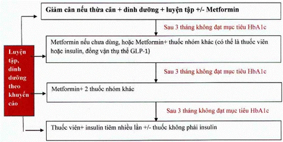
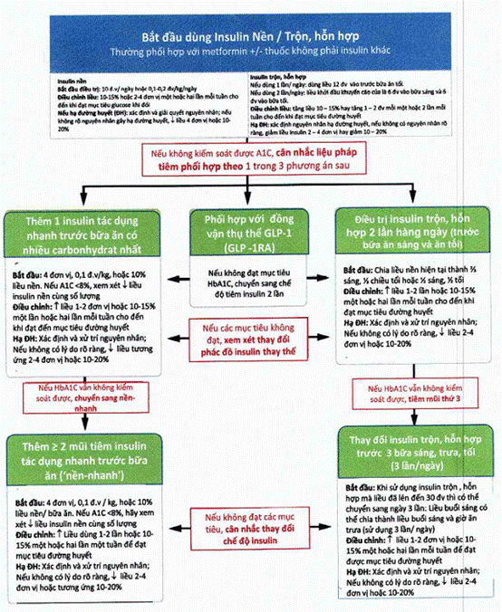

> Nguồn: https://thuvienphapluat.vn/van-ban/The-thao-Y-te/Quyet-dinh-3319-QD-BYT-2017-tai-lieu-Huong-dan-chan-doan-va-dieu-tri-dai-thao-duong-tip-2-356483.aspx
> Crawl ngày: 2026-08-07

# Quyết định 3319/QĐ-BYT (19/07/2017) - Hướng dẫn chẩn đoán và điều trị đái tháo đường típ 2

| **BỘ Y TẾ    -------** | **CỘNG HÒA XÃ   HỘI CHỦ NGHĨA VIỆT NAM    Độc lập - Tự do - Hạnh phúc     ---------------** | 
 
  | Số: 3319/QĐ-BYT | *Hà Nội, ngày* *19* *tháng* *07* *năm 2017* | 

 

**QUYẾT ĐỊNH**

VỀ
VIỆC BAN HÀNH TÀI LIỆU CHUYÊN MÔN “HƯỚNG DẪN CHẨN ĐOÁN VÀ ĐIỀU TRỊ ĐÁI THÁO ĐƯỜNG
TÍP 2”

**BỘ TRƯỞNG BỘ Y TẾ**

*Căn cứ Luật Khám bệnh, chữa bệnh năm
2009;*

*Căn cứ Nghị định số 75/2017/NĐ-CP ngày
20 tháng 6 năm 2017 của Chính phủ quy định chức năng, nhiệm vụ, quyền hạn và cơ
cấu tổ chức của Bộ Y tế;*

*Theo đề nghị của Cục trưởng Cục Quản lý
khám, chữa bệnh,*

**QUYẾT ĐỊNH:**

**Điều 1.** Ban hành kèm theo Quyết định này tài liệu chuyên môn “Hướng
dẫn chẩn đoán và điều trị đái tháo đường típ 2”.

**Điều 2.** Tài liệu chuyên môn “Hướng dẫn chẩn đoán và điều trị đái
tháo đường típ 2” được áp dụng tại các cơ sở khám bệnh, chữa bệnh trong cả nước.

**Điều 3.** Bãi bỏ nội dung “Hướng dẫn chẩn đoán và điều trị đái tháo đường
típ 2” trong “Hướng dẫn chẩn đoán và điều trị bệnh nội tiết - chuyển hóa” đã được
ban hành tại Quyết định số 3879/QĐ-BYT ngày 30 tháng 9 năm 2014 của Bộ trưởng Bộ
Y tế.

**Điều 4.** Quyết định này có hiệu lực kể từ ngày ký, ban hành.

**Điều 5.** Các ông, bà: Chánh Văn phòng Bộ, Chánh thanh tra Bộ, Tổng Cục
trưởng, Cục trưởng và Vụ trưởng các Tổng cục, Cục, Vụ thuộc Bộ Y tế, Giám đốc Sở
Y tế các tỉnh, thành phố trực thuộc trung ương, Giám đốc các Bệnh viện, Viện trực
thuộc Bộ Y tế, Thủ trưởng Y tế các ngành chịu trách nhiệm thi hành Quyết định
này./.

 

  |   ***Nơi nhận:***    -   Như Điều 5; - Bộ trưởng (để báo cáo); - Các Thứ trưởng; - Cổng thông tin điện tử Bộ Y tế; Website Cục KCB; - Lưu: VT, KCB, PC. | **KT. BỘ TRƯỞNG    THỨ TRƯỞNG                    Nguyễn Viết Tiến** | 

 

**HƯỚNG DẪN**

CHẨN
ĐOÁN VÀ ĐIỀU TRỊ ĐÁI THÁO ĐƯỜNG TÍP 2

*(Ban
hành kèm theo Quyết định số 3319/QĐ-BYT ngày 19 tháng 7 năm 2017 của Bộ trưởng
Bộ Y tế)*

**I. ĐẠI CƯƠNG**

Bệnh đái tháo đường là bệnh rối loạn
chuyển hóa không đồng nhất, có đặc điểm tăng glucose huyết do khiếm khuyết về tiết
insulin, về tác động của insulin, hoặc cả hai. Tăng glucose mạn tính trong thời
gian dài gây nên những rối loạn chuyển hóa carbohydrate,
protide, lipide, gây tổn thương ở nhiều cơ quan khác nhau, đặc biệt ở tim và mạch
máu, thận, mắt, thần kinh.

Theo Liên đoàn Đái tháo đường Thế giới
(IDF), năm 2015 toàn thế giới có 415
triệu người (trong độ tuổi 20-79) bị bệnh đái tháo đường (ĐTĐ), tương đương cứ
11 người có 1 người bị ĐTĐ, đến năm 2040 con số này sẽ là 642 triệu, tương
đương cứ 10 người có 1 người bị ĐTĐ. Bên cạnh đó, cùng với việc tăng sử dụng thực
phẩm không thích hợp, ít hoặc không hoạt động thể lực ở trẻ em, bệnh ĐTĐ típ 2
đang có xu hướng tăng ở cả trẻ em, trở thành vấn đề sức khỏe cộng đồng nghiêm
trọng. Bệnh ĐTĐ gây nên nhiều biến chứng nguy hiểm, là nguyên nhân hàng đầu gây
bệnh tim mạch, mù lòa, suy thận, và cắt cụt chi. Nhưng một điều đáng khả quan,
có tới 70% trường hợp ĐTĐ típ 2 có thể dự phòng hoặc làm chậm xuất hiện bệnh bằng
tuân thủ lối sống lành mạnh, dinh dưỡng hợp lý và tăng cường luyện tập thể lực.

Ở Việt Nam, năm 1990 của thế kỷ trước, tỷ
lệ bệnh ĐTĐ chỉ là 1,1 % (ở thành phố Hà nội), 2,25% (ở thành phố Hồ Chí
Minh), 0,96% (thành phố Huế),
nghiên cứu năm 2012 của Bệnh viện Nội tiết trung ương cho thấy: tỷ lệ hiện mắc
ĐTĐ trên toàn quốc ở người trưởng thành là 5.42%, tỷ lệ đái tháo đường chưa được
chẩn đoán trong cộng đồng là
63.6%. Tỷ lệ rối loạn dung nạp glucose toàn quốc 7,3%, rối loạn glucose máu lúc
đói toàn quốc 1,9% (năm 2003). Theo kết quả điều tra STEPwise về các yếu tố
nguy cơ của bệnh không lây nhiễm do Bộ Y tế thực hiện năm 2015, ở nhóm tuổi từ
18-69, cho thấy tỷ lệ ĐTĐ
toàn quốc là 4,1%, tiền ĐTĐ là 3,6%.

**II. CHẨN ĐOÁN**

**1. Chẩn đoán đái tháo đường**

Tiêu chuẩn chẩn đoán đái tháo đường
(theo Hiệp Hội Đái tháo đường Mỹ - ADA) dựa vào 1 trong 4 tiêu chuẩn sau đây:

a) Glucose huyết tương lúc đói (fasting
plasma glucose: FPG) ≥ 126 mg/dL (hay
7 mmol/L). Bệnh nhân phải nhịn ăn (không uống nước ngọt, có thể uống nước lọc,
nước đun sôi để nguội) ít nhất 8 giờ (thường phải nhịn đói qua đêm từ 8 -14 giờ),
hoặc:

b) Glucose huyết tương ở thời điểm sau 2
giờ làm nghiệm pháp dung nạp glucose đường uống 75g (oral glucose tolerance
test: OGTT) ≥ 200 mg/dL (hay
11,1 mmol/L).

Nghiệm pháp dung nạp glucose đường uống
phải được thực hiện theo hướng dẫn của Tổ chức Y tế thế giới: Bệnh nhân nhịn
đói từ nửa đêm trước khi làm nghiệm pháp, dùng một lượng glucose tương đương với
75g glucose, hòa tan trong 250-300 ml nước, uống trong 5 phút; trong 3 ngày trước
đó bệnh nhân ăn khẩu phần có khoảng 150-200 gam carbohydrat mỗi ngày.

c) HbA1c ≥ 6,5% (48 mmol/mol). Xét nghiệm này phải được
thực hiện ở phòng thí nghiệm được chuẩn hóa theo tiêu chuẩn quốc tế.

d) Ở bệnh nhân có triệu chứng kinh điển
của tăng glucose huyết hoặc mức glucose huyết tương ở thời điểm bất kỳ ≥ 200 mg/dL (hay 11,1
mmol/L).

Nếu không có triệu chứng kinh điển của
tăng glucose huyết (bao gồm tiểu nhiều, uống nhiều, ăn nhiều, sụt cân không rõ
nguyên nhân), xét nghiệm chẩn đoán a, b, d ở trên cần được thực hiện lặp lại lần
2 để xác định chẩn đoán. Thời gian thực hiện xét nghiệm lần 2 sau lần thứ nhất
có thể từ 1 đến 7 ngày.

Trong điều kiện thực tế tại Việt Nam,
nên dùng phương pháp đơn giản và hiệu quả để chẩn đoán đái tháo đường là định
lượng glucose huyết tương lúc đói 2 lần ≥ 126 mg/dL (hay 7 mmol/L). Nếu HbA1c được đo tại phòng xét
nghiệm được chuẩn hóa quốc tế, có thể đo HbA1c 2 lần để chẩn đoán ĐTĐ.

**2. Chẩn đoán tiền đái tháo đườ****n****g**

Chẩn đoán tiền đái tháo đường khi có một
trong các rối loạn sau đây:

- Rối loạn glucose huyết đói (impaired
fasting glucose: IFG): Glucose huyết tương lúc đói từ 100 (5,6mmol/L) đến 125
mg/dL (6,9 mmol/L), hoặc

- Rối loạn dung nạp glucose (impaired
glucose tolerance: IGT): Glucose huyết tương ở thời điểm 2 giờ sau khi làm nghiệm
pháp dung nạp glucose bằng đường uống 75 g từ 140 (7.8 mmol/L) đến 199 mg/dL
(11 mmol/L), hoặc

- HbA1c từ 5,7% (39 mmol/mol) đến 6,4% (47 mmol/mol).

Những tình trạng rối loạn glucose huyết này
chưa đủ tiêu chuẩn để chẩn đoán đái tháo đường nhưng vẫn có nguy cơ xuất hiện
các biến chứng mạch máu lớn của đái tháo đường, được gọi là tiền đái tháo đường
*(pre-diabetes)*.

**3. Phân loại đái tháo đường**

a) Đái tháo đường tip 1 (do phá hủy tế
bào beta tụy, dẫn đến thiếu insulin tuyệt đối).

b) Đái tháo đường típ 2 (do giảm chức
năng của tế bào beta tụy tiến triển trên nền tảng đề kháng insulin).

c) Đái tháo đường thai kỳ (là ĐTĐ được
chẩn đoán trong 3 tháng giữa hoặc 3 tháng cuối của thai kỳ và không có bằng chứng
về ĐTĐ tip 1, típ 2 trước đó).

d) Thể bệnh chuyên biệt của ĐTĐ do các
nguyên nhân khác, như ĐTĐ sơ sinh hoặc ĐTĐ do sử dụng thuốc và hóa chất như sử
dụng glucocorticoid, điều trị HIV/AIDS hoặc sau cấy ghép mô...

Chi tiết phân loại ĐTĐ trong Phụ lục 01
được ban hành kèm theo Quyết định này. Cách phân biệt ĐTĐ típ 1 và típ 2 trong Phụ
lục 02 được ban hành
kèm theo Quyết định này.

**4. Tiêu chuẩn để làm xét nghiệm chẩn
đoán đái tháo đườ****n****g hoặc tiền đái
tháo đường ở ng****ườ****i không có triệu
chứng ĐTĐ:**

a) Người lớn có BMI ≥ 23 kg/m2,
hoặc cân nặng lớn hơn 120% cân nặng lý tưởng và có một hoặc nhiều hơn một trong
các yếu tố nguy cơ sau:

- Ít vận động thể lực

- Gia đình có người bị đái tháo đường ở thế hệ cận kề (bố, mẹ,
anh chị em ruột)

- Tăng huyết áp (huyết áp tâm thu ≥ 140 mmHg và/hoặc huyết
áp tâm trương ≥ 90 mmHg hay
đang điều trị thuốc hạ huyết áp)

- Nồng độ HDL cholesterol <35 mg/ (0,9 mmol/L)
và/hoặc nồng độ triglyceride > 250 mg/dL
(2,82 mmol/L)

- Vòng bụng to: ở nam ≥ 90 cm, ở nữ ≥ 80 cm

- Phụ nữ bị buồng trứng đa nang

- Phụ nữ đã mắc đái tháo đường thai kỳ

- HbA1c ≥ 5,7% (39 mmol/mol), rối loạn glucose huyết đói
hay rối loạn dung nạp glucose ở lần xét nghiệm trước đó.

- Có các dấu hiệu đề kháng insulin trên
lâm sàng (như béo phì, dấu gai đen...).

- Tiền sử có bệnh tim mạch do xơ vữa động
mạch.

b) Ở bệnh nhân không có các dấu hiệu/triệu
chứng trên, bắt đầu thực hiện xét nghiệm phát hiện sớm đái tháo đường ở người ≥ 45 tuổi.

c) Nếu kết quả xét nghiệm bình thường, nên lặp lại
xét nghiệm sau mỗi 1-3 năm. Có thể thực hiện xét nghiệm sớm hơn tùy thuộc vào kết
quả xét nghiệm trước đó và yếu tố nguy cơ. Đối với người tiền đái tháo đường:
thực hiện xét nghiệm hàng năm.

**5. Phát hiện và ch****ẩ****n đoán đái tháo
đường**
**thai
kỳ**

a) Khái niệm: là ĐTĐ được chẩn đoán
trong 3 tháng giữa hoặc 3 tháng cuối của thai kỳ và không có bằng chứng ĐTĐ típ 1, típ 2 trước đó. Nếu
phụ nữ có thai 3 tháng đầu được phát hiện tăng glucose huyết:
chẩn đoán là ĐTĐ chưa được chẩn đoán hoặc chưa được phát hiện và dùng tiêu chuẩn
chẩn đoán ĐTĐ như ở người không có thai.

b) Thời điểm tầm soát đái tháo đường
thai kỳ

- Thực hiện xét nghiệm chẩn đoán ĐTĐ (đối
với ĐTĐ chưa được chẩn đoán trước đây) tại lần khám thai đầu tiên đối với những
người có các yếu tố nguy cơ của ĐTĐ, sử dụng các tiêu chuẩn chẩn đoán ĐTĐ tại Điểm a, b, d của mục 1, phần II (không áp dụng tiêu chuẩn về
HbA1c).

- Thực hiện xét nghiệm chẩn đoán ĐTĐ
thai kỳ ở tuần thứ 24 đến 28 của thai kỳ đối với những thai phụ không được chẩn
đoán ĐTĐ trước đó.

- Thực hiện xét nghiệm để chẩn đoán ĐTĐ
thật sự (bền vững): ở phụ nữ có ĐTĐ thai kỳ sau khi sinh từ 4 đến 12 tuần. Dùng
nghiệm pháp dung nạp glucose đường uống và các tiêu chuẩn chẩn đoán không mang
thai phù hợp trên lâm sàng. Sử dụng các
tiêu chuẩn chẩn đoán đái tháo đường tại Điểm a, b, d của mục 1,
phần II (không áp dụng tiêu chuẩn về HbA1c).

- Ở phụ nữ có tiền sử ĐTĐ thai kỳ nên thực
hiện xét nghiệm để phát hiện sự phát triển ĐTĐ hay tiền ĐTĐ ít nhất mỗi 3 năm một
lần.

- Phụ nữ có tiền sử ĐTĐ thai kỳ, sau đó
được phát hiện có tiền ĐTĐ: cần được điều trị can thiệp lối sống tích cực hay
metformin để phòng ngừa ĐTĐ.

c) Tầm soát và chẩn đoán ĐTĐ thai kỳ: có
thể thực hiện một trong 2 phương pháp sau:

**Phương pháp 1 bước (one-step strategy)**

Thực hiện nghiệm pháp dung nạp glucose
đường uống 75g (75-g OGTT): đo nồng độ glucose huyết tương lúc đói và tại thời điểm
1 giờ, 2 giờ, ở tuần thứ 24 đến
28 của thai kỳ đối với những thai phụ không được chẩn đoán ĐTĐ trước đó. Nghiệm
pháp dung nạp glucose đường uống phải được thực hiện vào buổi sáng sau khi nhịn đói qua
đêm ít nhất 8 giờ. Chẩn đoán ĐTĐ thai kỳ khi bất kỳ giá trị glucose huyết thỏa mãn tiêu chuẩn sau
đây:

- Lúc đói ≥ 92 mg/dL (5,1 mmol/L)

- Ở thời điểm 1 giờ ≥ 180 mg/dL (10,0 mmol/L)

- Ở thời điểm 2 giờ ≥ 153 mg/dL (8,5 mmol/L)

**Phương pháp 2 bước (two-step strategy)**

- **Bước 1:** Thực hiện nghiệm pháp uống
glucose 50g hoặc uống tải glucose 50 gam (glucose loading test: GLT): Uống 50 gam glucose (trước
đó không nhịn đói), đo glucose huyết tương tại thời điểm 1 giờ, ở tuần thứ 24 đến
28 của thai kỳ đối với những thai phụ không được chẩn đoán ĐTĐ trước đó. Nếu mức
glucose huyết tương được đo lường tại thời điểm 1 giờ sau uống là 130 mg/dL,
135 mg/dL, hoặc 140 mg/dL (7,2 mmol/L, 7,5 mmol/L, 7,8 mmol/L) tiếp tục với
nghiệm pháp dung nạp glucose đường uống 100g.

- **Bước 2:** Thực hiện nghiệm pháp
dung nạp glucose đường uống 100g (100-g OGTT): Nghiệm pháp phải được thực hiện khi bệnh
nhân đang đói: Bệnh nhân nhịn đói, uống 100 gam glucose pha trong 250-300 ml nước,
đo glucose huyết lúc đói và tại thời điểm 1 giờ, 2 giờ, 3 giờ, sau khi uống glucose. Chẩn
đoán ĐTĐ thai kỳ khi ít nhất có 2 trong 4 giá trị mức glucose huyết tương bằng hoặc vượt quá các
ngưỡng sau đây:

**B****ả****ng 1****:** **Tiêu chuẩn ch****ẩ****n đoán đái tháo
đường thai kỳ đ****ố****i với ph****ươ****ng pháp 2 b****ướ****c**

  |   | **Tiêu chí ch****ẩn** **đoán của   Carpenter/ Coustan** | **Tiêu ch****í** **chẩn đoán   theo National Diabetes Data Group** | 
 
  | Lúc đói | 95mg/dL (5,3 mmol/L) | 105 mg/dL (5,8 mmol/L) | 
 
  | Ở thời điểm 1 giờ | 180 mg/dL (10,0 mmol/L) | 190 mg/dL (10,6 mmol/L) | 
 
  | Ở thời điểm 2 giờ | 155 mg/dL (8,6 mmol/L) | 165 mg/dL (9,2 mmol/L) | 
 
  | Ở thời điểm 3 giờ | 140 /dL (7,8 mmol/L) | 145 mg/dL (8,0 mmol/L) | 

**III. ĐÁNH GIÁ TOÀN DIỆN
ĐỐI VỚI ĐÁI THÁO ĐƯỜNG**

**1. Mục đích:**

Đánh giá toàn diện nên thực hiện vào lần
khám bệnh đầu tiên nhằm mục đích sau:

- Xác định chẩn đoán và phân loại
ĐTĐ;

- Phát hiện các biến chứng đái tháo đường
và các bệnh đồng mắc;

- Xem xét điều trị trước và việc kiểm
soát yếu tố nguy cơ ở bệnh nhân ĐTĐ đã được thiết lập;

- Bắt đầu sự tham gia của bệnh nhân
trong việc xây dựng kế hoạch quản lý chăm sóc.

- Xây dựng kế hoạch để chăm sóc liên tục.

**2. Các nội dung đánh giá toàn diện**

**2.1. Bệnh sử - Lâm sàng:**

- Tuổi, đặc điểm lúc khởi phát ĐTĐ (nhiễm
ceton acid đái tháo đường, phát hiện
đái tháo đường bằng xét nghiệm nhưng
không có triệu chứng).

- Cân nặng các con lúc sinh (đối với phụ
nữ).

- Cách ăn uống, tình trạng dinh dưỡng,
tiền sử cân nặng, hành vi ngủ (thói quen, thời gian), thói quen luyện tập thể lực,
giáo dục dinh dưỡng, tiền sử và nhu cầu hỗ trợ hành vi.

- Tiền sử sử dụng thuốc lá, uống rượu và sử dụng
thuốc gây nghiện.

- Tìm hiểu bệnh nhân có tham gia các chương trình
giáo dục về ĐTĐ, tự quản lý và tiền sử, nhu cầu
hỗ trợ.

- Rà soát lại các phác đồ điều trị trước
và đáp ứng điều trị (dựa vào các số liệu HbA1c)

- Sử dụng các thuốc bổ sung và thay thế:
Các loại thực phẩm chức năng, thuốc cổ truyền đã sử dụng. Các loại thuốc điều trị bệnh
khác, thí dụ thuốc điều trị đau khớp...

- Các bệnh đồng mắc và bệnh về răng miệng
đang mắc.

- Tầm soát trầm cảm, lo âu và rối loạn ăn uống bằng cách sử dụng các đo
lường đã được hiệu chỉnh và phù hợp.

- Tầm soát về các vấn đề tâm lý, các rào
cản khác đối với điều trị và tự quản lý đái tháo đường, như nguồn tài chính hạn
chế, hậu cần và các nguồn hỗ trợ.

- Tầm soát về nỗi đau buồn, cảnh khốn
cùng khi bị ĐTĐ

- Đánh giá các hành vi sử dụng thuốc uống,
thuốc tiêm và các rào cản đối với sự tuân thủ điều trị.

- Nếu bệnh nhân có máy thử glucose huyết tại nhà hoặc
sổ theo dõi khám bệnh, kiểm
tra lại các thông số theo dõi
glucose huyết và xử trí của bệnh nhân.

- Tiền sử nhiễm ceton acid, tần suất, độ
trầm trọng, nguyên nhân.

- Tiền sử các cơn hạ glucose huyết, khả
năng nhận biết và cách xử trí lúc có cơn, tần suất, nguyên nhân.

- Tiền sử tăng huyết áp, rối loạn lipid
máu

- Các biến chứng mạch máu nhỏ: võng mạc,
thận, thần kinh

- Các biến chứng mạch máu lớn: bệnh tim
thiếu máu cục bộ, nhồi máu cơ tim, đột quỵ, bệnh mạch máu ngoại vi.

- Đối với phụ nữ trong lứa tuổi sinh sản:
hỏi về kế hoạch sinh
con của bệnh nhân, bệnh có dùng phương pháp nào để ngừa thai

**2.2. Khám thực thể:** cần đặc biệt
chú trọng:

- Chiều cao, cân nặng và BMI; Quá trình phát
triển và dậy thì ở trẻ em, thanh thiếu niên.

- Đo huyết áp, nếu cần đo huyết áp nằm
và đứng để tìm hạ huyết áp tư thế.

- Khám đáy mắt.

- Khám tuyến giáp.

- Khám da: tìm dấu gai đen, các thay đổi
da do ĐTĐ kiểm soát kém, khám các vùng tiêm chích nếu bệnh nhân dùng insulin).

- Khám bàn chân toàn diện:

+ Nhìn: xem dấu khô da, các vết chai, biến
dạng bàn chân

+ Sờ: mạch mu chân và chày sau

+ Có hay mất phản xạ gân cơ Achilles

+ Khám thần kinh nhanh: cảm giác xúc
giác, cảm giác rung, cảm nhận monofilament.

**2.3. Đánh giá về cận lâm sàng:**

- HbA1c, nếu chưa làm trong 3 tháng vừa qua

- Nếu chưa thực hiện hoặc không có sẵn
thông tin vòng một năm qua về các nội dung sau, thì làm xét nghiệm:

+ Bộ thông tin về lipid máu: bao gồm Cholesterol toàn
phần, LDL, HDL, Triglycerides nếu cần.

+ Xét nghiệm chức năng gan, AST ALT, xét nghiệm khác nếu cần

+ Tỉ số Albumin/creatinin nước tiểu lấy 1 lần vào
buổi sáng

+ Creatinin huyết thanh và độ lọc cầu
thận

+ TSH ở bệnh nhân ĐTĐ típ 1

**IV. ĐIỀU TRỊ**

**1. Mục tiêu điều trị cần đạt***

**Bảng 2: Mục
tiêu điều trị cho bệnh nhân đái tháo đường ở ng****ười** **tr****ưở****ng thành, không
có thai**

  | **Mục tiêu** | **Ch****ỉ** **số** | 
 
  | HbA1c | < 7%* | 
 
  | Glucose huyết tương mao mạch lúc đói,   trước ăn | 80-130 mg/dL (4.4-7.2 mmol/L)* | 
 
  | Đỉnh glucose huyết tương mao   mạch sau ăn 1-2 giờ | <180 mg/dL (10.0 mmol/L)* | 
 
  | Huyết áp | Tâm thu <140 mmHg, Tâm trương   <90 mmHg Nếu đã có biến chứng thận: Huyết áp   <130/85-80 mmHg | 
 
  | Lipid máu | LDL cholesterol <100 mg/dL (2,6   mmol/L), nếu chưa có biến chứng tim mạch. LDL cholesterol <70 mg/dL (1,8 mmol/L)   nếu đã có bệnh tim mạch. Triglycerides <150 mg/dL (1,7 mmol/L) HDL cholesterol >40 mg/dL (1,0 mmol/L)   ở nam và >50 mg/dL (1,3 mmol/L) ở nữ. | 

* Mục tiêu điều trị ở các cá nhân có thể
khác nhau tùy tình trạng của bệnh nhân.

- Mục tiêu điều trị có thể nghiêm ngặt hơn:
HbA1c <6,5% (48 mmol/mol) nếu có
thể đạt được và không có dấu hiệu đáng kể của hạ đường huyết và những tác dụng có hại của
thuốc: Đối với người bị bệnh đái tháo đường trong thời gian ngắn, bệnh ĐTĐ típ
2 được điều trị bằng thay đổi lối
sống hoặc chỉ
dùng metformin, trẻ tuổi hoặc không có
bệnh tim mạch quan trọng.

- Ngược lại, mục tiêu điều trị có thể ít
nghiêm ngặt (nới lỏng hơn): HbA1c < 8% (64 mmol/mol) phù hợp với những bệnh nhân có tiền
sử hạ glucose huyết trầm trọng, lớn tuổi, các biến chứng mạch máu nhỏ hoặc mạch
máu lớn, có nhiều bệnh
lý đi kèm hoặc bệnh ĐTĐ trong thời gian dài và khó đạt mục tiêu điều trị.

- Nếu đã đạt mục tiêu glucose huyết lúc đói. nhưng
HbA1c còn cao, cần
xem lại mục tiêu glucose huyết sau ăn, đo vào lúc 1-2 giờ sau khi bệnh nhân bắt đầu ăn.

**B****ả****ng 3: Mục tiêu điều
trị đái tháo đường ở người già**

  | **T****ì****nh tr****ạ****ng sức kh****ỏe** | **Cơ sở** **đ****ể chọn lựa** | **H****bA1****c** | **Glucose huyết   lúc đói** **hoặc** **trước** **ăn** **(****mg/dL)** | **Glucose lúc   đi ngủ (mg/dL)** | **Huyết áp** **mmHg** | 
 
  | Mạnh khỏe | Còn sống lâu | <7.5% | 90-130 | 90-150 | <140/90 | 
 
  | Phức tạp/ sức khỏe trung bình | Kỳ vọng sống trung bình | <8.0% | 90-150 | 100-180 | <140/90 | 
 
  | Rất phức tạp/ sức khỏe kém | Không còn sống lâu | <8.5% | 100-180 | 110-200 | <150/90 | 

* Đánh giá về kiểm soát đường huyết:

- Thực hiện xét nghiệm HbA1c ít nhất 2 lần trong 1
năm ở những người bệnh đáp ứng mục tiêu điều trị (và những người có đường huyết
được kiểm soát ổn định).

- Thực hiện xét nghiệm HbA1c hàng quý ở những người
bệnh được thay đổi liệu pháp điều
trị hoặc những người không đáp ứng mục tiêu về glucose huyết.

- Thực hiện xét nghiệm HbA1c tại thời điểm người bệnh
đến khám, chữa bệnh để tạo cơ hội cho việc thay đổi điều trị kịp thời hơn.

**2. Lựa chọn thuốc và phương pháp điều trị
đái tháo đường típ 2**

**Hình 1: Sơ đồ lựa
chọn thuốc và phương pháp điều trị đái tháo đường típ 2**

> **[Chuyển đổi ảnh → text để phục vụ embedding — nguồn ảnh: `images/3319_hinh1_stepwise.webp`, cần đối chiếu lại ảnh gốc khi cần độ chính xác tuyệt đối]**
>
> **Sơ đồ bậc thang lựa chọn thuốc điều trị ĐTĐ típ 2 (2017), 4 bước tuần tự, mỗi bước chuyển sang bước sau nếu sau 3 tháng không đạt mục tiêu HbA1c:**
> 1. Giảm cân nếu thừa cân + dinh dưỡng + luyện tập ± Metformin
> 2. Metformin nếu chưa dùng, hoặc Metformin + 1 thuốc nhóm khác (có thể là thuốc viên hoặc insulin, hoặc đồng vận thụ thể GLP-1)
> 3. Metformin + 2 thuốc nhóm khác
> 4. Thuốc viên + insulin tiêm nhiều lần ± thuốc không phải insulin
>
> *(Xuyên suốt 4 bước: "Luyện tập, dinh dưỡng theo khuyến cáo" là nền tảng duy trì liên tục, không phải một bước riêng.)*
>
> *(So sánh: đây vẫn là phác đồ bậc thang đơn giản tương tự Hình 1 của 3280/QĐ-BYT (2011), chưa phân tầng theo nguy cơ tim mạch/thận như sơ đồ phức tạp hơn xuất hiện sau này ở 5481/QĐ-BYT — xem `images/5481_p23.png`.)*

**Các loại thuốc điều trị ĐTĐ lần lượt là:** Metformin, thuốc
ức chế kênh đồng vận chuyển natri-glucose (SGLT2i), Sulfonylurea. Glinides, Pioglitazon, Ức chế enzym alpha
glucosidase. Ức chế enzym DPP-4, Đồng vận thụ thể GLP-1, Insulin.

a) Các yếu tố cần xem xét khi chọn lựa điều
trị:

- Hiệu quả giảm glucose huyết

- Nguy cơ hạ glucose huyết:
sulfonylurea, insulin

- Tăng cân: Pioglitazon, insulin,
sulfonylurea

- Giảm cân: GLP-1 RA, ức chế kênh đồng vận
chuyển natri-glucose (SGLT2i), ức chế enzym alphaglucosidase (giảm cân ít)

- Không ảnh hưởng nhiều lên cân nặng: ức
chế enzym DPP-4, metformin

- Tác dụng phụ chính (xem trong bài)

- Giá thuốc: cân nhắc dựa trên chi phí
và hiệu quả điều trị

b) Lựa chọn thuốc và phương pháp điều trị

- Nên chuyển bước điều trị mỗi 3 tháng nếu
không đạt được mục tiêu HbA1c. Cần theo dõi đường
huyết đói, đường huyết sau ăn 2 giờ để điều chỉnh liều thuốc.

- Có thể kết hợp thay đổi lối sống và
metformin ngay từ đầu. Thay đổi lối sống đơn thuần chỉ thực hiện ở những bệnh
nhân mới chẩn đoán, chưa có biến chứng mạn và mức đường huyết gần bình thường.

- Khi phối hợp thuốc, chỉ phối hợp 2, 3,
4 loại thuốc và các loại thuốc có cơ chế tác dụng khác nhau.

- Trường hợp bệnh nhân không dung nạp
metformin, có thể dùng sulfonylurea trong chọn lựa khởi đầu.

- Chú ý cẩn thận trọng tránh nguy cơ hạ glucose
huyết khi khởi đầu điều trị bằng sulfonylurea, insulin, đặc biệt khi glucose huyết ban đầu
không cao và bệnh nhân lớn tuổi.

- Chú ý giáo dục kỹ thuật tiêm và triệu
chứng hạ đường huyết cho bệnh nhân. Kiểm tra kỹ thuật tiêm của bệnh nhân khi
tái khám, khám vùng da nơi tiêm insulin xem có vết bầm, nhiễm trùng, loạn dưỡng mỡ.

**Hình 2: Sơ đồ điều trị
với insulin**

> **[Chuyển đổi ảnh → text để phục vụ embedding — nguồn ảnh: `images/3319_hinh2_insulin.gif`, cần đối chiếu lại ảnh gốc khi cần độ chính xác tuyệt đối]**
>
> **Sơ đồ chiến lược điều trị insulin ở BN ĐTĐ típ 2 (thường phối hợp metformin ± thuốc không phải insulin khác):**
>
> *Bước khởi đầu — chọn 1 trong 2 kiểu insulin:*
> - **Insulin nền:** Bắt đầu 10 đơn vị/ngày hoặc 0,1–0,2 đv/kg/ngày. Điều chỉnh: tăng 10–15% hoặc 2–4 đơn vị, mỗi 1–2 lần/tuần cho đến khi đạt mục tiêu glucose đói. Nếu hạ ĐH: xác định nguyên nhân rõ ràng, giảm liều 4 đơn vị hoặc 10–20%.
> - **Insulin trộn/hỗn hợp:** Bắt đầu 1 lần/ngày: 12 đv trước bữa tối; bắt đầu 2 lần/ngày: liều khuyến cáo chia bữa sáng và tối. Điều chỉnh: tăng 10–15% hoặc 1–2 đơn vị, 1–2 lần/tuần. Nếu hạ ĐH: giảm liều tương ứng 4 đơn vị hoặc 10–20%.
>
> *Nếu không kiểm soát được HbA1c → cân nhắc liệu pháp tiêm phối hợp, chọn 1 trong 3 phương án:*
> 1. **Thêm 1 mũi insulin tác dụng nhanh** trước bữa ăn có nhiều carbohydrate nhất (bắt đầu 4 đv hoặc 0,1 đv/kg hoặc 10% liều nền; điều chỉnh tăng 1–2 đv hoặc 10–15%/tuần).
> 2. **Phối hợp đồng vận thụ thể GLP-1 (GLP-1RA)** — nếu vẫn không đạt HbA1c, chuyển sang chế độ tiêm insulin 2 lần.
> 3. **Điều trị insulin trộn/hỗn hợp 2 lần/ngày** (trước bữa sáng và tối) — chia liều nền hiện tại thành ⅔ sáng/⅓ tối hoặc ½–½; điều chỉnh tăng 1–2 đv hoặc 10–15%/tuần.
>
> *Nếu vẫn không đạt mục tiêu → xem xét thay đổi phác đồ insulin thay thế, chọn 1 trong 2:*
> - **Thêm ≥2 mũi insulin tác dụng nhanh** trước bữa ăn (kiểu "nền–nhanh") — bắt đầu 4 đv hoặc 0,1 đv/kg hoặc 10% liều nền tương ứng mỗi bữa.
> - **Chuyển đổi hoàn toàn sang insulin trộn/hỗn hợp 3 lần/ngày** (sáng, trưa, tối) — khi liều trộn/hỗn hợp 2 lần đã lên đến ≥30 đơn vị, chia liều buổi sáng thành 2 lần cho bữa sáng và trưa.
>
> *(Ghi chú: sơ đồ này gần như giống hệt Hình 3 "Sơ đồ điều trị với insulin" của 5481/QĐ-BYT — xem `images/5481_p26.png` — cho thấy phần chiến lược tăng cường insulin ít thay đổi giữa 2 phiên bản 2017 và 2020, khác với phần lựa chọn thuốc uống ban đầu đã thay đổi nhiều.)*

***Các chiến lược điều trị insulin ở bệnh nhân đái
tháo đường típ 2.***

*** Điều trị với insulin nền:**

- *Khởi đầu điều trị với insulin nền*
khi không đạt được mục tiêu glucose huyết với thuốc uống. Liều khởi đầu khuyên dùng là 0,1 - 0,2 đơn
vị/kg cân nặng, phụ thuộc vào mức độ tăng glucose huyết, dùng phối hợp với 1 hoặc 2
thuốc uống.

- Khi đã điều chỉnh liều insulin nền đạt
được mục tiêu glucose huyết đói nhưng HbA1c vẫn chưa đạt mục tiêu, xem xét thêm insulin nhanh trước bữa ăn. Một cách khác có
thể xem xét là
chuyển sang insulin trộn sẵn/2 pha/hỗn hợp tiêm dưới da 2 lần mỗi ngày. Nếu vẫn không đạt
được mục tiêu, có thể xem xét chuyển sang insulin nền - insulin nhanh trước mỗi
bữa ăn (basal-bolus).

- *Liều khởi trị với insulin nền:*
insulin người như NPH (tiêm 1-2 lần/ ngày) hay insulin analog như glargine,
detemir (tiêm 1 lần/ngày), degludec (tiêm 1 lần/ngày liều khởi đầu 0,1-0,2 đơn
vị/kg/ngày.

- Nếu tiêm Insulin NPH, 2 mũi tiêm nên
cách nhau 11-12 giờ để tránh hiện tượng chồng liều. Nếu tiêm glargine hoặc
detemir nên tiêm vào giờ cố định mỗi ngày hoặc buổi sáng, hoặc buổi tối

*- Điều trị insulin nền-trước ăn (hoặc nền-nhanh)
(basal-bolus)*

+ Thêm 01 mũi insulin tác dụng nhanh trước
bữa ăn, khởi đầu 04 đơn vị, hoặc 0,1 đơn vị/kg cân nặng hay 10% liều insulin nền.

+ Điều chỉnh liều: tăng liều 10-15% hay
tăng 1 - 2 đơn vị mỗi một hoặc 2 lần mỗi tuần cho đến khi đạt mục tiêu đường
huyết.

+ Hạ đường huyết: xác định nguyên nhân hạ
đường huyết, nếu không có nguyên nhân rõ ràng, giảm liều insulin 2 - 4 đơn vị hay giảm
10 - 20%.

*** Điều trị** **với** **insulin trộn,
hỗn h****ợ****p:**

*- Bệnh nhân cũng có thể khởi đầu điều trị
với insulin trộn, h**ỗ**n hợp:*

+ Đối với bệnh nhân đái tháo đường típ 2
chưa sử dụng insulin: Bệnh nhân có thể khởi trị với insulin trộn, hỗn hợp, liều dùng theo thông
tin kê đơn được Bộ Y tế phê duyệt, ví dụ insulin gồm 70% Insulin Aspart
Protamine/30% Insulin Aspart hòa tan 1 lần hoặc 2 lần mỗi ngày. Nếu khởi trị 1
lần/ngày: liều dùng là 12 đơn vị vào bữa ăn tối (bữa ăn chiều). Nếu khởi trị 2 lần/ngày: liều khởi đầu
khuyến cáo là 6 đơn vị vào bữa sáng và 6 đơn vị vào bữa tối (bữa ăn chiều).

+ Điều chỉnh liều: tăng liều 10 - 15%
hay tăng 2
- 4 đơn vị mỗi 1
hoặc 2 lần mỗi tuần cho đến khi đạt mục tiêu đường huyết lúc đói.

+ Hạ đường huyết: xác định nguyên nhân hạ
đường huyết, nếu không có nguyên nhân rõ ràng, giảm liều insulin 2 - 4 đơn vị hay giảm
10 - 20%.

- *Bệnh nhân đang điều trị insulin nền
trước đó:* liều khởi đầu bằng liều insulin nền trước đó, chia thành 2/3 buổi
sáng, 1/3 buổi chiều (đối với insulin người) HOẶC 1/2 buổi sáng, 1/2 buổi chiều
(đối với insulin analog)

- *Bệnh nhân chưa điều trị liều
insulin nền:* liều khởi đầu 0,25 - 0,5 đơn vị/kg/ngày, chia thành 2/3 buổi
sáng, 1/3 buổi chiều (đối với insulin người) HOẶC 1/2 buổi sáng, 1/2 buổi chiều
tiêm ngay trước hoặc ngay sau khi ăn (đối với insulin analog).

- Khi sử dụng insulin trộn, hỗn hợp gồm
70% Insulin Aspart Protamine/30% Insulin Aspart hòa tan ngày 1 lần mà liều đã
lên đến 30 đơn vị thì có thể chia
thành 2 lần/ngày bằng cách chia liều bằng nhau vào bữa sáng và bữa tối (50/50)

- Liều insulin trộn, hỗn hợp gồm 70%
Insulin Aspart Protamine/30% Insulin Aspart hòa tan 2 lần/ ngày chuyển sang 3 lần/ngày:
liều buổi sáng có thể chia thành liều buổi sáng và giờ ăn trưa (sử dụng 3 lần/
ngày)

- Điều chỉnh liều: tăng liều 10 - 15%
hay tăng 1 - 2 đơn vị mỗi một hoặc 2 lần mỗi tuần cho đến khi đạt mục tiêu đường
huyết

- Hạ đường huyết: xác định nguyên nhân hạ
đường huyết, nếu không có nguyên nhân rõ ràng, giảm liều insulin 2 - 4 đơn vị hay giảm
10 - 20%.

- Insulin trộn, hỗn hợp cần tiêm trước bữa ăn, thời gian tiêm trước
ăn tùy thuộc loại insulin nhanh trong hỗn hợp (xem phụ lục 04).

*** Kiểm tra hiệu quả điều trị:**

- Glucose huyết sáng lúc đói phản ảnh hiệu
quả của insulin nền (đối với loại insulin tác dụng dài).

- Glucose huyết sau ăn phản ánh hiệu quả
của insulin nhanh tiêm trước khi ăn.

- Glucose huyết trước khi đi ngủ cho
phép tiên đoán nguy cơ hạ glucose huyết xảy ra ban đêm.

- Tuy nhiên, nồng độ glucose huyết trong
máu còn tùy thuộc số lượng và loại thức ăn trước đó, tình trạng vận động của bệnh
nhân, thuốc điều trị các bệnh lý đi kèm.

**3. Điều trị cụ th****ể**

**3.1. Thay đổi lối sống**

Thay đổi lối sống hay điều trị không
dùng thuốc bao gồm luyện tập thể lực, dinh dưỡng và thay đổi lối sống.

**a) Luyện tập thể lực**

- Cần kiểm tra biến chứng tim mạch, mắt,
thần kinh, biến dạng chân trước khi luyện tập và đo huyết áp, tần số tim. Không
luyện tập gắng sức khi glucose huyết > 250-270 mg/dL và ceton dương tính.

- Loại hình luyện tập thông dụng và dễ
áp dụng nhất: đi bộ tổng cộng 150 phút mỗi tuần (hoặc 30 phút mỗi ngày), không
nên ngưng luyện lập 2 ngày liên tiếp. Mỗi tuần nên tập kháng lực 2-3 lần (kéo
dây, nâng tạ).

- Người già, đau khớp có thể chia tập
nhiều lần trong ngày, thí dụ đi bộ sau 3 bữa ăn, mỗi lần 10-15 phút. Người còn
trẻ nên tập khoảng khoảng 60 phút mỗi ngày, tập kháng lực ít nhất 3 lần mỗi tuần.

**b) Dinh dưỡng**

Dinh dưỡng cần được áp dụng mềm dẻo theo
thói quen ăn uống của bệnh nhân, các thức ăn sẵn có tại từng vùng miền. Tốt nhất
nên có sự tư vấn của bác sĩ chuyên khoa dinh dưỡng.

Chi tiết về dinh dưỡng sẽ được thiết lập
cho từng bệnh nhân tùy tình trạng bệnh, loại hình hoạt động, các bệnh lý, biến
chứng đi kèm.

Các nguyên tắc chung về dinh dưỡng nên
được khuyến cáo cho mọi bệnh nhân:

- Bệnh nhân béo phì, thừa cân cần giảm
cân, ít nhất 3-7% so với cân nặng nền.

- Nên dùng các loại carbohydrat hấp thu
chậm có nhiều chất xơ, không chà xát kỹ như gạo lứt, bánh mì đen, nui còn chứa
nhiều chất xơ...

- Đạm khoảng 1-1,5 gam/kg cân nặng/ngày ở
người không suy chức năng thận. Nên ăn cá ít nhất 3 lần/tuần. Người ăn chay trường
có thể bổ sung nguồn đạm từ các loại
đậu (đậu phụ, đậu đen, đậu đỏ)

- Nên chú trọng dùng các loại mỡ có chứa acid béo không no một nối đôi hoặc nhiều nối đôi
như dầu ô liu, dầu mè, dầu lạc, mỡ cá. Cần tránh các loại mỡ trung chuyển (mỡ trans),
phát sinh khi ăn thức ăn rán, chiên ngập dầu mỡ.

- Giảm muối trong bữa ăn, còn khoảng
2300 mg Natri mỗi ngày.

- Chất xơ ít nhất 15 gam mỗi ngày.

- Các yếu tố vi lượng: nên chú ý bổ sung các yếu tố vi lượng nếu thiếu,
thí dụ sắt ở bệnh nhân ăn chay trường. Dùng Metformin lâu ngày có thể gây thiếu
sinh tố B12, nên chú ý
đến tình trạng này nếu bệnh nhân có thiếu máu hoặc triệu chứng bệnh lý thần
kinh ngoại vi.

- Uống rượu điều độ: một lon bia (330
ml)/ngày, rượu vang đỏ khoảng 150-200ml/ngày.

- Ngưng hút thuốc.

- Các chất tạo vị ngọt: như đường bắp,
aspartame, saccharin có nhiều bằng chứng trái ngược. Do đó nếu sử dụng cũng cần hạn chế đến
mức tối thiểu.

**3.2. Điều trị đái tháo đường bằng thuốc**

a) Các nhóm thuốc hạ glucose huyết đường
uống và thuốc dạng tiêm không thuộc nhóm insulin theo Phụ lục 03 được ban hành
kèm theo Quyết định này.

b) Insulin: Insulin được sử dụng ở bệnh
nhân ĐTĐ tip 1 và cả ĐTĐ típ 2 khi có triệu chứng thiếu insulin hoặc không kiểm
soát được glucose huyết dù đã ăn uống luyện tập và phối hợp nhiều loại thuốc
viên theo đúng chỉ dẫn. Ngoài ra ĐTĐ típ 2 khi mới chẩn đoán nếu glucose huyết
tăng rất cao cũng có thể dùng insulin
để ổn định glucose huyết, sau đó sẽ dùng các loại thuốc điều trị tăng glucose
huyết khác. Các loại insulin theo Phụ lục 04 được ban hành kèm theo Quyết định
này.

3.3. **Điều trị các bệnh phối hợp và
các biến chứng nếu có:** theo hướng dẫn chuyên môn của các bệnh và biến chứng
đó.

**IV. PHÒNG NGỪA VÀ KIỂM
SOÁT BIẾN CHỨNG MẠN TÍNH**

**1. Tăng huyết áp**

a) Theo dõi huyết áp: Phải đo huyết áp định
kỳ ở mỗi lần thăm khám. Nếu huyết áp tâm thu ≥ 130mmHg hay huyết áp tâm trương ≥80 mmHg cần phải kiểm
tra lại huyết áp vào ngày khác. Chẩn đoán tăng huyết áp khi kiểm tra lại có huyết áp tâm
thu ≥140 mmHg và/hay
huyết áp tâm trương ≥90 mmHg.

b) Mục tiêu điều trị về huyết áp: Mục
tiêu huyết áp tâm thu <140 mmHg phù hợp với đa số bệnh nhân đái tháo đường. Mục
tiêu huyết áp tâm trương < 90 mmHg. Có thể đặt mục tiêu huyết áp tâm thu cao
hơn hay thấp hơn tùy vào đặc điểm của bệnh nhân và đáp ứng với điều trị. Bệnh
nhân còn trẻ, có thể giảm huyết áp đến <130/90-80 mmHg nếu bệnh nhân dung nạp
được. Mục tiêu huyết áp ở bệnh nhân ĐTĐ
và bệnh thận mạn có thể <130/80-85 mmHg.

c) Điều trị:

- Bệnh nhân có huyết áp tâm thu từ
130-139 mmHg và/hoặc tâm trương 80-89 mmHg cần điều trị bằng cách thay đổi lối
sống trong thời gian tối đa là 3 tháng. Sau đó nếu vẫn chưa đạt được mục tiêu
huyết áp, cần điều trị bằng thuốc hạ huyết áp.

- Bệnh nhân có tăng huyết áp nặng hơn
(HA tâm thu ≥140 và/hoặc HA
tâm trương ≥90 mmHg) vào thời
điểm chẩn đoán hay khi theo dõi cần điều trị bằng với thuốc hạ huyết áp kết hợp
với thay đổi lối sống.

- Điều trị tăng huyết áp bằng cách thay đổi lối sống bao gồm giảm
cân nếu có thừa cân. Dùng chế độ ăn dành cho người tăng huyết áp, bao gồm giảm
muối và tăng lượng kali ăn vào; hạn chế uống rượu và tăng hoạt động thể lực.

- Thuốc điều trị hạ áp ở bệnh nhân tăng
huyết áp có đái tháo đường phải bao gồm thuốc ức chế men chuyển hay ức chế thụ
thể. Nếu bệnh nhân không dung nạp được nhóm này, có thể dùng nhóm khác thay thế.
Không phối hợp ức chế men chuyển với ức chế thụ thể. *Chống chỉ định dùng ức
chế men chuyển hoặc ức chế thụ thể ở phụ nữ có thai*.

- Thông thường cần phải phối hợp nhiều
thuốc hạ huyết áp (nhiều hơn hai thuốc ở liều tối đa) để đạt được mục tiêu huyết
áp. Phối hợp thường được khuyến cáo là ức chế men chuyển hoặc ức chế thụ thể phối
hợp với lợi tiểu, ức chế men chuyển hoặc ức chế thụ thể phối hợp với thuốc chẹn kênh
calci (thí dụ amlodipin). Nếu phối hợp 3 loại thuốc, bắt buộc phải có thuốc lợi
tiểu.

- Nên dùng một hay nhiều thuốc hạ huyết
áp ở thời điểm trước khi đi ngủ.

- Nếu đang dùng thuốc ức chế men chuyển,
ức chế thụ thể hay lợi tiểu, cần phải theo dõi chức năng thận và nồng độ kali
máu.

- Bệnh nhân bị đái tháo đường thường có tăng huyết
áp, với tần suất vào khoảng 50-70%, thay đổi tùy thuộc loại đái tháo đường, tuổi, béo phì
... Tăng huyết áp là yếu tố nguy cơ chính của bệnh
mạch vành, đột quị
và
biến chứng mạch máu nhỏ. Ở bệnh nhân bị đái tháo đường
típ 1 tăng huyết
áp là hậu quả của biến chứng thận, ngược lại ở bệnh nhân đái tháo đường típ 2 tăng huyết áp thường
có sẵn cùng với các yếu tố nguy cơ tim mạch chuyển hóa khác.

**2. Rối loạn lipid máu**

a) Đo chỉ số lipid máu: Cần kiểm tra bộ lipid
máu ít nhất hàng năm.

b) Điều trị:

- Thay đổi lối sống: Để điều chỉnh rối
loạn lipid máu, thay đổi lối sống tập trung vào giảm mỡ bão hòa, mỡ trans và lượng mỡ ăn
vào; tăng acid béo n-3, chất xơ hòa tan và stanols/sterols thực vật; giảm cân;
khuyên bệnh nhân tăng hoạt động thể lực để cải thiện lipid máu ở bệnh nhân đái
tháo đường.

- Điều trị bằng thuốc:

+ Điều trị statin kết hợp với thay đổi lối
sống ở những bệnh
nhân đái tháo đường sau (bất kể trị số lipid máu ban đầu là bao nhiêu): Có bệnh tim mạch;
Không có bệnh tim mạch nhưng lớn hơn 40 tuổi và có nhiều hơn một yếu tố nguy cơ
tim mạch khác.

+ Ở bệnh nhân không có các nguy cơ ở
trên, nên xem xét điều trị statin kết hợp với thay đổi lối sống nếu nồng độ LDL
cholesterol vẫn còn >100 mg/dL hay có nhiều yếu tố nguy cơ tim mạch.

+ Ở bệnh nhân không có bệnh tim mạch, mục
tiêu chính là LDL cholesterol <100 mg/dL (2,6 mmol/L). Ở bệnh nhân đã có bệnh
tim mạch, mục tiêu LDL cholesterol là <70 mg/dL (1,8 mmol/L), có thể xem xét
dùng statin liều cao.

+ Nếu bệnh nhân không đạt được mục tiêu
lipid máu với với statin ở liều tối đa có thể dung nạp được, có thể đặt mục
tiêu điều trị là giảm LDL ~30-40% so với ban đầu

+ Các mục tiêu lipid máu khác bao gồm nồng
độ triglycerides <150 mg/dL (1,7 mmol/L) và HDL cholesterol >40 mg/dL
(1,0 mmol/L) ở nam và >50 mg/dL (1,3 mmol/L) ở nữ. Cần chú ý ưu tiên mục
tiêu điều trị LDL cholesterol với statin trước.

+ Nếu vẫn không đạt được mục tiêu với
statin ở liều tối đa có thể dung nạp được, có thể phối hợp statin và thuốc hạ
lipid máu khác, tuy nhiên các phối hợp này chưa được đánh giá trong các nghiên
cứu về hiệu quả lên tim mạch hay tính an toàn. Theo nghiên cứu ACCORD lipid, nếu
triglycerides ≥ 204 mg/dL (2,3
mmol/L) và HDL ≤ 34 mg/dL (0,9
mmol/L) ở nam giới có thể phối hợp Statin với Fenofibrat.

+ Chống chỉ định statin trong thai kỳ.

**3. Các biến chứng mạch máu nhỏ và chăm
sóc bàn chân**

3.1. Phát hiện sớm các biến chứng

a) Bệnh thận do đái tháo đường: Ít nhất mỗi năm một lần,
đánh giá albumin niệu và mức lọc cầu thận ở tất cả các bệnh nhân ĐTĐ típ 2 và ở tất cả các bệnh
nhân có tăng huyết áp phối hợp.

b) Bệnh võng mạc do đái tháo đường:

- Bệnh nhân ĐTĐ típ 2 cần được khám mắt
toàn diện, đo thị lực tại thời điểm được chẩn đoán bệnh ĐTĐ.

- Nếu không có bằng chứng về bệnh võng mạc ở một hoặc nhiều
lần khám mắt hàng năm và đường huyết được kiểm soát tốt, có thể xem xét khám mắt
2 năm một lần. Nếu có bệnh võng mạc do ĐTĐ, khám võng mạc ít nhất hàng
năm. Nếu bệnh võng mạc đang tiến triển hoặc đe dọa đến thị lực, phải khám mắt
thường xuyên hơn.

c) Bệnh thần kinh do ĐTĐ.

Tất cả bệnh nhân cần được đánh giá về bệnh
thần kinh ngoại biên tại thời điểm bắt đầu được chẩn đoán ĐTĐ típ 2 và 5 năm sau khi chẩn
đoán bệnh tiểu đường típ 1, sau đó ít
nhất mỗi năm một lần.

d) Khám bàn chân:

- Thực hiện đánh giá bàn chân toàn diện
ít nhất mỗi năm một lần để xác định các yếu tố nguy cơ của loét và cắt cụt chi.

- Tất cả các bệnh nhân ĐTĐ phải được kiểm
tra bàn chân vào mỗi lần khám bệnh.

3.2. Điều trị các biến chứng: tham khảo
các hướng dẫn chẩn đoán, điều trị liên quan.

**4. Sử dụng thuốc chống kết tập tiểu cầu**

a) Phòng ngừa nguyên phát: ĐTĐ có tăng
nguy cơ tim mạch. Nam > 50 tuổi, nữ > 60 tuổi có kèm ít nhất 1 nguy cơ
tim mạch:

- Tiền sử gia đình có bệnh tim mạch

- Tăng huyết áp

- Hút thuốc lá

- RLCH lipid

- Tiểu albumin

b) Phòng ngừa thứ phát: sau biến cố tim
mạch

c) Thuốc điều trị:

- Dùng Aspirin 81-325-500 mg/ngày

- Dị ứng aspirin, không dung nạp aspirin:
dùng clopidogrel 75 mg/ngày.

**5. Tiêm vaxcin**

Bệnh nhân ĐTĐ cần được tiêm vacxin phòng
cúm, phế cầu trùng hàng năm. Ngoài ra cũng nên tiêm vacxin phòng
viêm gan siêu vi B.

**V. CHUYỂN TUYẾN**

- Bệnh nhân đái tháo đường típ 1 cần được khám bởi
bác sĩ chuyên khoa nội tiết, sau đó cùng theo dõi với bác sĩ đa khoa

- Bệnh nhân đái tháo đường típ 2 cần được chuyển lên
khám bác sĩ chuyên khoa nội tiết khi không đạt mục tiêu điều trị, hoặc khi phác
đồ điều trị ngày càng phức tạp dần (thí dụ tiêm insulin nhiều lần trong
ngày...)

- Bệnh nhân ĐTĐ típ 2 cần được chuyển
khám đáy mắt ngay khi mới chẩn đoán và sau đó mỗi 1 -2 năm một lần, bệnh nhân
đái tháo đường típ 1 cần được
khám đáy mắt 5 năm sau khi chẩn đoán, đôi khi sớm hơn: 3 năm sau khi chẩn
đoán. Phụ nữ có thai bị đái tháo đường cần khám đáy mắt ngay khi biết có thai.

- Khi bệnh nhân có bệnh lý thần kinh ngoại
biên, nhất là có biến dạng bàn chân và mất cảm giác ở chân như cảm giác đau, cảm
giác xúc giác, cần được khám để đánh giá nguy cơ loét bàn chân.

- Khám răng miệng hàng năm.

- Có thể cần gửi khám chuyên khoa khi có
một số biến chứng mạn của bệnh đái tháo đường: thí dụ cơn đau thắt ngực không ổn
định, bệnh thận mạn giai đoạn 3...(tham khảo thêm các hướng dẫn chẩn đoán và điều
trị biến chứng mạn của bệnh ĐTĐ).

**Tài liệu tham khảo:**

1. American Diabetes Association.
Standards of medical care in diabetes - 2017. Diabetes Care 2017;40 (Suppl. 1); DOI 10.2337/dc17-S001.

2. Consensus Statement by The American
Association of Clinical Endocrinologists and American College of Endocrinology
on the Comprehensive Típ 2 Diabetes
Management Algorithm - 2017 Executive Summary. Endocrine Practice 2017; 23
(No.2).

3. Atlas IDF 2015

4. Current Medical Diagnosis and
Treatment 2017. Lange edition.

5. Amir Qaseem et al. Oral Pharmacologic
treatment of Típ 2 Diabetes
Mellitus: A Clinical Practice Guideline Update From the American College of
Physician. Annals of Internal Medicine January 2017: DOI: 10.7326/M16-1860

6. Guidelines điều trị ĐTĐ của Anh quốc,
Canada, các nước khối ASEAN, Ấn độ.

7. 20th WHO Model List of
Essential Medicines (March 2017).

8. EMA, Guideline on Potency Labelling
for Insulin Analogue containing products with particular reference to the use
of “international units” or “units” (April 2005).

9. AACE 2017. Endocrine Practice 2017;
23 (No.2). Singapore Government - Agency for Care Effectiveness 2017. Endocrine
Practice 2017; 23 (No.2). *Kosiborod et al*. CVD-REAL Study. Circulation.
2017; CIRCULATIONAHA. 117.029190..

 

**PHỤ
LỤC 01:**

PHÂN
LOẠI ĐÁI THÁO ĐƯỜNG

*(Ban
hành kèm theo Quyết định số 3319/QĐ-BYT ngày 19 tháng 7 năm 2017* *của Bộ trưởng Bộ
Y tế)*

**1. Đái tháo đường tip 1**

Đái tháo đường típ 1 do tế bào beta bị
phá hủy nên bệnh nhân không còn hoặc còn rất ít insulin, 95% do cơ chế tự miễn
(típ 1 A), 5% vô
căn (típ1 B). Bệnh nhân
bị thiếu hụt insulin,
tăng glucagon trong máu, không điều trị sẽ bị nhiễm toan ceton. Bệnh có thể xảy
ra ở mọi lứa tuổi nhưng chủ yếu ở trẻ em và thanh thiếu niên. Bệnh nhân cần
insulin để ổn định glucose huyết. Người lớn tuổi có thể bị ĐTĐ tự miễn diễn tiến
chậm còn gọi là Latent Autoimmune Diabetes of Adulthood (LADA), lúc đầu bệnh
nhân còn đủ insulin nên không bị nhiễm toan ceton và có thể điều trị bằng thuốc viên nhưng
tình trạng thiếu insulin sẽ nặng dần với thời gian. ĐTĐ típ 1 tự miễn thường có các tự kháng thể
(KT) trong máu trước khi xuất hiện bệnh, lúc mới chẩn đoán: kháng thể kháng
Glutamic acid decarboxylase 65 (GAD 65), KT kháng Insulin (IAA), KT kháng
tyrosine phosphatase IA 2(ICA 512), KT kháng Zinc transpoeter 8 (ZnT8). Khi bệnh
kéo dài, các kháng thể sẽ giảm dần. Những người thân trong gia đình cũng có thể
mang các kháng thể này.

Dấu ấn di truyền của ĐTĐ típ 1: Mẹ bị ĐTĐ típ 1 nguy cơ con bị là 3%,
nguy cơ tăng đến 6% nếu cha bị ĐTĐ. Tỷ lệ cùng mắc ĐTĐ típ 1 ở hai trẻ sinh đôi
cùng trứng là 25-50%. Gen mã hóa nhóm phù hợp tổ chức lớp II DR DQ có liên quan
đến tăng nguy cơ ĐTĐ típ
1.

Yếu tố môi trường của ĐTĐ típ 1: virus quai bị,
rubella bẩm sinh, thuốc diệt chuột Vacor, hydrogen cyanide ở rễ cây sắn có liên
quan đến ĐTĐ típ 1.

**2. Đái tháo đường t****í****p 2**

Đái tháo đường típ 2 trước kia được gọi
là ĐTĐ của người lớn tuổi hay ĐTĐ không phụ thuộc insulin, chiếm 90-95% các trường
hợp ĐTĐ. Thể bệnh này bao gồm nhưng người có thiếu insulin tương đối cùng với đề
kháng insulin. Ít nhất ở giai đoạn
đầu hoặc có khi suốt cuộc sống bệnh nhân ĐTĐ típ 2 không cần insulin để sống
sót. Có nhiều nguyên nhân của ĐTĐ típ 2 nhưng không có 1 nguyên nhân chuyên biệt
nào. Bệnh nhân không có sự phá hủy tế bào beta do tự miễn, không có kháng thể tự
miễn trong máu. Đa số bệnh nhân có béo phì hoặc thừa cân và/hoặc béo phì vùng bụng
với vòng eo to. Béo phì nhất là béo phì vùng bụng có liên quan với tăng acid béo trong
máu, mô mỡ cũng tiết ra một số hormon làm giảm tác dụng của insulin ở các cơ
quan đích như gan, tế bào mỡ, tế bào cơ (đề kháng insulin tại các
cơ quan đích). Do tình trạng đề kháng insulin, ở giai đoạn đầu tế bào beta bù trừ và tăng tiết insulin
trong máu, nếu tình trạng đề kháng insulin kéo dài hoặc nặng dần, tế bào beta sẽ
không tiết đủ insulin và ĐTĐ típ 2 lâm sàng sẽ xuất hiện. Tình trạng đề kháng
insulin có thể cải thiện khi giảm cân, hoặc dùng một số thuốc nhưng không bao
giờ hoàn toàn trở lại bình thường.

Nguy cơ ĐTĐ típ 2 gia tăng với tuổi, béo
phì, ít vận động. Bệnh cũng thường xuất hiện ở phụ nữ có tiền sử ĐTĐ thai kỳ,
những người có tăng huyết áp, rối loạn lipid máu và ở một số sắc tộc nhạy cảm
như Mỹ da đen, Mỹ bản địa, người Mỹ Gốc La tinh, Mỹ gốc Á, dân châu Mỹ La tinh,
người gốc Nam Á, một số đảo vùng Thái Bình Dương. Yếu tố di truyền ảnh hưởng mạnh
trong bệnh ĐTĐ típ 2, tỷ lệ cùng bị ĐTĐ của hai người sinh đôi cùng trứng là
90%, hầu hết người ĐTĐ típ 2 đều có thân nhân bị ĐTĐ. Có thể bệnh do ảnh hưởng
của nhiều gen chi phối. Nếu tìm được một gen cụ thể gây tăng glucose huyết, bệnh
nhân sẽ được xếp vào thể bệnh chuyên biệt của ĐTĐ.

Yếu tố môi trường ảnh hưởng đến gia tăng
tỉ lệ ĐTĐ típ 2
liên quan đến béo phì, ăn các loại thực phẩm giàu năng lượng, giàu carbohydrat,
ít vận động. Do đó tỷ lệ này gia tăng nhanh chóng ở các nước có sự chuyển dịch
nhanh chóng về kinh tế, người dân thay đổi lối sống từ lao động nhiều sang ít vận
động, ăn các loại thức ăn nhanh giàu năng lượng bột đường làm gia tăng tỷ lệ béo phì. Ở các quốc
gia này, người bị ĐTĐ típ 2 có thể xuất hiện bệnh ở lứa tuổi trẻ hơn 40.

**3. Đái tháo đường thai kỳ**

ĐTĐ thai kỳ là ĐTĐ được chẩn đoán trong
3 tháng giữa hoặc 3 tháng cuối của thai kỳ và không có bằng chứng về ĐTĐ típ 1, típ
2 trước đó. *Nếu phụ nữ có thai 3 tháng đầu được phát hiện tăng glucose huyết
thì ch**ẩ**n đoán là ĐTĐ
chưa được chẩn đoán hoặc chưa được phát hiện và dùng tiêu chí chẩn đoán như ở
người không có thai*.

**4. Thể bệnh chuyên biệt của ĐTĐ-Đái tháo
đ****ường** **thứ phát**

4.1. Khiếm khuyết trên nhiễm sắc thể
thường, di truyền theo gen trội tại tế bào beta. ĐTĐ đơn gen thể MODY (Maturity
Onset Diabetes of the Young)

- MODY 1 (Protein đột biến Hepatocyte
nuclear factor 4α- gen *HNF4A*)

- MODY 2 (Protein đột biến Glucokinase-
gen *GCK*)

- MODY 3 (Protein đột biến Hepatocyte
nuclear factor 1α- gen *HNF1A*)

- MODY 4 (Protein đột biến pancreatic
duodenal homeobox-1-gen *PDX1*)

- MODY 5 (Protein đột biến Hepatocyte
nuclear factor 1β-gen *HNF**1**Beta*)

- MODY 6 (Protein đột biến Neuro D1 -gen *Neuro
D**1*)

- MODY 7: (Protein đột biến Kruppel-like
factor 11-gen *KLF* *11*)

- MODY 8: (Protein đột biến Carboxyl
ester lipase -gen *CEL*)

- MODY 9: (Protein đột biến Paired
homeobox4 -gen *PAX4*)

- Insulin hoặc proinsulin đột biến:
(Protein đột biến preproinsulin-gen *INS*)

- Đột biến kênh KATP (Protein
đột biến: kênh chỉnh lưu Kali 6,2-gen *KCNJ1**1*; Protein đột
biến: Thụ thể sulfonylurea 1-gen *ABBC8*)

4.2. Khiếm khuyết trên nhiễm sắc thể
thường, di truyền theo gen lặn tại tế bào beta: Hội chứng Mitchell-Riley, Hội
chứng Wolcott-Rallison, Hội chứng Wolfram, Hội chứng thiếu máu hồng cầu to đáp ứng
với thiamine, ĐTĐ do đột biến DNA ty thể. Các thể bệnh này hiếm gặp và thường
gây ĐTĐ sơ sinh hoặc ĐTĐ ở trẻ em.

4.3. Khiếm khuyết gen liên quan đến hoạt
tính insulin

- Đề kháng insulin típ A

- Leprechaunism

- Hội chứng Rabson-Mendenhall

- ĐTĐ thể teo mỡ

4.4. Bệnh lý tụy: viêm tụy, chấn thương,
u, cắt tụy, xơ sỏi tụy, nhiễm sắc tố sắt...

4.5. ĐTĐ do bệnh lý nội tiết: to đầu
chi, hội chứng Cushing, u tủy thượng thận, cường giáp, u tiết glucagon

4.6. ĐTĐ do thuốc, hóa chất: interferon
alpha, corticoid, thiazide, hormon giáp, thuốc chống trầm cảm, antiretroviral
protease inhibitors

4.7. Các hội chứng bất thường nhiễm sắc thể khác (Hội chứng
Down, Klinefelter, Turner..) đôi khi cũng kết hợp với ĐTĐ.

 

**PHỤ
LỤC 02:**

PHÂN
BIỆT ĐÁI THÁO ĐƯỜNG TÍP 1 VÀ TÍP 2

*(Ban
hành kèm theo Quyết định số 33**1**9/QĐ-BYT ngày 19 tháng 7 năm 2017* *của Bộ trưởng Bộ
Y tế)*

**Bảng 4: Phân biệt
ĐTĐ típ 1 và típ 2**

  | **Đặc điểm** | **Đái tháo đường   típ 1** | **Đái tháo đ****ường** **típ 2** | 
 
  | Tuổi xuất hiện | Trẻ, thanh thiếu niên | Tuổi trưởng thành | 
 
  | Khởi phát | Các triệu chứng rầm rộ | Chậm, thường không rõ triệu chứng | 
 
  | Biểu hiện lâm sàng | - Sút cân nhanh chóng. - Đái nhiều. - Uống nhiều | - Bệnh diễn tiến âm ỉ, ít triệu chứng - Thể trạng béo, thừa cân - Tiền sử gia đình có người mắc bệnh   đái tháo đường típ 2. - Đặc tính dân tộc, có tỷ lệ mắc bệnh   cao. - Dấu gai đen (Aeanthosis   nigricans) - Hội chứng buồng trứng đa nang | 
 
  | Nhiễm ceton, tăng ceton trong máu, nước   tiểu | Dương tính | Thường không có | 
 
  | C-peptid | Thấp/không đo được | Bình thường hoặc tăng | 
 
  | Kháng thể: Kháng đảo tụy (ICA) Kháng Glutamic acid decarboxylase 65   (GAD 65) Kháng Insulin (IAA) Kháng Tyrosine phosphatase (IA-2) Kháng Zinc Transporter 8 (ZnT8) | Dương tính | Âm tính | 
 
  | Điều trị | Bắt buộc dùng insulin | Thay đổi lối sống, thuốc viên và/ hoặc   insulin | 
 
  | Cùng hiện diện với với bệnh tự miễn   khác | Có | Hiếm | 
 
  | Các bệnh lý đi kèm lúc mới chẩn đoán:   tăng huyết áp, rối loạn chuyển hóa lipid, béo phí | Không có Nếu có, phải tìm các bệnh lý khác đồng mắc | Thường gặp, nhất là hội chứng chuyển   hóa | 

*Chú thích: bảng trên ch**ỉ* *có tính tham
khảo, có nhiều thể bệnh trùng lấp giữa các đặc điểm. Khi biểu hiện bệnh lý
không rõ ràng, cần theo dõi một thời gian để phân loại đ**ú**ng bệnh. Điều
trị chủ yếu dựa trên bệnh cảnh l**â**m sàng của bệnh nh**â**n để quyết định
có cần dừng ngay insulin hay không.*

 

**PHỤ
LỤC 03:**

CÁC
NHÓM THUỐC HẠ GLUCOSE HUYẾT ĐƯỜNG UỐNG VÀ THUỐC DẠNG TIÊM KHÔNG THUỘC NHÓM
INSULIN

*(Ban
hành kèm theo Quyết định số 3319/QĐ-BYT ngày 19 tháng 7 năm 2017* *của Bộ trưởng Bộ
Y t**ế**)*

**1. Sulfonylurea**

Cơ chế tác dụng: Nhóm sulfonylurea có chứa
nhân sulfonic acid urea, khi thay đổi cấu trúc hóa học sẽ cho ra các loại chế
phẩm khác nhau về hoạt tính. Thuốc kích thích tế bào beta tụy tiết insulin. Thuốc
gắn vào kênh kali phụ thuộc ATP (KATP) nằm trên màng tế bào beta
tụy làm đóng kênh này, do đó làm phân cực màng tế bào. Khi màng tế bào beta
phân cực, kênh calci phụ thuộc điện thế sẽ mở ra, calci sẽ đi vào trong tế bào làm phóng thích
insulin từ các hạt dự trữ. Thuốc làm giảm HbA1c từ 1 - 1,5%.

Thuốc Sulfonylurea thuộc thế hệ thứ nhất
như Tolbutamide, Chlorpropamide, Tolazamide, hiện nay ít được dùng. Tolbutamide
có thời gian bán hủy ngắn 6-10 giờ, được oxy hóa nhanh ở gan thành dạng bất hoạt,
không thải qua thận. Thuốc thường được chia dùng trước khi ăn và có thể trước
khi đi ngủ. Có thể dùng cho người già vì thời gian bán hủy ngắn. Thuốc có thể
gây mẩn ngứa, và gây hạ glucose huyết kéo dài khi dùng chung với warfarin,
phenylbutazone, sulfamide.

Chlorpropamide hiện nay ít được dùng do
thời gian bán hủy dài 20 giờ, tác dụng mạnh nhất 4-14 giờ sau khi uống. Thuốc
có thể gây hạ glucose huyết kéo dài nhất là ở người già, do chức năng thận suy
giảm. Chlorpropamide còn có tác dụng giống thuốc cai rượu, bệnh nhân đỏ bừng mặt,
nôn ói sau khi uống thuốc này và uống rượu. Thuốc cũng có thể gây hạ Natri huyết
vì có tác dụng tăng tiết vasopressin. Tolazamide có hoạt lực tương tự
Chlorpropamide nhưng không có tác dụng giống thuốc cai rượu và giữ nước.

Các thuốc thế hệ 2 (như Glyburide/glibenclamide,
Gliclazide, Glimepiride, Glipizide) được ưa dùng hơn các thuốc thế hệ 1.

**a) Glyburide/glibenclamide:** Viên 1,25-2,5-5mg. Liều khởi
đầu 2,5mg/ngày, liều trung bình thường dùng 5-10 mg/ngày uống 1 lần vào buổi
sáng. Không khuyến cáo dùng đến liều 20 mg/ngày vì tác dụng hạ glucose huyết
không tăng hơn.

Glyburide được chuyển hóa ở gan thành chất
dẫn xuất kém hoạt tính trừ khi bệnh nhân có suy thận. Tác dụng sinh học của
glyburide kéo dài đến 24 giờ sau khi uống 1 liều vào buổi sáng, do đó nguy cơ hạ
glucose huyết cao, nhất là ở người già, suy gan, suy thận.

Chống chỉ định: suy thận, dị ứng thuốc.

**b) Glimepiride:** Thuốc có các hàm lượng
1mg, 2mg, 4mg.
Liều thường được khuyến cáo 1mg-8mg /ngày. Thuốc có tác dụng kéo dài, thời gian bán hủy
5 giờ, do đó có thể uống
ngày 1 lần vào buổi sáng. Thuốc được chuyển hóa hoàn toàn ở gan thành chất
không còn nhiều hoạt tính.

**c) Gliclazide:** Thuốc có hàm lượng
80mg, tác dụng kéo dài 12 giờ. Liều khởi đầu 40- 80mg/ngày. Liều tối đa 320 mg/ngày.
Dạng phóng thích chậm có hàm lượng 30-60mg, liều khuyến cáo tối đa của dạng
phóng thích chậm là 120 mg/ngày. Thuốc được chuyển hóa hoàn toàn ở gan thành chất dẫn xuất
bất hoạt. Thuốc ít gây hạ glucose huyết hơn các loại sulfonylurea khác và được
chọn vào danh sách các thuốc thiết yếu để điều trị ĐTĐ của Tổ Chức Y tế Thế giới.

**d) Glipizide:** Thuốc hiện không lưu
hành tại Việt Nam. Thuốc có 2 hàm lượng 5-10mg. Để thuốc phát huy tác dụng tối
đa sau ăn, cần uống 30 phút trước khi ăn. Liều khởi đầu 2,5-5mg, liều tối đa có
thể dùng là 40 mg/ngày nhưng liều tối đa khuyên dùng là 20mg/ngày. Thuốc được
chuyển hóa 90% ở gan, phần còn lại thải qua thận. Chống chỉ định khi có suy
gan. Do thời gian bán hủy ngắn, có thể dùng ở người già, suy thận nhẹ.

Thuốc cũng có dạng phóng thích chậm với
hàm lượng 2,5-5-10mg.

**Tóm lại:**

Cơ chế tác dụng chính của sulfonylurea
là tăng tiết insulin ở tế bào beta tụy. Do đó tác dụng phụ chính của thuốc là hạ
glucose huyết và tăng cân. Cần chú ý khi dùng cho bệnh nhân lớn tuổi vì có nguy cơ hạ
glucose huyết cao hơn do bệnh nhân dễ bỏ ăn, ăn kém và có chức năng thận suy giảm.
Đa số các thuốc thải qua thận nên cần chú ý giảm liều hay ngưng thuốc khi bệnh
nhân có suy thận. Nếu thuốc được chuyển hóa ở gan, cần ngưng khi có suy tế bào gan. Thuốc được
dùng trước ăn 30 phút.

Hiệu quả hạ glucose huyết tối ưu của thuốc
đạt ở liều bằng nửa liều tối đa cho phép. Cần thận trọng khi dùng liều cao hơn vì có thể
làm tăng tác dụng phụ.

**2. Glinides**

Hiện có tại Việt Nam: Repaglinide hàm lượng
0,5-1-2mg

Cơ chế tác dụng tương tự như
sulfonylurea. Thuốc làm giảm HbA1c từ 1 - 1,5%.

Thuốc được hấp thu nhanh ở ruột, chuyển hóa
hoàn toàn ở gan và thải
qua mật, do đó thời gian bán hủy ngắn dưới 1 giờ. Thuốc làm tăng tiết insulin
nhanh nên liều thường dùng là 0,5-1 mg uống trước các bữa ăn 15 phút. Liều tối
đa 16 mg/ngày.

Tác dụng chủ yếu của thuốc là giảm
glucose huyết sau ăn. Thuốc cũng làm tăng cân và có nguy cơ hạ glucose huyết
tuy thấp hơn nhóm sulfonylurea. Do thời gian bán hủy ngắn, thuốc có thể dùng ở người già, khi
suy thận.

**3. Metformin**

Là thuốc duy nhất trong nhóm biguanide
còn được sử dụng hiện nay. Thuốc khác trong nhóm là phenformin đã bị cấm dùng vì tăng nguy cơ
nhiễm acid lactic.

Cơ chế tác dụng: giảm sản xuất glucose ở
gan. Có tác dụng yếu trên tăng hiệu ứng incretin. Thuốc làm giảm HbA1c khoảng 1 - 1,5%. Liều
thường dùng 500-2000 mg/ngày. Ít khi cần dùng đến liều 2500mg/ngày, ở liều này tác dụng giảm
glucose huyết không tăng nhiều nhưng tác dụng phụ sẽ nhiều hơn.

Chống chỉ định: bệnh nhân suy thận (độ lọc
cầu thận ước tính eGFR < 30 mL/phút, giảm liều khi độ lọc cầu thận ước tính
trong khoảng 30-45 ml/phút), suy tim nặng, các tình huống giảm lượng máu đến tổ
chức (mô) và/hoặc giảm oxy đến các tổ chức (mô) như choáng, bệnh phổi tắc nghẽn
mạn tính. Nếu bệnh nhân đái tháo đường mới chẩn đoán đã có độ lọc cầu thận ước tính
<45ml/phút, nên cân nhắc cẩn thận việc
dùng metformin.

Thận trọng khi dùng Metformin ở bệnh
nhân > 80 tuổi, những bệnh nhân có nguy cơ nhiễm acid lactic như suy thận,
nghiện rượu mạn. Ngưng Metformin 24 giờ trước khi chụp hình với thuốc cản
quang, phẫu thuật. Cho bệnh nhân uống đủ nước hay truyền dịch để phòng ngừa suy thận do
thuốc cản quang.

Thuốc dùng đơn độc không gây hạ glucose
huyết, không làm thay đổi cân nặng hoặc có thể giảm cân nhẹ, làm giảm hấp thu
vitamin B12 nhưng ít khi gây thiếu máu. Tác dụng phụ thường gặp là buồn nôn, đau
bụng, tiêu chảy, có thể hạn chế bằng cách dùng liều thấp tăng dần, uống sau bữa ăn
hoặc dùng dạng phóng thích chậm.

Thuốc có thể làm giảm nguy cơ tim mạch
và nguy cơ ung thư, tuy nhiên bằng chứng chưa rõ ràng.

Cách dùng: dùng trước hoặc sau ăn, nên
khởi đầu ở liều thấp
và tăng liều từ từ mỗi 5 - 7 ngày để làm giảm tác dụng phụ trên đường tiêu
hóa

Metformin thường được lựa chọn là thuốc
khởi đầu điều trị ở bệnh nhân đái tháo đường típ 2.

**4. Thiazolidinedione (TZD hay glitazone)**

Cơ chế tác dụng: Hoạt hóa thụ thể PPARg, tăng biểu lộ chất
chuyên chở glucose loại 1-4 (GLUT1 và GLUT4) giảm nồng độ acid béo trong máu, giảm sản suất glucose tại gan,
tăng adiponectin và giảm sự phóng thích resistin từ tế bào mỡ, tăng chuyển hóa
tế bào mỡ kém biệt hóa (preadipocytes) thành tế bào mỡ trưởng thành. Tóm lại
thuốc làm tăng nhạy cảm với insulin ở tế bào cơ, mỡ và gan. Giảm HbA1c từ 0.5 - 1,4%

Hiện nay tại Việt Nam chỉ có Pioglitazone còn được
sử dụng. Ngoài tác dụng giảm glucose huyết, Pioglitazone làm giảm triglycerides
9% và tăng HDL 15%. Khi dùng chung với insulin, liều insulin có thể giảm được khoảng
30-50%.

Nhóm TZD không gây hạ glucose huyết nếu
dùng đơn độc. Thuốc làm phù/tăng cân 3-4%, khi dùng cùng với insulin, có thể tăng cân
10-15% so với mức nền và tăng nguy cơ suy tim. Thuốc cũng làm tăng nguy cơ gãy xương
(ở phụ nữ), thiếu máu.

Gần đây có mối lo ngại rằng pioglitazone
có thể làm tăng nguy cơ ung thư bàng quang. Hiện nay Bộ Tế Việt Nam vẫn cho
phép sử dụng pioglitazone, tuy nhiên khi sử dụng pioglitazone cần phải hỏi kỹ bệnh
nhân về tiền sử ung thư, đặc biệt là ung thư bàng quang, kiểm tra nước tiểu tìm
hồng cầu trong nước tiểu, nên dùng liều thấp và không nên dùng kéo dài.

Thuốc được dùng 1 lần mỗi ngày, không phụ thuộc
bữa ăn. Liều khuyến
cáo Pioglitazone 15-45 mg/ngày.

Cần theo dõi chức năng gan trước khi điều trị và
định kỳ sau đó. Chống chỉ định: suy tim độ III-IV theo Hiệp Hội Tim New York
(NYHA), bệnh gan đang hoạt động, enzyme gan ALT tăng gấp 2,5 giới hạn trên của
trị số bình thường.

**5.** **Ứ****c chế enzyme** **α****-glucosidase**

Cơ chế tác dụng: thuốc cạnh tranh và ức
chế tác dụng của enzyme thủy phân đường phức thành đường đơn, do đó làm chậm hấp
thu carbohydrat từ ruột. Giảm HbA1c từ 0,5 - 0,8%

Thuốc chủ yếu giảm glucose huyết sau ăn,
dùng đơn độc không gây hạ
glucose huyết. Tác dụng phụ chủ yếu ở đường tiêu hóa do tăng lượng carbohydrat
không được hấp thu ở ruột non đến đại tràng, bao gồm: sình bụng, đầy hơi, đi ngoài phân
lỏng.

Uống thuốc ngay trước ăn hoặc ngay sau
miếng ăn đầu tiên. Bừa ăn phải có carbohydrat.

Thuốc hiện có tại Việt Nam: Acarbose
(Glucobay), hàm lượng 50 mg. Liều đầu có thể từ 25 mg uống ngay đầu bữa ăn, 3 lần/ngày.

**6. Thuốc có tác dụng Incretin**

Thuốc có tác dụng incretin làm tăng tiết
insulin tùy thuộc mức glucose và ít nguy cơ gây hạ glucose huyết. Ruột tiết ra
nhiều loại incretin, hormon ở ruột có tác dụng tăng tiết insulin sau ăn bao gồm glucagon like
peptide-1 (GLP-1) và glucose dependent insulinotropic polypeptide (GIP). Nhóm này
gồm 2 loại: thuốc đồng vận thụ thể GLP-1 dạng tiêm (glucagon like peptide 1
receptor analog-GLP-1RA) và thuốc ức chế enzyme dipeptidyl peptidase-4 (DPP-4).
Glucagon like peptide 1 là một hormon được tiết ra ở phần xa ruột non khi thức
ăn xuống đến ruột. Thuốc làm tăng tiết insulin khi glucose tăng trong máu, và
giảm tiết glucagon ở tế bào alpha tụy; ngoài ra thuốc cũng làm chậm nhu động dạ
dày và phần nào gây chán ăn. GLP-1 bị thoái giáng nhanh chóng bởi enzyme
dipeptidyl peptidase - 4, do đó các thuốc ức chế enzye DPP-4 duy trì nồng độ
GLP-1 nội sinh, không làm tăng cân và không gây hạ glucose huyết.

**a)** **Ức** **chế enzyme DPP-4
(Dipeptidyl peptidase-4)**

Cơ chế tác dụng: ức chế enzyme DDP- 4, một
enzyme thoái giáng GLP-1, do đó làm tăng nồng độ GLP-1 (glucagon-like peptide) có hoạt
tính. Thuốc ức chế enzyme DPP-4 làm giảm HbA1c từ 0,5 - 1,4%.

Dùng đơn độc không gây hạ glucose huyết,
không làm thay đổi cân nặng.

Thuốc được dung nạp tốt.

Hiện tại ở Việt nam có các loại:

**Sitaglipt****i****n:** viên uống
50-100mg uống. Liều thường dùng 100 mg/ngày uống 1 lần, giảm đến 50 mg/ngày khi
độ lọc cầu thận ước tính còn 50-30ml/1 phút và 25 mg/ngày khi độ lọc cầu thận giảm còn 30
ml/1 phút. Tác dụng phụ có thể gặp là viêm hầu họng, nhiễm khuẩn hô hấp trên, dị ứng ngứa
ngoài da, đau khớp. Nguy cơ viêm tụy cấp thay đổi theo nghiên cứu.

**Saxagliptin:** viên 2,5-5mg, uống 1 lần
trong ngày. Liều giảm đến 2,5 mg/ngày
khi độ lọc cầu thận giảm dưới 50 ml/1 phút. Thuốc giảm HbA1c khoảng 0,5-0,9%. Tác
dụng phụ gồm viêm hầu họng, nhiễm trùng hô hấp trên, mẩn ngứa, dị ứng, nhiễm
trùng tiết niệu.

**Vildagliptin:** viên 50 mg, uống 1-2 lần/ngày.
Giảm HbA1c khoảng
0,5-1%. Tác dụng phụ gồm viêm hầu họng, nhiễm trùng hô hấp trên, chóng mặt, nhức
đầu. Có 1 số báo cáo hiếm gặp về viêm gan khi dùng thuốc. Khuyến cáo theo dõi
chức năng gan mỗi 3 tháng trong
năm đầu tiên khi sử dụng và định kỳ sau đó.

**Linagliptin:** viên 5 mg uống 1 lần
trong ngày. Thuốc giảm HbA1c khoảng 0,4-0,6% khi kết hợp với sulfonylurea, metformin,
pioglitazone.

90% thuốc được thải không chuyển hóa qua
đường gan mật, 1-6% thải qua đường thận vào nước tiểu. Thuốc không cần chỉnh liều khi độ lọc cầu
thận giảm đến 15 ml/phút.

Tác dụng phụ có thể gặp: ho, viêm hầu họng,
mẩn ngứa, dị ứng, viêm tụy cấp.

**b) Thuốc đồng vận thụ thể GLP-1
(GLP-1RA: GLP-1 Receptor Analog)**

Hiện nay tại Việt Nam chỉ lưu hành Liraglutide.

**Liraglutide** là chất đồng vận hòa
tan có acid béo acyl hóa (ở vị trí 34 của phân tử, lysine được thay thế bằng
arginine và gắn thêm 1 chuỗi C16 acyl vào lysine ở vị trí 26). Như vậy fatty- acyl GLP-1 còn giữ
nguyên ái lực với thụ thể GLP-1 và việc gắn thêm chuỗi C16 acyl cho phép phân tử gắn với albumin, do vậy
ngăn cản tác dụng của enzyme DPP-4 và kéo dài thời gian tác dụng của thuốc. Thời
gian bán hủy của Liraglutide khoảng 12 giờ.

Thuốc giảm HbA1c khoảng 0,6-1,5%.
Trong nghiên cứu LEADER ở người ĐTĐ típ 2 có nguy cơ tim mạch cao, Liraglutide
giảm tử vong do tim mạch, nhồi máu cơ tim không tử vong, đột quị không tử vong và giảm
cân từ 1kg-2,8kg so với
nhóm giả dược.

Tác dụng phụ chính của thuốc là buồn
nôn, nôn gặp khoảng 10% trường hợp, tiêu chảy. Có thể gặp viêm tụy cấp nhưng hiếm.
Trên chuột thí nghiệm thuốc làm tăng nguy cơ ung thư giáp dạng tủy, tuy nhiên
tuyến giáp người ít thụ thể với GLP-1. Khả năng hiện tượng này ở người là thấp nhưng
không thể loại trừ hoàn toàn. Liraglutide nên được sử dụng thận trọng ở người
có tiền sử cá nhân hoặc gia đình bị ung thư giáp dạng tủy hoặc bệnh đa u tuyến
nội tiết loại 2.

Liều sử dụng 0,6 mg tiêm dưới da mỗi
ngày, sau 1 tuần có thể tăng đến 1,2 mg/ngày. Liều tối đa 1,8 mg/ngày. Không có
nhiều nghiên cứu về Liraglutide ở người suy thận, tuy nhiên khuyến cáo thận trọng
khi độ lọc cầu thận giảm <30 ml/1 phút.

**7. Thuốc ức chế kênh đồng vận chuyển
Natri-glucose SGLT2 (Sodium Glucose Transporter 2)**

Glucose được lọc qua cầu thận sau đó được
tái hấp thu chủ yếu ở ống thận
gần dưới tác dụng của kênh đồng vận chuyển Natri-glucose (Sodium Glucose
coTransporters (SGLT). SGLT2 giúp tái hấp thu khoảng 90% glucose lọc qua cầu thận,
do đó ức chế tác dụng kênh này ở bệnh nhân ĐTĐ típ 2 sẽ làm tăng thải glucose
qua đường tiểu và giúp giảm glucose huyết.

Hiện nay tại Việt Nam chỉ lưu hành thuốc
Dapagliflozin.

**Dapagliflozin:** giảm HbA1c 0,5-0,8% khi dùng đơn
độc hoặc phối hợp với thuốc viên khác hoặc insulin. Các nghiên cứu đối chứng giả
được cho thấy điều trị với
dapagliflozin 10mg làm giảm 3,7
mmHg huyết áp tâm thu và giảm 0,5 mmHg huyết áp tâm trương ở tuần 24 so với ban
đầu. Sự giảm tương tự được ghi nhận đến tuần 104. Dapagliflozin 10mg cho hiệu
quả giảm cân từ 2 -4kg, do giảm lượng mỡ thay vì giảm mô nạc khi đo bằng DXA.

Liều thường dùng là 10 mg, liều 5 mg được
khuyến cáo khởi đầu ở người suy gan nặng (Child Pugh C), nếu dung nạp tốt tăng
lên 10mg.

Thuốc sẽ giảm tác dụng khi độ lọc cầu thận
suy giảm, thông tin kê toa cho biết không khuyến cáo sử dụng Dapagliflozin cho
bệnh nhân suy thận trung bình đến suy thận nặng (độ thanh thải creatinin [CrCl]
< 60 ml/phút hoặc độ lọc cầu thận ước tính [eGFR] < 60 ml/phút/1,73 m2).

Các tác dụng phụ có thể gặp: Nhiễm nấm
đường niệu dục, nhiễm trùng tiết niệu. Có thể gặp nhiễm ceton acid với mức
glucose huyết bình thường (do đó không sử dụng thuốc này ở ĐTĐ típ 1 và thận
trọng nếu nghi ngờ bệnh nhân ĐTĐ típ 2 thiếu insulin trầm trọng).

Thống kê qua 22 nghiên cứu lâm sàng, những
trường hợp ung thư bàng quang mới được chẩn đoán được báo cáo ở nhóm bệnh nhân điều
trị với Dapagliflozin là 10/6045 (0,17%) và ở nhóm bệnh nhân điều trị với giả
dược hoặc thuốc so sánh là 1/3512 (0,03%). Các yếu tố nguy cơ ung thư bàng
quang và tiểu máu (một dấu chỉ cận lâm sàng của khối u đã có) tương tự nhau giữa
các nhóm điều trị lúc ban đầu. Tuy nhiên chưa có bằng chứng rõ ràng là dapagliflozin
tăng tỷ lệ các loại ung thư này.

***8. Các loại thuốc viên phối
hợp***

Do bản chất đa dạng của cơ chế bệnh sinh
ĐTĐ típ 2, việc phối hợp thuốc trong điều trị sẽ mang lại hiệu quả giảm glucose
huyết tốt hơn, đồng thời giảm tác dụng phụ khi tăng liều một loại thuốc đến tối
đa. *Ng**uyên* *tắc phối hợp
là không phối hợp 2 loại thuốc trong cùng 1 nhóm, thí dụ không phối hợp
gliclazide với gl**i**mepiride*.

Ngoài ra viên thuốc phối hợp 2 nhóm thuốc
sẽ giúp cho số viên thuốc cần sử dụng ít hơn, làm tăng tính tuân thủ dùng thuốc
của bệnh nhân. Bất lợi của viên thuốc phối hợp là không thể chỉnh liều 1 loại
thuốc.

Hiện nay tại Việt Nam có các thuốc viên phối
hợp Glyburide/ Metformin (glucovance), Amaryl/ Metformin (coAmaryl),
Sitagliptin/ Metformin (Janumet), Vildagliptin/ Metformin (Galvusmet),
Saxagliptin/Metformin (Komboglyze) dạng phóng thích chậm. Pioglitazone/Metformin.

**Bảng 5: Tóm tắt
ưu, nhược điểm của các thuốc viên hạ glucose huyết đường uống và thuốc tiêm
không thuộc nhóm insulin**

  | **Nhóm thuốc** | **Cơ chế tác dụng** | **Ưu điểm** | **Nhược điểm** | 
 
  | Sulfonylurea | Kích thích tiết insulin | Được sử dụng lâu năm ↓ nguy cơ mạch máu nhỏ ↓ nguy cơ tim mạch và tử vong ? | Hạ glucose huyết Tăng cân | 
 
  | Glinide | Kích thích tiết insulin | ↓ glucose huyết sau ăn | Hạ glucose huyết Tăng cân Dùng nhiều lần | 
 
  | Biguanide | Giảm sản xuất glucose ở gan Có tác dụng incretin yếu | Được sử dụng lâu năm  Dùng đơn độc không gây hạ glucose huyết Không thay đổi cân nặng, có thể giảm   cân ↓ LDL-cholesterol, ↓ triglycerides ↓ nguy cơ tim mạch và tử vong | Chống chỉ định ở bệnh nhân   suy thận (chống chỉ định tuyệt đối   khi eGFR <30 ml/phút) Rối loạn tiêu hóa: đau bụng, tiêu chảy Nhiễm acid lactic | 
 
  | Pioglitazone (TZD) | Hoạt hóa thụ thể PPARg Tăng nhạy cảm với insulin | Dùng đơn độc không gây hạ glucose   huyết ↓ triglycerides, ↑ HDL- cholesterol | Tăng cân Phù/Suy tim Gãy xương K bàng quang | 
 
  | Ức chế enzyme α- glucosidase | Làm chậm hấp thu carbohydrate ở ruột | Dùng đơn độc không gây hạ glucose huyết Tác dụng tại chỗ ↓ Glucose huyết sau ăn | Rối loạn tiêu hóa: sình bụng, đầy hơi,   tiêu phân lỏng Giảm HbA1c 0,5 - 0,8% | 
 
  | Ức chế enzym DPP-4 | Ức chế DPP-4  Làm tăng GLP-1 | Dùng đơn độc không gây hạ glucose huyết Dung nạp tốt | Giảm HbA1c 0,5 - 1% Có thể gây dị ứng, ngứa, nổi mề đay,   phù, viêm hầu họng, nhiễm trùng hô hấp trên, đau khớp Chưa biết tính an toàn lâu dài | 
 
  | Nhóm ức chế kênh đồng vận chuyển   Natri-glucose SGLT2 | Ức chế tác dụng của kênh đồng vận chuyển SGLT2 tại ống   thận gần, tăng thải glucose qua đường tiểu | Dùng đơn độc ít gây hạ glucose huyết Giảm cân Giảm huyết áp Giảm tử vong liên quan đến bệnh tim mạch   ở BN ĐTĐ típ 2 có nguy cơ tim mạch cao9 | Giảm HbA1c 0,5-1% Nhiễm nấm đường niệu dục, nhiễm trùng tiết   niệu, nhiễm ceton acid. Mất xương (với canagliflozin). | 
 
  | Thuốc đồng vận thụ thể GLP-1 | Thuốc làm tăng tiết insulin khi   glucose tăng cao trong máu đồng thời ức chế sự tiết glucagon, thuốc cũng làm   chậm nhu động dạ dày và giảm cảm giác thèm ăn | Giảm glucose huyết sau ăn, giảm   cân. Dùng đơn độc ít gây hạ glucose huyết Giảm tử vong liên quan đến bệnh tim   mạch ở BN ĐTĐ típ 2 có nguy cơ tim mạch cao | Giảm HbA1c 0,6-1,5% Buồn nôn, nôn, viêm tụy cấp. Không dùng khi có tiền sử gia đình ung   thư giáp dạng tủy, bệnh đa u tuyến nội tiết loại 2 | 

**Bảng 6: Tóm tắt
liều dùng các thuốc viên hạ glucose huyết uống**

  | **Thuốc** | **Hàm lượng** | **Liều mỗi ngày** | **Thời gian tác dụng** | 
 
  | *Sulfon**y**lurea* | 
 
  | Tolbutamide | 250-500 mg | 0,5-2 gam chia uống   2-3 lần | 6-12 giờ | 
 
  | Chlorpropamide | 100-250 mg | 0,1-0,5 gam uống 1 lần   duy nhất | 24-72 giờ | 
 
  | Glimepiride | 1-2 và 4 mg | 1-4 mg/ngày liều   thông thường. Liều tối đa 8mg/ngày | 24 giờ | 
 
  | Gliclazide | 80 mg 30-60 mg dạng phóng   thích chậm | 40mg-320 mg viên thường,   chia uống 2-3 lần 30-120 mg dạng phóng   thích chậm, uống 1 lần/ngày | 12 giờ 24 giờ, dạng phóng thích chậm | 
 
  | Glipizide | 5-10 mg 2,5-5-10 mg dạng   phóng thích chậm | Viên thường   2,5-40 mg uống 30 phút trước khi ăn 1 hoặc 2 lần/ngày Dạng phóng thích chậm   2,5 -10 mg/ngày uống 1 lần. Liều tối đa 20 mg/ngày uống 1 lần | 6-12 giờ  Dạng phóng thích chậm 24 giờ | 
 
  | Glinide |   |   |   | 
 
  | Repaglinide | 0,5-1-2 mg | 0,5-4 mg/ngày chia uống   trước các bữa ăn | 3 giờ | 
 
  | *Thuốc   tăn**g* *nhạy cảm với insulin* | 
 
  | Metformin | 500-850-1000mg   Dạng phóng thích chậm: 500-750   mg | 1-2,5 gam, uống 1   viên sau ăn, ngày 2   - 3 lần Dạng phóng thích chậm:   500-2000 mg/ngày uống 1 lần | 7-12 giờ  Dạng phóng thích   chậm: kéo dài 24 giờ | 
 
  | Pioglitazone | 15-30-45   mg/ngày | 15-45 mg/ngày | 24 giờ | 
 
  | *Thuốc   ức chế enzyme alpha glucosidase* | 
 
  | Acarbose | 50-100 mg | 25-100mg uống   3 lần/ngày ngay trước bữa ăn hoặc ngay sau miếng   ăn đầu tiên | 4 giờ | 
 
  | *Nhóm   ức ch**ế* *enzyme DPP-4* | 
 
  | Sitagliptin | 50-100mg | Liều thường dùng 100mg/ngày Khi độ lọc cầu thận   còn 30-50 ml/1 phút: 50 mg/ngày Khi độ lọc cầu thận   còn 30ml/l phút: 25 mg/ngày | 24 giờ | 
 
  | Saxagliptin | 2,5-5mg | 2,5- 5mg/ngày,   uống 1 lần Giảm liều   đến 2,5 mg/ngày khi độ lọc cầu thận ≤   50ml/1phút hoặc dùng cùng thuốc ức chế CYP3A4/5   mạnh thí dụ ketoconazole | 24 giờ | 
 
  | Vildagliptin | 50 mg | 50 mg uống 1-2 lần/ngày.   Chống chỉ định khi AST/ALT tăng gấp 2,5 giới hạn   trên của bình thường | 24 giờ | 
 
  | Linagliptin | 5mg | 5 mg uống 1 lần /ngày | 24 giờ | 
 
  | *Thu**ố**c   ức chế kênh SGLT2* | 
 
  | Dapagliflozin | 5-10 mg | 10 mg/ngày, uống 1 lần.   5 mg khi có suy gan | 24 giờ | 

 

**PHỤ
LỤC 04:**

CÁC
LOẠI INSULIN

*(Ban
hành kèm theo Quyết định số 3319/QĐ-BYT ngày 19 tháng 7 năm 2017* *của Bộ trưởng Bộ
Y tế)*

**1. Các loại insulin**

**1.1. Theo cấu trúc phân tử:**

- Insulin người1/human
insulin/insulin thường/regular insulin: được tổng hợp bằng phương pháp tái tổ hợp
DNA, rất tinh khiết, ít gây dị ứng và đề kháng do tự miễn và loạn dưỡng mô mỡ tại
chỗ tiêm. Thuốc cũng có thể bảo quản ở nhiệt độ phòng <30 độ C và có thể mang theo
khi đi du lịch miễn là tránh nhiệt độ rất nóng hoặc rất lạnh. Human insulin
hiện có tại Việt Nam gồm insulin thường (regular insulin) và NPH (Neutral Protamine
Hagedorn).

- Insulin analog được tổng hợp bằng kỹ thuật tái tổ hợp
DNA, nhưng có thay đổi cấu trúc bằng cách thay thế một vài acid amin hoặc gắn
thêm chuỗi polypeptide để thay đổi dược
tính.

Ví dụ một số insulin analog gồm insulin
tác dụng nhanh như Aspart, Lispro, Glulisine và insulin tác dụng kéo dài như
Detemir, Glargine. Hiện nay, insulin Degludec tác dụng kéo dài đã được cấp phép
lưu hành ở Việt Nam.

**1.2. Theo cơ chế tác dụng:**

**a) Insulin tác dụng nhanh, ng****ắ****n:**

- Insulin người (regular insulin) là loại
tinh thể insulin zinc hòa tan, tác dụng 30 phút sau khi tiêm dưới da, và kéo
dài 5-7 giờ với liều thường dùng, liều càng cao thời gian tác dụng càng kéo
dài. Thuốc có thể truyền tĩnh mạch khi điều trị cấp cứu hôn mê do nhiễm ceton
acid, tăng áp lực thẩm thấu máu, khi phẫu thuật.

- Insulin analog tác dụng nhanh, ngắn.
Hiện tại có 3 loại insulin analog tác dụng nhanh, ngắn là: Aspart, Lispro và
Glulisine

Insulin Aspart: Thay thế proline ở vị
trí B28 bằng aspartic
acid

Insulin Lispro: proline ở vị trí B28 đổi chỗ với
lysine ở vị trí B29

Insulin Glulisine: Asparagine ở vị trí
B3 được thay thế bằng lysine và lysine ở vị trí B29 được thay thế bằng glutamic acid.

03 loại insulin này ít có khuynh hướng tạo
thành hexamer so với human insulin. Sau khi tiêm dưới da, thuốc phân ly nhanh
thành monomer và được hấp thu, đạt đỉnh tác dụng sau 1 giờ. Sự thay đổi cấu
trúc này không ảnh hưởng đến việc gắn vào thụ thể insulin, ngoài ra thời gian
kéo dài tác dụng khoảng 4 giờ, không thay đổi theo liều dùng.

Do tác dụng nhanh của insulin analog, bệnh
nhân cần lưu ý có đủ lượng carbohydrat trong phần đầu của bữa ăn.

**b) Insulin tác dụng trung bình, trung
gian:**

NPH (Neutral Protamine Hagedorn hoặc Isophane Insulin): thuốc có tác
dụng kéo dài nhờ phối hợp 2 phần insulin zinc hòa tan với 1 phần protamine zinc
insulin. Sau khi tiêm dưới da, thuốc bắt đầu tác dụng sau 2-4 giờ, đỉnh tác dụng sau 6-7
giờ và thời gian kéo dài khoảng 10-20 giờ. Thường cần tiêm 2 lần một ngày để đạt hiệu quả kéo dài.

**c) Insulin tác dụng chậm, kéo dài:**

*Insulin glargine:* Asparagine ở vị
trí A21 được thay thế bằng glycine và 2 phân tử asparagine được gắn thêm vào đầu
tận carboxyl của chuỗi B. Insulin
glargine là dung dịch trong, pH acid. Khi tiêm dưới da, thuốc sẽ lắng đọng
thành các phân tử nhỏ được phóng
thích từ từ vào máu. Thuốc kéo dài tác dụng 24 giờ, không có đỉnh cao rõ rệt
trong máu, khi tiêm 1 lần trong ngày sẽ tạo một nồng độ insulin nền. Thuốc
không được trộn lẫn với human insulin.

*Insulin analog detemir**:* threonine ở vị
trí B30 được lấy đi và chuổi acid béo C14 (tetradecanoic acid được gắn với lysine ở vị trí
B29 bằng phản ứng acyl hóa). Thuốc kéo dài tác dụng 24 giờ và có thể tiêm dưới
da 1-2 lần/ngày để tạo nồng độ insulin nền. *Thuốc sử dụng được cho phụ nữ có
thai*.

*Insulin degludec:* là insulin
analog, threonine ở vị trí B30 bị cắt bỏ và lysine ở vị trí B29 được gắn kết với
hexdecanoic acid thông qua gamma-L-glutamyl. Trong dịch chứa có phenol và kẽm,
insulin degludec ở dạng dihexamer, nhưng khi tiêm dưới da, chúng kết hợp thành
những chuỗi multihexamer rất lớn, gồm hàng ngàn dihexamer. Các chuỗi này phân
tán rất chậm ở mô dưới ra và các phân tử insulin monomer được phóng thích từ từ
vào máu với nồng độ ổn định. Thời gian bán hủy của thuốc là 25 giờ. Thuốc bắt đầu
tác dụng 30-90 phút sau khi tiêm dưới da và kéo dài tác dụng hơn 42 giờ.

**d) Insulin trộn, hỗn hợp 2:**

Insulin trộn sẵn gồm 2 loại tác dụng
nhanh và tác dụng dài trong một lọ hoặc một bút tiêm.

Thuốc sẽ có 2 đỉnh tác dụng, insulin tác
dụng nhanh để chuyển hóa carbohydrat trong bữa ăn và insulin tác dụng dài để tạo
nồng độ insulin nền giữa các bữa ăn. Hiện có các loại:

- Insulin Mixtard 30: 70% insulin
isophane/30% insulin hòa tan

- Novomix 30: gồm 70% insulin aspart kết
tinh với protamin/30% insulin aspart hòa tan

- Ryzodeg: gồm 70% insulin degludec/30%
insulin aspart

- Humalog Mix 70/30: gồm 70% NPL(neutral
protamine lispro)/30% Insulin Lispro

- Humalog Mix 75/25: gồm 75% NPL(neutral protamine lispro)/25%
Insulin Lispro

- Humalog 50/50: gồm 50% NPL(neutral
protamine lispro)/50% Insulin Lispro

**2. Ký hiệu và nồng độ insulin**

Một lọ insulin có 10 mL, với các nồng độ
khác nhau. Hiện trên thị trường có 2 loại là 40 IU/mL (U 40-một lọ 10 ml có 400 đơn vị) và 100 IU/mL (U100- một lọ 10 ml có
1000 đơn vị). Chú ý phải dùng loại ống tiêm phù hợp với nồng độ thuốc: insulin
loại U 40 phải dùng ống
tiêm insulin 1ml = 40 IU,
insulin U100 phải dùng ống
liêm 1ml=100IU.

Hiện nay, WHO khuyến cáo nên chuẩn hóa về
hàm lượng 100 IU/ml để tránh trường hợp bệnh nhân dùng nhầm ống và kim tiêm dẫn
tới các phản ứng không mong muốn.

*Cách ghi hoạt lực của insulin:* Chuẩn quốc tế
được xây dựng để xác định hoạt lực insulin người, không bao gồm insulin analog.
Chỉ sử dụng đơn vị quốc tế (IU) để ghi hoạt lực insulin người. Hoạt lực của
insulin analog thường được ghi bằng đơn vị (U).

*Liều Insulin khi tiêm tính theo đơn vị,
không tính theo ml*.

Hiện nay có loại bút tiêm insulin cho
human insulin, insulin analog, mỗi bút tiêm có 300 đơn vị insulin.

**3. Bảo quản**

Tốt nhất để ở 2-8°C sẽ giữ được tới khi
hết hạn sử dụng. Nếu không có tủ lạnh có thể để ở nhiệt phòng <30°C cho phép giữ được 1
tháng mà không giảm tác dụng đối với các loại insulin sản xuất bằng phương pháp tái tổ hợp DNA.

Nếu insulin để ở nhiệt độ > 30°C sẽ giảm tác dụng. Luôn
cố gắng giữ insulin trong môi trường thoáng mát, *không tiếp xúc trực tiếp với
ánh sáng mặt trời*. Nếu dùng đá lạnh
cần chú ý không
được làm đông lạnh
insulin. *Không được để trong ngăn đ**á* *làm h**ỏ**ng insulin*.

**4. Sinh khả dụng của các loại insulin**

**Bảng 7: Sinh khả
dụng của các loại insulin**

  | **Lo****ạ****i insulin** | **Kh****ở****i đầu tác dụng** | **Đỉnh tác dụng** | **Thời gian kéo   dài tác dụng** | 
 
  | Insulin aspart, lispro, glulisine | 5-15 phút | 30-90 phút | 3-4 giờ | 
 
  | Human regular | 30-60 phút | 2 giờ | 6-8 giờ | 
 
  | Human NPH | 2-4 giờ | 6-7 giờ | 10-20 giờ | 
 
  | Insulin glargine | 30-60 phút | Không đỉnh | 24 giờ | 
 
  | Insulin detemir | 30-60 phút | Không đỉnh | 24 giờ | 
 
  | Insulin degludec | 30-90 phút | Không đỉnh | 42 giờ | 

*Chú thích:* Thời gian tác dụng của
insulin có thể thay đổi tùy cơ địa bệnh
nhân, vị trí tiêm chích. Thời gian trên dựa vào kết quả của các thử nghiệm lâm sàng.

**5. Các loại insulin hiện có tại Việt
Nam:**

**Bảng 8: Các loại
Insulin hiện có tại Việt Nam**

  | *Insulin analog tác   dụng nhanh, ng**ắ**n* - Aspart (Novo rapid) - Lispro (Humalog rapid) - Glulisine (Apidra) | 
 
  | *Insulin người tác   dụng nhanh, ng**ắ**n* Regular Insulin- Insulin thường | 
 
  | *Insulin ng**ười* *tác dụng   trung bình, trung gian* NPH Insulin | 
 
  | *Insulin analog tác   dụng chậm, kéo dài* - Insulin Glargine (Lantus U 100) - Insulin Detemir (Levemir) - Insulin Degludec (Tresiba) | 
 
  | *Insulin trộn, h**ỗ**n hợp* - 70% insulin isophane/30% Insulin hòa   tan (Insulin Mixtard 30) - 70% NPL/30% Lispro (Humalog 70/30) - 75% NPL/25% Lispro (Humalog 70/30) - 50% NPL/50% Lispro (Humalog 50/50) - 70% Insulin Aspart Protamine/30% Insulin   Aspart hòa tan (Novomix 30) - 70% insulin Degludec/30% insulin   Aspart (Ryzodeg) | 

***6. Cách sử dụng insulin***

- Insulin là thuốc có tác dụng hạ
glucose huyết mạnh nhất. Không có giới hạn trong việc giảm HbA1c.

- Không có giới hạn liều insulin.

- Insulin chỉ được tiêm dưới da (ngoại
trừ trường hợp cấp cứu), vị trí tiêm là ở bụng, phần trên cánh tay, đùi. Insulin được hấp
thu thay đổi tùy tình trạng BN, vị trí tiêm.

- Trường hợp cấp cứu hôn mê do nhiễm
ceton acid, tăng áp lực thẩm thấu máu, lúc phẫu thuật, Regular insulin (Insulin
thường) được sử dụng để truyền tĩnh mạch.

- Dùng phối hợp với thuốc viên: liều khởi
đầu của insulin nền (dùng insulin tác dụng trung bình hay tác dụng dài) là 0,1
- 0,2 đơn vị/kg cân nặng, tiêm dưới da vào buổi tối trước khi đi ngủ hoặc vào một giờ
nhất định trong ngày.

- Điều trị chỉ bằng insulin (ĐTĐ típ1 - ĐTĐ típ2) có biểu hiện
thiếu hụt insulin nặng:
liều khởi đầu insulin là: 0,25 - 0,5 đơn vị/kg cân nặng/ngày. Tổng liều Insulin
chia thành 1/2 -1/3 dùng cho insulin nền (Glargine, Detemir hoặc NPH), phần còn
lại chia tiêm trước 3 bữa ăn sáng, trưa, chiều (Regular insulin hoặc Aspart,
Lispro, Glulisine).

- Có thể dùng insulin trộn sẵn, thường insulin
trộn sẵn tiêm 2 lần/ngày trước khi ăn sáng và chiều. Insulin trộn sẵn loại analog
có thể tiêm 3 lần/ngày.

- Điều chỉnh liều insulin mỗi 3-4 ngày.

**7. Tác dụng phụ**

**a) Hạ glucose huyết:**

Hạ glucose huyết là biến chứng thường gặp
nhất khi tiêm insulin. Có thể gặp trong các trường hợp: tiêm quá liều insulin,
bỏ bữa ăn hoặc ăn muộn sau tiêm insulin, vận động nhiều...

Cần chỉ dẫn cho bệnh nhân cách phát hiện
các triệu chứng sớm của hạ glucose huyết: đói, bồn chồn, hoa mắt, vã mồ hôi,
tay chân lạnh. Khi glucose huyết xuống đến khoảng 54 mg/dL (3 mmol/L) bệnh nhân
thường có các triệu chứng cường giao cảm (tim đập nhanh, hồi hộp, đổ mồ hôi, lạnh
run) và đối giao cảm (buồn nôn, đói). Nếu các triệu chứng này không được nhận biết và xử trí
kịp thời, glucose huyết giảm xuống dưới 50 mg/dL (2,8 mmol/L) sẽ xuất hiện các
triệu chứng thần kinh như bứt rứt, lú lẫn, nhìn mờ, mệt mỏi, nhức đầu, nói khó.
Glucose huyết giảm hơn nữa có thể dẫn
đến hôn mê, kinh giật.

Khi có biểu hiện thần kinh tự chủ, cần
đo glucose huyết mao mạch ngay (nếu có máy) và ăn 1-2 viên đường (hoặc 1 miếng
bánh ngọt hoặc 1 ly sữa...)

Cách phòng ngừa:

- Giáo dục bệnh nhân, người nhà, người
chăm sóc nhận biết các triệu chứng của hạ glucose huyết và phòng tránh các tình
huống có thể hạ glucose huyết.

- Không nên chọn cách dùng insulin tích
cực trong các trường hợp sau: không có khả năng tự theo dõi glucose huyết, thí
dụ người già, không có máy thử đường, rối loạn tâm thần, nhiều bệnh đi kèm, biến
chứng nặng (suy thận mạn giai đoạn cuối, tai biến mạch máu não...)

**b) Hiện tượng Somogyi (tăng glucose huyết
do phản ứng):**

Do quá liều insulin. Tại thời điểm quá
liều insulin dẫn tới hạ glucose huyết làm phóng thích nhiều hormon điều hòa ngược
(catecholamine, glucagon ...) gây ra tăng glucose huyết phản ứng.

Hiện tượng này có thể xảy ra vào bất kì
lúc nào trong ngày, nhưng thường xảy ra vào giữa đêm và đo glucose huyết sáng
lúc đói thấy cao. Có thể nhầm với thiếu liều insulin. Nếu chỉ định đo glucose huyết giữa đêm có thể thấy có
lúc glucose huyết hạ thấp trong hiện tượng Somogyi (thí dụ 3 giờ sáng glucose
huyết 40 mg/dL (2,22 mmol/L), 6 giờ sáng 400 mg/dL (22,2 mmol/L). Cần giảm liều insulin
khi có hiện tượng này.

**c) Dị ứng insulin:** ngày nay rất hiếm
gặp với loại insulin người tái tổ hợp DNA.

**d) Loạn dưỡng mô mỡ:** teo mô mỡ hoặc
phì đại mô mỡ. Phòng ngừa: luân chuyển vị trí tiêm.

**e) Tăng cân**

**8. Giáo dục bệnh nhân và người nhà về sử
dụng insulin**

Giáo dục bệnh nhân và người nhà về các nội
dung sau:

- Cách tự tiêm insulin tại nhà (dùng bút
tiêm, ống tiêm)

- Nhận biết và phòng tránh các yếu tố nguy cơ hạ
glucose huyết.

- Biết cách tự theo dõi glucose huyết tại nhà.

- Biết xử trí sớm cơn hạ glucose huyết.

**PHỤ
LỤC 05:**

TƯƠNG
QUAN GIỮA GLUCOSE HUYẾT TƯƠNG TRUNG BÌNH VÀ HBA1C

*(Ban
hành kèm theo Quyết định số 3319/QĐ-BYT ngày 19 tháng 7 năm 2017* *của Bộ trưởng Bộ
Y tế)*

**1. Đại cương về HbA****1****c**

HbA1c được thành lập do sự kết hợp giữa glucose và
gốc NH2 của valine ở đầu tận của chuỗi betaglobin của huyết sắc tố, phản ứng này
không cần men và được gọi là phản ứng glycosyl hóa (glycosylation). Tốc độ
glycosyl hóa của huyết sắc tố tùy thuộc nồng độ glucose trong máu và HbA1c tồn tại trong suốt đời
sống của hồng cầu (khoảng 120
ngày). Hồng cầu mới thành lập không chứa HbA1c và hồng cầu sắp bị đào thải chứa nhiều HbA1c nhất. HbA1c phản ánh nồng độ glucose
trung bình trong máu trung bình 6-8 tuần trước khi đo.

Trước kia, HbA1c đo bằng phương pháp sắc ký lỏng cao áp (thực
hiện trong nghiên cứu DCCT tại Mỹ và nghiên cứu UKPDS tại Anh), được diễn đạt kết
quả là %, gần đây Liên đoàn
Đái tháo đường Quốc tế đề nghị trình bày kết quả theo mmol/mol. Tại Việt Nam bắt đầu có phương pháp miễn
dịch để đo HbA1c tại một số
thành phố lớn.

**2. Tương quan giữa HbA****1****c và nồng độ
glucose huyết trung bình:**

**Bảng 9: Tương
quan giữa HbA****1****c và nồng độ
glucose huyết trung bình**

  | **HbA1c (%)** | **HbA1c (mmol/mol)** | **Glucose huyết trung   bình (mmol/L)** | 
 
  | 13 | 119 | 18 mmol/L | 
 
  | 12 | 108 | 17 mmol/L | 
 
  | 11 | 97 | 15 mmol/L | 
 
  | 10 | 86 | 13 mmol/L | 
 
  | 9 | 75 | 12 mmol/L | 
 
  | 8 | 64 | 10 mmol/L | 
 
  | 7 | 53 | 8 mmol/L | 
 
  | 6 | 42 | 7 mmol/L | 
 
  | 5 | 31 | 5 mmol/L | 

Bảng này chỉ có tính cách tham khảo vì
trị số glucose huyết
dao động rất nhanh, do đó tốt nhất là tự đo đường huyết nhiều lần trong ngày
(đối với ĐTĐ típ 2 có thể đo
lúc đói, sau ăn,
trước
khi đi ngủ) để biết sự dao động của đường huyết và ảnh hưởng của bữa ăn. Khi
glucose huyết đã tương đối ổn định, có thể đo glucose huyết với tần xuất thưa hơn.

HbA1c thường được khuyến cáo đo 3 tháng một lần để
theo dõi sát tình trạng kiểm soát glucose huyết, nếu glucose huyết thường xuyên ổn
định có thể đo 6 tháng một lần. Mức glucose huyết ổn định để phòng ngừa các biến chứng
cho người ĐTĐ còn trẻ, không có bệnh đồng mắc là HbA1c <6,5-7%.

---

## LƯU Ý QUAN TRỌNG: VĂN BẢN ĐÃ HẾT HIỆU LỰC (SUPERSEDED)

**Quyết định 3319/QĐ-BYT (19/07/2017) là văn bản TRUNG GIAN trong chuỗi 3 phiên bản hướng dẫn chẩn đoán/điều trị ĐTĐ típ 2 của Bộ Y tế:**

1. Quyết định 3280/QĐ-BYT (09/09/2011) — bản đầu tiên, xem `raw/byt-3280-qd-byt-full-text.md`
2. **Quyết định 3319/QĐ-BYT (19/07/2017) — văn bản này**, thay thế nội dung ĐTĐ típ 2 trong Quyết định 3879/QĐ-BYT (30/09/2014)
3. **Quyết định 5481/QĐ-BYT (30/12/2020) — văn bản HIỆN HÀNH**, thay thế 3319 (xem `raw/byt-5481-qd-byt-full-text.md`)

**Khi trả lời người dùng về chẩn đoán/điều trị đái tháo đường típ 2, LUÔN ưu tiên dùng 5481/QĐ-BYT (2020) làm nguồn chính thức hiện hành.** Văn bản 3319 (2017) chỉ nên dùng cho mục đích tham khảo lịch sử / đối chiếu xem khuyến cáo đã thay đổi ra sao qua thời gian (ví dụ: Hình 1 của 3319 là phác đồ bậc thang đơn giản, chưa phân tầng theo nguy cơ tim mạch-thận như Hình 2 của 5481 — cho thấy bước ngoặt lớn nhất giữa hai phiên bản là việc áp dụng khuyến cáo ADA/EASD 2018 về ưu tiên SGLT2i/GLP-1RA cho nhóm nguy cơ tim mạch-thận cao). KHÔNG dùng 3319 làm căn cứ trả lời câu hỏi lâm sàng hiện tại vì nhiều số liệu/khuyến cáo đã lỗi thời so với 5481.
