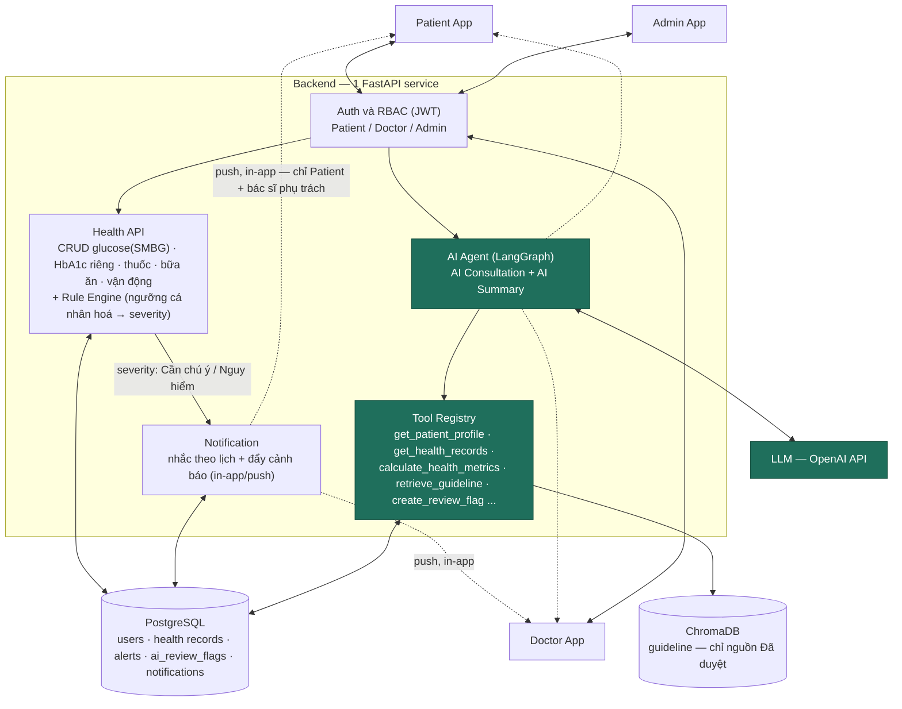
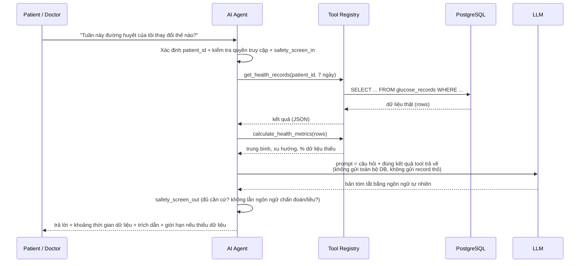

# **MVP: Diabetes Health Management System**

> Tài liệu nháp giai đoạn đầu — nội dung phạm vi cam kết (features, AC, priority) nay thuộc về [PRD.md](PRD.md) **v0.4**; tài liệu này chỉ còn giữ vai trò breakdown ý tưởng ban đầu + phác thảo kiến trúc nhẹ, đã cập nhật để không mâu thuẫn với PRD. Không dùng tài liệu này làm nguồn phạm vi khi có khác biệt với PRD.

## **1. Authentication & Authorization**

Quản lý xác thực và phân quyền người dùng trong hệ thống.

### **Features**

- Đăng nhập

- Đổi mật khẩu

- Phân quyền theo vai trò (Admin, Doctor, Patient)

## **2. User Management**

Quản lý thông tin và mối quan hệ giữa các đối tượng trong hệ thống.

### **Features**

### **Admin**

- Tạo tài khoản

- Cập nhật tài khoản

- Khóa/Mở tài khoản

- Đặt lại mật khẩu

- Quản lý nguồn tri thức (upload, gán tổ chức ban hành/phiên bản/năm/phạm vi áp dụng)

- Xem nhật ký hệ thống (audit log)

### **Doctor**

- Quản lý danh sách bệnh nhân (chỉ bệnh nhân có quan hệ theo dõi hợp lệ)

- Thêm bệnh nhân cần khám vào danh sách

- Đặt lịch tái khám cho bệnh nhân

- Xem hồ sơ bệnh nhân

- Thiết lập mục tiêu điều trị và ngưỡng cảnh báo cá nhân hoá

- Thiết lập kế hoạch đo và kế hoạch thuốc

- Đánh dấu trạng thái **Đã duyệt** cho nguồn tri thức dùng để tư vấn

### **Patient**

- Quản lý hồ sơ cá nhân

- Cập nhật thông tin sức khỏe

## **3. Health Monitoring**

Thu thập và theo dõi dữ liệu sức khỏe của bệnh nhân.

### **Features**

- Ghi nhận đường huyết (SMBG — giá trị, đơn vị, thời gian, ngữ cảnh đo)

- Ghi nhận HbA1c (giá trị + ngày xét nghiệm, lưu riêng với SMBG, không tính là chỉ số đo hằng ngày)

- Ghi nhận thuốc đã sử dụng (chọn từ kế hoạch bác sĩ thiết lập; chỉ xác nhận Đã dùng/Chưa dùng/Bỏ lỡ)

- Ghi nhận bữa ăn

- Ghi nhận hoạt động thể chất

- Ghi nhận triệu chứng và ghi chú

- Sửa bản ghi (lưu lịch sử giá trị trước/sau, người sửa, thời gian)

- Dashboard theo dõi sức khỏe

- Biểu đồ thống kê

- Lịch sử theo dõi

## **4. AI Assistant**

Trợ lý AI hỗ trợ tóm tắt thông tin sức khỏe của bệnh nhân từ lần khám trước đó đến hiện tại. Ngoài ra hỗ trợ giải đáp thắc mắc của bệnh nhân về bệnh tiểu đường.

### **Features**

### **AI Consultation**

- AI Chat

- Hỏi đáp kiến thức về bệnh tiểu đường (chỉ trả lời từ nguồn tri thức **Đã duyệt**, kèm trích dẫn để mở đúng nguồn)

- Hỏi đáp kiến thức về các loại thuốc (chỉ thông tin chung, không kê đơn/đổi liều)

- Giải thích chỉ số sức khỏe

- Giải thích kết quả phân tích

- Từ chối rõ ràng khi thiếu căn cứ, nguồn mâu thuẫn hoặc câu hỏi vượt phạm vi (đổi thuốc/liều/insulin, chẩn đoán)

- Câu hỏi có dấu hiệu nguy hiểm được chuyển sang luồng cảnh báo (mục 5), không trả lời như tư vấn thông thường

### **AI Summary**

- AI Chat

- Tóm tắt thông tin sức khỏe của bệnh nhân (mục tiêu, mức độ hoàn thành, xu hướng, HbA1c, cảnh báo — phần thiếu ghi "Không đủ dữ liệu")

- Tạo cờ **"Cần bác sĩ xem xét"** kèm lý do và dữ liệu liên quan — tách biệt với cảnh báo do Rule Engine tạo; AI không tự tạo/gửi đề xuất thuốc, liều, insulin hay mục tiêu điều trị mới

## **5. Notification & Alert**

Quản lý thông báo và cảnh báo sức khỏe.

### **Features**

- Nhắc đo đường huyết / uống thuốc theo kế hoạch bác sĩ thiết lập (tránh nhắc trùng, có thể hoàn thành/bỏ qua/hoãn)

- Nhắc tái khám

- Cảnh báo theo ngưỡng cá nhân hoá — mức **Cần chú ý** / **Nguy hiểm**, hiển thị ngay cho bệnh nhân (≤ 2 giây) kèm hướng dẫn hành động đã bác sĩ phê duyệt

- Gắn cờ cảnh báo trên dashboard **chỉ cho bác sĩ phụ trách bệnh nhân đó** (resolve qua danh sách phân công, không broadcast — không có kênh gửi cho caregiver/người thân trong MVP)

- *(Should, ngoài Must — cần dữ liệu sử dụng)* Cá nhân hoá thời điểm nhắc nhở theo hành vi

## **6. Reports & History**

Quản lý lịch sử và báo cáo sức khỏe.

### **Features**

- Lịch sử sức khỏe (Must)

- Lịch sử AI Chat, kèm phiên bản mô hình/nguồn (Must — phục vụ truy vết F3)

- Báo cáo trước tái khám do AI tổng hợp — mục tiêu, mức hoàn thành, xu hướng, HbA1c, cảnh báo liên quan (Must, F4)

- *(Could/optional — ngoài Must scope MVP, chỉ triển khai sau pilot nếu đủ dữ liệu và đánh giá an toàn)* Báo cáo định kỳ theo tuần/tháng, xuất báo cáo PDF, dự báo xu hướng

## **7. MVP Architecture**

Kiến trúc MVP cố tình giữ **tối giản**: một backend, một database & vector database, một AI Agent — không tách microservice, không thêm hạ tầng (queue, SMS gateway...) trừ khi luồng bắt buộc cần. Trọng tâm là làm rõ một điều wireframe/PRD đã nói nhưng bản trước chưa vẽ rõ: **AI Agent luôn lấy dữ liệu thật từ PostgreSQL qua Tool, không tự bịa số liệu.**

### **7.1 Nguyên tắc thiết kế**

- Một backend FastAPI duy nhất (modular monolith), một PostgreSQL duy nhất — đủ cho quy mô 4 người/6 tuần, không cần microservice hay message queue riêng trong MVP.

- Rule Engine (kiểm tra ngưỡng, phân loại mức độ) là logic chạy ngay trong Health API khi lưu bản ghi, không gọi LLM — để cảnh báo (kể cả khẩn cấp) vẫn hoạt động nếu AI lỗi hoặc chậm.

- AI Agent không được phép tự nhớ/suy đoán số liệu: mọi con số AI đưa ra phải đến từ kết quả một Tool gọi PostgreSQL (xem 7.4). Đây là ràng buộc grounding quan trọng nhất của toàn kiến trúc.

- Một AI Agent duy nhất dùng chung cho cả AI Consultation (Patient) và AI Summary (Doctor) — không multi-agent, sử dụng RAG/vector DB truy xuất kiến thức cần thiết theo các nguồn liên quan (chỉ nguồn **Đã duyệt**).

- AI chỉ được phép tạo cờ "Cần bác sĩ xem xét" — không bao giờ tự tạo/ghi cảnh báo ngưỡng y khoa; cảnh báo ngưỡng là quyền hạn riêng của Rule Engine. Hai luồng này tách bảng dữ liệu để không lẫn quyền ghi (xem 7.3, 7.4).

- Không có vai trò Caregiver/người thân trong MVP — PRD v0.4 xác nhận Caregiver chỉ là Could/Future, chưa phải co-primary persona; kiến trúc hiện tại không thiết kế trước cho luồng này.

### **7.2 Sơ đồ kiến trúc tổng quan**

### **7.3 Thành phần chính**

| Thành phần | Vai trò |
| --- | --- |
| Health API + Rule Engine | CRUD dữ liệu sức khỏe (SMBG, HbA1c riêng, thuốc, bữa ăn, vận động, triệu chứng); ngay khi lưu, kiểm tra ngưỡng cá nhân hoá (bác sĩ cấu hình) và gắn severity: Bình thường / **Cần chú ý** / **Nguy hiểm** |
| Notification | Cron đơn giản nhắc thuốc/đo chỉ số theo lịch; đẩy in-app + push ngay khi có severity Cần chú ý/Nguy hiểm (≤ 2s), resolve đích qua danh sách bác sĩ phụ trách — không broadcast, không có kênh caregiver |
| AI Agent + Tool Registry | Một agent cho cả AI Consultation và AI Summary; luôn gọi Tool để lấy dữ liệu thật trước khi LLM tổng hợp câu trả lời; chỉ tạo cờ xem xét (`ai_review_flags`), không tạo alert |
| PostgreSQL | Nguồn dữ liệu duy nhất: hồ sơ, health record, alert (Rule Engine), ai_review_flag (AI), notification |
| ChromaDB | Hỗ trợ AI trả lời hỏi đáp bằng nguồn dữ liệu Đã duyệt lấy từ công bố/quy định của Bộ Y tế và tài liệu tham khảo từ bệnh viện, tổ chức quốc tế |

### **7.4 Luồng AI Agent lấy dữ liệu từ database (trọng tâm)**

Nguyên tắc: **LLM chỉ nhìn thấy dữ liệu do Tool trả về**, không truy vấn DB trực tiếp và không được "nhớ" số liệu từ phiên trước — mọi câu trả lời có số liệu đều truy ngược được về một Tool call cụ thể. Đây là cách MVP đáp ứng yêu cầu "AI không bịa dữ liệu" trong PRD mà không cần thêm guardrail service riêng — việc validate nằm trong chính Tool (kiểm tra quyền, kiểm tra input) trước khi chạm DB.

### **7.5 Cảnh báo theo ngưỡng (F2)**

Không cần một "Emergency Detector" riêng — severity Cần chú ý/Nguy hiểm do Rule Engine gắn (7.3) là đủ để Notification chạy đúng timeline:

| t | Bước |
| --- | --- |
| 0s | Health API lưu bản ghi, Rule Engine gắn severity = Cần chú ý / Nguy hiểm |
| ≤ 2s | Notification hiển thị cảnh báo cho Patient App kèm hướng dẫn hành động đã bác sĩ phê duyệt |
| — | Notification gắn cờ trên dashboard **chỉ bác sĩ phụ trách bệnh nhân đó** (không broadcast) |

PRD v0.4 xác định rõ: hệ thống **không** tự động liên hệ 115/cấp cứu và **không** cam kết bác sĩ giám sát 24/7 (Won't scope) — không còn timeline đẩy push cho "người thân" ở 30s hay đếm ngược 5 phút gợi ý gọi 115 như bản thiết kế trước, vì Caregiver không phải persona MVP. Kênh gửi cụ thể (push/SMS/email) còn là open question, cần chốt trước grooming F1/F2 (PRD §9).

### **7.6 Công nghệ sử dụng **

- Frontend:

  - React + Vite: Khởi tạo nhanh, build nhẹ, phù hợp MVP

  - Tailwind: Phát triển giao diện nhanh, dễ tùy biến, phù hợp dashboard và responsive UI

- Backend

  - PostgreSQL: Ổn định, mã nguồn mở, phù hợp dữ liệu quan hệ và dễ mở rộng

  - ChromaDB: Cài nhanh, phù hợp với hệ thống chỉ có vài chục tài liệu.

  - Fast API: Hiệu năng cao, async tốt, tích hợp Python thuận tiện

  - JWT: Chuẩn phổ biến cho xác thực API, dễ triển khai phân quyền

- AI

  - Open AI API

  - Langraph: Điều phối workflow của AI Agent, giúp kiểm soát luồng xử lý và tích hợp các cơ chế guardrail, retry và human approval khi cần.

