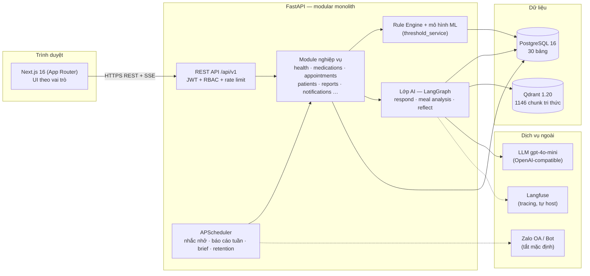
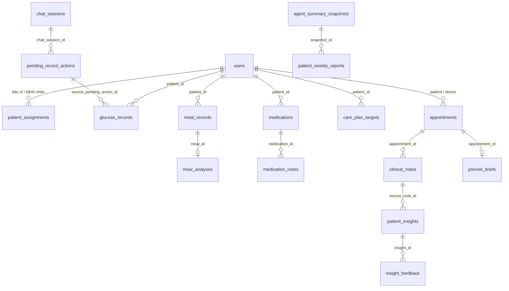
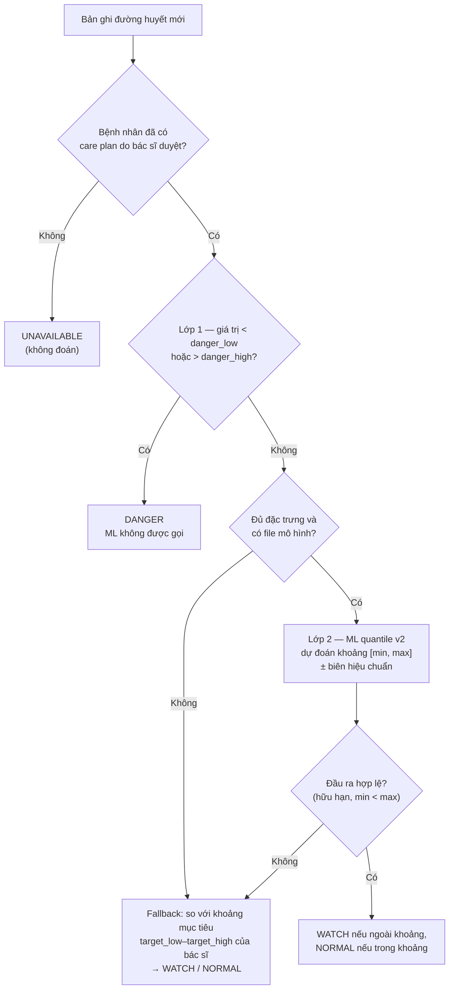
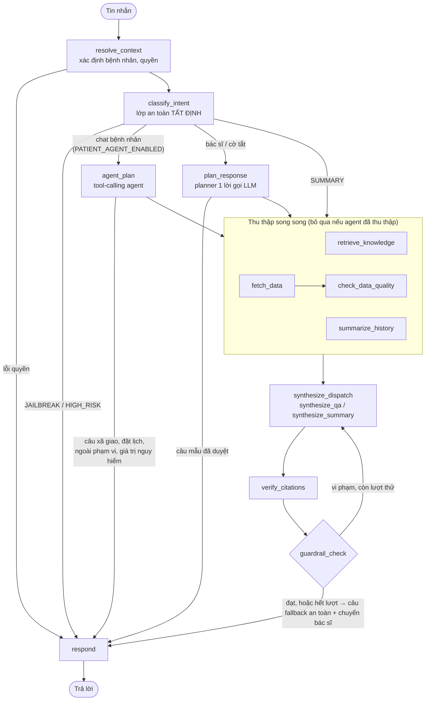
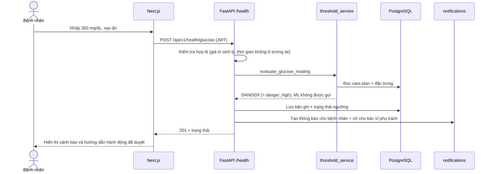

# VDiab — Tổng quan toàn bộ hệ thống

> **Trạng thái:** đối chiếu với mã nguồn ngày 2026-10-29, nhánh `feat/medication-adherence-previsit-brief`, commit `cd5e56e`.
> Mọi con số trong file này (số endpoint, số bảng, số chunk, kết quả eval) được đếm hoặc đọc trực tiếp từ code, cơ sở dữ liệu và `eval/results/` tại thời điểm đó. Khi code thay đổi, kiểm tra lại trước khi trích dẫn.
>
> Tài liệu này mô tả hệ thống **đang chạy được**. Phần chỉ có ở mức thiết kế hoặc chưa đo được ghi rõ ở [§13](#13-hạn-chế-và-việc-còn-mở).

---

## Mục lục

1. [Bài toán, người dùng và nguyên tắc](#1-bài-toán-người-dùng-và-nguyên-tắc)
2. [Kiến trúc tổng thể](#2-kiến-trúc-tổng-thể)
3. [Cấu trúc mã nguồn](#3-cấu-trúc-mã-nguồn)
4. [Backend: các module và API](#4-backend-các-module-và-api)
5. [Cơ sở dữ liệu](#5-cơ-sở-dữ-liệu)
6. [Cảnh báo ngưỡng: Rule Engine và mô hình ML](#6-cảnh-báo-ngưỡng-rule-engine-và-mô-hình-ml)
7. [Lớp AI](#7-lớp-ai)
8. [Các luồng nghiệp vụ chính](#8-các-luồng-nghiệp-vụ-chính)
9. [Thông báo và tác vụ định kỳ](#9-thông-báo-và-tác-vụ-định-kỳ)
10. [Bảo mật và quyền riêng tư](#10-bảo-mật-và-quyền-riêng-tư)
11. [Frontend](#11-frontend)
12. [Triển khai, vận hành và CI](#12-triển-khai-vận-hành-và-ci)
13. [Chất lượng và đánh giá](#13-chất-lượng-và-đánh-giá)
14. [Hạn chế và việc còn mở](#14-hạn-chế-và-việc-còn-mở)
15. [Tài liệu liên quan](#15-tài-liệu-liên-quan)

---

## 1. Bài toán, người dùng và nguyên tắc

**Bài toán.** Bệnh nhân đái tháo đường típ 2 tự theo dõi tại nhà giữa hai lần tái khám nhưng ghi chép rời rạc, khó tự nhận ra bất thường và thiếu nguồn thông tin tin cậy. Bác sĩ thì gần như không thấy dữ liệu của bệnh nhân trong khoảng thời gian đó. VDiab là nền tảng web giúp bệnh nhân ghi và theo dõi chỉ số, cảnh báo khi vượt ngưỡng, giải đáp kiến thức có nguồn, và tổng hợp dữ liệu cho bác sĩ trước buổi tái khám.

**Ba vai trò người dùng**

| Vai trò | Làm được gì |
|---|---|
| Bệnh nhân | Ghi đường huyết, huyết áp, bữa ăn (văn bản hoặc ảnh), vận động, thuốc; nhận cảnh báo và nhắc nhở; chat với trợ lý AI (hỏi đáp, ghi số liệu bằng lời); xem báo cáo tuần; xuất dữ liệu, yêu cầu xóa tài khoản |
| Bác sĩ | Xem danh sách bệnh nhân được phân công; xem chi tiết, biểu đồ, tóm tắt AI, brief trước tái khám; ghi chú lâm sàng; đặt mục tiêu điều trị (care plan); duyệt/bác bỏ nhận định AI; tạo lịch hẹn |
| Quản trị viên | Tạo tài khoản, đặt lại mật khẩu, phân công bệnh nhân cho bác sĩ, xem nhật ký kiểm toán, duyệt yêu cầu xóa dữ liệu |

**Nguyên tắc an toàn y khoa** (xuyên suốt mọi thành phần AI)

- AI **không chẩn đoán, không kê đơn, không gợi ý liều** thuốc/insulin.
- **Cảnh báo ngưỡng nguy hiểm chạy tất định, độc lập với LLM**: một chỉ số vượt ngưỡng bác sĩ đặt luôn được phát hiện kể cả khi nhà cung cấp LLM ngừng hoạt động.
- Trợ lý bệnh nhân **chỉ hỏi đáp và ghi số liệu, không đưa lời khuyên** (quyết định 2026-10-27, Epic 8.6). Kiến thức chung được thuật lại kèm nguồn ("Theo Bộ Y tế, người bệnh…"), không nói "bạn nên…".
- **Số liệu do code tính, LLM chỉ diễn giải.** LLM không được tự cộng, chia, hay bịa con số.
- Mọi ghi chép do AI soạn đều là **bản nháp chờ bệnh nhân xác nhận**.
- Câu hỏi bất thường hoặc AI không trả lời an toàn được → chuyển cho bác sĩ (cờ "Cần bác sĩ xem xét").

---

## 2. Kiến trúc tổng thể

**Kiểu kiến trúc:** *modular monolith*. Một ứng dụng FastAPI chia thành các module theo miền nghiệp vụ, dùng chung một PostgreSQL. Lý do không tách microservice: đội nhỏ, quy mô pilot, và các module chia sẻ dữ liệu bệnh nhân rất chặt. Hai dịch vụ giọng nói (STT, TTS) tách riêng vì cần phần cứng khác (xem §12).



**Nền tảng công nghệ** (đọc từ `requirements.txt`, `codebase/frontend/package.json`, `docker-compose*.yml`)

| Tầng | Công nghệ | Vai trò trong VDiab |
|---|---|---|
| Backend | FastAPI ≥0.115 (đang chạy 0.162), Uvicorn, Pydantic v2 | REST API, SSE stream cho chat |
| ORM / CSDL | SQLModel + PostgreSQL 16 | Hệ thống lưu trữ chính (system of record) |
| AI orchestration | LangGraph, LangChain, `langchain-openai` | Đồ thị agent, tool calling |
| LLM | `gpt-4o-mini` qua endpoint OpenAI-compatible (`AI_API_URL`) | Lập kế hoạch, soạn câu trả lời, tách món ăn, nhận diện ảnh |
| Embedding | `BAAI/bge-m3` (1024 chiều), chạy **local** bằng `sentence-transformers` | Vector hóa tri thức và câu hỏi — không gửi văn bản ra ngoài |
| Vector store | Qdrant 1.20 | Tìm kiếm tri thức (dense + BM25) và lưu nhận định AI |
| ML | scikit-learn (HistGradientBoosting quantile) | Khoảng theo dõi cá nhân hóa (WATCH) |
| Tác vụ định kỳ | APScheduler (chạy trong tiến trình backend) | Nhắc nhở, báo cáo tuần, brief, dọn dữ liệu |
| Tracing | Langfuse v3 (tự host, chỉ bật khi có key) | Theo dõi lời gọi LLM; nội dung được che ở production |
| Frontend | Next.js 16.4, React 19, TypeScript 5.7, Tailwind 4, shadcn, Recharts | Giao diện theo vai trò, biểu đồ |
| Thông báo ngoài | Zalo Official Account / ZBS template / Zalo Bot | Đẩy nhắc nhở qua Zalo (tùy chọn) |
| Đóng gói | Docker, Docker Compose | Triển khai |

---

## 3. Cấu trúc mã nguồn

```
VDiab/
├── codebase/
│   ├── backend/            # FastAPI: mỗi thư mục là một module nghiệp vụ (models, router, service, schemas)
│   ├── models/             # Lớp AI
│   │   ├── agents/         # LangGraph: graph.py, state.py, nodes/, tools/, prompts/
│   │   ├── rag/            # chunking, embeddings, ingest, vector_store (Qdrant)
│   │   ├── llm.py          # get_llm(): chọn model theo node, gắn tracing
│   │   └── tracing.py      # Langfuse
│   ├── frontend/           # Next.js
│   ├── stt-service/        # Speech-to-text (GPU, tách riêng, chưa đưa lên production)
│   ├── tts-service/        # Text-to-speech (tách riêng)
│   └── mcp/                # Chỗ dành cho MCP server — chưa có server nào
├── data/
│   ├── knowledge_base/     # Kho tri thức: sources.csv, raw/*.md, pdfs/, ingestion_manifest.json
│   └── NHANES, CGMacros, simulator_60d, ml/ …   # Dữ liệu huấn luyện/mô phỏng cho ML
├── artifacts/personalized_watch/   # Mô hình ML v0/v1/v2 + model card + metrics
├── eval/                   # Bộ golden dataset và các runner đánh giá
├── tests/                  # pytest: test_backend/, test_models/
├── scripts/                # Seed dữ liệu, backfill, kiểm tra schema
└── docs/                   # PRD, thiết kế, báo cáo chất lượng, task, khóa luận
```

---

## 4. Backend: các module và API

**85 endpoint** dưới `/api/v1` (đếm từ OpenAPI của ứng dụng) cộng `GET /health`.

| Module (`codebase/backend/`) | Prefix | Số endpoint | Chức năng chính |
|---|---|---:|---|
| `auth` | `/auth` | 4 | Đăng nhập (OAuth2 password form → JWT), xem/sửa hồ sơ, đổi mật khẩu |
| `admin`, `audit`, `privacy` (phần admin) | `/admin` | 10 | Quản lý người dùng, phân công bệnh nhân–bác sĩ, nhật ký kiểm toán, duyệt yêu cầu xóa |
| `privacy` | `/privacy` | 4 | Bệnh nhân xuất dữ liệu của mình, yêu cầu/hủy yêu cầu xóa tài khoản |
| `patients`, `insights` | `/doctor` | 9 | Danh sách bệnh nhân của bác sĩ, ghi chú lâm sàng, mục tiêu care plan (có phiên bản), nhận định AI + phản hồi của bác sĩ |
| `appointments` | `/appointments` | 9 | CRUD lịch hẹn, trạng thái, brief trước tái khám (tạo, xem, đánh dấu đã xem) |
| `health` | `/health` | 15 | Đường huyết, huyết áp, bữa ăn, vận động; phân tích bữa ăn (văn bản/ảnh), tương quan bữa ăn ↔ đường huyết, bác sĩ duyệt nhãn WATCH |
| `medications` | `/medications` | 9 | Thêm/đổi/ngừng thuốc (lưu lịch sử), ghi chú thuốc (quên liều, tác dụng phụ), tỷ lệ tuân thủ |
| `agent`, `summaries` | `/agent` | 9 | Chat (thường và SSE), ảnh bữa ăn trong chat, xác nhận bản nháp ghi chép, phiên chat, tóm tắt AI, chỉ số tóm tắt, gợi ý câu hỏi |
| `notifications` | `/notifications` | 12 | Thông báo trong app, lịch nhắc nhở, gợi ý giờ nhắc thông minh, liên kết và gửi Zalo |
| `reports` | `/reports` | 4 | Báo cáo tuần cho bệnh nhân |

**Các lớp middleware** (theo thứ tự ngoài → trong): `AuditContextMiddleware` (gắn request id, IP, người thực hiện cho mọi request) → `SQLInjectionGuardMiddleware` → CORS. Lỗi nhà cung cấp LLM (hết quota, timeout) được chuyển thành HTTP 503 với thông báo tiếng Việt thay vì lỗi 500.

**Kiểm soát truy cập dữ liệu bệnh nhân:** mọi endpoint đọc dữ liệu bệnh nhân đi qua `patients/access.py::ensure_patient_access`. Bệnh nhân chỉ xem dữ liệu của mình; bác sĩ chỉ xem bệnh nhân được phân công qua `patient_assignments`.

---

## 5. Cơ sở dữ liệu

**30 bảng** (SQLModel metadata). Dự án không dùng Alembic: `db.py::create_db_and_tables()` tạo bảng mới và **chỉ thêm** cột còn thiếu, nên cột mới phải nullable hoặc có giá trị mặc định.

| Nhóm | Bảng | Ghi chú |
|---|---|---|
| Người dùng & phân quyền | `users`, `patient_profiles`, `patient_assignments`, `zalo_link_codes` | `users.role` ∈ PATIENT / DOCTOR / ADMIN; mật khẩu bcrypt |
| Chỉ số sức khỏe | `glucose_records` (18 cột: giá trị, bối cảnh đo, trạng thái ngưỡng, khoảng dự đoán ML…), `blood_pressure_records`, `activity_records`, `meal_records`, `meal_analyses` | Bản ghi tạo từ chat trỏ về `pending_record_actions` qua `source_pending_action_id` |
| Thuốc | `medications` (có `replaces_medication_id` để giữ lịch sử đổi thuốc), `medication_notes` | |
| Điều trị & lâm sàng | `care_plan_targets` (ngưỡng mục tiêu/nguy hiểm, có phiên bản, bác sĩ duyệt), `clinical_notes`, `appointments`, `previsit_briefs`, `doctor_watch_reviews` | |
| AI | `agent_summary_snapshots`, `patient_insights`, `insight_feedback`, `patient_weekly_reports`, `chat_sessions`, `pending_record_actions`, `agent_checkpoints`, `agent_checkpoint_writes`, `agent_checkpoint_blobs` | 3 bảng checkpoint lưu trạng thái hội thoại LangGraph |
| Thông báo | `notifications`, `notification_preferences`, `reminder_time_suggestions` | |
| Kiểm toán & quyền riêng tư | `audit_events`, `account_deletion_requests` | |



*(Sơ đồ chỉ gồm các quan hệ chính; danh sách đầy đủ khóa ngoại lấy từ `SQLModel.metadata`.)*

---

## 6. Cảnh báo ngưỡng: Rule Engine và mô hình ML

Mỗi lần ghi đường huyết, `health/service.py::create_glucose_record` gọi `health/threshold_service.py::evaluate_glucose_reading`. Đây là hàm **duy nhất** được phép đưa ra quyết định ngưỡng. Quyết định đi qua các lớp sau:



- **DANGER** chỉ do ngưỡng bác sĩ quyết định, so sánh nghiêm ngặt. Mô hình ML không bao giờ được ghi đè DANGER.
- **Mô hình ML** (`artifacts/personalized_watch/v2_quantile_regression/`): hai mô hình HistGradientBoosting hồi quy phân vị (q = 0.10 và 0.90), hiệu chuẩn bằng split-conformal (biên 0.89 mg/dL). Trên tập giữ lại theo bệnh nhân: độ phủ 78.9% (mục tiêu 80%), độ rộng khoảng trung bình 57.8 mg/dL. Có hai phiên bản trước để so sánh: `v0_logreg`, `v1_hgb`.
- **Giới hạn của ML:** huấn luyện **chỉ trên dữ liệu tổng hợp** (synthetic type 2; pipeline huấn luyện ở `data/NHANES/final/`), nhãn là nhãn luật yếu, chưa có kiểm chứng lâm sàng trên bệnh nhân thật (ghi rõ trong model card).
- Bác sĩ có thể duyệt/sửa nhãn WATCH (`POST /health/glucose/{id}/watch-review`, bảng `doctor_watch_reviews`).
- Kết quả ngưỡng → tạo thông báo cho bệnh nhân và cờ cho bác sĩ phụ trách (§9).

---

## 7. Lớp AI

Lớp AI gồm **ba đồ thị LangGraph** dùng chung một kho công cụ (tools) và một kho tri thức:

| Đồ thị | Hàm dựng | Kích hoạt bởi | Checkpoint |
|---|---|---|---|
| Respond agent | `build_graph()` | Chat của bệnh nhân/bác sĩ, yêu cầu tóm tắt | Có (lưu hội thoại theo thread vào PostgreSQL) |
| Meal analysis | `build_meal_analysis_graph()` | Lưu bữa ăn (chạy nền), sửa/chạy lại phân tích | Không |
| Reflect (nhận định dài hạn) | `build_reflect_graph()` / `reflect()` | Lưu ghi chú lâm sàng, cron hằng tuần | Không |

### 7.1. Respond agent



**Các bước chính**

1. **`classify_intent` — lớp an toàn tất định, chạy trước mọi lời gọi LLM.** Dùng danh sách mẫu trong `prompts/safety_patterns.py` (~520 dòng):
   - *Lớp 1 — jailbreak/prompt injection*: đổi vai, ghi đè chỉ thị, payload mã hóa, delimiter giả…
   - *Lớp 2 — y khoa rủi ro cao*: tự tăng/giảm liều, ngừng thuốc có tên, dấu hiệu cấp cứu.

   Trúng một trong hai lớp → trả **câu mẫu đã duyệt** ngay, không gọi LLM. Hai lớp này cố ý **không** giao cho LLM: một lần thử dùng LLM phân loại jailbreak đã từng xếp nhầm một ca hạ đường huyết cấp cứu thành jailbreak (đã gỡ bỏ, ghi trong docstring `plan_response.py`).
2. **Lập kế hoạch** — một trong hai:
   - `plan_response`: một lời gọi LLM trả JSON (phân loại SOCIAL / APPOINTMENT_SUPPORT / OUT_OF_SCOPE / QA, cần dữ liệu cá nhân hay tri thức). Dùng cho bác sĩ, tóm tắt, hoặc khi tắt agent.
   - `agent_plan` (Epic 8, mặc định cho chat bệnh nhân): agent gọi tool. Một lượt mặc định chỉ tốn **một** lời gọi LLM (gọi nhiều tool cùng lúc). Các tool kết thúc lượt (`reply_social`, `out_of_scope`, `answer_directly`) **bị từ chối nếu tin nhắn có nội dung sức khỏe**, khi đó quay về "thu thập đủ rồi trả lời" (sửa 2026-10-29 sau eval).
   - Cả hai có *fast path* cho lời chào và câu tra cứu rõ ràng (bỏ qua LLM), và khi LLM lỗi thì mặc định **thu thập tất cả** chứ không từ chối.
3. **Thu thập** song song: `retrieve_knowledge` (RAG), `fetch_data` → `check_data_quality` (dữ liệu bệnh nhân + đánh giá độ đầy đủ), `summarize_history` (nén hội thoại dài).
4. **Soạn câu trả lời** (`synthesize_qa`): chỉ dựa trên đoạn tri thức đã truy xuất và dữ liệu đã tính sẵn. Model tự khai `used_chunk_ids`; trích dẫn chỉ được giữ khi **vừa được khai báo vừa qua kiểm tra trùng từ** với câu trả lời. Với bệnh nhân, nhận định về số liệu tách sang trường `assessment` (hiển thị riêng, ghi rõ do AI tạo).
5. **`verify_citations`**: bỏ qua khi trích dẫn đã tự khai báo hợp lệ (tiết kiệm một lời gọi LLM, Epic 5.4).
6. **`guardrail_check`** — quét câu trả lời trước khi gửi:

   | Mã lỗi | Phát hiện |
   |---|---|
   | `diagnosis_phrasing` | Chẩn đoán trực tiếp ("bạn bị đái tháo đường…") |
   | `personalized_dosage_directive`, `dose_change_advice`, `carb_based_dose_advice` | Chỉ định liều, đổi liều, tính insulin theo carb |
   | `medication_stop_advice`, `meal_skipping_advice` | Khuyên ngừng thuốc, bỏ bữa để hạ đường |
   | `causal_overreach` | Khẳng định nhân quả cá nhân từ dữ liệu bữa ăn |
   | `personal_advice` | (Bệnh nhân) bất kỳ câu khuyên trực tiếp nào |
   | `system_prompt_leak`, `embedded_instruction_compliance` | Lộ prompt hệ thống, làm theo chỉ thị nhúng trong tài liệu |
   | `uncited_retrieval_drift`, `direct_answer_unsupported_claim` | Khẳng định y khoa không có nguồn |

   Vi phạm → soạn lại **một lần**, và lần soạn lại được biết lý do bị chặn. Vẫn vi phạm → câu fallback an toàn + cờ chuyển bác sĩ. Câu trả lời có mục tiêu điều trị mơ hồ được gửi kèm lưu ý và cờ cho bác sĩ (human-in-the-loop).

**Kho tool của agent bệnh nhân** (18 tool, `tools/agent_tools.py`; không tool nào nhận `patient_id` từ model — luôn lấy từ người đã đăng nhập):

- *Đọc dữ liệu:* `get_health_records`, `get_health_stats` (thống kê do code tính), `get_medications`, `get_medication_adherence`, `get_my_doctor`, `get_appointments`, `get_weekly_report`, `get_meal_glucose_response`, `get_my_insights`, `search_knowledge`.
- *Ghi (tạo bản nháp chờ xác nhận):* `draft_records`, `propose_record_deletion`, `mark_medication_taken`, `set_medication_reminder`.
- *Kết thúc lượt:* `reply_social`, `request_new_appointment`, `out_of_scope`, `answer_directly`.

**Ghi số liệu từ chat:** `draft_records` cho LLM đọc câu chữ tự do (không dấu, viết tắt, "7 phẩy 2", "130 trên 85"), nhưng **code kiểm từng giá trị** với đoạn trích nguyên văn trong tin nhắn (`record_actions.draft_from_agent_proposal`). Code tự xử lý những gì đọc được tất định: giờ đo, đơn vị theo độ hợp lý, chặn câu giả định ("nếu", "định") và số liệu của người khác ("mẹ tôi"). Kết quả là thẻ xác nhận; bệnh nhân bấm lưu mới ghi vào CSDL. Giá trị ngoài vùng an toàn → câu chuyển tuyến cố định, không để LLM viết.

### 7.2. RAG — kho tri thức

| Thuộc tính | Giá trị |
|---|---|
| Nguồn | `data/knowledge_base/`: 56 mục trong `sources.csv` (Bộ Y tế 28, Bệnh viện 20, Nước ngoài 8) + 7 tài liệu dài (tier 2); 46 file văn bản gốc trong `raw/` — QĐ 5481/QĐ-BYT, QĐ 1530, Dược thư Quốc gia 2022 (13 chuyên luận thuốc), ADA 2026, IWGDF, VADE, Bạch Mai, WHO… |
| Chunking | Chunker v2 theo cấu trúc tài liệu (đề mục, bảng, danh sách), ngân sách tính bằng token của bge-m3; với văn xuôi, câu cuối (≤ 48 token) được lặp sang chunk sau; bỏ mục lục, số trang, tài liệu tham khảo; mỗi chunk mở đầu bằng dòng ngữ cảnh (tên tài liệu + đề mục) |
| Embedding | `BAAI/bge-m3`, 1024 chiều, chạy local trên CPU (p50 ~0.1 s/truy vấn) |
| Lưu trữ | Qdrant, collection `knowledge_base__bge-m3`, **1146 chunk** |
| Truy xuất | Hybrid: dense (cosine) + BM25, gộp bằng Reciprocal Rank Fusion (k = 60); ưu tiên nguồn tier 1 (+0.03); trả về 6 đoạn |
| Nguyên tắc | Chỉ nguồn đã duyệt; mỗi chunk mang metadata (tier, tổ chức, trang/mục, URL) để trích dẫn |

### 7.3. Phân tích bữa ăn (Epic 1)

`parse_meal_items` → `lookup_nutrition` → `aggregate` → `persist_analysis`.

- **Tách món:** luật tất định trước ("1 bát phở bò, 1 ly trà đá"); chỉ gọi LLM khi còn tên món bảng tra không biết. LLM **không bao giờ sinh số dinh dưỡng**.
- **Bảng tra:** 214 món/thực phẩm Việt (`nutrition_data/vn_foods.csv`) + bảng quy đổi đơn vị dân gian (bát, chén, đĩa, tô, ổ, lạng…). Khớp tên: chính xác → không dấu → tên nằm trong câu → fuzzy ≥ 0.85; không khớp thì để trống, không đoán.
- **Mức carb mỗi bữa:** < 30 g thấp, 30–60 g vừa, ≥ 60 g cao (cấu hình được, chờ bác sĩ duyệt). Bệnh nhân chỉ thấy carb; bác sĩ thấy cả kcal.
- **Ảnh bữa ăn:** một lời gọi vision model tạo bản nháp danh sách món. Ảnh **không được lưu** và không đi vào tracing; cần bệnh nhân đồng ý trước lần dùng đầu tiên.
- **Tương quan bữa ăn ↔ đường huyết:** ghép bữa ăn với lần đo sau ăn 60–180 phút; chỉ hiển thị khi một món/mức carb có ≥ 3 lần; diễn đạt "thường đi kèm", không nói "gây ra".
- **Lưu ý:** số carb/kcal hiện là **ước tính chưa đối chiếu** Bảng thành phần thực phẩm Việt Nam (`NUTRITION_DB_VERSION = vn_foods-2026.10-unverified`), UI ghi "ước tính".

### 7.4. Tóm tắt cho bác sĩ, brief tái khám, nhận định dài hạn, báo cáo tuần

- **Tóm tắt AI** (`synthesize_summary`): tổng hợp 7/30 ngày gồm đường huyết, huyết áp, bữa ăn liên quan tăng đường huyết, tuân thủ thuốc, thay đổi so với kỳ trước, độ đầy đủ dữ liệu. Lưu snapshot (`agent_summary_snapshots`) để đọc nhanh.
- **Brief trước tái khám** (Epic 4): tự tạo trước lịch hẹn (job hằng giờ), gồm HbA1c, mức đạt mục tiêu care plan, kế hoạch lần trước, phần lâm sàng; bác sĩ đánh dấu đã xem.
- **Nhận định dài hạn** (reflect): khi bác sĩ lưu ghi chú lâm sàng hoặc theo cron hằng tuần, hệ thống đề xuất/cập nhật `patient_insights` (lưu cả trong Qdrant để truy xuất). Bác sĩ xác nhận hoặc bác bỏ; nhận định bị bác bỏ không được dùng lại.
- **Báo cáo tuần cho bệnh nhân** (Epic 2): tạo tự động sáng Chủ nhật cho tuần vừa qua. Thống kê do code tính; phần lời là bản tóm tắt AI dành cho bệnh nhân của đúng tuần đó (đã qua guardrail); tuần không có số đo thì dùng câu cố định, không gọi LLM; một "việc nên làm" chọn theo luật từ các câu đã duyệt. Bệnh nhân nhận thông báo trong app và tin Zalo ngắn **không kèm số liệu sức khỏe**; có thể tắt nhận báo cáo.

### 7.5. Cấu hình LLM và tracing

- `get_llm(node)` chọn model theo node qua `LLM_NODE_MODELS` (mặc định tất cả dùng `MODEL_NAME = gpt-4o-mini`), endpoint OpenAI-compatible qua `AI_API_URL`.
- Mọi node được bọc `timed_node` để log `node, duration_ms, intent` — **không log nội dung câu hỏi/câu trả lời**.
- Langfuse tự host là kênh tracing duy nhất; backend **từ chối khởi động** ở production nếu bật LangSmith qua biến môi trường.

---

## 8. Các luồng nghiệp vụ chính

**Luồng 1 — Bệnh nhân ghi đường huyết (form hoặc chat)**



Ghi qua chat thì thêm một bước: agent soạn bản nháp → thẻ xác nhận → bệnh nhân bấm lưu → `POST /agent/record-actions/{id}` → đi tiếp luồng trên.

**Luồng 2 — Bệnh nhân hỏi trợ lý AI:** `POST /agent/chat` hoặc `/agent/chat/stream` (SSE, gửi tiến trình "đang xem lịch khám…" sau < 0.3 s) → respond agent (§7.1) → câu trả lời + nguồn trích dẫn + phần nhận định AI tách riêng + thẻ xác nhận (nếu có số liệu được kể).

**Luồng 3 — Bác sĩ chuẩn bị tái khám:** mở danh sách bệnh nhân → chi tiết (biểu đồ đường huyết có tô ngày quên thuốc, bữa ăn, thuốc) → brief trước tái khám → ghi chú lâm sàng → hệ thống trích nhận định từ ghi chú → bác sĩ xác nhận/bác bỏ.

---

## 9. Thông báo và tác vụ định kỳ

| Job (APScheduler, giờ Việt Nam) | Lịch | Việc làm |
|---|---|---|
| `reminder_tick` | Mỗi 1 phút | Sinh nhắc đo đường huyết/huyết áp/uống thuốc theo `notification_preferences`; tự đánh dấu hoàn thành khi bệnh nhân đã đo; đẩy Zalo nếu đã liên kết |
| `previsit_brief_tick` | Hằng giờ, phút 05 | Tạo brief cho lịch hẹn sắp tới |
| `weekly_report_tick` | Chủ nhật 08:00 (cấu hình được) | Tạo báo cáo tuần cho bệnh nhân |
| `weekly_reflection_tick` | Thứ Hai 02:00 | Chạy reflect tìm nhận định dài hạn |
| `retention_tick` | Hằng ngày 03:30 | Xóa hội thoại không hoạt động > 365 ngày, tóm tắt AI > 730 ngày |

- **Gợi ý giờ nhắc thông minh** (Epic 3.3): nếu ≥ 5/7 lần gần nhất bệnh nhân phản hồi trễ > 30 phút, đề xuất giờ mới bằng trung vị giờ phản hồi; chỉ đổi khi bệnh nhân chấp nhận.
- **Đặt nhắc thuốc bằng chat** (Epic 8.6): "nhắc tôi uống thuốc lúc 8h tối" → bản nháp → xác nhận.
- **Zalo:** có client cho Official Account, ZBS template và Zalo Bot (liên kết tài khoản bằng mã). Trong `.env` local đang **tắt** (`ZALO_NOTIFICATIONS_ENABLED=false`); chưa xác nhận chạy end-to-end trên production.

---

## 10. Bảo mật và quyền riêng tư

| Biện pháp | Chi tiết |
|---|---|
| Xác thực | JWT HS256, hết hạn 60 phút; mật khẩu bcrypt |
| Phân quyền | RBAC theo vai trò + kiểm tra quyền trên từng bệnh nhân (`ensure_patient_access`, `patient_assignments`) |
| Giới hạn tần suất | Đăng nhập 5 lần/phút/IP; `/agent/*` 20 lần/phút |
| Đầu vào | `SQLInjectionGuardMiddleware`; kiểm tra giá trị sinh lý và thời gian; denylist nội dung không an toàn trong mô tả bữa ăn |
| Kiểm toán | `audit_events`: mọi truy cập/thay đổi kèm request id, IP, người thực hiện; admin xem qua API |
| Quyền của bệnh nhân | Xuất toàn bộ dữ liệu; yêu cầu xóa tài khoản (admin duyệt) |
| Lưu trữ | Tự xóa theo thời hạn (§9); ảnh bữa ăn không lưu |
| Log | Không ghi nội dung sức khỏe (PHI) vào log kỹ thuật; log httpx bị hạ mức vì URL Zalo Bot chứa token |
| Kiểm tra khi khởi động production | Từ chối chạy nếu Qdrant không có API key hoặc nếu LangSmith tracing đang bật |
| Prompt injection | Lớp 1 tất định + nội dung tài liệu/tin nhắn luôn được đánh dấu là DỮ LIỆU trong prompt + guardrail phát hiện câu trả lời làm theo chỉ thị nhúng |

Chi tiết mối đe dọa và luồng dữ liệu: [THREAT_MODEL.md](THREAT_MODEL.md), [DATA_FLOWS.md](DATA_FLOWS.md), [DATA_RETENTION.md](DATA_RETENTION.md).

---

## 11. Frontend

Next.js 16 (App Router), một ứng dụng duy nhất, giao diện đổi theo vai trò. 16 trang (`codebase/frontend/app/`):

| Vai trò | Trang |
|---|---|
| Chung | `/` (trang giới thiệu), `/login`, `/profile`, `/notifications` |
| Bệnh nhân | `/dashboard`, `/health` (chỉ số), `/meals` (bữa ăn + thẻ phân tích + "món ảnh hưởng đường huyết"), `/medication`, `/ai` (trợ lý: chat, stream, nút chụp ảnh bữa ăn, thẻ xác nhận), `/appointments`, `/reports` |
| Bác sĩ | `/doctor` (danh sách bệnh nhân), `/doctor/patients/[id]` (chi tiết: biểu đồ, tab bữa ăn, thuốc, tóm tắt AI, brief, ghi chú, care plan, nhận định), `/doctor/account` |
| Quản trị | `/admin`, `/admin/account` |

Biểu đồ bằng Recharts; component UI từ shadcn + Tailwind 4. Nút nói (STT) chỉ hiện khi cấu hình `NEXT_PUBLIC_STT_WS_URL`.

---

## 12. Triển khai, vận hành và CI

**Docker Compose**

| File | Dịch vụ | Ghi chú |
|---|---|---|
| `docker-compose.yml` | `backend`, `frontend`, `db` (postgres:16-alpine), `qdrant` (qdrant:v1.20.0) | Stack chính |
| `docker-compose.langfuse.yml` | Langfuse web + worker, ClickHouse, MinIO, Redis, Postgres | Tracing tự host, tùy chọn |
| `docker-compose.stt.yml` | `stt-service` | Cần GPU NVIDIA (~16 GB VRAM); **không đưa lên production** — ghi bữa ăn bằng giọng nói hoãn sau pilot |
| `docker-compose.tts.yml` | `tts-service` | Tách riêng |

**Lệnh thường dùng** (`Makefile`): `make db-up`, `make run` (backend :8100), `make up/down`, `make ingest` (nạp kho tri thức), `make backup/restore/backup-drill`, `make test`, `make eval-*`.

**CI** (`.github/workflows/ci.yml`): ruff → pytest → `eval/run_eval.py` so với baseline → kiểm tra bootstrap schema → build frontend (`npm ci`). Hướng dẫn vận hành: [OPERATIONS_RUNBOOK.md](OPERATIONS_RUNBOOK.md), [BACKUP_RESTORE.md](BACKUP_RESTORE.md).

---

## 13. Chất lượng và đánh giá

| Hạng mục | Kết quả | Ngày / nguồn |
|---|---|---|
| Test tự động | **1075 test pass** | 2026-10-29, `pytest tests` |
| Lớp an toàn tất định (phân loại intent) | 37/37 | 2026-10-26, `eval/results/latest.json` |
| Routing / jailbreak (trajectory) | 10/10, không gọi LLM ở các ca này | 2026-10-26, `trajectory_local_20261027.json` |
| Rule Engine | **12/15** — 3 ca cần ngưỡng theo bối cảnh đo (xem §14) | 2026-10-26, `latest.json` |
| Golden scenarios — trợ lý AI (30 ca, agent bật, sau sửa, 2 lần chạy) | Phân loại 1.00 · chuyển cấp cứu 1.00 · từ chối đổi điều trị 5/5 · đáp ứng trích dẫn 0.87/0.93 · phủ ý chính 0.73/0.73 · không nội dung cấm 1.00 | 2026-10-29, `golden_scenarios_agent-on-fix-20261029-r{1,2}.json` |
| Ghi số liệu từ chat (63 ca) | Đúng hoàn toàn 93.7% · ghi nhầm 0% · đúng trường 100% (parser regex cũ: 54%) | 2026-10-27, `record_extraction-epic8.json` — **chưa chạy lại sau sửa agent 29/10** |
| Phân tích bữa ăn văn bản (62 ca) | 62/62 · sai số carb trung bình ≈ 0 g/bữa · 7/7 món lạ không đoán | 2026-10-29, `meal_analysis_text-20261029-1044.json` |
| AI Summary golden (8 ca) | 2 PASS · 3 FAIL · 2 chưa hỗ trợ · 1 bỏ qua | 2026-10-26, `ai_summary_golden.json` |
| Mô hình ML WATCH v2 | Độ phủ 78.9% (mục tiêu 80%) trên tập giữ lại theo bệnh nhân | `artifacts/personalized_watch/v2_quantile_regression/metrics.json` |
| Hiệu năng chat AI | p95 10.3 / 11.8 s (mục tiêu ≤ 10 s) — **đo trước khi có agent**, chưa đo lại | 2026-10-27, [PERFORMANCE_REPORT.md](PERFORMANCE_REPORT.md) |
| Thời gian tới sự kiện stream đầu tiên | 0.14–0.22 s (mẫu nhỏ) | 2026-10-27 |

**Giới hạn của cách đánh giá:** golden chỉ 30 ca; judge là LLM cùng model `gpt-4o-mini`; bộ ca bữa ăn do người viết đã thấy bảng tra; chưa có dữ liệu người dùng thật. Cách chấm golden thay đổi ngày 2026-10-29 — xem [eval/README.md](../eval/README.md).

---

## 14. Hạn chế và việc còn mở

**Kỹ thuật**
1. **Rule Engine thiếu ngưỡng theo bối cảnh đo.** Care plan chỉ có một khoảng mục tiêu chung, nên đường huyết lúc đói 155 mg/dL (mục tiêu lúc đói thường 80–130) hay trước khi ngủ 78 mg/dL không được cảnh báo "cần chú ý". Ngưỡng nguy hiểm vẫn hoạt động.
2. **Hiệu năng chưa đạt mục tiêu** p95 ≤ 10 s và chưa đo lại trên luồng agent. Phần lớn thời gian là độ trễ nền của nhà cung cấp LLM (~1.1–1.4 s mỗi lời gọi).
3. **Chất lượng nội dung AI ở mức trung bình:** phủ ý chính 0.73; câu hỏi "đang ốm có được ngừng thuốc không" có lần chỉ nhận câu fallback an toàn.
4. **Số liệu dinh dưỡng là ước tính** chưa đối chiếu bảng chuẩn; chưa có bộ ảnh để đánh giá nhận diện món từ ảnh.
5. **Mô hình ML chỉ huấn luyện trên dữ liệu tổng hợp.**

**Lâm sàng và vận hành**
6. Bác sĩ chưa duyệt: ngưỡng mức carb, định nghĩa tuân thủ thuốc, báo cáo tuần mẫu, thời gian đọc brief ≤ 2 phút.
7. Chưa có cron backup và diễn tập khôi phục trên production; chưa chốt thời hạn lưu trữ.
8. Chưa có pilot với bệnh nhân thật.

**Ngoài phạm vi / hoãn**
- Chẩn đoán, kê đơn, gợi ý liều; tích hợp CGM/thiết bị đeo; giám sát 24/7 và cấp cứu tự động (PRD Won't).
- Ghi bữa ăn bằng giọng nói (STT cần máy GPU riêng) — hoãn sau pilot.
- Quyền truy cập cho người thân (caregiver) — đã gỡ khỏi roadmap, phát triển sau.
- MCP server — chưa có.

Trạng thái chi tiết từng epic: [docs/tasks/README.md](tasks/README.md).

---

## 15. Tài liệu liên quan

| Chủ đề | Tài liệu |
|---|---|
| Yêu cầu sản phẩm | [PRD.md](PRD.md), [Danh sách User Story.md](Danh%20sách%20User%20Story.md) |
| Kiến trúc (bản gốc, có chỗ lỗi thời) | [../ARCHITECTURE.md](../ARCHITECTURE.md), [architecture_diagram.md](architecture_diagram.md) |
| Thiết kế AI | [AI_Summary_Respond_System_Design.md](AI_Summary_Respond_System_Design.md), [backendDocs/ai-flow.md](backendDocs/ai-flow.md) |
| ML | [ML_PERSONALIZED_WATCH_SYSTEM_PLAN.md](ML_PERSONALIZED_WATCH_SYSTEM_PLAN.md), [ML_HANDOFF_PERSONALIZED_ATTENTION.md](ML_HANDOFF_PERSONALIZED_ATTENTION.md) |
| API | [api/openapi.yaml](api/openapi.yaml) |
| Đánh giá | [../eval/README.md](../eval/README.md), [AI_Eval_Metrics_Plan.md](AI_Eval_Metrics_Plan.md), [QUALITY_REPORT.md](QUALITY_REPORT.md), [PERFORMANCE_REPORT.md](PERFORMANCE_REPORT.md) |
| Bảo mật & vận hành | [THREAT_MODEL.md](THREAT_MODEL.md), [DATA_FLOWS.md](DATA_FLOWS.md), [DATA_RETENTION.md](DATA_RETENTION.md), [OPERATIONS_RUNBOOK.md](OPERATIONS_RUNBOOK.md), [ZALO_NOTIFICATIONS.md](ZALO_NOTIFICATIONS.md) |
| Roadmap | [tasks/README.md](tasks/README.md) |
| Khóa luận | [report/HUONG_DAN_AGENT_VIET_KHOA_LUAN.md](report/HUONG_DAN_AGENT_VIET_KHOA_LUAN.md) |

**Chỗ tài liệu cũ lệch với code** (đã xác minh): ARCHITECTURE ghi "React SPA" (thực tế Next.js 16), "ChromaDB" (thực tế Qdrant), "LangSmith" (thực tế Langfuse); `docs/diagrams/*.png` còn các nhãn cũ đó.
