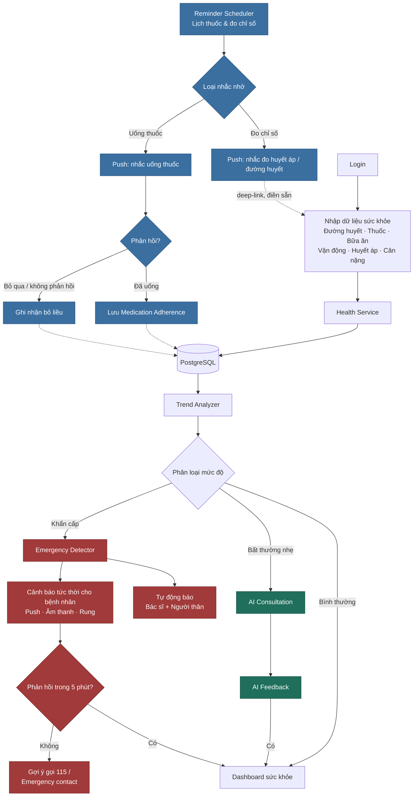
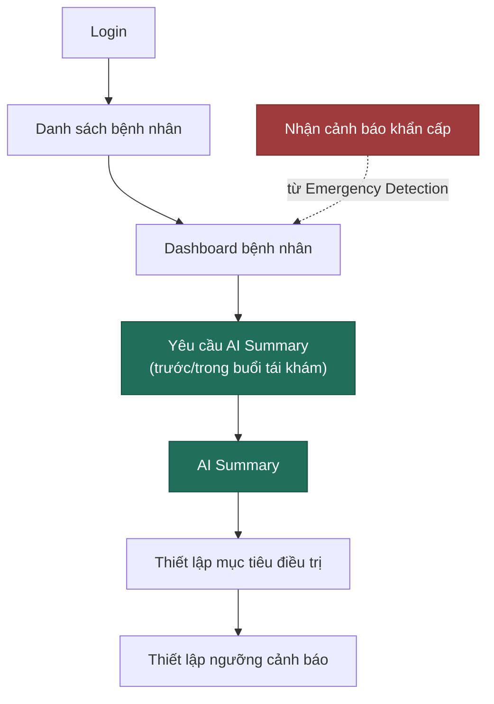
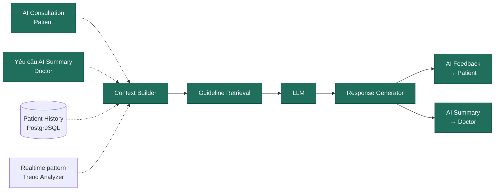

**DIAB  ·  TÀI LIỆU NỘP GATE 1**

**Wireframe & UI Flow**

Luồng trải nghiệm và bố cục màn hình cho MVP quản lý sức khỏe người tiểu đường — bao gồm điểm tương tác AI, nhắc uống thuốc & đo chỉ số định kỳ, và tính năng mới: phát hiện & cảnh báo tình huống khẩn cấp.

**Ngày: **02/08/2026    |    **Phiên bản: **v0.3 — thêm Reminder Flow & AI Summary tái khám    |    **Đối tượng: **Bệnh nhân · Bác sĩ

# 00. Tổng quan

DiaB giúp người bệnh tiểu đường ghi lại chỉ số sức khỏe hằng ngày và nhận phản hồi từ AI khi có dấu hiệu bất thường; bác sĩ theo dõi bệnh nhân của mình và nhận tóm tắt do AI tạo. Tài liệu này trình bày luồng người dùng (bao gồm nhắc nhở chủ động theo lịch), wireframe các màn hình lõi, và đặc tả tính năng cảnh báo khẩn cấp mới — phần dễ bị bỏ sót nhất nhưng quan trọng nhất với một ứng dụng y tế.

# 01. Sơ đồ luồng người dùng

Để dễ theo dõi, luồng được tách thành 3 sơ đồ riêng biệt thay vì gộp chung một sơ đồ lớn. Nút quyết định “Phân loại mức độ” chia thành ba nhánh — Bình thường / Bất thường nhẹ / Khẩn cấp — để nhánh khẩn cấp đi thẳng vào luồng cảnh báo riêng, không chờ qua AI Consultation dạng hội thoại. Sơ đồ Patient Flow còn gộp thêm Reminder Scheduler — luồng nhắc uống thuốc và đo huyết áp/đường huyết theo lịch — chạy song song và đổ dữ liệu tuân thủ vào cùng pipeline phân tích, để bỏ liều/bỏ đo lặp lại cũng được Trend Analyzer nhận diện như một dấu hiệu bất thường.

**■ Xanh lục teal**  = điểm tương tác AI      **■ Xanh dương**  = nhắc nhở theo lịch      **■ Đỏ**  = luồng cảnh báo khẩn cấp      **■ Trắng / viền xám**  = luồng nghiệp vụ thường

## 1.1  Patient Flow, Reminders & Emergency Detection

Reminder Scheduler nhắc uống thuốc/đo chỉ số song song với luồng nhập liệu → phân tích xu hướng → phân loại mức độ. Nhánh khẩn cấp kích hoạt Emergency Detector độc lập với AI Consultation.

## 1.2  Doctor Flow

Bác sĩ xem danh sách, yêu cầu AI Summary trước/trong buổi tái khám, thiết lập mục tiêu & ngưỡng cảnh báo; nhận cảnh báo khẩn cấp đẩy thẳng vào Dashboard bệnh nhân.

## 1.3  AI Service (Shared Backend)

Một backend AI dùng chung cho cả AI Consultation (bệnh nhân) và AI Summary (bác sĩ), lấy ngữ cảnh từ Patient History và xu hướng thời gian thực.

# 02. Bản phác thảo giao diện

Bảy màn hình lõi của MVP — đủ để chứng minh tính khả thi của Core Flow mà không sa vào màn hình phụ.

## 01 · Login

## 02 · Input

AI phân loại mức độ ngay sau khi gửi

## 03 · Dashboard (Output)

## 04 · AI Consultation (Output, chat)

Toàn màn hình là điểm chạm AI

## 05 · Emergency Alert — MÀN HÌNH MỚI

Full-screen takeover khi phát hiện khẩn cấp

## 06 · Doctor — Patient list

Dòng có cảnh báo SOS được viền đỏ

## 07 · AI Summary — Tái khám

Mở từ dòng bệnh nhân trong màn hình 06

# 03. Điểm tương tác AI

Đánh dấu rõ để mentor thấy AI nằm ở đâu trong trải nghiệm, không chỉ là một chatbot rời rạc.

| Màn hình | Điểm chạm AI | Đầu vào | Đầu ra |
| --- | --- | --- | --- |
| Nhập dữ liệu (02) | Phân loại mức độ (nền, không hiện UI) | Chỉ số vừa nhập + lịch sử | Cờ: Bình thường / Nhẹ / Khẩn cấp |
| Dashboard (03) | Nút nổi “Hỏi AI” | Ngữ cảnh dashboard hiện tại | Mở màn hình AI Consultation |
| AI Consultation (04) | Toàn bộ hội thoại | Câu hỏi + Patient History (RAG) | Phản hồi tư vấn, gợi ý hành động |
| Emergency Detector (05, nền) | Phát hiện bất thường cấp tốc | Realtime pattern từ Trend Analyzer | Kích hoạt luồng cảnh báo khẩn cấp |
| Doctor Dashboard (06) | “Yêu cầu AI Summary” | Dữ liệu bệnh nhân theo kỳ | Tóm tắt xu hướng + đề xuất theo dõi |
| AI Summary — Tái khám (07) | Tóm tắt tiến triển từ lần khám trước | Lịch sử từ lần tái khám gần nhất (chỉ số, tuân thủ thuốc, sự kiện bất thường) | Bản tóm tắt + khuyến nghị điều chỉnh điều trị |

# 04. Emergency Notification — đặc tả tính năng mới

Khi AI hoặc thiết bị phát hiện chỉ số ở mức nguy hiểm, hệ thống chủ động cảnh báo thay vì chờ người dùng mở app.

## Mức độ cảnh báo

| Mức độ | Điều kiện | Kênh & người nhận | Hành động |
| --- | --- | --- | --- |
| ⚠ CẢNH BÁO NHẸ | Chỉ số lệch ngưỡng nhưng chưa nguy hiểm tức thời (VD: đường huyết 180–250 mg/dL) | Thông báo trong app · chỉ bệnh nhân | Dẫn vào AI Consultation |
| 🚨 KHẨN CẤP | Ngưỡng nguy hiểm tính mạng (VD: hạ đường huyết < 54 mg/dL, hoặc mất kết nối thiết bị bất thường kèm chỉ số xấu trước đó) | Push + âm thanh + rung, full-screen · bệnh nhân → bác sĩ phụ trách → người thân | Escalation nếu không phản hồi trong 5 phút |

## Dòng thời gian escalation

| Thời điểm | Bước | Mô tả |
| --- | --- | --- |
| t = 0s | Phát hiện | Emergency Detector gắn cờ khẩn cấp |
| t ≈ 2s | Cảnh báo bệnh nhân | Full-screen + âm thanh + rung |
| t = 30s | Báo bác sĩ & người thân | Push/SMS tự động, kèm chỉ số |
| t = 5 phút | Không phản hồi | Gợi ý gọi 115 / hotline cấp cứu |

# 05. Checklist nộp Gate 1

**✔  **Sơ đồ luồng người dùng (User Flow) — có nhánh Reminder (thuốc/đo chỉ số) và Emergency riêng biệt

**✔  **Wireframe 7 màn hình lõi: Login, Input, Dashboard, AI Consultation, Emergency Alert, Doctor List, AI Summary tái khám

**✔  **Đánh dấu rõ điểm tương tác AI (bảng mục 03)

**☐  **Dựng lại wireframe trên Figma/Whimsley, để chế độ xem công khai

**☐  **Đính kèm file này (PDF/Word) vào folder tài liệu Gate 1

| Mẹo: tài liệu này tập trung vào Core Flow (nhập liệu → phân tích → phản hồi AI/cảnh báo). Khi dựng lại trên Figma, giữ đúng 6 màn hình này trước — đừng thêm màn hình phụ (settings, lịch sử chi tiết…) trước khi Core Flow được mentor duyệt. |
| --- |
