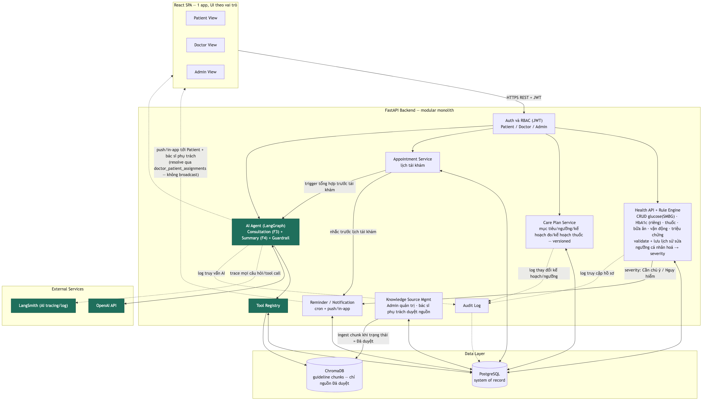
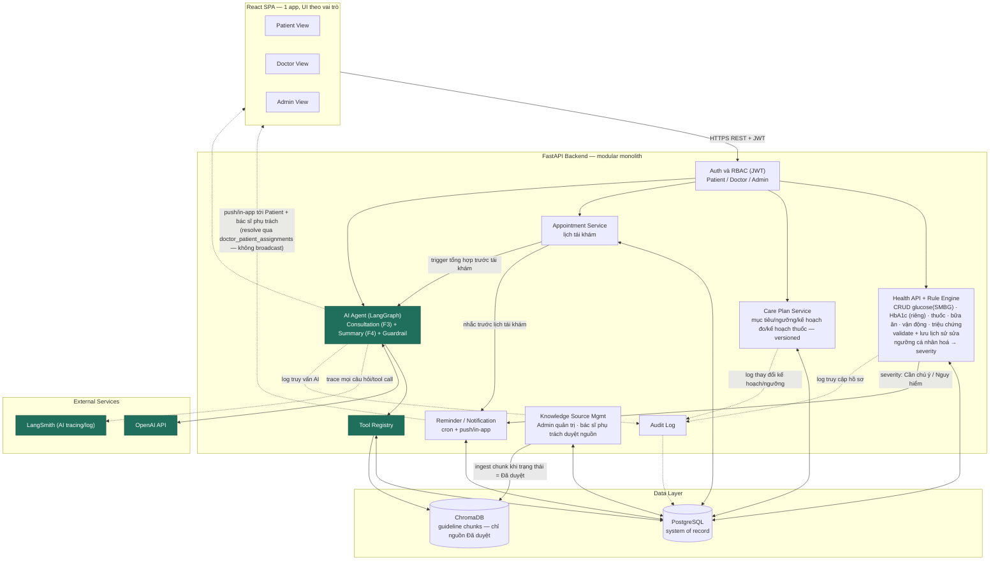
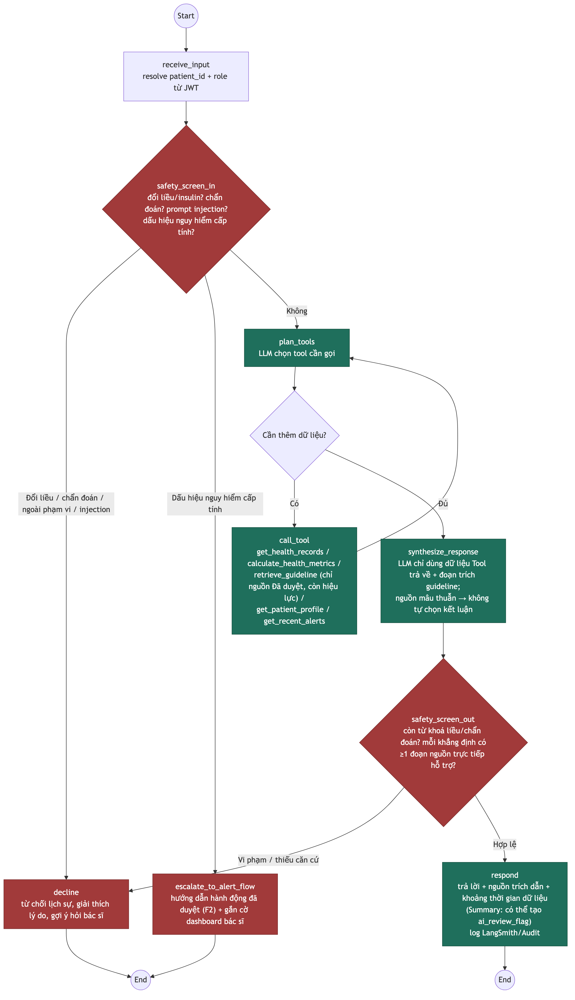
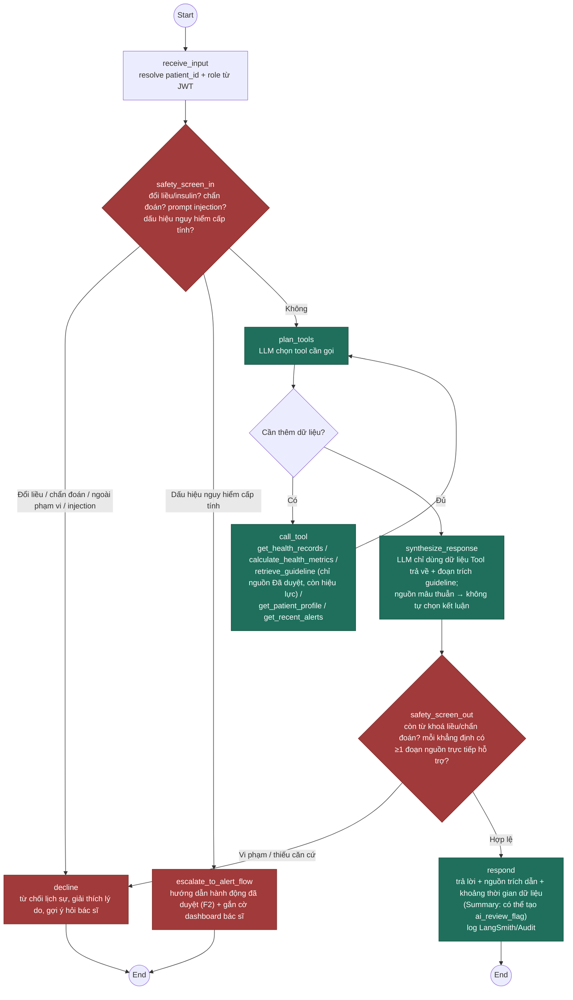
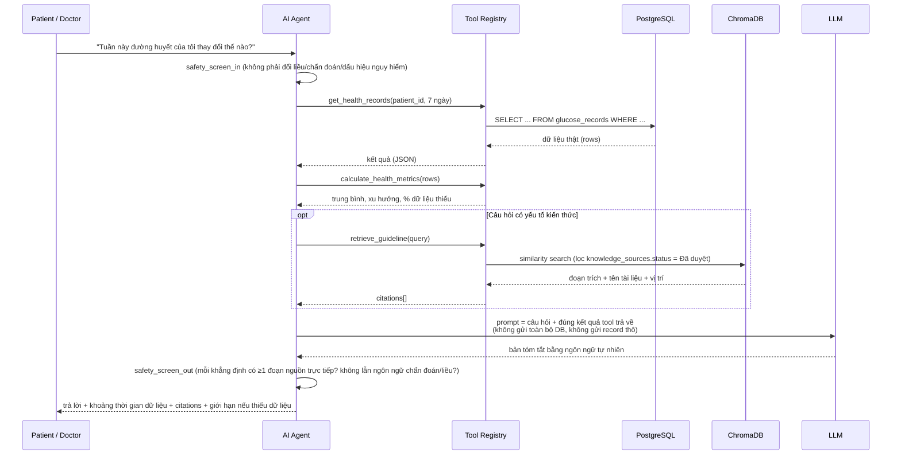
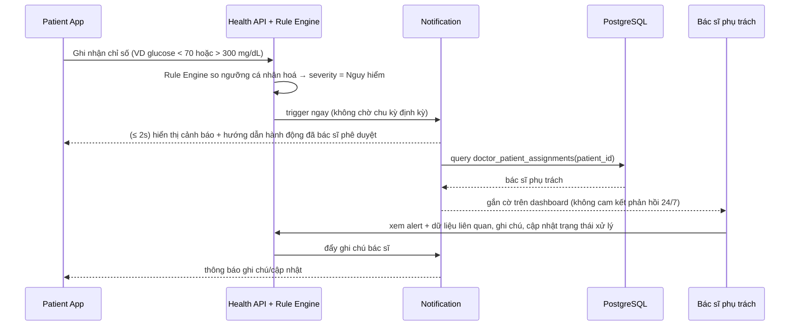

# Architecture Diagram — VDiab

Sơ đồ chi tiết cho kiến trúc; phần narrative/component detail đầy đủ ở [../ARCHITECTURE.md](../ARCHITECTURE.md). Nguồn: [PRD.md](PRD.md) **v0.4** — `MVP_Diabetes_Health_Management_System.md` là tài liệu nháp giai đoạn đầu, không còn đồng bộ với PRD hiện tại, không dùng làm nguồn phạm vi.

## 1. System Overview

Mermaid source

## 2. Agent Flow (LangGraph)

Một graph duy nhất dùng chung cho AI Consultation (F3, Patient) và AI Summary (F4, Doctor); guardrail chạy cả đầu vào lẫn đầu ra, không chỉ chặn từ khoá mà còn ép buộc trích dẫn "đủ căn cứ". Câu hỏi có dấu hiệu nguy hiểm y tế cấp tính **không** chỉ bị từ chối — được chuyển sang luồng cảnh báo F2 (xem §4).

Mermaid source

## 3. Grounding Sequence — AI luôn lấy dữ liệu thật

Nguyên tắc trọng tâm của toàn kiến trúc: **LLM chỉ nhìn thấy dữ liệu do Tool trả về**, không truy vấn DB trực tiếp, không "nhớ" số liệu từ phiên trước — mọi câu trả lời có số liệu truy ngược được về một Tool call cụ thể.

## 4. Alert Flow (F2) — cảnh báo ngưỡng

Không có "Emergency Detector" tách riêng — `severity` (Cần chú ý / Nguy hiểm) do Rule Engine gắn ngay khi lưu record (đồng bộ, không qua LLM) là đủ để Notification chạy đúng timeline. Đích nhận cảnh báo **luôn được resolve bằng query** tới `doctor_patient_assignments`, không phải danh sách tĩnh — chỉ bác sĩ phụ trách đúng bệnh nhân đó mới nhận được, không broadcast.

**Không có Caregiver, không có timer tự động liên hệ cấp cứu trong MVP.** PRD v0.4 xác nhận Caregiver không phải co-primary persona (chỉ xem xét lại sau pilot nếu có evidence) và "tự động liên hệ cấp cứu"/"cam kết giám sát 24/7" là Won't scope — hệ thống chỉ hiển thị cảnh báo cho Patient kèm hướng dẫn hành động **đã bác sĩ phê duyệt trước** (nội dung tĩnh, không phải phản hồi thời gian thực) và gắn cờ trên dashboard bác sĩ; không có cơ chế escort-to-hospital hay đếm ngược tự động gợi ý 115 như thiết kế v0.1.

| t | Bước |
| --- | --- |
| 0s | Health API lưu bản ghi, Rule Engine gắn `severity` = Cần chú ý / Nguy hiểm |
| ≤ 2s | Notification hiển thị cảnh báo cho Patient App kèm hướng dẫn hành động đã bác sĩ phê duyệt |
| — | Notification query `doctor_patient_assignments` để resolve đúng bác sĩ phụ trách, gắn cờ trên dashboard (kênh gửi cụ thể — push/SMS/email — còn là open question trong PRD §9) |

## 5. Component Details

| Component | Technology | Purpose |
| --- | --- | --- |
| Frontend | React + Vite + Tailwind | 1 SPA, UI theo role (Patient/Doctor/Admin) |
| Backend | FastAPI (modular monolith) | Auth, Health API + Rule Engine, Care Plan, Appointment, Reminder/Notification, Audit Log, Knowledge Source Mgmt |
| Agent orchestration | LangGraph | Tool-calling loop + guardrail in/out, dùng chung Consultation + Summary |
| LLM | OpenAI API | Sinh câu trả lời/tóm tắt, chỉ dựa trên dữ liệu Tool trả về |
| Database | PostgreSQL | System of record: users, health records, care plans, alerts, ai_review_flags, notifications, appointments, audit logs |
| Vector Store | ChromaDB (embedded) | RAG trên guideline Đã duyệt (`data/knowledge_base/raw/`) cho F3 |
| Tracing | LangSmith | AI Logs + debug grounding/guardrail |
| Auth | JWT | RBAC theo role, scope kiểm tra ở API + Tool layer |

## 6. Feature → Diagram Traceability

| Feature (PRD) | Sơ đồ liên quan |
| --- | --- |
| F1 — Nhật ký sức khỏe theo kế hoạch | §1 System Overview (Health API + Rule Engine, Reminder) |
| F2 — Theo dõi xu hướng và cảnh báo cá nhân hóa | §4 Alert Flow |
| F3 — Trợ lý tư vấn lối sống có căn cứ | §2 Agent Flow, §3 Grounding Sequence |
| F4 — Theo dõi bệnh nhân giữa các kỳ tái khám | §1 System Overview (Care Plan/Appointment Service), §2 Agent Flow (nhánh Summary/`ai_review_flags`) |

Component detail đầy đủ theo từng Feature: xem bảng traceability trong [../ARCHITECTURE.md](../ARCHITECTURE.md).
