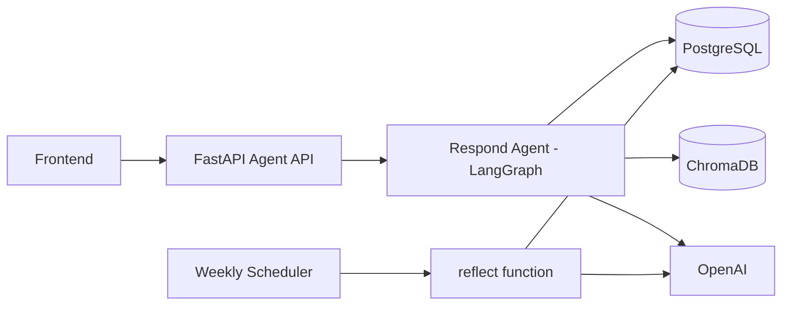
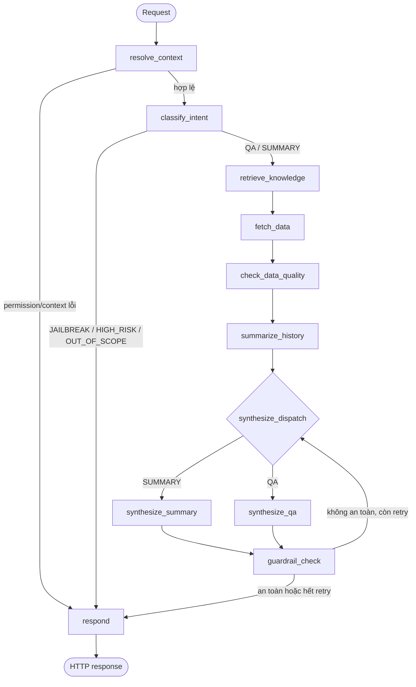
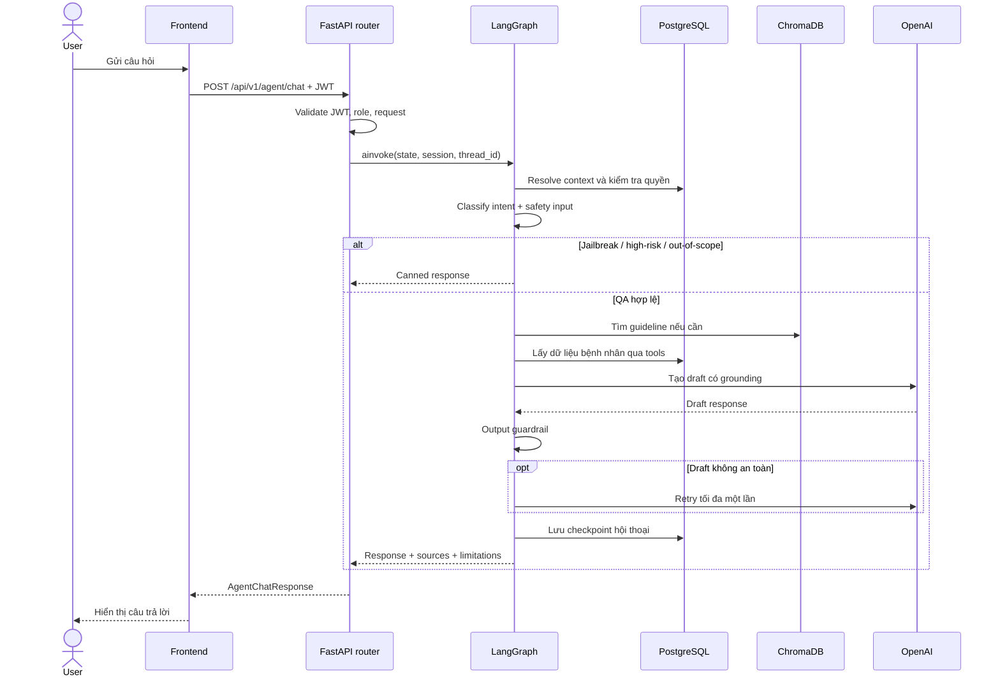
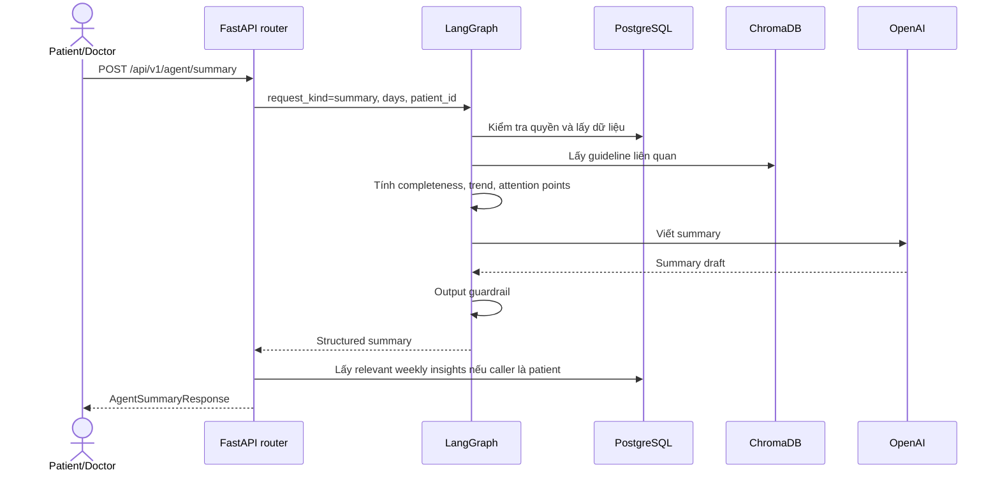
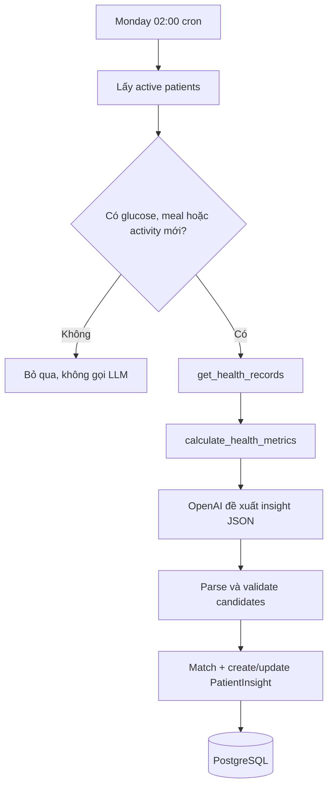

# Luồng hoạt động AI hiện tại của VDiab

Tài liệu này mô tả **luồng đang được code thực thi**, không chỉ mô tả kiến trúc dự kiến.

## 1. Tổng quan

AI thuộc backend về mặt kiến trúc, nhưng source code được tách thành hai khu vực:

```text
codebase/backend/agent/       # HTTP API, xác thực, phân quyền, response schema
codebase/models/              # LangGraph, node, prompt, tool, LLM và RAG
```

Hệ thống hiện có hai nhóm luồng AI:

1. **Respond agent**: trả lời chat và tạo summary theo request từ API.
2. **Reflect/insight**: chạy nền hằng tuần để phát hiện insight dài hạn của bệnh nhân.



## 2. Entry point từ backend

Hai endpoint AI nằm tại [`codebase/backend/agent/router.py`](codebase/backend/agent/router.py):

| Endpoint | Mục đích |
| --- | --- |
| `POST /api/v1/agent/chat` | Bệnh nhân hoặc bác sĩ hỏi AI |
| `POST /api/v1/agent/summary` | Tạo bản tổng hợp dữ liệu bệnh nhân trong 1–30 ngày |

Cả hai endpoint đều gọi cùng một LangGraph agent được export từ:

```python
from codebase.models.agents.graph import agent
```

Sau đó gọi:

```python
result = await agent.ainvoke(initial_state, config=graph_config)
```

Điểm khác biệt chính giữa hai endpoint là `request_kind`:

```python
request_kind = "chat"
# hoặc
request_kind = "summary"
```

`classify_intent` dựa vào trường này để chọn nhánh tổng hợp phù hợp.

## 3. Những việc backend làm trước khi gọi AI

Backend không chuyển thẳng mọi request cho LLM. Router thực hiện các bước sau:

1. FastAPI validate request bằng Pydantic schema.
2. Kiểm tra Bearer JWT.
3. Chỉ cho role `PATIENT` hoặc `DOCTOR` sử dụng agent.
4. Lấy SQLModel `Session` của request.
5. Tạo initial state cho LangGraph.
6. Tạo `thread_id` để cô lập bộ nhớ hội thoại.
7. Gọi `agent.ainvoke(...)`.
8. Chuyển lỗi permission từ graph thành HTTP `400/403`.
9. Đóng gói kết quả thành response schema.

Session database được truyền vào graph qua config:

```python
config = {
    "configurable": {
        "session": session,
        "thread_id": thread_id,
    }
}
```

Nhờ vậy node và tool dùng cùng request-scoped session, đồng thời test có thể thay PostgreSQL bằng SQLite in-memory.

## 4. Thread và bộ nhớ hội thoại

Chat dùng một thread ổn định theo cặp bệnh nhân–người đang hỏi:

```text
{patient_id}:{current_user_id}
```

Ví dụ:

```text
patient-A:patient-A  # bệnh nhân tự chat về mình
patient-A:doctor-X   # bác sĩ X chat về bệnh nhân A
patient-A:doctor-Y   # bác sĩ Y có thread riêng
```

Summary dùng namespace riêng:

```text
{patient_id}:{current_user_id}:summary
```

Do đó summary không làm lẫn lịch sử với hội thoại chat.

LangGraph checkpoint được lưu trong PostgreSQL qua [`codebase/models/agents/checkpoint.py`](codebase/models/agents/checkpoint.py). Với chat:

- Router thêm `HumanMessage` vào state.
- Graph đọc được lịch sử của cùng `thread_id`.
- Node `respond` thêm `AIMessage` cuối cùng.
- Checkpointer lưu state để lượt chat sau sử dụng.

Summary không thêm message hội thoại.

## 5. Respond-agent graph

Topology chính nằm tại [`codebase/models/agents/graph.py`](codebase/models/agents/graph.py):



### 5.1 `resolve_context`

File: [`codebase/models/agents/nodes/resolve_context.py`](codebase/models/agents/nodes/resolve_context.py)

Vai trò:

- Xác định bệnh nhân mục tiêu.
- Bệnh nhân mặc định truy cập dữ liệu của chính mình.
- Bác sĩ phải truyền `patient_id`.
- Kiểm tra bác sĩ có được phân công bệnh nhân đó hay không.
- Từ chối truy cập trái phép trước khi lấy dữ liệu hoặc gọi LLM.

Nếu có lỗi, graph đi thẳng tới `respond`; router sau đó đổi lỗi thành HTTP `400` hoặc `403`.

### 5.2 `classify_intent`

File: [`codebase/models/agents/nodes/classify_intent.py`](codebase/models/agents/nodes/classify_intent.py)

Node này phân request thành:

| Intent | Ý nghĩa |
| --- | --- |
| `SUMMARY` | Tạo bản tổng hợp dữ liệu |
| `QA` | Trả lời câu hỏi trong phạm vi đái tháo đường |
| `OUT_OF_SCOPE` | Ngoài phạm vi hệ thống |
| `HIGH_RISK` | Yêu cầu nguy hiểm như chẩn đoán hoặc tự đổi liều |
| `JAILBREAK` | Cố bypass instruction/guardrail |

Jailbreak và high-risk được phát hiện bằng rule/pattern **trước khi gọi LLM**. Các nhánh này dùng canned response và đi thẳng tới `respond`.

Node cũng nhận diện khoảng thời gian trong câu hỏi, ví dụ:

- `hôm nay`, `hôm qua`
- `2 tuần qua`
- `trong 1 tháng`
- `từ 1/8 đến 7/8`

Nếu câu hỏi chỉ yêu cầu dữ liệu cá nhân, chẳng hạn “tôi đang dùng thuốc gì”, node có thể đặt `skip_knowledge_retrieval=True` để không gọi RAG không cần thiết.

### 5.3 `retrieve_knowledge`

File: [`codebase/models/agents/nodes/retrieve_knowledge.py`](codebase/models/agents/nodes/retrieve_knowledge.py)

Vai trò:

- Tìm các đoạn guideline liên quan trong ChromaDB.
- Chỉ sử dụng knowledge source được chấp thuận.
- Trả về nội dung và metadata citation như title, section, page và source URL.
- Bỏ qua truy vấn nếu `skip_knowledge_retrieval=True`.

Phần chuẩn bị dữ liệu RAG nằm tại:

```text
codebase/models/rag/chunking.py
codebase/models/rag/ingest.py
```

### 5.4 `fetch_data`

File: [`codebase/models/agents/nodes/fetch_data.py`](codebase/models/agents/nodes/fetch_data.py)

Node sử dụng các Python tool trong:

```text
codebase/models/agents/tools/
├── patient_tools.py
├── metrics_tools.py
├── knowledge_tools.py
└── insight_tools.py
```

Dữ liệu có thể gồm:

- Bản ghi đường huyết.
- Bữa ăn.
- Vận động.
- Thuốc.
- Clinical notes hoặc dữ liệu liên quan khác.
- Các metric được tính từ dữ liệu gốc.

LLM không truy cập database trực tiếp và không được tự đoán số liệu. Python tool lấy dữ liệu có kiểm soát rồi đặt kết quả vào `AgentState`.

Hiện tại đây là lời gọi Python nội bộ, **không đi qua MCP server**.

### 5.5 `check_data_quality`

File: [`codebase/models/agents/nodes/check_data_quality.py`](codebase/models/agents/nodes/check_data_quality.py)

Node đánh giá dữ liệu có đầy đủ hay không và ghi nhận limitation. Mục tiêu là tránh AI đưa ra kết luận mạnh từ dữ liệu thiếu hoặc không đáng tin.

Kết quả được lưu trong các trường như:

- `data_completeness`
- `limitations`
- `data_used`

### 5.6 `summarize_history`

File: [`codebase/models/agents/nodes/summarize_history.py`](codebase/models/agents/nodes/summarize_history.py)

Node rút gọn lịch sử hội thoại khi cần để prompt không tăng không giới hạn. Đây là bước chuẩn bị context trước khi tổng hợp câu trả lời.

### 5.7 `synthesize_dispatch`

Node điều hướng nhỏ trong `graph.py`:

```python
if intent == "SUMMARY":
    return await synthesize_summary(state)
return await synthesize_qa(state)
```

Nó không chứa nghiệp vụ AI riêng, chỉ chọn một trong hai nhánh sau.

### 5.8 `synthesize_qa`

File: [`codebase/models/agents/nodes/synthesize_qa.py`](codebase/models/agents/nodes/synthesize_qa.py)

Nhánh này tạo câu trả lời chat dựa trên:

- Câu hỏi hiện tại.
- Lịch sử hội thoại.
- Dữ liệu cá nhân từ tool.
- Knowledge chunks từ RAG.
- Prompt an toàn.

Node gọi LLM thông qua:

```python
llm = get_llm()
result = await llm.ainvoke(...)
```

Factory LLM nằm tại [`codebase/models/llm.py`](codebase/models/llm.py). Hiện tại nó tạo `ChatOpenAI` theo `MODEL_NAME`, `OPENAI_API_KEY` và temperature trong settings.

Kết quả QA có thể gồm:

- `response`
- `sources`
- `data_used`
- `limitations`
- `personal_data_grounded`
- `handoff`

### 5.9 `synthesize_summary`

File: [`codebase/models/agents/nodes/synthesize_summary.py`](codebase/models/agents/nodes/synthesize_summary.py)

Nhánh này tạo bản tổng hợp có cấu trúc cho khoảng thời gian được yêu cầu:

- Tóm tắt chung.
- Xu hướng.
- Điểm cần chú ý.
- Mức độ đầy đủ của dữ liệu.
- Giới hạn.
- Câu hỏi gợi ý để trao đổi với bác sĩ.

Nếu LLM gặp sự cố, code có deterministic fallback dựa trên dữ liệu đã tính, nhằm tránh làm hỏng toàn bộ summary chỉ vì OpenAI không phản hồi.

### 5.10 `guardrail_check`

File: [`codebase/models/agents/nodes/guardrail.py`](codebase/models/agents/nodes/guardrail.py)

Guardrail kiểm tra output của cả QA và summary, gồm:

- Ngôn ngữ mang tính chẩn đoán trực tiếp.
- Chỉ dẫn liều thuốc cá nhân hóa.
- Khẳng định quan hệ nhân quả quá mức.
- Rò rỉ system prompt.
- Dấu hiệu làm theo embedded instruction/jailbreak.
- Dùng knowledge retrieval nhưng không có citation và cũng không grounded bằng dữ liệu cá nhân.

Nếu draft không an toàn:

1. Đặt `error="guardrail_failed"`.
2. Graph chạy lại bước synthesize tối đa một lần.
3. Nếu lần thứ hai vẫn lỗi, trả canned safety fallback.
4. Đặt `handoff=True` để chuyển hướng người dùng tới bác sĩ.

Nếu có nhiều mục tiêu lâm sàng khác nhau và cần cá thể hóa, response vẫn được trả nhưng được thêm cảnh báo xác nhận với bác sĩ và `handoff=True`.

### 5.11 `respond`

File: [`codebase/models/agents/nodes/respond.py`](codebase/models/agents/nodes/respond.py)

Đây là node lắp ráp kết quả cuối. Nó không gọi LLM và gần như không quyết định nghiệp vụ mới.

Node:

- Ưu tiên canned response nếu request bị short-circuit.
- Làm sạch các field không liên quan để dữ liệu từ lượt chat trước không bị rò sang lượt mới.
- Trả response, source, limitation, data used và handoff.
- Với chat, thêm `AIMessage` vào conversation memory.

## 6. Luồng `/chat`



Request:

```json
{
  "patient_id": "optional-uuid",
  "message": "Đường huyết của tôi 2 tuần qua có xu hướng thế nào?"
}
```

Response chính:

```json
{
  "response": "...",
  "data_used": [],
  "sources": [],
  "limitations": [],
  "handoff": false,
  "disclaimer": "..."
}
```

## 7. Luồng `/summary`



Request:

```json
{
  "patient_id": "optional-uuid",
  "days": 7
}
```

`days` được giới hạn từ 1 đến 30.

Response gồm:

- `summary`
- `date_range`
- `data_used`
- `trends`
- `attention_points`
- `data_completeness`
- `limitations`
- `suggested_doctor_questions`
- `relevant_insights`
- `disclaimer`

## 8. Weekly reflect và patient insight

Ngoài respond-agent, backend có scheduler tại [`codebase/backend/insights/scheduler.py`](codebase/backend/insights/scheduler.py).

Scheduler được khởi động cùng FastAPI và chạy:

```text
Thứ Hai lúc 02:00
Timezone: reminder_timezone, mặc định Asia/Ho_Chi_Minh
Khoảng dữ liệu: 7 ngày gần nhất
```

Luồng thực tế:



Entry function là:

```python
await reflect(
    patient_id,
    period_start,
    period_end,
    note_text=None,
    source_kind="weekly_batch",
    session=session,
)
```

Nó nằm tại [`codebase/models/agents/nodes/reflect.py`](codebase/models/agents/nodes/reflect.py) và thực hiện:

```text
gather → calculate metrics → LLM propose → parse → match → create/update insight
```

Nếu bệnh nhân không có dữ liệu mới, scheduler không gọi LLM. Nếu output của LLM không phải JSON hợp lệ hoặc không có candidate hợp lệ, hệ thống trả danh sách rỗng thay vì tạo insight không đáng tin.

### Lưu ý về `build_reflect_graph()`

[`codebase/models/agents/graph.py`](codebase/models/agents/graph.py) có định nghĩa một reflect graph:

```text
reflect_node → upsert_insight_node
```

Tuy nhiên, **reflect graph này hiện không nằm trên live runtime path**. Weekly scheduler đang gọi trực tiếp hàm `reflect()`. Reflect graph hiện được giữ để test, giữ topology thiết kế và có thể mở rộng sau này.

## 9. Dữ liệu nằm ở đâu trong từng bước?

| Loại dữ liệu | Nguồn |
| --- | --- |
| User, role, assignment | PostgreSQL |
| Glucose, meal, activity, medication | PostgreSQL |
| Conversation checkpoint | PostgreSQL |
| Patient insight | PostgreSQL |
| Guideline chunks và embedding | ChromaDB |
| Sinh câu trả lời/summary/insight | OpenAI API |
| Prompt | `codebase/models/agents/prompts/` |
| Điều phối | LangGraph |

## 10. Vai trò của `AgentState`

[`codebase/models/agents/state.py`](codebase/models/agents/state.py) định nghĩa dữ liệu được truyền giữa các node. Có thể coi nó là “bộ nhớ làm việc” của graph.

Các nhóm field chính:

```text
Identity       user_id, user_role, patient_id
Request        message, request_kind, date_range_days
Routing        intent, canned_response, skip_knowledge_retrieval
Memory         messages
Working data   tool_results, retrieved_chunks, data_completeness
Output         response, sources, trends, limitations, handoff
Safety         error, retry_count, guardrail_failures
```

Mỗi node chỉ trả các key nó sở hữu. LangGraph merge partial result vào state chung.

Vì state được checkpoint qua nhiều lượt chat, node phải chủ động reset các field như `canned_response`, `handoff`, date range và output cũ. Nếu không, dữ liệu của lượt trước có thể rò sang lượt sau.

## 11. Ranh giới trách nhiệm

### Backend API chịu trách nhiệm

- HTTP request/response.
- Pydantic validation.
- JWT và role.
- Chuyển graph error thành HTTP status.
- Cấp request-scoped database session.
- Tạo thread ID.

### AI graph chịu trách nhiệm

- Kiểm tra context và patient access ở graph path.
- Phân loại intent.
- Input safety screening.
- Điều phối RAG và data tools.
- Gọi LLM.
- Output guardrail và retry.
- Lắp ráp kết quả AI.

### Python tools chịu trách nhiệm

- Đọc dữ liệu thật từ PostgreSQL.
- Tính metric có tính xác định.
- Tìm knowledge được duyệt trong ChromaDB.
- Đọc/ghi insight theo interface giới hạn.

### LLM chịu trách nhiệm

- Diễn giải dữ liệu thành ngôn ngữ tự nhiên.
- Tổng hợp summary.
- Trả lời câu hỏi dựa trên dữ liệu/tool/RAG đã cung cấp.
- Đề xuất candidate insight cho reflect.

LLM không được tự truy vấn raw SQL, tự tạo dữ liệu bệnh nhân hoặc tự quyết định cảnh báo y khoa.

## 12. MCP có tham gia không?

Không. Luồng AI hiện tại gọi tool Python trực tiếp:

```text
LangGraph node → Python tool → PostgreSQL/ChromaDB
```

Folder `codebase/mcp/` hiện chưa tham gia runtime. Nếu sau này triển khai MCP, luồng có thể đổi thành:

```text
LangGraph → MCP client → MCP server → service/data source
```

## 13. Các file nên đọc theo thứ tự

1. [`codebase/backend/agent/router.py`](codebase/backend/agent/router.py)
2. [`codebase/backend/agent/schemas.py`](codebase/backend/agent/schemas.py)
3. [`codebase/models/agents/graph.py`](codebase/models/agents/graph.py)
4. [`codebase/models/agents/state.py`](codebase/models/agents/state.py)
5. [`codebase/models/agents/nodes/resolve_context.py`](codebase/models/agents/nodes/resolve_context.py)
6. [`codebase/models/agents/nodes/classify_intent.py`](codebase/models/agents/nodes/classify_intent.py)
7. [`codebase/models/agents/nodes/fetch_data.py`](codebase/models/agents/nodes/fetch_data.py)
8. [`codebase/models/agents/nodes/synthesize_qa.py`](codebase/models/agents/nodes/synthesize_qa.py)
9. [`codebase/models/agents/nodes/synthesize_summary.py`](codebase/models/agents/nodes/synthesize_summary.py)
10. [`codebase/models/agents/nodes/guardrail.py`](codebase/models/agents/nodes/guardrail.py)
11. [`codebase/models/agents/checkpoint.py`](codebase/models/agents/checkpoint.py)
12. [`codebase/backend/insights/scheduler.py`](codebase/backend/insights/scheduler.py)

## 14. Tóm tắt một câu

> FastAPI xác thực và tạo context; LangGraph điều phối safety, RAG, dữ liệu bệnh nhân và LLM; Python tools cung cấp dữ liệu thật; guardrail kiểm tra output; PostgreSQL giữ dữ liệu cùng memory; scheduler gọi `reflect()` hằng tuần để tạo insight dài hạn.

